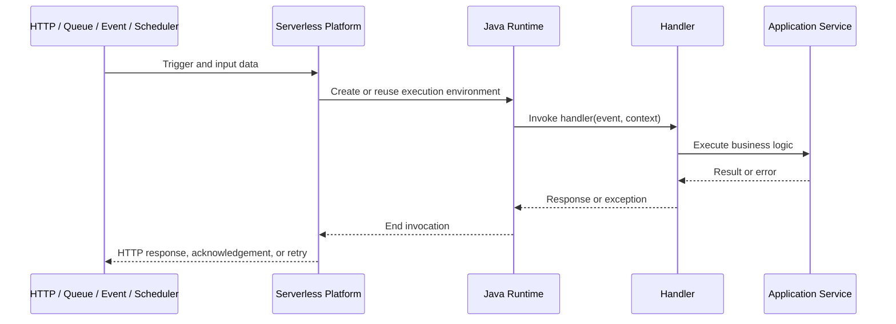

# Function Anatomy: Handler, Event, Context, and Response

A Java function in the FaaS model typically has an entry point invoked by the platform. When an HTTP request, message, or scheduled event arrives, the platform prepares the input data, creates metadata for the invocation, transfers control to the handler, and handles the result or error returned by the handler. The four core concepts to understand clearly are **handler**, **event**, **context**, and **response**.

They form the contract between Java code and the serverless execution environment. Understanding this contract accurately helps you write testable functions, avoid confusing business data with runtime metadata, and handle results properly for each trigger type.

## 1. How Does a Function Invocation Happen?

A function does not decide on its own when to run. An HTTP gateway, message broker, event source, or scheduler receives a trigger and requests the platform to execute the function. The runtime converts the trigger data into Java objects, invokes the handler, and then forwards the result or error back to the corresponding trigger mechanism.



This is the high-level flow. The details of event deserialization, message acknowledgement, response formatting, and retry depend on the platform and trigger type. For a synchronous HTTP request, the client typically receives a response. For an asynchronous event, the event publisher usually does not receive the handler's return value; the platform cares whether the invocation succeeded or failed in order to apply delivery policies.

A single call to a function is typically called an *invocation*. Each invocation has its own input and metadata. The platform may create a new execution environment or reuse an existing one. Therefore, initialization code at the class level may run only when the environment is created, while the handler is invoked again in subsequent invocations. You must never assume that a single instance processes only one request.

## 2. Handler: The Function Entry Point

A **handler** is the method or class that the runtime invokes when the function is triggered. The handler receives the event, may also receive the context, and then executes or orchestrates the business logic. The handler name and signature are configured according to the platform's conventions.

With the AWS Lambda Java runtime, a handler can implement `RequestHandler<I, O>`. The runtime invokes the `handleRequest` method, passing an input object of type `I` and a `Context` object; the return value has type `O`.

```java
import com.amazonaws.services.lambda.runtime.Context;
import com.amazonaws.services.lambda.runtime.RequestHandler;

public final class OrderCreatedHandler
        implements RequestHandler<OrderCreatedEvent, ProcessingResult> {

    @Override
    public ProcessingResult handleRequest(
            OrderCreatedEvent event,
            Context context) {

        if (event == null || event.getOrderId() == null) {
            throw new IllegalArgumentException("Missing orderId");
        }

        context.getLogger().log(
                "Processing order event: " + event.getEventId());

        processOrder(event.getEventId(), event.getOrderId());
        return new ProcessingResult("COMPLETED");
    }

    private void processOrder(String eventId, String orderId) {
        // Call the application service for idempotent business processing.
    }
}
```

`OrderCreatedEvent` is a DTO deserialized by the runtime from the payload; `ProcessingResult` is an application-defined result type. Both types must have structures compatible with the configured serializer/deserializer. The example assumes the trigger passes a single event to the handler; with an SQS event source mapping, the input type is typically a wrapper containing a list of records. A simple result type can be defined as follows:

```java
public final class ProcessingResult {
    private String status;

    public ProcessingResult() {}

    public ProcessingResult(String status) {
        this.status = status;
    }

    public String getStatus() {
        return status;
    }

    public void setStatus(String status) {
        this.status = status;
    }
}
```

The example illustrates the handler signature and how to use the context; actual business logic should live in a separate service so it can be tested without starting the FaaS runtime.

A handler should perform tasks at the invocation boundary:

- Validate input at the structural level and check required fields.
- Convert the event into a command or an application service call.
- Pass the correlation ID and necessary metadata down to the business layer.
- Convert the business result into a response according to the trigger's contract.
- Let errors be handled according to the designed policy; do not swallow exceptions and cause the runtime to mistake a failed invocation for a successful one.

Do not place all business logic, complex data queries, and retry rules into a single long handler. Separating the handler from the service allows the same business logic to be called from HTTP, a queue, or unit tests. If you use dependency injection, configure how the handler is instantiated and how dependency lifecycles are managed so they are compatible with the platform runtime.

## 3. Event: Data That Triggers the Function

An **event** is the input data describing what happened or the request that needs to be processed. An event can be an HTTP request, a message in a queue, a business event, or a payload sent by a scheduler. The data type and structure of the event depend on the trigger.

Do not assume every trigger sends the same JSON structure. An HTTP gateway may send the method, path, headers, query parameters, and body. A queue may send a batch of multiple records, each containing a message body, message ID, and delivery metadata. An event bus may send an envelope containing the source, event type, timestamp, and business data payload.

### 3.1. Distinguishing Between the Envelope and Business Data

Many systems wrap business data inside an **event envelope**. The envelope describes the event at the system level; the `data` section holds the business content.

```json
{
  "specversion": "1.0",
  "id": "evt-7f31",
  "source": "order-service",
  "type": "com.example.order.created",
  "subject": "orders/ord-1042",
  "time": "2026-11-17T10:15:30Z",
  "datacontenttype": "application/json",
  "data": {
    "orderId": "ord-1042",
    "customerId": "cus-81",
    "total": 1250000,
    "currency": "VND"
  }
}
```

The example above follows the CloudEvents format. Not every platform uses CloudEvents or these exact fields; this is a common way to standardize events. When integrating, rely on the actual schema of the trigger and adapter. Do not add an envelope to the payload yourself if the source service already provides its own envelope.

Fields commonly useful in an event contract include:

- `id`: unique identifier of the event, supporting deduplication and idempotency.
- `source`: the system or component that emitted the event.
- `type`: the event type, helping the consumer choose how to process it.
- `time`: the timestamp when the business event occurred; distinguish this from the time the function received the event.
- `data`: the business data to be processed.
- `version` or schema information: enables controlled payload evolution over time.

The event identifier is not the same as the invocation request ID. An event may be redelivered multiple times, each creating an invocation with a different request ID. If you use the request ID as a deduplication key, the consumer can still process the same event repeatedly. Use the event ID or a stable business key for idempotency.

### 3.2. Events by Trigger Type

| Trigger | Common Input Data | What the Handler Needs to Care About |
|---|---|---|
| HTTP | Method, path, headers, query, body, authentication info forwarded by the gateway | Request validation, authentication/authorization, status codes, and response body |
| Queue | A single message or batch of records, message ID, body, delivery attributes | Per-record processing, success acknowledgement, retry, and failed messages |
| Pub/sub or event bus | Event envelope, event type, source, business payload | Routing by event type, schema validation, deduplication |
| Scheduler | Schedule info, scheduled timestamp, service-specific configured payload | Time zones, delayed runs, duplicate runs, and business-period keys |

For HTTP, `body` is typically a string that must be parsed into a DTO. Never trust that every header or piece of data sent by the client is valid. The gateway may normalize or strip certain headers, and how identity is propagated depends on the authentication configuration.

For a queue, an event may contain multiple records. The handler must understand whether the runtime requires processing the entire batch or supports per-record failure reporting. If processing one record fails but the handler still returns an overall success, the platform may acknowledge the entire batch and the failed message will not be redelivered.

For an event bus, the consumer should rely on `type` and the schema version to choose how to process it. When adding new fields, consider backward compatibility; when changing semantics or data types, publish a new schema version or provide an explicit migration step.

### 3.3. Designing DTOs and Validating Events

DTOs help limit the data exposed to the business layer. Do not pass the entire cloud-provider object deep into the domain if only a few fields are needed. An adapter can translate the platform event into an internal command.

```java
public final class OrderCreatedEvent {
    private String eventId;
    private String orderId;
    private String customerId;

    public OrderCreatedEvent() {}

    public String getEventId() {
        return eventId;
    }

    public void setEventId(String eventId) {
        this.eventId = eventId;
    }

    public String getOrderId() {
        return orderId;
    }

    public void setOrderId(String orderId) {
        this.orderId = orderId;
    }

    public String getCustomerId() {
        return customerId;
    }

    public void setCustomerId(String customerId) {
        this.customerId = customerId;
    }
}
```

This is a simple JavaBean to illustrate JSON mapping. If you use a Java record, builder, or another serialization library, verify that the runtime's serializer supports that structure. Validate required fields, length, format, value ranges, and schema version before invoking business logic. An invalid payload is typically an error that cannot be fixed by automatic retries.

## 4. Context: Metadata of the Invocation

**Context** contains information about the current invocation and certain utilities provided by the runtime. It differs from the event: the event describes the input data or what happened; the context describes the environment executing that invocation.

In AWS Lambda Java, `Context` can provide information such as:

- Request ID of the current invocation.
- Function name, version, and execution environment information.
- Remaining execution time before the deadline.
- Allocated memory and the runtime logger.

Example:

```java
public ProcessingResult handleRequest(
        OrderCreatedEvent event,
        Context context) {

    String invocationId = context.getAwsRequestId();
    int remainingMs = context.getRemainingTimeInMillis();

    context.getLogger().log(
            "Invocation " + invocationId
            + " has " + remainingMs + " ms remaining");

    if (remainingMs < 2_000) {
        throw new IllegalStateException(
                "Insufficient time to safely process event");
    }

    processOrder(event.getEventId(), event.getOrderId());
    return new ProcessingResult("COMPLETED");
}
```

Specific method names and capabilities depend on the SDK/runtime. The example uses AWS Lambda `Context`; other platforms may call the equivalent object an execution context, invocation context, or provide metadata via different parameters.

### 4.1. Request ID and Correlation ID

`requestId` helps locate logs for a specific invocation. It is typically generated by the platform and changes across redeliveries. `correlationId` is an application-supplied identifier propagated across multiple components to link the steps of a single business workflow.

For example, a client sends an order creation request with a correlation ID; the order creation function logs that ID and writes it to the outbox event; the consumer reads the event and continues logging the same correlation ID. When investigating an order, the operations team can trace logs from the API to the consumer even though each function has its own request ID.

Never treat a request ID or correlation ID as proof of authentication or access permission. If the correlation ID comes from the client, bound its length and sanitize the value before logging. Do not put tokens, secrets, or personal data into IDs.

### 4.2. Context Is Not for Storing Business State

Context is meaningful only within the scope of the current invocation. Do not store the context object in a static variable, do not pass it to a later invocation, and do not use the context as a database. Once the invocation ends, this object is no longer a valid data source for other work.

Some runtimes reuse the execution environment. This allows reusing database connections or initialized immutable objects, but it does not guarantee that in-memory variables will persist forever. Business data that must survive across invocations must be stored in durable storage. Avoid using mutable static variables to hold user or request data because invocations may share the environment and cause data leakage between requests.

The remaining time in the context is useful to avoid starting work that cannot finish before the deadline. Set timeouts for database and HTTP calls lower than the remaining time, leaving time to write logs or complete necessary operations. Do not start a critical dependent task when the invocation is nearly out of time without a safe continuation mechanism.

## 5. Response: Return Result Depends on the Trigger

**Response** is the result the handler provides to the runtime. The meaning of the response varies by trigger type. A returned Java value does not necessarily become an HTTP response, and a successful invocation does not mean the message producer receives the returned data.

### 5.1. Synchronous HTTP

For synchronous HTTP, the gateway typically converts the handler result into an HTTP response. The response contract must define the status code, headers, and body. Some integrations require the body to be a serialized JSON string; some frameworks or adapters perform this automatically.

Example of a response after an adapter maps the business result:

```json
{
  "statusCode": 201,
  "headers": {
    "content-type": "application/json"
  },
  "body": "{\"orderId\":\"ord-1042\",\"status\":\"PENDING\"}"
}
```

The `201 Created` status code is appropriate when a new resource has been created. If the request only accepts background work that has not yet completed, you can return `202 Accepted` along with a job ID so the client can query the status later. Use 4xx codes for request or authorization errors; use 5xx codes for server-side errors that the client may need to retry depending on the contract. Do not return stack traces, table names, or internal details in the body.

Errors occurring in the handler can be mapped by the gateway into error responses. Configure consistent mappings and test both success and error paths; do not assume every Java exception automatically becomes the desired status code.

### 5.2. Asynchronous Invocation

With asynchronous triggers, the producer typically only sends the event and receives an acknowledgement that the platform accepted the request (if the service returns an acknowledgement). The producer does not wait for the handler's return value. When the handler finishes normally, the runtime typically considers the invocation successful. When the handler throws an exception or times out, the platform may retry or route the error according to configuration.

Therefore, `return new ProcessingResult(...)` in an asynchronous handler does not mean the producer receives that object. If the business workflow needs to publish a result, the function must explicitly persist the state to a database, emit a result event, or invoke a designed callback/API.

### 5.3. Queue and Batch Response

When a queue triggers a function in batches, message acknowledgement depends on the integration rules. Some configurations acknowledge the entire batch only if the handler succeeds; if an error occurs, the entire batch may be redelivered. This approach can cause records that were already processed successfully to run again.

Some platforms support *partial batch response*: the handler returns a list of failed record identifiers so the runtime redelivers only those records. With AWS Lambda and SQS, this mechanism must be enabled in the event source mapping configuration, and the handler must return the supported batch response format. Enabling the feature only in code while forgetting to configure the mapping will not produce the desired behavior.

Whether using batch responses or not, each record still needs idempotent processing. A situation can occur where business logic has committed, but the acknowledgement is lost; the broker redelivers the message and the consumer must recognize that the record has already been processed.

### 5.4. Scheduler and Scheduled Events

With a scheduler, there is typically no client waiting for an HTTP response. The runtime relies on whether the invocation ends in success or failure to apply the retry or error policy of the scheduling service. If you need to track how far a run has progressed, record the job state keyed by `scheduleId`, business period, or execution ID in durable storage.

Do not use a "function started" log as proof that the task completed. Record the final state after the business transaction commits, and set up metrics and alerts for failed or delayed runs.

## 6. Distinguishing Handler Errors from Business Errors

The runtime needs to know whether an invocation succeeded or failed to decide on acknowledgement and retries. Therefore, how the handler represents errors directly affects reliability.

- **Invalid input errors:** typically cannot be fixed by retrying. Record the reason in a controlled manner and move the message to a DLQ or error-handling flow according to policy.
- **Transient errors:** for example, network timeouts or overloaded downstream services. You can throw an exception so the runtime applies retries with a finite attempt count and backoff.
- **Expected business errors:** for example, an order was already canceled or its state does not allow transitioning. You can return a clear business result or emit a rejection event; avoid turning every such case into an exception that causes continuous retries.
- **Unknown errors:** log sufficient correlation ID and invocation ID details, keep error messages safe, and let the retry/DLQ policy handle them as designed.

Do not catch every exception and return a success response. If the handler swallows an error before the runtime notices, the message may be acknowledged even though the business work is incomplete. Conversely, throwing an exception for every business rejection outcome can cause pointless retries and increase cost.

## 7. Principles for Designing a Function Contract

A good function contract helps producers and consumers understand the exact data, behavior, and recovery semantics. Before implementing, define:

1. **Handler:** which class/method is the entry point, what are the input/output signatures, and how are dependencies initialized?
2. **Event:** which schema is accepted, which fields are required, what is the event identifier, and how are schema versions managed?
3. **Context:** which metadata comes from the runtime, what is the deadline, and how are request ID/correlation ID propagated across steps?
4. **Response:** who receives the result, what is the response format, and is success determined by return value, HTTP status, or acknowledgement?
5. **Error:** which errors are retried, which are not, how are batches acknowledged, and where is the DLQ?
6. **Idempotency:** if the same event is delivered twice, which key prevents duplicate business side effects?
7. **Observability:** are logs, metrics, and traces sufficient to correlate one request with downstream invocations?
8. **Security:** how is input data authenticated and authorized; could logs accidentally contain secrets or sensitive data?

When changing an event schema or response type, treat it as a contract change. Old producers and new consumers may be deployed at different times; therefore, prefer backward-compatible changes, support multiple versions during the transition period, and deprecate old versions according to plan.

## 8. Conclusion

The handler is the entry point invoked by the runtime; the event is the triggering data; the context describes the current invocation; and the response is the result interpreted according to the trigger type. With Java FaaS, separate adapters and handlers from business logic, manage event schemas explicitly, use context for metadata and deadlines, and understand precisely how HTTP responses, acknowledgements, retries, and batch responses work. This is the foundation for functions to handle requests accurately when running synchronously, asynchronously, or on a schedule.
