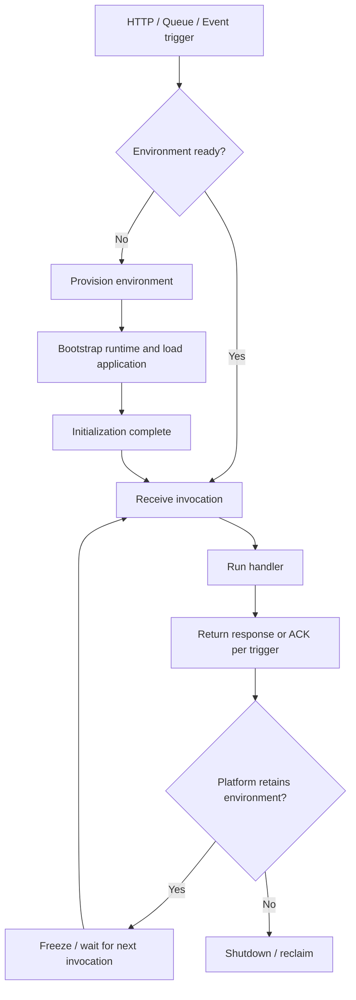
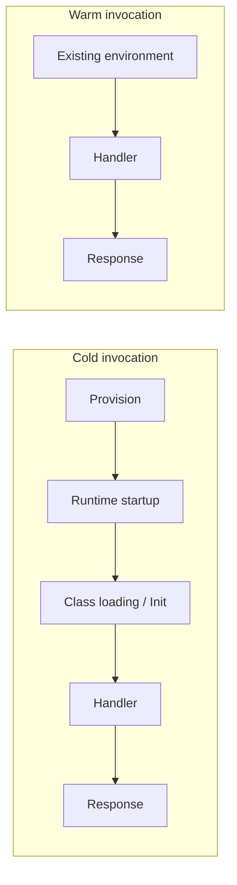

# Initialization, Execution, and Termination Steps of the Runtime Environment

A serverless invocation is not just the moment the function executes the first statement in the handler. Before that, the platform must provision an execution environment, start the runtime, and load the application code. After the handler returns a result, the environment may be retained to serve the next invocation or reclaimed when the platform scales down resources. This sequence of activities forms the function execution lifecycle.

Understanding this lifecycle helps Java developers decide where to place configuration, when to create connections, how to manage state, how to handle errors, and how to measure cold starts. It is important to distinguish the **lifecycle of an invocation** from the **lifecycle of an execution environment**. An invocation may finish in a few milliseconds, while the environment that ran that invocation may continue to exist longer; however, the application must never assume the environment will always be reused.

## 1. Two Lifecycles to Distinguish

In FaaS, the platform typically manages an execution environment consisting of the runtime, application code, memory, and some temporary resources. When a trigger arrives, the platform routes an invocation to an appropriate environment. If no environment is ready, the platform may have to create a new one.



The diagram illustrates a general flow. Phase names, resource allocation mechanisms, reuse policies, and shutdown timing vary across platforms. Some platforms allow multiple concurrent invocations in a single process; some platforms typically assign one invocation at a time per environment. Read the provider's runtime contract before relying on any specific assumption.

| Scope | When Does It Start? | When Does It End? | Examples of Data or Resources |
|---|---|---|---|
| One invocation | Runtime receives a request, message, or event | Handler completes, times out, or errors | Request, event, context, local variables |
| One execution environment | Platform creates sandbox/process and starts runtime | Platform reclaims or terminates environment | Loaded classes, shared objects, HTTP client, in-memory cache |
| Durable data | Written to a storage service | According to business or retention policy | Orders, workflow state, idempotency records, outbox |

These three scopes have different lifetimes. Local variables inside the handler belong to the invocation. A `static final HttpClient` can exist for as long as the process remains alive. An order record in a database exists independently of whether the runtime is still running.

## 2. Environment Initialization Phase

When no environment is ready, the platform prepares a new one. The general process typically includes the following steps:

1. **Provision the environment:** select a region, allocate CPU/memory resources, and create a sandbox or container matching the function configuration.
2. **Prepare the artifact:** fetch the deployment code and required dependencies, attach configuration, environment variables, and granted permissions.
3. **Start the runtime:** launch the JVM or corresponding runtime, initialize communication between the platform and the runtime, and load extensions if any.
4. **Load the application:** load classes, execute static initializers, and create configuration objects or the dependency injection container depending on how the application is written.
5. **Ready for invocations:** the runtime signals readiness or completes initialization according to the platform's protocol.

Not every platform executes these exact steps in this order or exposes every step. Some runtimes keep the bootstrap phase inside managed infrastructure; some allow initialization extensions or hooks. Nevertheless, for Java applications, starting the JVM, loading classes, and instantiating dependencies typically account for a significant portion of pre-handler time.

### Initialization in Java

Java can execute work before the handler via static initializers, static field initializers, the handler class constructor, or a dependency injection framework. Example:

```java
import java.net.http.HttpClient;
import java.time.Duration;

public final class CatalogFunction {
    // Created when the class is initialized in the execution environment.
    private static final HttpClient HTTP = HttpClient.newBuilder()
            .connectTimeout(Duration.ofSeconds(2))
            .build();

    private static final CatalogConfig CONFIG = CatalogConfig.fromEnvironment();

    public ApiResponse handle(ApiRequest request, InvocationContext context) {
        // Request-specific data must stay within the invocation scope.
        String requestId = context.requestId();
        return loadCatalog(request, requestId);
    }

    private ApiResponse loadCatalog(ApiRequest request, String requestId) {
        // Call the catalog service via HTTP and process the result.
        return CatalogClient.fetch(HTTP, CONFIG, request, requestId);
    }
}
```

`HttpClient` and `CatalogConfig` are created at the class scope, so they can be reused when the same process continues receiving invocations. This avoids recreating the client on every call. The types `ApiRequest`, `ApiResponse`, `InvocationContext`, `CatalogConfig`, and `CatalogClient` are illustrative application types; actual adapters depend on the chosen runtime or framework.

Early initialization is suitable for shared, safe, and rarely changing objects. Do not perform business side effects in static initializers, such as creating orders, sending emails, or writing a record marking that the function started. An environment may be created and receive no invocations, or be re-initialized after an error. Side effects in initialization can therefore run multiple times and are not tied to a specific business request.

### Common Initialization Mistakes

- **Missing or invalid configuration:** invalid environment variables, secrets, or endpoints cause class initialization to fail. Validate required configuration early and emit clear errors in initialization logs.
- **Overly heavy dependencies:** classpath scanning, building a large framework container, or loading many libraries prolongs cold start duration. Initialize only the components the function actually needs.
- **Network calls in static initializers:** temporarily unavailable DNS, secret managers, or databases can prevent the entire environment from starting. Consider creating lightweight clients during init, while performing actual connections on demand with timeouts and bounded retries.
- **Indefinitely cached secrets:** fetching secrets during init reduces calls to the secret manager, but secrets may be rotated while the environment is still alive. Use a TTL, refresh mechanism, or secret versioning aligned with security policies.
- **Sharing mutable objects:** mutable static state easily causes data leakage between invocations or race conditions if the runtime supports in-process concurrency.

## 3. Invocation Execution Phase

Once the environment is ready, the runtime receives an invocation. The invocation may come from an HTTP request, a queue message, a schedule, or an event from another service. The platform adapter converts the payload and metadata into parameters used by the handler.

A typical invocation has the following steps:

1. **Receive input:** the runtime deserializes the request or event and prepares context such as the request ID, deadline, function info, and trigger metadata.
2. **Create processing scope:** the handler reads input data, validates structure, creates objects scoped solely to the invocation, and determines the correlation ID.
3. **Execute business logic:** check permissions, read/write data stores, call external APIs, or publish commands to a queue/event bus.
4. **Complete:** return the HTTP response, acknowledge the message, or report the result to the adapter according to the trigger contract.
5. **Per-invocation cleanup:** close invocation-scoped resources, finalize transactions, and emit necessary logs/metrics.

For HTTP, the handler's response is typically returned to the gateway or caller. If the function only accepts a long-running workflow, return an accepted status with a tracking ID and continue processing via a queue or workflow. Keeping an HTTP invocation open throughout a long process increases timeout risk and holds resources unnecessarily.

For a queue, an invocation may receive a single message or an entire batch. Returning success from the handler may acknowledge the whole batch; if one item fails, the retry policy may redeliver the entire batch. Some platforms support partial batch responses to request redelivery only for failed items. Understand the event source's ACK contract, visibility timeout, batch size, and retry semantics.

For event triggers, the platform may invoke the function directly or use an event source mapping to poll events from the source and invoke the function. Retry mechanisms, retention periods, ordering, and error handling depend on the source type. Never assume all events are delivered exactly once or globally ordered.

## 4. Partitioning Resources by Lifetime

Good design starts with the question: does this resource belong to an invocation, an environment, or must it persist durably?

| Resource Type | Recommended Scope | Notes |
|---|---|---|
| Request, event, user identity, business transaction | Invocation | Do not retain across subsequent calls |
| Local variables, DTOs, validation results | Invocation | Create fresh from current input |
| HTTP client, serializer, immutable config | Environment | Reusable if thread-safe and configured with proper timeouts |
| Connection pool | Environment or managed proxy | Monitor total connections during scale-out; handle stale connections after idle periods |
| Reference data cache | Environment with explicit TTL | Tolerate cache misses, stale data, and environment reclamation |
| `/tmp` or ephemeral disk | Environment | Data may persist across invocations but is not durable; control disk usage and clear sensitive data |
| Order status, workflow progress, idempotency key | Durable data store | Independent of environment lifetime |

An environment can be reused, but that is strictly a performance optimization opportunity. The platform may reclaim an environment after one call, after an idle period, during scale-in, upon deploying a new version, or after an error. Therefore, in-memory caches and temporary files must never be the sole source of truth for a business workflow.

### Avoiding Data Leakage Between Invocations

Suppose a function handles product lookup requests for multiple customers. If `currentCustomerId` is stored in a static variable and you forget to reset it, a subsequent invocation might accidentally use the previous customer's data. Similarly, a shared result list can accumulate entries across multiple calls.

The safe rule is to keep per-request data in local variables or objects created fresh for the invocation. Shared objects should be immutable or designed to be thread-safe; caches must be keyed properly, have a TTL, and avoid storing sensitive data without proper isolation. Always check authorization against the current identity, never relying on information cached from a previous invocation.

## 5. After the Handler Finishes: Reuse, Freeze, and Shutdown

After an invocation completes, the environment may follow one of these paths:

- **Reuse:** the runtime keeps the process or container ready for subsequent invocations to reuse. Static objects, loaded classes, and some in-memory data may remain intact.
- **Pause or freeze:** the platform may freeze the environment's CPU when idle. When reused, the process can resume with its heap and temporary files still present. Specific details depend on the platform.
- **Reclaim:** the platform terminates the environment to free resources. Memory and temporary files are lost; network connections may also be closed.

The application does not necessarily receive notification before the environment is reclaimed. Some platforms provide a shutdown hook or termination signal with a limited cleanup window; scenarios such as hard timeouts, host failures, or forced kills give the application no opportunity to run cleanup.

Therefore:

- Complete required transactions and side effects before the handler returns a result.
- Use `try/finally` or try-with-resources for invocation-scoped resources, such as streams, file handles, or transactions.
- Do not wait for a shutdown hook to save business state, emit critical events, or finalize payments.
- If post-response processing is needed, enqueue the work to a durable queue or workflow before returning the response.
- Treat shutdown hooks as best-effort cleanup opportunities, not mandatory steps for correctness.

Example of closing invocation-scoped resources:

```java
public ApiResponse handle(ApiRequest request, InvocationContext context) {
    try (var session = database.openSession()) {
        session.begin();
        var result = orderService.process(session, request, context.requestId());
        session.commit();
        return ApiResponse.ok(result);
    } catch (TemporaryDependencyException ex) {
        // The adapter can map this error to an appropriate trigger response/retry.
        throw ex;
    }
}
```

The example assumes `Session` implements `AutoCloseable`; transaction details depend on the database library. `close()` is called when the block exits normally or via an exception. If the process is forcibly killed, there is no guarantee `finally` or `close()` will run. Thus, the database still needs timeouts, transaction timeouts, and server-side rollback mechanisms.

## 6. Cold Start and Warm Invocation

**Cold start** is the latency incurred when the platform must prepare a new environment before running the handler. Depending on the platform, this may include provisioning a sandbox, downloading the artifact, starting the runtime, loading classes, running static initializers, and creating dependencies.

**Warm invocation** uses an environment that is already initialized and ready. It typically skips most bootstrap overhead, but still must deserialize input, run the handler, call dependent services, and return the result. Warm does not mean the handler is guaranteed to be fast: slow database queries or partner API timeouts can still dominate latency.



Ways to reduce cold starts for Java:

1. Reduce artifact size, remove unnecessary dependencies, and avoid broad classpath scanning.
2. Keep static initialization lightweight; defer heavy work until truly needed, without pushing missing required-config errors to hard-to-diagnose times.
3. Initialize shared clients once per environment when the client is safe to reuse.
4. Measure framework initialization, class loading, and handler duration separately to locate the actual bottleneck.
5. Choose appropriate memory/CPU; some platforms allocate CPU proportional to configured memory, so increasing memory can shorten execution time while also changing cost.
6. For latency-sensitive workloads, consider pre-provisioned concurrency, runtime snapshots, or equivalent features if supported by the provider; account for maintenance costs and associated limits.

Some platforms offer Java-specific optimizations such as post-initialization snapshots or native runtimes. Snapshots can shorten startup by restoring captured state, but you must verify how sockets, threads, random seeds, timestamps, and external resources behave upon restore. Native images can reduce startup time and footprint, but change build times, reflection/dynamic class loading compatibility, and performance characteristics. These are choices based on platform and workload, not mandatory requirements for every Java function.

## 7. Concurrency and Process Reuse

When load increases, the platform typically creates additional environments to handle multiple concurrent invocations. The number of environments can grow faster than the number of connections a database or external service can sustain. Each environment may create its own client or connection pool; total connections therefore scale out with instance count.

Moreover, not every runtime has the same concurrency model. Some platforms run at most one invocation per environment at a time; others allow multiple requests to share a single process. Check the specific model and write concurrency-safe code if objects can be shared across threads.

Practical rules:

- Reuse thread-safe clients such as HTTP clients, serializers, or SDK clients.
- Do not use mutable static variables to hold request, current user, or transaction state.
- Bound thread pools and connection pools; do not create a large pool in every environment.
- Set timeouts for DNS, connect, read, and total request duration; close or replace stale connections when needed.
- Use reserved concurrency, max instances, or equivalent consumer limits to protect databases and partner APIs.
- For queues, use queue depth and message age to throttle worker count rather than letting consumers scale unboundedly.

A subtle bug is spawning a background thread to continue work after the handler returns. When the environment is frozen, the thread may stop making progress; when the environment is reclaimed, the work may be lost. If a task must complete, model it as a message or durable stateful workflow. Background threads should only be used for optional secondary work whose lifecycle is explicitly supported by the runtime.

## 8. Timeouts, Exceptions, and Retries in the Lifecycle

An invocation can end in several ways:

| Outcome | What Happens in the Runtime | What to Watch Out For |
|---|---|---|
| Handler returns success | Runtime sends response or ACK per trigger | Confirm transactions and side effects completed before reporting success |
| Handler throws exception | Runtime reports failed invocation to adapter/platform | Trigger decides whether to retry, drop message, or route to DLQ |
| Invocation times out | Platform may terminate execution or the runtime | Do not assume `finally` always runs; side effects may already have occurred before timeout |
| Environment crashes | Invocation may fail mid-execution | Caller or event source may redeliver; idempotency is required |
| Initialization error | Environment is not ready to receive invocations | Platform may try another environment or report errors per its policy |

A timeout does not prove that an operation did not occur. For example, a function writes an order to the database but times out before returning the HTTP response. The client sees an error and retries the request; without an idempotency key, the system may create a second order.

With messages, a consumer may execute a side effect but fail to ACK the message. The message is redelivered and the handler runs again. Therefore, the consumer should persist the processed `eventId` or message ID in the same transaction as the business change whenever possible. When calling external systems, use that system's idempotency key or design compensating operations.

Retries should be bounded, using exponential backoff and jitter. Data errors that cannot self-heal should not be retried continuously. Configure delivery attempts, visibility timeout, retention period, and DLQ according to the trigger source's characteristics. Retry semantics differ across HTTP gateways, queues, streams, and event buses; check the event source contract instead of applying one uniform policy to all.

## 9. Java Example: Separating Initialization from Invocation

The code below illustrates how to structure a function handling HTTP requests. Shared configuration and clients are created at the environment level; request data and results are created per invocation.

```java
import java.net.http.HttpClient;
import java.time.Duration;

public final class ProductFunction {
    private static final FunctionConfig CONFIG = FunctionConfig.load();
    private static final HttpClient HTTP = HttpClient.newBuilder()
            .connectTimeout(Duration.ofSeconds(2))
            .build();

    private final ProductService products = new ProductService(HTTP, CONFIG);

    public HttpResponse handle(HttpRequest request, FunctionContext context) {
        String requestId = context.requestId();

        // These variables belong exclusively to the current invocation.
        String productId = request.pathParameter("productId");
        String principal = context.authenticatedPrincipal();

        if (productId == null || productId.isBlank()) {
            return HttpResponse.badRequest("productId is required");
        }

        if (!products.canRead(principal, productId)) {
            return HttpResponse.forbidden();
        }

        ProductView result = products.find(productId, requestId);
        return result == null
                ? HttpResponse.notFound()
                : HttpResponse.ok(result);
    }
}
```

In the example, `CONFIG`, `HTTP`, and `ProductService` belong to the process scope. `productId`, `principal`, and `result` belong to the invocation. `ProductService` must be safe for concurrent invocation if the runtime supports concurrency within the same environment; it must not store `principal` or `productId` in shared mutable fields. Request/response/context classes are provided or adapted by the platform adapter.

A function consuming messages can also use the same shared service, but each message must have its own context and idempotency handling. If the runtime delivers a batch, the handler must explicitly identify which items succeeded and which need retry according to the event source protocol.

## 10. Observing the Lifecycle and Diagnosing Cold Starts

If you only measure total invocation duration, it is hard to tell whether latency comes from bootstrap or business logic. Record platform-provided durations separately from application-measured milestones.

| Metric | Meaning | Used to Diagnose |
|---|---|---|
| Initialization duration | Time spent preparing runtime and application per platform definition | Cold starts, slow static init, or dependency injection |
| Handler duration | Time spent executing handler code | Slow business logic, queries, and API calls |
| Invocation count | Number of times the handler is called | Traffic volume and load shifts |
| Concurrent executions | Number of concurrently running invocations | Pressure on databases, pools, and external services |
| Error / timeout / throttle | Rate of errors, timeouts, or throttling | Unstable dependencies, timeout settings, or concurrency limits |
| Queue age / retry / DLQ | Delay and redelivery status of messages | Slow consumers, poison messages, or prolonged outages |

Every log should include the platform request ID if available, the workflow correlation ID, and the event ID when processing messages. Do not log tokens, secrets, or full sensitive payloads. For reused environments, logs should identify which invocation is currently running to avoid confusing initialization logs with business logs.

Questions that help isolate issues:

- If only the first invocation after an idle period is slow, inspect cold starts and initialization.
- If both cold and warm invocations are slow, measure the handler, database, DNS, and external services.
- If latency rises as concurrency rises, inspect connection pools, downstream limits, and throttling.
- If queue age rises without function errors, inspect concurrency, batch size, and processing throughput.
- If error rates jump after deployment, inspect static initialization, configuration, dependencies, and runtime compatibility.

## 11. Testing the Lifecycle Before Deployment

Testing a handler once in a unit test is not enough to verify serverless function behavior. You must also test what happens across multiple invocations and when the environment changes:

1. **Initialization:** missing configuration, inaccessible secrets, failing dependencies, and class initialization failures must produce clear diagnostic messages.
2. **Warm reuse:** invoke the handler multiple times in the same process and verify data from a prior request does not leak into the next request.
3. **Concurrency:** execute multiple concurrent invocations if the runtime supports it; verify thread safety, pools, and caches.
4. **Timeout and retry:** simulate slow dependencies, the function stopping after writing data but before returning a response, and message redelivery.
5. **Scale-out:** increase load to observe environment count, connections, concurrency, and throttling.
6. **Environment replacement:** start a new process and verify the function works without needing data from the old process's memory or temporary files.
7. **Shutdown:** verify cleanup under normal termination conditions; also ensure business logic remains correct when shutdown hooks do not run.
8. **New version deployment:** verify configuration and schema compatibility during the window when old and new environments may coexist under platform mechanics.

You cannot force every platform's exact freeze, restore, or hard termination behavior in unit tests. Use integration tests in the target cloud environment and monitor telemetry post-deployment to verify actual behavior.

## 12. Deciding Which Phase to Place Work In

| Task | Appropriate Phase | Reason |
|---|---|---|
| Read static config, create shared serializers or HTTP clients | Initialization | Cost is paid once per environment and can be reused |
| Check user permissions, validate requests, start transactions | Invocation | Depends on the identity and data of the current invocation |
| Write order and outbox | Invocation, inside transaction | Must be tied to a specific business operation |
| Send notification after order commits | Consumer invocation via queue/event | Decouples async work from the API response |
| Delete temporary files after processing | End of invocation or best-effort lifecycle hook | Prevents temp data accumulation; do not use cleanup to store state |
| Persist multi-hour workflow progress | Database or durable workflow | Environment may be reclaimed at any time |
| Close clients or flush telemetry on shutdown | Shutdown hook if available | Only a cleanup optimization; must not determine business correctness |

No single phase fits all tasks. Initialization should focus on safe, shared resources; invocations process specific data; long-lived state belongs in durable services; shutdown handles only cleanup that can be safely skipped.

## 13. Design Checklist

- [ ] Distinguish invocations from execution environments in design and logs.
- [ ] Know clearly whether the platform reuses environments and which concurrency model it supports.
- [ ] Keep initialization lightweight, validate configuration, and avoid business side effects.
- [ ] Reuse thread-safe clients at the environment scope when appropriate.
- [ ] Keep request data, principal, and transactions within the invocation scope.
- [ ] Do not use static fields or temporary files as sources of durable business state.
- [ ] Configure timeouts for dependencies, bound pools, and control concurrency during scale-out.
- [ ] Complete side effects before returning success; use idempotency for retries and duplicate deliveries.
- [ ] Do not rely on shutdown hooks to commit data or emit critical events.
- [ ] Measure initialization, handler duration, concurrency, errors, timeouts, and queue age separately.
- [ ] Test cold starts, warm reuse, concurrency, retries, timeouts, and environment replacement.

The function lifecycle consists of provisioning the environment, initializing the runtime and application, executing each invocation, and then reusing or reclaiming the environment. By placing work in the proper lifetime scope, Java applications can leverage warm reuse to reduce initialization cost while keeping business state safe across retries, scale-out, and abrupt runtime termination.
