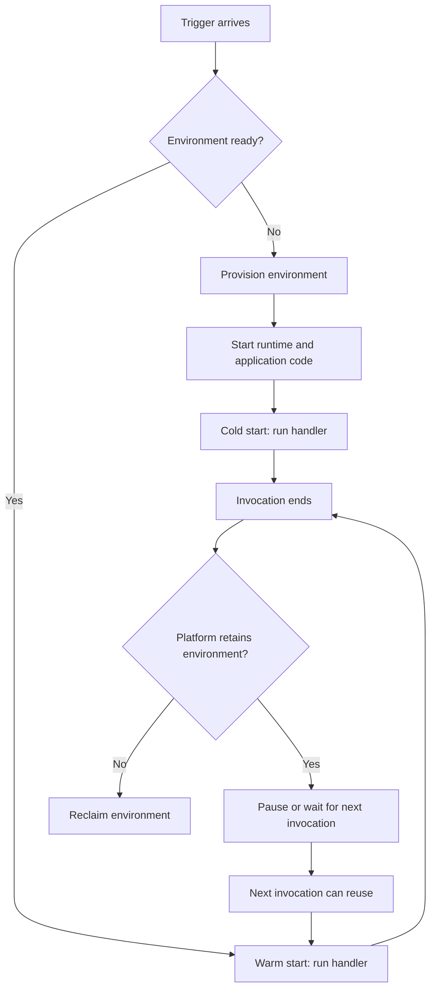

# Cold Start, Warm Start, and Execution Environment Reuse

A serverless function may be invoked thousands of times, but that does not mean the platform creates a new virtual machine or process for each request. To reduce latency and cost, the platform typically retains an execution environment after an invocation finishes and can reuse that environment for subsequent invocations. When a new environment must be provisioned, the first request incurs additional initialization time, commonly called a **cold start**. When an already-ready environment is reused, the invocation typically experiences a **warm start** and skips most of the initial startup cost.

With Java, this difference can be significant because the runtime needs to start the JVM, load classes, run static initializers, initialize the dependency injection container, prepare serializers, and create clients for external services. A small application can start up quickly, whereas an application using a heavy framework or extensive classpath scanning may take longer before handling the first request.

Understanding the execution environment lifecycle helps developers place initialization in the right place, reuse resources safely, avoid relying on in-memory state, and choose appropriate latency-reduction techniques. The goal is to ensure the function remains correct when the environment is replaced at any time, while taking advantage of reuse when the platform permits.

## 1. Distinguishing Invocation Lifecycle and Environment Lifecycle

There are two related but distinct lifecycles:

- **Invocation lifecycle** is the lifecycle of a single call to the function: receiving input, running logic, producing a result or error, and ending the call.
- **Execution environment lifecycle** is the lifecycle of the environment in which the function runs: being provisioned, initializing the runtime and application code, handling one or more invocations, and then potentially being frozen, reused, or discarded.

When an invocation finishes, it does not mean the execution environment is destroyed. Conversely, an active execution environment is not guaranteed to survive until the next invocation. The platform decides when to spin up additional environments, keep idle ones, pause them, or reclaim them.

You can visualize a simple cycle:



The diagram illustrates the concept only. Details of provisioning, freeze/thaw, environment retention duration, and the number of invocations handled per environment depend on the provider, runtime configuration, and trigger type.

### Cold Start

A cold start occurs when the platform must prepare a new execution environment before calling the handler. Some of the steps may include:

1. Provisioning or selecting compute resources and isolating the environment.
2. Preparing the runtime matching the configured Java version.
3. Downloading or mounting the function code and required dependencies.
4. Starting the JVM process or equivalent runtime.
5. Loading classes, running static initializers, and creating shared objects.
6. Initializing the framework, dependency injection, serializers, logging, and connection clients.
7. Invoking the handler to process the first trigger.

Not every platform performs these steps in the same order or exposes all of this duration as a single metric. Some parts may be cached or executed by the platform before a request arrives.

### Warm Start

A warm start occurs when an invocation runs on an already initialized environment. The JVM and loaded classes typically remain in memory; static fields, singletons, and shared clients can continue to exist. Therefore, the function can skip much of the startup work and go straight to processing the invocation.

A warm start is not a guarantee of fixed latency. An invocation can still be slow due to JIT compilation, garbage collection, cache misses, expired connections, DNS lookups, database load, or partner services. An existing environment may also need to lazily initialize a component that has never been used before.

## 2. What Causes the Platform to Create a New Environment?

Cold starts do not happen only on the first call to a function after deployment. A new environment may be created when:

- The function experiences increased load and needs additional capacity to handle concurrent invocations.
- An older environment has been idle long enough and was reclaimed by the platform.
- A new version, configuration, runtime, or dependency is deployed.
- The platform replaces an environment due to maintenance, errors, resource limits, or internal orchestration.
- Another trigger or traffic stream requires capacity that is not yet available.

This explains why a function may have warm starts most of the time yet still incur cold starts during traffic spikes. Horizontal scaling typically creates additional execution environments; these new environments must initialize before accepting work.

The number of environments created does not necessarily equal the number of requests. The platform may process multiple invocations in batches, limit concurrency, reuse environments, or apply its own concurrency model. Read the semantics of the platform you are using instead of inferring instance counts solely from request counts.

## 3. Components That Contribute to Startup Latency in Java

Java has multiple initialization layers between the moment the runtime is prepared and when the handler is ready. Factors that commonly affect startup include:

| Component | Work Performed | Cause of Slowdown |
|---|---|---|
| JVM startup | Starting the runtime, configuring heap and internal services | Runtime and memory setup take preparation time |
| Class loading | Finding, reading, verifying, and linking classes | Many classes, large dependencies, or complex classloaders |
| Static initialization | Running static blocks and creating static objects | Synchronous init, reading config, or network calls in initializers |
| Dependency injection | Building object graphs and resolving dependencies | Classpath scanning, reflection, proxies, runtime annotation processing |
| Framework bootstrap | Initializing routing, context, serializers, and extensions | Heavy frameworks, auto-configuration, or plugin discovery |
| JIT and runtime profiling | Compiling hot code paths into optimized machine code | Early invocations may not yet reach steady-state performance |
| External connections | DNS, TLS handshake, authentication, and opening connections | Network dependencies, remote services, and secret/config lookups |
| Logging and telemetry | Initializing appenders, exporters, tracers, and metrics | Synchronous exporters or configuring many components |

Not all of these tasks appear in the same cold start metric. For example, if an HTTP client is created on first use inside the handler, connection setup cost may show up in the first invocation of that feature rather than the platform-reported init phase.

A useful breakdown splits the total observed duration into parts:

\[
T_{response} =
T_{platform_init} +
T_{application_init} +
T_{handler} +
T_{dependency}
\]

This is a conceptual decomposition, not a standard measurement formula across all providers. Some parts may overlap or be folded into another metric. When optimizing, identify which part actually consumes the time instead of assuming JVM startup is always the sole cause.

## 4. Where to Place Shared Initialization?

A key decision is choosing which work runs during the initialization phase and which work runs per request.

### Eager Initialization

Eager initialization creates resources before the handler processes the first invocation. In Java, the common approach is using `static final` for shared, immutable, or thread-safe objects:

```java
public final class OrderHandler {
    private static final HttpClient HTTP_CLIENT =
            HttpClient.newBuilder()
                    .connectTimeout(Duration.ofSeconds(2))
                    .build();

    private static final ObjectMapper JSON =
            new ObjectMapper();

    private static final URI PAYMENT_API =
            URI.create(requiredEnv("PAYMENT_API_URL"));

    public Response handle(Request request, Context context) {
        // Use the already initialized dependencies.
        // Request-specific data is kept in local variables.
        return process(request, HTTP_CLIENT, JSON, PAYMENT_API);
    }

    private static String requiredEnv(String name) {
        String value = System.getenv(name);
        if (value == null || value.isBlank()) {
            throw new IllegalStateException(
                    "Missing environment variable: " + name);
        }
        return value;
    }
}
```

This is an illustrative example for a generic handler adapter; types such as `Request`, `Response`, and `Context` must be replaced by those of the actual runtime or framework.

Advantages of eager initialization:

- Detects missing configuration or dependency creation errors early.
- Reuses objects across multiple invocations on the same environment.
- Reduces repetitive work inside the handler.
- Makes handler execution time more predictable once initialization succeeds.

The drawback is that every first invocation must wait for that initialization, even when the request does not use some of the dependencies. If a static initializer calls an external service, a transient network error can prevent the entire environment from initializing. Avoid performing business side effects or unnecessary network calls in static initializers.

### Lazy Initialization

Lazy initialization defers creating a dependency until the first time that feature is used. This is useful when a function has multiple business branches and each invocation uses only a small subset of dependencies.

The advantage is that handlers for common paths avoid the cost of unrelated components. The drawback is that the first request entering that branch pays the initialization cost; if multiple concurrent invocations access it simultaneously, the initialization mechanism must be thread-safe.

You can use Java's holder idiom to initialize a shared object on first access:

```java
final class ReportClientHolder {
    private ReportClientHolder() {}

    private static final class Instance {
        static final ReportClient CLIENT = createClient();
    }

    static ReportClient get() {
        return Instance.CLIENT;
    }

    private static ReportClient createClient() {
        return new ReportClient(
                URI.create(System.getenv("REPORT_API_URL")));
    }
}
```

JVM class initialization guarantees that class initialization is synchronized according to Java rules. However, if creating a client requires retries, secret refreshing, or resource closing, a simple holder may not be sufficient. In that case, you need an abstraction with explicit state and synchronization.

### Choosing Eager or Lazy?

| Scenario | Appropriate Approach |
|---|---|
| Small object, used in most invocations, thread-safe | Eager initialization |
| Heavy dependency used only in a rare branch | Lazy initialization |
| Mandatory config that must be valid before accepting requests | Eager validation at init |
| Secrets or tokens with a lifecycle requiring refresh | Cache with TTL and refresh mechanism |
| Connection to external service that may fail transiently | Initialize with timeout and recovery strategy; avoid hanging static initializers |
| Resource specific to a single request | Create during invocation and release properly |

There is no rule that everything should be statically initialized. Choose based on usage frequency, creation cost, thread safety, credential lifecycle, and failure behavior.

## 5. Reusing Environments Without Creating State Bugs

Static fields, singletons, and shared objects can persist across multiple invocations on the same execution environment. This is an opportunity to reduce cost, but also a source of bugs if data from a previous request is accidentally retained.

Dangerous example:

```java
public final class UnsafeHandler {
    private static String currentUserId;
    private static Map<String, Object> currentRequestData;

    public Response handle(Request request) {
        currentUserId = request.userId();
        currentRequestData = request.attributes();

        return process(currentUserId, currentRequestData);
    }
}
```

If the environment is reused, old values can persist. If the runtime allows multiple concurrent invocations on the same instance, two requests can also overwrite each other's data. Even if the current platform serializes invocations on an environment, a design relying on that assumption can break when switching runtimes or changing concurrency settings.

Keep per-request data in local variables and pass it explicitly between methods:

```java
public final class SafeHandler {
    public Response handle(Request request) {
        String userId = request.userId();
        Map<String, Object> requestData = request.attributes();

        return process(userId, requestData);
    }
}
```

Practical rules:

- Use static fields for immutable dependencies or objects with a thread-safe contract.
- Do not store user IDs, tenant IDs, authorization contexts, or request payloads in shared variables.
- Do not use static variables like a database to hold business state across invocations.
- If caching data, define TTL, size limits, invalidation rules, and ways to prevent mixing tenant data.
- Do not keep expired secrets or tokens indefinitely; refresh and handle rotation.
- Verify the thread safety of shared SDKs, clients, serializers, and libraries.
- Do not rely on invocation ordering or assume a specific invocation will run on the same environment.

An environment being reused is an optimization you can leverage. It is not a place to store durable state. When you need to persist business progress, use an appropriate database, object storage, queue, or workflow state.

## 6. Connection Reuse and Resource Management

Creating network connections is typically expensive because it requires DNS lookup, TCP handshake, TLS handshake, and authentication. Reusing HTTP clients or connection pools can reduce this cost on warm invocations.

In Java, clients designed to be thread-safe such as `java.net.http.HttpClient` can be created once and reused. With JDBC, connection pools can help reduce connection establishment overhead, but pool configuration in serverless environments requires caution.

Suppose each execution environment creates a pool with up to 10 connections and the system scales out to 80 environments. In theory, those pools can open up to 800 connections to the database. If the database can sustain only 200 connections, increasing function concurrency can overload the database even though each individual pool looks small.

When reusing connections:

1. Set bounded connection timeouts, request timeouts, and read timeouts.
2. Define how to detect connections that have gone stale or been closed by the server.
3. Configure small pools sized to the connections actually needed per environment.
4. Calculate the total connection budget against the maximum number of environments, not just a single instance.
5. Use a proxy or managed connection pooling service when supported by the platform and architecture.
6. Handle connection errors and retries according to operation semantics; do not blindly retry a transaction with side effects.
7. Close response bodies, statements, and resources according to the library contract.

A warm environment may retain a client longer than the target service's connection lifetime. Therefore, reusing a client does not mean every internal connection remains valid. Clients and pools must self-recover or be configured to validate connections before use.

For files, streams, and temporary resources, release them within the invocation scope using try-with-resources. Never let an invocation finish while file descriptors or streams remain held in shared objects.

## 7. Freeze, Thaw, and Environment Termination

Some platforms can pause an environment when no invocation is active and resume it later. This implementation is commonly called freeze/thaw. When an environment is paused, background threads and timers may not run as they would in a traditional server application. When resumed, wall-clock time has elapsed; tokens, leases, sockets, or cached data may have expired.

Therefore:

- Do not use background threads to finish business work after the handler has returned a result.
- Do not assume timers will fire on schedule while the environment is idle.
- Do not use monotonic clocks or in-memory timestamps as the source of truth for deadlines spanning across freezes.
- Check leases, credentials, and connections when resuming work.
- Use queues or workflows to represent work that must run after an invocation.

Execution environment termination is also not always a predictable application callback. The platform can reclaim an environment whenever necessary. Shutdown hooks or termination callbacks, if provided by the runtime, should only be used for best-effort cleanup; do not place critical data writes or message acknowledgements in that step.

A safe principle is to **persist durably before returning a result or acknowledging a message**. If business work must be completed, complete it during the invocation or hand off the work to a durable component before ending.

## 8. Cold Start Reduction Techniques for Java Applications

Cold start optimization should begin with measurement and identifying where time is spent. Then choose corresponding measures.

### Reducing Initialization Work

- Include only truly needed dependencies in the deployment artifact.
- Avoid broad classpath scanning or automatic plugin discovery if unnecessary.
- Use dependency injection with low bootstrap overhead; consider build-time object graph generation if supported by the framework.
- Avoid calling external APIs in static initializers.
- Move non-mandatory work out of the init phase.
- Use reusable serializers and clients instead of creating new ones per request.
- Remove unnecessary logging exporters or instrumentation while keeping essential telemetry.

Lazy initialization can reduce init time but makes the first invocation of a branch slower. Measure both init time and the latency of the first request using that dependency.

### Reducing Artifact Size and Complexity

Large dependencies increase download, decompression, or class-loading overhead depending on the platform. Remove unused dependencies, avoid pulling in multiple modules for a small utility, and inspect the actual deployed artifact. With frameworks, configure away unnecessary auto-configuration or component scanning whenever possible.

### Choosing Appropriate Runtime and Resource Configurations

Some platforms allocate more CPU when higher memory is configured. Increasing memory can speed up JVM startup, class loading, and processing, even though per-unit-time pricing may increase. Compare total duration and total cost rather than looking only at memory size.

Benchmark configuration tiers with the same artifact, trigger type, and load scenario. Select the optimal configuration based on p95/p99 targets and cost per successful request.

### Native Image and AOT

Ahead-of-time (AOT) compilation or native images can reduce startup time by shifting part of the work from runtime to build time. However, native images may require explicit reflection, dynamic proxy, resource, and serialization configuration; some libraries relying on runtime discovery will not work without metadata.

Beyond startup time, measure memory, warmed throughput, build time, artifact size, and operational complexity. Native images are not automatically faster for all workloads; JIT can achieve strong throughput once the application has run long enough.

### Snapshots or Pre-warmed Capacity

Some platforms provide mechanisms to pre-provision capacity or save a snapshot of an initialized environment. These mechanisms can reduce startup wait time for a portion of traffic, but come with their own costs and limits.

With snapshot restore, inspect whether captured objects contain random seeds, timestamps, sockets, temporary credentials, or unique data that must be regenerated after restore. Values that must be unique or refreshed must be recreated in the appropriate post-restore hook according to platform guidance.

With pre-warmed capacity, determine the number of ready environments, how bursts beyond capacity are handled, retention duration, and cost. Pre-warmed capacity does not mean every request in every situation will avoid cold starts.

## 9. Measuring Cold Starts and Warm Starts

Do not evaluate cold starts by intuition or a single test call. Latency depends on runtime, deployment region, memory configuration, artifact, platform state, and concurrent load.

You should collect:

- Runtime startup and application init duration if provided by the platform.
- Handler execution duration.
- External dependency call duration.
- Percentage of invocations experiencing cold starts.
- p50, p95, and p99 end-to-end request latency.
- Init error rate, timeouts, and dependency error rate.
- Concurrent environment count and concurrency over time.
- Actual cost by configuration and load level.

Separate invocation groups:

| Group | Characteristics | What to Inspect |
|---|---|---|
| Cold start | New environment must initialize | Runtime init, application init, first-request latency |
| Warm start | Ready environment is reused | Handler latency, connection reuse, cache hits |
| Scale-out | Load rises and platform spins up more environments | Cold start rate during bursts, concurrency, and queue depth |
| First-use lazy path | Dependency created on first run of a branch | First-branch latency, initialization errors |
| Resume after idle | Environment resumed after idle period | Stale connections, expired credentials, stale caches |

You can record an environment-scoped `coldStart` flag to classify the first invocation in that environment if the runtime does not provide an equivalent signal:

```java
public final class InvocationMetrics {
    private static final AtomicBoolean FIRST_INVOCATION =
            new AtomicBoolean(true);

    private InvocationMetrics() {}

    public static boolean isFirstInvocationInThisEnvironment() {
        return FIRST_INVOCATION.compareAndSet(true, false);
    }
}
```

This flag is only an in-memory observation signal for one environment. It is not absolute proof of every cold start category defined by the platform; some platforms have multiple init phases or provide more accurate metrics. If the runtime already provides an official metric, prefer using that metric.

When testing, run multiple rounds and separate scenarios: calls after deployment, steady warm traffic, burst traffic, long idle intervals, version changes, and dependency failures. Do not use a fixed sleep interval to assert that an environment was definitely reclaimed, because environment retention time is controlled by the platform.

## 10. Trade-offs Between Latency, Availability, and Cost

Cold starts are part of the serverless operational model. Not every function needs to eliminate them. A background job may tolerate a few hundred milliseconds of startup; an interactive API or webhook with a strict SLA may need warmer capacity.

Common choices:

| Option | Impact on Latency | Impact on Cost and Operations |
|---|---|---|
| Reduce dependencies and init work | Reduces cold starts | May require adjusting architecture and build process |
| Lazy initialization | Reduces initial init | First-use path may be slow; needs concurrency handling |
| Increase memory/CPU | May reduce startup and handler time | Per-unit-time cost changes |
| Native image/AOT | May reduce startup | Build and library compatibility become more complex |
| Pre-warmed capacity | Reduces wait time for prepared capacity | Incurs capacity maintenance cost |
| Snapshot restore | May skip part of bootstrap | Has restore limits and snapshot state handling requirements |
| Accept cold starts | No extra cost for dedicated warm capacity | Tail latency may be higher |

Define goals before optimizing: p95 or p99 latency, percentage of requests needing fast responses, batch completion time, average cost, or burst resilience. Optimizing one metric can worsen another. For example, increasing memory may shorten execution time without necessarily reducing total cost; keeping capacity pre-warmed can reduce latency but raise cost during low traffic.

A simple decision guide:

- For asynchronous tasks with queues and retries, cold starts may be acceptable if total processing time still meets business requirements.
- For synchronous APIs with strict SLAs, measure p95/p99 and consider reducing init or pre-warming capacity.
- For steady, continuous workloads with low idle time, compare FaaS cost against long-running services.
- For heavy Java frameworks, benchmark native image/AOT or startup-optimized frameworks before committing to a specific platform.

## 11. Lifecycle Design Checklist for Java Functions

Before deploying, check the following questions:

1. **Init:** Which parts run before the first invocation? Do any static initializers make network calls or perform side effects?
2. **Dependency:** Are shared objects immutable or thread-safe? Which dependencies can be lazy?
3. **State:** Is any request, user, tenant, or token data held in static fields?
4. **Concurrency:** How does the platform handle concurrency on a single environment? Does the code rely on sequential execution assumptions?
5. **Connection:** Are pools bounded appropriately relative to the maximum number of environments? How are stale connections handled?
6. **Credential:** Can secrets and tokens expire or rotate? Do caches have TTLs and refresh logic?
7. **Freeze/thaw:** Which work might stop once the handler returns? Are any essential background tasks better moved to queues/workflows?
8. **Shutdown:** Does critical data depend on a shutdown hook to be persisted?
9. **Measurement:** Are init time, handler time, and dependency time separated? Are p95/p99 tracked?
10. **Cost:** Does a cold start reduction solution increase capacity or memory costs?

## 12. Applied Example: A Report-Generation Function

Suppose a Java function receives an HTTP request to generate a report. The function needs to read configuration, query a database, and write a file to object storage.

A sound design might look like this:

- Initialize the serializer, HTTP client, and immutable configuration once per execution environment.
- Read the user's identity and permissions per invocation.
- Validate the tenant and report parameters before querying data.
- Use a bounded database client or pool and handle stale connections.
- Write the report to object storage, then persist completion status durably.
- If the report takes a long time, the API creates a job and enqueues a message; a worker processes it asynchronously.
- Return a job ID so the client can poll status instead of keeping the HTTP invocation open.
- Log the correlation ID across the API, queue, worker, and object storage metadata when appropriate.
- Measure init time, query time, file generation time, and upload time separately.

If the environment is reclaimed immediately after the invocation ends, the job status and file still exist because they were written to durable services. If the environment is reused, the shared serializer and client reduce overhead. The exact same design works correctly in both cases.

## Conclusion

A cold start is the cost of preparing a new execution environment; a warm start leverages an already initialized environment. With Java, startup time can come from the JVM, class loading, static initialization, framework bootstrap, and connection setup. Reusing static objects and clients reduces repetitive work, but business data and request context must be managed according to their proper lifecycles.

Treat the execution environment as a temporary resource managed by the platform. Functions must be able to re-initialize cleanly, handle requests independently, write important state to durable storage, and recover when connections or credentials are stale. Once init, handler, and dependency durations are measured separately, teams can choose among reducing init work, lazy loading, resource sizing, native images, or pre-warmed capacity based on actual SLAs and cost.
