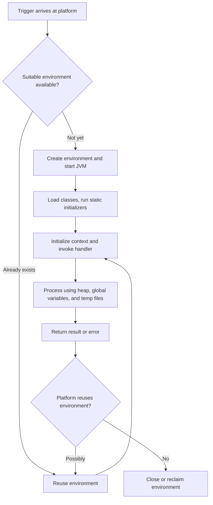

# Global Variables, Local Memory, and Temporary Directories

A Java function is typically invoked multiple times over the lifetime of an execution environment. The cloud platform may retain the environment after an invocation for subsequent reuse, create additional environments as load increases, or destroy the environment when no longer needed. Therefore, how you place data in global variables, per-invocation memory, and temporary directories directly affects the function's correctness, security, stability, and cost.

In the **CLOUD_SERVERLESS** module, learners build and deploy Java functions triggered by HTTP, messages, or events. This lesson focuses on the three places commonly used to hold data during processing: execution-environment-level state, invocation-level memory, and temporary files. The key is distinguishing data that can be reused for optimization from business data that must be persisted durably.

## 1. Understanding the Execution Environment and an Invocation

Two concepts must be distinguished:

- **Execution environment:** the process or sandbox prepared by the platform to run the function. For Java, this environment typically includes the runtime/JVM, class loader, loaded classes, heap, threads, and runtime configuration.
- **Invocation:** a single instance of the function processing an HTTP request, message, or event. Each invocation has its own input data, context, result, and processing deadline.

An environment may process one invocation and then be reused for the next. When load rises, the platform may create multiple independent environments to handle concurrent load. When an environment is reclaimed, the entire heap, static variables, and local files belonging to that environment can disappear.

### Conceptual Lifecycle

The diagram describes the general idea. The timing of reuse, freezing, thawing, or reclamation depends on the provider and trigger type. There is no guarantee that the next invocation will run in the same environment, nor is there any guarantee an environment will survive for a specific duration.

When the JVM starts in a new environment, Java loads classes as needed and runs class static initializers according to JVM rules. Then the handler is invoked. If the platform retains the environment, loaded classes and static objects may remain when the next invocation reaches the same environment. If the platform creates a new environment, those objects are initialized again. This is why a static variable may retain values across some invocations yet revert to its initial state on another call.

## 2. Global Variables and Environment-Level State

In Java, static variables belong to a class loaded in a class loader. A singleton or an object held in a dependency injection container can also live as long as the execution environment. In a serverless function, these objects are commonly used to avoid repeated initialization across invocations handled within the same environment.

### What Should Be Placed at the Global Level?

The following objects are generally appropriate if their library or API permits safe reuse:

- Immutable constants and validated configuration not tied to a specific request.
- HTTP clients, SDK clients, or connection pools confirmed by library documentation to be thread-safe and equipped with proper connection management.
- Configured JSON mappers or configuration parsers that can be used concurrently.
- Small caches with bounded size and time-to-live, where the cache only accelerates processing and does not determine business correctness.

For example, an HTTP client can be created once per environment to reuse connections:

~~~java
public final class CustomerFunction {
    // Java's HttpClient can be reused across requests.
    private static final HttpClient HTTP = HttpClient.newBuilder()
            .connectTimeout(Duration.ofSeconds(2))
            .build();

    public Response handle(Request request, FunctionContext context) {
        String customerId = request.customerId();
        String requestId = context.requestId();

        // Invocation-specific data is passed via local variables.
        Customer customer = loadCustomer(HTTP, customerId, requestId);
        return Response.ok(customer);
    }

    private Customer loadCustomer(
            HttpClient client, String customerId, String requestId) {
        // Build and send request to the downstream service.
        return Customer.from(fetchCustomer(client, customerId, requestId));
    }
}
~~~

This is an illustrative structural example; types such as Request, Response, FunctionContext, and the downstream service call methods belong to the application adapter. For other SDKs or libraries, check documentation regarding thread safety, lifecycle, and how to close clients before placing objects at the static level.

### Do Not Use Global Variables to Store User or Request Data

Static variables can retain their values after the handler returns. If invocation-specific data is stored in such a variable, a subsequent invocation may accidentally read stale data. When an environment handles multiple concurrent requests, two requests can also overwrite each other's data.

The following example is unsafe:

~~~java
public final class UnsafeCustomerFunction {
    private static String currentCustomerId;

    public Response handle(Request request) {
        currentCustomerId = request.customerId();
        return createResponse(currentCustomerId);
    }
}
~~~

Suppose request A sets customer ID A, and then request B sets customer ID B before request A reads the static variable. Request A could build a response for B. Even if the current platform runs at most one invocation per environment, A's value can still linger when a later invocation runs on the same environment. Relying on static variables to store user IDs, authorization contexts, per-request tokens, or transaction data can cause data leakage and business bugs.

Keep request-specific data in local variables and pass it explicitly via parameters. If per-customer caching is needed, the cache must have proper key policies, synchronization, size limits, expiration, and authorization checks; never let a cache become the authoritative source for access permissions or transaction state.

### Global Variables Are Not System-Wide Shared Memory

Each execution environment has its own memory. When the platform scales out into multiple environments, each environment has its own separate copy of static variables and caches. Copies do not automatically synchronize with one another. When an environment is reclaimed, the state inside it is lost.

Therefore, do not use static variables to:

- Count total requests or transactions across the entire system.
- Mark an event as processed for cross-environment deduplication.
- Issue unique sequence numbers or implement distributed locks.
- Store sessions, shopping carts, order states, or data that must outlive the invocation.
- Perform distributed locking, leader election, or coordination across multiple instances.

For example, a static AtomicLong only counts increments within the environment that holds it. When there are three environments, there can be three separate counters; when a new environment is created, its counter starts over. To count system-wide, use a database, distributed counter, or appropriate telemetry system.

### Thread Safety and Initialization

Not every FaaS platform has the same concurrency model. Some runtimes process only one invocation at a time per environment; some platforms or serverless container models can handle multiple concurrent requests in the same instance. Java frameworks may also use thread pools or asynchronous callbacks. Therefore, verify the actual concurrency configuration and design shared objects to be thread-safe.

Important considerations:

- Prefer objects that are immutable after initialization.
- Do not share mutable collections without proper synchronization; if needed, use concurrent data structures and enforce clear data bounds.
- Avoid network calls, database queries, or slow config loading in static initializers if doing so prolongs cold starts or prevents the entire environment from starting when a downstream service temporarily fails.
- Handle expired configuration or credentials properly. Client objects may be reusable, but tokens and credentials must be refreshed using the library's safe mechanism.
- Do not rely on shutdown hooks or JVM exit timing to finalize business transactions or delete critical data; the environment may be reclaimed without giving the application an opportunity to clean up as expected.

## 3. Local Memory Within an Invocation

Local variables inside the handler method are usually the right place to hold data needed only for the current execution: parsed requests, query results, context, intermediate data, and objects used to build the response.

~~~java
public Response handle(Request request, FunctionContext context) {
    String requestId = context.requestId();
    String orderId = request.orderId();
    Order order = orderRepository.findById(orderId);
    PaymentResult payment = paymentService.check(order);

    return Response.from(requestId, order, payment);
}
~~~

These variables belong to the invocation's execution flow. Once the method finishes, unreferenced variables become eligible for garbage collection. However, Java does not guarantee memory is freed immediately when the method returns. If an object remains referenced by a static variable, cache, thread, callback, or asynchronous task, it can continue to exist after the invocation.

### Heap and Memory Limits

Java objects are normally allocated on the JVM heap. Beyond the heap, the process also uses native memory, thread stacks, direct buffers, class metadata, and native library memory. The memory limit allocated to a function by the platform usually applies at the environment or instance level in a provider-specific way; do not assume the entire limit is Java heap.

Reading large payloads completely into byte arrays or creating multiple copies of the same data can cause heap usage to spike rapidly and trigger OutOfMemoryError. Garbage collection also consumes CPU and can increase latency. For large files or messages, process via streams, small batches, or intermediate writes to object storage/temporary files instead of holding the entire content in RAM.

~~~java
try (InputStream input = request.body()) {
    processStream(input);
}
~~~

Close streams, response bodies, cursors, and similar resources using try-with-resources when required by the API. Avoid retaining references to requests or large payloads in caches, static fields, or long-lived collections. If using a cache, bound item count or capacity and set an expiration policy.

### ThreadLocal and Asynchronous Tasks

ThreadLocal can be useful when a library requires thread-scoped context, but thread pools typically reuse threads across tasks. If you fail to call remove in a finally block, data from a previous request can remain on the thread and be misread by later work.

~~~java
private static final ThreadLocal<String> REQUEST_ID = new ThreadLocal<>();

public Response handle(Request request, FunctionContext context) {
    REQUEST_ID.set(context.requestId());
    try {
        return process(request);
    } finally {
        REQUEST_ID.remove();
    }
}
~~~

Use this pattern only when a library strictly requires ThreadLocal; passing context explicitly is usually clearer and safer. For asynchronous tasks, know who owns the executor, whether context propagates across threads, and whether tasks complete before the invocation ends. Do not spawn a background thread and return a response immediately expecting the platform to keep the thread running until completion. Some platforms freeze or reclaim the environment after the response; unfinished background work may be interrupted. Wait for essential tasks to complete within timeout limits or send the work to a durable queue/workflow.

## 4. Temporary Directories and Local Files

Many runtimes provide a writable disk area for functions to store intermediate data. In Java, obtain the temporary directory via the java.io.tmpdir system property instead of assuming a hardcoded path:

~~~java
Path tempDirectory = Path.of(System.getProperty("java.io.tmpdir"));
~~~

This area is useful when you need to:

- Download a file from object storage to process with a library that only accepts file paths.
- Extract archives or create intermediate files during format conversions.
- Stream large data without holding all of it in heap.
- Build a report or artifact before uploading it to durable storage.

The temporary directory typically has bounded capacity and belongs to the execution environment. Files may persist when the environment is reused, but the platform can delete them when provisioning a new environment or reclaiming an old one. Files are also not automatically shared across instances. Thus, the temporary directory is not a database, object storage, or an inter-function data exchange channel.

### Creating and Cleaning Up Files Safely

The following example generates a unique filename, streams data, and deletes the file even if processing throws an error:

~~~java
public Result handle(UploadRequest request) throws IOException {
    Path tempDirectory = Path.of(System.getProperty("java.io.tmpdir"));
    Path tempFile = Files.createTempFile(
            tempDirectory, "upload-", ".bin");

    try {
        try (InputStream input = request.body()) {
            Files.copy(input, tempFile,
                    StandardCopyOption.REPLACE_EXISTING);
        }

        return processFile(tempFile);
    } finally {
        Files.deleteIfExists(tempFile);
    }
}
~~~

This is an illustrative skeleton; types such as UploadRequest, Result, and processFile belong to the application. You must add input size limits, format validation, IOException handling, and authorization checks appropriate for the actual API.

Important principles when using temporary files:

1. Use temporary file creation APIs to generate unpredictable names and prevent two invocations from overwriting each other's files. Never construct filenames directly from user input without path sanitization and validation.
2. Clean up in finally or try-with-resources with an appropriate abstraction. Do not rely on deleteOnExit because the environment may outlive a single invocation and JVM shutdown is not guaranteed to occur at the expected time.
3. Limit file sizes and check remaining disk space. If multiple concurrent requests write files, temporary space can run out even if each individual file is small.
4. Do not write secrets, access tokens, or sensitive data to files unless necessary. If mandatory, define encryption policies, access permissions, and retention periods according to platform capabilities.
5. Do not assume POSIX permissions, filesystem types, or encryption features are identical across all runtimes. Use platform-provided protections and verify actual deployment configuration.
6. After processing, upload results that must be kept long-term to object storage or a durable service before returning the response to the caller.

## 5. Choosing the Right Place to Store Data

| Storage Location | Scope and Lifetime | Suitable Use Cases | Should Not Be Used For |
|---|---|---|---|
| Static variables/singletons | Within a single JVM/class loader of one execution environment; lost when environment is replaced | Constants, reusable clients, small bounded caches | Business state, sessions, system-wide counters, distributed deduplication |
| Local variables/heap | During processing and while referenced; reclaimed by garbage collector when eligible | Temporary invocation data, intermediate objects, query results | Data that must survive across invocations or large payloads exceeding memory budget |
| ThreadLocal | Bound to a thread; threads may be reused | Technical thread-scoped context when required by a library | Storing request context without cleanup; data shared across threads |
| Temporary directory/files | Local disk of the environment; may be lost when environment is reclaimed | Intermediate files, extraction, stream processing | Long-term storage, sharing across instances, sole checkpoints |
| Database/object storage/queue | Per durability and policy of the chosen service | Business state, files to retain, work requiring durable delivery | Ultra-short-lived cache if access cost/latency is unsuitable |

Practical rule: if losing data after an invocation finishes or after an environment is replaced makes the business outcome wrong, that data must be stored in a durable service. Static fields and temporary files may serve only as performance copies or regenerable intermediate data.

## 6. Example: Processing an Uploaded File

Suppose an HTTP function receives a request to process a PDF invoice. The function needs to fetch the file, read its contents, extract information, and store the result.

An appropriate layout would be:

1. **Environment level:** reuse HTTP clients or SDK clients if the library supports concurrent use. You may cache immutable configuration or small metadata with a finite lifetime.
2. **Invocation level:** keep the request ID, authenticated user ID, invoice ID, extracted results, and processing status in local variables. Do not write these values into shared static fields.
3. **Temporary file level:** download the PDF into a uniquely named file in java.io.tmpdir if the OCR library requires a file path. Validate size and format before processing; delete the file in finally.
4. **Durable storage level:** write the results and invoice status to a database. If the original PDF or converted file must be kept, upload it to object storage and store the object key in the database.
5. **Orchestration level:** if OCR takes a long time or requires independent retries, enqueue the job to a queue/workflow and return an acceptance ID to the caller instead of trying to keep an HTTP invocation open for too long.

In this architecture, if the environment is reclaimed immediately after the function returns the response, business data remains intact in the database/object storage and work continues via the queue/workflow mechanism. If the environment is reused, the shared HTTP client helps save initialization time. Correctness does not depend on whether static variables or temporary files survive.

## 7. Common Pitfalls and How to Prevent Them

| Symptom | Possible Cause | Remediation |
|---|---|---|
| Request receives another user's data | Request/user context stored in static field or uncleaned ThreadLocal | Move data to local variables, pass via parameters; clean ThreadLocal in finally |
| Cache has stale values or differs across instances | Each environment has its own cache with no synchronization | Set TTL/invalidation; use database or distributed cache when consistency is needed |
| Counter resets to 0 after a while | Environment replaced or invocation routed to another instance | Use durable/distributed counters |
| Function fails with OutOfMemoryError or long GC | Large payload read into heap, retained references, unbounded cache | Streaming, small batches, bounded caches, fewer data copies, and heap profiling |
| Subsequent invocation runs out of temp disk | Old files not deleted or multiple invocations writing concurrently | Clean files in finally, limit sizes, and monitor disk usage |
| File not found in next invocation | New environment created or temp file reclaimed | Store persistent files in object storage; use temp files only within a controlled flow |
| Background work stops after returning response | Environment frozen or reclaimed | Wait for task completion or offload work via queue/workflow |
| Slow cold start or function fails to start | Static initializer performs heavy work or depends on external services | Reduce synchronous init; handle timeouts/config errors cleanly; measure cold starts |

## 8. Design and Verification Process

When adding a variable or file to a Java function, answer these questions in order:

1. **Who needs this data?** Only one call, one thread, one environment, or multiple instances/the whole system?
2. **How long must it be kept?** Within a single method, across multiple invocations, across scaling/restarts, or long-term per business rules?
3. **What happens if the environment is replaced right after the invocation?** If losing the data breaks business correctness, move it to durable storage.
4. **Can concurrent access occur?** Check the concurrency model of the platform and framework; use immutable objects or proper synchronization.
5. **Is capacity bounded?** Set limits on heap, caches, payloads, temporary files, and concurrent tasks; avoid loading large datasets completely into RAM.
6. **Is there sensitive data?** Avoid keeping per-user information in shared state; restrict file permissions, retention time, and logging.
7. **Are cleanup and error handling complete?** Close streams, delete files, clear ThreadLocal, bound retries, and do not depend on shutdown hooks.

Useful checks for Java functions include:

- Invoke the handler multiple times on the same instance in a test to detect old state leaking into later invocations.
- Run multiple parallel requests with different user IDs to uncover race conditions in static fields and singletons.
- Test creating a new environment or scaling out to confirm the application does not depend on local caches.
- Simulate errors mid-file-write and mid-processing to verify finally deletes files.
- Test large payloads, nearly full temporary storage, timeouts, and downstream service errors.
- Monitor cold starts, execution duration, heap, GC counts, temp file usage, and error rates via platform logs/metrics.

Unit tests inside a single JVM cannot fully simulate platform freezing or environment reclamation. Combine them with integration tests on the deployed runtime and verify concurrency behavior, temporary storage capacity, and memory limits under real configuration.

## 9. Conclusion

Static variables and singletons can help reuse clients, configuration, and small caches within the same execution environment. They live for the lifetime of the environment, may be lost during scaling or restarts, and may be shared across multiple invocations or threads depending on the platform. Therefore, never use them to store business state or request-specific data.

Local variables and the heap are suitable for intermediate invocation data, but memory is bounded and the garbage collector does not free objects immediately upon method return. Temporary directories are suited for regenerable intermediate files; generate safe filenames, control disk usage, and clean up after processing. Data that must persist across invocations, environments, or instances must be stored in an appropriate database, object storage, queue, or durable service.
