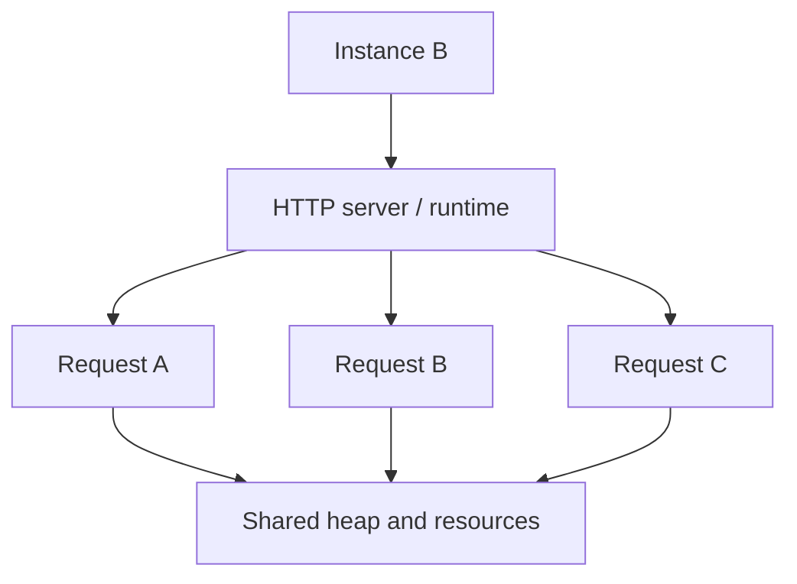
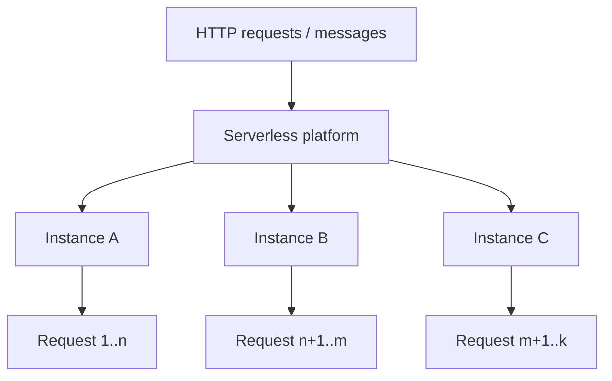
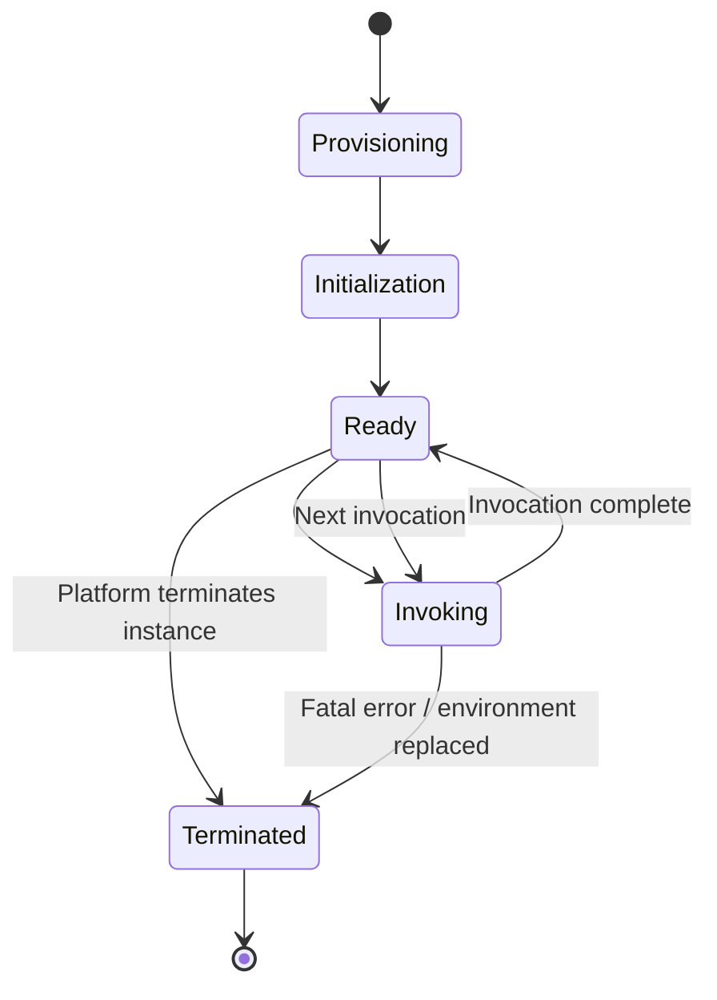

# Models for Handling Multiple Requests in One Instance

## 1. Why Understand How One Instance Handles Multiple Requests?

In the serverless model, the cloud provider manages the execution environment and decides when to create, reuse, or terminate that environment. A function may be invoked multiple times over the lifetime of a single environment. However, how those invocations are dispatched within an environment depends on the platform, trigger type, and concurrency configuration.

This directly affects latency, scalability, memory consumption, thread safety in Java, and how shared resources are managed. If you assume every call runs in a fresh process, the application may unnecessarily re-initialize clients and connections. If you assume an instance only processes sequentially while the platform allows multiple concurrent requests, shared variables can cause race conditions or mix data across users.

Within the scope of CLOUD_SERVERLESS, this lesson focuses on the execution lifecycle of Java functions triggered by HTTP, messages, or events. Three concepts must be distinguished: an instance can be reused across multiple invocations; an instance can process invocations sequentially or concurrently; and the platform can create multiple instances to meet total load.

## 2. Distinguishing Instance, Invocation, and Request

The following terms often appear together but do not share the same meaning:

| Concept | Meaning | Example |
| --- | --- | --- |
| Instance / execution environment | Runtime environment provisioned by the platform, typically containing the runtime, memory, and application process | A Java environment with loaded classes and an initialized handler |
| Invocation | A single time the platform calls the function to process input | One handler call triggered by an HTTP request or message |
| Request | Request at the application or protocol layer | `POST /orders` with an order-creation payload |
| Event/message | Data triggering asynchronous processing | `OrderCreated` sent to a queue |
| Batch | A group of records packaged into a single invocation | One handler call containing 10 messages from a queue |

On some HTTP platforms, each request maps to one invocation. In serverless container services, a single instance may receive multiple concurrent HTTP requests. For queue triggers, one invocation may contain one or more messages depending on batch configuration. Therefore, the number of requests, messages, invocations, and instances are not necessarily equal.

**An instance is not a single invocation.** An instance is an environment with a longer lifetime than one invocation. The platform may reuse that environment for the next call or terminate it and create a new one.

## 3. Two Models for Handling Multiple Calls in One Instance

### 3.1. Sequential Reuse

In the sequential model, an instance finishes the current invocation before accepting the next one. Once processing finishes, the platform may retain the environment for reuse. The runtime, loaded classes, handler object, and shared resources may remain in memory.


In this model, instance-level state can persist from one call to the next. For example, an HTTP client created when initializing the handler can be reused to call external services. A static variable assigned in an earlier invocation may also retain its value in a later invocation.

Some traditional FaaS platforms enforce a limit of one concurrent invocation per execution environment. When multiple invocations arrive simultaneously, the platform typically spins up additional execution environments or queues work according to the service's mechanics. This is the behavior of a specific platform, not a universal rule for every product labeled serverless.

Sequential reuse avoids paying runtime and dependency initialization costs on every call. Even so, you must not rely on an instance being guaranteed to be reused. The platform may terminate the instance after a period of time, when load drops, when a new version is deployed, or when the environment needs replacement.

### 3.2. Concurrent Requests Within the Same Instance

In the concurrent model, a single instance can accept multiple requests or invocations with overlapping execution windows. The application may use multiple threads, an event loop, or asynchronous mechanisms to process them. Requests share the heap, configuration, singletons, and process-level resources.



Concurrency capacity within one instance is typically controlled by concurrency settings, runtime limits, or the HTTP server inside the instance. Some serverless container services allow configuring the maximum concurrent requests per instance. Some function platforms restrict each execution environment to one concurrent invocation. Read the documentation and configuration of the exact service you use instead of inferring behavior solely from Java or the word "serverless".

When multiple requests run simultaneously, each invocation's local variables have their own scope, but singleton fields, static variables, in-memory caches, and shared clients can be accessed concurrently. Therefore, code must be thread-safe, or concurrency must be bounded to match the design.

### 3.3. Horizontal Scaling Across Multiple Instances

In addition to concurrency inside a single instance, the platform can spin up multiple instances to handle load. For example, one instance receives a number of concurrent requests, and then the orchestrator creates additional instances as total load grows or when the configured concurrency limit is reached.



Each instance has its own memory and local state. A static variable in Instance A is not automatically shared with Instance B. If the application needs shared data across instances, that data must live in an external system such as a database, distributed cache, object storage, or messaging service.

Total processing capacity depends on both the number of instances and the number of requests each instance can handle concurrently. Raising per-instance concurrency can reduce the number of instances needed, but it also increases pressure on CPU, memory, connection pools, and downstream services. Increasing the instance count can raise throughput, while also increasing connections and load on downstream services.

## 4. Lifecycle of an Instance

A typical lifecycle can be described by the following phases. Exact names and details vary by provider:

1. **Provisioning:** the platform allocates the execution environment and required resources.
2. **Runtime initialization:** starts the Java runtime, loads classes, and loads libraries.
3. **Application initialization:** creates the handler, dependency injection container, clients, or application-level resources.
4. **Invocation:** receives input, creates context for the call, and executes business logic.
5. **End of invocation:** returns a result or records an error; invocation-specific resources must be released.
6. **Reuse or termination:** the platform may retain the instance for a future invocation or terminate the instance.



The first call in a new environment is commonly called a cold start because it incurs additional provisioning and initialization time. Subsequent calls on an initialized environment can be warm invocations. Warm invocations are usually faster because the runtime and some resources are already ready, though the platform does not promise the instance will stay alive forever.

On some platforms, an environment may be paused or frozen between invocations and resumed when new work arrives. The application should not rely on background threads continuing to run during that time, nor treat the interval between two invocations as guaranteed execution time.

## 5. Which Resources Should Be Reused?

When an instance is reused, certain expensive-to-initialize resources can be retained. The decision should be based on the resource's lifetime and safety guarantees.

| Data or Resource Type | Can Be Kept at Instance Scope? | Notes |
| --- | --- | --- |
| Immutable configuration | Yes | Load once if config does not change during the instance's lifetime; when deploying a new version, new instances receive the new config |
| HTTP client or SDK client | Usually yes | Reuse to leverage connection pooling; verify client thread-safety documentation |
| Dependency injection container and stateless services | Usually yes | Singletons must be safe for multi-threaded calls if the platform permits concurrency |
| Cache of regenerable data | Conditionally | Must enforce size limits, TTL, and tolerate caches not being synchronized across instances |
| Current request, user, or tenant | No | Must live in local variables or invocation-specific context |
| Business outcomes needing long-term persistence | Should not be stored only in instance | Write to a database or durable store |
| Idempotency keys | Should not be stored only in instance | Use a durable store so different instances can check the same key |
| Long-running background threads or tasks | Should not be relied upon | Platform may pause or terminate the instance after the invocation |

### 5.1. Reusing Clients and Shared Objects

Initializing network connections, TLS, SDK clients, or a dependency injection container on every invocation can increase latency and create unnecessary connections. If a library permits safe reuse, initialize the client at the class or handler level.

The Java example below illustrates a handler holding a shared HTTP client while creating each request's context inside the handler method:

```java
import java.time.Instant;
import java.net.http.HttpClient;

public final class OrderFunction {
    // Java's HttpClient can be reused across requests.
    private static final HttpClient HTTP_CLIENT = HttpClient.newHttpClient();

    // Service must be stateless or thread-safe if the instance handles concurrent requests.
    private final OrderService orderService = new OrderService(HTTP_CLIENT);

    public OrderResponse handle(OrderRequest request) {
        RequestContext context = new RequestContext(
                request.requestId(),
                request.tenantId(),
                Instant.now());

        return orderService.createOrder(request, context);
    }
}

record RequestContext(String requestId, String tenantId, Instant receivedAt) {}
```

`HTTP_CLIENT` is shared, whereas `RequestContext` is specific to the invocation. The example assumes `OrderService` does not store the current request in a field that another request could overwrite. If the service has mutable caches or counters, clearly define synchronization and size bounds.

### 5.2. Avoiding Storing Request Data in Fields

The following code is unsafe when multiple requests can run concurrently on the same handler object:

```java
public final class UnsafeOrderFunction {
    private final OrderService orderService;
    private String currentTenant;

    public UnsafeOrderFunction(OrderService orderService) {
        this.orderService = orderService;
    }

    public OrderResponse handle(OrderRequest request) {
        currentTenant = request.tenantId();
        return orderService.createOrder(request, currentTenant);
    }
}
```

Suppose Request A writes `tenant-A`, and then Request B writes `tenant-B` before A uses `currentTenant`. Request A may execute with B's tenant, causing data mixing or tenant-isolation violations.

Pass data as parameters or via a local context:

```java
public final class SafeOrderFunction {
    private final OrderService orderService;

    public SafeOrderFunction(OrderService orderService) {
        this.orderService = orderService;
    }

    public OrderResponse handle(OrderRequest request) {
        String tenantId = request.tenantId();
        return orderService.createOrder(request, tenantId);
    }
}
```

Local variables are created separately for each method execution. However, using local variables does not automatically make referenced objects thread-safe; if multiple requests modify a shared mutable object, proper synchronization is still required.

## 6. Thread Safety in Java Applications

When concurrency is greater than one, multiple threads can simultaneously access objects that live for the duration of the instance. Common bugs include:

- **Race condition:** the outcome depends on the interleaving order of read and write operations.
- **Lost update:** two requests read the same value and overwrite each other's updates.
- **Shared mutable state:** one request modifies a field or collection that another request is currently using.
- **Resource contention:** multiple requests contend for connection pools, locks, CPU, or thread limits.
- **Context leakage:** user info, tenant info, or correlation IDs from a previous request remain behind and get used by a later request.

### 6.1. Designing Stateless Services

Prefer designing services that accept data via parameters, use local variables, and return results. Shared fields should be immutable after initialization or components with a clear thread-safe contract.

```java
public final class PriceService {
    private final PricingRules rules;

    public PriceService(PricingRules rules) {
        this.rules = rules;
    }

    public Price calculate(Order order, Customer customer) {
        // Do not store order or customer in service fields.
        return rules.priceFor(order, customer);
    }
}
```

If an instance-scoped shared counter is needed, you can use `AtomicLong` or appropriate synchronization. However, an in-memory counter reflects only the current instance; it is not a system-wide total and will be lost when the instance terminates. If accurate numbers or business updates are needed, use an appropriate database or metrics system.

### 6.2. Singletons and Dependency Injection

Many Java frameworks create singleton beans in the application context. When the runtime reuses the context across multiple requests, singletons are also reused. A singleton bean holding immutable dependencies or thread-safe clients is usually appropriate. A singleton bean holding fields such as `currentUser`, `currentRequest`, temporary result lists, or unprotected mutable buffers can cause bugs under concurrency.

Bean scopes must match the actual invocation model. If a framework provides a request scope, that scope is only meaningful if the adapter creates and terminates the request context properly. Do not assume a request-scoped bean always exists across all trigger types; message handlers and scheduled events may not have an HTTP request context.

### 6.3. Being Careful with ThreadLocal

`ThreadLocal` is sometimes used to attach a correlation ID or context to the current thread. However, thread pools can reuse threads across different requests. If the value is not removed in `finally`, data from a previous request can leak into the next request. With asynchronous processing, context may also fail to propagate automatically across threads.

If you must use `ThreadLocal`, always clean it up:

```java
public final class RequestContextHolder {
    private static final ThreadLocal<String> REQUEST_ID = new ThreadLocal<>();

    public static void set(String requestId) {
        REQUEST_ID.set(requestId);
    }

    public static String get() {
        return REQUEST_ID.get();
    }

    public static void clear() {
        REQUEST_ID.remove();
    }
}

// At the request-handling boundary:
Response handle(Request request, OrderService service) {
    try {
        RequestContextHolder.set(request.requestId());
        return service.handle(request);
    } finally {
        RequestContextHolder.clear();
    }
}
```

If the framework already provides a mechanism for propagating context per request or per reactive pipeline, prefer that mechanism to avoid manual ThreadLocal management.

## 7. Managing Connection Pools and Bounded Resources

Instance reuse typically enables reusing clients and connection pools. However, as concurrency increases, the number of requests simultaneously borrowing connections also increases. A pool that is too small makes requests wait too long; a pool that is too large across many instances can exceed database connection limits.

For example, if the platform runs 20 instances and each instance has a pool of up to 10 connections, the total potential connections can reach 200. The actual number also depends on whether the pool opens connections lazily and the number of concurrent requests. Therefore, calculate total connections based on the maximum instance count, connections per instance, and other applications accessing the same database.

Practical principles:

- Reuse clients or pools if the library supports it and provides a way to close resources when appropriate.
- Set pool limits based on concurrency and database limits.
- Set timeouts for waiting on connections, query execution, and overall request duration.
- Release connections, streams, file handles, and locks in `try-with-resources` or `finally`.
- Consider a database proxy or managed connection service when instance counts can scale rapidly.
- Monitor pool utilization, wait counts, connection timeouts, and actual active connections on the database.

Do not create a new pool for every request if the pool can be safely shared. Conversely, do not use a non-thread-safe client from multiple concurrent requests just because it is declared `static`.

## 8. Batch Message Processing vs. Instance Concurrency

For queue or stream triggers, the platform may group multiple messages into one invocation. For example, a single handler call receives a list of 10 messages and loops to process each one. This is batch processing: one invocation containing multiple records.

The application can process the batch sequentially or explicitly process it in parallel inside the invocation. If processing in parallel, bound the number of concurrent tasks, ensure dependencies are thread-safe, and define how per-message errors are reported. If the platform supports partial batch responses, the handler can indicate which messages need to be redelivered; otherwise, a single failed message may cause the entire batch to be redelivered depending on the service.

Batch processing does not mean the platform is running multiple concurrent invocations on the same instance. These are two different layers of concurrency:

| Processing Layer | Example | What Needs Control |
| --- | --- | --- |
| Multiple records in one invocation | A handler receives a batch of 10 messages | Loops, in-application parallel processing, partial failures, and timeouts |
| Multiple concurrent invocations in one instance | Multiple HTTP requests executing overlappingly in one container | Thread safety, request context, pools, and concurrency limits |
| Multiple instances running in parallel | Platform creates multiple environments to increase throughput | Shared state, quotas, database connections, and total cost |

## 9. Errors, Retries, and Safe Idempotency When Instances Are Reused

Having the same instance handle multiple invocations does not guarantee a request is executed only once. HTTP clients may retry, queues may redeliver messages, the platform may retry after timeouts, or users may resubmit actions. Idempotency must still be designed at the business level.

Additionally, an error in the current invocation must not leave partial mutable state behind that corrupts the next invocation. Create a fresh context for each request, close resources in `finally`, clear ThreadLocal, roll back temporary state, and persist business state to durable storage within proper transactions.

For example, if a request updates a `currentOrder` field on a singleton and throws an exception before clearing the field, the next request might accidentally read the old order. Designing stateless services and using local variables helps narrow down this class of bugs.

For messages, use the event ID or business key as the idempotency key in durable storage. Do not use a static `HashSet` in an instance as the sole deduplication mechanism: other instances cannot see that set, and the data is lost when the instance is terminated.

## 10. Concurrency Configuration and Resource Balancing

Per-instance concurrency is an operational parameter that must be chosen based on the workload. A high value can utilize CPU better and reduce the number of instances, but also increases contention among requests for resources. A low value can reduce intra-instance contention, but causes the platform to spin up more instances to handle the same load.

When evaluating configuration, consider:

- **Request profile:** CPU-bound, I/O-bound, average processing time, and p95/p99 distribution.
- **Memory:** heap used per request, object sizes, and memory leak risk.
- **Threading model:** thread counts, event loops, blocking calls, and framework thread pools.
- **Downstream services:** database connection limits, external API rate limits, and queue throughput.
- **Platform limits:** maximum concurrency per instance, maximum instances, timeouts, and account quotas.
- **Cost:** instance count, execution duration, CPU/memory configuration, and auxiliary services.

Do not raise concurrency just to cut instance count if the application is bottlenecked by a database or external API. In that case, more requests per instance may simply lengthen internal queues and increase timeouts. Conversely, if the workload is mostly I/O-bound and all clients safely support concurrency, raising concurrency can improve resource utilization.

Load-test across multiple concurrency levels and monitor throughput, p95/p99 latency, error rates, CPU, heap, thread count, connection pools, instance count, and backlog. Tests must use data and downstream dependencies close to the production environment.

## 11. HTTP Processing Flow Example

Suppose a service receives `POST /orders` requests and runs on a serverless container platform with per-instance concurrency greater than one. Three requests can be sent to the same instance over overlapping intervals:

1. The runtime receives the requests and creates a separate context for each request.
2. The handler calls a shared `OrderService`. The service does not store the current tenant or order in mutable fields.
3. Each request creates a local context containing the request ID, tenant ID, and timestamp received.
4. The shared HTTP client is reused to call the inventory service; the connection pool limits the number of open connections.
5. Each request's result is returned independently. Logs and traces attach the correlation ID so flows can be distinguished.
6. When load exceeds the instance's configured capacity, the platform may spin up additional instances. All instances use the database as the authoritative data source.

If the same example runs on a platform allowing only one invocation per execution environment, concurrent requests will be handled in separate environments or scheduled according to platform mechanics. When an instance is reused sequentially, the HTTP client can still be reused; the code must still avoid storing request state in fields because the next request may reuse the exact same handler instance.

## 12. Design Checklist for Java Functions

Before deploying, check the following points:

- Have you confirmed whether the platform handles one or multiple concurrent invocations per instance?
- Have you distinguished message batches from multiple concurrent invocations?
- Which handler objects, singletons, and static fields are retained across invocations?
- Are request, user, tenant, and correlation ID data kept separately in each invocation's context?
- Are shared clients and SDKs thread-safe according to their library documentation?
- Do in-memory caches have TTLs, size bounds, and tolerate each instance having its own cache?
- Are ThreadLocal and per-request resources cleaned up even when exceptions occur?
- Are connection pools sized appropriately for per-instance concurrency and maximum instance count?
- Are business operations idempotent when the platform or client retries?
- Is state that must persist long-term stored in a durable system?
- Have you measured cold starts, warm latency, throughput, p95/p99, errors, and cost at expected load?

## 13. Common Misconceptions

| Misconception | Reality to Remember |
| --- | --- |
| Every function invocation always gets a new instance | The platform can reuse an instance across multiple invocations |
| A warm instance is guaranteed to be reused | Reuse is a platform decision and is not guaranteed indefinitely |
| Each instance always handles only one request at a time | Per-instance concurrency depends on the service, trigger, and configuration |
| Declaring a `static` variable makes data globally shared across the system | Static variables belong to one runtime/instance and are lost when the instance ends |
| Singletons are always safe because there is only one object | A singleton can be accessed concurrently by multiple threads |
| Using local variables makes everything thread-safe | Mutable objects referenced by local variables can still be shared resources |
| A batch of messages is equivalent to multiple invocations | A batch is multiple records in one invocation; invocation concurrency is a different layer |
| An in-instance cache is enough for deduplication | Instances do not share caches; idempotency requires a durable store when applied system-wide |

## 14. Conclusion

A serverless instance can be reused across multiple invocations. Invocations can happen sequentially or concurrently depending on the platform and configuration; at the same time, the platform can scale horizontally by creating additional instances. These three mechanisms affect in-memory state, thread safety, connections, and cost in different ways.

With Java, reuse resources that are expensive to initialize and safe to share, keep request data in isolated contexts, design singletons to be stateless or thread-safe, size pools according to concurrency, and persist business state in durable systems. Always verify the concurrency model of the target service and measure actual behavior before choosing production settings.
