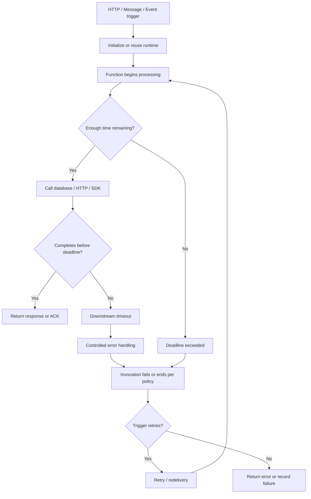
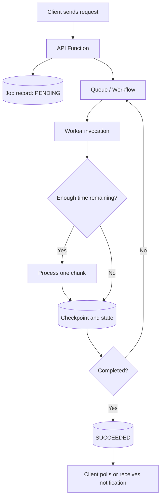

# Execution Timeouts and Function Timeout Behavior

Every time a serverless function is triggered, it has a bounded amount of time to finish. This window is constrained by the platform's configuration and by deadlines at surrounding layers such as the HTTP gateway, client, queue, or downstream services. When a function fails to finish before the deadline, the platform may terminate the invocation and record a timeout. The consequence is not just a failed request: the work may already have produced partial side effects, the message may be redelivered, and the next attempt may run concurrently or repeat the previous side effects.

Therefore, timeouts must be designed as part of the execution lifecycle. The application must track remaining time, bound each downstream call, stop work when insufficient time remains, and protect operations with business side effects using idempotency. For Java functions, setting timeouts on HTTP clients, JDBC, and SDKs is just as important as configuring the function timeout on the platform.

## 1. Distinguishing Timeout and Deadline

The following terms often appear together but represent different limits:

| Concept | Meaning | Example |
| --- | --- | --- |
| Function timeout | Maximum runtime of a single invocation enforced by the platform | Function configured with a 10-second maximum |
| Deadline | Absolute point in time by which all work must complete | Request must produce a result before 18:30:05 |
| Client timeout | Duration the client waits for a response | Browser or calling service waits at most 8 seconds |
| Gateway/integration timeout | Duration the gateway waits for the function or backend to respond | API gateway stops waiting after 7 seconds |
| Downstream timeout | Maximum duration for a dependent operation | Database query maximum of 2 seconds |
| Idle timeout | Period of connection inactivity before being closed | HTTP or TCP connection closed when idle |

Function timeout is usually a hard limit enforced by the platform. Deadline is an application-level concept: it lets internal steps know the total remaining time and proactively stop before the platform has to force-terminate execution. An invocation can hit a database timeout before reaching the function timeout; a gateway can also time out while the function is still running, depending on the integration and platform.

Do not treat the client, gateway, function, and downstream timeouts as the same number. Each layer needs a limit appropriate to its role and must leave headroom for the calling layer to handle the outcome.

## 2. Lifecycle When an Invocation Approaches the Time Limit

An invocation typically passes through stages: receiving the trigger, preparing the execution environment if needed, running business logic, calling dependent services, and returning a result or acknowledging the event. The platform tracks invocation duration per service rules. If the limit is exceeded, it marks the run as failed due to timeout and terminates execution according to its own mechanism.



If a function hits the platform's hard limit, the runtime may be stopped immediately. You cannot assume the application will always execute `finally`, shutdown hooks, completion callbacks, or final log statements. Exact termination behavior varies by provider and runtime, but a safe design must treat abrupt interruption as an expected possibility.

This leads to a critical rule: any data that must survive after the invocation must be written to a durable storage system before the function finishes. Heap memory, `static` variables, background threads, or temporary files inside the function environment are not places to store state recoverable after a timeout.

## 3. How Timeouts Behave Differently by Trigger

A function timeout is an execution-layer event. External behavior also depends on the trigger and protocol the function uses.

| Trigger Type | What the Caller Observes | What Can Happen Next |
| --- | --- | --- |
| Synchronous HTTP | Client or gateway receives a timeout error, integration error, or closed connection | Client may retry; function may have already executed partial side effects before being stopped |
| Asynchronous queue/message | Producer typically does not receive the final processing outcome directly | Message may be redelivered after visibility timeout or per retry policy |
| Event bus or stream | Event source records a failed execution per its mechanism | Records may be retried, retained, skipped, or routed to an error stream depending on config |
| Schedule | The scheduled run may be marked failed | Next schedule may still run; overlap depends on scheduler and locking mechanism |
| Batch | Some records may already be processed before the batch fails | Whole batch or only failed records may be retried, depending on partial failure reporting |

### Synchronous HTTP

In an HTTP flow, multiple parties wait concurrently: the client waits on the gateway, the gateway waits on the function, and the function waits on downstream services. If the gateway times out before the function, the client may receive `504 Gateway Timeout` even though the function is still running. If the function times out first, the gateway may translate the execution error into another error response. Status codes and invocation cancellation behavior depend on the platform.

Closing the connection or stopping waiting on the client side does not guarantee the function stops automatically. If the function continues and writes data after the client has timed out, a client retry can produce two side effects. Therefore, endpoints performing write operations should accept a stable idempotency key or unique request ID.

### Asynchronous Messages and Events

With a queue, the function typically acknowledges a message only after successful processing according to the event source protocol. If a timeout occurs before acknowledgement, the message can be redelivered. The visibility timeout or lease mechanism must be long enough for expected processing and aligned with the function's maximum timeout. If the lease expires while the old invocation is still running, another consumer may receive the same message and process it concurrently.

With streams or other event sources, retry behavior may affect an entire shard, partition, or batch. Read the retry policy, checkpointing, batch window, and time limits of the exact service. You cannot assume every event source redelivers a single record in the same way.

## 4. Side Effects and State on Timeout

A timeout is not a transaction rollback. If a function already sent an email, inserted a record, charged a payment, or emitted an event before being stopped, those effects may still persist. Marking an invocation as failed only indicates the platform did not record successful completion per its protocol.

For example, an order-processing function executes the following steps:

1. Write the order to the database.
2. Call the payment service.
3. Emit an `OrderPaid` event.
4. Return the HTTP response.

If the function times out after step 2 but before step 3, a retry may repeat the payment request. If it times out after step 3 but before sending an ACK, the event source may redeliver the message and cause the event to be emitted again. Both cases show why you cannot rely on the function running exactly once.

Protective measures include:

- Use a stable idempotency key or event ID across attempts.
- Persist processing status and operation outcomes durably.
- Use unique constraints or conditional writes to prevent two invocations from creating the same result.
- With databases and message brokers, consider transactional outbox/inbox patterns to persist business changes and events in an appropriate transaction.
- Only ACK a message after the required outcome has been persisted durably.
- Maintain reconciliation workflows for ambiguous states, such as when a client times out while payment may have succeeded.

Idempotency does not make invocations free and does not automatically undo partial side effects. It enables retries to recognize work that was already done and return the stored result or safely skip duplicate operations.

## 5. Choosing Timeouts Based on the End-to-End Flow Deadline

A practical design approach is budgeting time from the outside in. Outer layers must wait long enough for inner layers to finish and return a controlled result. Downstream operations must finish before the function does so time remains for error handling, state persistence, and returning a response.

For example, an API with a total budget of 8 seconds might hypothetically allocate time as follows:

| Layer | Example Limit | Purpose |
| --- | ---: | --- |
| Client | 8 seconds | Limits how long the user waits |
| Gateway | 7 seconds | Leaves time to receive and forward the response from the function |
| Function | 6 seconds | Leaves headroom before the gateway timeout |
| Single downstream call | Max 2 seconds | Prevents one dependency from consuming the entire budget |
| Error handling and response | ~0.5–1 second buffer | Writes state, emits necessary logs, and returns a clear error |

These numbers illustrate how to allocate a budget, not a universal standard configuration for all platforms. Verify maximum limits, configuration units, and timeout behavior of the gateway, runtime, and downstream services in use.

When choosing values, base them on:

1. **End-to-end SLA:** the maximum time acceptable to the caller or business process.
2. **Actual measurements:** p50, p95, and p99 of processing duration under normal and peak load. Averages poorly reflect slow cases.
3. **Cold starts:** include initialization latency if it falls within the deadline budget or counts toward invocation duration.
4. **Downstream calls:** set timeouts on every HTTP call, query, transaction, and SDK operation; never let an operation wait indefinitely.
5. **Retries:** account for total time across all attempts, backoff, and message wait times. Do not set a long timeout and let nested retries exceed the SLA.
6. **Completeness:** if a task frequently exceeds the limit, split the work or move to asynchronous processing instead of continually raising the timeout.

A timeout that is too short causes false failures and unnecessary retries. A timeout that is too long holds resources while downstream services may already be down, increasing latency and cost. A good value must be long enough for valid work while short enough for the system to recover during incidents.

## 6. Propagating Deadlines and Setting Timeouts in Java

Configuring only the function timeout in the console or Infrastructure as Code is not enough. Each dependent call needs to receive the invocation's remaining time. If a function has 1 second left while the HTTP client still waits 30 seconds, the runtime may terminate the function mid-call.

### Creating a Deadline Using Monotonic Time

To measure remaining time inside a process, use `System.nanoTime()` instead of `System.currentTimeMillis()`. A monotonic clock is not affected by system clock synchronization adjustments. The example below illustrates a simple deadline object:

```java
import java.time.Duration;

public final class InvocationDeadline {
    private final long deadlineNanos;

    public InvocationDeadline(Duration budget) {
        if (budget.isNegative() || budget.isZero()) {
            throw new IllegalArgumentException("budget must be positive");
        }
        this.deadlineNanos = System.nanoTime() + budget.toNanos();
    }

    public Duration remaining() {
        long nanos = deadlineNanos - System.nanoTime();
        if (nanos <= 0) {
            throw new IllegalStateException("Invocation deadline exceeded");
        }
        return Duration.ofNanos(nanos);
    }

    public Duration remainingMinus(Duration reserve) {
        Duration usable = remaining().minus(reserve);
        if (usable.isNegative() || usable.isZero()) {
            throw new IllegalStateException("Insufficient time for next operation");
        }
        return usable;
    }
}
```

When the runtime provides the remaining invocation time, use that value as the initial budget or convert it into an internal deadline. If no such API exists, construct a deadline from a known application budget, leaving a safety margin for startup and returning the result.

### Applying Deadlines to the HTTP Client

With Java's `HttpClient`, you can set per-request timeouts based on remaining time. Reserve a buffer for error handling and returning the response:

```java
import java.net.URI;
import java.net.http.HttpClient;
import java.net.http.HttpRequest;
import java.net.http.HttpResponse;
import java.time.Duration;

public final class PartnerClient {
    private final HttpClient client = HttpClient.newHttpClient();

    public HttpResponse<String> fetch(
            URI uri,
            InvocationDeadline deadline
    ) throws Exception {
        Duration requestBudget = deadline.remainingMinus(Duration.ofMillis(300));

        HttpRequest request = HttpRequest.newBuilder(uri)
                .timeout(requestBudget)
                .GET()
                .build();

        return client.send(request, HttpResponse.BodyHandlers.ofString());
    }
}
```

This example sets a limit for a single HTTP request. In a real application, handle `HttpTimeoutException`, connection errors, HTTP error responses, and `InterruptedException` explicitly. When catching `InterruptedException`, restore the interrupt flag via `Thread.currentThread().interrupt()` before propagating the error upward. Never swallow interrupts, as they may be signals requesting work cancellation.

### Applying to Databases and SDKs

With JDBC, set query timeouts via `Statement.setQueryTimeout(...)`, transaction timeouts, or driver-specific settings. Standard JDBC APIs use seconds so granularity can be coarse; verify behavior with your driver and database. Also set a limit on waiting for a connection from the pool, since query timeout does not cover pool acquisition wait time.

With cloud SDKs, configure connection timeout, socket/read timeout, API call timeout, and retry policy according to SDK capabilities. Connection timeout only bounds establishing the connection; it does not necessarily bound the entire request. A single API call may include multiple retry attempts, so account for the total budget across retries.

Methods like `Future.get(timeout, unit)` or `CompletableFuture.orTimeout(...)` bound how long the caller waits. They do not automatically guarantee the underlying task stopped or side effects were canceled. Check the library's cancellation mechanism, close resources properly, and still apply idempotency for operations that may have been dispatched.

## 7. Retries, Backoff, and DLQ After Timeouts

Timeouts are often treated as retryable errors, but retrying every timeout unconditionally can worsen congestion. For instance, a slow database causes function timeouts; the event source redelivers messages; more new invocations query the database concurrently; the database slows down further and timeout rates climb. This is a load amplification loop.

A sound retry policy should:

- Bound the number of attempts and total retry duration.
- Use exponential backoff with jitter to avoid many consumers retrying simultaneously.
- Distinguish transient errors from data or configuration errors that cannot self-heal.
- Avoid nested retries across multiple layers without a shared budget; three layers each retrying three times can generate far more calls than expected.
- Keep the idempotency key consistent across attempts and persist completed outcomes.
- Route unprocessable messages to a dead-letter queue (DLQ) or error flow after an appropriate threshold.
- Monitor message age, receive count, timeouts, and DLQ record count.

If a timeout occurs after a downstream service received the request but before the function received the response, the outcome may be in an unknown state. Do not immediately re-execute a non-idempotent operation. Query the status using the request ID or idempotency key, reconcile the outcome, and only then decide whether to retry.

## 8. Timeouts in Batch Processing

When a function processes a batch of messages, the invocation duration must cover the entire batch plus headroom. Larger batches reduce invocation count but increase processing duration, memory usage, and blast radius if a batch times out.

Suppose a batch has 100 records and the function processes 90 records before timing out. If the event source supports only full-batch retries, the 90 already processed records may run again. If partial batch responses or per-record checkpoints are supported, the function can request retries only for incomplete items. Specific mechanisms depend on the trigger.

When designing batches:

1. Measure p95/p99 per-record processing time and representative batch sizes.
2. Choose batch size and batch window so enough time remains to complete before the function timeout.
3. Apply idempotency per record, not solely by the entire batch ID.
4. Persist progress or results durably if processing involves multiple steps.
5. Use partial batch failures when supported by the event source and return the exact list of records needing retry.
6. Verify that timeout, visibility/lease, and retry policies work together so two consumers do not process the same record simultaneously.

## 9. When Work Cannot Finish Within One Invocation

Raising timeouts is appropriate only when the work has a finite duration within platform limits. For long-running tasks, switch to a chunked and orchestrated model:

- Receive the request, validate it, and write a job record with status `PENDING`.
- Enqueue the job ID into a queue or workflow engine.
- A worker processes a portion of work per invocation, persisting checkpoints and state.
- When approaching the deadline, the worker saves progress and exits cleanly so the next run can resume.
- On completion, update status to `SUCCEEDED`; on unrecoverable failure, save the reason and route to an error workflow.
- The client polls status via job ID or receives a notification when the work completes.



Checkpoints must be written atomically or equipped with duplicate-write detection. If a worker times out right after saving a checkpoint but before acknowledging the message, the next run must read the state and continue safely. For multi-step workflows, an orchestration service can manage retries, waits, timeouts, and per-step state more cleanly than writing a long loop inside one function.

## 10. Observing and Troubleshooting Timeouts

A dashboard showing only invocation counts and error counts is insufficient to diagnose timeouts. At minimum, monitor:

| Metric | What to Detect |
| --- | --- |
| Invocation duration and billed duration | Is the function frequently approaching the limit? |
| Timeout count/rate | Are timeouts concentrated in a specific function, trigger, or deployed version? |
| p50, p95, p99 latency | Is the tail distribution rising before timeouts appear? |
| Remaining deadline | How much time remains when starting each downstream call? |
| Downstream latency and errors | Which database, HTTP service, or SDK is slow? |
| Retry count and age of oldest message | Are messages being continuously redelivered or is a backlog growing? |
| Batch failures and DLQ depth | Which records fail frequently and are getting stuck? |
| Cold starts and concurrency | Are initialization or concurrent load increasing duration? |

Logs should include the request ID, event ID, function/version, trigger, attempt number, processing duration, and the name of the timed-out dependency. Do not log tokens, secrets, or entire sensitive payloads purely for diagnostics. Use traces to see time distribution between the function and downstream calls; configure sensible sampling so observability costs do not grow out of control.

When a timeout alert fires, an investigation workflow can follow this order:

1. Identify the affected function, version, trigger, and time window.
2. Compare p95/p99 against the function timeout and gateway/client timeouts.
3. Inspect traces to locate the operation consuming the most time.
4. Check downstream services for elevated latency, errors, connection limits, or throttling.
5. Inspect retries, concurrency, batch sizes, backlog, and DLQ.
6. Verify side effects that may have occurred prior to the timeout; reconcile by request ID/idempotency key.
7. After remediation, test with representative load and confirm the timeout rate drops while the SLA is met.

## 11. Timeout Design Checklist for Java FaaS

- [ ] Define the end-to-end SLA and limits for the client, gateway, function, queue, and downstream services.
- [ ] Set the function timeout within platform limits and leave headroom for error handling.
- [ ] Measure p95/p99 under representative load, including cold starts where relevant.
- [ ] Propagate deadlines or remaining time to every HTTP, database, and SDK call.
- [ ] Configure explicit connection, read, query, and API call timeouts; never let operations wait indefinitely.
- [ ] Handle interrupts properly and do not assume `Future.cancel` always stops side effects.
- [ ] Design idempotency for requests/messages that can be retried or resent.
- [ ] Bound retries, backoff, and jitter, and route persistent errors to a DLQ.
- [ ] For batches, evaluate partial failures, checkpoints, and the possibility of re-running already-succeeded records.
- [ ] For long-running tasks, split work and persist state durably across invocations.
- [ ] Monitor timeout rate, duration, remaining deadline, downstream latency, retries, and backlog.

A timeout is the time boundary of an execution, not proof that every operation inside it was rolled back. When the application propagates deadlines to dependencies, persists state durably, handles bounded retries, and protects side effects with idempotency, a Java function can fail predictably and recover safely in the serverless model.
