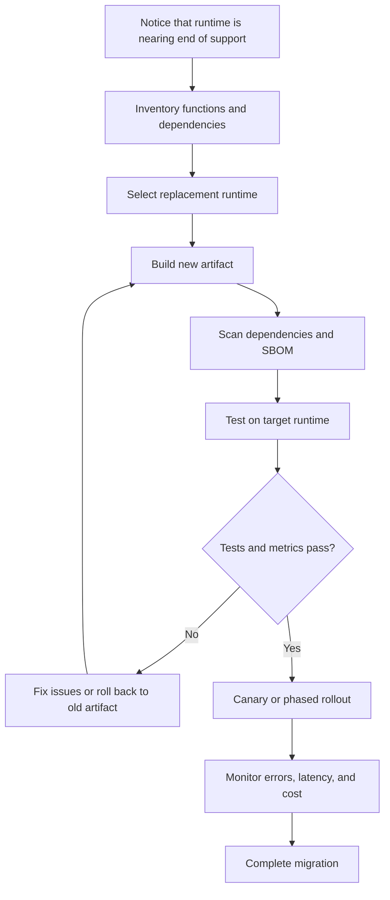

# Runtime Versions, Dependencies, and Support Lifecycle

A Java function only operates reliably when its source code, Java version, library dependencies, and execution environment remain compatible throughout the application's deployment lifetime. In the serverless model, the provider typically manages most of the execution infrastructure, yet the development team must still choose an appropriate runtime, package dependencies safely, track support timelines, and upgrade before versions are discontinued.

Within the scope of **CLOUD_SERVERLESS**, this lesson focuses on Java functions triggered by HTTP, messages, or events. Learners need to understand runtime and dependency lifecycles to deploy functions that can be updated, recovered, and operated long-term, while controlling impacts on cold starts, scalability, and cost.

## 1. What Does a Java Function's Runtime Include?

The runtime is the environment the platform uses to launch function code. For Java, several components commonly lumped together as "the Java version" must be distinguished:

- **JDK (Java Development Kit):** the toolkit for developing, compiling, and packaging applications. The JDK is typically used in CI for compiling and testing.
- **JVM (Java Virtual Machine):** the virtual machine that executes Java bytecode. The JVM handles class loading, memory management, garbage collection, and other execution operations.
- **Java runtime/JRE:** the set of components needed to run Java applications. In modern Java distributions, a standalone JRE may not be released as a separate package; providers typically supply an appropriate JDK or runtime image.
- **Operating system, architecture, and system libraries:** the runtime may depend on Linux, x86-64 or ARM64 architecture, CA certificates, native libraries, and other platform components.
- **Function adapter or bootstrap:** the integration layer that receives requests/events from the platform and dispatches them into the Java handler. Initialization and communication mechanics depend on the FaaS service.

When someone says a function "runs Java 21", you must know whether that number describes the JDK used to compile, the target Java release, the JVM in the execution environment, or the runtime identifier required by the provider. These values can differ. For instance, a project may compile with a newer JDK while setting `--release` to an older version; the resulting bytecode must still be compatible with the deployed runtime and must not use APIs available only in the newer version.

A function also depends on more than the Java version number. It depends on CPU architecture, operating system, frameworks, native libraries, and how the platform invokes the handler. Compatibility checks must therefore cover the entire execution environment.

## 2. Choosing a Java Version for Serverless Environments

When choosing a Java release, the development team must balance support duration, compatibility, language features, performance, and runtime options supported by the FaaS provider.

### Prefer Versions with a Clear Support Plan

Java LTS releases are typically well suited for long-lived services because they offer broader update roadmaps and longer support windows than short-term releases. However, "LTS" does not automatically mean every FaaS provider supports that version at the same time or for the same duration. Cross-check at least three timelines:

1. The support lifecycle of the JDK distribution used by your organization.
2. The Java versions and architectures supported by the FaaS service.
3. The lifecycle of the framework and primary libraries in the application.

For example, a framework may not yet fully support a new Java release, or the FaaS provider may not yet offer the corresponding runtime in your deployment region. In that case, using the newest release can increase operational risk without delivering practical value.

### Distinguish Compile Version and Runtime Version

Explicitly declare the Java version in your build system instead of relying on the default JDK on developer machines or CI runners. With Maven, you can set the target release as follows:

```xml
<properties>
    <maven.compiler.release>21</maven.compiler.release>
    <project.build.sourceEncoding>UTF-8</project.build.sourceEncoding>
</properties>
```

With Gradle, you can pin the toolchain:

```kotlin
java {
    toolchain {
        languageVersion = JavaLanguageVersion.of(21)
    }
}

tasks.withType<JavaCompile>().configureEach {
    options.release = 21
}
```

The numbers above are configuration examples only. In real deployments, replace them with versions supported by your framework, pipeline, and FaaS service. If you compile with Java 21 while the function is configured to run Java 17, the bytecode or APIs used may be incompatible. Conversely, compiling with an older release does not guarantee the application runs properly on a newer runtime if there are behavior changes, JVM option changes, or native library differences.

## 3. Runtime Support Lifecycle

Runtimes are provided along a lifecycle. Stage names and timelines vary across providers, but they typically include states similar to the following:

| Stage | Common Meaning | What the Development Team Needs to Do |
|---|---|---|
| Supported | Can create, update, and run functions; receives updates per service policy | Monitor notices, patch applications, and test periodically |
| Deprecation announced | Provider announces end-of-support dates or upcoming restrictions | Plan upgrades, identify affected functions, and test replacement runtimes |
| Restricted | May block creating new functions or certain configuration/code updates | Complete migration before restriction milestones; verify redeployment capability |
| End of support | No longer receives support or patches per published policy | Migrate to a supported runtime; assess risks if legacy workloads remain |
| Retired | Platform may refuse to start functions using that runtime | Functions must be upgraded or replaced to continue operating |

This is a general model, not a universal schedule applying to every service. Some providers split milestones into stopping new creation, stopping updates, and finally stopping function invocation. Some services still allow legacy functions to run for a period after end of support, without guaranteeing patches or supportability. Never treat the fact that a function is still running as proof that its runtime is still supported.

When receiving a deprecation notice, read carefully:

- The last date to create new functions using the old runtime.
- The last date to update code or configuration for existing functions.
- When the runtime reaches end of support and when it is retired, if applicable.
- Affected regions, architectures, function types, or API versions.
- How the platform handles existing functions and whether any automatic upgrade occurs.
- Migration procedures, compatibility limits, and rollback options.

Never assume the provider will automatically upgrade a function's runtime. Even if the platform applies minor patches to a managed runtime, moving from one Java release to another usually requires the development team to test and deploy explicit changes.

## 4. Responsibility Boundaries Between Provider and Development Team

In FaaS, the provider usually manages servers, isolation layers, and part of the runtime environment. However, the extent of management depends on how the function is packaged.

| Item | Managed Runtime | Custom Runtime or Customer-Provided Container |
|---|---|---|
| Physical servers and underlying infrastructure | Provider | Provider |
| Invocation orchestration and scaling layer | Provider per service characteristics | Provider per service characteristics |
| Base platform and standard runtime patches | Usually managed by provider per runtime policy | Depends on platform scope; customer usually manages the image and runtime inside the image |
| Selected Java version and app compatibility | Development team chooses from supported list | Development team chooses and packages |
| Function code and application dependencies | Development team | Development team |
| Testing, upgrading, and releasing new runtimes | Development team tests app; provider maintains base runtime per policy | Development team is responsible for updating, testing, and releasing the image/runtime |

With a managed runtime, the provider may apply OS or runtime patches on the service's schedule. The development team must still track notices, ensure application compatibility, update its own dependencies, and verify behavior after changes.

With a custom container, the development team typically controls more: base image, JDK/JRE, certificates, system libraries, bootstrap, and packaged dependencies. Greater control comes with greater responsibility for patching and releasing images. An image built months ago may contain a vulnerable base image or system library even if the Java code has not changed.

## 5. Dependencies: What the Application Brings Along

Dependencies are the libraries and modules an application needs to compile or run. A Java function may depend on:

- Direct libraries declared in Maven or Gradle.
- Transitive dependencies pulled in by other libraries.
- Frameworks and adapters integrating with the FaaS platform.
- Database drivers, HTTP clients, provider SDKs, and serialization libraries.
- Native libraries or components outside the JVM.
- Build plugins, compilers, and packaging tools affecting the generated artifact.

Transitive dependencies are often a hidden source of risk. A minor upgrade of a direct library can pull in a different version of an HTTP client, logging library, or parser. If multiple libraries require incompatible versions, the application can hit build errors, `NoSuchMethodError`, `ClassNotFoundException`, class conflicts, or differing behavior between local and production environments.

Do not inspect only the list of direct dependencies. Inspect the dependency tree, the actually resolved versions, and the packaged artifact contents.

## 6. Reproducible Dependency Management

A build must produce explainable and reproducible outputs. If two builds from the same commit resolve different library versions, reproducing bugs and investigating vulnerabilities becomes much harder.

### Declaring Versions Explicitly

With Maven, you can manage versions centrally using `dependencyManagement` or a framework BOM. Illustrative example:

```xml
<properties>
    <jackson.version>2.17.2</jackson.version>
</properties>

<dependencyManagement>
    <dependencies>
        <dependency>
            <groupId>com.fasterxml.jackson</groupId>
            <artifactId>jackson-bom</artifactId>
            <version>${jackson.version}</version>
            <type>pom</type>
            <scope>import</scope>
        </dependency>
    </dependencies>
</dependencyManagement>
```

The version in the example only illustrates centralized management; choose a supported version compatible with the framework in use. Avoid declaring the same library at multiple inconsistent versions.

With Gradle, you can enable dependency locking to record resolved versions:

```kotlin
dependencyLocking {
    lockAllConfigurations()
}
```

After configuring locking, generate and commit the lock state according to your project's build workflow. Dependency verification can be used to verify artifact checksums or signatures, helping detect unexpected artifact replacements.

### Inspecting the Dependency Tree

When investigating conflicts or preparing an upgrade, inspect the dependency tree instead of guessing from build files. Common commands:

```bash
# Maven: view the resolved dependency tree
mvn dependency:tree

# Maven: view dependencies with newer updates available
mvn versions:display-dependency-updates

# Gradle: view dependencies for the runtime configuration
./gradlew dependencies --configuration runtimeClasspath

# Gradle: explain why a particular version was selected
./gradlew dependencyInsight --dependency jackson-databind --configuration runtimeClasspath
```

The commands above are examples for development environments; verify plugins and project configuration before adding them to pipelines. Never automatically upgrade every dependency simply because a tool reports newer versions. Each change must be evaluated for compatibility and risk.

## 7. Packaging Dependencies for Functions

FaaS typically requires uploading an artifact or container image. For Java, packaging can be a standard JAR, fat/uber JAR, ZIP archive with bundled libraries, or container image. Each platform has its own conventions for handlers, directories, bootstraps, package size limits, and class loading.

When packaging, verify:

1. All dependencies required at runtime are included in the artifact or explicitly provided by the runtime.
2. You do not accidentally bundle libraries already provided by the environment if doing so causes version conflicts.
3. Configuration files, certificates, and resources are placed in the correct classpath or image locations.
4. Native libraries match the function's operating system and CPU architecture.
5. Artifact size stays within service limits and excludes unnecessary development tools.
6. No credentials, private keys, `.env` files, or secrets are included in the artifact.

For example, a JAR that works on a developer's laptop can fail on FaaS if it is missing a resource loaded via `ClassLoader`, relies on a Windows-only native library, or depends on a file outside the packaged directory. Always test the exact artifact to be deployed in a production-like environment.

Dependencies also affect cold starts. A large package, many classes to load, or a framework initializing many components can increase startup time. However, do not drop libraries based on size alone; measure initialization time, affected functionality, and maintenance cost of alternatives.

## 8. Dependency Security and Vulnerability Management

Third-party libraries can have vulnerabilities disclosed after a function is deployed. Unchanged source code does not mean unchanged security risk.

A dependency management process should include:

- Scanning direct and transitive dependencies for vulnerabilities with tools suited to the Java ecosystem.
- Monitoring advisories from library maintainers, frameworks, JDK distributions, and platform providers.
- Assessing impact based on version, exploitable call paths, exposure, and the data handled by the function.
- Prioritizing security patches; reviewing release notes and breaking changes before major version upgrades.
- Removing unused dependencies to reduce attack surface and artifact size.
- Generating an SBOM (*Software Bill of Materials*) to know which components an artifact contains and support investigations when new advisories emerge.
- Re-scanning built artifacts before release and on a schedule post-deployment.

A CVE alert does not always mean the function is exploitable, nor should it be ignored just because the dependency is transitive. Identify the actual version inside the artifact, affected functionality, and data paths reaching the vulnerable component. If an immediate update is not possible, record the risk, mitigations, and remediation deadline.

Never download JARs from untrusted sources or manually copy libraries into artifacts as a "quick fix". Use trusted repositories, verify checksums/signatures when applicable, and restrict artifact sources allowed by your pipeline.

## 9. Safely Upgrading Runtimes and Dependencies

Upgrading a Java release or framework can impact bytecode, APIs, reflection, serialization, TLS, garbage collection, memory footprint, and startup time. A safe upgrade breaks work into small, verified steps with a rollback plan.

A practical process may include:

1. **Inventory:** identify functions, runtime identifiers, Java releases, frameworks, direct/transitive dependencies, architectures, and trigger sources in use.
2. **Read notices:** review provider deprecation schedules, JDK and framework support timelines, release notes, and breaking change lists.
3. **Create an upgrade branch:** update toolchain and target release, upgrade required frameworks/dependencies, and remove deprecated APIs.
4. **Clean build:** build in a CI environment with pinned tool versions; verify dependency resolution and proper artifact packaging.
5. **Testing:** run unit tests, integration tests, HTTP/event contract tests, and verify serialization, database drivers, TLS, and native libraries.
6. **Test on target runtime:** deploy to staging or a test alias with the same trigger types, configuration, permissions, and architecture close to production.
7. **Measure operations:** compare cold starts, processing duration, memory, errors, timeouts, concurrency, and cost against the prior version.
8. **Controlled rollout:** use canary releases, traffic shifting, or phased function batches if supported by the platform; monitor metrics and logs after each wave.
9. **Rollback or remediation:** keep a supported previous artifact ready, rollback configuration, and a plan for data already written by the new version.
10. **Finalize:** update the runtime inventory, SBOM, runbooks, and next review date.

Rolling back code is not always sufficient. If the new version changed a data schema or message format, the old version may fail to read new data. When changes affect data, use backward-compatible migrations or phased transition plans.

## 10. Example: A Message-Processing Java Function Needing a Runtime Upgrade

Suppose a Java function consumes `InvoiceCreated` from a queue, uses a framework to deserialize JSON, writes data to a database, and sends notifications. After the provider announces the current Java runtime is nearing end of support, the team must evaluate both the runtime and dependencies.



In this scenario, the team cannot simply swap the runtime identifier. They must confirm the JSON library supports the new Java release, the database driver is compatible, TLS certificates load properly, older messages still deserialize, and the function does not exceed its timeout after framework initialization. If the new runtime increases cold starts, measure whether end-to-end latency still meets requirements.

The provider is responsible for maintaining the base runtime per service policy and announcing lifecycle milestones. The development team is responsible for upgrading code, dependencies, testing message contracts, controlling rollouts, and handling data changes.

## 11. Tracking Lifecycle in Day-to-Day Operations

Do not wait for a runtime end-of-support notice to start inventorying. A simple runtime catalog can store these fields:

| Field | Purpose |
|---|---|
| Function name and environment | Identify the workload and blast radius |
| Provider, FaaS service, and region | Look up exact support schedules and service limits |
| Runtime identifier and Java release | Know which version is actually running |
| Build JDK and target release | Identify toolchain and artifact bytecode version |
| Framework and key dependencies | Assess compatibility and vulnerabilities |
| Architecture, package type, and base image | Spot differences across runtime environments |
| Support status and deprecation dates | Determine upgrade urgency |
| Owning team and point of contact | Ensure notifications reach an actionable owner |
| Artifact/SBOM and last scan timestamp | Support component traceability and risk tracking |

Combine this catalog with provider alerts, dependency scanners, and change management workflows. Every function needs an explicit owner; unowned functions can continue being invoked and become risks when runtimes reach end of support.

A practical review cadence may include checking runtime notices monthly, scanning dependencies on every build, and reviewing the entire catalog ahead of deprecation milestones. Actual frequency depends on system criticality and platform pace of change.

## 12. Common Pitfalls and How to Prevent Them

| Error | Cause | Prevention |
|---|---|---|
| Build succeeds but function fails to start | Bytecode/API incompatible with runtime or wrong handler/bootstrap | Explicitly declare Java release and test artifact on target runtime |
| Works locally but fails on FaaS | Missing dependency/resource, OS or architecture mismatch | Test the actual deployment package in an equivalent environment |
| `ClassNotFoundException` or `NoSuchMethodError` | Missing transitive dependency or version conflict | Inspect dependency tree and artifact contents |
| Errors appear after runtime update | App relied on old runtime behavior or configuration | Track runtime changes and test in staging/canary |
| Function still runs but is out of support | Monitoring only invocations without tracking deprecation schedules | Track runtime lifecycle and put upgrade dates in backlog |
| Artifact contains known vulnerability | Dependencies not scanned or transitive dependencies ignored | Scan periodically, generate SBOMs, and enforce vulnerability SLAs |
| Cold starts increase after upgrade | New framework or dependency initializes more components | Measure initialization time separately and optimize with data |
| Rollback breaks data reading | Schema or message format changed incompatibly | Design phased migrations and test cross-version compatibility |

## 13. Pre-Release or Upgrade Checklist for Functions

| Question | Required Evidence |
|---|---|
| Is the chosen runtime still supported by the FaaS service? | Runtime identifier and lifecycle docs for the exact service/region |
| Does the build Java version match target and runtime? | Explicitly declared toolchain, `--release`, or compiler settings |
| Are framework and dependencies compatible? | Dependency tree, compatibility notes, and test results |
| Does the artifact contain all runtime components? | Inspection of JAR/ZIP/image, resources, bootstrap, and native libraries |
| Do dependencies come from trusted sources? | Approved repositories, checksums/signatures where applicable, and lock state |
| Are there unresolved vulnerabilities? | Dependency scan results, SBOM, and time-bound exception records |
| Does the old runtime have deprecation milestones? | Dates for ending creation, updates, support, and retirement per service notice |
| Does the upgrade affect triggers or data? | HTTP/event tests, schema compatibility, and migration plan |
| Can it be released and rolled back safely? | Canary/rollout plan, supported previous artifact, and rollback criteria |
| Are performance and cost acceptable? | Comparison of cold starts, latency, memory, errors, concurrency, and cost |

## 14. Sustaining Functions Throughout Their Lifecycle

A Java function's lifecycle does not end with a successful deployment. New runtimes will arrive, dependencies will receive patches, frameworks will evolve, and providers will adjust support schedules. To keep functions operating reliably, maintain three parallel practices:

- **Version management:** pin toolchains and dependencies, record actual runtimes, store artifacts alongside SBOMs, and ensure reproducible builds.
- **Risk management:** scan vulnerabilities, track deprecation notices, evaluate transitive dependencies, and remediate unsupported components.
- **Change management:** test on target runtimes, roll out in phases, measure cold starts/latency/cost, and maintain data-compatible recovery plans.

Serverless providers reduce server administration and part of base runtime management, but the development team still owns the lifecycle of application code and dependencies. By clearly understanding the differences between build JDK, target Java release, execution runtime, and packaged dependencies, teams can upgrade proactively before support ends, reduce compatibility failures, and maintain Java functions safely in production.
