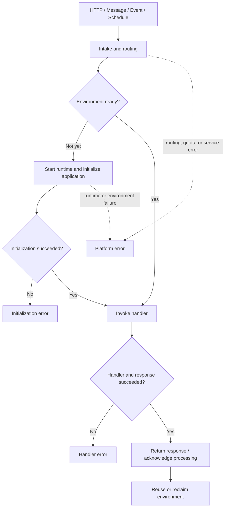
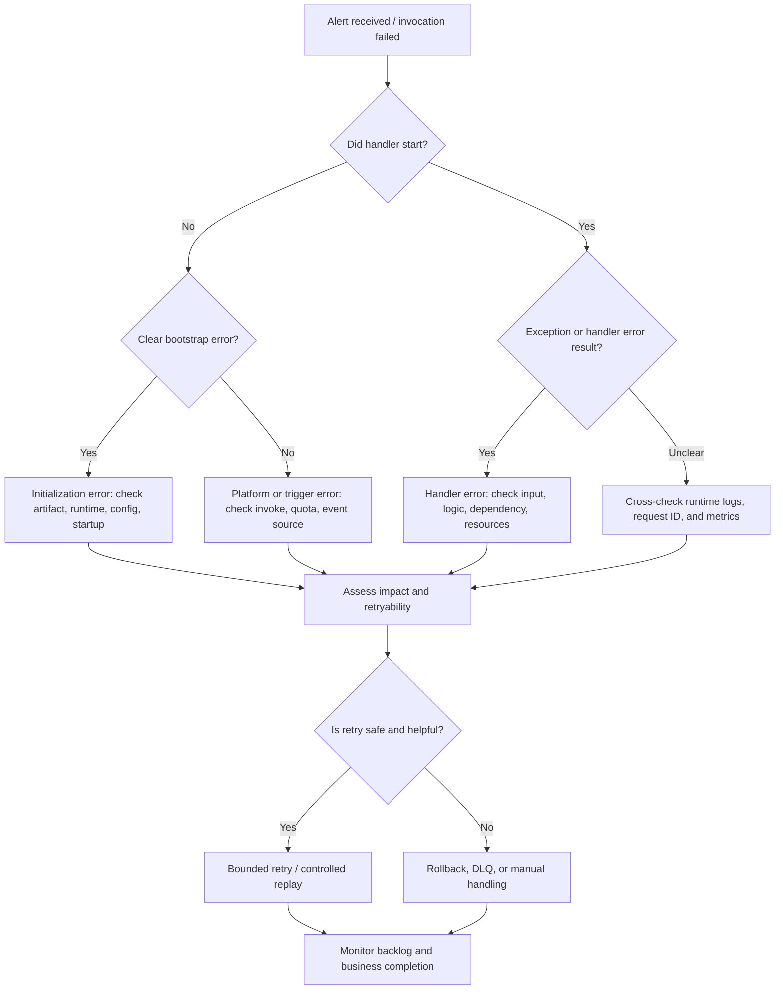

# Classifying Initialization Errors, Handler Errors, and Platform Errors

A function execution can fail at multiple points: before the handler code is invoked, while the handler is running, or in the serverless service layer orchestrating execution. Accurately identifying the timing and source of a failure helps the team know whether to fix Java code, runtime configuration, dependencies, triggers, or provider infrastructure. If every failure is lumped into a single "function failed" message, retrying, investigating, and recovering take longer, and a minor error can even escalate into a major outage.

This lesson classifies errors into three practical groups: **initialization errors**, **handler errors**, and **platform errors**. This is a classification for design and operations, not a universal error-code standard shared across all providers. Specific status names, logs, and retry rules vary across FaaS platforms and trigger types.

## 1. Placing Errors in the Function Lifecycle

A FaaS invocation typically passes through the following phases:

1. **Trigger intake and routing:** the platform receives an HTTP request, message, event, or schedule; validates configuration; and locates the target function.
2. **Execution environment preparation:** the platform provisions an environment, starts the runtime, and loads application code when a new environment is needed.
3. **Application initialization:** the runtime loads classes, runs static initializers, builds the dependency injection container, reads configuration, and prepares shared components.
4. **Handler invocation:** the adapter converts input into appropriate objects and calls the handler method; the application validates data, executes business logic, and builds a result.
5. **Invocation completion:** the runtime serializes the result, returns the response, or acknowledges processing; for asynchronous triggers, the platform or event source may decide to retry.
6. **Pause, reuse, or reclamation of environment:** the platform may keep the environment to serve subsequent invocations or terminate it. The application must not assume an instance will always be reused.



The diagram illustrates conceptual boundaries. In real systems, a platform may collapse multiple stages into a single error status, or record an error at the runtime layer even when the root cause lies in application code. For example, a static initializer failing to connect to a database is an initialization error by root cause; the provider may surface it as a runtime initialization error.

### Distinguishing by Timing

| Error Group | Typical Timing | Typical Symptoms | First Investigation Path |
| --- | --- | --- | --- |
| Initialization errors | Before the handler begins processing | No handler-entry logs; new environments repeatedly fail to become ready; class-loading or bootstrap errors | Artifact, Java runtime, configuration, static initializers, dependencies, and startup permissions |
| Handler errors | After the handler is invoked | Request/event ID and processing logs exist; exceptions, wrong results, timeouts, or dependency errors | Input, business logic, queries, external APIs, serialization, and invocation resources |
| Platform errors | At the intake, routing, provisioning, or orchestration layer | Throttling, service unavailable, invocation rejected, event source unable to poll, or control-plane errors | Quotas, concurrency, service status, trigger config, and evidence from the provider |

Absence of handler-entry logs is not enough to prove a platform error. Logs may not have been emitted, may have been filtered, or may not have flushed before the runtime stopped. Cross-check the request ID, initialization logs, metrics, event source, and service health before concluding.

## 2. Initialization Errors

Initialization errors occur when the platform has started preparing an environment, yet the application cannot become ready to receive invocations. For Java, this is typically the stage where the runtime starts the JVM, loads classes, and initializes shared components.

### 2.1. Common Causes

**Incompatible artifact or runtime.** The deployment package is missing classes, missing resources, has the wrong entry point, uses the wrong bytecode version, or relies on native libraries incompatible with the runtime's operating system or CPU architecture. For example, an application compiled for a newer Java version than the deployed runtime may hit `UnsupportedClassVersionError`.

**Class-loading and static initializer failures.** A missing class, library version conflict, or error inside a static block can prevent the application from initializing. External calls placed in static initializers can also make startup depend on a database, secret manager, or another API.

```java
public final class ReportHandler {
    // Risk: creating the client may fail as soon as the class is loaded.
    private static final ReportClient CLIENT = ReportClient.connectFromEnvironment();

    public Response handle(Request request) {
        return CLIENT.createReport(request);
    }
}
```

If `connectFromEnvironment()` throws an exception, the handler may never be invoked. Business logs at the start of `handle()` will not appear. Inspect the initialization stack trace and the configuration required by the client.

**Dependency injection or framework bootstrap failure.** A required bean fails to instantiate, configuration is invalid, a profile does not exist, environment variables are missing, or the framework cannot locate a resource, halting the application before the first invocation.

**Startup configuration and permissions.** The function may be unable to read a required secret, certificate, config file, or endpoint. Distinguish the function's execution permissions from permissions required by downstream services. If a secret is denied during bootstrap, it is an initialization error; if a permission is used only when handling a specific request, the error may surface in the handler.

**Unstable network dependency initialization.** Connecting to a database or external API during startup can fail due to DNS, routing, firewalls, VPC settings, TLS, connection exhaustion, or an unavailable downstream service. A single transient failure can cause every new environment to fail if the application lacks timeouts and a sound initialization strategy.

### 2.2. Symptoms and Diagnosis

- Invocations fail before any handler-entry logs appear.
- Errors cluster on newly provisioned environments or right after deploying a new version.
- Logs show signs such as class-loading failures, static initializer errors, missing environment variables, failure to create the application context, or inability to read secrets.
- Initialization duration spikes abnormally, cold starts lengthen, or new environments repeatedly spin up and terminate.
- The old version runs fine while the new version cannot start, even with unchanged invocation inputs.

Investigation should begin with the artifact and runtime: verify the Java version, handler configuration, classpath, packaged resources, environment variables, and deployment architecture. Next, read logs from the very start of bootstrap and inspect the root-cause stack trace rather than only the outer wrapper exception. If startup calls another service, check DNS, TLS, routing, security groups/firewalls, IAM/service account permissions, and dependency health.

Do not blame every initialization error on cold starts. A cold start is the process of preparing a new environment; it can succeed or fail. A slow initialization that completes is a latency issue. An initialization that fails to complete is an initialization error.

### 2.3. Prevention and Recovery

- Build with the exact Java version and target bytecode of the runtime; inspect the deployment package contents before releasing.
- Boot the application in a production-equivalent environment to catch class-loading, framework, and configuration issues.
- Keep static initializers simple and deterministic; avoid long queries or business side effects during class loading.
- Set bounded timeouts on network operations during startup. If a dependency is temporarily unavailable, use bounded retries with backoff.
- Verify secret-reading and config permissions in the deployed environment, not only on developer machines.
- Roll out gradually or use aliases/versions so you can revert to a known-good release.
- Emit enough bootstrap logging to identify which component failed to initialize, without logging secrets, tokens, or sensitive data.

An important note: not every dependency should be connected before the first invocation. Initializing lightweight, reusable clients is often beneficial; however, executing database queries or external API calls inside static initializers can prolong cold starts and turn a dependency outage into an environment startup failure. Consider constructing clients once while performing actual connections or queries within invocation scope, with proper timeouts and error handling.

## 3. Handler Errors

Handler errors occur after the runtime has invoked the handler code. Causes may lie in input data, business logic, dependencies, resources, or response generation.

### 3.1. Categories of Handler Errors

**Invalid input.** Missing required fields, wrong data types, oversized payloads, schema drift, or data failing business validation. These are typically predictable errors and should not be retried indefinitely with the same input.

**Business logic bugs.** Invariant violations, invalid order states, calculation bugs, or unhandled branches. These errors usually require code or data fixes; automatic retries will not make them disappear.

**External dependency errors.** Database connection rejections, deadlocks, 5xx API responses, rate limits, timeouts, or temporarily unavailable payment services. Distinguish transient failures from permanent errors such as missing entities or denied permissions.

**Serialization and response errors.** The handler completed business work yet failed to serialize the result to JSON, returned a type unsupported by the runtime, or produced a response exceeding gateway limits. Errors can happen after the core business work has already completed.

**Resource limits exceeded during invocation.** The handler consumes excessive memory, CPU, or time and is terminated by the runtime/platform. By symptom, this may be reported as a platform-observed timeout or out-of-memory error; by cause, investigate algorithms, data sizes, queries, loops, concurrency, or configured resource limits.

### 3.2. Classifying by Recoverability

| Error Type | Example | Does Retry Help? | Handling Approach |
| --- | --- | --- | --- |
| Data/validation error | Missing `orderId`, invalid format | Usually no | Reject request or route malformed message to invalid-data handling |
| Non-transient business error | Order already canceled, disallowed state | Usually no | Record final business outcome; do not retry indefinitely |
| Transient dependency error | Brief timeout, HTTP 503, connection reset | Possibly | Bounded retry with backoff and jitter; enforce per-call timeouts |
| Dependency quota/rate-limit error | HTTP 429 or request throttling | Possibly after waiting | Honor `Retry-After` if present, slow down, and bound concurrency |
| Configuration/permission error | Wrong secret, missing table read permission | Not until fixed | Fix config or policies; avoid aggressive retry loops |
| Unknown error | Null pointer, bug, or unexpected state | Uncertain | Log stack trace and context; bound retries and route repeat cases for investigation |
| Timeout/OOM | Processing huge file exceeding memory or deadline | Only if root cause is transient | Optimize, split work, adjust validated resources, or change execution model |

An exception does not automatically tell the platform whether an error is recoverable. The runtime or adapter usually sees only whether the invocation succeeded or failed. The application and trigger configuration must translate that classification into appropriate behavior: returning an HTTP status code, throwing an exception, acknowledging a message, requesting a retry, or routing the failed record to a dead-letter queue.

### 3.3. Neither Swallow Errors nor Retry Blindly

The snippet below illustrates handling invalid input differently from transient dependency errors in an HTTP handler. The `Request`, `Response`, and exception types are illustrative, not APIs of a specific provider.

```java
public final class OrderHttpHandler {
    private final OrderService orders;

    public OrderHttpHandler(OrderService orders) {
        this.orders = orders;
    }

    public Response handle(Request request) {
        try {
            CreateOrder command = validateAndMap(request);
            Order order = orders.create(command);
            return Response.created(order);
        } catch (InvalidRequestException error) {
            // Input error: return a clear result, do not request automatic retry.
            return Response.badRequest(error.getMessage());
        } catch (TransientDependencyException error) {
            // Transient error: report failure so caller can apply controlled retry.
            return Response.serviceUnavailable("Dependency temporarily unavailable");
        } catch (RuntimeException error) {
            // Unclassified error: log safe context and let the runtime observe the failure.
            log.error("Order handler failed", error);
            throw error;
        }
    }
}
```

In an HTTP API, a 400 response typically denotes invalid input; 503 can denote a temporarily unavailable dependency; 500 denotes an unexpected processing error. Exact conventions depend on the API contract. If the gateway or adapter turns exceptions into HTTP 200, clients may assume the request succeeded. Conversely, returning 500 for permanent data errors can cause clients to retry pointlessly.

For queues or asynchronous events, expression differs: throw an exception or report the record as failed so the trigger applies retries. If the handler catches an exception and returns normally, the platform may treat the message as successfully processed. Therefore, the same business error may require different expression depending on the trigger.

## 4. Platform Errors

Platform errors occur in the service layer managing invocations, execution environments, routing, or event sources. The application may not have been invoked yet, or may be unable to finish because a service outside handler code failed.

### 4.1. Categories of Platform Errors

**Orchestration service unavailable.** The provider's control plane or data plane suffers an outage, causing environment provisioning, function invocation, or response delivery to fail. Evidence usually appears in service error codes, request IDs, service health pages, or provider incident notices.

**Throttling and quota limits.** The function exceeds concurrency limits, requests per second, environment creation rates, or account/region quotas. Some cases return throttling errors or reject invocations before the handler runs.

**Routing and trigger configuration errors.** API Gateway points to the wrong version/alias, an event source mapping is disabled, a subscription lacks permissions, a schedule is misconfigured, or a trigger cannot invoke the function. These can be operational configuration errors rather than provider infrastructure outages, yet they sit outside handler logic.

**Event source or delivery errors.** A queue cannot be polled, a stream shard cannot be read, message-reading permissions were revoked, or an event source mapping errored. In that case, the function may receive no events even though handler code is completely healthy.

**Unexpected runtime environment termination.** The runtime host, sandbox, or physical server may fail. The platform may spin up a new environment and redeliver the event, depending on the trigger and delivery semantics.

**Platform limits exceeded.** The invocation is terminated due to maximum timeout, memory limit, payload size, or concurrency limits. Separate two questions: what action did the platform take, and what condition in the workload caused the limit to be breached? For instance, the platform sends a stop signal on timeout; the root cause may be an unindexed query or a hanging dependency.

### 4.2. Symptoms and Diagnosis

- Failures happen before the handler starts, or multiple unrelated functions fail during the same window.
- Error codes from management/invoke APIs, throttling notices, service unavailable messages, or abnormal event source mapping statuses appear.
- Traffic rises alongside concurrency, throttle counts, or queue message age.
- Direct invocation of the function succeeds, while expected triggers fail to deliver events.
- Multiple invocations are affected across the same region/account or a shared provider backing service.

Collect request/invocation IDs, timestamps with time zones, region, function version/alias, trigger, raw error codes, and relevant metrics. Check quotas, reserved/provisioned concurrency if applicable, trigger state, invoke permissions, and provider service health. When evidence points to a widespread outage, check the provider's status dashboard.

Do not blame every network error on the platform. Wrong DNS, missing VPC routes, blocking security groups, or expired certificates can stem from workload configuration. Determine whether the failure occurred on the path invoking the function, the path from the function to a dependency, or the path from the event source delivering the event.

### 4.3. Prevention and Recovery

- Monitor quotas and set alerts before hitting concurrency or request-rate limits.
- Cap maximum concurrency to match database and dependency capacity so sudden scale-out does not overwhelm downstream systems.
- Use queues as buffers when business rules permit asynchronous processing; monitor backlog and message age.
- Design retries with backoff and jitter to avoid many clients or invocations retrying at the same instant.
- Configure dead-letter queues or failure destinations for asynchronous sources when supported by the platform.
- Maintain an event-replay procedure for post-incident recovery while ensuring handlers are idempotent.
- Verify invoke permissions, event source mappings, versions/aliases, and network settings after every deployment.
- During provider outages, monitor status, preserve unprocessed events, and replay strictly according to policy to avoid traffic spikes once the service recovers.

## 5. Retries Depend on the Trigger Type

Classifying an error is only the first step. Subsequent recovery depends on how the function is invoked. There is no universal rule that every failure is automatically retried by the platform.

| Trigger Type | Who Typically Decides Retries? | What to Watch Out For |
| --- | --- | --- |
| Synchronous HTTP | Client, API caller, or gateway layer per configuration | Callers may retry after 5xx/timeouts; idempotency keys are needed to avoid duplicate orders or charges |
| Synchronous SDK/API invocation | Caller | Distinguish invoke-API service errors from function errors returned in the invocation payload; inspect both response metadata and function error |
| Asynchronous invocation | FaaS service per configured retry policy | May retry on function errors; bound attempts, event age, and dead-letter/failure destinations |
| Queue event source | Queue and event source mapping | Visibility timeout, receive count, redrive policy, batch size, and failed-record handling govern redelivery |
| Stream event source | Event source mapping and checkpoints/offsets | One bad record can stall partition/shard progress; handle partial batches, retries, and poison records per stream semantics |
| Scheduled event | Scheduler and event delivery mechanism | Handle duplicate runs, delayed runs, and catch-up runs after outages |

### 5.1. HTTP and Synchronous Invocation

With HTTP, the function usually returns a response within the same request flow. If the client times out, it may not know whether the business action completed. For example, the function wrote an order to the database, then the response connection dropped; a client retry can create a duplicate order without an idempotency key.

Callers should retry conditionally: retry only likely transient errors, use backoff, cap attempts, and keep the same idempotency key for the same business operation. Never retry every 4xx code. For 5xx errors, check the API contract and the possibility that side effects already persisted before resending.

### 5.2. Queues and Batch Processing

One invocation can receive multiple messages. If one message fails and the handler throws a generic exception, the platform may redeliver the entire batch, including messages already processed successfully. This increases load and causes repeated side effects. Some platforms support reporting individual failed records or partial batch responses; use that feature where appropriate and check the exact event source contract.

Queues typically have a visibility timeout or processing lease. If the function takes longer than this window, the message may reappear while the earlier execution is still running. Configure timeouts and visibility timeouts compatibly, while still designing idempotency since duplicate delivery can happen for many reasons.

### 5.3. Streams and Poison Records

In streams, ordering and checkpoints may be tied to a partition or shard. A poison record that always errors can block progress or cause repeated retries for that segment of the stream. Consider partial batch responses, batch bisection, bounded retries, record expiration, and poison-record isolation mechanisms specific to the service.

Never drop failed records merely to keep the stream moving if doing so loses business data. Record identifiers, sanitized payloads, and failure reasons in an investigable location, and define how to replay them after fixing the bug.

### 5.4. Why Idempotency Is an Operational Requirement

Retries can occur after a side effect completed but before the platform received a success acknowledgement. Handlers must therefore process redelivered events safely. Use the event ID or a stable business key, persist markers atomically, and forward the same idempotency key to external services if supported.

Never rely solely on static variables or instance memory to detect duplicate events. Instances can be replaced, invocations can run concurrently, and retries can land on a different environment.

## 6. Quick Diagnostic Matrix

When an alert fires, start from the symptom and narrow down using evidence:

| Symptom | Possibilities to Check | Useful Evidence |
| --- | --- | --- |
| No handler logs after deploy | Initialization error, wrong entry point, or trigger cannot invoke function | Init logs, runtime errors, function version/alias, invoke request ID |
| Only the new version fails | Incompatible artifact, dependency, config, or migration | Compare package, runtime, env vars, and stack traces between versions |
| Handler runs then throws exception | Data, business logic, or dependency error | Event/request ID, stack trace, sanitized input, dependency traces |
| Duration hits exact timeout | Handler hung or task exceeded time limit | Duration, timeout metrics, external query/API traces, final logs before stop |
| Memory grows then invocation stops | Memory leak, loading full files, oversized batches, or insufficient heap | Memory metrics, heap profile if available, payload and batch sizes |
| Throttles spike as traffic rises | Concurrency or quota limits | Concurrent executions, throttle count, request rate, and account/region quotas |
| Direct invoke succeeds but queue does not process | Event source mapping, queue read permissions, or poller errors | Mapping status, visible/in-flight message counts, permissions, event source metrics |
| Duplicate messages or double processing | Retries, visibility timeout, duplicate events, or insufficient idempotency | Event ID, receive count, processing duration, inbox records, side-effect logs |
| Multiple functions fail simultaneously | Shared dependency or provider outage | Timestamps, region, dependency errors, provider status, multi-function metrics |

An effective practice is constructing a timeline per event: when the source emitted it, when the trigger received it, when the invocation started, when the handler started, dependency calls, completion or failure times, and retries. A timeline reveals where the failure occurred and whether business side effects already took place.

## 7. Logging and Metrics to Separate the Three Error Groups

A good observability setup must answer three questions: was the function invoked, did the handler run, and did the business action complete?

### 7.1. Structured Logging

Emit relevant correlation fields for every execution:

- Platform-assigned `requestId` or invocation ID.
- `eventId`, message ID, or idempotency key if supplied by the source.
- `correlationId` or business ID to link steps across the workflow.
- Function name, version/alias, trigger, and processing stage.
- Error classification result: `INITIALIZATION`, `HANDLER`, or `PLATFORM` once sufficient evidence exists.
- Internal error code, exception class, and involved dependency.
- Duration, retry count, and business completion status.

Do not log full payloads if they contain sensitive data. Log necessary identifier fields, mask personal data and tokens, bound log sizes, and ensure bootstrap logs never leak secrets.

### 7.2. Metrics to Track

| Metric | Operational Meaning |
| --- | --- |
| Invocation count and error count | Total calls and invocation failure rate |
| Init duration / cold start count | Duration and frequency of new environment initialization |
| Handler duration, p95/p99 | Processing latency and trend toward timeout |
| Timeouts and memory utilization | Invocations constrained by time or memory limits |
| Throttles and concurrent executions | Concurrency and quota pressure |
| Queue depth, message age, receive count | Backlog, processing lag, and retry levels |
| Dead-letter queue depth | Events unprocessable under current policy |
| Business completion/failure | Final business outcome, separate from invocation success |

Platform metrics usually cannot replace business metrics. A handler can return success after merely placing a message onto a queue; business completion happens later in a worker. Measure both intake and final completion.

### 7.3. Alerting on Meaningful Signals

Alert when error rates spike, init errors appear after deployment, p95/p99 approaches timeout, throttling rises, queue age breaches SLAs, DLQ receives messages, or business completion rates drop. Some platform errors are brief; alerts based on trends and impact are usually more actionable than alerting on a single exception.

## 8. Incident Response Workflow

When a function fails in production, follow this sequence:

1. **Determine scope.** Is one invocation, one version, one trigger, or multiple functions affected? When did the incident start, and did it coincide with a deployment or config change?
2. **Identify the failing phase.** Was an invocation created? Are there init logs? Did the handler start? Was the outcome acknowledged or is the event retrying?
3. **Gather identifiers.** Save request ID, event ID, version, region, trigger, timestamp, and raw error codes.
4. **Provisional classification.** Initialization, handler, or platform error? Record evidence and confidence level; avoid forcing ambiguous errors into a bucket without enough data.
5. **Assess business impact.** Did database writes, payments, emails, or resource creations happen before the error? Is there a duplication risk on retry?
6. **Mitigate impact.** Can you roll back the version, lower concurrency, pause the trigger, route messages to a DLQ, or enable graceful degradation?
7. **Controlled recovery.** Replay events only when handlers are idempotent and dependencies are healthy; monitor backlog, retries, and business outcomes post-recovery.
8. **Confirm root cause.** Build a timeline, find the triggering condition, and verify the fix prevents recurrence.



## 9. Practical Examples

### Example A: Java Function Fails to Start After Deploying a New Version

After deployment, every invocation fails and no logs appear inside the `handle()` method. Runtime logs show `UnsupportedClassVersionError` while loading a class.

**Classification:** Initialization error caused by bytecode compiled for a newer Java version than the deployed runtime.

**Resolution:** Check the build JDK, target bytecode, and function runtime; rebuild with compatible settings; verify startup in a production-equivalent environment; deploy a new version while preserving rollback capability.

### Example B: Order Processing Fails During a Transient Database Disconnect

The handler started and logs show `eventId`, but the order update timed out during a database failover. The message was redelivered afterward.

**Classification:** Handler error caused by a transient dependency failure. Even if the runtime stopped the function for hitting total timeout and the platform recorded an invocation timeout, the root cause remains database wait time or connection management.

**Resolution:** Set connection and query timeouts below the function timeout; use backoff retries for safe operations; enforce idempotency by order/event; verify transactions leave no half-completed state; monitor receive counts and DLQ.

### Example C: HTTP API Throttled During a Traffic Surge

The function runs normally at low load, but a campaign drives a sharp surge in concurrent requests. Some requests are rejected before the handler starts; throttle metrics rise.

**Classification:** Platform error at the concurrency/quota layer. If increased handler concurrency overloaded the database, an application-side dependency error may also coexist.

**Resolution:** Inspect quotas and concurrency; cap limits to match database capacity; use a queue for work that can be processed asynchronously; return clear overload responses; configure client retries with backoff and jitter; load-test before raising quotas.

### Example D: Poison Message Causes Repeated Batch Redeliveries

A queue trigger delivers 10 messages to the function. Nine succeed, and one malformed message causes the handler to throw an exception. If the adapter marks the entire batch failed, the nine succeeded messages may be redelivered.

**Classification:** Handler error due to invalid data; redelivering the whole batch is the event source's retry behavior.

**Resolution:** Validate each record, use partial batch responses if supported by the platform, record failed messages for investigation, and route unprocessable messages to a DLQ per policy. Operations for the nine succeeded records must still be idempotent to stay safe during redelivery.

## 10. Design and Operations Checklist

- [ ] Can tell whether the handler started or the invocation failed beforehand.
- [ ] Initialization logs capture bootstrap failure causes without leaking secrets.
- [ ] Artifact, Java version, runtime, classpath, and resources are verified before deploy.
- [ ] Static initializers perform no business side effects or unbounded network dependencies.
- [ ] Handler distinguishes data errors, business errors, transient dependency errors, and unknown errors.
- [ ] Exceptions are not swallowed in ways that mislead the platform into treating invocations as successful.
- [ ] Dependency timeouts are lower than the total function timeout and retries are bounded.
- [ ] Retry policy matches the HTTP, async invocation, queue, or stream trigger in use.
- [ ] Idempotency covers side effects and duplicate event processing.
- [ ] Batches handle per-record failures if supported by the event source.
- [ ] Quotas, concurrency, throttles, queue age, and DLQ are monitored.
- [ ] Request ID/event ID exist to build timelines and correlate logs across steps.
- [ ] Rollback, event replay, and post-recovery business verification procedures are in place.

## Conclusion

Initialization errors occur before the handler is ready, typically involving artifacts, runtime, class loading, bootstrap, or startup configuration. Handler errors occur during processing and typically involve inputs, business logic, dependencies, serialization, or resource limits. Platform errors lie in intake, routing, provisioning, quotas, event sources, or the provider's orchestration services.

These three groups help pinpoint where to investigate, though they do not replace root-cause analysis. A platform-recorded timeout may still originate from a slow query inside the handler; a network error during initialization may stem from workload VPC configuration. Combine failure timing, request/event IDs, logs, metrics, and trigger state to classify accurately.

Finally, retries must be guided by trigger type and error recoverability. Idempotent design, explicit timeouts, bounded retries, dead-letter queues, and end-to-end observability enable Java functions to recover safely when failures occur without creating unintended business side effects.
