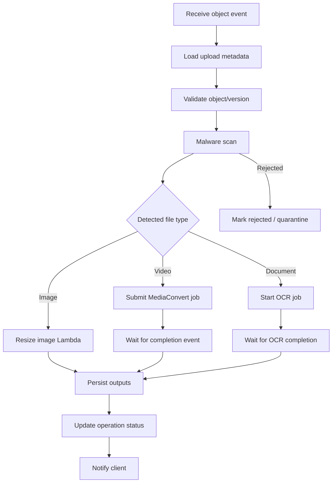

# Designing an Image, Video, and Document Upload Processing Pipeline

## 1. Why Do You Need an Asynchronous File Processing Pipeline?

A Java application often starts by receiving a file over HTTP, saving it, and processing it right inside the same request: validating the format, resizing images, generating thumbnails, reading PDFs, extracting text, or transcoding video. This approach is easy to implement when files are small and processing times are short. When files grow larger, traffic spikes, or processing libraries consume heavy CPU/RAM, requests can time out, the JVM retains large buffers in the heap, and a single slow dependency can bottleneck the entire API.

A serverless pipeline decouples **file intake** from **file processing**. The API authorizes the upload and creates an upload record; the client uploads the file directly to object storage; an object-created event enqueues the work; workers or a workflow process the file based on its type; results are written to a dedicated output area; and status is updated so the client can query it.

This design absorbs bursts, retries individual jobs, scales workers independently, and avoids forcing users to hold an HTTP connection open for the entire processing duration. It also introduces responsibilities around untrusted file security, duplicate events, idempotency, data lifecycle, storage costs, and recoverability.

In the CLOUD_SERVERLESS module, a Java function can handle image processing or short orchestration steps; long videos and documents requiring OCR may be better suited for dedicated managed services. You should not force every file format into a single Lambda handler.

## 2. Design Goals and Boundaries

A well-designed pipeline needs clear boundaries:

- **Upload boundary:** who is allowed to upload, which key they can upload to, permitted sizes/formats, and how long the URL remains valid.
- **Quarantine boundary:** newly uploaded files are treated as untrusted data until they pass inspection.
- **Processing boundary:** each file or file version has its own operation ID and processing state.
- **Worker boundary:** each worker has least-privilege permissions scoped to its specific job type.
- **Output boundary:** results are written to a separate bucket/prefix with clear versioning and access policies.
- **Status boundary:** clients can inspect progress/results without accessing internal queues or storage.
- **Recovery boundary:** retries, DLQs, replay, and reconciliation can operate independently.

Do not use the client-supplied filename as a unique identifier. Multiple users can upload `report.pdf`; the same key can be re-uploaded; notifications can arrive late or be duplicated. Use a server-generated `uploadId`, object key, and object version/checksum to identify the data.

## 3. Reference Architecture

An AWS example: the client requests an upload session and uploads the file to an S3 quarantine area; S3 emits an event to SQS; a dispatcher validates metadata and starts a workflow; the workflow routes the file to the appropriate processor.

```mermaid
flowchart TD
    C[Web / Mobile client] -->|POST /uploads| A[Java API Lambda]
    A --> DB[(Upload metadata DB)]
    A -->|Presigned URL| C
    C -->|PUT / multipart upload| Q[(S3 quarantine bucket)]
    Q -->|Object-created event| S[SQS intake queue]
    S --> D[Java dispatcher Lambda]
    D --> W[Step Functions workflow]
    W --> V[Validate + malware scan]
    V --> R{File type}
    R -->|Image| I[Image Lambda]
    R -->|Video| M[MediaConvert / ECS worker]
    R -->|Document| T[Textract / document worker]
    I --> O[(S3 processed bucket)]
    M --> O
    T --> O
    O --> DB
    DB -->|Status/result| A
    C -->|GET /uploads/{id}| A
```

Main flow:

1. The API authenticates the user/tenant and creates an `uploadId` along with an upload record.
2. The API generates a presigned URL or presigned POST for a specific object key.
3. The client uploads directly to S3; the file is stored in the quarantine bucket/prefix.
4. The object-created event is delivered to SQS for buffering and retries.
5. The dispatcher verifies the object, version, and upload record, then starts the workflow.
6. The workflow performs security scanning, detects the file type, and selects the processor.
7. The processor writes outputs with deterministic keys and updates metadata and status.
8. The client polls for status or receives a callback when the operation completes.

SQS acts as the buffer and retry boundary; Step Functions manages multi-step flows, timeouts, and processing branches; S3 stores the file content; and the database holds business state. Never place binary files inside queue messages or workflow state payloads.

## 4. Creating an Upload Session Before Receiving the File

Instead of letting the client choose the bucket/key, the API should create an upload session with explicit permissions and expiration.

Example request:

```http
POST /uploads
Authorization: Bearer <access-token>
Content-Type: application/json

{
  "fileName": "invoice-2026.pdf",
  "contentType": "application/pdf",
  "expectedSize": 1843200,
  "purpose": "INVOICE_IMPORT"
}
```

Response:

```json
{
  "uploadId": "upl-7f1a",
  "objectKey": "quarantine/tenant-42/upl-7f1a/source",
  "uploadUrl": "https://storage.example/...signed...",
  "expiresAt": "2026-11-17T08:15:00Z",
  "statusUrl": "/uploads/upl-7f1a"
}
```

The API persists metadata before returning the URL. The upload URL should restrict:

- The specific object key and bucket.
- The HTTP method (PUT or POST) and a short expiration window.
- Content type/checksum constraints if they can be signed into the request.
- Maximum size; a presigned POST policy can enforce `content-length-range`.
- Preventing clients from writing directly to the processed bucket or another tenant's key.
- Never granting bucket listing, object deletion, or read access to other files.

The content type sent by the client cannot be blindly trusted. Workers must verify file signatures/magic bytes and actual structure. A presigned URL is a bearer capability: anyone holding the URL can use it within its scoped permissions and expiration, so never log the full URL or send it to analytics.

## 5. Direct Upload and Multipart Upload

For large files, letting the client upload directly to object storage avoids routing all bytes through API Gateway/Lambda. With multipart uploads, the client sends multiple parts and finishes with `CompleteMultipartUpload`; processing events should only trigger after the object is complete.

The upload design needs to:

- Enforce limits on file size and part count.
- Store the multipart session's upload ID so it can be resumed or aborted.
- Verify the checksum upon completion if integrity verification is required.
- Configure a lifecycle rule to clean up incomplete multipart uploads.
- Handle client disconnections and part upload retries.
- Prevent the object from entering the pipeline before the upload is complete.

An S3 ETag is not always the MD5 of the entire object, especially for multipart uploads and certain encryption modes. If integrity checking is needed, use a service-supported checksum and store the verified algorithm and value.

## 6. Quarantine and Untrusted File Inspection

Uploaded files are untrusted input. Before sending them to a parser, OCR engine, or transcoder, place them in quarantine and check:

- Actual size, page/frame count, duration, and pixel dimensions.
- Magic bytes and true format; do not rely solely on file extension or MIME headers.
- Malware/viruses using an appropriate scanner.
- Archives for abnormal compression ratios, zip bombs, or path traversal.
- PDFs/Office documents for macros, scripts, embedded objects, or malicious payloads.
- Corrupted or truncated files, or parser timeouts.
- Tenant ownership, upload session, and object key.

Do not run complex parsers with broad network access or access to production data. Isolate scanners/processors within an appropriate security boundary, enforce CPU/RAM/time limits, and grant read access only to the input object plus write access to a dedicated output prefix.

For sensitive documents, consider Content Disarm and Reconstruction (CDR), masking/redaction, and a review process. Never write raw documents or personal data to logs.

## 7. File Identification and Duplicate Event Handling

Object-created notifications can be delivered more than once and do not guarantee global ordering. SQS Standard also provides at-least-once delivery. Consequently, the same file may trigger a workflow multiple times.

A processing identity can be constructed from:

```text
processingKey = tenantId
              + bucket
              + objectKey
              + objectVersionId
              + processorName
              + processorVersion
              + transformProfile
```

If versioning is enabled, `versionId` distinguishes uploads at different points in time. Without a version ID, use a verified checksum or an immutable upload ID. Do not rely on ETag as a general-purpose MD5.

Store a processing record with a unique key/conditional write. Only one worker claims the operation; duplicate events read the current state and avoid repeating side effects. If the same object needs to run through a new processing profile, `processorVersion`/`transformProfile` must intentionally produce a new identity.

For S3 events that include a `sequencer`, it can be used to distinguish newer/older events for the same object key; never compare sequencers across different keys. When using versioning, prefer binding the operation to a specific object version rather than relying solely on event arrival order.

## 8. Upload and Processing State Model

Uploading and processing are two distinct lifecycles. An upload may complete without being processed yet; a single file may have multiple processing profiles.

Example upload states:

```text
CREATED
  -> UPLOADING
  -> UPLOADED
  -> VALIDATING
  -> ACCEPTED
  -> REJECTED
```

Processing states:

```text
PENDING
  -> RUNNING
  -> SUCCEEDED
  -> FAILED_RETRYABLE
  -> FAILED_FINAL
  -> CANCELLED
```

In practice, `FAILED_RETRYABLE` can be an internal attempt state while the overall operation remains `RUNNING` as long as retries remain. State transitions must use conditional writes or version checks so a stale worker cannot overwrite newer results. Record `attempt`, `startedAt`, `completedAt`, `errorCode`, `outputKey`, and `processorVersion`.

Clients need a status API with a clear contract. Do not expose SQS, Step Functions execution ARNs, or internal buckets for clients to infer status.

## 9. Routing by File Type

After validation, the dispatcher selects the appropriate processor. Do not rely solely on filename extensions; combine MIME detection, file signatures, upload purpose policies, and processing limits.

| Type | Common Steps | Suitable Platform |
|---|---|---|
| Image | Decode, check dimensions, rotate by EXIF, resize, thumbnail, strip metadata | Java Lambda for small/medium images; container if native dependencies or high memory are needed |
| Video | Probe metadata, transcode, generate preview, thumbnail, audio extraction | AWS Elemental MediaConvert or container/batch worker |
| PDF/Document | Malware scan, OCR, page split, classify, extract fields, redact | Textract or document processing service; Lambda for orchestration |
| Archive | Check entries/paths, bound decompression, scan contents | Isolated worker with CPU/disk quotas and expansion limits |

A single event can produce multiple outputs: thumbnails in multiple sizes, video previews, transcripts, OCR JSON, and metadata. Use a manifest or output records to describe all artifacts associated with a source version.

## 10. Image Processing Pipeline

For images, a Java Lambda is well suited for short, bounded tasks: resizing, thumbnails, format conversion, watermarking, or metadata extraction.

A typical pipeline:

1. Read the object version from quarantine.
2. Verify magic bytes and ensure the decoder supports the format.
3. Enforce limits on width, height, pixel count, and file size before allocating large buffers.
4. Decode the image and apply EXIF orientation.
5. Generate the target sizes defined by the profile.
6. Strip sensitive GPS/EXIF metadata if not needed by the business.
7. Encode the output format and compute the checksum.
8. Write the output to an immutable key based on source version/profile.
9. Record metadata and transition the operation to `SUCCEEDED`.

Example output keys:

```text
processed/tenant-42/upl-7f1a/v3/thumbnail-320.webp
processed/tenant-42/upl-7f1a/v3/preview-1280.webp
```

Including `profileVersion` in the key allows re-running when algorithms change without overwriting outputs from older versions. If clients need a stable output pointer, the database can point to the active version once processing completes.

### Java Image Worker: Memory Considerations

A 5 MB compressed image can require hundreds of MB when decoded into a pixel buffer. Estimate memory based on pixel count, intermediate copies, and concurrent images processed—not just file size. Avoid loading the entire file into multiple `byte[]` arrays; stream where the library supports it, cap dimensions, and process one output at a time.

If using ImageIO or native codecs, verify that decoders/plugins are bundled in the artifact and compatible with the Lambda Linux/architecture environment. Test CMYK, alpha channels, orientation, animated images, and malformed files. Use memory tuning to measure peak RAM and execution duration.

## 11. Video Processing Pipeline

Videos typically involve long processing durations, large files, and multiple output profiles. By default, you should not load an entire video into a Java Lambda and transcode it within a single invocation.

A reference pipeline:

1. An S3 event generates a job request.
2. The dispatcher validates metadata and submits a MediaConvert job or ECS/Batch task.
3. The media service reads the source object and writes renditions to the processed bucket.
4. A completion event updates the operation status.
5. A worker generates thumbnails/manifests or writes final metadata.

Example output:

```text
processed/video-123/source-version-4/
  ├── hls/master.m3u8
  ├── hls/segment-00001.ts
  ├── hls/segment-00002.ts
  ├── poster.webp
  └── metadata.json
```

Choose MediaConvert when you need managed transcoding with standard codecs/profiles and do not want to manage a fleet. Choose ECS/Fargate or AWS Batch when you need custom binaries, specialized codecs, heavy GPU/CPU resources, or custom pipeline logic. Lambda can orchestrate jobs without needing to perform the heavy transcoding itself.

Track job IDs, retries, quotas, concurrent jobs, and per-minute/per-output costs. If a job is submitted twice due to duplicate events, use the processing key and check existing job records before creating a new job.

## 12. Document Processing Pipeline

Documents may require OCR, table/form extraction, classification, redaction, or signature verification. For large or multi-page documents, synchronous APIs are usually unsuitable.

Example pipeline:

1. Quarantine and malware scan.
2. Validate format, page count, and size limits.
3. Submit an async OCR/analysis job using a service such as Amazon Textract.
4. Receive a completion notification or poll job status according to policy.
5. Retrieve results by page/chunk and store JSON with a schema version.
6. Normalize fields, validate business rules, and apply redaction.
7. Update metadata/status or route to human review.

Do not place large OCR responses directly into Step Functions state. Store results in S3/database and pass references. For legal or financial documents, do not automatically treat low-confidence OCR results as accurate data; define confidence thresholds and human review flows.

## 13. Orchestration with Step Functions

When a pipeline has multiple steps, branches by file type, distinct retry behaviors, or needs to wait for external processing services, Step Functions helps manage the state machine.

Example state flow:



Use `Retry` for transient errors and `Catch` for errors requiring state transitions or compensation. For long-running tasks, use the callback/wait pattern or completion events instead of keeping a Lambda running to poll continuously.

Step Functions state payloads have size limits. Pass `bucket`, `key`, `versionId`, `uploadId`, and job IDs; do not pass file bytes or large OCR payloads. Keep large data in S3/databases.

## 14. Defining Contracts Between Steps

An internal work item can carry:

```json
{
  "uploadId": "upl-7f1a",
  "tenantId": "tenant-42",
  "source": {
    "bucket": "uploads-quarantine",
    "key": "quarantine/tenant-42/upl-7f1a/source",
    "versionId": "3Lg..."
  },
  "detectedType": "application/pdf",
  "processor": "document-ocr",
  "processorVersion": "v2",
  "correlationId": "corr-92a1",
  "attempt": 1
}
```

Messages should carry only the necessary references and metadata. Workers must verify `tenantId`, bucket, key, and version against the upload record before reading the file; do not trust a message payload merely because it came from a queue. Use schema versions so older workers can still process queued messages when producers deploy a new version.

## 15. S3 Event Notifications: Duplicates, Ordering, and Loops

S3 event notifications can be delivered multiple times and do not guarantee ordering. Consumers must be idempotent per object version and processing profile.

Principles:

- Enable versioning when you need to distinguish multiple uploads to the same key.
- Inspect `versionId`, `sequencer`, event type, and bucket/key.
- Use `sequencer` only to compare events for the same object key.
- Ignore events for already-processed object versions or older versions according to policy.
- Do not subscribe to the output prefix if workers write outputs to the same bucket/prefix and would trigger recursive loops.
- Prefer separating the quarantine bucket and processed bucket when security boundaries differ.

Never assume notifications arrive once or in order. A delayed event may reference an older object version; workers must process the exact version specified by the event rather than blindly reading the "latest object".

## 16. Idempotency and Safe Output Writing

A processing record can use a unique key:

```text
tenantId#bucket#objectKey#versionId#processor#processorVersion#profile
```

The worker claims the record via a conditional insert/update. If already `SUCCEEDED`, return success without re-running. If currently `RUNNING`, another worker must not run concurrently unless the lease has expired and fencing/versioning is enforced. On transient errors, increment the attempt count and retry; on permanent errors, record `FAILED_FINAL`.

Output keys should be deterministic based on the input version and processing profile. If a retry writes to the same output key, ensure the write is repeatable and only publish the output pointer after all files are complete. Never expose partially written files to clients; you can write to a staging key and copy or commit the manifest afterward.

Database status and object outputs are not within the same atomic transaction. If output upload succeeds but the metadata update fails, retries must detect that the output already exists and complete the metadata update. A reconciliation job can detect orphaned outputs or operations stuck in `RUNNING` for too long.

## 17. SQS, Retries, and DLQs for File Processing

SQS decouples event ingestion from processing throughput. With Standard queues, messages can be duplicated; with FIFO queues, ordering and deduplication have specific scopes and windows, but consumers still require idempotency.

Configuration:

- Visibility timeout sufficient for the Lambda timeout and batch window.
- Batch size tuned to the memory/duration characteristics of each file type.
- Partial batch responses so failed records can be retried independently when possible.
- Redrive policy and DLQ with retention and alerts.
- Maximum concurrency to protect the database, Textract/MediaConvert quotas, and downstream APIs.
- Retry/backoff strategies and classification of transient vs. permanent errors.

Do not infinitely retry corrupted files or unsupported formats. Validation/permanent failures should be marked rejected or moved to quarantine; only transient network/throttling errors are suitable for retries.

## 18. Backpressure and Scaling by Workload Type

Images, videos, and documents have very different processing costs. A shared queue can let long videos block small image thumbnails. Consider splitting queues by workload:

- `image-processing-queue`
- `video-transcode-queue`
- `document-ocr-queue`

Each queue has its own worker concurrency, batch size, visibility timeout, DLQ, and alarms. A dispatcher can route messages by type after validation.

Cap concurrency based on downstream quotas and cost. For example, Textract and MediaConvert have job quotas, and the metadata database also has write limits. Increasing Lambda concurrency does not automatically increase the capacity of downstream file processing services.

Monitor arrival rate, completion rate, queue depth, and message age. If the video queue grows while the image queue stays steady, scaling image workers will not clear the video backlog. Scale per queue/operation type with separate SLOs.

## 19. Choosing Lambda or a Dedicated Processing Service?

AWS Lambda has a maximum execution time of 15 minutes per invocation; `/tmp` defaults to 512 MB and is configurable up to 10,240 MB; memory is configurable up to 10,240 MB with CPU scaling alongside memory. Always verify these quotas for your target runtime, Region, and deployment timeframe.

| Task | Java Lambda | Dedicated Service / Container |
|---|---|---|
| Small/medium image thumbnails | Usually a good fit | Unnecessary if libraries and sizes fit |
| Very high-resolution image resizing | May require high memory and benchmarking | ECS/Batch if extra resources or special libraries are needed |
| Probing video metadata | Usable for small files and lightweight tools | Container if heavy binaries/CPU are required |
| Long or multi-profile video transcoding | Generally avoid running entirely in Lambda | MediaConvert, ECS/Fargate, or Batch |
| Multi-page document OCR | Lambda can orchestrate | Async Textract or OCR service/container |
| Malware scanning | Possible for small files/lightweight engines | Isolated scanner service/container for large files or heavy engines |
| Archive extraction | Only with strict bounds | Container/job with disk/CPU quotas when needed |

Decide based on file size, duration, memory, CPU, native dependencies, concurrency, quotas, and cost. Do not choose Lambda solely because the API already runs on Lambda.

## 20. Handling Large Files and Ephemeral Filesystems

Do not load large files into the heap just to pass them from S3 to a library. Consider streaming, or downloading to `/tmp` when a library requires seeking/random access.

Rules:

- Stream and process in chunks whenever the format and library support it.
- Validate size and metadata before allocating buffers.
- Limit the number of files/parts processed concurrently within a single invocation.
- Use `/tmp` deliberately and clean up temporary files afterward; execution environments can be reused.
- Never treat `/tmp` as durable storage or a shared space across invocations.
- Check available disk space before downloading a file.
- Set appropriate timeouts and offload long jobs to dedicated containers/services.

For archives, cap total uncompressed size, entry count, directory depth, and expansion ratio to prevent zip bombs. Never use archive entry paths directly as local filesystem paths without normalizing and checking for traversal.

## 21. Storing Outputs and Distributing Results

Outputs need clear naming, retention, and access policies. Separate buckets/prefixes can be used:

```text
uploads-quarantine/
  tenant-42/upload-id/source

uploads-processed/
  tenant-42/upload-id/source-version/processor-version/output...
```

The metadata database stores:

- Source object key/version/checksum.
- Detected MIME type and file size.
- Processor/profile version.
- Output key/version/checksum.
- Status, attempt count, error code, and timestamps.
- Tenant/owner and access policy.

Clients access outputs via API authorization or short-lived presigned GET URLs. Do not make buckets public simply for convenient thumbnail display. For sensitive content, enforce authorization every time a URL is issued and audit downloads.

If an output consists of multiple files, write a JSON manifest listing keys/versions/checksums and only mark `SUCCEEDED` after every required artifact exists.

## 22. Completion Notifications and Callbacks

After processing completes, the system can:

- Allow clients to poll `GET /uploads/{uploadId}` or `GET /operations/{operationId}`.
- Send a registered webhook callback.
- Emit a `FileProcessingCompleted` domain event to EventBridge/SNS.
- Update notification/in-app state.

A webhook callback is an external side effect that can time out or duplicate. Use a stable event ID, signatures, backoff retries, and a dedicated delivery state. Never let a callback delivery failure lose successfully processed outputs; store notification intent in an outbox or separate state record.

## 23. Observability for File Pipelines

A file may pass through multiple workers and services. Propagate `uploadId`, `processingId`, `eventId`, `correlationId`, source version, and workflow execution ID across logs and traces.

Useful metrics:

- Uploads accepted/rejected and upload completion latency.
- File size by bucket/range (never use object keys as metric labels).
- Processing duration by processor/type/profile.
- Queue depth and `ApproximateAgeOfOldestMessage` per queue.
- Retries, suppressed duplicates, permanent failures, and DLQ counts.
- Workflow successes/failures/timeouts.
- Output bytes and storage growth.
- Cost per successfully processed file by type.
- Scanner/OCR/transcode quotas and throttling.

Do not use `uploadId`, object key, customer ID, or filename as metric dimensions due to high cardinality and potential sensitive data exposure. Keep these IDs in logs/traces with proper access controls and retention.

Dashboards should show whether the pipeline is bottlenecked at upload, queue wait, scanning, transformation, or output persistence. API acceptance latency alone does not reflect end-to-end file completion time.

## 24. Cost and FinOps

Pipeline costs go beyond Lambda execution duration:

- S3 storage for originals, quarantine, processed outputs, and versions.
- PUT/GET/LIST requests, multipart uploads, and incomplete multipart parts.
- SQS requests, DLQ storage, and redrives.
- Lambda GB-seconds, invocations, `/tmp`/memory configurations, and retries.
- Step Functions state transitions/executions.
- MediaConvert, Textract, or scanner/container runtime costs.
- KMS requests, data transfer, NAT, and cross-AZ traffic.
- CloudWatch Logs, metrics, traces, and retention.
- Storage lifecycle transitions, backups, and replication.

Configure lifecycle policies to clean up quarantine and temporary outputs based on retention, while keeping originals according to business/compliance requirements. Abort incomplete multipart uploads. Avoid re-running expensive video or OCR jobs when the processing record shows the job has already completed.

Measure cost per successful file by type and size. A 4K video and a thumbnail should not be treated as equivalent operations. Costs can be allocated by tenant, processor, input GB, video minutes, or document page count.

## 25. Testing the Pipeline

The test suite should include small, large, valid, malformed, and edge-case file fixtures. Verify:

- Expired upload URLs, invalid HTTP methods, or mismatched object keys.
- Incomplete vs. completed multipart uploads.
- MIME headers that do not match magic bytes.
- Files exceeding size, pixel, page, or duration limits.
- Duplicate S3 events and out-of-order events.
- Same key with a new object version.
- Worker crashes after writing output but before updating status.
- Retries after OCR/transcode provider throttling or timeouts.
- Poison messages routed to the DLQ and redriven.
- Outputs not triggering recursive event loops.
- Tenant isolation preventing reading another tenant's files/outputs.
- Queue backlogs and concurrency limits protecting downstream services.
- Lifecycle cleanup of multipart uploads and quarantine objects according to policy.

Cloud integration tests should run against isolated buckets, queues, and databases using fixtures free of real PII, and clean up after each test run. Never use real malware to test scanners in production; use safe test files or vendor-published test signatures.

## 26. Step-by-Step Implementation Roadmap

1. **Pick one file type:** start with image thumbnails or simple documents with strict limits.
2. **Build the upload API:** persist upload sessions and issue scoped presigned URLs.
3. **Provision quarantine storage:** enable encryption, versioning/lifecycle rules, and bucket policies.
4. **Route events to a queue:** configure notifications, SQS, DLQ, and IAM permissions.
5. **Write an idempotent worker:** processing key, conditional state transitions, and deterministic output keys.
6. **Add validation/scanning:** never directly process uninspected files.
7. **Expose the status API:** let clients track accepted/running/succeeded/failed states.
8. **Add workflow orchestration:** only when multiple steps, distinct retries, or external service waits are needed.
9. **Load and security testing:** file sizes, traffic bursts, malformed files, duplicates, and tenant isolation.
10. **Canary rollout:** onboard a small subset of tenants or file types.
11. **Expand capabilities:** add video/OCR once quotas, costs, and runbooks are established.
12. **FinOps review:** lifecycle rules, storage growth, cost per file, and retry waste.

## 27. Common Anti-Patterns

| Anti-Pattern | Consequence | Mitigation |
|---|---|---|
| Uploading files through a Lambda API and buffering them in the heap | Memory pressure, timeouts, and higher latency | Have clients upload directly to object storage |
| Trusting client-supplied extensions/MIME types | Parsers receive mismatched formats | Magic-byte detection and content validation |
| Processing files synchronously inside the HTTP request | Long client waits, timeouts, and retries | `202 Accepted` + queue + status API |
| Using Lambda to transcode all videos | Exceeds timeouts/memory or incurs high cost | MediaConvert, containers, or Batch |
| No quarantine boundary | Unscanned files go straight to parsers | Quarantine and scan before processing |
| No versioning/idempotency | Duplicate events create duplicate or stale outputs | Processing key scoped to object version/profile |
| Writing outputs to a subscribed prefix | S3 event loops | Separate buckets/prefixes and filter events |
| Putting binaries or OCR results into messages/state | Payload limit errors and extra cost | Store in S3 and pass object references |
| A single queue for all file types | Videos block images; hard to scale independently | Dedicated queues/workers per workload |
| Retrying corrupt files indefinitely | Wasted spend and queue backlogs | Classify permanent vs. transient errors; route to DLQ |
| Skipping tenant ownership checks | Cross-tenant file leakage | Verify upload records and enforce IAM boundaries |
| Missing lifecycle policies | Rising storage costs and orphaned multipart parts | TTL/lifecycle rules and reconciliation |

## 28. Production Checklist

- [ ] Upload sessions are created only after authentication/authorization.
- [ ] Presigned URLs restrict key, method, expiration, and appropriate size limits.
- [ ] Clients upload directly to object storage for large files.
- [ ] Multipart uploads have an abort/lifecycle policy.
- [ ] New files land in quarantine and are scanned/validated.
- [ ] MIME types are verified via signatures/content inspection.
- [ ] Limits are enforced on file size, pixel count, page count, duration, and archive expansion.
- [ ] Object versions/checksums are recorded to uniquely identify inputs.
- [ ] Duplicate and out-of-order events are handled safely.
- [ ] Processing records use idempotency keys and conditional claims.
- [ ] Output keys are deterministic per source version and profile.
- [ ] Image/video/document workloads use processors aligned with resource limits.
- [ ] Step Functions/queues pass only references, not large binary payloads.
- [ ] SQS configures visibility timeouts, retries, partial batch responses, and DLQs.
- [ ] Worker concurrency protects database and provider quotas.
- [ ] Operation status and completion latency are exposed to clients.
- [ ] Output access is authorized per tenant using short-lived URLs.
- [ ] S3 events do not trigger recursive loops from outputs.
- [ ] Reconciliation handles orphaned outputs and stuck operations.
- [ ] Metrics/logs/traces include upload/correlation IDs while avoiding high-cardinality metric labels.
- [ ] Lifecycle policies cover quarantine, temporary outputs, and incomplete multipart uploads.
- [ ] Cost per successful file is tracked by type and size.
- [ ] Cloud integration tests cover duplicates, timeouts, malformed files, and cross-tenant access.

## References

- [Amazon S3 event notifications](https://docs.aws.amazon.com/AmazonS3/latest/userguide/EventNotifications.html)
- [Amazon S3 presigned URLs](https://docs.aws.amazon.com/AmazonS3/latest/userguide/using-presigned-url.html)
- [Amazon S3 multipart upload](https://docs.aws.amazon.com/AmazonS3/latest/userguide/mpuoverview.html)
- [Using Lambda with Amazon SQS](https://docs.aws.amazon.com/lambda/latest/dg/with-sqs.html)
- [AWS Step Functions service integrations](https://docs.aws.amazon.com/step-functions/latest/dg/connect-to-resource.html)
- [AWS Lambda quotas](https://docs.aws.amazon.com/lambda/latest/dg/gettingstarted-limits.html)
- [AWS Elemental MediaConvert](https://docs.aws.amazon.com/mediaconvert/latest/ug/what-is.html)
- [Amazon Textract asynchronous operations](https://docs.aws.amazon.com/textract/latest/dg/async.html)
- [Amazon S3 lifecycle management](https://docs.aws.amazon.com/AmazonS3/latest/userguide/object-lifecycle-mgmt.html)
- [AWS Prescriptive Guidance: Serverless image handling](https://docs.aws.amazon.com/prescriptive-guidance/latest/patterns/processing-images-automatically-with-amazon-s3-and-aws-lambda.html)

## Conclusion

A serverless file pipeline should accept uploads directly into object storage, isolate new files in quarantine, and use events and queues to orchestrate asynchronous processing. Derive operation IDs and processing keys from the object version and profile to withstand duplicates, retries, and replays. Use Java Lambda for short tasks like image resizing or orchestration; choose MediaConvert/containers for heavy video processing and OCR services for multi-page documents. Status tracking, DLQs, backpressure, tenant isolation, lifecycle policies, and cost per successful file must be designed in from the start. Begin with a well-scoped file type, test failure modes thoroughly, and add processors incrementally once the initial pipeline operates reliably.
