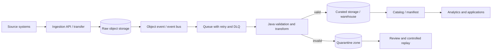
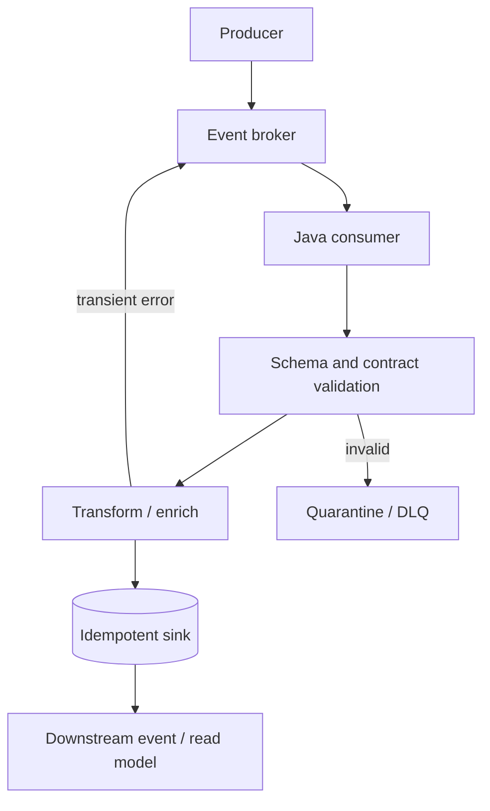
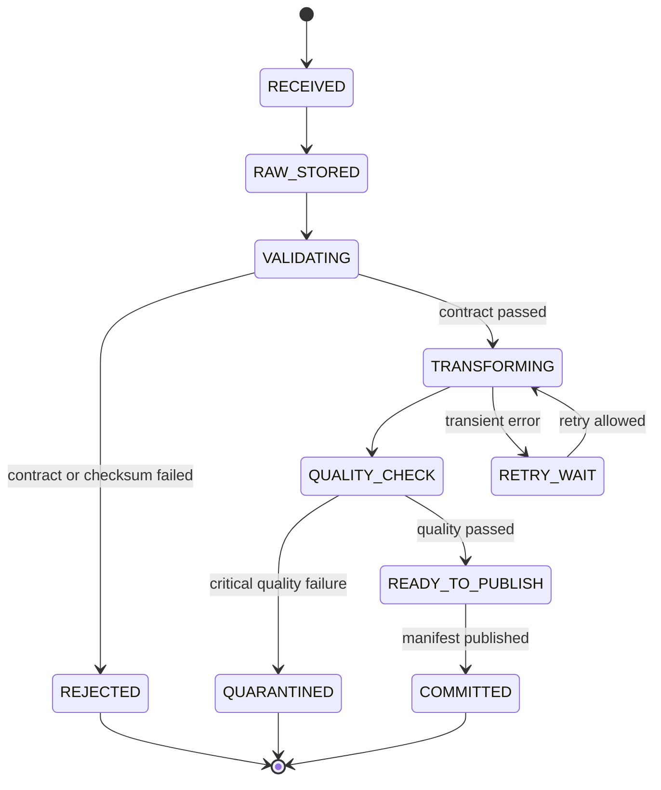

# Designing Serverless ETL and Data Quality Checks

## 1. What Problem Does Serverless ETL Solve?

ETL (Extract, Transform, Load) is the process of extracting data from one or more sources, normalizing/transforming it, and loading it into a target system for reporting, search, analytics, or business operations. In a serverless architecture, these steps are triggered by schedules, HTTP requests, object events, messages, or stream events; compute is provisioned on demand, and infrastructure operations are offloaded to the cloud provider.

One pipeline might receive order files from object storage, validate schemas, filter out bad records, normalize currencies, compute daily totals, and write cleaned data to a data warehouse. Another pipeline might process near-real-time events from a queue, enrich them with reference data, and update a read model.

Serverless ETL is useful when workloads are bursty, scheduled, process independent events, or can be split into small chunks. It reduces the need to manage persistent servers or clusters, but it does not eliminate responsibilities for data modeling, correctness, retries, ordering, security, and cost.

A well-designed pipeline must be able to answer:

- Where does the data come from, who owns it, and what schema/contract is guaranteed?
- Are originals stored immutably for replay and auditing?
- Which records are valid, which are quarantined, and by what criteria?
- What happens if an event is delivered twice or arrives out of order?
- If a function stops mid-execution, where does the pipeline resume?
- How do you know the output data is complete, consistent, and on time?
- Who is allowed to read raw/quarantine/curated data, and how is sensitive data protected?
- Is cost measured per file, record, GB, or business outcome?

## 2. ETL, ELT, and Choosing a Processing Model

### 2.1. ETL and ELT

| Model | Flow | When Suitable |
| --- | --- | --- |
| ETL | Extract → Transform → Load | Need to clean/anonymize/normalize data before it enters the target system |
| ELT | Extract → Load raw → Transform in target system | Data warehouse/lakehouse can process large data and you want to retain raw data for flexible transforms |
| Streaming transformation | Event → Validate/Transform → Continuous sink | Need near-real-time updates with an event stream as the source |
| Micro-batch | Group events/files by window and process in small batches | Want to balance latency, throughput, and cost |

Serverless does not require pure ETL. You can ingest raw data into object storage first, then use a SQL engine, managed Spark, or a warehouse to transform it in an ELT pattern. This approach is often well suited when data volumes are large, history must be retained, and transforms may need to be re-run with updated logic.

### 2.2. Batch, Event-Driven, and Streaming

| Characteristic | Batch | Event-Driven | Streaming |
| --- | --- | --- | --- |
| Trigger | Schedule, manual, file manifest | Object event, queue, webhook | Continuous stream/partition |
| Unit of work | File, partition, time window | Single event or small group | Record/event by partition and window |
| Latency | Minutes/hours | Seconds/minutes | Low, depending on engine and watermark |
| State | Checkpoint per batch/partition | Idempotency record and job state | Offset/checkpoint, window state |
| Suitable for | Backfills, reporting, imports | File arrival, webhooks, business events | Clickstream, telemetry, event analytics |

Do not turn a 20 GB file into millions of single-row invocations. For large datasets, split by partition/chunk or use a managed distributed data processing service. FaaS is suited for orchestration steps, lightweight validation, enrichment, or bounded chunk processing; Spark/Dataflow/Glue/warehouses are usually better for large joins/aggregations and heavy shuffles.

## 3. Reference Architectures

### 3.1. Batch Pipeline from Object Storage



Object storage provides durable storage for raw data; events merely signal that an object is ready. A queue decouples producer speed from consumer speed, buffers work when downstream systems slow down, and supports retries/DLQs. A Java function processes an object or chunk, then writes curated or quarantine output.

### 3.2. Event-Driven Pipeline



Consumers must handle duplicate deliveries and late-arriving messages. If the sink is a database, use unique keys or version-guarded upserts. If the sink is object storage, use deterministic output keys and commit markers/manifests. Never assume the broker and function provide end-to-end exactly-once semantics.

### 3.3. Separating Data Zones

A data lake typically separates zones by purpose:

| Zone | Contents | Rules |
| --- | --- | --- |
| Landing | Newly received files, not yet confirmed complete | Written only by ingestion roles; uses manifests/upload completion |
| Raw | Immutable originals keyed by source/version/ingest time | Never modified in place; strict retention and access controls |
| Quarantine | Records/files failing contracts or quality gates | Includes error codes, lineage, source, and restricted access |
| Curated | Normalized data that passed quality gates | Explicit schema/version, partitioning, and catalog registration |
| Serving | Read models, aggregates, or application-facing tables | Defined freshness SLA and owner |

Raw data is the source of truth for replay and investigation. Never overwrite raw data with transformed data. Curated outputs should maintain lineage back to the raw object/version, pipeline version, and processing timestamp.

## 4. Designing Safe Ingestion

### 4.1. Receiving Data and Confirming Upload Completion

Object-created events may fire when an upload finishes, but with multipart uploads or custom transfer mechanisms, you must understand the source's exact semantics. Avoid triggering ETL on temporary objects, partially written files, or wrong prefixes.

Confirmation methods:

- Use provider-specific object finalize/completed event types.
- Have the producer upload to a staging key, then copy/rename or publish a manifest upon completion.
- Use a manifest containing the file list, sizes, checksums, and schema version.
- Verify object version, content length, and checksum before processing.

Do not rely solely on filename or timestamp to conclude a file is complete. If producers overwrite the same key, use version IDs or immutable object names to distinguish individual uploads.

### 4.2. Event Notifications Are Just Signals

Object storage events can be duplicated, arrive out of order, or contain incomplete metadata. Consumers should use the event to obtain the object reference, then read the object by explicit version/checksum. Never embed large files in event payloads.

A processing identity can be constructed from:

```text
source_system + bucket/container + object_key + object_version + pipeline_name
```

If you need to re-run the same object with a new transform version, include `pipeline_version` in the processing identity. If you only want to ensure the same pipeline version does not process an object twice, the key must be stable across source object/version and pipeline version.

### 4.3. Store Raw Before Transforming

Whenever possible, write data to the raw zone before processing. That way, if a function fails or the schema validator changes, you can replay from raw without asking the producer to resend.

If ingestion must validate before accepting a file, still retain the original or a quarantine copy according to retention policy. Never drop invalid data silently.

## 5. Data Contracts and Schema Evolution

### 5.1. Data Contracts

A data contract is an agreement between producer and consumer regarding structure, semantics, quality, ownership, and how changes are made. A contract should specify:

- Dataset/event name and owner.
- Schema version and format (JSON, Avro, Protobuf, Parquet, CSV...).
- Required fields, data types, ranges, and semantics.
- Nullability, defaults, and timezone conventions.
- Primary/business keys and uniqueness rules.
- Event time, ingestion time, and ordering guarantees.
- Data classification, PII handling, and retention.
- Freshness/availability SLOs.
- Compatibility policy and deprecation process.

A syntactically valid schema does not guarantee business-valid data. For example, `amount: -100` is a valid number but may violate transaction rules; `customer_id` is a string but may not exist in the customer master.

### 5.2. Schema Compatibility Rules

| Change | Risk | Handling Approach |
| --- | --- | --- |
| Add optional field | Usually compatible with consumers that ignore unknown fields | Define clear default/null semantics |
| Add required field | Older consumers may not supply it | New version or phased rollout |
| Remove/rename field | Older consumers may break | Deprecation window and dual-read/write |
| Change field type | Parsers/logic may fail or lose precision | New field/version and migration |
| Change meaning while keeping name | Silent data corruption | Introduce a new field/version; never change semantics implicitly |
| Change enum values | Consumers with exhaustive switches may fail | Consumers handle unknown/default values |

For event contracts, prefer additive changes and tolerant consumers that still enforce validation. Being tolerant does not mean ignoring invalid fields or guessing missing data.

### 5.3. JSON Schema Example

```json
{
  "$schema": "https://json-schema.org/draft/2020-12/schema",
  "$id": "https://schemas.example.test/order-event-v2.json",
  "title": "OrderCreated",
  "type": "object",
  "required": ["eventId", "schemaVersion", "occurredAt", "orderId", "currency", "totalMinor"],
  "properties": {
    "eventId": { "type": "string", "minLength": 1 },
    "schemaVersion": { "const": 2 },
    "occurredAt": { "type": "string", "format": "date-time" },
    "orderId": { "type": "string", "minLength": 1 },
    "currency": { "type": "string", "pattern": "^[A-Z]{3}$" },
    "totalMinor": { "type": "integer", "minimum": 0 },
    "customerReference": { "type": ["string", "null"] }
  },
  "additionalProperties": false
}
```

The schema above is illustrative. `additionalProperties: false` catches unexpected fields but can make rolling out additive fields harder if consumers are not yet updated. Choose strictness per contract: producers/registries can be strict, while consumers can allow unknown fields while still validating required fields and semantics.

## 6. Data Quality Checks

### 6.1. Quality Dimensions

| Dimension | Question | Example Check |
| --- | --- | --- |
| Completeness | Are critical fields or records missing? | `order_id` is non-null; record count matches manifest |
| Validity | Do values match expected formats, ranges, or domains? | Currency is in the allowlist; timestamp parses cleanly |
| Uniqueness | Are there duplicate keys? | A given `event_id` is applied only once |
| Consistency | Do fields or tables agree with each other? | Sum of line items equals order total |
| Accuracy | Does data reflect the authoritative source? | Amounts reconcile against the payment ledger |
| Timeliness | Did the data arrive on time? | Event age is within the freshness SLO |
| Referential integrity | Do referenced keys exist? | `customer_id` exists in customer master |
| Integrity | Is the file or batch corrupted or truncated? | Checksum, row count, footer/manifest |

No single rule fits every dataset. Business owners must define the critical dimensions, acceptance thresholds, and consequences of violations.

### 6.2. Three Layers of Validation

**Layer 1 – Structural validation:** is the file readable, is the schema version supported, are fields and data types correct, and are encoding and delimiters valid?

**Layer 2 – Record-level semantic validation:** is the amount non-negative, is the currency valid, is the timestamp within range, is the business key populated, do enums belong to the allowed set, and do cross-field rules hold?

**Layer 3 – Dataset/batch-level validation:** record counts, duplicate ratios, total amounts, distributions, referential integrity, partition coverage, and reconciliation against manifest/source control totals.

A file where every single row is valid can still be a bad batch if 30% of records are missing or the total amount fails to match the source. Therefore, both row-level and batch-level quality gates are required.

### 6.3. Quality Rules with Owners and Severity

Every rule should define:

- A stable `rule_id`.
- Target dataset, field, and scope.
- Pass/fail condition or threshold.
- Severity: reject, quarantine, warn, or monitor.
- An owner authorized to grant exceptions.
- Error code and remediation steps.
- Version and effective date.

Do not hard-code every rule inside one monolithic function. Manage rules in versioned, tested, and peer-reviewed code or config; rules affecting correctness or security require the same release controls as application code.

### 6.4. Hard Fail, Quarantine, and Warning

| Outcome | Behavior | Example |
| --- | --- | --- |
| Reject batch | Do not publish output; route entire batch to quarantine | Unrecognized schema, checksum mismatch, untrusted source |
| Quarantine record | Exclude bad record from curated output, retain record and error metadata | An order missing currency or having an invalid amount |
| Warning | Allow through while recording quality metrics and alerting the owner | Optional field missing at a low rate |
| Pass | Write curated output and quality report | All critical rules meet thresholds |

Do not automatically drop invalid records and treat the batch as complete if dropping them skews financial totals or business counts. For critical rules, the batch should fail or withhold curated dataset publication until resolved.

## 7. Batch-Level Quality Gates

### 7.1. Control Totals Example

The producer sends a manifest:

```json
{
  "batchId": "orders-2026-11-17-001",
  "schemaVersion": 2,
  "object": "raw/orders/date=2026-11-17/part-001.parquet",
  "expectedRows": 125000,
  "expectedAmountMinor": 9876543210,
  "sha256": "<sha256-of-object-bytes>"
}
```

After reading the file, the pipeline compares actual row count, checksum, and total amount against the manifest. If the source does not supply a total amount, it can reconcile against a ledger or another trusted snapshot.

### 7.2. Quality Thresholds

Suppose a batch contains 100,000 records:

| Rule | Threshold | Action |
| --- | --- | --- |
| Missing order ID | 0 records | Reject batch |
| Invalid currency | At most 0.01% | Quarantine record and alert |
| Duplicate event ID | 0 new duplicates | Deduplicate by event ID; if payload conflicts, quarantine |
| Missing optional phone | At most 5% | Warning |
| Total amount mismatch | Difference of 0 minor units | Do not publish; investigate source |
| Batch freshness | Under 15 minutes | Alert SLA or fail downstream gate depending on dataset |

Thresholds are illustrative. For payment data, amount tolerance may be zero; for telemetry, a small bad-record ratio may be acceptable. Never copy thresholds across datasets without business owner approval.

### 7.3. Never Publish Half a Batch

If a function writes outputs directly to the path read by downstream consumers, consumers may observe incomplete data. A safer pattern:

1. Write outputs to a dedicated staging path keyed by `batch_id` and `pipeline_version`.
2. Write the quality report, row count, and checksum.
3. If critical gates pass, publish a manifest/commit marker using conditional creation or an appropriate transaction.
4. Downstream consumers only read batches whose manifest status is `COMMITTED`.
5. If gates fail, retain staging for investigation or clean it up per retention after writing quarantine records.

With object storage, renames may actually be copy + delete rather than atomic operations. A manifest/commit marker indicates batch completion without relying on atomic renames.

## 8. Quarantine and Handling Bad Data

### 8.1. What Should a Quarantine Record Contain?

A quarantine record should capture:

- Dataset, source system, source object/version, and record position.
- Event ID/business key if parseable.
- Schema version and pipeline version.
- `rule_id`, error code, and offending field.
- Ingest/processing timestamps and correlation ID.
- Raw payload or reference to the raw payload per policy.
- Retry/replay status and assigned owner.

Never log full PII or secrets. If raw payloads must be retained, encrypt them, restrict IAM and retention, and mask sensitive values in dashboards.

### 8.2. Distinguishing Data Errors from Infrastructure Errors

| Error Type | Example | Handling |
| --- | --- | --- |
| Permanent data error | Malformed amount, missing required field | Quarantine; do not retry indefinitely |
| Contract error | Unsupported schema version | Quarantine batch and require producer/consumer update |
| Transient infrastructure error | Object store timeout, database throttling | Retry with backoff/jitter |
| Dependency unavailable | Reference data API temporarily down | Bounded retry or buffer |
| Unknown outcome | Sink may have committed before function timed out | Check idempotency/commit marker before retrying |

Do not send permanent data errors into a retry loop, because every retry only wastes money and inflates the backlog. Conversely, do not quarantine transient network errors as if they were malformed payloads.

### 8.3. Controlled Replay

A replay must explicitly specify:

- Source object/event ID and version.
- Pipeline code/config version.
- Quality rule set version.
- Scope of records to reprocess.
- Idempotency key and output namespace.
- Approver if business outcomes will change.
- How old vs. new outputs will be compared and how to roll back publication if needed.

Never edit a raw file and replay without preserving evidence. If source data must be corrected, create a corrected version with lineage linked back to the original.

## 9. Idempotency and Duplicate Event Handling

### 9.1. Why Does ETL Need Idempotency?

Object events, queues, and streams can redeliver the same work item. A function can time out after writing output but before acknowledging the message. If a retry writes a second output or adds to an aggregate again, data gets double-counted.

The processing identity should include all factors that affect the output:

```text
dataset + source_id + source_version + pipeline_version + partition_or_event_id
```

If the pipeline version is unchanged, retries must write to the same output identity. If transform logic changes, run under a new version and publish through a migration/backfill workflow.

### 9.2. Deterministic Outputs

For file-based ETL, generate deterministic output keys from input identity and pipeline version, for example:

```text
curated/orders/pipeline=v3/source-version=17/batch=orders-2026-11-17-001/part-0001.parquet
```

Write outputs without corrupting already-committed data. You can write immutable staging objects and then conditionally create the manifest. On retry, check whether the manifest is already committed; if so, return the stored result.

For database sinks, use unique keys/upserts or transactions. For aggregates, track applied contribution/event IDs or use checkpointed window recomputation to avoid double counting.

### 9.3. Exactly-Once vs. Effectively-Once

At-least-once delivery can produce duplicates; at-most-once can drop events on failure. True end-to-end exactly-once requires coordination across source, compute, and sink, and is usually not guaranteed by a single function trigger alone.

In many pipelines, the practical goal is effectively-once: accept duplicate deliveries and retries, but combine idempotent sinks, unique keys, checkpoints, and commit markers so observable results appear only once.

## 10. Checkpoints, Watermarks, and Late Data

### 10.1. Event Time vs. Processing Time

- **Event time:** when the event actually occurred at the source.
- **Ingestion time:** when the system received the data.
- **Processing time:** when the function/engine processed it.

If a payment event occurs at 10:00 but arrives at 10:12, reporting by processing time places it in the 10:12 bucket; reporting by event time places it in the 10:00 bucket. Choose semantics based on business requirements.

### 10.2. Watermarks

A watermark is an estimate of event-time progress in a stream, used to decide when a window can be considered largely complete. Too short a watermark drops late events; too long a watermark increases state/storage and output latency.

For events arriving after the watermark, the pipeline can:

- Accept late events and update aggregates.
- Route them to a side output for separate processing.
- Reopen/recompute windows within an allowed lateness window.
- Route them to late-event quarantine if past the retention/reconciliation window.

Do not silently drop late events just because they missed the current window; define an explicit policy and metric.

### 10.3. Durable Checkpoints

Checkpoints must store processed positions, source partitions/offsets, window state, schema version, and pipeline version. For streams, checkpoint/offset commits must be coordinated with sink commits. Committing offsets before the sink is durable risks data loss on crash. Committing the sink first and crashing before committing offsets can replay events—requiring an idempotent sink.

For batch files, checkpoints can be tracked per partition or chunk. Write the checkpoint only after the chunk output is committed. Never store checkpoints solely in function memory, since execution environments can be reclaimed.

## 11. Splitting Work and Controlling Parallelism

### 11.1. Chunking

Split large files/batches into chunks sized in bytes and processing time to fit within function timeouts, memory, and resource limits. Each chunk gets a stable ID, input range, and dedicated output path.

Example:

```text
batch-001
  chunk-0000: rows 0..9999
  chunk-0001: rows 10000..19999
  chunk-0002: rows 20000..29999
```

If one chunk fails, only that chunk needs to be retried. Finally, the orchestrator verifies that all required chunks committed and the overall quality gate passes before publishing the batch.

### 11.2. Bounded Concurrency

Do not fan out tens of thousands of concurrent invocations if your database, reference API, or warehouse cannot sustain the load. Cap concurrency according to downstream capacity, batch size, and quotas. Queues absorb bursts; consumer concurrency dictates the drain rate.

### 11.3. Backpressure

When the sink slows down or the quality service is congested:

- Reduce consumer concurrency.
- Pause dispatching new chunks.
- Hold backlog in a queue with sufficient retention.
- Retry transient failures with backoff/jitter.
- Separate queues by criticality when workloads have different priorities.
- Monitor oldest message age and batch deadlines.

Autoscaling is not a substitute for backpressure. Spinning up more function instances when a database has already exhausted its connections only amplifies the outage.

## 12. Orchestration and Pipeline State

### 12.1. When Do You Need a Workflow Engine?

A single function fits small, single-step, short-lived ETL jobs. When a pipeline involves multiple steps, parallel chunks, varied retry policies, waits, approvals, compensations, or deadlines, use a workflow/orchestration service.

A workflow engine can coordinate:

1. Validating the manifest and source object.
2. Launching partition/chunk jobs with bounded parallelism.
3. Collecting results and verifying control totals.
4. Running dataset-level quality gates.
5. Publishing the curated manifest/catalog partition.
6. Emitting completion events and updating lineage.
7. Quarantining or triggering manual review on failure.

### 12.2. Reference State Machine



Pipeline state should record `batch_id`, source version, pipeline version, owner, attempt count, checkpoint, output manifest, quality report, and timestamps. Do not rely on in-memory execution state to determine whether a batch is complete.

### 12.3. Publishing a Commit Marker

Downstream consumers only read partitions/batches in the committed state. A manifest can include:

```json
{
  "batchId": "orders-2026-11-17-001",
  "status": "COMMITTED",
  "pipelineVersion": "v3.4.1",
  "schemaVersion": 2,
  "sourceObjects": ["raw/orders/part-001.parquet"],
  "outputObjects": ["curated/orders/batch-001/part-0001.parquet"],
  "rowCount": 124998,
  "quarantinedRows": 2,
  "qualityReport": "quality/orders/batch-001.json",
  "committedAt": "2026-11-17T10:30:00Z"
}
```

The manifest must be published atomically using storage capabilities, such as conditional creation/versioning or a metadata store transaction. If two invocations attempt to commit simultaneously, only one may create the manifest; the other reads the committed manifest and verifies it matches the same processing identity.

## 13. Java Implementation Patterns

### 13.1. Data Model and Validation Result

```java
import java.math.BigDecimal;
import java.time.Instant;
import java.util.List;

public record OrderRow(
        String eventId,
        String orderId,
        String customerId,
        BigDecimal amount,
        String currency,
        Instant occurredAt) {
}

public record ValidationIssue(
        String ruleId,
        String field,
        String code,
        String message) {
}

public record ValidationResult(
        OrderRow value,
        List<ValidationIssue> issues) {

    public boolean valid() {
        return value != null && issues.isEmpty();
    }
}
```

Use `BigDecimal` for monetary amounts; never use `double` or `float`, because floating-point rounding errors can break reconciliation. Use `Instant` or an explicit timezone-aware type for event timestamps.

### 13.2. Rule-Based Validator

```java
import java.math.BigDecimal;
import java.util.ArrayList;
import java.util.Set;

public final class OrderValidator {
    private static final Set<String> CURRENCIES = Set.of("VND", "USD", "EUR");

    public ValidationResult validate(OrderRow row) {
        var issues = new ArrayList<ValidationIssue>();

        if (row.eventId() == null || row.eventId().isBlank()) {
            issues.add(new ValidationIssue(
                    "ORDER_EVENT_ID_REQUIRED", "eventId", "MISSING_VALUE",
                    "eventId is required"));
        }
        if (row.orderId() == null || row.orderId().isBlank()) {
            issues.add(new ValidationIssue(
                    "ORDER_ID_REQUIRED", "orderId", "MISSING_VALUE",
                    "orderId is required"));
        }
        if (row.customerId() == null || row.customerId().isBlank()) {
            issues.add(new ValidationIssue(
                    "CUSTOMER_ID_REQUIRED", "customerId", "MISSING_VALUE",
                    "customerId is required"));
        }
        if (row.amount() == null || row.amount().compareTo(BigDecimal.ZERO) < 0) {
            issues.add(new ValidationIssue(
                    "ORDER_AMOUNT_NON_NEGATIVE", "amount", "INVALID_AMOUNT",
                    "amount must be present and non-negative"));
        }
        if (row.currency() == null || !CURRENCIES.contains(row.currency())) {
            issues.add(new ValidationIssue(
                    "ORDER_CURRENCY_ALLOWED", "currency", "INVALID_CURRENCY",
                    "currency is not supported"));
        }
        if (row.occurredAt() == null) {
            issues.add(new ValidationIssue(
                    "ORDER_TIME_REQUIRED", "occurredAt", "MISSING_VALUE",
                    "occurredAt is required"));
        }

        return new ValidationResult(issues.isEmpty() ? row : null, List.copyOf(issues));
    }
}
```

Validators should not call databases or HTTP services per field. Referential integrity checks may need a separate batch lookup/enrichment step to avoid N+1 requests and manage timeouts.

### 13.3. Processing a Record and Quarantining

```java
import java.util.List;

enum SinkWriteResult {
    INSERTED,
    ALREADY_PRESENT_SAME_PAYLOAD,
    CONFLICTING_PAYLOAD
}

public final class OrderRecordProcessor {
    private final OrderValidator validator;
    private final CuratedSink curatedSink;
    private final QuarantineSink quarantineSink;

    public OrderRecordProcessor(
            OrderValidator validator,
            CuratedSink curatedSink,
            QuarantineSink quarantineSink) {
        this.validator = validator;
        this.curatedSink = curatedSink;
        this.quarantineSink = quarantineSink;
    }

    public RecordOutcome process(
            SourceReference source,
            long rowNumber,
            OrderRow row) {

        ValidationResult result = validator.validate(row);
        if (!result.valid()) {
            quarantineSink.write(source, rowNumber, row, result.issues());
            return RecordOutcome.quarantined(result.issues().size());
        }

        SinkWriteResult writeResult = curatedSink.upsertIdempotently(
                result.value().eventId(), result.value());
        return switch (writeResult) {
            case INSERTED -> RecordOutcome.accepted();
            case ALREADY_PRESENT_SAME_PAYLOAD -> RecordOutcome.deduplicated();
            case CONFLICTING_PAYLOAD -> {
                var issue = new ValidationIssue(
                        "EVENT_ID_PAYLOAD_CONFLICT", "eventId", "CONFLICTING_DUPLICATE",
                        "The same event ID was received with a different payload");
                quarantineSink.write(source, rowNumber, row, List.of(issue));
                yield RecordOutcome.quarantined(1);
            }
        };
    }
}
```

`SinkWriteResult` has three values: `INSERTED`, `ALREADY_PRESENT_SAME_PAYLOAD`, and `CONFLICTING_PAYLOAD`; `CuratedSink.upsertIdempotently` needs a unique constraint/conditional write and payload hash comparison. Same event ID with the same payload is a duplicate counted separately; same event ID with a different payload is quarantined for investigation rather than silently overwritten. This is a skeleton, so auxiliary interfaces and types are omitted. `quarantineSink.write` must persist durably before the caller acknowledges the source. If the sink fails transiently, throw an exception to retry; never treat storage errors as quarantine data.

### 13.4. Batch Quality Report

```java
import java.math.BigDecimal;

public record BatchQualityReport(
        long inputRows,
        long acceptedRows,
        long quarantinedRows,
        long deduplicatedRows,
        BigDecimal inputAmount,
        BigDecimal acceptedAmount,
        BigDecimal quarantinedAmount,
        BigDecimal deduplicatedAmount,
        BigDecimal expectedAmount,
        boolean checksumMatches) {

    public boolean criticalChecksPassed() {
        return checksumMatches
                && acceptedRows + quarantinedRows + deduplicatedRows == inputRows
                && inputAmount.compareTo(
                        acceptedAmount.add(quarantinedAmount).add(deduplicatedAmount)) == 0
                && inputAmount.compareTo(expectedAmount) == 0;
    }
}
```

The `accepted`, `quarantined`, and `deduplicated` buckets in the report must be mutually exclusive. If records are quarantined or duplicates are legitimately removed, the accepted amount total may differ from the source total. Compute input, accepted, quarantined, and deduplicated totals separately; do not compare accepted amount directly against expected source amount as if bad records never existed. The quality report must clearly represent reconciliation:

```text
input_amount = accepted_amount + quarantined_amount + deduplicated_amount
input_rows = accepted_rows + quarantined_rows + deduplicated_rows
```

If business rules require every record to be accepted, `quarantinedRows > 0` will still fail the batch gate even if the sums balance.

### 13.5. Streaming Orchestrator Without Holding the Whole File in Memory

For large files, read via a stream or split into chunks; never call `readAllBytes()` on unbounded files. Each chunk writes its own output and updates its checkpoint after the sink confirms commit. Compute row counts, checksums, and aggregates incrementally.

```java
try (var rows = sourceReader.open(sourceReference)) {
    long rowNumber = 0;
    while (rows.hasNext()) {
        OrderRow row = rows.next();
        RecordOutcome outcome = processor.process(
                sourceReference, rowNumber, row);
        qualityAccumulator.record(row, outcome);
        rowNumber++;
    }
}
```

This loop illustrates streaming through a reader; the actual implementation needs to bound records per batch/chunk, flush the sink per chunk, and persist checkpoints after commit. If a function times out, the orchestrator resumes from uncommitted chunks.

## 14. Example Quality Queries

### 14.1. Null and Range Checks

```sql
SELECT
    COUNT(*) AS total_rows,
    SUM(CASE WHEN order_id IS NULL OR order_id = '' THEN 1 ELSE 0 END) AS missing_order_id,
    SUM(CASE WHEN amount_minor < 0 THEN 1 ELSE 0 END) AS negative_amount,
    SUM(CASE WHEN currency NOT IN ('VND', 'USD', 'EUR') THEN 1 ELSE 0 END) AS invalid_currency
FROM staging_orders
WHERE batch_id = :batch_id;
```

### 14.2. Finding Duplicate Keys

```sql
SELECT event_id, COUNT(*) AS copies
FROM staging_orders
WHERE batch_id = :batch_id
GROUP BY event_id
HAVING COUNT(*) > 1;
```

Do not automatically pick `MAX(updated_at)` when two records sharing the same event ID carry different payloads. Identical payloads may indicate redelivery; conflicting payloads represent a data integrity incident requiring quarantine and reconciliation.

### 14.3. Checking Referential Integrity

```sql
SELECT COUNT(*) AS orphan_orders
FROM staging_orders s
LEFT JOIN customer_dimension c
  ON c.customer_id = s.customer_id
WHERE s.batch_id = :batch_id
  AND c.customer_id IS NULL;
```

If the customer dimension is updated asynchronously, an orphan may be a late-arriving reference rather than corrupt data. Define allowed lateness or retry enrichment before quarantining.

### 14.4. Reconciling Totals

```sql
SELECT
    COUNT(*) AS row_count,
    SUM(amount_minor) AS amount_total_minor,
    COUNT(DISTINCT event_id) AS unique_events
FROM staging_orders
WHERE batch_id = :batch_id;
```

Reconcile against the manifest/control totals from the source. Across multiple currencies, never sum amounts directly without converting them using a defined exchange rate and timestamp.

## 15. Orchestration and Choosing Cloud Services

### 15.1. AWS

An example architecture can use:

- Amazon S3 as landing/raw/curated object storage.
- S3 event notifications or EventBridge to detect new objects.
- SQS for buffering, retries, and DLQs.
- AWS Lambda Java for lightweight validation, metadata processing, or chunk transformations.
- AWS Step Functions to coordinate fan-out, retries, waits, and quality gates.
- AWS Glue/Spark/Athena/Redshift for distributed processing, cataloging, and large-scale analytics.
- DynamoDB/RDS as the idempotency/metadata store depending on consistency and transaction needs.

Do not use Lambda to run a job that exceeds execution timeouts or requires large shuffles. Use Glue/managed Spark or split the job into checkpointed chunks.

### 15.2. Azure

An example architecture can use:

- Azure Data Lake Storage Gen2 for landing/raw/curated storage.
- Event Grid to emit object events.
- Service Bus or Storage Queue for buffering.
- Azure Functions Java for small validations/transforms or event handlers.
- Durable Functions for orchestration when stateful workflows are needed.
- Azure Data Factory/Synapse/Fabric for pipelines, data integration, and large-scale analytical processing.
- Azure Monitor/Application Insights to track freshness, failures, and dependencies.

Select the hosting plan based on duration, memory, scaling, networking, and latency; do not assume every ETL job fits into a single Function App.

### 15.3. Google Cloud

An example architecture can use:

- Cloud Storage for landing/raw/curated storage.
- Eventarc or Pub/Sub for event routing/buffering.
- Cloud Run functions / Cloud Run services in Java for transforms and validation.
- Workflows to orchestrate multi-step flows.
- Dataflow for distributed batch/stream processing; BigQuery for ELT/analytics.
- Dataplex/catalog and Cloud Logging/Monitoring for governance and observability.

Cloud Run fits containerized Java workloads requiring runtime/dependency control or durations outside short functions. Dataflow/BigQuery fit large datasets and complex parallelism.

### 15.4. Compute Selection Criteria

| Scenario | Recommended Choice |
| --- | --- |
| Validate a small file, runs in seconds | Function |
| Independent event enrichment, bursty traffic | Function + queue |
| Multi-step job with state-based retries | Workflow orchestrator + functions/tasks |
| Large file needing splitting and bounded parallelism | Orchestrator + chunk workers or managed batch |
| Hundreds of GB/TB joins/shuffles | Managed Spark/Dataflow/warehouse |
| Large streaming state/windows | Managed stream processing engine |
| SQL transforms on raw data inside a warehouse | ELT/warehouse engine |

## 16. Observability and Data Lineage

### 16.1. Operational Metrics

Track at minimum:

- Ingested files, bytes, and records.
- Accepted, rejected, quarantined, and duplicate rows.
- Schema validation failures by schema version.
- Batch completion and failure durations.
- Queue depth and oldest event age.
- Retry attempts, DLQ counts, and replay volume.
- Checkpoint lag, watermark lag, and late-event counts.
- Curated output freshness and commit latency.
- Control total mismatches and reconciliation deltas.
- Cost per GB, record, or successful dataset.

### 16.2. Data Freshness SLO

Example SLO: 99% of today's order data partitions must be published within 10 minutes of ingestion. Measure from ingestion timestamp to committed manifest, not just function execution duration.

For nightly batches, a freshness SLO might be "dataset ready before 06:00 UTC". For streams, measure event-time lag and watermark lag. SLOs must specify schedules, timezones, holidays, and how missing source deliveries are handled.

### 16.3. Structured Logs and Correlation

Logs should include:

- `pipeline_name`, `pipeline_version`.
- `batch_id`, `source_id`, `object_version`.
- `chunk_id`, `partition`, `attempt`.
- `schema_version`, `rule_id`, `error_code`.
- `correlation_id`, trace ID.
- `input_rows`, `accepted_rows`, `quarantined_rows`.
- `output_manifest` and commit status.

Never log raw rows or PII. Use record references or controlled hashes to locate payloads in quarantine under proper authorization.

### 16.4. Lineage

Lineage must answer: which raw object/event, transform code/version, rule version, and publisher produced this curated dataset? This can be stored in manifests or catalog metadata:

```json
{
  "dataset": "curated.orders",
  "pipeline": "orders-etl",
  "pipelineVersion": "v3.4.1",
  "schemaVersion": 2,
  "sourceBatch": "orders-2026-11-17-001",
  "sourceObjects": ["raw/orders/part-001.parquet"],
  "qualityRuleSet": "orders-rules-v7",
  "committedAt": "2026-11-17T10:30:00Z"
}
```

Lineage supports audits, impact analysis, rollbacks, and replays when a source or transform is later found to be defective.

## 17. Data Security and Governance

### 17.1. Least Privilege

Separate roles by stage:

- Ingestion can only write to landing/raw.
- Validator can only read raw and write quality reports/quarantine.
- Transformer reads raw and writes only to allowed staging/curated prefixes.
- Publisher only commits manifests/catalog metadata.
- Analyst only reads curated/serving data per business authorization.
- Replay operators have controlled replay permissions without blanket access to all PII.

Never use one shared admin role across the entire pipeline. Separating permissions limits the blast radius if a function or dependency is compromised.

### 17.2. Encryption and Sensitive Data

- TLS for data in transit.
- Encryption at rest with well-scoped key policies.
- Secrets in a secrets manager, never in environment variables, files, or logs.
- Mask/tokenize PII when raw values are unnecessary.
- Restrict access to raw/quarantine and audit read access.
- Define retention/deletion policies per zone.
- Enforce data residency and cross-region transfer rules per compliance requirements.

### 17.3. Do Not Let Quarantine Become an Indefinite Data Store

Quarantine may hold malformed or sensitive data. It requires an owner, retention policy, remediation workflow, and deletion rules. If records are corrected and replayed, audit who/what made the change, why, and which version was used.

## 18. Cost and Performance Optimization

### 18.1. Avoiding the Small-File Problem

Writing one file per event can create millions of tiny files, inflating request/metadata costs and slowing queries. Batch events into micro-batches by time/size thresholds and write columnar formats like Parquet/ORC with sensible partitioning.

Do not partition by high-cardinality keys such as user ID. Choose partition keys based on query patterns, retention, and per-partition data size.

### 18.2. Tuning Batch Size and Concurrency

Larger batch sizes reduce per-invocation overhead but increase memory usage, execution duration, and retry blast radius. Smaller batch sizes increase invocation/transaction counts. Benchmark multiple profiles and measure cost per successful record, p95 duration, error rate, and downstream load.

Concurrency must align with sink capacity. If a database safely handles 40 concurrent write transactions, cap consumer concurrency so the entire fleet stays within that budget.

### 18.3. Read Only Required Fields

With columnar formats, projection pushdown and partition pruning reduce bytes scanned. Avoid scanning an entire dataset just to filter a single day. Use appropriate compression and target file sizes for your query engine.

### 18.4. Reusing Clients and Connections

In Java functions, reuse SDK clients, HTTP clients, and connection pools within the execution environment when thread-safety and lifecycle allow. Close streams/responses properly; never open a new connection per record. Bound pool sizes so total fleet instances do not exhaust downstream capacity.

### 18.5. Monitoring Cost per Dataset

Measure:

\[
Cost\ per\ GB = \frac{Allocated\ pipeline\ cost}{GB\ successfully\ processed}
\]

\[
Cost\ per\ valid\ record = \frac{Allocated\ pipeline\ cost}{Accepted\ records}
\]

Track raw storage, transform compute, quarantine, logs, network, warehouse loads, and replays separately. If replay volume spikes, cost per record rises even when producer traffic remains flat.

## 19. Testing the ETL Pipeline

### 19.1. Unit Tests

- Parsers for both valid and invalid schema versions.
- Validators for boundary values, nulls, precision, timezones, and enums.
- Deterministic transformations for identical inputs and versions.
- Rule thresholds and quality reports.
- Canonical keys and idempotency identities.

### 19.2. Integration Tests

- Upload a complete object and verify event delivery.
- Duplicate events do not create duplicate outputs.
- Transient storage/database errors trigger retries.
- Quarantine records are durably written before acknowledging the source.
- Manifests appear only after quality gates pass.
- Crashes after output writes but before checkpointing do not cause double counting.
- Replays from raw produce the exact expected output for the selected pipeline version.

### 19.3. Data Tests and Property-Based Tests

Verify invariants:

- `input_rows = accepted_rows + quarantined_rows + deduplicated_rows` when the three buckets are mutually exclusive.
- `input_amount = accepted_amount + quarantined_amount + deduplicated_amount` when every record carries an amount and transforms do not alter currency.
- A single event ID never produces multiple business effects.
- Transforms never produce nulls for required fields.
- Output sorting/aggregation remains invariant under input reordering when semantics require it.
- Re-running the same batch does not mutate already-committed results.

### 19.4. Load and Failure Tests

- Burst object events and large queue backlogs.
- Large files near memory/timeout limits.
- Slow or unavailable reference data services.
- New schema versions sent before consumers deploy.
- Late-arriving and out-of-order events.
- Multi-batch DLQ replays.
- Regional/service outages and checkpoint recovery.
- Revoked permissions or unavailable encryption keys.

## 20. End-to-End Example: Processing an Order File

Suppose a producer outputs an hourly Parquet file and manifest for orders. The pipeline executes:

1. Producer writes the file to landing with an immutable object version.
2. Producer publishes a manifest containing batch ID, schema version, expected rows, total amount, and checksum.
3. The event bus places the object reference onto a queue.
4. A Java function claims the batch ID in the metadata store; duplicate events read the current state.
5. The function validates checksum, schema, and manifest.
6. A streaming reader iterates over records, validating fields and business rules.
7. Valid records write to curated staging keyed by batch/version; invalid records write to quarantine with their rule ID.
8. A quality accumulator computes row counts, amount totals, duplicate counts, and thresholds.
9. If critical rules fail, the batch moves to `QUARANTINED`/`REJECTED`; no curated manifest is published.
10. If gates pass, the publisher conditionally creates the commit manifest.
11. The catalog/consumers receive the completion event and read the committed batch.
12. Metrics record freshness, accepted/quarantined rates, cost, and lineage.

If a function times out after writing to staging, retries inspect the batch state and deterministic output path. If the manifest is already committed, the retry returns completion. If not, the pipeline resumes from uncommitted chunks. If the source payload is bad, records are quarantined and replayed only after a data correction decision.

## 21. Common Design Pitfalls

| Pitfall | Consequence | Fix |
| --- | --- | --- |
| Transforming raw objects in place | Loss of originals for audit/replay | Keep raw immutable and separate curated storage |
| Assuming events arrive exactly once | Duplicate outputs or double counting | Idempotency keyed by source version/event ID |
| Validating only syntax/schema | Business-invalid data slips through | Record-level and dataset-level quality rules |
| Dropping bad records without logging why | Silent data loss | Quarantine records and emit quality reports |
| Retrying all errors | Permanent bad data bloats the backlog | Classify transient, permanent, and ambiguous errors |
| Acknowledging before sink durability | Data loss on function crash | Commit sink and checkpoint in safe order |
| Publishing output before quality gates | Consumers read half-finished batches | Write to staging and use commit manifests |
| Storing checkpoints in RAM | Progress lost when instances recycle | Persist durable checkpoints |
| Neglecting schema evolution | Consumers crash on producer deployments | Data contracts, compatibility tests, versioning |
| Unbounded fan-out | Overloads databases/warehouses | Bounded concurrency and backpressure |
| Single invocation for huge files | Timeouts/OOM and full-file retries | Streaming readers, chunking, or managed data engines |
| Using `double` for money | Reconciliation rounding errors | Use `BigDecimal` or minor integer units |
| Omitting lineage | Hard to trace output origins or logic | Store manifests and pipeline metadata |
| Quarantine without retention | Sensitive data lingers indefinitely | Access controls, ownership, and TTLs |

## 22. Production Checklist

- [ ] Data contracts specify owners, schema versions, and compatibility policies.
- [ ] Raw data is stored immutably or with appropriate versioning and retention.
- [ ] Ingestion verifies object/batch completeness via events, manifests, and checksums.
- [ ] Event identities are stable and consumers are idempotent.
- [ ] Validation covers structural, semantic, and dataset-level rules.
- [ ] Quality rules define severity, owners, versions, and thresholds.
- [ ] Invalid records/files are quarantined with metadata and restricted access.
- [ ] Critical quality gates prevent publishing bad batches.
- [ ] Output staging and commit manifests prevent consumers from reading partial data.
- [ ] Checkpoints/offsets are stored durably and coordinated with sink commits.
- [ ] Late events, out-of-order arrivals, and replays follow explicit policies.
- [ ] Chunking and concurrency respect timeouts, memory, and downstream capacity.
- [ ] Retries, backoff, and DLQs distinguish transient from permanent errors.
- [ ] Metrics track freshness, accepted/rejected counts, duplicates, lag, and cost.
- [ ] Structured logs exclude PII and secrets.
- [ ] Lineage links outputs to source data, pipeline version, and rule version.
- [ ] Least-privilege IAM, encryption, retention, and auditing are configured.
- [ ] Load and failure tests cover duplicates, timeouts, schema changes, and replays.
- [ ] Cost per GB/record/dataset is monitored.
- [ ] Runbooks exist for quarantine handling, replay, reconciliation, and publish rollbacks.

## 23. Conclusion

Serverless ETL combines object storage, events/queues, Java functions, workflow orchestrators, and data processing services to process data on demand. Functions fit ingestion handlers, validation, enrichment, and bounded chunk processing; large datasets, heavy joins/shuffles, or complex streaming state usually call for dedicated managed engines.

Data quality must be checked across schema, record, and dataset levels. Data contracts enable controlled evolution between producers and consumers; quality gates determine what gets published; quarantine preserves failures for investigation; and manifests, checkpoints, and idempotency ensure retries and replays never corrupt results. Security, lineage, freshness, and cost per outcome must be monitored as core operational properties of the pipeline.

A pipeline is complete only when outputs are committed, quality reports are persisted, lineage is traceable, and downstream consumers can read a consistent dataset. Designing these guarantees in from day one enables serverless systems to scale while preserving correctness and resilience.

## References

- [AWS Glue – What is AWS Glue?](https://docs.aws.amazon.com/glue/latest/dg/what-is-glue.html)
- [AWS Lambda – Using Lambda with Amazon S3](https://docs.aws.amazon.com/lambda/latest/dg/with-s3.html)
- [AWS Step Functions – Data processing workflows](https://docs.aws.amazon.com/step-functions/latest/dg/welcome.html)
- [Azure Data Factory – Introduction](https://learn.microsoft.com/en-us/azure/data-factory/introduction)
- [Azure Functions – Event-driven scaling](https://learn.microsoft.com/en-us/azure/azure-functions/functions-scale)
- [Google Cloud Dataflow – Overview](https://cloud.google.com/dataflow/docs/overview)
- [Google Cloud Workflows – Overview](https://cloud.google.com/workflows/docs/overview)
- [Apache Parquet – Documentation](https://parquet.apache.org/docs/)
- [JSON Schema – Understanding JSON Schema](https://json-schema.org/understanding-json-schema/)
