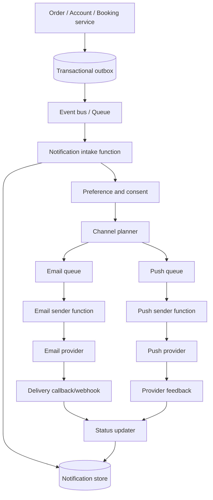
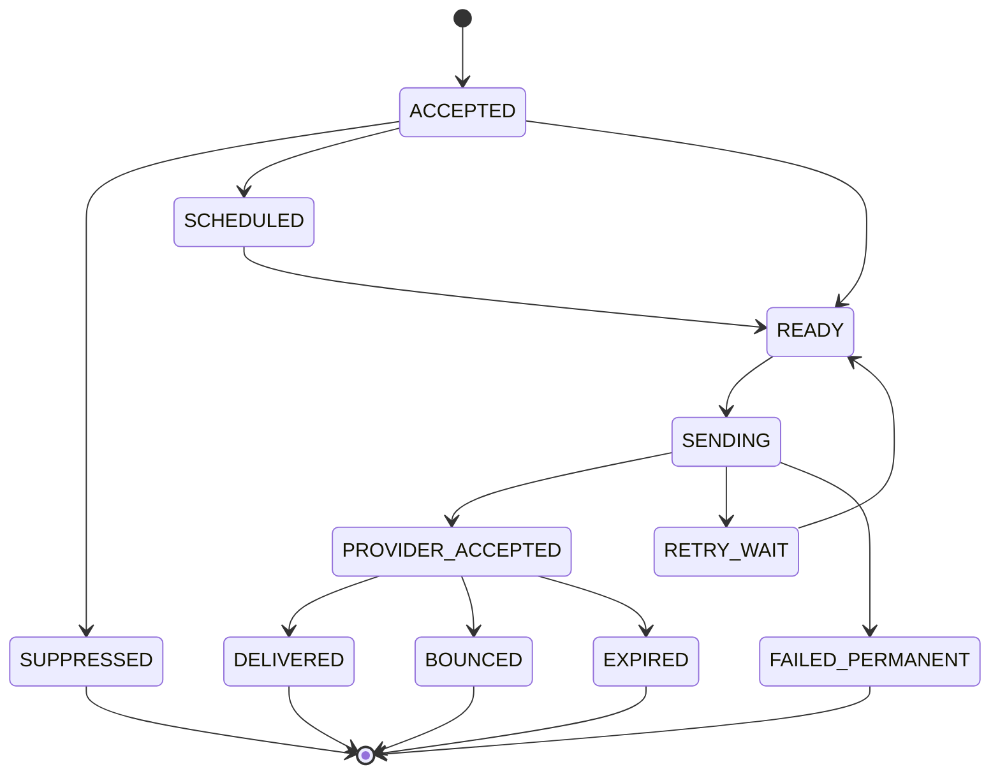

# Building an Email and Push Notification Service

Email and push notifications are two primary channels for notifying users about order status, account security, appointments, transactions, or new content. In a serverless system, a single business event can trigger multiple Java functions: checking preferences, rendering templates, dispatching through providers, and receiving delivery callbacks. A sound design decouples business flows from channel providers, withstands bursts, retries, and duplicate events, and respects user consent and privacy.

A notification service is more than a function calling SMTP or a push API. It must manage the **notification lifecycle**: receiving requests, evaluating eligibility, scheduling, dispatching to providers, capturing results, handling bounces/invalid tokens, and persisting traceable state. You must distinguish between a provider accepting a request and an email actually landing in an inbox or a push notification appearing on a device.

This guide covers building a notification service using Java FaaS, HTTP APIs, event buses/queues, email providers, and push providers such as Firebase Cloud Messaging (FCM) or Apple Push Notification service (APNs). The focus spans event-driven architecture, data models, templates, preferences/consent, idempotency, retries, rate limiting, security, observability, testing, and operations.

## 1. Roles and Overall Architecture

### 1.1. Separating Business Events from Notification Commands

Business services should emit events describing what happened—such as `OrderShipped`, `PasswordResetRequested`, or `AppointmentReminderDue`. The notification service decides whether to send a notification, through which channels, using which template, and when.

Do not make the Order Service aware of SMTP hosts, FCM credentials, or email templates. When a provider changes, business logic should never require redeployment just because a delivery adapter changed.

### 1.2. Reference Architecture



Components can run as separate functions or combined functions depending on throughput and ownership. Separating queues per channel allows independent concurrency limits, enforces provider quotas, and prevents email backlogs from delaying push notifications.

### 1.3. Component Responsibilities

| Component | Responsibility |
| --- | --- |
| Producer | Emits domain events after the business transaction commits |
| Intake | Validates events, creates notification intents, and enforces idempotency |
| Preference service | Reads consent, channel preferences, quiet hours, and frequency caps |
| Planner | Selects channels, templates, locales, and delivery timing |
| Sender | Invokes providers, classifies outcomes, and records attempts |
| Provider callback | Receives bounces, complaints, invalid tokens, or delivery feedback |
| Notification store | Stores state, recipient references, attempts, and audit metadata |
| DLQ/replay | Isolates unprocessable notifications and supports controlled replay |

### 1.4. Synchronous or Asynchronous?

An HTTP API can accept notification requests and return `202 Accepted` with a `notificationId` when delivery executes asynchronously. This response means the request was accepted under the API contract—not that the email or push was delivered.

In an event-driven flow, producers publish events via an outbox/queue after committing. Senders execute independently and can retry without holding an HTTP request open while waiting for provider responses.

## 2. Domain Model and Notification Lifecycle Design

### 2.1. Notification Intent

A notification intent describes what the application wants to communicate:

- `notificationId`: stable identifier for the notification;
- `businessEventId`: originating business event;
- `recipientId`: internal recipient identifier;
- `notificationType`: notification type, e.g., `ORDER_SHIPPED`;
- `channels`: eligible channels to consider;
- `templateKey` and `templateVersion`;
- `locale`;
- `scheduledAt` and `expiresAt`;
- `correlationId`/`causationId`;
- filtered template variable payload;
- classification such as transactional, security, or marketing.

Do not embed full user profiles or secrets in events. Use the recipient ID to fetch email addresses or device tokens from the profile service under appropriate authorization.

### 2.2. Overall State vs. Per-Channel State

A notification might succeed over email while failing over push. Therefore, track delivery attempts per channel/recipient rather than using a single boolean `sent` flag.

Example state machine:



`PROVIDER_ACCEPTED` and `DELIVERED` are two different states. A provider may confirm it accepted the request without proof that the email reached the inbox or the push notification rendered on the device.

### 2.3. Attempt States

Each provider call should have its own record:

| State | Meaning |
| --- | --- |
| `STARTED` | Sender began an attempt |
| `ACCEPTED` | Provider acknowledged accepting the request |
| `RETRYABLE_FAILURE` | Transient error eligible for retry |
| `PERMANENT_FAILURE` | Non-recoverable error such as invalid address or invalid payload |
| `UNKNOWN_OUTCOME` | Timeout/connection loss; unclear whether the provider processed the request |
| `DELIVERED` | Delivery feedback received per provider capabilities |
| `BOUNCED`/`UNREGISTERED` | Provider reported the address/token is no longer valid |

Do not transition `UNKNOWN_OUTCOME` directly to retry or a fallback provider if duplicate delivery is a risk. Query/reconcile first or rely on provider idempotency if supported.

### 2.4. Java Domain Records

```java
import java.time.Instant;
import java.util.Map;
import java.util.Set;

public enum NotificationChannel {
    EMAIL,
    PUSH
}

public enum NotificationClass {
    SECURITY,
    TRANSACTIONAL,
    MARKETING
}

public record NotificationCommand(
        String notificationId,
        String businessEventId,
        String recipientId,
        String notificationType,
        NotificationClass classification,
        Set<NotificationChannel> requestedChannels,
        String templateKey,
        String locale,
        Instant scheduledAt,
        Instant expiresAt,
        Map<String, String> templateVariables) {
}
```

In production systems, `templateVariables` should follow a schema tied to `notificationType`; do not accept arbitrary unvalidated maps from callers. For sensitive data, pass only references and retrieve contents from an access-controlled source.

## 3. Event Contracts and Transactional Outbox

### 3.1. Why Use an Outbox?

If the Order Service commits an order and then publishes an event in two separate operations, several failure modes arise:

- order commits but publishing fails: no notification is sent;
- publishing succeeds but the order transaction rolls back: a notification is sent for a non-existent order;
- producer times out after publishing and retries: duplicate events are emitted.

A transactional outbox writes business state and the event within the same database transaction. A publisher reads the outbox and forwards events to the broker; since the publisher may resend after a lost acknowledgement, notification intake must still be idempotent.

### 3.2. Example Event

```json
{
  "eventId": "evt-order-9001",
  "source": "orders-service",
  "type": "OrderShipped",
  "occurredAt": "2026-11-17T08:30:00Z",
  "correlationId": "checkout-2201",
  "data": {
    "orderId": "order-9001",
    "recipientId": "user-42",
    "trackingReference": "track-abc"
  }
}
```

The event carries the minimal data needed for routing. The notification service can look up email addresses, locales, and preferences from the profile service. Avoid placing access tokens, password reset secrets, or device tokens on the event bus unnecessarily.

### 3.3. Inbox/Idempotency at Intake

Use a unique key such as `(consumer_name, event_id, notification_type)` so the same event does not generate duplicate notification intents. When one event legitimately triggers multiple notification types, include the type in the key.

```sql
CREATE TABLE notification_inbox (
    consumer_name VARCHAR(100) NOT NULL,
    event_id VARCHAR(200) NOT NULL,
    notification_type VARCHAR(100) NOT NULL,
    received_at TIMESTAMP NOT NULL,
    PRIMARY KEY (consumer_name, event_id, notification_type)
);

CREATE TABLE notification_request (
    notification_id VARCHAR(200) PRIMARY KEY,
    event_id VARCHAR(200) NOT NULL,
    recipient_id VARCHAR(200) NOT NULL,
    notification_type VARCHAR(100) NOT NULL,
    status VARCHAR(40) NOT NULL,
    created_at TIMESTAMP NOT NULL
);
```

Insert the inbox record and the notification request in the same transaction. On a duplicate inbox insert, treat it as a duplicate delivery and do not create a second request.

### 3.4. Idempotency Key per Recipient and Channel

A single notification can fan out across multiple recipients and channels. The delivery idempotency key can be:

```text
notificationId + channel + recipientId
```

If a user has multiple push devices, include `deviceRegistrationId` or endpoint ID. Never expose raw email addresses or device tokens as keys in logs; store safe hashes or references instead.

## 4. Preferences, Consent, and Sending Policies

### 4.1. Notification Classification

Not all notifications follow the same rules:

- **Security:** login alerts, password changes, MFA; require priority delivery and clear content.
- **Transactional:** order confirmations, receipts, shipping updates; tied to user-initiated transactions.
- **Marketing:** promotions, newsletters, product recommendations; require explicit consent and unsubscribe mechanisms per applicable policies and laws.

Classification must be stored in the command and verified at send time. Never allow producers to self-label messages as `SECURITY` to bypass consent if the notification type is not permitted by policy.

### 4.2. Channel Preferences

Users may choose email, push, or both. Preferences should be stored per notification category/type rather than a single global flag. For example, a user may disable marketing push notifications while keeping security alerts enabled.

### 4.3. Consent and Unsubscribe

For marketing notifications, retain consent evidence: source, timestamp, policy/version, scope, and withdrawal mechanism. Unsubscribes must take effect according to policy requirements and be checked before sending each message or at the designated send time.

Never infer consent simply because a user has an email address or registered an account. Specific legal rules vary by jurisdiction, message type, and recipient relationship; legal/compliance owners must validate requirements.

### 4.4. Quiet Hours and Timezones

Quiet hours can defer non-urgent notifications. Store the recipient's timezone or enforce an explicit timezone policy. Handle daylight saving time and timezone changes for multi-region products.

Do not blindly apply quiet hours to security alerts or critical policy-exempt notifications. Exemption rules must be explicitly defined per notification type.

### 4.5. Frequency Caps and Business Deduplication

A user may trigger multiple similar events within a short period. Apply frequency caps per category, recipient, and time window; batch into digests when appropriate. Never coalesce distinct security alerts or critical transaction receipts that must be delivered individually.

### 4.6. Re-Checking Preferences Right Before Sending

Preferences can change between event ingestion and actual dispatch. For scheduled notifications or messages delayed in queues, re-evaluate consent and channel preferences at send time. Record the policy decision and version to explain why a notification was sent or suppressed.

## 5. Email Channel

### 5.1. Email Provider Adapter

Define a common interface so the business layer does not depend directly on a specific provider SDK:

```java
import java.time.Instant;

public record EmailMessage(
        String recipient,
        String subject,
        String htmlBody,
        String textBody,
        String idempotencyKey) {
}

public record ProviderAcceptance(
        String providerMessageId,
        Instant acceptedAt) {
}

public interface EmailProvider {
    ProviderAcceptance send(EmailMessage message);
}
```

Concrete adapters can call an SMTP relay or the provider's HTTP API. Persist the returned provider message ID to correlate callbacks and bounces with the notification attempt.

### 5.2. Provider Acceptance Is Not Inbox Delivery

An email provider returns success once it accepts a message for processing. Afterward, the email can still bounce, be rejected by the receiving mail server, land in spam, or be hidden by mailbox policies. Notification states should distinguish `PROVIDER_ACCEPTED`, `DELIVERED` (when feedback is available), `BOUNCED`, and `COMPLAINED`.

### 5.3. SPF, DKIM, and DMARC

Production sending domains must configure proper email authentication:

- SPF specifies which servers are authorized to send on behalf of the domain;
- DKIM cryptographically signs messages to verify content and domain integrity;
- DMARC defines handling policies and alignment for SPF/DKIM.

Monitor domain reputation, bounce rates, complaint rates, and suppression lists. Never send production traffic from personal domains or unauthenticated domains.

### 5.4. Templates and Content

Templates should include:

- key and version;
- locale;
- subject;
- HTML body;
- plain-text alternative;
- variable schema;
- owner/reviewer;
- preview/test fixtures.

Escape variables according to HTML/URL context to prevent injection attacks. Never concatenate raw user input directly into HTML. Links should use HTTPS, approved domains, and avoid sensitive tokens in query strings whenever possible.

### 5.5. Unsubscribe and Headers

For marketing emails, provide a clear unsubscribe option and standard headers supported by providers and mailbox clients. Enforce unsubscribes in the preference service and suppression store—never merely hide links in templates.

### 5.6. Bounce and Complaint Feedback

Provider webhooks/events can report:

- hard bounce: address does not exist or cannot receive mail;
- soft bounce: temporary issue such as a full mailbox;
- complaint: recipient marked the message as spam;
- suppression: provider refused to send to a blocked address.

Hard bounces and complaints typically require updating suppression lists or prompting the user to re-verify their address. Soft bounces can be retried according to provider policy. Never retry a hard-bounced address indefinitely.

## 6. Push Notification Channel

### 6.1. Device Registration

Mobile/web apps register device tokens or push endpoints with the backend. Registration records typically store:

- recipient/user ID;
- platform (Android/iOS/Web);
- token/endpoint encrypted at rest;
- app/environment (production/sandbox);
- device registration ID;
- created/lastSeen/updated timestamps;
- active/revoked status;
- locale and notification capabilities if needed.

Device tokens can rotate or expire. Clients must upload refreshed tokens when prompted by the provider SDK, and the backend must handle invalid-token feedback.

### 6.2. Never Treat a Token as a User Identity

One user can own multiple devices, and tokens can rotate or be revoked. Token-to-user mappings must be updated during login, logout, account switching, and shared-device usage.

When a user logs out or revokes a device, delete or disable the registration per policy. Never send private notifications to a stale token belonging to a logged-out account.

### 6.3. FCM and APNs

FCM provides an interface for Android delivery and can bridge to some platforms; iOS push ultimately relies on APNs. For iOS, configure the proper topic/bundle ID, signing key/certificate, and environment. For Android, verify project/sender IDs and app configuration.

Provider adapters should abstract payload differences, authentication, and error mapping without pretending every platform shares identical semantics.

### 6.4. Payloads and Privacy

Push notifications can appear on lock screens. Keep payloads minimal—avoid account numbers, medical details, payment info, or sensitive data. Send a generic notification and have the app fetch full details after the user authenticates.

Deep links must never implicitly grant access. When the app opens, the backend must still authorize the user for the referenced resource.

### 6.5. TTL, Priority, and Collapse Keys

- TTL limits how long a message remains relevant; stale delivery notices can expire.
- Priority governs urgency and power consumption according to platform semantics.
- Collapse keys group replaceable status updates, such as "latest order status available".

Do not use collapse keys for events where every individual message must be seen, such as security alerts or important receipts.

### 6.6. Provider Acceptance Does Not Mean Device Display

A push provider may accept a message while the device is offline, the app is force-stopped, notification permissions are disabled, or the OS suppresses display. Track provider status separately from client-side read/open acknowledgements if the product needs visibility into user engagement.

## 7. Java Provider Adapters and Dispatch

### 7.1. Common Channel Interface

```java
import java.time.Instant;
import java.util.Map;

public record NotificationContent(
        String title,
        String body,
        String deepLink,
        Map<String, String> data) {
}

public record DeliveryTarget(
        String recipientId,
        String endpointReference,
        NotificationChannel channel) {
}

public interface NotificationChannelSender {
    NotificationChannel channel();

    ProviderAcceptance send(
            DeliveryTarget target,
            NotificationContent content,
            String idempotencyKey);
}
```

`endpointReference` is a reference to the email address or device token in a secured store—not a raw secret printed in logs. The adapter resolves the reference through a dedicated repository/service with scoped permissions.

### 7.2. Dispatch Service

```java
import java.util.EnumMap;
import java.util.Map;

public final class NotificationDispatcher {
    private final Map<NotificationChannel, NotificationChannelSender> senders;

    public NotificationDispatcher(
            Iterable<NotificationChannelSender> configuredSenders) {
        this.senders = new EnumMap<>(NotificationChannel.class);
        for (NotificationChannelSender sender : configuredSenders) {
            NotificationChannel previous = sender.channel();
            if (senders.put(previous, sender) != null) {
                throw new IllegalArgumentException(
                        "Duplicate sender for channel " + previous);
            }
        }
    }

    public ProviderAcceptance send(
            DeliveryTarget target,
            NotificationContent content,
            String idempotencyKey) {
        NotificationChannelSender sender = senders.get(target.channel());
        if (sender == null) {
            throw new UnsupportedOperationException(
                    "Channel is not configured: " + target.channel());
        }
        return sender.send(target, content, idempotencyKey);
    }
}
```

In production, invoke the dispatch service after preference/consent checks and after atomically claiming the delivery attempt. Never hold a database transaction open across an external provider call.

### 7.3. Delivery Attempt State

A sender flow can follow these steps:

1. Claim `(notificationId, channel, recipient/device)` via a conditional update or lease.
2. Generate an attempt ID and record `STARTED`.
3. Call the provider with an idempotency key if supported.
4. Persist the provider message ID and response.
5. Classify the result as accepted, retryable, permanent, or unknown.
6. Acknowledge the queue message only after the state is durably persisted.

If a function times out after the provider accepts the request but before the response is saved, the attempt stays in an unknown state. Reconcile via provider ID/request logs or provider idempotency before resending.

## 8. Retries, Idempotency, and Duplicate Delivery

### 8.1. Error Classification

| Error | Typical Handling |
| --- | --- |
| Provider 429/throttling | Honor `Retry-After`, reduce concurrency, and retry with jitter |
| Provider 5xx/transient network | Bounded retries if the outcome is safe |
| Invalid recipient/email | Permanent failure or suppression |
| Invalid push token | Deactivate registration and do not retry that token |
| Invalid template/payload | Permanent failure; alert template owner |
| Auth/configuration error | Fail fast and alert owner; do not hammer retries |
| Timeout with unknown outcome | Reconcile before resending or failing over |

### 8.2. Exponential Backoff and Jitter

A retry policy can use:

\[
Delay_n = Random(0, \min(MaxDelay, BaseDelay \times 2^n))
\]

Cap maximum attempts, total retry window, and notification expiry. If a notification loses value after 15 minutes, do not retry it a day later just because the message remained in a queue.

### 8.3. Exactly-Once Delivery Cannot Be Assumed

Queues generally provide at-least-once delivery, and provider calls can time out after accepting a message. Therefore, the notification service must tolerate duplicate attempts using idempotency and deduplication.

Not every provider supports idempotency keys on send APIs. Where unsupported, application-level claims reduce duplicates but cannot completely eliminate crashes between provider acceptance and persistence updates. Design for `UNKNOWN_OUTCOME` and reconciliation.

### 8.4. Idempotency per Recipient/Channel

Example keys:

```text
notificationId:EMAIL:recipient-42
notificationId:PUSH:device-registration-91
```

If a notification targets both email and push, the two channels maintain independent states. Retrying push does not re-send an already-accepted email. If a user has three devices, each endpoint tracks its own attempt.

### 8.5. DLQ and Replay

Route messages to a DLQ when retry budgets are exhausted or payloads are unprocessable. DLQ records should include notification ID, event ID, channel, error category, attempt count, and timestamp. Never log raw secrets or tokens.

Replays must check expiry, current consent, idempotency, and provider suppression lists. Never bulk-redrive while a provider is actively throttling.

## 9. Rate Limiting, Fan-Out, and Backpressure

### 9.1. Fan-Out by Recipient

One event may target thousands of users. Do not create a single invocation that loads the entire recipient list into memory and calls providers sequentially. Split fan-out into pages/batches or per-recipient/partition messages.

### 9.2. Rate Limiting per Provider and Tenant

Enforce quotas across multiple scopes:

- provider account/project;
- channel;
- tenant/customer;
- recipient;
- notification category;
- campaign/batch.

Provider quotas can vary by region, account reputation, or message class. Store rate-limit configs outside application code and build dashboards to monitor throttling.

### 9.3. Concurrency Caps

Cap sender concurrency so you neither exceed provider quotas nor exhaust database connections. A concurrency limit inside a single JVM is not a global limit; use platform-level concurrency caps, queue consumer limits, or a distributed rate limiter.

### 9.4. Queue Smoothing

Queues absorb bursts but do not provide infinite capacity. Track queue depth, oldest message age, enqueue/dequeue rates, provider throttling, and retries. If producers consistently outpace senders, throttle admission, batch work, or request higher provider quotas.

### 9.5. Notification Priority

Security and transactional notifications may require separate queues/priorities from marketing campaigns. Do not let a campaign sending millions of emails delay password resets or OTPs. Enforce tenant fairness and per-category burst limits.

### 9.6. Scheduled Notifications

For reminders and digests, store `scheduledAt` and `expiresAt` and use an appropriate scheduler, workflow, or delayed queue. Define timezone handling, duplicate schedule prevention, and missed-run behavior. Idempotency keys can combine recipient, notification type, and logical schedule window.

## 10. Email and Push Fallback

### 10.1. Fallbacks Must Be Policy-Driven

If a push fails due to an invalid token, falling back to email may be allowed when user consent and preferences permit. However, never fall back automatically on every error:

- a provider timeout with unknown outcome may have already delivered the push;
- security notifications may be prohibited from falling back to email by policy;
- marketing channels may be unsubscribed;
- an email bounce does not grant permission to send SMS.

### 10.2. Fallback State Machine

Record the channel decision, reason, and policy version. For instance, `PUSH_INVALID_TOKEN` may transition to email if policy allows; `PUSH_UNKNOWN_OUTCOME` must reconcile before falling back to avoid duplicates.

### 10.3. Never Use Fallback to Bypass Consent

A user disabling marketing push notifications does not mean you may send the same message via email. Consent and preferences must be evaluated independently for the fallback channel.

## 11. Security and Privacy

### 11.1. Protecting Recipient Data

- encrypt email addresses and device tokens at rest when required by policy;
- restrict read permissions on recipient endpoints;
- never log raw tokens, email addresses, or sensitive payloads;
- use TLS for all provider calls;
- rotate provider credentials via a secrets manager;
- separate IAM identities for email senders and push senders;
- enforce retention and deletion policies on notification history.

### 11.2. Webhook Verification

Provider callbacks can be spoofed if endpoints are unverified. Validate cryptographic signatures/HMACs or the provider's official authentication mechanism, enforce timestamp/replay windows, and deduplicate callback events. Never trust a status body merely because the webhook URL is obscure.

### 11.3. Template Injection and Phishing

Escape variables according to HTML context; never let users supply arbitrary subject lines or From addresses. Keep sender domains authenticated and maintain a link allowlist. Security notifications should use consistent domains and links so users can recognize legitimate messages.

### 11.4. Push Payloads and Deep Links

Never put access tokens, reset tokens, or sensitive data into push payloads. Deep links only navigate the app; the backend must still verify authentication and authorization before returning data.

### 11.5. Data Retention

Notification history can contain recipients, content, and provider metadata. Set retention windows aligned with business/audit needs and privacy policies. When deleting user data, account for profiles, endpoints, queued notifications, DLQs, provider logs, and backups per your deletion workflow.

## 12. Observability and Delivery Status

### 12.1. Metrics

Track per channel, provider, and type using low-cardinality dimensions:

- notifications accepted, suppressed, and scheduled;
- send attempts and retry counts;
- provider acceptance rates;
- delivery, bounce, and complaint rates where supported by providers;
- invalid push token rates;
- provider 429s, 5xx errors, and timeouts;
- queue depth and oldest message age;
- latency from event creation to provider acceptance;
- latency to delivery feedback;
- cost per accepted/delivered notification.

Never use `recipientId`, email address, or device token as metric labels. Use access-controlled logs and traces for per-notification debugging.

### 12.2. Trace Context

Propagate W3C trace context from the business event through intake, planner, sender, and provider callbacks where feasible. Because callbacks can arrive minutes or hours later, correlation IDs and notification IDs are typically needed to stitch the lifecycle together—do not assume the parent trace span stays open.

### 12.3. Structured Logs

Useful log fields:

- notification ID, event ID, and correlation ID;
- channel and provider;
- template key, version, and locale;
- attempt number and hashed idempotency key;
- provider message ID;
- result/error category;
- latency and queue age;
- policy decision (allowed, suppressed, fallback).

Redact recipient endpoints and payloads. Never log full email/push contents unless justified, access-controlled, and approved for retention.

### 12.4. Provider Callbacks and Delivery Semantics

Webhook callbacks must:

- verify signatures/authentication;
- validate event schemas/versions;
- deduplicate by callback ID;
- map provider message IDs back to notification attempts;
- apply valid state transitions;
- acknowledge only after persisting state;
- emit internal events if business workflows require delivery outcomes.

Callbacks can arrive late or out of order. Never allow a late `ACCEPTED` callback to overwrite a confirmed `BOUNCED` state. Enforce transition rules and versioning.

## 13. Java Example: Pre-Send Policy Evaluation

Example separating policy evaluation from provider calls:

```java
public record RecipientPreferences(
        boolean emailEnabled,
        boolean pushEnabled,
        boolean marketingConsent,
        String locale,
        String timeZone) {
}

public record SendDecision(
        NotificationChannel channel,
        boolean allowed,
        String reason) {
}

public final class NotificationPolicy {
    public SendDecision evaluate(
            NotificationCommand command,
            NotificationChannel channel,
            RecipientPreferences preferences) {

        if (command.classification() == NotificationClass.MARKETING
                && !preferences.marketingConsent()) {
            return new SendDecision(channel, false, "NO_MARKETING_CONSENT");
        }

        boolean enabled = switch (channel) {
            case EMAIL -> preferences.emailEnabled();
            case PUSH -> preferences.pushEnabled();
        };

        if (!enabled) {
            return new SendDecision(channel, false, "CHANNEL_DISABLED");
        }

        return new SendDecision(channel, true, "ALLOWED");
    }
}
```

This is a minimal illustrative policy. Production policies must account for notification class/type, consent scope, legal basis, quiet hours, frequency caps, mandatory security notices, and user-level suppressions. Never use a single boolean consent flag for all notification types.

## 14. Java Example: Handling Provider Results

Do not send every exception into a retry loop. Use typed, classified outcomes:

```java
public enum ProviderFailureKind {
    THROTTLED,
    TRANSIENT,
    PERMANENT,
    CONFIGURATION,
    UNKNOWN_OUTCOME
}

public sealed interface SendResult {
    record Accepted(String providerMessageId) implements SendResult {}
    record Failed(ProviderFailureKind kind, String code) implements SendResult {}
}

public final class SendResultHandler {
    public DeliveryAction decide(SendResult result) {
        return switch (result) {
            case SendResult.Accepted accepted -> DeliveryAction.MARK_ACCEPTED;
            case SendResult.Failed failed -> switch (failed.kind()) {
                case THROTTLED, TRANSIENT -> DeliveryAction.RETRY_WITH_BACKOFF;
                case PERMANENT -> DeliveryAction.MARK_FAILED;
                case CONFIGURATION -> DeliveryAction.ALERT_AND_STOP;
                case UNKNOWN_OUTCOME -> DeliveryAction.RECONCILE_FIRST;
            };
        };
    }
}
```

`DeliveryAction` is an application enum. Using sealed types and pattern-matching `switch` requires a compatible Java version. Provider adapters must map explicit error codes to `ProviderFailureKind` rather than classifying based on exception message strings.

## 15. Testing the Notification Service

### 15.1. Unit Tests

Test:

- preferences and consent across each notification class;
- locale and template variable validation;
- quiet hours and timezone handling;
- fallback policies;
- retry classification and expiration;
- idempotency key generation;
- valid state transitions;
- invalid token and bounce suppression logic.

Inject `Clock`, provider clients, and policy repositories for deterministic tests.

### 15.2. Provider Contract Tests

Use mocks or provider sandboxes to verify:

- request payloads and authentication;
- response mapping and provider message IDs;
- 429/5xx/invalid request semantics;
- callback signature verification;
- bounce, complaint, and invalid-token event mapping;
- provider API version compatibility.

Never send real emails or push notifications to production users during tests.

### 15.3. Integration Tests

Test:

- duplicate outbox publications;
- queue redeliveries;
- two invocations racing to claim the same notification;
- timeouts after provider acceptance;
- late or out-of-order callbacks;
- one channel succeeding while another fails;
- preferences changing after a message is scheduled;
- DLQ redrive after notification expiry.

### 15.4. Load Tests

Generate large bursts and skewed recipient distributions. Validate provider quotas, sender concurrency, queue age, database connections, and cost. Load tests must use sandbox/test tenants and capped traffic so they do not harm email domain or push project reputation.

### 15.5. End-to-End Acceptance

Using controlled test mailboxes and devices, verify:

- correct content and locale;
- valid links and deep links;
- working unsubscribe flows;
- push permission and device token lifecycles;
- accurate recording of provider acceptance and feedback;
- duplicate events never producing duplicate user-facing notifications.

## 16. Reliability, Fallbacks, and Disaster Recovery

### 16.1. Provider Outages

When an email provider experiences an outage:

- reduce sender concurrency;
- retain messages in queues until expiry;
- retry transient errors within budget;
- trip circuit breakers when needed;
- consider failing over to a backup provider if contracts and idempotency allow;
- avoid flapping across providers when outcomes are unknown.

For push providers, monitor invalid-token rates, provider health, and app-specific credentials. Provider failovers must be tested before an actual outage occurs.

### 16.2. Multi-Provider Strategy

Adapter abstractions make swapping providers easier, but they do not guarantee a secondary provider shares identical semantics, quotas, templates, feedback webhooks, or idempotency guarantees. Separate mappings and tests are required.

If the primary provider times out after sending a request, do not immediately send via the secondary because the primary may have already accepted it. Reconcile using provider message IDs or idempotency keys if supported; if unresolvable, follow an explicit policy to either accept potential duplicates or wait for clarity, documenting the risk.

### 16.3. Queue Retention and Expiry

Messages can sit in queues longer than their content remains useful. Every notification should define `expiresAt`, which the sender checks before dispatching. Outdated reminders or stale order states can be suppressed.

### 16.4. Backup and Recovery

Back up notification state, preferences/consent, and template versions according to recovery policies. When restoring or replaying, preserve idempotency keys and re-check current expiry and consent so stale notifications are not re-sent in bulk.

## 17. Cost and FinOps

### 17.1. Cost Drivers

- FaaS invocations, duration, and memory;
- queue/event bus requests and payloads;
- database reads, writes, and storage;
- email provider volume/tier fees;
- push provider and network charges;
- template asset/object storage;
- log, metric, and trace ingestion and retention;
- data transfer, NAT, and egress.

### 17.2. Unit Costs

Track:

\[
CostPerAccepted = \frac{TotalNotificationCost}{ProviderAcceptedCount}
\]

\[
CostPerDelivered = \frac{TotalNotificationCost}{DeliveredCount}
\]

If a provider does not supply delivery confirmations, do not equate `ProviderAcceptedCount` with `DeliveredCount`. Clearly report both the denominator and feedback coverage.

### 17.3. Cost Controls

- frequency caps and deduplication;
- bounded batching and fan-out;
- TTL/expiry for stale notifications;
- minimizing log payloads and metric cardinality;
- safe template caching;
- per-tenant and per-campaign quotas;
- dashboards tracking retry amplification and provider throttling.

Never cut costs by omitting mandatory security notices, unsubscribe mechanisms, or required audit evidence.

## 18. Operations and Runbooks

### 18.1. Spiking Email Bounces

1. Segment bounces by domain, provider, and template.
2. Distinguish hard bounces, soft bounces, and complaints.
3. Verify SPF/DKIM/DMARC, sender reputation, and suppression lists.
4. Pause campaigns if complaints or bounces exceed thresholds.
5. Update suppression lists and recipient validation.
6. Resume only after confirmation from the provider/domain owner.

### 18.2. Spiking Invalid Push Tokens

1. Group failures by app version, platform, and environment.
2. Check token refresh registration and login/logout flows.
3. Deactivate tokens marked unregistered by the provider.
4. Do not retry invalid tokens.
5. Prompt clients to refresh tokens and audit account/device mappings.

### 18.3. Growing Queue Backlogs

1. Inspect provider 429/5xx rates, sender duration, and concurrency.
2. Identify which queue is backed up: email or push.
3. Tune concurrency within provider quotas.
4. Check notification expiration and priority queues.
5. Trip circuit breakers or throttle producers if downstream dependencies are overloaded.
6. Monitor oldest message age, DLQ depth, and business delivery outcomes.

### 18.4. Duplicate Notifications

1. Locate the notification ID, event ID, and attempt history.
2. Pinpoint whether duplicates originated at the producer, outbox, queue, sender, or provider callback.
3. Verify unique constraints and idempotency scopes.
4. Check timeouts/unknown outcomes and provider idempotency handling.
5. Block replays/routes that would generate further duplicates.
6. Fix state transitions and run reconciliation.

## 19. Production Checklist

- [ ] Business events are emitted post-commit via an outbox or equivalent reliable mechanism.
- [ ] Notification intents have stable IDs and validated schemas.
- [ ] Inbox/idempotency prevents duplicate events from creating duplicate notification intents.
- [ ] Delivery idempotency is scoped by notification, channel, recipient, and device.
- [ ] Provider acceptance is distinguished from delivered/displayed state.
- [ ] Preferences, consent, unsubscribes, and suppressions are checked per channel and type.
- [ ] Quiet hours, timezones, and frequency caps have explicit policies.
- [ ] Templates are versioned, localized, schema-checked, and output-escaped.
- [ ] Email domains configure SPF/DKIM/DMARC and process bounce/complaint feedback.
- [ ] Push token lifecycles, logout/revocation, and invalid token cleanup are handled.
- [ ] Push payloads omit sensitive data; deep links re-authorize on the backend.
- [ ] Provider credentials reside in a secrets manager and are rotated.
- [ ] Webhook callbacks are verified, deduplicated, and tolerant of out-of-order delivery.
- [ ] Retries define failure classification, max attempts, backoff, jitter, and expiry.
- [ ] Unknown outcomes are reconciled before retrying or failing over when necessary.
- [ ] Queues, concurrency, and rate limits protect provider quotas.
- [ ] Security and transactional notifications are prioritized separately from marketing campaigns.
- [ ] DLQ/replay workflows enforce auditing, idempotency, and rate limits.
- [ ] Metrics/logs/traces omit raw emails, tokens, and high-cardinality IDs.
- [ ] Dashboards track provider health, bounces, complaints, invalid tokens, lag, and cost.
- [ ] Unit, contract, integration, load, and E2E tests cover failure modes.
- [ ] Runbooks exist for provider outages, bounces, invalid tokens, backlogs, and duplicates.
- [ ] Retention and deletion policies cover notification history, endpoints, and DLQs.

## Conclusion

A notification service should be designed as a stateful event-processing system with an explicit delivery lifecycle. Business services emit events post-commit; notification intake creates idempotent intents; policies evaluate consent and preferences; planners choose channels; senders invoke providers; and callbacks update state. Queues decouple workloads and smooth bursts, while adapters isolate business logic from specific providers.

Email provider acceptance does not mean inbox placement; push provider acceptance does not mean device display. Retries, duplicates, and timeouts must be handled through idempotency keys, attempt states, and reconciliation. Preferences, unsubscribes, invalid tokens, webhook verification, data minimization, and retention are core pillars of a production-grade design.

With Java FaaS, keep handlers thin, adopt outbox/inbox patterns, isolate provider adapters, separate queues by channel, enforce rate limits, and instrument observability across the notification lifecycle. Monitor delivery feedback, backlogs, bounces, retries, and cost per accepted/delivered notification. Test both happy paths and provider outages, duplicates, unknown outcomes, and out-of-order callbacks before opening production traffic.
