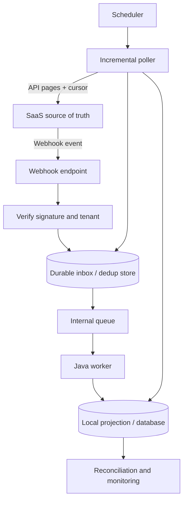

# Syncing SaaS Data with Webhooks and Scheduled Polling

When integrating a Java application with an external SaaS platform, data can change on both sides. For example, a CRM updates a customer, a billing system changes a subscription status, or a support platform creates a new ticket. Your application must detect those changes and update its local data copy promptly while handling lost, duplicated, or out-of-order webhooks, as well as temporary SaaS API outages.

A practical design typically combines **webhooks for near-real-time change notifications** with **scheduled syncs for reconciliation and recovering missed events**. Webhooks reduce latency and polling volume; scheduled syncs detect drift, recover from extended outages, and reconcile state against the authoritative source. Both paths must share identical tenant, idempotency, cursor, and conflict-resolution rules so they never overwrite data incorrectly.

## 1. Why Combine Webhooks and Scheduled Sync?

A webhook is an HTTP request sent by the SaaS platform to your application's endpoint when an event occurs. A scheduled sync is a periodic job that proactively calls the SaaS API to fetch records created or modified since the last synchronization.

| Sync Approach | Strengths | Limitations |
|---|---|---|
| Webhook | Low latency, notifies only on change, reduces polling | Can duplicate, arrive out of order, retry, or be lost during endpoint outages or misconfigurations |
| Scheduled polling | Proactively verifies state, recovers missed changes | Latency depends on schedule interval, consumes API quota, requires pagination/cursor management |
| Hybrid | Webhooks deliver fast updates; polling fixes drift and recovers gaps | Must handle two paths writing to the same data and manage checkpoints cleanly |

Never treat webhooks as a durable message queue owned by your application. Providers may retry only for a limited window, cap retry attempts, or require manual replays. Conversely, continuously polling the entire dataset wastes API quota and creates unnecessary load. The hybrid pattern combines the strengths of both.



Webhooks and pollers can feed changes into a shared processing pipeline. When doing so, record the event source (`WEBHOOK` or `POLL`), event/object version, and cursor so you can trace the origin of every update. If you need to publish a message to a separate queue after writing to the inbox, use a transactional outbox or let workers poll the inbox; never assume writing to the database and publishing to a broker form a single atomic transaction. If publishing fails after the inbox commits, the outbox/inbox dispatcher must retry without losing the event.

## 2. Defining the Source of Truth and Sync Scope

Before implementing, decide which data is owned by the SaaS and which data is managed by your internal application.

- **SaaS as source of truth:** fields such as subscription status, external customer name, or ticket status originate from the SaaS; the local database acts purely as a projection/cache.
- **Internal application as source of truth:** data is created internally and pushed to the SaaS; webhooks only reflect acceptance status or edits made by SaaS users.
- **Bidirectional:** each system updates a subset of fields; define ownership per field or workflow rather than blindly applying a "last-write-wins" rule.

Clarify:

- Which objects/resources require syncing—such as customer, contact, invoice, subscription, or ticket.
- Which fields are synced vs. purely internal.
- Which tenant/account maps to which SaaS connection.
- Target cadence and latency for webhooks and reconciliation.
- Handling of creates, updates, archives, hard deletes, and restores.
- Conflict policies when the same object changes on both sides.
- Retention periods for events, cursors, audit logs, and tombstone records.

Avoid storing entire SaaS payloads in your internal database when only a few fields are needed. Selecting a minimal projection reduces sensitive data exposure, lowers schema coupling, and makes vendor payload additions easier to absorb.

## 3. Webhook Flow: Verify, Persist Durably, Then Respond Fast

A webhook endpoint should execute these steps in order:

1. Receive the HTTP request over HTTPS and enforce a body size limit.
2. Read the exact raw request body bytes as received.
3. Verify the signature, timestamp, or token according to the SaaS provider's documentation.
4. Resolve the tenant/connection using registered configuration; never trust a tenant ID merely because it appears in the body.
5. Validate event type, event ID, schema version, and required headers.
6. Persist the event into a durable inbox with a unique key for deduplication.
7. Commit the persisted event before returning HTTP success.
8. Let an asynchronous worker process the event and update the local projection.

The endpoint should return `2xx` immediately after the event is durably stored. Never hold the HTTP connection open to call multiple SaaS APIs, update multiple tables, or send emails. If business logic takes too long, provider timeouts can trigger webhook retries and generate extra duplicates. Enforce body size limits at the API gateway/reverse proxy and HTTP server before the framework buffers the full request; checking `rawBody.length` in the controller is only a secondary guard after bytes have been read.

### Why a Durable Inbox?

If the endpoint returns `200 OK` before persisting the event, the process could crash immediately afterward while the provider believes the event was delivered. If the endpoint executes full processing before responding, the request could time out after side effects succeed, causing the provider to retry and create duplicates.

A durable inbox decouples **receiving an event** from **processing an event**. An inbox table can include:

| Field | Purpose |
|---|---|
| `provider` | SaaS/provider name |
| `connection_id` | Authenticated SaaS connection |
| `tenant_id` | Mapped internal tenant |
| `event_id` | Provider-assigned event ID |
| `event_type` | Event type |
| `object_id` | SaaS object ID if available |
| `occurred_at` | Event timestamp reported by the provider |
| `received_at` | Timestamp when the endpoint received the request |
| `payload` | Protected/bounded payload or reference to object storage |
| `status` | `RECEIVED`, `PROCESSING`, `PROCESSED`, `RETRY`, or `DEAD` |
| `attempt_count` | Number of worker processing attempts |
| `last_error` | Sanitized error code for investigation |

Define an appropriate unique constraint, such as `(provider, connection_id, event_id)`. If the provider does not issue stable event IDs, define a deduplication key per the contract; hashing the payload is only a fallback because two distinct valid events can share identical payloads.

## 4. Securing Webhook Authentication

A webhook endpoint is a public HTTP ingress or externally reachable by the SaaS. Never process a payload simply because the request hit an obscure path or carried a plausible tenant header.

Common mechanisms:

- HMAC signature computed over the raw body using a shared secret.
- Timestamp included inside the signature to bound the replay window.
- Per-connection/tenant secrets when supported by the provider.
- mTLS or token authentication if supported and required by the contract.
- IP allowlists strictly as defense in depth; never rely on them instead of cryptographic signatures since IP ranges change.

### HMAC Must Use the Raw Body

Many providers sign the exact bytes of the request body. If you parse JSON and re-serialize it, field ordering, whitespace, or encoding can change and invalidate the signature. Read the raw bytes, compute the HMAC following the provider's exact canonicalization rules, and compare in constant time.

Illustrative Java helper for a header formatted as `sha256=<hex>`:

```java
import javax.crypto.Mac;
import javax.crypto.spec.SecretKeySpec;
import java.security.MessageDigest;
import java.util.HexFormat;

public final class WebhookSignature {
    public static boolean verify(byte[] rawBody,
                                 String suppliedHeader,
                                 byte[] secret) throws Exception {
        if (suppliedHeader == null || !suppliedHeader.startsWith("sha256=")) {
            return false;
        }

        byte[] supplied;
        try {
            supplied = HexFormat.of().parseHex(
                    suppliedHeader.substring("sha256=".length()));
        } catch (IllegalArgumentException invalidHex) {
            return false;
        }

        Mac mac = Mac.getInstance("HmacSHA256");
        mac.init(new SecretKeySpec(secret, "HmacSHA256"));
        byte[] expected = mac.doFinal(rawBody);
        return MessageDigest.isEqual(expected, supplied);
    }

    private WebhookSignature() {}
}
```

This illustrates one hypothetical contract. Providers may use different HMAC algorithms, Base64 encoding, timestamp prefixes, multiple signature versions, or custom canonical strings. Implement the exact specification in the provider's documentation; do not copy this header format across all SaaS integrations. Fetch secrets from a secrets manager—never hardcode them in source code or logs.

### Replay Protection

When providers sign a timestamp, verify it falls within an acceptable tolerance (e.g., a few minutes, based on clock skew and contract). Even a validly signed older request can be replayed; therefore, timestamp validation must be paired with event ID deduplication. Never use timestamp as the sole deduplication key.

### Secret Rotation

If the provider supports secret rotation, there may be an overlap period accepting both the current and next secrets. Keep the overlap window bounded, log which key version succeeded, and revoke the old secret once the provider confirms cutover. Avoid testing an unbounded list of secrets, which increases attack surface and processing overhead.

## 5. Java: Webhook Controller That Only Receives and Persists Events

An example Spring Boot controller that receives raw bytes, verifies the signature, and calls an inbox service. Header mapping, secret lookup, and transaction boundaries are kept outside the controller for testability.

```java
@RestController
@RequestMapping("/integrations/acme/webhooks")
public class AcmeWebhookController {
    private final WebhookVerifier verifier;
    private final WebhookInboxService inbox;

    public AcmeWebhookController(WebhookVerifier verifier,
                                 WebhookInboxService inbox) {
        this.verifier = verifier;
        this.inbox = inbox;
    }

    @PostMapping
    public ResponseEntity<Void> receive(
            @RequestHeader("X-Acme-Signature") String signature,
            @RequestHeader("X-Acme-Event-Id") String eventId,
            @RequestBody byte[] rawBody) {

        if (rawBody.length > 256 * 1024) {
            return ResponseEntity.status(HttpStatus.PAYLOAD_TOO_LARGE).build();
        }
        VerifiedWebhook verified = verifier.verify(signature, rawBody);
        if (!verified.valid()) {
            return ResponseEntity.status(HttpStatus.UNAUTHORIZED).build();
        }

        // The provider adapter must ensure eventId is covered by the
        // verified signature, or extract it from the signed body.
        inbox.accept(verified.connectionId(), eventId, rawBody);
        return ResponseEntity.accepted().build();
    }
}
```

An illustrative controller cannot replace a contract-accurate adapter: some providers pass event IDs in the body, some sign timestamps/headers as well, and some use separate webhook endpoints per connection. If the event ID arrives in a header while the signature only covers the body, do not trust that header for deduplication unless the provider binds it to the signed payload; extract the ID from the verified body or verify a canonical signature covering headers. Looking up the connection/secret must also use a registered endpoint key or installation identifier before verifying the signature. Return error codes expected by the provider on authentication failure; if the inbox/database is temporarily unavailable, return a retryable error rather than `2xx` before durable persistence.

### Inbox Transactions and Duplicates

The inbox service must handle races between simultaneous identical webhook deliveries. Rely on database unique constraints rather than performing a `SELECT` followed by an `INSERT`, because two concurrent requests could both observe "not present yet".

```java
@Transactional
public AcceptResult accept(String connectionId,
                           String eventId,
                           byte[] rawBody) {
    boolean inserted = inboxRepository.insertIfAbsent(
            connectionId, eventId, rawBody, clock.instant());
    return inserted ? AcceptResult.STORED : AcceptResult.ALREADY_RECEIVED;
}
```

`insertIfAbsent` should use an atomic database statement such as `INSERT ... ON CONFLICT DO NOTHING` or an equivalent unique-constraint upsert. This avoids catching a constraint-violation exception inside a transaction that may already be marked rollback-only. When a duplicate was previously stored, you can return `2xx` because the application has already received the event. Treat duplicates as success only if the unique key truly represents the same event under the contract. If the same event ID arrives with a different payload, flag the anomaly and emit an audit/security signal.

## 6. Asynchronous Event Processing and Idempotency

Webhook providers generally use at-least-once delivery: an event can be delivered repeatedly until a successful response is received or the retry policy expires. Workers can also re-run after timeouts, crashes, or acknowledgement failures. Therefore, handlers must be idempotent.

One approach uses the event ID as a processing key and records state within the same transaction as the data update:

1. Read events in `RECEIVED`/`RETRY` status.
2. Claim the event via a conditional status/lease update so two workers do not process it concurrently.
3. Verify whether the event ID has already been processed.
4. Apply changes to the projection and write a processed marker in the same transaction.
5. Commit; then mark or signal completion.

If side effects occur outside the database (calling another API, sending an email), a database transaction cannot guarantee atomicity with the external system. Use an outbox, downstream idempotency keys, or a stateful workflow with appropriate compensation.

### Inbox and Outbox

- **Inbox:** durably persists inbound events, deduplicates them, and tracks processing state.
- **Outbox:** persists outbound commands/events in the same transaction as internal data changes; a separate publisher forwards them to a broker or SaaS.

These two patterns prevent "database committed but message never sent" and "message acknowledged but never saved". They do not create global exactly-once delivery; the goal is controlled at-least-once delivery with idempotent effects.

## 7. Handling Out-of-Order Events

Webhooks can arrive out of order due to retries, network delays, or parallel workers. For instance, `customer.updated` version 12 might be processed before version 11. If the older event arrives later and overwrites the entire record, local state regresses.

Prefer metadata supplied by the provider:

- Monotonic object version or sequence number.
- `updated_at` with clear precision and semantics.
- Event creation time and object revision.
- Causation/parent event ID if available.

If the provider supplies a monotonically increasing version, apply updates only when the incoming version is newer than the stored version. If only timestamps exist, account for clock skew, timestamp precision, and two updates sharing the same timestamp. Never assume event arrival time equals business order.

When an event merely signals "object changed" without carrying a full snapshot, the worker can call the SaaS API to fetch the latest object state. This avoids applying stale payloads, though you must handle API quotas, deleted objects, and state changing further during the fetch.

## 8. Scheduled Sync: Incremental Polling Instead of Full Scans

Pollers should fetch only records modified since the previous checkpoint rather than downloading the full dataset every run. SaaS APIs commonly support one or more mechanisms:

- `updated_since` / `modified_after` timestamps.
- Opaque cursors or delta tokens.
- Pagination tokens (`nextPageToken`, `next_cursor`, `rel=next` links).
- Change feeds or export jobs.
- Sequence numbers or revisions.

Prefer provider-issued delta cursors because they handle change semantics more accurately than self-managed timestamps. If an API only supports timestamps, use an overlap window to avoid missing records due to indexing lag, timestamp precision, or concurrent updates.

### Watermarks and Overlap Windows

Suppose the previous sync completed up to watermark `T`. The next run can query starting from `T - overlap`, stepping back a few minutes. Records inside the overlap window are re-read; idempotent upserts and version checks prevent stale overwrites.

```text
lastSuccessfulWatermark = 10:00:00Z
overlapWindow           = 5 minutes
nextQueryFrom           = 09:55:00Z
```

Overlap protects against missed records but increases re-reads. Tune its length based on API indexing delay, timestamp granularity, and quota. Do not make the overlap too short if the provider has long eventual consistency delays; do not make it too wide when datasets and quotas are tight.

### Do Not Use Job Start Time as the Checkpoint

If a job starts at 10:05 and fails on the final page, never advance the checkpoint to 10:05. Advance the checkpoint only after all preceding records are durably persisted. When using timestamps, checkpoint up to the timestamp of the data actually processed—not the scheduler's current wall-clock time.

## 9. Safe Pagination and Cursors

In paginated APIs, each page typically returns items plus a token for the next page. Cursors may be opaque tokens; never parse, modify, or fabricate their values when the provider expects them passed verbatim.

Safety rules:

- Persist the new cursor only after the current page has been processed and committed.
- If processing fails mid-page, re-running that page must be safe via idempotent upserts/dedup.
- Never advance the cursor before page data is durably saved.
- Bound page sizes according to API quotas and payload limits.
- Track page counts, record counts, durations, and errors per tenant/connection.
- Handle expired/invalid cursors per the contract; a controlled full resync may be required.
- If the API returns `next` URLs, invoke only allowlisted hosts or validate the origin per contract to prevent SSRF.

### Java Example: Reading Pages by Cursor

```java
public void syncPages(SaaSConnection connection) {
    String cursor = checkpointStore.loadCursor(connection.id());

    while (true) {
        Page<CustomerDto> page = saasClient.fetchCustomers(
                connection, cursor, 200);

        transactionTemplate.executeWithoutResult(status -> {
            for (CustomerDto item : page.items()) {
                customerRepository.upsertIfNewer(
                        connection.tenantId(), item);
            }
            checkpointStore.saveCursor(
                    connection.id(), page.nextCursor());
        });

        if (page.nextCursor() == null) {
            break;
        }
        cursor = page.nextCursor();
    }
}
```

This is Java pseudocode; adapt it to your transaction manager and actual API semantics. `customerRepository` and `checkpointStore` should share the same transactional resource if you want page data and cursor committed atomically. If checkpoints reside in a separate store, write the cursor only after data commits; a crash in between will re-read the page, requiring idempotent upserts. If the API returns an empty `nextCursor` on the final page, persist an explicit "sync complete"/watermark state rather than treating `null` ambiguously. If a transaction cannot span a huge page, process records in chunks and commit the cursor only after the whole page completes—or track per-item progress consistently. You can also cap page counts and detect repeated cursors to avoid infinite loops if a provider returns malformed pagination tokens.

## 10. Full Sync, Delta Sync, and Reconciliation

### Initial Full Sync

When a tenant connects a SaaS integration for the first time, an initial copy is required. Full syncs can take a long time and hit API quotas. Paginate with checkpoints, limit concurrency, and optionally run per object type. Never load all records into memory before writing to the database.

Webhooks can still arrive while the full sync is running. A safe strategy:

1. Capture incoming webhooks in the durable inbox as soon as the connection is activated.
2. Obtain an initial snapshot/cursor using the provider's supported mechanism.
3. Sync page by page with checkpoints.
4. Process/replay events captured during the full sync.
5. Run delta sync from the appropriate cursor/watermark to catch changes made during the snapshot.
6. Mark the connection `READY` once reconciliation meets completion criteria.

If the provider lacks snapshot-consistent cursors, you may need to enable webhooks first, pull a full snapshot, and then poll an overlap window with version-guarded upserts. Provider documentation dictates the exact sequence; never assume a full-list API yields a point-in-time consistent snapshot.

### Delta Sync

Delta sync fetches only records created or modified since the last cursor/watermark. It saves quota and time, but relies on accurate cursor persistence and the provider retaining change history long enough.

### Reconciliation

Reconciliation compares local state against the source within a bounded scope. It can:

- Re-fetch objects updated within a recent lookback window.
- Spot-check a random or per-tenant sample of records.
- Reconcile counts/aggregates per object type.
- Run a less frequent full inventory if quotas permit.
- Check webhook delivery gaps, event age, and cursor lag.

Reconciliation does not need to scan everything every few minutes. Choose cadence based on criticality, volume, API quota, and cost. Billing or entitlement data typically warrants more frequent reconciliation than low-priority profile fields.

## 11. Handling Deletes, Archives, and Restores

Deletions are easy to miss during sync. Many delta APIs only return active or updated records; if an object is hard-deleted, it may simply vanish from list endpoints.

Common patterns:

- `deleted`/`archived` webhook events paired with local tombstones.
- Change feeds that include deletion markers.
- Audit/change-log APIs containing deletion states.
- Full reconciliation via snapshots/counts, taking care not to falsely delete items due to incomplete pagination.

Never delete a local object solely because it was absent from one page or single query. Conclude an object is deleted only when confirmed by the provider contract or a verified complete snapshot. Store tombstones with external ID, deleted version/timestamp, and event source to guard against stale events arriving later.

If an object is restored or unarchived, newer versions/sequences must supersede the prior tombstone. Set tombstone retention long enough to deduplicate delayed events.

## 12. Scheduling, Avoiding Overlapping Jobs, and Distributed Leases

A `@Scheduled` method running across multiple application instances can fire simultaneously on every instance. That spawns multiple pollers for the same tenant, burning quota and causing duplicate writes or cursor races.

Coordination options:

- Cloud managed scheduler invoking a single function/endpoint.
- Distributed lock in a database/Redis with owner ID, lease expiry, and fencing token.
- Scheduler library with a persistent job store and cluster mode.
- Partitioning tenants across workers using queues/leases for controlled parallelism.

### Locks Need Leases and Fencing

A lock should never be a simple "is running" boolean. A worker can crash and leave the lock stuck forever; or an old worker can pause, let its lease expire, watch a new worker acquire the lock, and then wake up and overwrite data. A monotonically increasing fencing token lets storage reject writes from stale owners.

A lease record can include:

| Field | Purpose |
|---|---|
| `job_key` | Tenant + provider + object type |
| `owner_id` | Instance/job run currently holding the lease |
| `lease_until` | Expiration timestamp in UTC |
| `fencing_token` | Monotonically increasing number incremented on each claim |
| `heartbeat_at` | Most recent lease renewal timestamp |

Never use local `synchronized` blocks or static flags to coordinate multiple serverless instances; those apply only within a single JVM.

### Sharding Load by Tenant

Do not let one tenant with a massive dataset block all other tenants. Use queues or scheduler partitioning so each connection progresses independently with bounded concurrency and its own rate budget. A throttled tenant can be retried later without stalling other tenants.

## 13. Java: Scheduled Sync with Per-Connection Locks and Checkpoints

The example below illustrates orchestration structure; locks, checkpoints, and transactions must be backed by appropriate distributed storage.

```java
public final class SaaSSyncJob {
    private final ConnectionRepository connections;
    private final DistributedLease leases;
    private final SyncService syncService;

    public void runDueConnections() {
        for (SaaSConnection connection : connections.findDueConnections()) {
            String key = connection.provider() + ":" + connection.id();
            leases.tryAcquire(key).ifPresent(lease -> {
                try (lease) {
                    syncService.syncIncrementally(connection, lease);
                } catch (RetryableSyncException ex) {
                    syncService.recordRetry(connection, ex);
                }
            });
        }
    }
}
```

`tryAcquire` must perform an atomic claim in shared storage, returning a lease with expiry/heartbeat and a fencing token. `findDueConnections` should paginate, cap tenants per run, and enforce fairness so long-waiting tenants are not starved.

In serverless environments, the scheduler should usually trigger a brief dispatcher that enqueues each tenant/connection onto a queue. Workers then process connections independently, preventing one invocation's duration from scaling with the entire tenant roster.

## 14. Rate Limits and Retries When Calling SaaS APIs

SaaS providers commonly rate-limit APIs per tenant, API key, application, endpoint, or plan. A scheduled sync running across many tenants concurrently can trip global or per-tenant limits.

Classify errors carefully:

| Error | Recommended Action |
|---|---|
| `429 Too Many Requests` | Honor `Retry-After` or reset headers; slow down and retry with jitter |
| `5xx` | Bounded retries with exponential backoff and jitter |
| Timeout/network reset | Idempotent retry within deadline; check whether the request may have succeeded |
| `401` | Refresh token per flow; retry once if refresh succeeds |
| `403` | Inspect scopes/permissions; usually requires user/admin action rather than tight retries |
| `400` validation/schema | Flag data/contract error; do not retry indefinitely |
| Cursor expired/invalid | Restart delta or full sync via recovery procedure |
| `404` | Distinguish deleted objects from wrong endpoint/resource paths |

### Backoff and Jitter

Retrying many tenants simultaneously with identical delays creates thundering herds. Use exponential backoff with jitter, bounded attempts, and overall deadlines. If the provider sends `Retry-After`, honor it first. Persist retry state rather than sleeping inside a serverless function for long intervals.

### Scoping Rate Limiters Properly

If the SaaS enforces per-tenant limits, each connection needs its own token bucket. If there is a global app limit, workers need a shared limiter. A local in-memory limiter only throttles a single instance; as functions scale out, aggregate traffic can exceed quotas. Enforce limits via queue concurrency, distributed token buckets, or a centralized dispatcher.

## 15. OAuth Tokens and Connection Lifecycles

Many SaaS platforms use OAuth 2.0 access and refresh tokens. Scheduled syncs must handle token expiration, rotation, revocation, and scope changes.

- Encrypt refresh tokens at rest and restrict read permissions.
- Never log access/refresh tokens or URLs containing tokens.
- Refresh tokens per contract; some providers rotate refresh tokens and immediately invalidate prior ones.
- Prevent concurrent workers from refreshing the same connection simultaneously; use single-flight coordination or a per-connection lease.
- When refresh fails with `invalid_grant`, mark the connection as requiring re-authentication rather than retrying endlessly.
- Track granted scopes and detect revoked scopes.
- When a user disconnects, halt scheduled syncs, revoke tokens if supported by the provider, delete secrets, and apply data retention policies.

Never share a single OAuth token across tenants when the provider requires per-tenant consent. Every connection must map to the right tenant and principal.

## 16. Multi-Tenancy and Data Protection

Webhook payloads may carry external customer IDs, emails, or business records. Every operation must be bound to the authenticated connection:

- Map endpoints, secrets, and provider connections to the exact tenant.
- Never trust `tenantId` inside the payload to choose where to write data.
- Use composite keys combining tenant/connection and external object ID.
- Scope every query, upsert, delete, and checkpoint to the tenant.
- Restrict worker permissions so each worker accesses only the secrets of connections it handles.
- Prevent events from tenant A from writing into tenant B's projection.
- Separate encryption keys or secret scopes according to data policy.
- Maintain audit logs for connects, disconnects, replays, full resyncs, and manual overrides.

If a single shared webhook URL is used, the signing key or provider account mapping must identify the tenant before processing. If a provider supports only one app-wide secret, verify the event's account/installation ID against registered records.

### SSRF Risks with Callbacks or Next-Page URLs

Some APIs return `next` links, export URLs, or webhook callback URLs. Never blindly invoke arbitrary URLs from external payloads. Validate the HTTPS scheme, check hostnames against a provider allowlist, block private/link-local/metadata IPs, and inspect redirects. Configure HTTP clients not to follow redirects to untrusted hosts where OAuth tokens could leak.

## 17. Conflict Resolution for Bidirectional Changes

When both the SaaS and internal application can modify an object, define per-field ownership:

| Field | Owner | Rule |
|---|---|---|
| `externalSubscriptionStatus` | SaaS billing | Updated by SaaS events/polls |
| `internalRiskScore` | Internal application | Never overwritten by webhooks |
| `displayName` | Defined by business rules | May require versioned last-write-wins or manual conflict resolution |
| `syncStatus` | Integration service | Managed internally |

If using last-write-wins, timestamps must come from sources with clear, comparable semantics. Never use worker processing time, as a delayed webhook could overwrite newer edits. For critical data, store source versions and conflict records for human or workflow resolution.

A safe approach treats the local database as a read projection of SaaS-owned fields while keeping internal fields in separate tables or columns. When pushing local changes back to the SaaS, use a dedicated command/outbox and provider idempotency keys where supported.

## 18. Observability for Sync Health

Do not track only function invocation counts. You need visibility into whether each tenant is syncing on time and how well data reconciles.

Useful metrics:

- Webhooks received, verified, rejected, duplicated, and inbox age.
- Inbox backlog, processing duration, retry counts, and dead-letter counts.
- Webhook delivery delay: `received_at - occurred_at` when source timestamps are trustworthy.
- Last successful sync time per tenant, provider, and object type.
- Cursor lag or watermark lag.
- Pages/records fetched, inserted, updated, skipped, and deleted/tombstoned.
- API request counts, `429`s, `5xx`s, timeouts, and token refresh failures.
- Reconciliation mismatch counts and time to resolve mismatches.
- Lease conflicts, overlapping job attempts, and job durations.

Structured logs should capture `provider`, `connectionId`, `tenantId` (non-sensitive internal ID), `eventId`, `objectId`, `syncRunId`, `cursorVersion`, `attempt`, and `correlationId`. Never log raw webhook bodies, OAuth tokens, or full PII.

Alerts should focus on business impact:

- Key tenants failing to sync within SLA thresholds.
- Oldest inbox event exceeding age thresholds.
- Continuously climbing cursor lag.
- Sudden spikes in `429` or authentication failures.
- New DLQ items or reconciliation mismatches above thresholds.
- Scheduler stalling or leases held past expected limits.

## 19. Testing Webhooks and Scheduled Syncs

Tests should simulate non-ideal SaaS behaviors:

### Webhooks

- Valid, invalid, missing signatures, and old secrets during rotation windows.
- Expired timestamps or excessive clock skew.
- Oversized payloads, malformed JSON, or unsupported schema versions.
- Same event ID delivered repeatedly and concurrently.
- Out-of-order events or stale events arriving after newer ones.
- Database/inbox unavailable before the endpoint returns `2xx`.
- Worker crashing after updating the database but before acknowledging.

### Scheduled Sync

- Multi-page pagination and empty final pages.
- APIs returning `429`, `5xx`, timeouts, or `Retry-After`.
- Expired/invalid cursors requiring a full resync.
- Overlapping job triggers across multiple instances.
- Worker crashing mid-page; next run resumes without skipping records.
- Records changing while pagination is underway.
- Objects deleted, archived, restored, or missing from list endpoints.
- One throttled tenant not starving other tenants.

### Consistency and Security

- Webhooks and pollers updating the same object concurrently.
- Duplicate events causing no duplicate side effects.
- Spoofed tenant IDs in payloads unable to target another tenant.
- Next-page URLs blocked from accessing metadata/private endpoints.
- Logs verified free of tokens and sensitive payloads.
- Tenant disconnect halting jobs and revoking credentials per policy.

Use a fake SaaS server or WireMock/MockWebServer to control responses, pagination, and fault injection. Complement with contract tests against a provider sandbox before enabling production connections. Never use test accounts holding real customer data without proper safeguards.

## 20. Rollout and Operating SaaS Connections

A safe rollout sequence:

1. Create the connection and store credentials in a secrets store.
2. Verify OAuth scopes, webhook subscriptions, and callback URLs.
3. Enable the webhook endpoint writing only to the durable inbox; verify signatures and tenant mapping.
4. Start the initial full sync with low rate/concurrency and checkpointing.
5. Process inbox events accumulated during the full sync.
6. Run delta sync and reconciliation to catch any missed changes.
7. Mark the connection `READY` once cursors and projections meet criteria.
8. Gradually scale sync concurrency within API quotas and database capacity.
9. Monitor inbox age, cursor lag, `429`s, auth failures, and mismatches.
10. On disconnect or authorization errors, pause syncs, prompt re-authentication, and keep state explicit.

When changing schemas or mappings, use expand-contract: add compatible fields/columns first, deploy workers supporting both old and new versions, and only then remove old fields. Webhooks can arrive mid-rollout; versioned event envelopes and tolerant readers minimize compatibility errors.

## 21. Common Design Pitfalls

| Pitfall | Consequence | Fix |
|---|---|---|
| Relying solely on webhooks | Lost events when providers stop retrying or endpoints are down | Scheduled reconciliation |
| Polling the entire dataset every time | Wastes quota, high latency, heavy load | Delta cursors/watermarks with reasonable overlap |
| Returning `2xx` before saving the event | Events lost if the process crashes | Durable inbox before acknowledgement |
| Running full business logic inside the webhook request | Timeouts and duplicate retries | Enqueue and process asynchronously in workers |
| Skipping signature verification on raw bytes | Accepts spoofed events or fails valid signatures | HMAC/provider verification per contract |
| Using event ID as a global key | Collisions across tenants/providers | Composite key per provider/connection/event |
| Check-then-insert without unique constraint | Race conditions create duplicates | Unique constraints and atomic inserts |
| Advancing cursor before committing data | Skipped records on crash | Commit data before/atomically with checkpoint |
| Ordering events by arrival time | Stale events overwrite newer state | Object version/sequence and conflict policies |
| Running jobs on every instance without locks | Duplicate polling and cursor races | Distributed scheduler/leases |
| Retrying immediately on `429` | Thundering herds and stricter throttling | `Retry-After`, backoff, jitter, and limiters |
| Using local semaphores as global limits | Scale-out exceeds SaaS quotas | Distributed limiters or concurrency caps |
| Deleting local objects absent from one page | Data loss from incomplete pagination | Tombstones and controlled full reconciliation |
| Trusting tenant IDs or next URLs in payloads | Cross-tenant writes or SSRF | Verified connection mappings and URL allowlists |

## 22. Implementation Checklist

### Connections and Webhooks

- [ ] Source of truth and field ownership are clearly defined.
- [ ] Webhooks enforce HTTPS, signature verification, and secret rotation.
- [ ] Raw body bytes are used according to the exact signature contract.
- [ ] Timestamp/replay windows and event IDs are validated.
- [ ] Tenants are mapped from authenticated connections.
- [ ] Inbox persists durably before returning `2xx`.
- [ ] Duplicate deliveries are handled via unique keys/idempotency.
- [ ] Asynchronous workers implement retries, leases, and dead-letter handling.

### Scheduled Sync and Checkpoints

- [ ] Delta cursors or watermarks are preferred over continuous full scans.
- [ ] Overlap windows are configured when APIs only support timestamps.
- [ ] Pagination saves cursors only after page commits.
- [ ] Invalid/expired cursors have a reset/full-resync procedure.
- [ ] Deletes, archives, and restores are handled via tombstones or change feeds.
- [ ] Jobs use distributed leases/fencing to prevent overlapping runs.
- [ ] Tenants are fairly partitioned with dedicated rate budgets.

### Reliability and Consistency

- [ ] Webhooks and pollers share idempotent upsert logic.
- [ ] Event ordering is enforced via versions/sequences.
- [ ] Conflict policies are explicit for bidirectional fields.
- [ ] Outbox/inbox patterns are used where durable side effects are required.
- [ ] Retries use backoff/jitter, honor `Retry-After`, and enforce retry budgets.
- [ ] `429`s, auth errors, schema errors, and cursor errors are classified separately.

### Security and Operations

- [ ] OAuth tokens/secrets are encrypted and never appear in logs.
- [ ] Next-page and callback URLs are allowlisted to prevent SSRF.
- [ ] All queries, writes, and checkpoints are tenant-scoped.
- [ ] Metrics track last successful sync, cursor lag, inbox age, DLQs, and reconciliation mismatches.
- [ ] Alerts, replay/runbooks, and audit logs cover connect, disconnect, and full resyncs.
- [ ] Sandbox contract tests and per-tenant rollouts are in place.

Webhooks deliver fast change signals; scheduled syncs verify source state and recover missed updates. By persisting events durably, deduplicating per connection, processing idempotently, advancing checkpoints only after commit, bounding pagination/rate limits, and reconciling periodically, a Java SaaS integration can withstand retries, outages, and out-of-order events. This hybrid design maintains a far more reliable internal data copy while keeping latency, API quotas, security, and operational costs under control.
