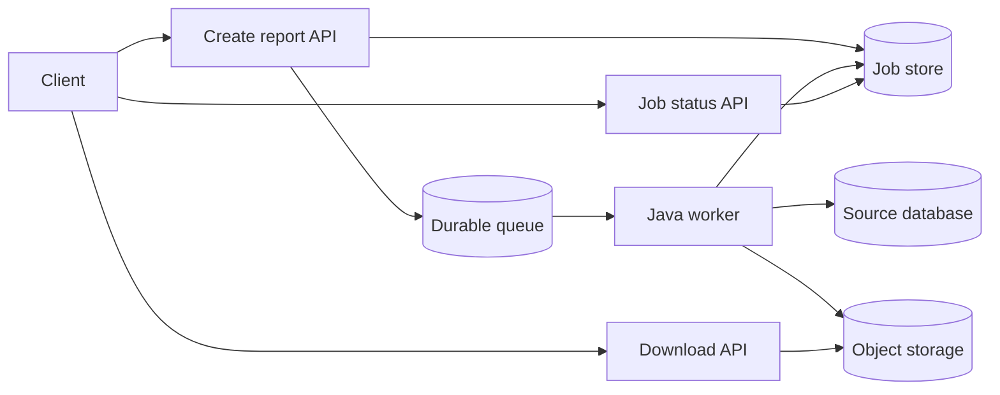
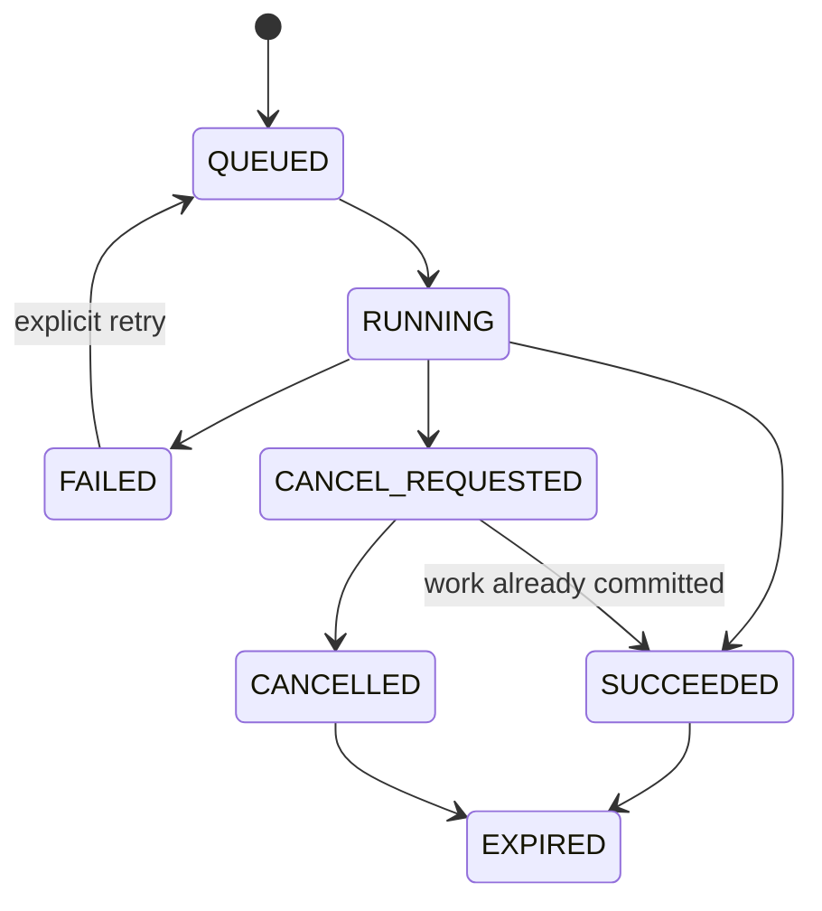
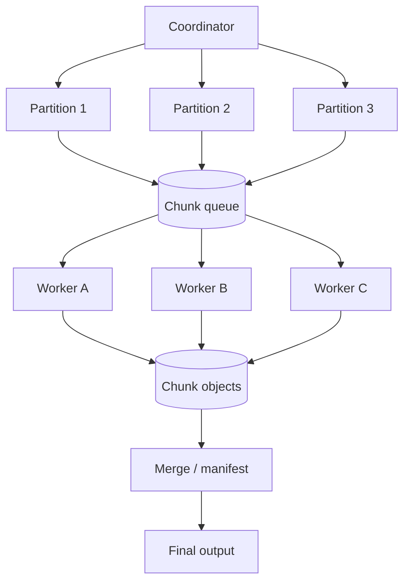

# Generating Reports and Exporting Files for Long-Running Tasks

Generating large reports, aggregating months of data, or exporting millions of records often takes tens of seconds to several minutes, or even longer. Running the entire export inside a single HTTP request risks function timeouts, ties up concurrency slots for extended periods, and forces clients to wait on fragile connections. A user closing their browser or losing network connectivity should never lose work that has already been accepted.

The right pattern is an **asynchronous job**: the API validates and persists a durable job, workers process it in the background, progress and state are stored for clients to track, outputs are written to object storage, and users download results via short-lived URLs. For Java serverless applications, this pattern brings together HTTP triggers, queue/event triggers, state management, retries, idempotency, access control, scale-out, and cost control.

Within **CLOUD_SERVERLESS**, this module focuses on building and deploying serverless applications—particularly Java functions triggered by HTTP, messages, or events. Learners address triggers, state, permissions, retries, idempotency, cold starts, scaling, and cost. This lesson guides you through designing a resilient report generation and file export flow capable of handling long-running jobs, tracking progress, resuming after failures, and distributing outputs securely.

## 1. Why Should You Not Hold an HTTP Request Open Until Export Completes?

A synchronous HTTP request forces both the client and the function to wait for the entire report generation duration. This has several drawbacks:

- API gateways, load balancers, and runtimes enforce their own timeouts; outer-layer timeouts may be shorter than processing time.
- Functions tie up concurrency slots, memory, and downstream connections while doing long-running work.
- Clients may disconnect while the server is still working; client retries can trigger duplicate report generation.
- Large queries can monopolize database connections and degrade interactive requests.
- It is hard to expose progress, pause, cancel, retry individual parts, or resume after an instance recycles.
- Large responses consume memory and network buffers, especially when assembling ZIP or XLSX files.

Synchronous HTTP still fits small reports with bounded sizes and predictable latency. Whenever processing time is unpredictable or risks exceeding timeouts, move to an asynchronous job.

## 2. Asynchronous Job Architecture

The core flow comprises a request-intake API, a job state store, a durable queue, workers, and object storage:



The API returns quickly once the job and message are durably persisted. Workers execute independently of the original HTTP connection. Clients use `jobId` to poll status and retrieve results upon completion.

Component responsibilities:

- **API:** authenticates callers, validates inputs, enforces quotas, creates jobs, and returns operation IDs.
- **Job store:** persists state, progress, owner/tenant, timestamps, version, and output metadata.
- **Queue or workflow engine:** wakes workers, coordinates steps, and manages retries.
- **Worker:** reads data in pages/chunks, generates outputs, and updates progress.
- **Object storage:** stores completed files and manifests; never rely on function memory for persistent outputs.
- **Notification:** signals completion or failure if the product uses push updates instead of polling.

## 3. HTTP Contract for Asynchronous Jobs

An API can expose these endpoints:

| Method | Endpoint | Purpose |
|---|---|---|
| `POST` | `/reports` | Create a report export job |
| `GET` | `/reports/{jobId}` | Check status and progress |
| `GET` | `/reports/{jobId}/download` | Obtain a short-lived download URL upon completion |
| `POST` | `/reports/{jobId}/cancel` | Request job cancellation if still possible |
| `GET` | `/reports` | List the caller's jobs with filtering and pagination |

Example job creation request:

```http
POST /reports
Authorization: Bearer <access-token>
Idempotency-Key: report:customer-42:2026-10
Content-Type: application/json

{
  "reportType": "monthly-orders",
  "from": "2026-10-01T00:00:00Z",
  "to": "2026-11-01T00:00:00Z",
  "format": "CSV",
  "filters": {
    "status": ["CONFIRMED", "SHIPPED"]
  }
}
```

Response when the job is accepted:

```http
HTTP/1.1 202 Accepted
Location: /reports/job-8f32
Retry-After: 3
Content-Type: application/json

{
  "jobId": "job-8f32",
  "status": "QUEUED",
  "statusUrl": "/reports/job-8f32"
}
```

`202 Accepted` means the system has accepted the work for asynchronous processing—not that the report is finished. Return `202` only after both job creation and message emission are durably persisted in a consistent manner.

## 4. Job State Machine

Jobs need an explicit state machine so the API, workers, notifications, and users share a consistent view of state.



Suggested meanings:

| State | Meaning |
|---|---|
| `QUEUED` | Job accepted and waiting for a worker |
| `RUNNING` | Worker is actively processing |
| `CANCEL_REQUESTED` | Cancellation requested; worker must check at the next checkpoint |
| `SUCCEEDED` | Output completed and safely published |
| `FAILED` | Job terminated with failure; includes a safe displayable error code |
| `CANCELLED` | Worker stopped and confirmed job cancellation |
| `EXPIRED` | Output retention elapsed and download is no longer available |

Never transition `RUNNING` to `SUCCEEDED` merely because a worker built bytes in memory. Ensure the output object is complete, metadata is recorded, and the job store points to a valid output before publishing success.

## 5. What Should a Job Record Store?

A minimal job record can include:

```json
{
  "jobId": "job-8f32",
  "tenantId": "tenant-42",
  "requestedBy": "user-17",
  "reportType": "monthly-orders",
  "status": "RUNNING",
  "progress": {
    "completedUnits": 4,
    "totalUnits": 10,
    "unit": "partition"
  },
  "attempt": 1,
  "version": 6,
  "createdAt": "2026-11-17T09:00:00Z",
  "startedAt": "2026-11-17T09:00:03Z",
  "updatedAt": "2026-11-17T09:01:20Z",
  "expiresAt": "2026-11-24T09:00:00Z",
  "output": null,
  "errorCode": null
}
```

Key fields:

- `tenantId` and `requestedBy`: establish job ownership.
- `status`: workflow state.
- `progress`: meaningful progress units, such as partitions, pages, or records.
- `attempt`: worker execution attempt count.
- `version`: supports conditional updates/optimistic locking when multiple workers or the cancel API update the record concurrently.
- `expiresAt`: retention deadline for job metadata and outputs.
- `output`: object key/version, size, checksum, and content type upon completion.
- `errorCode`: safe external error code; stack traces stay in access-controlled logs.

Do not store long-lived presigned URLs in the job record. Generate download URLs on demand with short TTLs when an authorized caller requests a download.

## 6. Consistent Job Creation with a Transactional Outbox

A common bug is inserting a job into the database and publishing a queue message in two separate operations:

1. Database job insert succeeds.
2. Queue publish fails.
3. The job remains stuck in `QUEUED` with no worker ever picking it up.

The reverse failure can also occur: the message is published, the database transaction rolls back, and a worker receives a nonexistent job.

A transactional outbox closes this gap by writing the job and an outbox event within the same transaction. A relay reads the outbox and publishes to the queue. Because the relay may redeliver after a lost acknowledgement, consumers must still be idempotent.

```sql
BEGIN;

INSERT INTO report_jobs(job_id, tenant_id, status, request_hash, version)
VALUES (:job_id, :tenant_id, 'QUEUED', :request_hash, 1);

INSERT INTO outbox_events(event_id, aggregate_id, event_type, payload)
VALUES (:event_id, :job_id, 'ReportRequested', :payload);

COMMIT;
```

The relay marks the outbox entry published only after the broker confirms receipt according to its semantics. If the relay crashes after publishing but before updating the outbox, the message may be resent; `jobId`/`eventId` serves as the worker's deduplication key.

## 7. Idempotency When Clients Submit Report Requests

A client can time out after the server has already created the job. On retry, the system must distinguish the same request from a new request.

Idempotency key design:

- Client sends a stable `Idempotency-Key` per user action.
- Server scopes the key by tenant/caller and hashes the normalized request.
- Same key, same request hash: return the existing job.
- Same key, different payload: return `409 Conflict`.
- Expire keys per retention policy after the window in which clients can retry.

Never treat a client-supplied idempotency key as an authorization credential. Other users must never read a job simply by guessing a key or `jobId`.

## 8. Validating and Bounding Requests Before Enqueuing

Export jobs can consume substantial CPU, database I/O, storage, and network bandwidth. Validate requests before accepting a job:

- Permitted report types and output formats.
- Maximum query date range.
- Accessible tenants/projects.
- Permitted filters and exportable columns.
- Estimated output size or row count if feasible.
- Per-user/per-tenant concurrent job quotas.
- Authorization to export sensitive fields.
- Deadlines or output retention bounds.

If limits are exceeded, return appropriate errors such as `400`, `403`, `413`, `422`, or `429` per the API contract. Never enqueue work guaranteed to exceed limits and let workers waste resources.

## 9. Choosing a Queue or a Workflow Engine?

A simple queue and worker fit single-step exports or short chains managed inside the worker. A workflow engine fits multi-step pipelines requiring durable state, branching, waits, callbacks, per-step retries, and orchestration visibility.

| Requirement | Suitable Pattern |
|---|---|
| Single worker generating CSV from one query | Queue + Java worker |
| Parallel partition processing followed by merge | Queue fan-out + coordinator |
| Export spanning extract, transform, upload, notify | Workflow/state machine or orchestrator worker |
| Waiting for human approval before generating file | Durable workflow with human approval callback |
| Scheduled recurring reports | Scheduler creating jobs + queue/workflow |
| Multi-hour runs requiring step-level resume | Workflow engine with durable state |

Orchestration services include AWS Step Functions, Azure Durable Functions, and Google Cloud Workflows; integrations, timeouts, quotas, and pricing vary by platform. Avoid building a custom workflow engine inside a database when a managed orchestrator fits your requirements.

## 10. Splitting Work into Steps and Checkpoints

Large reports should be decomposed into independently retryable units:

1. Normalize and persist the report specification.
2. Fix the data snapshot or watermark.
3. Generate the list of partitions or key ranges.
4. Enqueue chunks.
5. Workers read and produce each chunk.
6. Coordinator verifies all chunks succeeded.
7. Merge/compose final output or create a manifest.
8. Verify checksum, size, and publish the output.
9. Update job status to `SUCCEEDED`.
10. Dispatch notifications.

Checkpoints must hold enough state for workers to resume without reprocessing everything from scratch. Never keep cursors solely in function memory, as instances can be recycled.

## 11. Source Data Consistency

A report running for 20 minutes can read data that mutates mid-export. Without a defined snapshot, early and late pages may reflect different points in time.

Options:

- **Database snapshot transaction:** use snapshot isolation or repeatable read if supported and transaction duration is acceptable.
- **Watermark:** lock an `asOf` timestamp or sequence before starting; queries read only records at or before the watermark.
- **Materialized snapshot:** stage a dedicated dataset snapshot at request time.
- **Immutable event/source versions:** read from an immutable event log or versioned store when available.

Do not hold database transactions open for minutes or hours just to export files if doing so causes locks, exhausts connections, or impacts OLTP workloads. Watermarks must rely on columns/sequences with strict semantics; plain timestamps are insufficient if late-arriving updates or clock skew occur.

## 12. Keyset Pagination Instead of Loading Everything into Memory

Never load millions of rows into a `List` before serializing. Use streaming or keyset pagination to keep memory consumption flat.

Example keyset query:

```sql
SELECT id, created_at, customer_name, total_amount
FROM orders
WHERE created_at < :as_of
  AND (created_at, id) > (:last_created_at, :last_id)
ORDER BY created_at, id
LIMIT :page_size;
```

`(created_at, id)` provides a deterministic total ordering when `id` is a unique tie-breaker. For databases without row-value comparisons, write the equivalent predicate: `created_at > :last_created_at OR (created_at = :last_created_at AND id > :last_id)`.

Offset pagination slows down at high offsets and skips or duplicates rows if data shifts between pages. Keyset pagination requires a supporting index and a checkpointed cursor. If using a snapshot or watermark, every page query must apply the exact same snapshot condition.

## 13. Java Worker Reading Page by Page

Example service processing pages and persisting the cursor only after each chunk is safely written:

```java
public void exportPartition(ExportJob job, Partition partition) {
    ExportCursor cursor = checkpointRepository.load(job.id(), partition.id())
            .orElse(ExportCursor.start());

    while (true) {
        cancellationService.throwIfCancellationRequested(job.id());

        List<OrderRow> rows = orderRepository.fetchNextPage(
                job.snapshotWatermark(), cursor, 1_000);

        if (rows.isEmpty()) {
            checkpointRepository.markComplete(job.id(), partition.id(), cursor);
            return;
        }

        ChunkResult chunk = chunkWriter.writeDeterministicChunk(
                job.id(), partition.id(), cursor, rows);

        checkpointRepository.advanceAfterWrite(
                job.id(), partition.id(), cursor, chunk.nextCursor(),
                chunk.objectKey(), chunk.checksum());

        cursor = chunk.nextCursor();
    }
}
```

This is a skeleton; `advanceAfterWrite` requires a conditional update or transaction, and `writeDeterministicChunk` must be idempotent. If a worker crashes after uploading but before advancing the checkpoint, a retry must detect the existing chunk object and verify its checksum instead of appending duplicate rows.

## 14. Streaming CSV Instead of Building the Entire File in RAM

CSV suits large exports well because it can be written sequentially. Wrap the output stream in a `Writer` to enforce UTF-8 encoding and proper escaping.

```java
try (OutputStream output = objectStorage.openUploadStream(outputKey);
     BufferedWriter writer = new BufferedWriter(
             new OutputStreamWriter(output, StandardCharsets.UTF_8))) {

    writer.write("order_id,created_at,customer,total_amount");
    writer.newLine();

    for (OrderRow row : repository.streamRows(snapshot, filters)) {
        writer.write(csv(row.orderId()));
        writer.write(',');
        writer.write(csv(row.createdAt().toString()));
        writer.write(',');
        writer.write(csv(row.customerName()));
        writer.write(',');
        writer.write(row.totalAmount().toPlainString());
        writer.newLine();
    }
}
```

`objectStorage.openUploadStream` is an abstraction; most object stores require multipart uploads rather than a plain single stream. With multipart uploads, complete the upload only after all parts are written, and abort the multipart upload if the job fails or is cancelled.

Avoid `repository.streamRows` if its implementation holds a database transaction or connection open too long without proper fetch/timeout controls. For long exports, keyset pagination is generally easier to checkpoint and bound than long-lived streaming cursors.

## 15. CSV Escaping and Spreadsheet Safety

CSV serialization must escape commas, double quotes, and newlines inside fields. A basic helper:

```java
static String csv(String value) {
    if (value == null) {
        return "";
    }
    String escaped = value.replace("\"", "\"\"");
    return "\"" + escaped + "\"";
}
```

When files are opened in Excel or other spreadsheets, guard against **CSV formula injection**. Untrusted text starting with `=`, `+`, `-`, `@`, or control characters can be interpreted as formulas. For user-controlled text columns, apply a spreadsheet-safe policy (such as prefixing an apostrophe after normalizing leading characters) and test in target spreadsheet tools. Document any escaping behavior in the export contract, as it alters raw values for machine re-imports.

Also specify delimiter, line endings, character encoding, BOM if needed for compatibility, decimal separator, timezone, and null representation. Never rely on the JVM default locale; enforce fixed formatting and UTC or the timezone declared in the report specification.

## 16. XLSX, PDF, and ZIP Have Specific Limits

CSV lacks sheets, styling, and rich types. XLSX is useful when users need multiple sheets, formulas, or formatting, but libraries can consume heavy memory if they buffer the entire workbook. With Apache POI, consider streaming APIs such as SXSSF for large sheets, configuring row windows, temporary files, and cleanup.

Excel enforces a limit of 1,048,576 rows per worksheet. When datasets exceed that limit, split across sheets/files or offer CSV/Parquet instead. PDF works well for formatted reports, but requires layout/pagination and is poorly suited for dumping millions of rows.

ZIP archives bundle multiple files nicely, but require caps on total uncompressed size, entry counts, and compression ratios. Never trust user-supplied filenames or paths; sanitize entry names to prevent path traversal. When reading compressed inputs, cap decompressed size and compression ratios to defend against zip bombs.

## 17. Partitioning for Scale-Out

A single worker may not finish fast enough. Split datasets by tenant, date, ID range, or partition key, then enqueue each chunk.



Keep partitions relatively balanced so one oversized chunk does not drag out the whole job. Avoid creating millions of tiny messages; queue and orchestration overhead can outweigh parallelism gains. Choose chunk sizes based on processing duration, memory, retry cost, and downstream capacity.

If output order matters, give each partition a stable sequence/index. The coordinator merges in partition order or generates a manifest specifying part order. Never rely on Standard queue delivery order or worker completion order.

## 18. Capping Concurrency to Protect the Database

Scaling workers out does not mean letting concurrency grow unbounded. If each worker opens a connection against a database with a tight connection budget, excessive workers can exhaust the pool.

Enforce limits across:

- Max concurrent jobs per tenant and globally.
- Max concurrent chunks/partitions.
- Database connection pools and query concurrency.
- Read replica capacity when offloading reporting queries.
- Object storage multipart upload concurrency.
- Downstream API quotas.
- Function memory/CPU and page sizes.

You can separate `interactive-export` and `bulk-export` queues so user-facing reports take priority over historical batch exports. Admission control should check backlog depth and oldest job age before accepting new jobs.

## 19. Chunk Worker Idempotency

Queues generally offer at-least-once delivery or redeliver when ack/lock timeouts expire. Workers must assume any chunk can execute multiple times.

A chunk identity can be:

```text
jobId + partitionId + chunkSequence + inputSnapshotVersion
```

Deriving deterministic object keys from this identity ensures retries overwrite the exact same chunk safely or verify an already-written object. Never generate random filenames on each retry, which creates duplicate artifacts and obscures the authoritative output.

Advance the checkpoint only after the chunk is durably written and its checksum/metadata are verified. If storage upload succeeds but checkpointing fails, retries must verify the existing object and proceed. If the checkpoint commits before the upload finishes, the job risks skipping unsaved data.

## 20. Writing Staging Outputs and Publishing Final Results

Never allow clients to download an object while a worker is still writing it. Use staging keys or a dedicated prefix:

```text
exports/{tenantId}/{jobId}/staging/part-00001.csv
exports/{tenantId}/{jobId}/staging/part-00002.csv
exports/{tenantId}/{jobId}/final/report.csv
exports/{tenantId}/{jobId}/manifest.json
```

Once all parts finish:

1. Verify part counts and statuses.
2. Merge parts or build a manifest according to the output format.
3. Validate checksum, byte size, row count, and schema.
4. Write the final object to an immutable key/version.
5. Update the job store to reference the final object via a conditional update.
6. Transition the job to `SUCCEEDED`.
7. Send completion notifications only after the succeeded state commits.

Object storage does not always provide atomic renames. Copying from staging to final adds time and cost. You can use a manifest/pointer as the final publication step, provided clients access outputs solely through an API that verifies job state.

## 21. Manifests for Multi-Part Exports

When merging into one monolithic file is unnecessary, you can return a manifest listing the parts:

```json
{
  "jobId": "job-8f32",
  "format": "CSV_PARTS",
  "snapshot": "orders-as-of-2026-11-17T09:00:00Z",
  "parts": [
    {
      "sequence": 1,
      "objectKey": "exports/tenant-42/job-8f32/part-00001.csv",
      "rows": 100000,
      "sha256": "..."
    },
    {
      "sequence": 2,
      "objectKey": "exports/tenant-42/job-8f32/part-00002.csv",
      "rows": 85000,
      "sha256": "..."
    }
  ]
}
```

Manifests require the same access controls as the files themselves. Never embed public object URLs or credentials inside manifests. The download API can mint short-lived URLs per part or serve a merged archive.

## 22. Tracking Meaningful Progress

Progress does not have to be an exact percentage. When total row counts are unknown upfront, report completed partitions, current phase, or a "preparing data" status.

Example status response:

```json
{
  "jobId": "job-8f32",
  "status": "RUNNING",
  "phase": "EXPORTING",
  "progress": {
    "completedPartitions": 4,
    "totalPartitions": 10
  },
  "updatedAt": "2026-11-17T09:01:20Z"
}
```

Never increment progress before a chunk commits. Updating progress too frequently inflates database write load and cost; update per chunk, on fixed intervals, or on phase transitions.

## 23. Conditional Updates for State and Progress

Multiple workers or the cancel endpoint may update a job concurrently. Use version numbers and conditional updates so stale workers cannot overwrite newer state.

SQL example:

```sql
UPDATE report_jobs
SET status = 'RUNNING',
    started_at = COALESCE(started_at, CURRENT_TIMESTAMP),
    version = version + 1,
    updated_at = CURRENT_TIMESTAMP
WHERE job_id = :job_id
  AND status = 'QUEUED'
  AND version = :expected_version;
```

A worker claims the job only if exactly one row was updated. Otherwise, another worker already claimed or cancelled it. Even with queues providing visibility timeouts or locks, conditional state transitions remain essential because message redeliveries can still happen.

## 24. Cancellation and Deadlines

Cancellation is cooperative between the API and workers; you cannot assume an in-flight function halts instantaneously when a client requests cancellation.

A safe flow:

1. API verifies the caller owns the job and the job is in a cancellable state.
2. API transitions `RUNNING` to `CANCEL_REQUESTED` via a conditional update.
3. Workers check the cancellation flag at chunk/checkpoint boundaries.
4. Workers stop picking up new chunks, abort multipart uploads, and clean up staging per policy.
5. Workers transition the job to `CANCELLED`.

If a worker already published the final output and committed `SUCCEEDED`, cancellation cannot undo completion; the API should return the current state. Persist job deadlines as well so workers discard expired work or stop per policy.

## 25. Retries, Timeouts, and Dead-Letter Queues

Retries should happen at the chunk or safely repeatable step level. A long-running report should never restart from scratch just because one partition failed.

Error classification:

| Error | Appropriate Behavior |
|---|---|
| Transient network/database error | Bounded retries with exponential backoff and jitter |
| Dependency rate limiting | Honor `Retry-After` and reduce concurrency |
| Invalid report filter | Fail fast; do not retry |
| Revoked permissions | Halt job and record a safe error reason |
| Poison message/invalid schema | Route to DLQ/quarantine and alert |
| Worker timeout | Retry chunk from checkpoint if idempotent |
| Interrupted storage upload | Abort/resume multipart per provider and verify parts |
| Cancellation requested | Stop at checkpoint and settle message per queue semantics |

Visibility timeouts, lock durations, or ack deadlines must exceed chunk processing time or be renewed appropriately. Do not set the queue visibility timeout to the entire report's runtime if workers process individual chunks independently.

## 26. Completion Notifications

Once `SUCCEEDED` is committed, you can send an email, webhook, or in-app notification. Use an outbox for notifications as well so completed jobs neither miss notifications nor send uncontrolled duplicates.

Notifications should not embed long-lived presigned URLs. Include `jobId` and a link back to the application; when the user opens it, the backend checks authorization and generates a fresh download URL. For webhooks, sign payloads, verify endpoints, enforce bounded retries, and track delivery status.

## 27. Secure File Downloads

The download endpoint must:

- Authenticate the caller.
- Verify tenant/user ownership of the job.
- Verify the job is `SUCCEEDED` and the output has not expired.
- Generate a short-lived presigned URL or proxy the stream through the API.
- Grant `GET` permission only for the exact object—never bucket listing.
- Set safe `Content-Type`, `Content-Disposition`, and filename headers.
- Keep URLs out of logs, analytics, and unnecessary referrers.
- Optionally cap download counts or emit audit events per policy.

Presigned URLs are bearer credentials: anyone with the link can access the object until it expires. Short TTLs, unguessable object keys, and narrow IAM scopes reduce risk, but never replace authorization before issuing the URL.

## 28. Protecting Data Inside Export Files

Exports aggregate rows across tables and can be more sensitive than individual UI screens. Enforce:

- Permissions per report type and per column.
- Preventing clients from requesting arbitrary internal fields or cross-tenant data.
- Server-side row-level and tenant-level filtering.
- Server-side encryption with controlled key access.
- TLS in transit and signed download links.
- Redacting/masking unnecessary sensitive fields.
- Setting the shortest retention period that satisfies business requirements.
- Auditing who requested, generated, and downloaded each file.
- Purging outputs, staging objects, parts, manifests, and backups per policy.

Never trust client-supplied `tenantId`, `userId`, object keys, or report types without validating against server-side identity and permissions.

## 29. Size Limits, Quotas, and Abuse Prevention

Export endpoints can be abused for bulk data exfiltration. Enforce:

- Max concurrent jobs per user and per tenant.
- Max new jobs per minute/day.
- Maximum query date span per report type.
- Maximum output size and row limits.
- Caps on partition/chunk counts and total processing time.
- Download caps and output TTLs.
- Separate priorities and quotas for interactive vs. bulk exports.
- Rejection or deferral policies when backlogs cross thresholds.

Enforce quotas at both the API and workers. API-only limits are insufficient if a queue already holds a backlog or internal producers also enqueue jobs.

## 30. Cost and Performance Optimization

Report costs include multiple components:

- Invocation duration, CPU/memory, and retries.
- Queue requests, workflow transitions, and orchestration.
- Database reads, connection time, and read replica usage.
- Object storage bytes, multipart requests, copies/merges, and retention.
- Network egress and download traffic.
- Notifications, logs, metrics, and traces.
- Ephemeral storage and coordinator/worker overhead.

To optimize:

1. Run indexed queries and select only columns required by the export.
2. Use keyset pagination, bounded page sizes, and streaming writes.
3. Split into chunks so retries remain small instead of re-running the whole report.
4. Choose appropriate compression; weigh CPU cost against storage and egress savings.
5. Cap concurrency within database and storage budgets.
6. Clean up staging objects and parts on failure or expiry.
7. Measure cost per report and cost per exported row.
8. Schedule heavy exports during off-peak hours if SLAs permit.

Do not inflate function memory merely to hold entire files in RAM when streaming or multipart uploads solve the problem. Conversely, overly tiny chunks inflate queue and orchestration overhead; benchmark with realistic workloads.

## 31. Observability for Long-Running Jobs

Dashboards should monitor:

| Metric | Question Answered |
|---|---|
| Jobs created/completed/failed | What are completion rates and failure trends? |
| Queue age/depth | Are jobs waiting too long? |
| Job duration p50/p95/p99 | Which report types are slow? |
| Chunk duration/retries | Which partitions bottleneck execution? |
| Rows/bytes exported | How are workload volumes and output sizes trending? |
| Worker concurrency/throttles | Are we hitting limits or overloading dependencies? |
| Cancel/failure reasons | Are stops user-initiated or system failures? |
| Output expiration/cleanup | Are expired files lingering uncleaned? |
| Cost per job | Which reports consume the most resources? |

Logs and traces should include `jobId`, access-appropriate `tenantId`, `partitionId`, `attempt`, `phase`, and `correlationId`. Avoid using these IDs as high-cardinality metric labels. Link job-creation APIs to workers via trace/message context or correlation IDs; because long jobs can outlive single-trace retention windows, start per-phase traces linked by `jobId`.

## 32. Implementation Across Cloud Platforms

Service names and quotas vary by region and tier; the table below summarizes common patterns rather than replacing official provider docs.

| Platform | Intake / Orchestration | Worker | File Output |
|---|---|---|---|
| AWS | API Gateway/Lambda + SQS or Step Functions | Lambda or container worker | S3 |
| Azure | API Management/Functions + Service Bus or Durable Functions | Azure Functions / Container Apps job | Blob Storage |
| Google Cloud | API endpoint/Cloud Run + Cloud Tasks/Pub/Sub or Workflows | Cloud Run job/service or function | Cloud Storage |

When choosing services, verify maximum execution times, payload limits, retry semantics, queue retention, concurrency limits, orchestration history retention, multipart upload support, and regional availability. Never design a job exceeding worker time limits without splitting it or moving to appropriate compute.

## 33. Testing Failure Scenarios

Happy-path tests are not enough. Verify:

- Client resending `POST /reports` after a timeout with the same idempotency key.
- Queue delivering the same chunk twice.
- Worker crashing after uploading a chunk but before updating the checkpoint.
- Worker crashing mid-upload.
- One partition failing while sibling partitions succeed.
- Slow database queries or replica lag.
- Job cancellation requested mid-execution.
- Job hitting its deadline or output reaching retention expiry.
- Expired presigned URLs or callers losing permissions before download.
- Another tenant attempting to read a `jobId` or object key.
- CSV payloads containing commas, quotes, newlines, Unicode, and formula-like prefixes.
- Files hitting row/size limits or interrupted multipart uploads.
- Outbox relay duplicate publications or temporary queue unavailability.

Integration tests should run against databases, queues, and object storage emulators/test environments closely matching production semantics. Run load tests with concurrent jobs to measure database load, queue age, memory footprints, output throughput, and cost.

## 34. Common Design Pitfalls

| Pitfall | Consequence | Mitigation |
|---|---|---|
| Holding HTTP requests open for long exports | Timeouts and tied-up concurrency slots | Return `202` and process via background jobs |
| Returning `202` before durable persistence | Clients think jobs succeeded when lost | Job store + outbox or confirmed publish |
| Loading all records into a `List` | OOM errors and GC pressure | Keyset pagination and streaming |
| Skipping snapshot isolation | Reports mix rows from different points in time | Watermark or snapshot semantics |
| Using large `OFFSET` values | Slow queries and skipped/duplicated rows on concurrent writes | Indexed keyset pagination |
| Non-idempotent workers | Duplicate chunks and corrupted outputs | Deterministic keys, checkpoints, and checksums |
| Publishing outputs before completion | Users download partial files | Staging prefixes + final publish/pointer |
| Unconditional progress updates | Stale workers overwrite newer state | Versioning/CAS and guarded transitions |
| Unbounded export endpoints | Data exfiltration and runaway costs | Authorization, quotas, and size/time limits |
| Long-lived presigned URLs | Shared links remain valid too long | Short TTLs and authorization on every request |
| Skipping staging cleanup | Growing storage bills and retained expired data | Lifecycle rules and cleanup jobs |

## 35. End-to-End Design Workflow

1. **Define SLAs:** completion time, size/row limits, retention, and waiting UX.
2. **Design APIs:** create/status/cancel/download endpoints and idempotency contracts.
3. **Persist jobs durably:** state, owner, request hash, version, deadline, and expiry.
4. **Emit messages reliably:** transactional outbox or provider-supported atomic publish.
5. **Fix source data:** immutable report spec and snapshot/watermark.
6. **Partition work:** chunk sizes, keyset cursors, and concurrency budgets.
7. **Build idempotent workers:** deterministic output keys, checkpoints, and bounded retries.
8. **Publish outputs safely:** staging, validation, manifests/final pointers, and job state.
9. **Secure downloads:** authorization, tenant isolation, short-lived URLs, and auditing.
10. **Operate:** dashboards, alerts, retention cleanup, cost allocation, and runbooks.

## 36. Production Checklist

| Question | Required Evidence |
|---|---|
| Are long tasks decoupled from HTTP requests? | API returns `202` with job ID and status URL |
| Are jobs persisted durably? | Job store, outbox, or confirmed publish |
| Is job creation idempotent? | Idempotency key + request hash + retention |
| Are state transitions guarded? | State machine and conditional/versioned updates |
| Are inputs validated and bounded? | Authorization, range, size, and quota policies |
| Is the data snapshot explicit? | Watermark or snapshot version recorded on the job |
| Do workers avoid loading full datasets into RAM? | Keyset pagination/streaming and memory tests |
| Are chunk retries safe? | Deterministic keys, checkpoints, and checksums |
| Does concurrency protect the database? | Worker caps, pool budgets, and backpressure |
| Are outputs published only when complete? | Staging, manifest/checksum, and final pointer |
| Are cancellation and deadlines clear? | Checkpoint cancellation checks and terminal states |
| Are downloads authorized? | Tenant checks, short-lived URLs, and audits |
| Are file formats hardened? | CSV escaping/formula policy and XLSX/PDF limits |
| Do retention and cleanup work? | TTL/lifecycle rules for jobs, outputs, and staging |
| Are observability and costs tracked? | Job duration, queue age, bytes/rows, and cost/job |
| Have failure and scale scenarios been tested? | Duplicate deliveries, crash recovery, load, and DR tests |

The asynchronous report-generation pattern decouples request intake time from actual processing time. A job store provides durable state; queues or workflows coordinate workers; checkpoints, conditional updates, and idempotency allow safe recovery across retries; and object storage retains outputs until expiration. Combining consistent snapshots, keyset pagination/streaming, concurrency caps, authorization, and automated cleanup enables Java serverless systems to produce large exports without relying on long-lived HTTP requests or a single function instance's memory.
