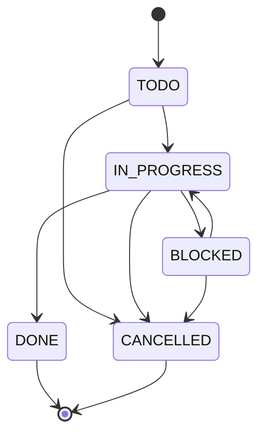

# Defining Requirements, API Contracts, and SLOs for a Task Management Service

Before writing a Java handler or creating a cloud function, the development team needs to align on what problem the service solves, who is allowed to use it, what data it manages, how the API responds, and what counts as healthy system operation. These decisions form the foundation of a Java serverless API that can be deployed, tested, and operated safely.

This lesson uses a running example project: the **Task Management API**, which enables users and teams to create, view, update, assign, and track tasks. The API runs on a serverless platform and receives HTTP requests; some operations may be processed asynchronously via queues/events and Java workers. The scope focuses on requirements, the resource model, the HTTP contract, and Service Level Objectives (SLOs), without diving into cloud-specific deployment configurations.

The expected outcome is a specification clear enough for frontend, backend, QA, platform, and product teams to implement without having to guess critical rules.

## 1. Starting from the Problem and Users

The Task Management API is more than a set of CRUD endpoints. Users need to know who is responsible for a task, its current status, its due date, and its change history. Teams need to filter tasks by project, assignee, status, or deadline; the system must prevent users of one tenant from reading another tenant's data.

### Key Actors

| Actor | Goal | Typical Permissions |
| --- | --- | --- |
| Task creator | Create and track tasks | Create tasks, view tasks they have access to |
| Assignee | Execute assigned work | View, update progress, add comments per policy |
| Project manager | Coordinate project work | Assign tasks, change priority/deadline, view reports |
| Tenant administrator | Manage tenant members and configuration | Manage memberships, roles, and projects within the tenant |
| Service integration | Create/update tasks from external systems | Machine-to-machine permissions according to granted scopes |
| Operator | Support system operations | View health/metrics and process jobs per operational permissions; does not implicitly have permission to read all business content |

Actors are business roles. A single person may simultaneously be a creator, assignee, and project manager across different projects. Authorization must be based on authenticated identity, membership, and resource policy—not merely on a role name sent by the client.

### Core Use Cases

1. A user creates a task with a title, description, project, assignee, and deadline.
2. A user views task details and change history.
3. A user searches for tasks by project, status, assignee, and time range.
4. An authorized user updates task content or metadata.
5. An assignee transitions task status according to a valid workflow.
6. A project manager assigns or reassigns a task to another member.
7. The system emits an event when a task is created, assigned, or completed.
8. A client can retry a request upon timeout without creating duplicate tasks.
9. A user receives a structured error when data is invalid or permission is denied.

## 2. Defining Scope and What Is Out of Scope

The first version's scope should be small enough to deliver without being ambiguous.

### In Scope for MVP

- Caller authentication via access tokens or the organization's identity mechanism.
- Data isolation by tenant and project membership.
- Creating, reading, updating, searching, and transitioning task status.
- Cursor pagination for lists.
- Idempotency for task creation operations that may be retried.
- Optimistic concurrency to prevent overwriting concurrent updates.
- Auditing of critical changes.
- Consistent API error format.
- Structured logging, metrics, tracing, and baseline SLOs.
- Asynchronous events for notifications or integrations if needed.

### Out of Initial Scope

- Real-time chat and collaborative editing of the same field.
- Gantt charts, resource planning, and complex dependency graphs.
- Large file attachments sent directly through the task API.
- Custom per-tenant workflows.
- Advanced full-text search across multiple tenants.
- Commercial SLAs or usage-based chargeback.

Out of scope does not mean never implemented. Stating it explicitly prevents the API from accidentally promising support for undesigned behaviors.

## 3. Writing Testable Functional Requirements

Good requirements describe observable behavior and acceptance criteria. Avoid statements like "the API must be fast," "the system must be secure," or "tasks must be easy to manage" unless accompanied by specific criteria.

| ID | Functional Requirement | Sample Acceptance Criteria |
| --- | --- | --- |
| FR-01 | Create a task in a project the caller is authorized to access | Valid request returns `201 Created`, including the task ID and representation |
| FR-02 | View a task by ID | Returns `200`; non-existent or out-of-scope tasks are handled under a consistent policy |
| FR-03 | Update a task | Only allowed fields can be modified; concurrency checks are supported |
| FR-04 | Transition task status | Only valid transitions per the state machine are permitted |
| FR-05 | List tasks | Supports filtering, stable sorting, and cursor pagination |
| FR-06 | Assign a task | Assignee must be a valid member of the project/tenant |
| FR-07 | Record change history | Actor, timestamp, change type, and correlation ID are stored per policy |
| FR-08 | Emit events | Events are published after the business transaction commits; no phantom events on rollback |
| FR-09 | Retry create requests | Same idempotency key within the defined scope does not create a second task |
| FR-10 | Tenant isolation | Callers cannot read or modify resources belonging to another tenant |

Each requirement needs an owner, priority, test cases, and a link to an API operation or workflow. If a requirement lacks measurable criteria, clarify it before marking it complete.

## 4. Non-Functional Requirements

Non-functional requirements (NFRs) define system quality and constraints. With serverless, NFRs must account for both the platform and its dependencies because functions can scale faster than databases.

| Category | Questions to Resolve | Sample MVP Criteria |
| --- | --- | --- |
| Availability | How available must the API be? | Monthly 99.9% availability SLO for critical APIs |
| Latency | How long do users wait? | p95 under 300 ms, p99 under 800 ms for standard read/write requests |
| Throughput | Normal and peak load? | 100 requests/s sustained, 300 requests/s burst over a defined window |
| Scalability | Scale by request or queue? | Concurrency limits in place to protect the database |
| Durability | When the API reports task creation succeeded, is the data durable? | Return `201` only after transaction commit |
| Security | Who can access tasks? | OIDC/OAuth2, tenant isolation, least privilege |
| Consistency | How are concurrent updates handled? | Optimistic concurrency; no silent overwrites |
| Observability | Can errors be detected and investigated? | Correlation IDs, structured logs, metrics, traces, and alerts |
| Recovery | What happens on data or region loss? | RPO/RTO approved by product/operations |
| Cost | Are there cost limits? | Track cost per active tenant/task and environment budgets |

These numbers are initial assumptions to illustrate the specification. Product, QA, and operations must validate them against traffic forecasts, load tests, dependency capacity, and service criticality before treating them as commitments.

## 5. Defining the Resource Model

A REST API should represent resources using clear nouns and relationships. A simple model:

```text
Tenant
  └── Project
       └── Task
            ├── Assignee (User reference)
            ├── Comments
            └── Activity / Audit entries
```

A Task may contain:

| Field | Logical Type | Rules |
| --- | --- | --- |
| `id` | UUID/ULID | Server-generated, immutable |
| `tenantId` | Identifier | Derived from identity/context, never trusted from client body |
| `projectId` | Identifier | Must belong to a tenant the caller has access to |
| `title` | String | Required, length-limited |
| `description` | String | Optional, size-limited |
| `status` | Enum | Transitions controlled by server |
| `priority` | Enum | E.g., `LOW`, `NORMAL`, `HIGH`, `URGENT` |
| `assigneeId` | Identifier/null | Must be a valid member |
| `dueAt` | Instant/null | ISO-8601 with explicit timezone/offset |
| `createdBy` | Identifier | Derived from authenticated principal |
| `createdAt` | Instant | Server-generated |
| `updatedAt` | Instant | Server-updated |
| `version` | Integer/ETag | Incremented when the resource changes |

Do not allow clients to set `tenantId`, `createdBy`, `createdAt`, or `version` when creating a task. If data import with these fields is permitted, it must be a separate, audited API/permission.

### Task State Machine

A sample state machine:



This is a sample policy. If reopening a `DONE` task is allowed, add a `DONE -> TODO` or `DONE -> IN_PROGRESS` transition along with permission and audit rules. Never let clients send arbitrary status strings and write them directly to the database.

## 6. Defining the HTTP API Surface

An MVP API can use the following resource paths:

| Method | Path | Purpose | Typical Success |
| --- | --- | --- | --- |
| `POST` | `/v1/projects/{projectId}/tasks` | Create a task | `201 Created` |
| `GET` | `/v1/tasks/{taskId}` | Get task details | `200 OK` |
| `PATCH` | `/v1/tasks/{taskId}` | Update allowed fields | `200 OK` |
| `POST` | `/v1/tasks/{taskId}/transitions` | Transition status | `200 OK` |
| `GET` | `/v1/projects/{projectId}/tasks` | Search tasks in a project | `200 OK` |
| `GET` | `/v1/tasks/{taskId}/activity` | View history | `200 OK` |
| `POST` | `/v1/tasks/{taskId}/comments` | Add a comment | `201 Created` |

Paths use plural nouns, clear IDs, and a `/v1` version prefix. Avoid naming endpoints after implementation details like `/runTaskUpdateFunction`; clients should depend on the business contract rather than cloud function names.

### Synchronous or Asynchronous?

Creating a task can usually return synchronously after database commit. However, exporting thousands of tasks, bulk imports, or notification-sending workflows can take longer and should run asynchronously.

Async pattern:

1. The client sends a request to create a job.
2. The API authenticates, validates, and durably persists the job/message.
3. The API returns `202 Accepted` with `jobId` and a status URL.
4. A worker processes the queue/event within concurrency limits.
5. The client polls the status endpoint to see `PENDING`, `RUNNING`, `COMPLETED`, or `FAILED`.

Do not return `202` before the work is durably recorded. If enqueueing fails, the API must return an error rather than claiming the work was accepted.

## 7. Defining the Request/Response Contract

The API contract must specify required fields, data types, limits, defaults, enums, status codes, headers, and possible errors.

### Create Task Request

```http
POST /v1/projects/prj_123/tasks HTTP/1.1
Authorization: Bearer <access-token>
Content-Type: application/json
Idempotency-Key: 3e6b1b5a-...
X-Correlation-ID: req-01J...
```

```json
{
  "title": "Prepare November release",
  "description": "Verify checklist and confirm owner",
  "priority": "HIGH",
  "assigneeId": "usr_456",
  "dueAt": "2026-11-25T17:00:00+07:00"
}
```

Response:

```http
HTTP/1.1 201 Created
Location: /v1/tasks/tsk_789
ETag: "1"
Content-Type: application/json
```

```json
{
  "id": "tsk_789",
  "projectId": "prj_123",
  "title": "Prepare November release",
  "description": "Verify checklist and confirm owner",
  "status": "TODO",
  "priority": "HIGH",
  "assigneeId": "usr_456",
  "dueAt": "2026-11-25T10:00:00Z",
  "createdAt": "2026-11-17T03:15:00Z",
  "updatedAt": "2026-11-17T03:15:00Z",
  "version": 1
}
```

The server may normalize timestamps to UTC in responses. The contract must specify whether inputs require an offset/timezone or allow local time; avoid interpreting timezone-less timestamps using the runtime's default timezone.

### Field Ownership

| Field | Sent by Client? | Server-Generated / Controlled? |
| --- | --- | --- |
| `title`, `description`, `priority` | Yes | Validate and normalize |
| `projectId` | Path | Verify permissions and tenant ownership |
| `assigneeId`, `dueAt` | Yes if permitted | Verify membership, timezone/format |
| `id`, initial `status` | No | Server-generated and defaulted |
| `tenantId`, `createdBy` | No | Derived from security context |
| `createdAt`, `updatedAt`, `version` | No | Managed by server |

Never bind JSON requests directly to persistence entities. Use a request DTO allowlist of fields to prevent mass assignment—such as a client sending `tenantId`, `createdBy`, or `status=ADMIN_APPROVED` outside the contract.

## 8. Data Validation and Normalization

Validation must happen at the boundary before invoking business logic:

- `title`: trim, non-empty, published maximum length.
- `description`: byte/character limit to prevent oversized payloads.
- `priority`: accept only defined enum values.
- `assigneeId`: exists and belongs to the permitted project/tenant.
- `dueAt`: valid ISO-8601; rules for past timestamps must be explicit.
- `projectId`: caller has permission to create tasks in the project.
- JSON body: reject unsupported fields or ignore according to published policy.
- Content-Type: accept only supported media types.
- Request size: capped to protect memory and cost.

Client-side validation improves UX, but the server remains the final authority. Never rely on JavaScript/frontend code to enforce authorization or business invariants.

### Validation Errors Must Not Be Ambiguous

Instead of returning `400 Bad Request` with the text "Invalid request", return an error with a code and the relevant field. For example:

```json
{
  "type": "https://api.example.com/problems/validation-error",
  "title": "Request validation failed",
  "status": 400,
  "detail": "One or more fields are invalid.",
  "instance": "/v1/projects/prj_123/tasks",
  "code": "VALIDATION_FAILED",
  "errors": [
    {
      "field": "title",
      "code": "REQUIRED",
      "message": "Title must not be empty."
    }
  ],
  "traceId": "trace-01J..."
}
```

You can use Problem Details for HTTP APIs (RFC 9457) as the base format and add conventional extension fields. Never include stack traces, SQL, secrets, or internal details in responses.

## 9. HTTP Status Codes and Error Contract

| Status | When Used in Task API | What the Client Should Do |
| --- | --- | --- |
| `200 OK` | Successful read/update/transition with a response body | Use the updated representation |
| `201 Created` | Task/comment created successfully | Read `Location` and body |
| `202 Accepted` | Async job durably accepted | Poll status or wait for callback |
| `204 No Content` | Operation succeeded with no body needed | Do not expect JSON |
| `400 Bad Request` | Invalid JSON/field/format | Fix the request |
| `401 Unauthorized` | Missing or invalid token | Re-authenticate |
| `403 Forbidden` | Caller authenticated but not permitted | Do not retry with the same credentials |
| `404 Not Found` | Resource does not exist or policy hides cross-tenant resources | Verify ID/permissions per contract |
| `409 Conflict` | State transition/business conflict or idempotency key reused with wrong payload | Inspect conflict code and handle |
| `412 Precondition Failed` | `If-Match` does not match ETag/version | Fetch the latest representation and decide whether to retry the update |
| `413 Content Too Large` | Body exceeds limit | Reduce payload or use a separate upload flow |
| `415 Unsupported Media Type` | Unsupported Content-Type | Send a supported media type |
| `422 Unprocessable Content` | Request parses cleanly but violates semantic rules if API adopts this status | Fix content per error details |
| `429 Too Many Requests` | Rate/quota exceeded | Respect `Retry-After` if present |
| `500 Internal Server Error` | Unexpected error | Retry with controls if the operation is idempotent |
| `502/503/504` | Temporary gateway/dependency/service error or timeout | Retry with backoff and deadline |

Pick a consistent convention between `400` and `422` for validation. Do not use `500` for expected business errors such as an assignee not belonging to the project; those cases need defined status codes and error codes.

## 10. Idempotency for Create and Side-Effecting Operations

A client may send `POST /tasks`, the server creates the task successfully, but the response is lost on the network. If the client retries, the system could create two tasks. `Idempotency-Key` identifies retries belonging to the same logical request.

The contract must specify:

- Which operations require the header.
- Key scope: tenant + operation + key, or principal + route + key.
- Key retention duration.
- How payload hashes are compared.
- Response when a key is resent with the same or a different payload.
- How two concurrent requests with the same key are handled.
- Outcome when the first request is still in progress or has failed.

Sample behavior:

| Case | Behavior |
| --- | --- |
| New key, valid payload | Create task and store result with the key |
| Existing key, identical payload, operation completed | Return the stored result per contract |
| Existing key, different payload | `409 Conflict` with code `IDEMPOTENCY_KEY_REUSED` |
| Two concurrent requests with same key | One request claims the key; the other receives the result or an in-progress status |
| Key past retention | May be treated as a new request per policy; clients should not retry beyond this window |

Idempotency records must be persisted durably. Never use a static `HashMap` inside a Lambda/Function App/Cloud Run instance because multiple instances do not share memory and can be terminated.

### Idempotency and Transactions

If the task row and idempotency record live in the same database, write them within a single transaction. If `TaskCreated` must be published, use a transactional outbox to ensure the event is recorded in the same transaction; since a relay may deliver events multiple times, consumers still need deduplication.

## 11. Concurrent Updates via ETag/Version

Two users might open the same task simultaneously, edit the title and priority, and save almost at the same time. If the API uses last-write-wins without warning, the second user's save can overwrite the first user's changes.

Optimistic concurrency uses a version or ETag:

```http
GET /v1/tasks/tsk_789
```

```http
ETag: "7"
```

The client sends:

```http
PATCH /v1/tasks/tsk_789
If-Match: "7"
Content-Type: application/merge-patch+json
```

If the resource is still at version 7, the server applies the patch and returns version 8. If the resource has already changed to version 8, the server returns `412 Precondition Failed` so the client can fetch the latest data and decide how to merge. If the API uses a version field in the body instead of an ETag, define the equivalent status/error and do not mix both in contradictory ways.

## 12. Pagination, Filtering, and Sorting

Task lists can grow large. Never return the entire list in a single response.

Example:

```http
GET /v1/projects/prj_123/tasks?status=IN_PROGRESS&assigneeId=usr_456&limit=50
```

Response:

```json
{
  "items": [
    {
      "id": "tsk_789",
      "title": "Prepare November release",
      "status": "IN_PROGRESS",
      "priority": "HIGH"
    }
  ],
  "nextCursor": "eyJpZCI6InRzay03ODkifQ",
  "hasMore": true
}
```

The contract must specify:

- Default and maximum `limit`.
- Supported filters and how filters combine.
- Allowlist of sort fields and sort directions.
- Stable tie-breaker, e.g., `createdAt,id`.
- Opaque cursor that clients cannot arbitrarily modify.
- Whether the cursor is bound to tenant/filter/sort context.
- Behavior when records change while a client is paginating.

Cursor pagination is generally more stable than offset pagination when new data is continuously inserted. Cursors must be validated and must never allow crossing tenant boundaries.

## 13. Authentication and Authorization

Authentication identifies who the caller is; authorization decides what the caller is allowed to do on a specific resource.

A sample model:

- OAuth 2.0/OIDC access token verified by the API gateway or application.
- The `sub` claim identifies the principal.
- Tenant context is derived from trusted issuer claims or membership lookup.
- Scopes/roles grant coarse-grained operation access.
- Project/task policies enforce resource-level access.

Example scopes:

| Scope | Meaning |
| --- | --- |
| `tasks:read` | Read tasks the principal is authorized to access |
| `tasks:write` | Create/update tasks in authorized projects |
| `tasks:assign` | Assign tasks to valid members |
| `tasks:admin` | Manage task/project configuration per policy |

Do not treat `tasks:write` as permission to modify every task in every tenant. Every query must be scoped by tenant/project access. When a resource ID exists in another tenant, you may return `404` to avoid leaking its existence; choose a consistent behavior and document it in the contract.

### Tenant Isolation

Every task must carry a tenant ID from the server context. Repository queries should include the tenant condition directly in the query:

```sql
SELECT id, title, status
FROM task
WHERE tenant_id = :authenticated_tenant_id
  AND project_id = :project_id
  AND id = :task_id;
```

Do not fetch by `task_id` first and rely solely on the frontend to hide the resource. Authorization must be enforced in the backend, close to the data access boundary.

## 14. API Versioning and Compatibility

Putting the version in the URL such as `/v1` makes the contract's major version visible to clients. Versioning requires a clear policy:

- Additive changes (adding optional fields) can usually stay within the same major version if older clients ignore unknown fields.
- Changing semantics, removing fields, changing data types, or altering state transitions may constitute breaking changes.
- Deprecation requires notice, timelines, and telemetry to identify which clients still use the old version.
- Event schemas have their own versions; do not assume HTTP API versions and event versions always match.
- API responses should avoid depending on JSON field ordering.

Do not create `/v2` just for adding an optional field. Conversely, do not keep `/v1` if a change causes older clients to misinterpret data or trigger different side effects.

## 15. SLO, SLA, and SLI

Three concepts must be distinguished:

- **SLI (Service Level Indicator):** the actual measurement, such as the percentage of valid requests completed successfully or p95 latency.
- **SLO (Service Level Objective):** an internal target for an SLI over a time window, such as 99.9% monthly availability.
- **SLA (Service Level Agreement):** a formal commitment to customers, potentially tied to service credits or contractual terms.

Do not call an engineering target an SLA unless it has been approved by product/legal/operations. SLOs are tools for operations and engineering prioritization; SLAs are external commitments.

### Defining the Availability SLI

For the Task API, eligible requests can be defined as requests reaching the API with a valid method/path, excluding caller-caused authentication or validation errors. Successful requests are those completed per contract with a success status.

\[
Availability = \frac{Good\ requests}{Eligible\ requests} \times 100\%
\]

You must explicitly document whether `429`, gateway timeouts, dependency errors, and cancelled requests are counted. Do not exclude server errors from the denominator just because they occurred in a dependency; from the client's perspective, the service failed to complete the request.

### Sample SLOs for MVP

| SLI | Sample SLO | Measurement Window |
| --- | --- | --- |
| API availability | 99.9% | Rolling 30 days |
| Read/write latency p95 | Under 300 ms | 5 minutes/1 hour, by endpoint class |
| Read/write latency p99 | Under 800 ms | Rolling window with sufficient traffic |
| Async task dispatch delay | 95% of jobs start within 60 seconds after accepted | Rolling 7 days |
| Async completion | 99% of standard-class jobs complete within 5 minutes | By job class |
| Data durability | Zero loss of tasks that returned `201` after commit | Recovery testing and audit |
| Tenant isolation | Zero confirmed cross-tenant accesses | Continuous security control |

These targets are illustrative starting points for discussion, not promises about any provider's capabilities. Latency SLOs should separate read, write, and complex query endpoints; do not lump everything into a single percentile where lightweight endpoints mask heavy ones.

## 16. Error Budgets and How to Use Them

With a 99.9% availability SLO, the error budget is 0.1% of eligible requests in the window. Over a 30-day month, the time equivalent is roughly:

\[
30 \times 24 \times 60 \times 0.001 = 43.2\text{ minutes}
\]

This is only a time-based conversion if the service receives continuous traffic and availability is defined as time-based. For request-based SLIs, error budgets should be computed against eligible request counts rather than converted directly into downtime minutes.

When the error budget burns quickly:

- Prioritize fixing reliability issues over accelerating feature rollouts.
- Reduce blast radius with canaries and rollbacks.
- Inspect dependencies, throttling, timeouts, retries, and capacity.
- Slow down releases if the burn rate exceeds thresholds.
- Notify owners and product per policy.

Never use an error budget to excuse security or data-correctness incidents. A tenant data leak can be critical even if availability remains at 99.99%.

## 17. Defining Accurate Latency SLIs

Latency must be measured from the caller's perspective. For HTTP APIs:

- Gateway/request latency: from when the edge receives the request until the response completes.
- Integration/backend latency: time waiting for the backend function/service.
- Handler duration: execution time of the Java handler.
- Dependency span: time spent in database, queue, or external API calls.

Relying only on handler duration can miss cold starts or gateway overhead. For async jobs, measure from when the API returns `202` until the worker starts (dispatch delay), and from accepted to completed (end-to-end completion time).

Percentiles must be computed from proper distributions/histograms. Never average per-instance p95 values to estimate system-wide p95. At low traffic, p99 can be noisy; use a sufficiently long window and monitor sample counts.

## 18. Contract for Asynchronous Jobs

If the Task API includes bulk imports, reports, or long-running background operations, define a dedicated job resource:

```http
POST /v1/projects/prj_123/task-imports
Idempotency-Key: import-2026-11-17-001
Content-Type: application/json
```

```json
{
  "sourceObjectId": "obj_456",
  "mode": "VALIDATE_AND_IMPORT"
}
```

Response:

```http
HTTP/1.1 202 Accepted
Location: /v1/jobs/job_789
Retry-After: 3
```

```json
{
  "jobId": "job_789",
  "status": "PENDING",
  "submittedAt": "2026-11-17T03:15:00Z",
  "statusUrl": "/v1/jobs/job_789"
}
```

The client polls:

```http
GET /v1/jobs/job_789
```

The final response may include `COMPLETED`, `FAILED`, `CANCELLED`, the number of processed records, and a result link. Do not put stack traces or internal details into `errorDetail`; use a stable `errorCode` and trace ID.

### Job Status Contract

| Status | Meaning |
| --- | --- |
| `PENDING` | Durably accepted, waiting for a worker |
| `RUNNING` | Worker is actively processing |
| `RETRY_WAIT` | Waiting for retry per policy |
| `COMPLETED` | Completed and validation passed |
| `FAILED` | Retries exhausted or requires operator intervention |
| `CANCEL_REQUESTED` | Cancellation request received |
| `CANCELLED` | Stopped per policy and state saved |

If a job can run for hours, the status API should return high-level progress/checkpoints and an updated timestamp so clients know the job is still active.

## 19. API Contract for Audit/Activity

Task history must answer who changed what and when. A sample activity entry:

```json
{
  "id": "act_321",
  "taskId": "tsk_789",
  "actorId": "usr_456",
  "type": "STATUS_CHANGED",
  "occurredAt": "2026-11-17T03:20:00Z",
  "changes": {
    "status": {
      "from": "TODO",
      "to": "IN_PROGRESS"
    }
  },
  "correlationId": "req-01J..."
}
```

The audit contract must specify:

- Whether the actor is a user, service principal, or system job.
- Timestamps are server time in UTC.
- Which fields are recorded in `changes`; avoid logging secrets/PII.
- Whether activity entries are immutable and who can read them.
- Pagination/ordering of activity entries.
- Retention and export per compliance policy.

Audit events should not be plain text application logs if they are needed to reconstruct business history. Persist structured records with clear schemas and access controls; logs/traces provide supplementary technical details.

## 20. OpenAPI as a Shared Contract Source

OpenAPI aligns backend, frontend, QA, and client-generation tools on a single contract. An illustrative spec excerpt:

```yaml
openapi: 3.1.0
info:
  title: Task Management API
  version: 1.0.0
servers:
  - url: https://api.example.com
paths:
  /v1/projects/{projectId}/tasks:
    post:
      operationId: createTask
      summary: Create a task in a project
      parameters:
        - name: projectId
          in: path
          required: true
          schema:
            type: string
        - name: Idempotency-Key
          in: header
          required: true
          schema:
            type: string
            maxLength: 128
      requestBody:
        required: true
        content:
          application/json:
            schema:
              $ref: '#/components/schemas/CreateTaskRequest'
      responses:
        '201':
          description: Task created
          headers:
            Location:
              schema:
                type: string
            ETag:
              schema:
                type: string
          content:
            application/json:
              schema:
                $ref: '#/components/schemas/Task'
        '400':
          description: Invalid request
        '401':
          description: Authentication required
        '403':
          description: Operation forbidden
        '409':
          description: Idempotency or business conflict
        '429':
          description: Rate limit exceeded
  /v1/tasks/{taskId}:
    get:
      operationId: getTask
      summary: Get a task
      parameters:
        - name: taskId
          in: path
          required: true
          schema:
            type: string
      responses:
        '200':
          description: Task found
        '404':
          description: Task not found or not visible
components:
  schemas:
    CreateTaskRequest:
      type: object
      additionalProperties: false
      required: [title]
      properties:
        title:
          type: string
          minLength: 1
          maxLength: 200
        description:
          type: string
          maxLength: 10000
        priority:
          type: string
          enum: [LOW, NORMAL, HIGH, URGENT]
        assigneeId:
          type: [string, 'null']
        dueAt:
          type: [string, 'null']
          format: date-time
    Task:
      type: object
      required: [id, projectId, title, status, createdAt, version]
      properties:
        id:
          type: string
        projectId:
          type: string
        title:
          type: string
        status:
          type: string
          enum: [TODO, IN_PROGRESS, BLOCKED, DONE, CANCELLED]
        createdAt:
          type: string
          format: date-time
        version:
          type: integer
```

This is a starting excerpt, not a complete OpenAPI specification. You still need to add security schemes, error schemas, PATCH semantics, pagination parameters, transition operations, activity/job paths, examples, and response headers. `additionalProperties: false` tightens the contract, but consider how clients and servers handle new fields during version evolution.

### Contract-First Workflow

1. Product/backend align on use cases and the resource model.
2. Author OpenAPI and event schemas.
3. Review status codes, errors, auth, idempotency, pagination, and SLOs.
4. Generate mock servers/clients or contract tests.
5. Implement Java adapters/application services.
6. Run consumer/provider contract tests in CI.
7. Version the spec alongside releases and communicate deprecations.

## 21. Java DTOs and the Validation Boundary

Use separate request DTOs instead of binding directly to entities:

```java
import jakarta.validation.constraints.NotBlank;
import jakarta.validation.constraints.Size;

public record CreateTaskRequest(
        @NotBlank
        @Size(max = 200)
        String title,

        @Size(max = 10_000)
        String description,

        TaskPriority priority,
        String assigneeId,
        java.time.OffsetDateTime dueAt
) {}
```

The DTO defines the fields callers are allowed to submit. `tenantId`, `createdBy`, `status`, `createdAt`, and `version` are determined on the server. Validation annotations must be activated at the framework adapter; annotations alone do not execute automatically without validation integration.

### Suggested Java Layering

```text
com.example.taskapi
├── adapter
│   └── http
│       ├── TaskController.java
│       ├── CreateTaskRequest.java
│       └── ApiExceptionHandler.java
├── application
│   ├── CreateTaskService.java
│   ├── UpdateTaskService.java
│   └── TaskQueryService.java
├── domain
│   ├── Task.java
│   ├── TaskStatus.java
│   └── TaskPolicy.java
└── infrastructure
    ├── persistence
    ├── messaging
    └── security
```

The HTTP adapter handles serialization, validation, and status codes. Application services execute use cases. The domain model holds state transitions and invariants. Infrastructure provides database, queue, and identity integration. This structure lets the same business logic be invoked from an HTTP function, queue worker, or test without coupling to a specific cloud SDK.

## 22. Separating SLOs for API and Workers

An API can return `202` quickly while a worker processes slowly. If you only measure HTTP latency, users may see a "healthy" API while work never finishes.

Define separate SLIs:

| Layer | SLI | Sample SLO |
| --- | --- | --- |
| HTTP edge | Availability and request latency | 99.9%; p95 under 300 ms |
| API application | Validation/business success, handler duration | p95 handler under 200 ms for standard request classes |
| Queue dispatch | Accepted-to-start delay, oldest message age | 95% of jobs start within 60 seconds |
| Worker | Completion rate and processing duration | 99% of standard tasks complete within 5 minutes |
| Data correctness | Duplicate tasks, invalid transitions, lost accepted jobs | Zero confirmed duplicate logical creates; zero lost accepted jobs |
| Security | Cross-tenant access and unauthorized mutations | Zero confirmed unauthorized accesses |

Data correctness and security SLOs should not be expressed solely as percentiles. They can be invariants or zero-tolerance controls with dedicated incident processes.

### End-to-End SLO

If a client submits a bulk import and receives `202`, completion time must be measured from when the server accepts the request until the job reaches `COMPLETED`, not just response time. You can define SLOs by job class—small, standard, large—each with different size limits and deadlines.

## 23. Capacity Assumptions and Load Profile

SLOs cannot be validated without describing the traffic profile:

- Average and peak request rates.
- Burst duration and endpoint request mix.
- Payload size p50/p95/max.
- Read/write ratio and query complexity.
- Number of active tenants and largest tenant size.
- Batch size, queue event rate, and retry rate.
- Database connection/throughput budget.
- External API quotas and timeouts.
- Hourly/daily/event-driven traffic schedules.

Example initial load profile:

| Metric | Assumed Value |
| --- | ---: |
| Active tenants | 500 |
| Peak concurrent users | 2,000 |
| Sustained HTTP rate | 100 req/s |
| HTTP burst | 300 req/s for 30 seconds |
| Read/write ratio | 70/30 |
| Request body p95 | Under 16 KB |
| Async event rate | 50 events/s average, 200 events/s burst |
| Default/max task list page size | 50/100 |

These are illustrative assumptions to prepare for load testing. If actual traffic differs, update the profile and SLOs before production. Never raise function concurrency based solely on HTTP peaks; check database and downstream capacity as well.

## 24. Observability and Correlation Contract

Every request needs a correlation ID to connect the gateway, Java function, database spans, outbox, and worker. If the client sends `X-Correlation-ID`, the server can validate/cap its length and propagate it; otherwise, the server generates a new ID. Never use a correlation ID as a substitute for authorization or an idempotency key.

Structured logs should include:

- `timestamp`, `level`, `service`, `environment`, `region`, `revision`.
- `requestId`, `correlationId`, `traceId`.
- Internal `tenantId` if policy permits and it does not expose sensitive data.
- `operation`, `httpRoute`, `statusCode`, `durationMs`.
- `taskId`/`jobId` when needed for investigation, avoiding high-cardinality metric labels.
- `errorCode` and dependency name, never logging secrets or sensitive payloads.

Platform metrics include requests/invocations, errors, duration, throttles, and concurrency. Business metrics include tasks created/completed, invalid transitions, duplicate suppression, queue age, job completion, and reconciliation mismatches. Traces help analyze dependency latency.

## 25. Security and Data Handling Requirements

The API specification must define:

- TLS for all requests crossing trust boundaries.
- Token validation: issuer, audience, signature, expiry, and key rotation.
- Tenant isolation in queries and event consumers.
- Role/scope-based authorization and resource membership checks.
- Rate limiting by principal/tenant and endpoint cost.
- Request size limits and input validation.
- No logging of access tokens, secrets, passwords, or full payloads containing PII.
- Encryption at rest for databases/objects and key management.
- Auditing for assignments, status transitions, permissions, and exports.
- Retention/deletion policies for tasks, comments, and activity entries.
- Secrets/configuration managed outside build artifacts.
- Separate workload identities for the API, workers, and deployment pipelines.

With serverless, scaling out does not reduce security requirements. Every invocation must verify permissions from the identity/context; never use static variables to hold the current tenant/user because execution environments may be reused across subsequent requests.

## 26. Acceptance Criteria for MVP

An MVP release can be considered ready when the following criteria are met:

### Functional

- Authorized users can create tasks in valid projects.
- Newly created tasks have an ID, initial status, audit metadata, and version.
- Users can view only tasks belonging to tenants/projects they have access to.
- Updates and transitions obey the state machine.
- List endpoints filter, sort, and paginate stably.
- Idempotency prevents duplicate creates within the defined window.
- Async jobs return `202` only after the accepted state is durably saved.

### Contract

- OpenAPI documents requests, responses, headers, errors, and auth.
- Status codes and error codes are consistent.
- Timestamp format and timezone handling are defined.
- Pagination, idempotency, and concurrency semantics are documented.
- API versioning and deprecation policies are agreed upon.

### Reliability and Operations

- SLOs/SLIs have owners, measurement windows, and queries/dashboards.
- Load tests meet the approved traffic profile.
- Timeouts/retries/rate limits do not trigger retry storms.
- Database concurrency stays within the capacity budget.
- Logs/metrics/traces include correlation IDs.
- Alerts cover availability, latency, queue age, worker failures, and security events.
- Backup/recovery and RPO/RTO are defined for critical data tiers.

### Security

- Authentication and authorization tests pass.
- Cross-tenant access tests pass.
- No secrets or out-of-policy PII appear in logs.
- Least-privilege identities are configured.
- Task and permission change audits are persisted per policy.

## 27. Questions Product/Engineering Must Resolve Before Implementation

Some decisions cannot be inferred from the framework alone:

1. Is tenant a mandatory boundary for every task? Are there public/shared projects?
2. Who can assign tasks to someone outside the project? Can users assign themselves?
3. Can a `DONE` task be reopened? Who is authorized?
4. Is task deletion a hard delete, soft delete, or archive? What is the retention period?
5. Can comments/activity entries be edited or deleted? What must audits retain?
6. Is a deadline an instant or a local date? If a date, is it in the project's or user's timezone?
7. How long is `Idempotency-Key` retained, and is it mandatory for create?
8. Does the list API need full-text search, or sorting by priority or due date?
9. Are bulk imports/reports needed asynchronously in the MVP? What are the size limits?
10. Do the 99.9% SLO and latency targets fit the product tier?
11. Who approves RPO/RTO and data residency requirements?
12. Is the API exposed to the public internet or internal/private networks only?

Record the answers in ADRs, the API contract, or product requirements. If anything remains undecided, mark the assumption, owner, and deadline instead of silently embedding it in code.

## 28. Common Mistakes When Specifying Serverless APIs

1. **Starting from function handlers before understanding use cases.** The resulting API reflects implementation details instead of user needs.
2. **Writing only endpoints and sample JSON.** Missing auth, errors, retries, pagination, idempotency, and concurrency semantics.
3. **Trusting `tenantId` in the request body.** Creates cross-tenant access vulnerabilities.
4. **Returning `200` before data commits.** Clients assume the task was created, yet the record may be lost.
5. **Omitting idempotency on POST.** Retries after timeouts create duplicate tasks.
6. **Leaving state transitions undefined.** Clients can push tasks into invalid states.
7. **Omitting optimistic concurrency.** Users overwrite each other's updates.
8. **Using offset pagination on rapidly changing data without accepting inconsistency.** Records can repeat or be skipped across pages.
9. **Measuring handler duration instead of client latency.** Ignores gateway, cold starts, and dependencies.
10. **Setting SLOs only for HTTP.** Async workers can build unbounded backlogs while the API keeps returning 202.
11. **Calling internal targets SLAs.** Creates unapproved external commitments.
12. **Not describing a traffic profile.** Makes capacity and cost validation impossible.
13. **Failing to separate platform success from business success.** A successful invocation does not guarantee the task completed properly.
14. **Using one concurrency limit for all dependencies.** Databases and external APIs have different capacities.

## 29. Workflow from Requirements to Contract and SLOs

1. **Discover:** identify actors, pain points, use cases, and business outcomes.
2. **Scope:** lock MVP and out-of-scope items.
3. **Model:** define tenant/project/task/job/activity entities and the state machine.
4. **Specify:** write functional requirements and acceptance criteria.
5. **Set NFRs:** define availability, latency, throughput, durability, security, recovery, and cost.
6. **Design API:** choose resource paths, methods, requests/responses, status codes, and error schemas.
7. **Define semantics:** idempotency, concurrency, pagination, versioning, sync/async, and retries.
8. **Secure:** specify authentication, authorization, tenant isolation, and auditing.
9. **Measure:** define SLIs/SLOs, load profile, dashboards, and error budgets.
10. **Review:** product, backend, frontend, QA, security, and operations review the contract together.
11. **Test:** generate contract tests, validation tests, load tests, and failure-mode tests.
12. **Baseline:** version OpenAPI, SLOs, and assumptions alongside the release.

## 30. Pre-Coding Checklist

- [ ] Actors, use cases, and business outcomes are clear.
- [ ] MVP and out-of-scope boundaries are documented.
- [ ] Functional requirements have IDs and acceptance criteria.
- [ ] NFRs have numbers, measurement windows, and owners.
- [ ] Resource model and task state machine have been reviewed.
- [ ] API paths/methods/requests/responses are described in OpenAPI.
- [ ] Status codes and the Problem Details error contract are agreed upon.
- [ ] Authentication, authorization, and tenant isolation are defined.
- [ ] Idempotency key scope/retention/concurrent behavior are clear.
- [ ] ETag/version and conflict behavior are clear.
- [ ] Pagination/filtering/sorting have limits and cursor semantics.
- [ ] Async jobs have `202`, a status resource, retries, and completion SLOs.
- [ ] Timestamps/timezones, field ownership, and validation rules are clear.
- [ ] SLIs/SLOs separate HTTP edge, application, worker, and data correctness.
- [ ] Traffic profile and downstream capacity assumptions are justified.
- [ ] Logging/metrics/tracing and correlation IDs are specified.
- [ ] Security, auditing, data retention, and privacy requirements are clear.
- [ ] Acceptance criteria are confirmed by QA and operations.

A successful Java serverless API starts with a clear contract and operational targets. For the Task Management API, the resource model defines which tenant and project a task belongs to and which state transitions are valid; the HTTP contract defines requests, responses, errors, pagination, idempotency, and concurrency; and SLOs measure both synchronous requests and asynchronous workers. When these decisions are reviewed and tested before implementation, the team can choose the right functions, queues, databases, and workflows without constantly breaking the contract after clients depend on the API.

## Official References

- [OpenAPI Specification](https://spec.openapis.org/oas/latest.html)
- [RFC 9110 – HTTP Semantics](https://www.rfc-editor.org/rfc/rfc9110)
- [RFC 9457 – Problem Details for HTTP APIs](https://www.rfc-editor.org/rfc/rfc9457)
- [RFC 3339 – Date and Time on the Internet](https://www.rfc-editor.org/rfc/rfc3339)
- [Google Cloud – Service Level Objectives](https://cloud.google.com/stackdriver/docs/solutions/slo-monitoring)
- [Google SRE Book – Service Level Objectives](https://sre.google/sre-book/service-level-objectives/)
- [AWS Well-Architected – Serverless Applications Lens](https://docs.aws.amazon.com/wellarchitected/latest/serverless-applications-lens/serverless-applications-lens.html)
- [AWS Lambda – Best practices](https://docs.aws.amazon.com/lambda/latest/dg/best-practices.html)
- [Microsoft Azure Well-Architected Framework – Reliability](https://learn.microsoft.com/azure/well-architected/reliability/)
- [OAuth 2.0 Security Best Current Practice (RFC 9700)](https://www.rfc-editor.org/rfc/rfc9700)
