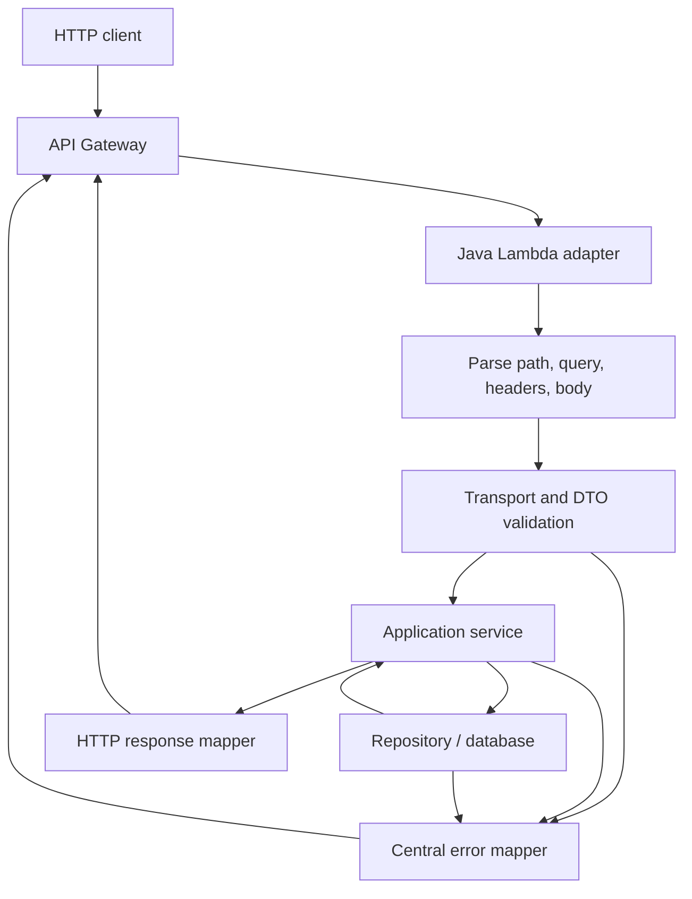

# Adding Validation, Pagination, and HTTP Error Mapping

A well-engineered Java serverless API must handle untrusted inputs, return bounded lists of data, and represent errors under a consistent contract. These three concerns are tightly coupled: validation decides whether a request is fit to process; pagination bounds data volume and query cost; and error mapping translates exceptions from inner layers into clear, safe, automation-friendly HTTP responses.

In a Java serverless API project, requests typically flow through an API Gateway and trigger a Java function. The function may run on AWS Lambda or an equivalent FaaS platform. The adapter receives the HTTP event, transforms it into an internal request, invokes services/repositories, and converts the result into an HTTP response. Validation, pagination, and error logic should therefore never depend directly on a single cloud provider's event type.

This lesson demonstrates how to structure these three capabilities for endpoints such as `POST /customers`, `GET /customers`, and `GET /customers/{id}`. Examples use Java, Jakarta Bean Validation, SQL, and API Gateway HTTP APIs; the principles apply equally to Azure Functions, Google Cloud Functions, or other Java frameworks.

## 1. Viewing the Entire Request Pipeline

A request should pass through boundaries with clear responsibilities:



| Component | Responsibility |
|---|---|
| API Gateway | TLS, routing, authorizers, throttling, payload limits, and event forwarding |
| Lambda adapter | Read HTTP event, parse request, extract request ID, and build response |
| DTO validation | Validate shape, types, lengths, ranges, and relationships across fields |
| Application service | Enforce business rules, resource permissions, and orchestrate use cases |
| Repository | Query data, cap results, and execute pagination |
| Error mapper | Map exceptions to status codes, headers, and error bodies |
| Response mapper | Serialize body, headers, status code, and content type |

Validation at the gateway can filter out malformed requests early, but the function must still validate the data it receives. Clients might reach the function through multiple routes, test harnesses, or other event sources; gateway validation is not the sole trust boundary.

## 2. Separating Validation Layers

Never lump every check into one giant `if` statement. Separating validation by layer ensures accurate error responses and places checks where sufficient context exists.

| Layer | Examples | Appropriate Enforcement Point |
|---|---|---|
| Transport | Missing body, unsupported content type, non-numeric `pageSize` query | HTTP adapter |
| Syntax/format | Malformed JSON, invalid UUID format, unparseable timestamp | Parser/adapter |
| Schema/field | Blank `name`, malformed email, negative quantity | DTO validation |
| Cross-field | `startDate` must precede `endDate`, only one of two fields allowed | Class-level validator or application service |
| Business rule | Email already in use, order cannot transition status, quota exceeded | Application/domain service |
| Authorization | User cannot read a customer belonging to another tenant | Security/application service |
| Persistence constraint | Unique key contention, foreign key no longer exists | Database/repository and error mapper |

A request can be structurally valid yet invalid under business rules. For example, `email` may have valid syntax while already being registered to another account. That is a resource conflict, not an email format error.

### Validation Does Not Replace Authorization

A well-formed UUID does not mean the caller is allowed to access that resource. After parsing and validating IDs, the application service must still verify tenant/owner/role permissions. Avoid returning distinct errors that let callers probe whether a resource exists in another tenant; depending on your threat model, return `404` for both "does not exist" and "not permitted to know".

## 3. Designing Request DTOs and Jakarta Bean Validation

Never bind JSON directly to database entities. Use dedicated DTOs so the API accepts only allowed fields, preventing mass assignment into `id`, `role`, `tenantId`, `createdAt`, or internal state.

Example DTO for creating a customer:

```java
import jakarta.validation.constraints.Email;
import jakarta.validation.constraints.NotBlank;
import jakarta.validation.constraints.Pattern;
import jakarta.validation.constraints.Size;

public record CreateCustomerRequest(
        @NotBlank(message = "Name must not be blank")
        @Size(max = 120, message = "Name must be at most 120 characters")
        String name,

        @NotBlank(message = "Email must not be blank")
        @Email(message = "Email format is invalid")
        @Size(max = 254, message = "Email is too long")
        String email,

        @Pattern(
                regexp = "^[0-9+() .-]{7,24}$",
                message = "Phone number format is invalid")
        String phone
) {}
```

Constraints should reflect the API contract rather than trying to replace all business rules. `@Email` checks basic syntax; it does not prove the mailbox exists or that the user owns the address. The phone regex here is also a simple input rule; if your product supports multiple countries, use an appropriate library/standard and store a normalized form.

### Running Validation in a Java Function

In Spring/Jakarta EE applications, the framework can trigger validation automatically via annotations. In a plain Java Lambda handler, annotations do not execute automatically; you must invoke `Validator` explicitly or use a framework adapter configured for validation.

Initialize `ValidatorFactory` once per execution environment to reuse across warm invocations. Close the factory on shutdown if the runtime/framework provides an appropriate lifecycle hook.

```java
import jakarta.validation.Validation;
import jakarta.validation.Validator;
import jakarta.validation.ValidatorFactory;

public final class RequestValidators {
    private static final ValidatorFactory FACTORY =
            Validation.buildDefaultValidatorFactory();
    private static final Validator VALIDATOR = FACTORY.getValidator();

    private RequestValidators() {}

    public static Validator get() {
        return VALIDATOR;
    }
}
```

Validating a DTO:

```java
import jakarta.validation.ConstraintViolation;
import jakarta.validation.Validator;

import java.util.Set;

public final class CreateCustomerValidator {
    private final Validator validator;

    public CreateCustomerValidator(Validator validator) {
        this.validator = validator;
    }

    public void validate(CreateCustomerRequest request) {
        Set<ConstraintViolation<CreateCustomerRequest>> violations =
                validator.validate(request);

        if (!violations.isEmpty()) {
            throw RequestValidationException.from(violations);
        }
    }
}
```

When cross-field constraints are needed, use a class-level annotation and custom validator. For example, a date range requires `startDate <= endDate`; errors should attach to the object or relevant field according to the published error contract.

### Parsing JSON Safely

Parsers can throw exceptions before a DTO is constructed. Handle malformed JSON, empty bodies, and unsupported content types explicitly. Never turn every parse failure into `500 Internal Server Error`.

Useful checks:

- `Content-Type` must be in the supported list, e.g., `application/json`.
- A body must be present on routes that require a payload.
- JSON must be syntactically valid and match expected field types.
- Reject unsupported fields or define an explicit unknown-field policy.
- Enforce body size limits at the gateway and/or adapter.
- Never log raw request bodies that might contain PII or secrets on parse errors.

## 4. Normalizing Data After Validation

Validation confirms data is acceptable; normalization converts data into a consistent form for comparison and storage.

Examples:

- Trim leading/trailing whitespace from names and search strings.
- Normalize email addresses per system policy; avoid altering the local-part arbitrarily without defined semantics.
- Parse timestamps into `Instant`/`OffsetDateTime` rather than comparing strings.
- Standardize country codes, currencies, or phone numbers per domain standards.
- Distinguish omitted fields, explicit `null`, and empty strings in PATCH requests.

Avoid normalization that silently alters meaning. Email case sensitivity requires an explicit policy; for Unicode, consider normalization forms and domain comparison rules.

## 5. Business Validation and Handling Race Conditions

Pre-write checks alone cannot guarantee invariants under concurrent requests. For instance, two requests may both verify an email does not exist yet, and then both insert. Database unique constraints are the ultimate safeguard.

Handling pattern:

1. Validate request format.
2. Check business rules to provide friendly feedback.
3. Execute the write with constraints/transactions protecting the invariant.
4. If the database reports a unique conflict, map it to `409 Conflict`.

SQL example:

```sql
CREATE UNIQUE INDEX uq_customer_email
    ON customer (normalized_email);
```

The repository should catch the specific email unique-constraint violation and translate it to `CustomerEmailAlreadyExistsException`. Never map every `SQLException` or every integrity violation to `409`; database connectivity errors remain server/dependency errors.

## 6. Designing Query Parameters for Pagination

A list endpoint must bound the amount of data returned. For example:

```http
GET /customers?pageSize=25&sort=createdAt,desc&status=ACTIVE
```

API conventions should be published:

| Parameter | Example Rule |
|---|---|
| `pageSize` | Default 25, minimum 1, maximum 100 |
| `cursor` | Server-issued opaque token; cannot be combined with `offset` |
| `offset` | Supported only on small/simple endpoints if needed |
| `sort` | Accepts only allowlisted fields and directions |
| `status` | Published enum; reject invalid values |
| `q` | Search query with length limits and explicit semantics |

Decide consistently whether oversized page sizes are rejected or clamped to the maximum. If clamping, document or return metadata indicating the applied limit. Never allow a client to send `pageSize=1000000` and force the function to read millions of rows or exceed payload limits.

### Strict Query Parameter Parsing

Never call `Integer.parseInt` without handling errors. Verify:

- Whether the parameter is present; apply defaults when missing.
- Only a single value is supplied if repetition is not allowed.
- Numeric parsing succeeds without overflow.
- Values fall within min/max bounds.
- Enum/sort fields belong to the allowlist.
- `cursor` and `offset` do not appear together if the API forbids combining them.
- Filters are reasonably sized and normalized.

Never concatenate `sort` values directly from the query into SQL. Column names and sort directions typically cannot be bound as query parameters; map from an allowlist to fixed SQL fragments.

## 7. Offset Pagination vs. Keyset/Cursor Pagination

The two common pagination approaches carry distinct trade-offs.

| Criterion | Offset Pagination | Keyset/Cursor Pagination |
|---|---|---|
| Request | `limit`, `offset` | `limit`, `cursor` |
| Deep page access | Can be slow because the database must skip many rows | Usually more efficient with proper indexes |
| Dataset changes between pages | Rows may repeat or be skipped | More stable when sort keys and cursors are well-designed |
| Jumping to page N | Easier | Not natural; requires sequential traversal or stored checkpoints |
| Implementation | Simple | Requires cursor format/versioning and validation |
| Best fit | Small datasets, internal reports, UIs needing page numbers | Large APIs, rapidly changing data, infinite scroll |

### Offset Pagination

Example:

```sql
SELECT id, name, email, created_at
FROM customer
WHERE tenant_id = :tenant_id
ORDER BY created_at DESC, id DESC
LIMIT :limit OFFSET :offset;
```

Offset requires deterministic ordering. Ordering solely by `created_at` when multiple rows share the same timestamp produces unstable ordering. Add a unique tie-breaker such as `id`.

Large offsets incur significant scanning/skipping work. Inserts or deletes between requests shift row positions, causing users to see duplicate or missing items. For frequently updated data, cursor/keyset pagination is usually a better fit.

### Keyset Pagination

Suppose results are sorted by `created_at DESC, id DESC`. The cursor stores the key pair from the last row of the previous page. The next page queries:

```sql
SELECT id, name, email, created_at
FROM customer
WHERE tenant_id = :tenant_id
  AND (
      created_at < :last_created_at
      OR (created_at = :last_created_at AND id < :last_id)
  )
ORDER BY created_at DESC, id DESC
LIMIT :page_size_plus_one;
```

Fetch `pageSize + 1` rows to detect whether a next page exists, returning at most `pageSize` rows. If an extra row exists, construct the cursor from the actual last returned row. Indexes must support the filter and sort order, such as `(tenant_id, created_at DESC, id DESC)`.

Keyset avoids deep-offset costs and handles shifting pages better, though it does not guarantee a strict snapshot if sort keys change or rows are deleted. Prefer immutable sort keys where possible and define semantics when new rows are inserted while a client paginates.

## 8. Designing Secure Cursors

Cursors should be opaque tokens: clients store and echo them back without modifying their contents. A cursor payload may contain:

- Cursor format version.
- Sort key values of the previous page's last row.
- Sort direction and filter fingerprint.
- Tenant/user scope if binding to the caller is needed.
- Expiration time or snapshot/version if required by the API.

Example internal payload (not a public format):

```json
{
  "v": 1,
  "createdAt": "2026-11-17T08:30:00Z",
  "id": "cus-1042",
  "sort": "createdAt:desc,id:desc",
  "filterHash": "f2a19c",
  "expiresAt": "2026-11-17T10:30:00Z"
}
```

The server can serialize JSON, Base64URL-encode it, and sign it with HMAC. When receiving a cursor, decode it, verify the signature using constant-time comparison, check version/expiry/filter, and parse field types before building the query. If the cursor contains sensitive details, signing does not hide them; use encryption or a server-side opaque handle.

A cursor is not authorization. Even when signed, the server must still derive tenant/user from the security context and enforce access predicates in the query. Never trust a `tenantId` sent by a client inside a cursor or query.

### Example Cursor Signing in Java

This is an illustrative HMAC-SHA256 skeleton; production systems must manage secrets in a secret manager and support key rotation and version/key IDs.

```java
import javax.crypto.Mac;
import javax.crypto.SecretKey;
import java.security.MessageDigest;
import java.util.Base64;

public final class CursorSigner {
    private final SecretKey key;

    public CursorSigner(SecretKey key) {
        this.key = key;
    }

    public String sign(byte[] payload) {
        byte[] signature = hmac(payload);
        Base64.Encoder encoder = Base64.getUrlEncoder().withoutPadding();
        return encoder.encodeToString(payload) + "."
                + encoder.encodeToString(signature);
    }

    public byte[] verify(String token) {
        String[] parts = token.split("\\.", -1);
        if (parts.length != 2) {
            throw new InvalidCursorException();
        }

        Base64.Decoder decoder = Base64.getUrlDecoder();
        try {
            byte[] payload = decoder.decode(parts[0]);
            byte[] supplied = decoder.decode(parts[1]);
            byte[] expected = hmac(payload);
            if (!MessageDigest.isEqual(expected, supplied)) {
                throw new InvalidCursorException();
            }
            return payload;
        } catch (IllegalArgumentException error) {
            throw new InvalidCursorException();
        }
    }

    private byte[] hmac(byte[] payload) {
        try {
            Mac mac = Mac.getInstance("HmacSHA256");
            mac.init(key);
            return mac.doFinal(payload);
        } catch (Exception error) {
            throw new IllegalStateException("Cursor signing unavailable", error);
        }
    }
}
```

This snippet does not replace validating the payload after verification. Cap token length, check cursor version/expiry/filter fingerprint, and permit only server-supported sort keys. Avoid returning distinct errors for "invalid signature" versus "resource not found" if doing so leaks unnecessary information.

## 9. Repository Pagination and SQL Safety

Repositories should accept a validated query object rather than raw query strings.

```java
public record CustomerSearch(
        int pageSize,
        CustomerSort sort,
        CustomerStatus status,
        String normalizedQuery,
        CustomerCursor cursor
) {}

public enum CustomerSort {
    CREATED_DESC,
    CREATED_ASC,
    NAME_ASC
}
```

Map the enum to fixed SQL:

```java
String orderBy = switch (query.sort()) {
    case CREATED_DESC -> "created_at DESC, id DESC";
    case CREATED_ASC -> "created_at ASC, id ASC";
    case NAME_ASC -> "name ASC, id ASC";
};
```

This example is safe only because `orderBy` comes from an internal enum, never arbitrary client strings. Filter values must still use parameter binding (`?`, `:tenantId`); never concatenate search values into SQL. For column names or directions that cannot be bound, use an allowlist and fixed mapping.

### Fetching One Extra Row to Determine `hasNextPage`

```java
List<Customer> rows = repository.find(query, query.pageSize() + 1);
boolean hasNextPage = rows.size() > query.pageSize();

List<Customer> items = hasNextPage
        ? rows.subList(0, query.pageSize())
        : rows;

String nextCursor = hasNextPage
        ? cursorFactory.from(items.get(items.size() - 1), query)
        : null;
```

Ensure `pageSize >= 1` before calling `items.get(items.size() - 1)`. Never build the cursor from the extra row; doing so would cause the next page to skip a row that was never returned to the client.

### Is a Count Really Needed?

`COUNT(*)` can be expensive on large tables, complex filters, or distributed stores. Return `totalCount` only when the product truly requires it and the database can support it. Cursor APIs typically need only `items`, `nextCursor`, and `hasNextPage`. If total counts are approximate or eventually consistent, document those semantics explicitly.

## 10. Consistent Pagination Responses

Example response:

```json
{
  "items": [
    {
      "id": "cus-1042",
      "name": "Nguyen An",
      "email": "an@example.test"
    }
  ],
  "page": {
    "pageSize": 25,
    "hasNextPage": true,
    "nextCursor": "eyJ2IjoxLCJpZCI6ImN1cy0xMDQyIn0.signature"
  }
}
```

Conventions:

- `items` is always an array, even when empty.
- `pageSize` is the maximum item count applied by the server.
- `hasNextPage` derives from the extra row or datastore continuation token.
- `nextCursor` is `null` or omitted when no next page exists; pick one convention and keep it consistent.
- Never return a cursor when there is no next page.
- Preserve identical filters and sorting across pages; cursors should bind to the filter fingerprint.

If an API needs offset pagination, it may return `pageNumber`, `pageSize`, `totalCount`, and `totalPages`, but must define behavior when data changes between calls.

## 11. Mapping HTTP Errors Under a Single Contract

Java exceptions should never leak directly to HTTP. Different layers may throw different exception types; a central error mapper translates them into published status codes, headers, and bodies.

An API can adopt RFC 9457 Problem Details with media type `application/problem+json`.

```json
{
  "type": "https://api.example.test/problems/validation-error",
  "title": "Invalid request",
  "status": 422,
  "detail": "One or more fields failed validation.",
  "instance": "/customers",
  "code": "VALIDATION_FAILED",
  "traceId": "req-7f8c",
  "errors": [
    {
      "field": "email",
      "code": "INVALID_FORMAT",
      "message": "Email format is invalid"
    }
  ]
}
```

Fields such as `code`, `traceId`, and `errors` are API extensions. Preserve `type`, `title`, `status`, `detail`, and `instance` semantics per Problem Details. `detail` and `message` must be client-safe; never include SQL, stack traces, secrets, internal hostnames, or raw rejected values in responses.

### Status Mapping Table

| HTTP Status | When Used | Examples |
|---|---|---|
| `400 Bad Request` | Unparseable request or transport/query syntax error | Malformed JSON, `pageSize=abc` |
| `401 Unauthorized` | Unauthenticated or invalid credentials | Expired token |
| `403 Forbidden` | Authenticated but lacks permission | Not authorized to create customer |
| `404 Not Found` | Resource/route does not exist or is not visible | Customer ID not found in tenant |
| `405 Method Not Allowed` | Route exists but method is unsupported | POST to a GET-only route |
| `409 Conflict` | Conflict with existing state/resource | Duplicate email, optimistic lock conflict |
| `412 Precondition Failed` | Request precondition like `If-Match` failed | ETag has changed |
| `413 Content Too Large` | Body exceeds limit | Oversized JSON upload |
| `415 Unsupported Media Type` | Unsupported Content-Type | Sending XML to a JSON-only endpoint |
| `422 Unprocessable Content` | JSON parses cleanly but field/schema/business input is invalid | Invalid email format, end date before start date |
| `429 Too Many Requests` | Caller exceeded rate/concurrency quota | Per-tenant rate limit |
| `500 Internal Server Error` | Unexpected error inside function | Bug or violated invariant |
| `502 Bad Gateway` | Function received invalid response from upstream | Malformed dependency response |
| `503 Service Unavailable` | Dependency/service temporarily unavailable | Exhausted database pool, provider unavailable |
| `504 Gateway Timeout` | Gateway/function/dependency timed out | Synchronous request exceeded timeout |

Some APIs consolidate `400` and `422` by convention. What matters is choosing a convention, documenting it in OpenAPI, and applying it consistently. Never return `200 OK` with `{ "success": false }` for standard HTTP errors.

### Do Not Overuse 500

Validation, not-found, and conflict errors are expected API outcomes, not system failures. If every exception maps to 500, clients cannot tell whether to fix the request, re-authenticate, retry, or stop. Conversely, never map every exception to 400, which hides server failures and blinds monitoring.

## 12. Building an Error Taxonomy in Java

Create meaningful business exceptions instead of matching message strings.

```java
public abstract class ApiException extends RuntimeException {
    protected ApiException(String message) {
        super(message);
    }
}

public final class CustomerNotFoundException extends ApiException {
    public CustomerNotFoundException() {
        super("Customer not found");
    }
}

public final class CustomerEmailAlreadyExistsException extends ApiException {
    public CustomerEmailAlreadyExistsException() {
        super("Customer email already exists");
    }
}
```

In production systems, exceptions can carry safe codes/metadata rather than public messages. The error mapper decides what message to expose instead of forwarding `getMessage()` verbatim from infrastructure exceptions.

### Problem Details Model

```java
public record ApiProblem(
        String type,
        String title,
        int status,
        String detail,
        String instance,
        String code,
        String traceId,
        List<FieldProblem> errors
) {}

public record FieldProblem(
        String field,
        String code,
        String message
) {}
```

### Central Error Mapper

```java
public final class ApiErrorMapper {
    public ApiProblem map(
            Exception error,
            String path,
            String traceId) {

        if (error instanceof RequestValidationException validation) {
            return problem(422, "Invalid request",
                    "One or more fields failed validation.",
                    "VALIDATION_FAILED", path, traceId,
                    validation.fieldProblems());
        }

        if (error instanceof CustomerNotFoundException) {
            return problem(404, "Resource not found",
                    "Customer does not exist.",
                    "CUSTOMER_NOT_FOUND", path, traceId, List.of());
        }

        if (error instanceof CustomerEmailAlreadyExistsException) {
            return problem(409, "Data conflict",
                    "Email is already in use.",
                    "CUSTOMER_EMAIL_EXISTS", path, traceId, List.of());
        }

        if (error instanceof DependencyUnavailableException) {
            return problem(503, "Service temporarily unavailable",
                    "Please try again later.",
                    "DEPENDENCY_UNAVAILABLE", path, traceId, List.of());
        }

        return problem(500, "Server error",
                "An unexpected error occurred.",
                "INTERNAL_ERROR", path, traceId, List.of());
    }

    private ApiProblem problem(
            int status, String title, String detail, String code,
            String path, String traceId, List<FieldProblem> errors) {
        return new ApiProblem(
                "https://api.example.test/problems/"
                        + code.toLowerCase(java.util.Locale.ROOT).replace('_', '-'),
                title, status, detail, path,
                code, traceId, errors);
    }
}
```

This skeleton illustrates the pattern. Production implementations should use stable `type` URIs per problem type, standardize error codes, and handle authentication, authorization, malformed JSON, throttling, timeouts, and provider-specific exceptions. Never catch `Throwable` and mask fatal JVM errors; the adapter may catch `Exception` at the request boundary after proper logging/monitoring.

### Validation Errors Must Be Deterministic

Never return raw `ConstraintViolation` objects, as they may expose root beans, invalid values, or implementation details. Map them to safe DTOs:

```java
List<FieldProblem> fieldProblems = violations.stream()
        .map(v -> new FieldProblem(
                v.getPropertyPath().toString(),
                v.getConstraintDescriptor()
                        .getAnnotation().annotationType().getSimpleName(),
                v.getMessage()))
        .sorted(Comparator.comparing(FieldProblem::field)
                .thenComparing(FieldProblem::code))
        .toList();
```

In larger APIs, use application-defined error codes such as `REQUIRED`, `TOO_LONG`, and `INVALID_FORMAT` instead of exposing annotation names. Sort errors by field/code so tests and clients receive deterministic results. Avoid echoing rejected values, which may contain passwords, tokens, or sensitive data.

## 13. Mapping Errors at the API Gateway and Lambda Boundary

With Lambda proxy integration, the function usually returns status codes, headers, and bodies itself. The error mapper must be invoked in the adapter so no unhandled exception escapes and produces a non-contract response.

Processing flow:

1. Extract the request ID from API Gateway context or generate a safe correlation ID.
2. Parse method, path, headers, query, and body.
3. Invoke the router/controller and application service.
4. Serialize the success response.
5. On exception, invoke the central error mapper and serialize Problem Details.
6. Attach `Content-Type: application/problem+json` for errors, appropriate CORS headers, and request/trace IDs.

API Gateway can also return errors before the function runs—such as authorizer rejections, missing routes, throttling, or oversized payloads. Gateway-generated responses do not pass through the Java error mapper. Configure gateway responses/default error mappings and CORS so clients receive the most consistent format possible, and document cases where the platform cannot return function-identical Problem Details.

### Adapter Skeleton for API Gateway HTTP API v2

```java
import com.amazonaws.services.lambda.runtime.Context;
import com.amazonaws.services.lambda.runtime.RequestHandler;
import com.amazonaws.services.lambda.runtime.events.APIGatewayV2HTTPEvent;
import com.amazonaws.services.lambda.runtime.events.APIGatewayV2HTTPResponse;

import java.util.Map;

public final class CustomerApiHandler implements
        RequestHandler<APIGatewayV2HTTPEvent, APIGatewayV2HTTPResponse> {

    private final CustomerRouter router = ApplicationGraph.customerRouter();
    private final ApiErrorMapper errors = new ApiErrorMapper();

    @Override
    public APIGatewayV2HTTPResponse handleRequest(
            APIGatewayV2HTTPEvent event, Context context) {

        String requestId = context.getAwsRequestId();
        String path = event.getRawPath() == null ? "/" : event.getRawPath();

        try {
            ApiRequest request = ApiGatewayRequestAdapter.from(event, requestId);
            ApiResponse response = router.handle(request);
            return toGatewayResponse(response);
        } catch (Exception error) {
            ApiProblem problem = errors.map(error, path, requestId);
            return APIGatewayV2HTTPResponse.builder()
                    .withStatusCode(problem.status())
                    .withHeaders(Map.of(
                            "Content-Type", "application/problem+json",
                            "Cache-Control", "no-store"))
                    .withBody(Json.write(problem))
                    .withIsBase64Encoded(false)
                    .build();
        }
    }

    private APIGatewayV2HTTPResponse toGatewayResponse(ApiResponse response) {
        return APIGatewayV2HTTPResponse.builder()
                .withStatusCode(response.status())
                .withHeaders(response.headers())
                .withBody(response.body())
                .withIsBase64Encoded(false)
                .build();
    }
}
```

`ApiGatewayRequestAdapter`, `CustomerRouter`, `ApplicationGraph`, and `Json` are application abstractions in this example. Builder/accessor names must match the version of `aws-lambda-java-events` in use. For binary bodies or base64-encoded events, the adapter must decode per `isBase64Encoded` rather than assuming all bodies are UTF-8 JSON. Also ensure success responses include CORS/security headers just like error responses.

## 14. Retry Semantics and HTTP Error Mapping

Status codes guide how clients retry. Define them clearly:

| Error | What Should the Client Do? |
|---|---|
| `400`, `401`, `403`, `404`, `415`, `422` | Fix request/credentials/permissions; do not blindly retry unchanged |
| `409` | Read current state or resolve the conflict before resending |
| `412` | Fetch the latest resource/ETag and decide whether to retry the update |
| `429` | Honor `Retry-After`, exponential backoff, and jitter |
| `500`, `502`, `503`, `504` | May retry if the operation is safe/idempotent and retry budget remains |

If the API supports side-effecting write requests, use idempotency keys so clients can retry after timeouts without creating duplicate records or payments. Error responses may include `Retry-After` on 429/503. Do not send retry headers if the server lacks a meaningful estimate.

A dependency timeout can have an indeterminate outcome: the provider processed the request, but the response was lost. Never treat a timeout as "guaranteed failure" and retry with a new key. Reuse the same idempotency key or reconcile per the provider contract.

## 15. Pagination in Serverless: Compute, Memory, and Response Limits

Pagination is not merely a UI concern. A Lambda function has memory and time limits and incurs cost proportional to execution duration and resources. Reading too many rows increases query duration, memory usage, serialization time, and timeout risk.

Design considerations:

- Maximum page size bounded by item size and payload limits.
- Database indexes covering filter + sort.
- Projections fetching only API-required fields, avoiding full entities or large blobs.
- Query timeout set lower than function timeout so time remains for response mapping.
- Connection pool and concurrency sized to database capacity.
- Cursor token size and validation overhead.
- Avoid running `COUNT(*)` on every page unless needed.

With DynamoDB, pagination typically uses `LastEvaluatedKey`/`ExclusiveStartKey`; the API should wrap that key into an opaque cursor, signing or storing it server-side if needed. DynamoDB's `Limit` caps the number of items evaluated before filters in certain query patterns, so returned items may be fewer than the page size. Never assume a single `Query` always returns the exact count requested by the client.

With SQL databases, keyset pagination paired with proper indexes generally provides more stable cost than deep offsets. Measure query plans and latency at realistic page depths.

## 16. Security for Validation, Pagination, and Errors

Security principles:

- Validate every input server-side, even if the frontend already validates.
- Use DTO allowlists; avoid binding requests directly to persistence entities.
- Parameterize SQL values; allowlist sort fields and directions.
- Enforce tenant/resource authorization in queries and services.
- Cap body size, page size, query length, and cursor length.
- Sign cursors to detect tampering; encrypt if cursor payloads contain sensitive details.
- Never treat a signed cursor as authorization; check permissions on every request.
- Never return stack traces, SQL, table names, secrets, tokens, or rejected values.
- Redact PII in logs and validation diagnostics.
- Throttle list/search endpoints to limit enumeration and cost.

Validation messages can also leak internal schema details if they expose overly specific field or constraint names. Expose only contract-defined fields and error codes, keeping full diagnostics in access-controlled logs.

## 17. Observability and Operations

A serverless API needs metrics to confirm validation, pagination, and error mapping behave properly.

| Metric / Log Field | Purpose |
|---|---|
| Request count by route/method/status | Traffic and error distribution |
| Validation failure count by error code | Detect broken client integrations or abuse |
| Error count by category | Separate client, business, dependency, and internal errors |
| p50/p95/p99 latency | Monitor API and query latency |
| Rows returned / query duration | Detect abnormal page sizes or query plans |
| Invalid/expired cursor count | Detect client bugs or token tampering |
| Response bytes | Detect oversized payloads |
| Throttles/concurrency/timeouts | Monitor serverless limits |
| Trace/request ID | Correlate API Gateway, Lambda, and database calls |

Never use customer IDs, cursor tokens, emails, or request IDs as metric labels due to high cardinality and data exposure risks. Log structured fields such as route template, status, error code, and request ID; never log raw bodies or tokens. Include the trace ID in Problem Details so clients can report it for support.

## 18. Testing Validation, Pagination, and Error Mapping

Test every boundary, not just happy paths.

### Validation Tests

- Empty body, malformed JSON, wrong content type, and oversized body.
- Missing, null, blank, malformed, oversized, and out-of-range fields.
- Unknown fields and disallowed bindings.
- Cross-field constraints.
- Unicode, whitespace, case normalization, and timestamps/timezones.
- Two concurrent requests violating a unique constraint; only one succeeds.
- Tenant authorization even when the ID format is valid.

### Pagination Tests

- Default page size, min/max bounds, and out-of-range page sizes.
- Valid, tampered-signature, expired, wrong-version, and oversized cursors.
- Cursor replayed with different filters or sort orders.
- Disallowed sort fields/directions.
- Multiple rows sharing the same sort timestamp; tie-breaker prevents duplicates/omissions.
- Inserts/deletes between two pages matching published semantics.
- Empty page, last page, and `hasNextPage`.
- Tenant isolation on every page.
- Query plans/indexes and latency bounds under target load.

### Error Mapping Tests

- Every exception type maps to the expected status/code/title.
- Validation errors are sorted deterministically.
- Responses use `application/problem+json` and exclude stack traces/secrets/rejected values.
- `Retry-After` is present on appropriate throttling/dependency errors.
- API Gateway-generated errors and CORS are tested at the integration stage.
- Request/trace IDs can be used to locate logs.

JUnit example for the mapper:

```java
@Test
void mapsCustomerConflictTo409Problem() {
    ApiProblem problem = mapper.map(
            new CustomerEmailAlreadyExistsException(),
            "/customers",
            "req-test-1");

    assertEquals(409, problem.status());
    assertEquals("CUSTOMER_EMAIL_EXISTS", problem.code());
    assertEquals("req-test-1", problem.traceId());
}
```

This test example assumes the mapper and models are initialized in the test fixture. Add contract tests comparing actual responses against the OpenAPI schema so code and API documentation stay aligned.

## 19. Common Mistakes

| Anti-pattern | Consequence | Remedy |
|---|---|---|
| Validating only in frontend/API Gateway | Requests arriving via other paths bypass checks | Re-validate at the function/application boundary |
| Binding JSON to database entities | Mass assignment and schema coupling | Use allowlisted request DTOs |
| Lumping business conflicts into validation errors | Clients receive misleading semantics | Separate 422 and 409 per contract |
| Mapping all exceptions to 500 | Clients cannot tell how to fix or retry | Central error taxonomy and mapper |
| Returning exception messages/stack traces | Exposes internals and sensitive data | Safe Problem Details |
| Concatenating SQL sort from query params | SQL injection | Enum/allowlist for sort, bind filter values |
| Unbounded page sizes | Huge queries/responses, higher cost and timeouts | Default/max page size |
| Deep offsets on large tables | Slow queries scanning many rows | Keyset/cursor with indexes |
| Sorting without a tie-breaker | Duplicate/missing rows across pages | Deterministic sort using a unique key |
| Base64-only unsigned cursors | Clients tamper with position/filter/tenant | HMAC signing or server-side opaque cursors |
| Trusting tenant ID inside cursors | Cross-tenant access risks | Derive tenant from auth context and enforce in queries |
| Running `COUNT(*)` on every request | Higher latency and DB load | Make counts optional or omit from cursor APIs |
| Testing only the function, not the gateway | Gateway-generated errors break format/CORS | Integration test the API Gateway boundary |

## 20. Implementation Workflow for a Java Serverless API

1. **Finalize the API contract.** Define fields, status codes, Problem Details, pagination parameters, and the OpenAPI schema.
2. **Create request/response DTOs.** Never use persistence entities as API models.
3. **Add parsers and validation.** Parse transport details, validate field/cross-field constraints, and normalize inputs.
4. **Separate business rules.** Check uniqueness/state/authorization in services and protect invariants with database constraints.
5. **Design pagination.** Choose offset or keyset based on dataset characteristics, enforce deterministic sorting, cap page size, and add indexes.
6. **Build the cursor codec.** Add versioning, signing, expiration, filter fingerprinting, and key rotation when using cursors.
7. **Establish an error taxonomy.** Define stable exceptions/codes and a central mapper.
8. **Integrate the API Gateway adapter.** Map status codes, headers, Problem Details, binary bodies, and CORS.
9. **Add observability.** Emit metrics by route/status/error code, query latency, response size, and trace ID.
10. **Test thoroughly.** Write unit, repository, property/cursor, contract, and gateway integration tests.
11. **Deploy with controls.** Monitor validation errors, p95/p99 latency, query latency, 4xx/5xx rates, and Lambda timeouts.
12. **Keep documentation updated.** Keep OpenAPI, examples, and the error code catalog synchronized with the implementation.

## 21. Pre-Production Checklist

- [ ] Request DTOs are decoupled from persistence entities and expose only allowed fields.
- [ ] Server-side validation runs at the function/application boundary.
- [ ] Malformed JSON, content types, body size, and query parsing have explicit error mappings.
- [ ] Cross-field and business validations live in the appropriate layers.
- [ ] Database constraints protect invariants against race conditions.
- [ ] Tenant/resource authorization is enforced on every query.
- [ ] Page size has a default, minimum, and maximum.
- [ ] Sorting and filtering use allowlists and parameterized SQL.
- [ ] Pagination uses deterministic ordering with a unique tie-breaker.
- [ ] Cursors include versioning, integrity checks, expiration, and filter binding where needed.
- [ ] The API clearly defines `hasNextPage`, `nextCursor`, and behavior when data changes.
- [ ] `COUNT(*)` runs only when genuinely required.
- [ ] Problem Details use stable error codes and leak no internals.
- [ ] 4xx/5xx mappings and retry semantics are published.
- [ ] Gateway-generated errors, CORS, and function-generated errors are tested.
- [ ] Logs/metrics omit raw PII, secrets, and cursor tokens.
- [ ] Validation, pagination, error mapper, and OpenAPI contract tests pass.
- [ ] Dashboards/alerts cover query latency, response bytes, Lambda timeouts, and database capacity.

## References

- [RFC 9457: Problem Details for HTTP APIs](https://www.rfc-editor.org/rfc/rfc9457.html)
- [RFC 9110: HTTP Semantics](https://www.rfc-editor.org/rfc/rfc9110.html)
- [Jakarta Bean Validation](https://jakarta.ee/specifications/bean-validation/)
- [OWASP Input Validation Cheat Sheet](https://cheatsheetseries.owasp.org/cheatsheets/Input_Validation_Cheat_Sheet.html)
- [AWS Lambda Java handler](https://docs.aws.amazon.com/lambda/latest/dg/java-handler.html)
- [API Gateway HTTP API Lambda integrations](https://docs.aws.amazon.com/apigateway/latest/developerguide/http-api-develop-integrations-lambda.html)
- [AWS Lambda best practices](https://docs.aws.amazon.com/lambda/latest/dg/best-practices.html)

## Conclusion

Validation, pagination, and error mapping are three parts of a single API contract. Use DTOs and server-side validation to control inputs; enforce business rules and authorization at the application boundary; apply bounded page sizes, sort allowlists, and cursor/keyset pagination for large datasets; and translate exceptions into Problem Details with meaningful HTTP status codes that leak no internals. In serverless systems, test both the function and API Gateway-generated errors, monitor query and response costs, and reuse expensive initialization components across warm invocations. When these rules are published in OpenAPI and verified across unit and integration boundaries, your Java API becomes easier to integrate, safer, and more reliable to operate.
