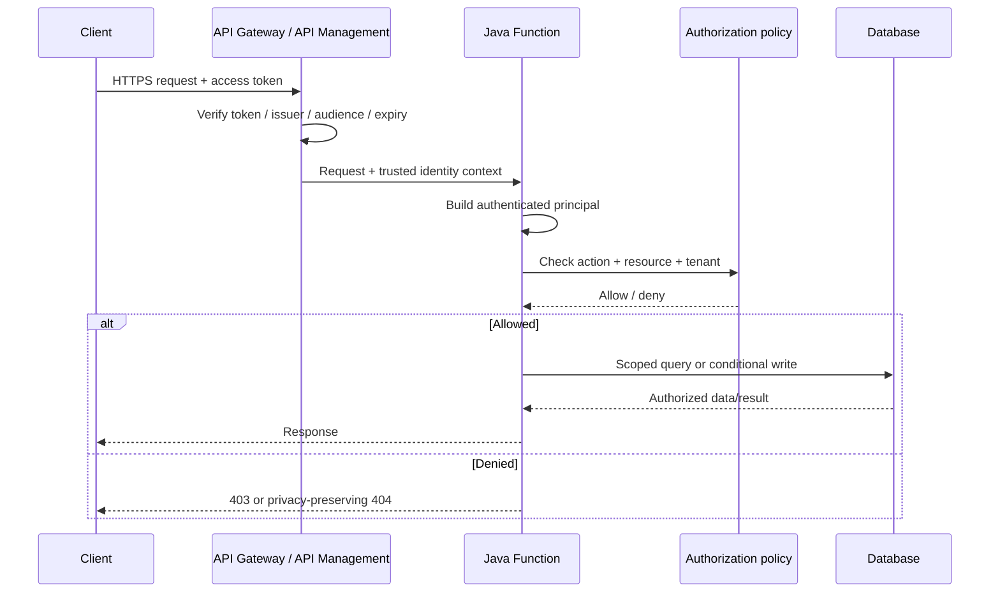

# Integrating Authentication and Enforcing Data Ownership

A Java serverless API must verify **who is calling** and **what the caller is allowed to do with the exact requested resource**. These two questions are related but distinct. Authentication confirms the caller's identity; authorization decides whether the caller can read, create, update, or delete a specific resource.

A request carrying a valid access token may still be forbidden from reading another tenant's order. A user with the `customer` role may be allowed to call `GET /orders/{id}`, yet only view orders belonging to their own tenant and ownership scope. If the API only checks the token or a coarse role while skipping per-object permissions, the system becomes vulnerable to Broken Object Level Authorization (BOLA), commonly exploited by swapping IDs in URLs or request bodies.

In serverless architectures, API Gateway or API Management can verify tokens at ingress; the Java function must still enforce business rules and data-level permissions. A function's execution role grants the function access to cloud services, but it does not automatically prove the end user is authorized to access the record they requested.

## 1. Authentication and Authorization Are Two Separate Steps

### 1.1. Authentication: Verifying Identity

Authentication answers: "Who is the caller, and is their proof of identity trustworthy?" For modern APIs, identity typically comes from an OAuth 2.0 access token issued by an Authorization Server, often paired with OpenID Connect (OIDC) for user sign-in.

The API may receive:

- **JWT access token:** a signed token containing claims such as issuer, subject, audience, expiry, scope, or roles.
- **Opaque access token:** an unintelligible string; the resource server requires token introspection or a provider-supplied verification mechanism.
- **Workload identity:** an IAM role, managed identity, service principal, or client credentials for service-to-service calls.

The API must validate tokens according to the identity provider's contract. Never decode a JWT payload and trust its claims without verifying the signature and required conditions.

### 1.2. Authorization: Deciding Permissions per Action and Resource

Authorization answers: "Which actions can this identity perform on which resources under what context?" A decision typically depends on:

- subject: the calling user, service, or workload;
- action: `read`, `create`, `update`, `delete`, `approve`, `export`;
- resource: a specific document, order, account, tenant, or record;
- context: tenant, business state, time, network location, or sensitivity level;
- policy: roles, ownership relationships, memberships, and business rules.

For example, `orders:read` permits the caller to invoke the order-reading API group, but it is not enough to conclude the caller may read every order ID. The API must verify tenant and per-order permissions.

### 1.3. General Processing Flow



The gateway filters out requests lacking valid identity early. The function must still enforce business permissions because the gateway typically does not know whether the caller owns the order/document being accessed.

## 2. Choosing the Right Protocol and Token Type

### 2.1. OAuth 2.0 Access Tokens

OAuth 2.0 is an authorization framework. Clients obtain access tokens to call a resource server/API with granted scopes or permissions. APIs should accept access tokens via `Authorization: Bearer ...` over HTTPS and accept only tokens issued specifically for that API.

Never use an ID token in place of an access token to protect an API. An OIDC ID token describes the login result for the client application; its audience is typically the client ID. The access token is the credential issued to call resource servers and must carry the audience and permissions appropriate for the API.

### 2.2. OpenID Connect

OIDC adds an identity authentication layer on top of OAuth 2.0. Claims such as `sub`, `iss`, `email`, or `name` carry meanings defined by the provider and policy. Use the `iss` + `sub` pair as a stable subject identifier scoped to the issuer; email addresses can change and should not be assumed as primary keys.

Never assume `sub` matches across two different identity providers. If the system supports multiple issuers, namespace subjects by issuer or map them to managed internal user IDs.

### 2.3. JWT vs. Opaque Tokens

| Characteristic | JWT Access Token | Opaque Access Token |
|---|---|---|
| Verification | Verify signature and claims via metadata/JWKS | Introspection or provider-specific mechanism |
| Request-time network dependency | Verifiable locally while keys are cached | Usually requires calling introspection or caching results |
| Revocation | Difficult to revoke immediately if verified purely offline | Can reflect revocation status via introspection |
| Size | Can be large with many claims | Typically shorter |
| Risks | Trusting invalid claims, key rotation issues, or wrong audience | Introspection outages or stale caches |

Choose based on identity provider capabilities, latency, token revocation needs, and your threat model. Regardless of token type, the function must fail closed when identity cannot be verified under policy; never treat token verification errors as valid access.

## 3. Verifying JWTs Properly

If the API accepts JWT access tokens, it must verify at minimum:

1. **Signature:** use the public key from the issuer's trusted JWKS/metadata; permit only configured algorithms. Never trust an algorithm chosen by the token outside an allowlist.
2. **Issuer (`iss`):** must match the configured issuer exactly.
3. **Audience (`aud`):** must contain this API/resource server's identifier.
4. **Expiry (`exp`):** token has not expired; apply a small, bounded clock skew.
5. **Not before (`nbf`):** do not accept the token before its validity start time.
6. **Token type/use:** confirm it is the proper access token type per the provider, avoiding ID token confusion.
7. **Scope/permission:** token holds the minimum permissions needed for the endpoint.
8. **Tenant/organization context:** if using a tenant claim, verify it originates from a trusted issuer and matches the resource's tenant.

Depending on the provider, also validate `client_id` or `azp`, token version, authorized party, authentication context, and token delegation policies. Never rely on a claim named `role` or `groups` unless the issuer guarantees the semantics and provenance of that claim.

### 3.1. JWKS and Key Rotation

JWTs often carry a `kid` header to select the public key from JWKS. The API should:

- fetch JWKS from the issuer's preconfigured metadata endpoint;
- cache keys with a sensible TTL to reduce network calls and cold-start latency;
- refresh on encountering a new `kid` with rate/frequency bounds;
- support overlap windows between old and new keys during provider key rotation;
- never fetch JWKS from arbitrary URLs supplied in tokens or requests;
- fail closed if the signature cannot be verified and no valid key exists.

Caching in a static field of a Java function is only a best-effort optimization. Execution environments can be recreated or reclaimed at any time; never rely on an in-memory cache as the sole security state store. If the JWKS endpoint temporarily fails, use cached keys only within policy and time bounds.

### 3.2. Never Write a Naive Custom JWT Verifier

Never parse Base64 manually and compare claims yourself. Use a maintained JOSE/OIDC library or let gateway/identity middleware verify tokens. Library configuration must pin issuer, audience, algorithms, and key source; "the library verified the signature" does not mean all token conditions were checked.

## 4. Placing Authentication at API Gateway and Java Function

### 4.1. API Gateway / API Management Authorizers

Gateways can verify tokens before requests reach the function:

- AWS API Gateway HTTP API supports JWT authorizers with issuer, audience, and route scopes.
- Amazon Cognito or Lambda authorizers can provide authentication/authorization models tailored to API Gateway.
- Azure API Management offers a `validate-jwt` policy to inspect tokens before forwarding requests to Azure Functions or backends.
- Other gateways/reverse proxies can integrate OIDC providers or external authorization services.

Authorizers protect the perimeter and standardize identity context. However, a route scope like `documents:read` still does not replace checking ownership, tenant, or per-document ACLs.

### 4.2. Functions Must Trust Identity Context Only from Protected Paths

If a function receives identity claims from gateway context, trust them only when:

- only the gateway or authorized service principal is permitted to invoke the function;
- the function endpoint is not publicly exposed and has no invoke path bypassing the gateway;
- transport/invocation policies protect context integrity;
- the adapter extracts claims from platform-authenticated context fields, not client-supplied headers.

Never trust `X-User-Id`, `X-Tenant-Id`, `X-Role`, or similar headers if clients can set them. If a function can be invoked directly by multiple sources, each entry path must have its own authentication mechanism and normalize into a trusted principal.

### 4.3. Distinguishing Caller Identity from Execution Identity

At least two identities exist in every execution:

- **Caller identity:** the user/service that called the API and is the subject of business authorization decisions.
- **Execution identity:** the IAM role or managed identity used by the function to access databases, queues, secret stores, and cloud resources.

An execution role may allow the function to read the `documents` table, but that does not mean the caller may read every row in that table. The function must enforce authorization against the caller context before returning data. Granting broad DB permissions to a function must never translate into broad access for every API user.

## 5. Normalizing the Principal in Java

Once the token or context is verified, the adapter maps it into an immutable principal object. Business layers should never read raw headers or parse JWTs themselves.

```java
import java.util.Set;

public record Actor(
        String issuer,
        String subject,
        String tenantId,
        Set<String> scopes,
        Set<String> roles,
        String clientId) {

    public Actor {
        if (issuer == null || issuer.isBlank()) {
            throw new IllegalArgumentException("issuer is required");
        }
        if (subject == null || subject.isBlank()) {
            throw new IllegalArgumentException("subject is required");
        }
        scopes = scopes == null ? Set.of() : Set.copyOf(scopes);
        roles = roles == null ? Set.of() : Set.copyOf(roles);
    }
}
```

In production applications, `subject` should be namespaced by `issuer` or mapped to an internal principal ID. Never use email as `subject` simply because email is readable. `tenantId` may be blank for single-tenant APIs; if an endpoint requires a tenant and the principal lacks a valid tenant, reject the request.

Example adapter receiving a gateway-verified identity context:

```java
public interface VerifiedIdentityContext {
    String issuer();
    String subject();
    String tenantId();
    Set<String> scopes();
    Set<String> roles();
    String clientId();
}

public final class ActorFactory {
    public Actor from(VerifiedIdentityContext context) {
        return new Actor(
                context.issuer(),
                context.subject(),
                context.tenantId(),
                context.scopes(),
                context.roles(),
                context.clientId());
    }
}
```

`VerifiedIdentityContext` is an adapter abstraction; its implementation must pull claims from a trusted authorizer context. This snippet does not verify JWTs itself and must never be wired directly to client-controlled headers.

## 6. Choosing an Authorization Model

### 6.1. RBAC: Role-Based Access Control

Roles group related permissions, for example:

| Role | Common Permissions |
|---|---|
| `customer` | Read and update select fields of accounts/orders within their own scope |
| `support_agent` | View support details for assigned tenants/queues; sensitive actions require auditing |
| `tenant_admin` | Manage members and resources within their own tenant |
| `platform_admin` | Controlled platform operations permissions, usually separated from user-facing APIs |

Roles only describe permission sets. A `tenant_admin` in tenant A is not automatically an admin in tenant B. Always combine roles with tenant/resource scope.

### 6.2. ABAC: Attribute-Based Access Control

ABAC evaluates attributes of the subject, resource, action, and environment. For example:

- the actor has `tenantId = tenant-17`;
- the document has `tenantId = tenant-17`;
- the actor holds scope `documents:read`;
- the document has status `published`;
- the request originates from an authenticated application.

A policy can allow reading if the tenant matches and the actor is the owner or holds a role permitted to read documents in that tenant. ABAC fits well when access depends on richer attributes than a single role.

### 6.3. ReBAC: Relationship-Based Access Control

ReBAC models relationships such as owner, member, editor, viewer, approver, or parent-child. For example, a user who is not the direct owner may have a document shared with them as `viewer`. In that case, checking only `owner_subject == actor.subject` is too restrictive; the system needs an ACL or trusted relationship store.

### 6.4. Combining Models

A typical decision checks:

1. Token is valid and has the required scope.
2. Actor belongs to the resource's tenant.
3. Actor is the owner, an authorized member, or holds a policy-permitted role.
4. The resource's current state permits the action.

Apply **deny by default**: if a claim is missing, a relationship is absent, a policy is indeterminate, or the authorization service cannot return a reliable decision, deny access.

## 7. Data Modeling for Resource Ownership

In multi-tenant APIs, resources typically need explicit partitioning and ownership fields. Example `documents` table:

| Field | Meaning |
|---|---|
| `id` | Resource ID, such as a UUID or non-sequential ID |
| `tenant_id` | Owning tenant |
| `owner_subject` | Internal or namespaced subject of the creator or owner |
| `created_at` | Creation timestamp |
| `updated_at` | Last update timestamp |
| `version` | Version for optimistic locking |
| `visibility` | Visibility scope such as private, tenant, or shared |

When resources are shared, use a dedicated ACL/relationship table such as `document_permissions(document_id, subject_id, permission)`. Never stuff user lists into JSON blobs while neglecting transactional integrity or indexing when permissions change.

### 7.1. Tenant and Owner Are Two Different Boundaries

- Tenant identifies the data partition/organization the resource belongs to.
- Owner identifies the subject with direct ownership of the resource.
- ACL/relationships grant other subjects access based on shared permissions.
- Roles grant administrative capabilities within a defined scope, typically a tenant.

Never use an `ownerId` from a request body to prove the caller is the owner. When creating a resource, the server sets `tenant_id` and `owner_subject` from the verified principal or trusted business rules.

### 7.2. Unpredictable IDs Do Not Replace Authorization

UUIDs, ULIDs, or random IDs reduce sequential guessing but are not an authorization mechanism. Attackers can obtain IDs from logs, shared links, responses, or other sources. Every object operation must still verify tenant, owner, or ACLs.

## 8. Enforcing Permissions at the Service and Data Layers

Authorization should not reside solely in controllers or API Gateway. Place business rules in application/domain services so every adapter (HTTP, queue, scheduler, or internal call) shares them. Data access should also scope queries by tenant/owner to minimize the risk of a code path forgetting a filter.

### 8.1. Java Example: Reading a Document by Owner

```java
import java.util.Optional;

public interface DocumentRepository {
    Optional<Document> findByIdAndTenantId(String id, String tenantId);
}

public interface DocumentPolicy {
    boolean canRead(Actor actor, Document document);
}

public final class DocumentService {
    private final DocumentRepository repository;
    private final DocumentPolicy policy;

    public DocumentService(DocumentRepository repository, DocumentPolicy policy) {
        this.repository = repository;
        this.policy = policy;
    }

    public Document get(Actor actor, String documentId) {
        if (actor.tenantId() == null || actor.tenantId().isBlank()) {
            throw new ForbiddenException();
        }

        Document document = repository
                .findByIdAndTenantId(documentId, actor.tenantId())
                .orElseThrow(NotFoundException::new);

        if (!policy.canRead(actor, document)) {
            // Use 404 when the API deliberately hides resource existence.
            throw new NotFoundException();
        }

        return document;
    }
}
```

In this example, the repository scopes results by tenant first, and the policy verifies owner/ACL/role afterward. `DocumentPolicy` can allow owners, shared viewers, or tenant admins per defined rules. If the system uses uniform access errors, it may return 403; to avoid leaking whether a resource exists in another tenant, return 404 consistently.

### 8.2. Scoping Queries from the Start

For lists, searches, exports, and pagination, tenant/owner filters must live inside the query. Never load all records and filter in Java:

```sql
SELECT id, title, owner_subject, updated_at, version
FROM documents
WHERE tenant_id = :tenant_id
  AND owner_subject = :subject
ORDER BY updated_at DESC
LIMIT :limit OFFSET :offset;
```

If ACLs or tenant admins apply, the query must join the appropriate permission/relationship tables. Count queries, aggregations, autocomplete, exports, and background reports must enforce the exact same boundary; protecting only `GET /documents/{id}` is insufficient.

### 8.3. Creating Resources from a Verified Principal

```java
public Document create(Actor actor, CreateDocumentRequest request) {
    if (!actor.scopes().contains("documents:write")) {
        throw new ForbiddenException();
    }

    Document document = new Document(
            newDocumentId(),
            actor.tenantId(),
            actor.subject(),
            request.title(),
            request.body());

    return repository.insert(document);
}
```

`tenantId` and `ownerSubject` are taken from `Actor`, never from the request body. Clients can provide `title` and `body` if allowed by the contract, but cannot assign owner or tenant themselves.

### 8.4. Updates and Deletes Must Check Atomically

The "read resource → check owner → update" pattern can suffer race conditions if ownership or ACLs change between the check and the write. For critical operations, include tenant/owner/version predicates in the update statement or execute the policy check and write inside an appropriate transaction.

Owner-only update example:

```sql
UPDATE documents
SET title = :title,
    body = :body,
    version = version + 1,
    updated_at = CURRENT_TIMESTAMP
WHERE id = :document_id
  AND tenant_id = :tenant_id
  AND owner_subject = :subject
  AND version = :expected_version;
```

If 0 rows are updated, the resource may not exist, may not belong to the actor, or the version may have changed. The API should map this outcome per security and concurrency policies without returning resource data to explain the error to an unauthorized caller.

For complex ACLs, use a transaction to inspect permission rows and update the resource together, or use a conditional statement / tested row-level security. Never decouple policy checks from writes where races can open security gaps.

### 8.5. Nested Resources and Bulk Operations

Endpoints like `GET /tenants/{tenantId}/projects/{projectId}/documents/{documentId}` must verify the full hierarchy: the actor has tenant membership, the project belongs to that tenant, and the document belongs to that project. Never check only the final document ID.

For bulk APIs, validate each resource or run a query scoped by the same policy. Never accept an array of IDs and load or delete all of them without checking ownership on every record. When some items are permitted and others are denied, clearly specify whether the API executes atomically or returns per-item results; ensure responses never leak out-of-scope IDs.

## 9. Preventing BOLA/IDOR and Mass Assignment

### 9.1. BOLA/IDOR

BOLA occurs when an API lets a caller operate on an object merely by supplying its ID without checking permissions on that object. For example:

```http
GET /api/orders/ord-9002
Authorization: Bearer <valid-access-token-for-user-A>
```

If `ord-9002` belongs to user B and the API only checks that the token is valid, user A can read B's data. The fix is querying scoped by tenant/owner/ACL and enforcing policies on every operation, including exports and nested resources.

### 9.2. Mass Assignment

Never bind request JSON directly into entities containing `tenantId`, `ownerSubject`, `status`, `approvedBy`, or `role`. Callers could inject extra fields outside the contract to alter ownership or state.

Use allowlisted input DTOs:

```java
public record CreateDocumentRequest(
        String title,
        String body) {
}

public record UpdateDocumentRequest(
        String title,
        String body,
        long expectedVersion) {
}
```

Privileged fields are managed by the server or modified only through dedicated, protected workflows. Never deserialize requests directly into JPA entities and call `save()` on the whole object.

### 9.3. Enforcing Ownership Across Every HTTP Verb

| Operation | Minimum Checks |
|---|---|
| `GET /resources/{id}` | Tenant + owner/ACL + read permission |
| `GET /resources` | Query scoped by tenant/owner/ACL |
| `POST /resources` | Tenant/owner taken from principal; check create permission |
| `PUT/PATCH /resources/{id}` | Tenant + owner/ACL + update permission + version/concurrency |
| `DELETE /resources/{id}` | Tenant + owner/ACL + delete permission; audit if required |
| `POST /resources/{id}/approve` | Role/relationship allowed to approve + valid business state |
| `POST /resources/export` | Scope across the entire exported dataset and check quotas |

## 10. Multi-Tenancy and Data Isolation

### 10.1. Tenant Context Must Come from a Trusted Source

If the token carries a tenant claim, verify that the claim was issued by the identity provider according to your membership model. If the tenant is in the path (`/tenants/{tenantId}/...`), compare the path against the tenants the actor is allowed to access. A client-supplied path parameter does not prove membership.

When users belong to multiple tenants, clients may select a tenant context, but the server must verify membership and construct a request-scoped actor/tenant context after verification. Never hold the current tenant in a static mutable field on the function because the execution environment may be reused for another user's invocation.

### 10.2. Defense in Depth in the Database

Beyond service-layer authorization, you can use:

- composite keys/indexes containing `tenant_id`;
- repository methods requiring a tenant context parameter;
- database row-level security (RLS) where supported;
- dedicated schemas/databases for tenants with strict isolation requirements;
- separate credentials/roles by workload or data boundary.

RLS is an additional defense layer; ensure session/connection context is set and reset safely when connection pools are reused. A connection retaining a previous tenant context can leak data unless the context is transaction-scoped and reliably reset.

### 10.3. Caches Are Also a Data Boundary

Cache keys must include sufficient tenant/resource/authorization context. A key like `document:{id}` could serve tenant A's response to tenant B if IDs are not globally unique or cache policies are flawed. When ACLs change, apply invalidation or versioning so revoked users cannot continue reading cached content.

## 11. Identity for Events and Asynchronous Processing

Java functions may be triggered by queues, streams, event buses, or schedulers. Consumers must distinguish **who initiated the business action** from **which service is executing the event**.

### 11.1. Never Put User Access Tokens in Messages

Never place raw bearer tokens into queues or events. Tokens may expire before the consumer runs, leak into logs or DLQs, or be replayed outside their intended audience. Messages should carry an event/operation ID and the minimal actor context needed for auditing and business logic.

Example envelope:

```json
{
  "eventId": "evt-81c2",
  "eventType": "document.export.requested",
  "schemaVersion": 1,
  "occurredAt": "2026-11-17T10:30:00Z",
  "tenantId": "tenant-17",
  "actor": {
    "issuer": "https://identity.example.com/",
    "subject": "user-284",
    "clientId": "web-app"
  },
  "data": {
    "documentId": "doc-73",
    "operationId": "op-501"
  }
}
```

An envelope is trustworthy only when the producer is authenticated/authorized to publish, broker policies restrict producers, schemas are validated, and message integrity is protected architecturally. Never trust `actor.subject` if an event is constructed directly from unverified client payloads without trusted ingress.

### 11.2. Two Identity Layers in Consumers

- **Producer/service identity:** the consumer function verifies the event came from an authorized broker/producer.
- **Original actor:** the subject that initiated the command, used for auditing or applying business policy per chosen semantics.

The consumer accesses the database using its own execution role or managed identity. Never borrow an end user's DB access by embedding tokens inside events.

### 11.3. When Should Authorization Be Evaluated?

For events describing an already-accepted fact (e.g., `document.created`), the producer typically verified permissions when the command was accepted. The consumer processes a trusted fact from the producer, checking producer permissions, event schema, idempotency, and its own invariants. Do not require the original user access token to still be valid hours later.

For deferred commands (e.g., "export document tomorrow"), business rules must decide whether permissions are checked:

- when the user submits the request, storing proof/decision context; or
- at execution time, so permission revocation takes effect before the action runs.

Document this rule explicitly in business policy. Either way, the consumer still verifies the resource exists, is in a valid state, and matches tenant/ACL constraints. Never treat the event payload as the sole proof of current permissions.

### 11.4. Event Replay and Auditing

Replays may run days after a user was locked or an ACL changed. Define whether a replay restores a previously accepted decision or acts as a new command requiring re-authorization. Log actor, producer, operation ID, policy version, and decision timestamp for auditability. Do not store more personal data than necessary in retained events.

## 12. Service-to-Service Authorization

When one function calls another API, the downstream service must verify the calling workload. Options include OAuth 2.0 client credentials, workload identity, managed identity, IAM-signed requests, or token exchange / on-behalf-of flows if the downstream service must know the original user.

Distinguish two patterns:

- **Service identity:** the downstream service only needs to know which function is calling and grants permissions by workload.
- **Delegated user context:** the downstream service must enforce the end user's permissions; use token exchange/OBO or a provider-supported delegation mechanism.

Never forward a user's access token to every dependency by default. Tokens have narrow audiences; forwarding them to APIs with mismatched audiences both fails validation and widens credential exposure. Never invent custom `X-Acting-User` headers to simulate delegation.

Execution roles/managed identities should follow least privilege: a function reading documents needs read access only to relevant resources; a notification function does not need permission to delete database rows. Splitting functions and roles by capability limits blast radius if a handler is compromised.

## 13. Error Handling and HTTP Status Codes

| Scenario | Common HTTP Status | Notes |
|---|---|---|
| Missing or invalid/expired token | `401 Unauthorized` | May include `WWW-Authenticate` per contract |
| Valid token lacking endpoint scope/role | `403 Forbidden` | Caller authenticated but lacks permission |
| Resource does not exist | `404 Not Found` | Resource not found |
| Resource exists but must be hidden from caller | `404 Not Found` | Can be used consistently to prevent enumeration |
| Version changed during update | `409 Conflict` or `412 Precondition Failed` | Per API concurrency contract |
| Authorization provider unavailable | `503 Service Unavailable` or policy-defined error | Fail closed; never turn errors into allow |

Choosing 403 versus 404 is a design decision. If using 404 to hide resources, apply it consistently so differing timings or messages do not leak existence. Never return stack traces, SQL, sensitive token claims, or owner details to unauthorized callers.

## 14. Caching and Performance in Serverless

Authorization carries overhead: token verification, JWKS refreshes, membership lookups, ACL queries, and policy evaluation. Optimize without weakening security semantics.

- Cache JWKS/public keys with TTLs and bounded refreshes for new `kid` values.
- Cache metadata/memberships briefly if revocation latency is acceptable.
- Cache policy decisions only when cache keys include subject, tenant, action, resource, and policy/version context.
- Invalidate or version caches when owners, ACLs, or roles change.
- Use scoped batch queries for lists instead of N+1 authorization calls.
- Avoid calling the identity provider on every request if the gateway already verified the token and the trust boundary is secured.
- Never store mutable principals in static fields; request context must be isolated per invocation.

During Java cold starts, initializing OIDC/JWKS clients can add init duration. Reusing HTTP clients and public key caches within an execution environment is a valid optimization, provided caches are not treated as the source of truth and enforce TTL/refresh/fail-closed behavior.

## 15. Logging, Auditing, and Investigability

Log authorization decisions in structured form so teams can investigate who accessed which resource under which policy. Useful fields:

- request/correlation/trace ID;
- service, function name, and version;
- issuer namespace or internal actor ID;
- tenant ID;
- action and resource type/ID (per data classification);
- allow/deny and non-sensitive reason code;
- policy version/decision ID;
- timestamp and producer identity for event-driven flows.

Never log raw access tokens, refresh tokens, session cookies, private keys, or full payloads containing PII. When linking subjects, use internal IDs or pseudonymous identifiers per policy. Audit trails for sensitive operations—such as exports, approvals, deletes, owner changes, or access grants—require dedicated retention and read access controls.

Separate operational logs from audit logs if immutability, retention, or access controls differ. Never allow ordinary users to delete or modify audit events about their own actions.

## 16. Testing Authentication and Ownership

Tests must cover both valid tokens and cross-resource/cross-tenant access scenarios. Policy unit tests do not replace integration tests across the gateway and database.

### 16.1. Authentication Tests

- missing, malformed, bad-signature, or unknown-`kid` tokens;
- disallowed issuers;
- audience belonging to another client, or ID tokens sent in place of access tokens;
- expired tokens or tokens before `nbf`;
- missing scopes or wrong claim types;
- key rotation / JWKS refresh;
- identity provider / introspection timeouts;
- invoking the function directly to verify authorizers cannot be bypassed.

### 16.2. Ownership/Tenant Tests

| Actor | Resource | Expected Outcome |
|---|---|---|
| Owner A, tenant 1 | Document A, tenant 1 | Allow per action/scope |
| User B, tenant 1 | Document A, tenant 1 | Deny unless shared via ACL/role |
| User A, tenant 1 | Document C, tenant 2 | Deny; leak neither content nor metadata |
| Tenant admin 1 | Another document in tenant 1 | Allow if admin policy permits |
| Tenant admin 1 | Document in tenant 2 | Deny |
| User without tenant claim | Tenant-scoped endpoint | Deny |
| Shared viewer | ACL-permitted document | Allow read, deny write |
| User with revoked ACL | Previously shared document | Deny per cache/revocation policy |

### 16.3. Object-Level Security Tests

- Swap IDs in URLs, query parameters, nested paths, and request bodies.
- Inject spoofed `tenantId`, `ownerId`, `role`, `status`, or `approvedBy` in JSON.
- Verify list/search/count/export apply the same tenant filters as detail endpoints.
- Test bulk update/delete with mixed arrays of permitted and forbidden IDs.
- Test races where ACL/ownership changes concurrently with update/delete.
- Verify cache keys and invalidation after permission revocation.
- Test event replay and service-to-service identity.

### 16.4. Testing Database Isolation

When using RLS or pooled connections, verify that after tenant A's transaction finishes, a connection reused for tenant B retains no stale context. Test success, exception, timeout, and rollback paths to guarantee context is reset.

## 17. Common Design Mistakes

| Mistake | Risk | Remedy |
|---|---|---|
| Checking only whether the JWT is valid | Users read other people's objects | Enforce per-resource/per-action authorization |
| Trusting `userId` or `tenantId` from body/headers | Identity/tenant spoofing | Derive from verified principal and verify membership |
| Using coarse roles like `customer` to open all records | BOLA/IDOR | Combine roles with tenant, owner, and ACLs |
| Relying on unguessable IDs instead of authorization | Resources exposed once IDs leak | Enforce permissions on every request |
| Filtering only detail endpoints | Lists/exports/searches leak data | Apply query scoping on every data path |
| Binding requests to entities | Mass assignment alters owner/role/status | Allowlist input DTOs and server-managed fields |
| Trusting custom forwarded headers | Clients spoof actors | Read context only from trusted gateway/invocation paths |
| Confusing execution role with user permissions | Function reads excessive data on caller's behalf | Enforce caller authorization separately |
| Embedding access tokens in events | Tokens leak or expire before processing | Use trusted event envelopes and service identity |
| Caching ACLs without invalidation | Revoked users retain access | Apply policy-aligned TTL/versioning/invalidation |
| Using static mutable tenant context | Context leaks across invocations | Use request-scoped immutable principals |
| Failing open on auth provider errors | Unverified callers gain access | Fail closed with controlled error handling |

## 18. Implementation Checklist

### Authentication

1. Does the API use OAuth 2.0/OIDC or an appropriate workload identity?
2. Does the API accept only access tokens with the right audience, rejecting ID tokens?
3. Are issuer, signature, algorithm, expiry, `nbf`, key rotation, and scopes verified?
4. Do gateway authorizers protect all routes with no unauthorized bypass paths to the function?
5. Are claims extracted from trusted invocation context rather than client-controlled headers?

### Authorization and Ownership

6. Is the principal normalized with issuer/subject/tenant and kept immutable?
7. Does policy distinguish endpoint scopes from per-resource permissions?
8. Are tenant, owner, ACLs, roles, and business state checked?
9. Do list, search, export, bulk, and nested endpoints share the exact same data scope?
10. Do creates/updates prevent clients from assigning owner, tenant, or privileged fields?
11. Do queries/writes include tenant/owner conditions and proper concurrency checks?
12. Do cache keys and invalidation account for tenant and permissions?

### Serverless and Operations

13. Is caller identity kept distinct from the execution role/managed identity?
14. Are event producers authenticated, actor contexts trustworthy, and raw tokens excluded?
15. Do consumers have clear policies on whether authorization runs at command acceptance or execution?
16. Do per-function IAM/RBAC permissions follow least privilege?
17. Do logs/audits include decision IDs without unnecessary tokens or PII?
18. Are BOLA, IDOR, mass assignment, tenant isolation, key rotation, and direct-invoke bypass tested?
19. Are auth provider/JWKS outages handled fail-closed with metrics and alerts?
20. Are owners clearly assigned for updating policies, reviewing access, and handling incidents?

## Conclusion

A secure serverless API verifies tokens and identity at the trust boundary, then enforces policies per action and per resource. Gateway authorizers can validate access tokens, but Java services must still verify tenant, owner, ACLs, and business state. Derive identity from verified contexts, keep principals immutable per invocation, scope queries and writes right at the data layer, and never trust client-supplied IDs, roles, or tenants. For queues and events, authenticate producer identities, carry minimal actor context for auditing, and specify whether authorization is evaluated at command receipt or execution time. Cross-tenant, BOLA/IDOR, mass assignment, cache, and replay testing are essential to prove data ownership is enforced consistently across every entry point.
