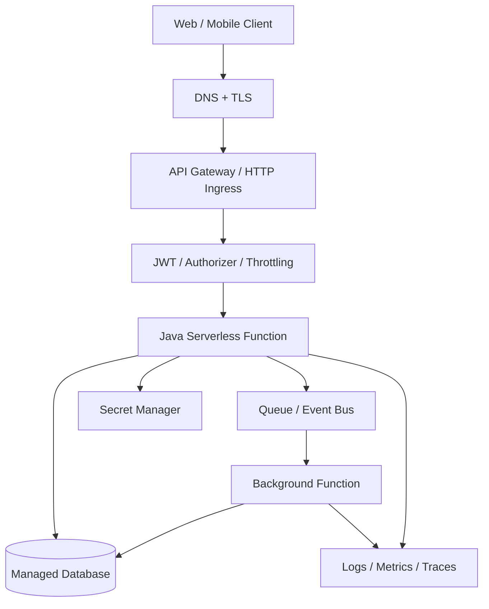

# Declaring Infrastructure and Environment Configuration for the API Project

A Java serverless API is more than a handler receiving HTTP requests. To run in the cloud, the project also needs an API Gateway or HTTP ingress, function runtime, access permissions, databases, secrets, logs, metrics, alarms, networking, and per-environment configuration. Creating resources manually or scattering configuration across source code causes dev, staging, and production environments to drift, making them hard to reproduce and hard to verify before release.

The sustainable approach is declaring infrastructure with **Infrastructure as Code (IaC)**, separating non-secret configuration from secrets, parameterizing environment-specific values, and promoting the same tested artifact across environments. For a Java serverless API, IaC describes the resource graph and permissions; the Java application reads injected runtime configuration; and the pipeline validates templates, generates deployment plans, deploys, and verifies the outcome.

## 1. What Makes Up a Java Serverless API's Infrastructure?

A simple task management API may include the following components:

- HTTP API Gateway to receive requests, route traffic, and enforce authentication/throttling.
- Java function executing business logic.
- Database storing tasks and metadata.
- Secret manager storing credentials for external systems if applicable.
- IAM role/service identity granting least-privilege permissions to the function.
- Log groups, metrics, tracing, and alarms for operations.
- Queue or event bus for asynchronous tasks if the API needs background processing.
- DNS, custom domain, certificates, WAF, or private networking as required.



Not every project needs every component. Only add queues, VPCs, NAT Gateways, WAFs, or multiple databases when concrete requirements call for them. Every added resource increases cost, permission management, and operational surface area.

### Resource Graph and Dependencies

IaC describes resources and their dependency relationships. For example, a function needs the database table name, its execution role needs the table ARN, API routes need function integrations, and alarms need function metrics. A proper deployment creates resources in dependency order and exposes required outputs for subsequent steps.

Distinguish between:

- **Resource:** a cloud object with its own lifecycle, such as a function, API, table, or queue.
- **Configuration:** values controlling how a resource behaves, such as timeout, memory, concurrency, or stage.
- **Output:** information emitted after deployment, such as an API URL, function ARN, or table name.
- **Secret:** credentials or keys requiring access control and rotation.
- **Runtime configuration:** values the Java application reads during function initialization or request handling.

## 2. What Is Infrastructure as Code?

Infrastructure as Code describes infrastructure in files that can be version-controlled, reviewed, validated, and deployed repeatably. Instead of clicking through a console to create each resource, the team declares desired state in templates or code.

IaC helps you:

- Reproduce dev, staging, and production from the same structure.
- Review infrastructure changes via pull requests.
- Inspect IAM permissions, networking, and configuration before deploying.
- Spin up ephemeral test environments that can be torn down or recreated.
- Track changes, drift, and release history.
- Reduce manual effort and configuration inconsistencies.

IaC does not guarantee safety by itself. A template can still declare overly broad permissions, public databases, or accidental deletion of stateful resources. Review plans/diffs, policy checks, backup/retention settings, and separate deploy permissions.

### Choosing Tools by Platform

| Tool | Typical Scope | Notes |
|---|---|---|
| AWS SAM / CloudFormation | AWS Lambda, API Gateway, DynamoDB, SQS, and AWS resources | SAM adds serverless syntax on top of CloudFormation |
| AWS CDK | Declare AWS infrastructure in Java, TypeScript, Python, and supported languages | Synthesizes CloudFormation; always review synthesized templates |
| Terraform | Multi-cloud/provider resources and external cloud services | Manages state, locking, provider versions, and plans |
| Azure Bicep / ARM | Azure Functions, API Management, Service Bus, Storage, and Azure resources | Bicep is a declarative language compiling to ARM templates |
| Google Cloud Terraform / deployment tooling | Cloud Run/Functions, API Gateway, Pub/Sub, IAM, and GCP resources | Manages projects, regions, API enablement, and IAM |

Pick one primary tool per infrastructure scope to avoid multiple systems managing the same resource. If CDK, SAM, and Terraform coexist in one organization, define clear resource ownership boundaries.

## 3. Project Directory Structure

A project structure can separate Java source code, IaC, and deployment configuration:

```text
java-serverless-api/
├── src/
│   ├── main/java/com/example/api/
│   └── test/java/com/example/api/
├── infra/
│   ├── template.yaml
│   ├── parameters/
│   │   ├── dev.json
│   │   ├── staging.json
│   │   └── prod.json
│   └── policies/
├── config/
│   └── application-local.yml
├── scripts/
│   ├── deploy.ps1
│   └── smoke-test.ps1
├── pom.xml
└── README.md
```

This is an illustrative layout, not a mandatory directory naming requirement. What matters is:

- IaC can be validated independently.
- Environment configurations contain no plaintext secrets.
- Local files are never accidentally packaged into production artifacts.
- The pipeline knows the exact template, artifact, and parameter set for each environment.
- Stateful resources have explicit lifecycle/retention policies.

Never maintain a separate copy of source code per environment. Environment differences belong in controlled parameters/configuration and policies.

## 4. Separating Dev, Staging, and Production Environments

Each environment serves a distinct purpose:

| Environment | Purpose | Data and Permissions |
|---|---|---|
| Dev | Rapid development, integration checks | Synthetic/mock data, limited permissions, frequent resource creation and teardown |
| Staging | Production-like testing, migrations, and smoke tests | Production-like configuration, masked or synthetic data, controlled deploy permissions |
| Production | Serving real users | Real data, least privilege, backups/retention, approvals, and auditing |

### Account / Project / Subscription-Level Isolation

Whenever possible, use separate AWS accounts, Azure subscriptions, or Google Cloud projects for critical environments. Account/project isolation separates:

- IAM principals and permission boundaries.
- Quotas, billing, and budgets.
- Networks, secrets, and encryption keys.
- Audit logs and resource policies.
- Blast radius if dev is misconfigured.

Merely renaming a stack to `prod` within the same account does not create an equivalent security boundary. If an organization must share an account, isolate roles, resource naming, networks, secret paths, and policies per environment.

### Regions and Availability

Choose regions based on user latency, data residency, service availability, quotas, and cost. Coupled resources such as functions, APIs, databases, secrets, and queues usually must reside in compatible regions. Never assume quotas, secrets, IAM resources, or endpoints in one region automatically exist in another.

## 5. Classifying Configuration: Defaults, Environment, Secrets, and Feature Flags

Not every value should be handled the same way.

| Category | Examples | Appropriate Management Place |
|---|---|---|
| Non-sensitive defaults | Default page size, operation names | Code or versioned default configuration |
| Environment configuration | Stage, log level, table name, API base URL | IaC parameters, environment variables, or config service |
| Secrets | Passwords, OAuth client secrets, API keys, private keys | Cloud Secrets Manager / Key Vault / Secret Manager |
| Feature flags | Enabling new endpoints, shifting traffic per tenant | Feature flag service or audited config |
| Dynamic operational settings | Temporarily throttling business concurrency, batch limits | Versioned config service with caching/refresh and separate change permissions |

A simple rule:

- Non-secret values that rarely change and are needed at startup can be injected via environment variables.
- Secrets must be retrieved from a secret store or managed identity mechanism; never commit them to repositories or templates.
- Feature flags may need changes without redeployment; keep them separate from immutable deployment configuration.
- Large values or complex settings should use a versioned config service instead of stuffing them into environment variables.

### Avoiding Environment Hard-Coding

Never write code like:

```java
String tableName = "tasks-prod";
String apiUrl = "https://api.example.com";
```

inside business logic. Configuration must be injected from runtime/deployment. Code should never guess whether it is in production from hostnames, branch names, or an unvalidated boolean flag.

## 6. Resource Naming and Tagging Conventions

Resource names should help identify the service, environment, functional area, and owner. For example:

```text
tasks-api-dev
tasks-api-staging
tasks-api-prod
tasks-table-prod
tasks-events-prod
```

Not all resource types allow the same characters or lengths. Follow each provider's naming rules and avoid placing emails, customer names, or sensitive details in resource names.

Useful tags/labels:

| Tag | Example | Purpose |
|---|---|---|
| `service` | `tasks-api` | Group resources by service |
| `environment` | `prod` | Distinguish environments |
| `owner` | `platform-team` | Identify owning team |
| `cost-center` | `cc-042` | Cost allocation |
| `managed-by` | `sam` / `terraform` | Identify management tooling |
| `data-classification` | `confidential` | Apply data governance policies |

Tags do not replace IAM or resource policies. An `environment=dev` tag alone does not stop a dev principal from reading production data if policies fail to enforce it.

## 7. Declaring an AWS Serverless API with AWS SAM

AWS SAM extends CloudFormation to describe Lambda functions, API events, and serverless resources. Templates are version-controlled alongside source code; parameters supply environment-specific values.

The example below declares an HTTP API with a JWT authorizer, a Java Lambda function, and a DynamoDB table. This is an illustrative template for a task-reading API; adjust runtimes, routes, schemas, IAM, and quotas for real projects.

```yaml
AWSTemplateFormatVersion: '2010-09-09'
Transform: AWS::Serverless-2016-10-31
Description: Java serverless Tasks API

Parameters:
  EnvironmentName:
    Type: String
    AllowedValues:
      - dev
      - staging
      - prod
  JwtIssuer:
    Type: String
  JwtAudience:
    Type: String
  FunctionConcurrency:
    Type: Number
    Default: 50

Globals:
  Function:
    Runtime: java21
    Architectures:
      - arm64
    MemorySize: 1024
    Timeout: 10
    Tracing: Active
    Environment:
      Variables:
        APP_ENV: !Ref EnvironmentName
        LOG_LEVEL: INFO

Resources:
  TasksTable:
    Type: AWS::DynamoDB::Table
    DeletionPolicy: Retain
    UpdateReplacePolicy: Retain
    Properties:
      TableName: !Sub '${EnvironmentName}-tasks'
      BillingMode: PAY_PER_REQUEST
      AttributeDefinitions:
        - AttributeName: pk
          AttributeType: S
        - AttributeName: sk
          AttributeType: S
      KeySchema:
        - AttributeName: pk
          KeyType: HASH
        - AttributeName: sk
          KeyType: RANGE
      SSESpecification:
        SSEEnabled: true
      PointInTimeRecoverySpecification:
        PointInTimeRecoveryEnabled: true

  TasksHttpApi:
    Type: AWS::Serverless::HttpApi
    Properties:
      StageName: !Ref EnvironmentName
      Auth:
        Authorizers:
          JwtAuthorizer:
            JwtConfiguration:
              issuer: !Ref JwtIssuer
              audience:
                - !Ref JwtAudience
            IdentitySource: "$request.header.Authorization"

  TasksFunction:
    Type: AWS::Serverless::Function
    Properties:
      CodeUri: target/function.zip
      Handler: com.example.api.TasksHandler
      ReservedConcurrentExecutions: !Ref FunctionConcurrency
      Environment:
        Variables:
          TASKS_TABLE_NAME: !Ref TasksTable
      Policies:
        - Statement:
            - Effect: Allow
              Action:
                - dynamodb:GetItem
                - dynamodb:PutItem
                - dynamodb:UpdateItem
                - dynamodb:Query
              Resource: !GetAtt TasksTable.Arn
      Events:
        ListTasks:
          Type: HttpApi
          Properties:
            ApiId: !Ref TasksHttpApi
            Path: /tasks
            Method: GET
            Auth:
              Authorizer: JwtAuthorizer

Outputs:
  ApiUrl:
    Description: Base URL of the HTTP API
    Value: !Sub 'https://${TasksHttpApi}.execute-api.${AWS::Region}.amazonaws.com/${EnvironmentName}'
  TasksTableName:
    Description: DynamoDB table name
    Value: !Ref TasksTable
  TasksFunctionArn:
    Description: Lambda function ARN
    Value: !GetAtt TasksFunction.Arn
```

### Reading the Template Section by Section

- `Parameters` declares values provided at deploy time, such as environment, JWT issuer/audience, and concurrency.
- `Globals` sets shared function defaults to avoid repeating runtime, memory, timeout, and tracing settings.
- `TasksTable` declares the database, encryption, and point-in-time recovery. `DeletionPolicy: Retain` protects against data loss when a stack is deleted; test environments need separate lifecycle/cleanup procedures.
- `TasksHttpApi` declares the HTTP API and JWT authorizer.
- `TasksFunction` declares the artifact, handler, concurrency, environment variables, and IAM policy.
- `Events` wires the `GET /tasks` route to the function and requires the authorizer.
- `Outputs` exposes the URL, table name, and ARN for smoke tests or dependent stacks.

### Notes When Using This Template in Real Projects

- `java21` and `arm64` must be supported by the runtime/provider and your artifact's native dependencies. If using native libraries lacking ARM64 support, choose the matching architecture.
- `CodeUri` must point to a properly packaged artifact; the pipeline must build the artifact before `sam build/deploy`.
- JWT issuer/audience must match the real identity provider; never reuse dev values in production.
- `ReservedConcurrentExecutions` must fit within account/region quotas and match database capacity.
- The IAM policy in this example covers only the illustrative operations. If using GSIs, streams, KMS customer-managed keys, or secrets, add the corresponding resources and actions.
- Never put plaintext secrets in `Parameters`, `Environment`, or templates. Pass secret ARNs/references and grant read access separately only when the function truly needs them.
- `DeletionPolicy: Retain` does not replace backups, restore tests, or data retention policies.

## 8. Per-Environment Deployment Configuration

Templates should maintain consistent resource structure while environments supply distinct parameter sets. For example:

| Parameter | Dev | Staging | Production |
|---|---|---|---|
| `EnvironmentName` | `dev` | `staging` | `prod` |
| `JwtIssuer` | sandbox issuer | staging issuer | production issuer |
| `JwtAudience` | `tasks-api-dev` | `tasks-api-staging` | `tasks-api` |
| `FunctionConcurrency` | 5 | 20 | Based on load tests/quotas |
| Log level | DEBUG/INFO | INFO | INFO/WARN |
| Data | Synthetic | Masked/synthetic | Production data |

Values in this table are illustrative only. Production concurrency must not be extrapolated from dev; calculate it from peak traffic, database capacity, downstream limits, and quotas.

### samconfig.toml

AWS SAM CLI can store per-environment deploy settings in `samconfig.toml`. This file is suitable for non-secret parameters, stack names, regions, and deployment options. Never store access keys, passwords, or secret values in it.

Simple structure example:

```toml
version = 0.1

[dev.deploy.parameters]
stack_name = "tasks-api-dev"
region = "ap-southeast-1"
capabilities = "CAPABILITY_IAM"
parameter_overrides = "EnvironmentName=dev JwtIssuer=https://identity-dev.example.com JwtAudience=tasks-api-dev FunctionConcurrency=5"

[staging.deploy.parameters]
stack_name = "tasks-api-staging"
region = "ap-southeast-1"
capabilities = "CAPABILITY_IAM"
parameter_overrides = "EnvironmentName=staging JwtIssuer=https://identity-staging.example.com JwtAudience=tasks-api-staging FunctionConcurrency=20"
```

Production can be configured in pipeline secret/variable stores with required approvals. Never commit production credentials. Even if `samconfig.toml` holds only non-sensitive accounts, regions, and parameters, review changes carefully to avoid deploying to the wrong account or region.

## 9. Environment Variables in Java

Java functions should read configuration through a centralized layer, validate it on startup, and pass it into services. Avoid scattering `System.getenv()` calls throughout business logic.

Example:

```java
import java.util.Map;
import java.util.Set;

public record ApiConfig(
        String environment,
        String tasksTableName,
        String logLevel) {

    private static final Set<String> ALLOWED_ENVIRONMENTS =
            Set.of("dev", "staging", "prod");

    public static ApiConfig from(Map<String, String> env) {
        String environment = required(env, "APP_ENV");
        if (!ALLOWED_ENVIRONMENTS.contains(environment)) {
            throw new IllegalStateException("Unsupported APP_ENV");
        }

        String tableName = required(env, "TASKS_TABLE_NAME");
        String logLevel = env.getOrDefault("LOG_LEVEL", "INFO");
        if (!Set.of("TRACE", "DEBUG", "INFO", "WARN", "ERROR")
                .contains(logLevel.toUpperCase())) {
            throw new IllegalStateException("Invalid LOG_LEVEL");
        }
        return new ApiConfig(environment, tableName, logLevel.toUpperCase());
    }

    private static String required(Map<String, String> env, String key) {
        String value = env.get(key);
        if (value == null || value.isBlank()) {
            throw new IllegalStateException("Missing configuration: " + key);
        }
        return value;
    }
}
```

In Lambda, configuration can be initialized once during the initialization phase:

```java
public final class TasksHandler {
    private static final ApiConfig CONFIG = ApiConfig.from(System.getenv());
    // Reuse thread-safe SDK clients; keep request data out of static fields.
}
```

Validating configuration early surfaces broken deployments before serving business requests. Exception messages should name only the missing/invalid key, never print secret values. For environments needing dynamic configuration updates, use a versioned config service with a refresh policy rather than expecting environment variables to change inside a running execution environment.

## 10. Secret Management

Secrets are sensitive values such as database passwords, OAuth client secrets, webhook signing keys, API tokens, or private keys. Never store secrets in:

- Git repositories, commit history, or pull requests.
- Dockerfiles, JAR resources, or `application.yml` packaged inside build artifacts.
- Plaintext IaC parameters or stack outputs.
- Environment variables holding raw passwords/tokens when secret references can be used.
- Logs, exception messages, metric labels, or command lines that may be recorded.

### Using a Secret Manager

| Cloud | Common Services |
|---|---|
| AWS | Secrets Manager, Systems Manager Parameter Store (SecureString) |
| Azure | Key Vault |
| Google Cloud | Secret Manager |

Functions should use their execution role/service identity to fetch secrets. Grant access only to the exact secret ARN/resource and action needed. Never put static access keys in environment variables when the provider offers managed identities/roles.

### Store ARNs/References Instead of Secret Values

Example environment variable:

```text
PAYMENT_PROVIDER_SECRET_ARN=arn:aws:secretsmanager:ap-southeast-1:123456789012:secret:tasks/prod/payment-abc
```

An ARN is not the secret value itself, though it can reveal resource names and account IDs. Grant metadata/secret read access only to principals that require it. The function uses the Secrets Manager SDK with its execution role to retrieve the value when needed.

### Rotation and Caching

Secrets can be rotated. If the function caches secrets in memory to reduce API calls, set an appropriate TTL, handle refresh failures, and never retain stale credentials indefinitely. For connection pools, rotation may require opening new connections or refreshing credentials before reconnecting. Never log secrets when a refresh fails.

## 11. IAM and Service Identity

Each function should have its own execution role/service account or a tightly scoped permission set per workload. Permissions must derive from actual operations:

- Read/write only the exact tables or collections required.
- Read only the exact secret ARNs needed if credentials are required.
- Publish messages only to the specific queues/topics.
- Write logs/traces per platform mechanisms.
- Decrypt using only the specific KMS key when using customer-managed keys.

Avoid `*` policies for actions or resources whenever scoping is possible. Separate:

- **Identity policy:** what actions a principal can perform on resources.
- **Resource policy:** which principals a resource permits to access it.
- **Trust policy:** which identities can assume a role or impersonate a service account.
- **Permission boundary / organization policy:** maximum ceiling of permissions that can be granted.

Never use the same admin role to deploy and run functions. The deployment principal creates/modifies resources; the runtime identity only serves requests. CI/CD should assume roles via federation/OIDC where supported rather than storing long-lived cloud access keys.

## 12. API Gateway and Authentication Configuration

IaC should declare API routes, authorizers, CORS, throttling, and access logging. These settings are part of the API contract and security posture.

### Authentication and Authorization

- Use JWT/OIDC authorizers at the gateway when appropriate.
- Functions must still check resource and tenant permissions; a valid token does not entitle a user to access every task.
- IAM authorization suits service-to-service calls on platforms that support it.
- API keys primarily identify clients and enforce quotas per contract; they should not replace user authentication.
- Use resource policies, private APIs, or network policies to restrict access sources when needed.

### CORS

CORS is a browser policy for cross-origin requests, not an authentication mechanism. Declare only the required origins, methods, and headers. Avoid `*` when APIs use credentials or need specific origin restrictions. CORS does not prevent non-browser clients from calling the API.

### Throttling and Payloads

Configure request rate and burst limits aligned with quotas and downstream capacity. Set payload limits, timeouts, and access logs. If the API accepts large uploads, consider uploading directly to object storage via presigned URLs instead of streaming large payloads through Lambda.

## 13. Database, Queue, and Network Configuration

### Database

- Enable encryption at rest and TLS in transit.
- Configure backups/PITR, retention, and deletion policies.
- Separate databases/schemas/tables by environment.
- Grant functions access only to required resources.
- Size connection pools to match concurrency and database limits.
- Use versioned migrations; never auto-run destructive migrations on every cold start.

### Queues and Event Buses

- Declare retention, visibility/lock timeouts, DLQs, and retry policies.
- Grant producer/consumer permissions per specific queue/topic.
- Configure batch size, batch window, and maximum concurrency within latency budgets.
- Design message schemas with versioning, event IDs, and correlation IDs.
- Ensure consumers are idempotent because deliveries may repeat.

### Networking

Do not place a function inside a VPC/VNet just because an old template defaulted to it. Private networking is useful when accessing private databases/services, but adds complexity, IP/subnet sizing concerns, NAT costs, and routing overhead.

When a function requires a VPC:

- Choose private subnets with sufficient IPs across appropriate availability zones.
- Open only necessary outbound/inbound security group rules.
- Use VPC endpoints/private endpoints for supported services to reduce internet/NAT egress.
- Verify DNS, route tables, NAT, firewalls, and egress policies.
- Monitor connection counts and ephemeral port exhaustion.

Never expose a database publicly just to make function connectivity easier. Design a secure network path and test connectivity from the actual runtime.

## 14. Configuring Observability and Alerting in IaC

Logs, metrics, and alarms should be declared alongside the function so you do not deploy and only later discover missing operational telemetry.

At minimum, include:

- Structured logs containing timestamp, service, environment, request ID, correlation ID, and outcome.
- Error counts, durations, throttles, and concurrent executions.
- API 4xx/5xx rates, latency, and integration errors.
- Queue depth / oldest message age when using async processing.
- Database throttling / connection saturation.
- SLO-based alarms, not just single CPU/memory thresholds.
- Log retention and encryption matching data classification.

Avoid logging request bodies or secrets. Set retention periods per environment and compliance rules; dev retention can be shorter than production, yet sufficient for debugging and compliance.

## 15. Configuring Quotas, Concurrency, and Cost Controls

Infrastructure must declare deliberate limits:

- Reserved/max concurrency to protect downstream dependencies.
- Provisioned/minimum capacity when SLOs demand steady latency.
- API Gateway throttling to absorb bursts.
- Queue event source maximum concurrency to pace workers.
- Database capacity/connection limits.
- Log retention, trace sampling, and storage lifecycle policies.

Never set high concurrency solely to scale functions quickly. For example, 100 Lambda instances each holding a 10-connection pool can open up to 1,000 connections if every pool fills. Calculate concurrency × connections per instance and compare against database limits.

Tag resources by service, environment, owner, and cost center. Configure budgets and alerts per account/project/subscription. Track cost per successful request—including retries and downstream usage—rather than looking solely at raw invocation counts.

## 16. Terraform and State Management

If using Terraform, each environment should have a separate state backend or clearly designed state/key boundary with locking and versioning. Never commit state files containing secrets to repositories.

Example layout:

```text
infra/terraform/
├── modules/
│   ├── api-function/
│   ├── http-api/
│   └── data-store/
└── environments/
    ├── dev/
    │   ├── main.tf
    │   └── terraform.tfvars
    ├── staging/
    └── prod/
```

Example variables and locals:

```hcl
variable "environment" {
  type = string
  validation {
    condition     = contains(["dev", "staging", "prod"], var.environment)
    error_message = "environment must be dev, staging, or prod."
  }
}

variable "function_memory_mb" {
  type    = number
  default = 1024
}

locals {
  service_name = "tasks-api"
  resource_name = "${local.service_name}-${var.environment}"
}
```

Common commands:

```bash
terraform fmt -check
terraform validate
terraform plan -var-file=environments/staging/terraform.tfvars
terraform apply -var-file=environments/staging/terraform.tfvars
```

Always review plans before applying to production. Use a remote backend with encryption, access control, versioning, and state locking. Terraform workspaces are merely a state-selection mechanism; they do not create security or account isolation comparable to separate environments.

## 17. Azure Bicep and Google Cloud

The same principles hold across different syntax:

### Azure Bicep

- Parameterize location, environment, SKU, and resource naming.
- Use Key Vault references/managed identities for secrets.
- Grant least-privilege access via managed identities and role assignments.
- Choose the right deployment scope: resource group, subscription, or management group.
- Run `what-if` to preview changes before deploying.
- Separate subscriptions/management groups for production per organizational governance.

### Google Cloud

- Use dedicated projects for critical environments.
- Enable required APIs in projects through controlled IaC/bootstrap workflows.
- Use dedicated service accounts for Cloud Run/Functions with resource-scoped IAM bindings.
- Use Secret Manager and Workload Identity / managed identities; never bundle service account keys into artifacts.
- Parameterize region, service account, concurrency, memory, ingress, and scaling.
- Use Terraform plans or appropriate deployment tooling to review changes.

Never copy an IAM role or network policy verbatim from AWS to Azure or GCP; map designs based on each provider's identity and resource policy model.

## 18. Local Development and Environment Parity

Local development should simulate runtime contracts without spinning up full cloud infrastructure on every run.

Options:

- Run Java handlers/controllers directly with local environment variables.
- Use AWS SAM local to invoke functions/APIs with sample events.
- Use LocalStack or appropriate emulators when testing service interactions.
- Use Testcontainers for databases, queues, or container-supported dependencies.
- Use mock servers for external APIs and identity providers.

Files like `application-local.yml` or `.env.local` are strictly for local use and must be listed in `.gitignore`. Never copy production secrets to developer machines. Use sandbox accounts or low-privilege local secrets.

Environment parity means keeping contracts, schemas, and resource behaviors close enough to catch bugs—not provisioning identical database sizes or quotas across every environment. Dev can be smaller, provided differences affecting test outcomes are documented.

## 19. CI/CD: Validate, Plan, Deploy, and Promote Artifacts

Pipelines should verify both Java code and IaC:

1. Compile and run Java unit tests.
2. Package the artifact and compute its checksum/digest.
3. Validate IaC syntax/schemas and run linters.
4. Scan dependencies, secrets, container images, and IaC misconfigurations.
5. Generate a deployment plan/diff for the target environment.
6. Review IAM changes, public exposure, data deletions, and resource replacements.
7. Auto-deploy to dev and run integration/smoke tests.
8. Promote the exact same artifact digest to staging and production.
9. Require approvals and dedicated deployment identities for production.
10. Monitor health, alarms, and rollback/roll-forward readiness.

### Example AWS SAM Commands

```bash
mvn clean package
sam validate --lint
sam build
sam deploy --config-env dev
sam local start-api
```

Run these commands in a project with a properly configured `template.yaml`, built artifact, AWS profile/role, and `samconfig.toml`. `sam deploy --config-env dev` selects the corresponding deploy config section; production pipelines must assume the target account role and supply reviewed parameters.

### Promoting the Same Artifact

Do not rebuild source independently per environment if you want certainty that the tested binary is the one running in production. Build one immutable artifact, record its digest, and promote it across dev → staging → production. Environment-specific values are injected at deploy/runtime, never compiled into the JAR.

### Approvals and Deployment Permissions

Separate dev and production deployment roles. Production pipelines should run only from protected branches/tags or workflows with code review and approvals. Never let developer roles arbitrarily modify production IAM or delete databases.

## 20. Drift Detection and Out-of-Band Changes

Configuration drift happens when live cloud resources diverge from repository declarations—for instance, someone edits a timeout in the console, adds an IAM permission, or modifies an API route manually.

Handling workflow:

- Detect drift with CloudFormation drift detection, Terraform refresh/plan, or equivalent tools.
- Determine whether the change was intentional or out-of-process.
- If it should be kept, update IaC and review it.
- If unauthorized, reconcile the resource back to declared state after assessing impact.
- Record an audit trail, owner, and reason for the change.

Never run apply/reconcile blindly when drift affects databases or stateful resources. A plan might propose replacing a resource and cause data loss if lifecycle policies are misconfigured.

## 21. Migrations and Lifecycle of Stateful Resources

Functions can be replaced rapidly, whereas databases, queues, and object storage hold long-lived data. Separate lifecycles:

- Stateless resources: function versions, API deployments, and temporary log/test resources can be replaced frequently.
- Stateful resources: databases/tables, buckets, queues holding active messages, encryption keys, and secrets with rotation/retention rules.

For schema changes, use expand-contract:

1. Add fields/indexes compatible with existing code.
2. Deploy code capable of reading both old and new schemas.
3. Backfill data if needed.
4. Switch writes and reads to the new schema.
5. Remove old fields only after all functions/versions have migrated.

Never run destructive migrations automatically inside static initializers or on every Lambda cold start. Use dedicated migration jobs with separate permissions, locking, and auditing. Production databases require backups/PITR and periodic restore drills.

## 22. Testing Configuration and Infrastructure

Useful test layers:

| Test | Objective |
|---|---|
| IaC lint/validate | Catch syntax and schema errors |
| Policy-as-code | Catch wildcard IAM, public resources, or missing encryption |
| Template unit tests | Verify declared resources, routes, env vars, policies, and outputs |
| Integration tests | Verify functions reach the right database/queue/secret |
| Environment smoke tests | Verify API URL, authentication, routes, and health after deploy |
| Negative security tests | Unauthorized principals must be denied |
| Drift tests | Verify live resources match IaC |
| Recovery tests | Verify backups/restores and compatible rollbacks |

Template tests should also verify that unintended permissions are absent. For instance, a function reading the tasks table should not hold `dynamodb:*` across all resources.

## 23. Common Configuration Mistakes

| Mistake | Consequence | Remedy |
|---|---|---|
| Hard-coding endpoints/table names | Deploys to wrong environment or hurts reusability | Parameterize and inject configuration |
| Committing secrets into IaC | Credentials exposed in Git, state, or logs | Use secret managers and runtime identities |
| Sharing one account/role across all environments | Larger blast radius and accidental deploy risks | Isolate accounts, projects, and roles |
| Using IAM `*` for convenience | Function receives excessive privileges | Least privilege by action and resource |
| Unnecessary VPC attachment | Added network complexity and cost | Use private networking only when required |
| Setting concurrency without sizing the DB | Connection exhaustion and throttling | Compute concurrency × pool size and cap it |
| Deploying templates without reviewing plans | Accidental replacements/deletions or public exposure | Review diffs, backups, and approvals |
| Rebuilding artifacts per environment | Staging binary differs from production | Promote the same immutable digest |
| Testing only from the IDE | Missing dependencies/config in deployment packages | Test the built artifact and real runtime events |
| Ignoring drift | Console edits cause environment divergence | Drift detection and IaC reconciliation |
| Deleting a stack wipes the database | Production data loss | Retain policies, backups, and separate lifecycles |
| Unversioned dynamic config | Hard to reproduce bugs and roll back | Versioned configs and feature-flag audits |

## 24. Pre-Production Deployment Checklist

### IaC and Environments

- [ ] Resource graph, dependencies, and outputs are declared in IaC.
- [ ] Dev/staging/prod have separate parameter sets and isolated accounts/projects/subscriptions.
- [ ] Region, naming, tags, quotas, and budgets are defined.
- [ ] Templates passed lint/validate and deployment plans were reviewed.
- [ ] No resource is managed simultaneously by multiple IaC states.

### Configuration and Secrets

- [ ] Non-sensitive configuration is injected per environment.
- [ ] Secrets live in Secrets Manager / Key Vault and never appear in Git, templates, or logs.
- [ ] Runtime identity can read only the required secrets and resources.
- [ ] Java configuration is validated and errors never expose sensitive values.
- [ ] Feature flags have owners, audit trails, and rollback procedures.

### Security and Networking

- [ ] Least-privilege IAM and trust policies have been reviewed.
- [ ] API authentication, tenant/resource authorization, and throttling are configured.
- [ ] CORS permits only necessary origins; team understands CORS is not authentication.
- [ ] Databases and private services are not publicly exposed unnecessarily.
- [ ] Encryption, TLS, KMS, and secret rotation are defined.

### Reliability and Operations

- [ ] Timeouts, memory, concurrency, and downstream capacity are load-tested.
- [ ] Backups/PITR, retention, and deletion policies for stateful resources are clear.
- [ ] Logs, metrics, traces, alarms, and log retention are declared.
- [ ] Quotas, budgets, and cost-allocation tags are verified.
- [ ] CI/CD promotes the same artifact digest with production approvals.
- [ ] Smoke tests, rollback/roll-forward plans, and drift detection are ready.

Declaring infrastructure and environment configuration makes a Java serverless API repeatable, testable, and consistent to operate. Model your resource graph with IaC, isolate environments by account/project where appropriate, inject non-secret configuration, fetch secrets from a secret manager, grant least-privilege IAM, and validate quotas, networking, and dependencies before release. When pipelines validate templates, review plans, promote the same artifact, and monitor drift, teams can scale the API while keeping security, reliability, and cost under control.
