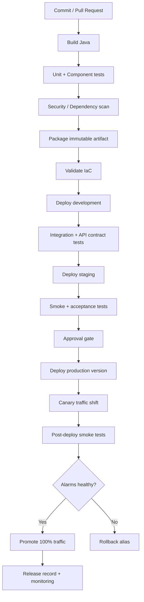

# Building an API Deployment Pipeline and Post-Release Smoke Tests

## 1. Why Does a Serverless API Need a Deployment Pipeline?

A Java API running on AWS Lambda typically involves multiple moving parts: Java source code, dependencies, the Lambda function, API Gateway, IAM roles, logs/metrics, queues or databases, and per-environment configuration. Merely building a JAR does not mean the API is production-ready. A release must also provision or update infrastructure, bind the right Lambda version to API routes, configure permissions, verify endpoints post-deploy, and provide a rollback path if failures appear.

A CI/CD pipeline automates the repeatable steps from commit to production. It ensures every environment deploys through the exact same workflow, artifacts remain traceable, infrastructure changes are reviewed, and post-release defects are caught early.

Smoke tests are a short suite of checks run after deployment to verify critical paths actually work: DNS/API endpoints are reachable, authentication functions, Lambda is invoked, responses match the expected structure, and essential dependencies are accessible. Smoke tests do not replace unit tests, integration tests, or load tests; they serve as a fast signal that the new release is not fundamentally broken.

In the CLOUD_SERVERLESS project, the pipeline should deploy Java functions and API Gateway using immutable artifacts, Infrastructure as Code (IaC), Lambda versions/aliases, controlled rollouts, post-release smoke tests, and alarm-driven rollbacks. The goal is repeatable releases, knowing precisely which version is serving traffic, and catching defects before shifting 100% of traffic.

## 2. Reference Pipeline Architecture

A typical pipeline consists of these stages:



These steps can be implemented with GitHub Actions, AWS CodePipeline/CodeBuild, or any existing CI system. Tools may vary, but the contract should remain consistent: one commit produces one deterministic artifact; the artifact is tested before promotion; and deployments and post-deploy checks leave recorded results.

## 3. Repository Conventions for a Java Serverless API

A simple repository layout:

```text
orders-api/
├── src/
│   ├── main/java/com/example/orders/
│   └── test/java/com/example/orders/
├── template.yaml              # AWS SAM template
├── samconfig.toml             # per-environment deploy config, no secrets
├── scripts/
│   ├── smoke-test.sh
│   └── package-info.sh
├── .github/workflows/
│   └── deploy.yml
├── pom.xml
└── README.md
```

Real-world repositories may use Gradle, AWS CDK, or Terraform instead of Maven/SAM. What matters is that application code, infrastructure, and release checks are versioned, reviewed, and deployed together.

Never commit credentials, access keys, tokens, database passwords, or configuration files containing secrets. `samconfig.toml` should hold only stack names, Regions, non-sensitive parameters, and deploy options.

## 4. Building Reproducible Java Artifacts

Builds must run from a pinned commit, use a JDK/runtime compatible with Lambda, and lock dependency versions. Maven example:

```bash
mvn --batch-mode --no-transfer-progress clean verify
```

`verify` runs the preceding Maven lifecycle phases, including compilation, tests, and configured plugins. The pipeline must fail immediately if compilation or tests fail.

For Java Lambda, verify:

- Build JDK version and Lambda Java runtime are compatible.
- Handler class/method matches deployment configuration.
- Dependencies are packaged completely with no missing runtime libraries.
- Any native libraries/JNI are compiled for the target Linux architecture.
- The JAR/ZIP contains no secrets or unnecessary test files.
- Artifact size is within limits and startup time is measured.
- Unit/integration tests run against the exact dependency versions shipped in the deployable artifact.

When using the Maven Shade Plugin or Spring Boot packaging, verify the manifest, service loaders, and resource merging. A JAR that runs on a developer's laptop will not necessarily run properly in Lambda if the handler, classpath, or native dependencies are wrong.

## 5. Running Test Layers Before Deployment

Do not wait until production smoke tests to catch code bugs. Each test layer covers a distinct scope.

| Test Type | What Does It Verify? | Where Does It Run? |
|---|---|---|
| Unit test | Business logic, validation, mapping, state transitions | Every pull request |
| Component test | Handler/application service with mocked dependencies | Every pull request |
| Contract test | Request/response schemas, status codes, event schemas | Pull requests and pre-release |
| Integration test | Real IAM, Lambda, API Gateway, queues, and databases | Cloud sandbox or ephemeral environment |
| End-to-end test | Business journey spanning multiple services | Staging or dedicated test environment |
| Smoke test | Whether core paths work after deployment | After every deployment/canary |
| Load test | Throughput, latency, concurrency, throttling, and cost | Before major releases / periodically |

Smoke tests should be short, deterministic, and minimally dependent on data. A smoke suite checking only `GET /health` can miss auth, route mapping, or serialization bugs; select a few requests representative of the API contract.

## 6. Dependency and Security Checks in CI

Before packaging artifacts, the pipeline should perform appropriate checks:

- Dependency vulnerability scanning and license checks.
- Secret scanning across source code and artifacts.
- Static analysis/linting per project standards.
- IaC policy checks: public resources, wildcard IAM, encryption, and logging.
- Dependency tree checks to catch version conflicts.
- Container image scanning if deploying as an image.
- SBOM or dependency manifest generation to trace built components.

Never suppress vulnerabilities automatically simply because a release is urgent. Enforce severity policies, time-bound exceptions with owners, and recorded decisions. Secret scanning must execute before artifacts are uploaded or deployed.

## 7. Immutable Artifacts and Release Traceability

Build once, then promote the exact same artifact through dev, staging, and production. Never rebuild separately for production, as dependency resolution or build environment changes could yield a different artifact.

Record metadata for every artifact:

- Git commit SHA.
- Build run ID and build timestamp.
- JAR/ZIP SHA-256 checksum or container image digest.
- Java/JDK version and dependency manifest.
- IaC template version.
- Test results and security scan summary.
- Release version/tag.

Checksum generation example:

```bash
sha256sum target/orders-api.jar > target/orders-api.jar.sha256
```

For container images, deploy by digest (`repository@sha256:...`) rather than mutable tags like `latest`. For Lambda ZIPs, store packages in an artifact store/S3 under versioned or hashed keys with versioning and appropriate retention enabled.

Never rebuild the artifact after staging smoke tests. Production must receive the exact bytes that were tested, while environment-specific configuration is passed separately at deploy time.

## 8. Infrastructure as Code for API and Lambda

API Gateway, Lambda, IAM, log groups, alarms, queues, and permissions should all be managed via IaC. AWS SAM is a strong fit for Lambda/API Gateway; CDK or Terraform can also be used.

IaC enables you to:

- Review infrastructure changes just like application code.
- Create consistent environments.
- Maintain change history and recreate resources.
- Inspect permissions and configuration before deployment.
- Avoid manual configuration drift between staging and production.

Pipelines should run linting, validation, and template checks before deploying. SAM example:

```bash
sam validate --lint
sam build
```

`sam build` produces the build artifact directory from the template. `sam deploy` then deploys that built artifact; never hand-edit production resources outside IaC without bringing those changes back into the repository.

## 9. Example SAM Template for a Java API and Lambda Alias

The abbreviated example below illustrates an HTTP API, a Java 21 function, a published `live` alias, and canary deployment. Alarms must be defined in the stack and attached to the deployment preference based on your system's metrics and SLOs.

```yaml
AWSTemplateFormatVersion: '2010-09-09'
Transform: AWS::Serverless-2016-10-31
Description: Orders API - Java Lambda

Parameters:
  Environment:
    Type: String
    AllowedValues: [dev, staging, prod]

Resources:
  OrdersHttpApi:
    Type: AWS::Serverless::HttpApi
    Properties:
      StageName: '$default'

  OrdersFunction:
    Type: AWS::Serverless::Function
    Properties:
      FunctionName: !Sub 'orders-api-${Environment}'
      Runtime: java21
      Architectures:
        - arm64
      Handler: com.example.orders.OrderHandler::handleRequest
      CodeUri: .
      MemorySize: 1024
      Timeout: 15
      AutoPublishAlias: live
      DeploymentPreference:
        Type: Canary10Percent5Minutes
      Environment:
        Variables:
          APP_ENV: !Ref Environment
      Tracing: Active
      Events:
        Health:
          Type: HttpApi
          Properties:
            ApiId: !Ref OrdersHttpApi
            Path: /health/ready
            Method: GET
        GetOrder:
          Type: HttpApi
          Properties:
            ApiId: !Ref OrdersHttpApi
            Path: /v1/orders/{orderId}
            Method: GET
```

This is a skeleton that must be adapted to your project: `CodeUri: .` assumes `pom.xml` and function sources reside at the repository root so the SAM Java builder can package them; in multi-module projects, point to the module containing the corresponding `pom.xml`. `OrderHandler` in the example implements `RequestHandler<OrderRequest, OrderResponse>` with a `handleRequest` method. With Spring Cloud Function or AWS Serverless Java Container, entry points differ.

`DeploymentPreference` uses CodeDeploy to shift alias traffic according to the canary configuration. To enable automatic rollback, add appropriate CloudWatch alarms and verify the CodeDeploy IAM/service role. Never copy a template into production without reviewing memory, timeout, architecture, permissions, logging, API auth, CORS, and alarms.

## 10. Per-Environment Configuration

Environments typically include `dev`, `staging`, and `prod`. They should differ in account/Region, endpoints, quotas, retention, and protection levels, while sharing the same template and artifact.

| Component | Dev | Staging | Production |
|---|---|---|---|
| AWS account | Sandbox/dev account | Pre-production account | Production account |
| Data | Synthetic/test data | Masked or realistic synthetic data | Business data |
| API auth | Test identity | Production-equivalent identity | Official production auth |
| Lambda concurrency | Low, capped | Near-production for testing | Per capacity plan |
| Logging | Controlled debug | Info/structured | Structured, retention per policy |
| Alarms | Basic | Full coverage for drills | SLO-based paging |
| Deployment | Automatic | Automatic after tests | Approval + canary |

Never hard-code endpoints, account IDs, database URLs, or secrets into the JAR. Use environment variables for non-sensitive settings and Secrets Manager/Parameter Store for secrets. Each environment maintains separate secrets and resources; never copy production secrets to dev.

## 11. GitHub Actions and AWS OIDC

CI runners need permissions to deploy to AWS, but long-lived access keys should never be stored in repository secrets. GitHub Actions can use OpenID Connect (OIDC) to assume an IAM role whose trust policy restricts repository, branch, or GitHub Environment.

Abbreviated workflow example:

```yaml
name: Deploy Orders API

on:
  pull_request:
    branches: [main]
  push:
    branches: [main]

permissions:
  contents: read
  id-token: write

jobs:
  build-test:
    runs-on: ubuntu-latest
    steps:
      - uses: actions/checkout@v4

      - uses: actions/setup-java@v4
        with:
          distribution: temurin
          java-version: '21'
          cache: maven

      - name: Build and test
        run: mvn --batch-mode clean verify

      - name: Validate SAM
        run: |
          sam validate --lint
          sam build

      - name: Package release bundle
        run: |
          tar -czf release-bundle.tgz .aws-sam/build scripts/smoke-test.sh
          sha256sum release-bundle.tgz
      - uses: actions/upload-artifact@v4
        with:
          name: orders-api-release
          path: release-bundle.tgz
          if-no-files-found: error

  deploy-staging:
    if: github.event_name == 'push'
    needs: build-test
    runs-on: ubuntu-latest
    environment: staging
    steps:
      - uses: actions/download-artifact@v4
        with:
          name: orders-api-release
      - uses: aws-actions/setup-sam@v2
      - uses: aws-actions/configure-aws-credentials@v4
        with:
          role-to-assume: ${{ vars.AWS_DEPLOY_ROLE_ARN }}
          aws-region: ${{ vars.AWS_REGION }}
      - name: Deploy staging from the release bundle
        run: |
          tar -xzf release-bundle.tgz
          sam deploy \
            --template-file .aws-sam/build/template.yaml \
            --stack-name orders-api-staging \
            --resolve-s3 \
            --capabilities CAPABILITY_IAM \
            --parameter-overrides ParameterKey=Environment,ParameterValue=staging \
            --no-confirm-changeset
      - name: Smoke test staging
        env:
          API_BASE_URL: ${{ vars.API_BASE_URL }}
          API_TOKEN: ${{ secrets.SMOKE_TEST_TOKEN }}
        run: bash scripts/smoke-test.sh

  deploy-production:
    if: github.event_name == 'push'
    needs: deploy-staging
    runs-on: ubuntu-latest
    environment: production # Configure required reviewers in GitHub Environment
    steps:
      - uses: actions/download-artifact@v4
        with:
          name: orders-api-release
      - uses: aws-actions/setup-sam@v2
      - uses: aws-actions/configure-aws-credentials@v4
        with:
          role-to-assume: ${{ vars.AWS_DEPLOY_ROLE_ARN }}
          aws-region: ${{ vars.AWS_REGION }}
      - name: Deploy production from the same release bundle
        run: |
          tar -xzf release-bundle.tgz
          sam deploy \
            --template-file .aws-sam/build/template.yaml \
            --stack-name orders-api-production \
            --resolve-s3 \
            --capabilities CAPABILITY_IAM \
            --parameter-overrides ParameterKey=Environment,ParameterValue=prod \
            --no-confirm-changeset
      - name: Smoke test production
        env:
          API_BASE_URL: ${{ vars.API_BASE_URL }}
          API_TOKEN: ${{ secrets.SMOKE_TEST_TOKEN }}
        run: bash scripts/smoke-test.sh
```

This is a structural example, not a ready-to-use workflow. The build job generates `.aws-sam/build`, packages it with the smoke script, and uploads a release bundle; staging and production download that exact bundle without rebuilding. Configure OIDC trust policies, IAM deploy roles, artifact retention, Regions, stack parameters, and API URLs outside the workflow. Production should be a GitHub Environment with required reviewers or an approval gate. For systems requiring strict verification that production receives the exact package deployed to staging, record the release bundle checksum and verify it after downloading in each job.

Actions should be pinned to full commit SHAs per organizational security policy; version tags like `@v4` are readable but not strictly immutable.

## 12. Separating Build, Deploy, and Promote

A clean release separates three operations:

1. **Build:** produce an immutable artifact and metadata.
2. **Deploy:** create a new Lambda version, update resources/configuration, and attach the version to an alias.
3. **Promote:** shift traffic to the new version after smoke tests and alarms pass.

There is no need to rebuild when promoting. The same artifact can be deployed to staging and then production with different parameters. If an environment requires compile-time configuration, reconsider the design, because it produces distinct artifacts per environment and weakens traceability.

## 13. Lambda Versions and Aliases

Lambda `$LATEST` is mutable. Every code or configuration update alters `$LATEST`. A published version is an immutable snapshot of code and part of its configuration; an alias is a stable pointer referencing a specific version.

Example:

```text
orders-api:$LATEST  -> code under development
orders-api:41       -> previously published version
orders-api:42       -> newly published version
orders-api:live     -> alias pointing to version 42
```

API Gateway integrations should point to an appropriate alias rather than `$LATEST` if you want alias-based rollouts and rollbacks. With SAM `AutoPublishAlias`, SAM manages published versions and aliases for the function.

Record the version/alias in release records. Never merely note "deployed orders-api"; record which version, artifact hash, and alias are serving traffic.

## 14. Canary and Linear Deployments

Canary shifts a small slice of traffic to the new version, observes telemetry, and only then increases the share. For example, `Canary10Percent5Minutes` shifts 10% of traffic for the first 5 minutes; if deployment alarms do not trigger, CodeDeploy completes the rollout per strategy. Linear deployments increase traffic in equal timed increments.

Canary helps when:

- The API has enough production traffic to produce meaningful statistical signals.
- Error/latency metrics are segmented by version/alias or deployment.
- Aliases can be rolled back rapidly.
- Database schemas and event contracts remain compatible with both old and new versions during the transition.

Canary does not replace smoke tests. Smoke tests verify specific critical journeys; canary observes behavior under real traffic. Both are needed when release risk is significant.

## 15. Alarms for Automatic Rollback

Alarms should reflect user impact and function failures:

- API Gateway 5xx rate or count.
- Lambda `Errors` and `Throttles`.
- Lambda `Duration` or API integration latency p95/p99.
- Dependency timeout/error rates.
- Queue age if the API emits events to workers.
- Business invariants or operation failure rates if reliable metrics exist.

Set thresholds from baselines/SLOs and traffic volume. Overly sensitive alarms can roll back on a single transient error; overly loose alarms let faulty releases absorb too much traffic. Under low traffic, combine CloudWatch alarms with smoke tests and log/trace inspection.

CodeDeploy can roll back automatically when an alarm enters ALARM state or a deployment lifecycle hook fails. Verify deployment status, alarm states, and CodeDeploy permissions before enabling production rollouts.

## 16. What Should Post-Deploy Smoke Tests Verify?

A smoke test suite for a Java API can cover:

1. **Reachability:** API domain/routes respond within a bounded timeout.
2. **Health/readiness:** the function executes and mandatory dependencies are reachable.
3. **Authentication:** valid tokens are accepted; missing/invalid tokens are rejected with the expected status.
4. **Routing:** API Gateway routes/methods/paths invoke the intended Lambda alias.
5. **Serialization:** JSON responses contain key expected fields and types.
6. **Dependency path:** read-only query against the database/cache or critical dependency succeeds.
7. **CORS:** preflight succeeds if the API serves browsers.
8. **Latency:** requests complete within smoke-test thresholds.
9. **Correlation:** responses/logs contain a request ID or trace for investigation.

Smoke tests must be safe to run repeatedly. Prefer GET/read-only endpoints. If writes are unavoidable, use a dedicated test tenant/namespace, idempotency keys, and cleanup, and never trigger real payments or emails.

## 17. Health Endpoints for Lambda APIs

Two endpoints with distinct meanings can be exposed:

- `/health/live`: the application can accept requests and the handler is operational.
- `/health/ready`: mandatory dependencies required to serve requests are currently reachable.

Do not let readiness probe every dependency or run heavy queries on every request. Health endpoints must be fast, use short timeouts, and never expose hostnames, credentials, stack traces, or internal details.

Lambda is not an always-running server process like a container; a health endpoint invocation checks only one invocation. It does not prove every execution environment or all concurrency slots are warm and healthy. Combine smoke tests with CloudWatch metrics and service-level monitoring.

## 18. Example Smoke Test Script

Example Bash script using `curl` and `jq`. CI injects `API_BASE_URL` and `API_TOKEN` from environment/secret stores; never print tokens to logs.

```bash
#!/usr/bin/env bash
set -euo pipefail

: "${API_BASE_URL:?API_BASE_URL is required}"
: "${API_TOKEN:?API_TOKEN is required}"

response="$(curl --silent --show-error --fail-with-body \
  --max-time 8 \
  --header "Authorization: Bearer ${API_TOKEN}" \
  --header "Accept: application/json" \
  "${API_BASE_URL}/health/ready")"

printf '%s' "${response}" | jq -e '.status == "ok"' >/dev/null

orders_response="$(curl --silent --show-error --fail-with-body \
  --max-time 8 \
  --header "Authorization: Bearer ${API_TOKEN}" \
  --header "Accept: application/json" \
  "${API_BASE_URL}/v1/orders?limit=1")"

printf '%s' "${orders_response}" | jq -e '
  (.items | type == "array") and
  (.items | length <= 1)
' >/dev/null

echo "Smoke tests passed"
```

Paths `/health/ready` and `/v1/orders` are illustrative; replace them with your real routes. If the API returns sensitive data, never print the full response body to logs; the script validates structure and discards output. Use `--max-time` so smoke tests cannot hang the pipeline.

If testing POST is necessary, create records inside a dedicated test tenant with an idempotency key unique to the build/run ID and run a cleanup step. Never call endpoints that send real emails, capture payments, or create production shipments solely to verify a deployment.

## 19. Smoke Tests During Canary and After Promotion

Recommended sequence:

1. Deploy the new version and publish a Lambda version.
2. Wait for the alias and Provisioned Concurrency (if used) to become ready.
3. CodeDeploy shifts the canary traffic percentage.
4. Run smoke tests against the real public/private API Gateway endpoint.
5. Monitor 5xx errors, Lambda errors, throttles, duration, and business metrics.
6. If smoke tests fail or alarms fire, roll back the alias.
7. If healthy, promote 100% of traffic.
8. Run smoke tests again on the fully promoted state.
9. Monitor the release over a post-release observation window.

Smoke tests must know which version they are hitting. Calling the production alias during a canary can route requests to either the old or new version under weighted routing. To test the new version deterministically, use a dedicated test alias or deployment hook; do not expose internal test aliases to external users.

## 20. API Contract Smoke Tests

A matching HTTP status code with a broken JSON contract can still break clients. Check key fields:

```json
{
  "orderId": "order-9381",
  "status": "PENDING",
  "createdAt": "2026-11-17T08:00:00Z"
}
```

Smoke tests can verify:

- `orderId` is a non-empty string.
- `status` belongs to the published enum.
- `createdAt` is a parseable timestamp.
- The API returns `Content-Type: application/json`.
- Error responses contain no stack traces or secrets.
- Request ID / correlation headers are present per contract.

Full contract tests belong before deployment; smoke tests verify a small representative sample post-deploy to keep execution fast.

## 21. Verifying API Gateway and Lambda Permissions

After deployment, several failures appear that unit tests do not catch:

- API Gateway route/method was not created or stage was not updated.
- Lambda integration points to the wrong function, version, or alias.
- Lambda resource-based policy lacks permission for API Gateway to invoke it.
- IAM execution role lacks permissions to read secrets, databases, or queues.
- Authorizer or JWT issuer/audience is misconfigured.
- CORS allow-origin/header/method rules are wrong.
- Custom domain/base path mapping or DNS is not updated.
- VPC routes, security groups, or DNS block Lambda from reaching dependencies.

Smoke testing through the real API endpoint catches routing, auth, and integration issues. Invoking Lambda directly alone does not prove API Gateway, authorizers, mapping templates, CORS, or custom domains work.

## 22. Database Migrations and Backward Compatibility

Code deployments and database schemas often cannot roll back like a single binary artifact. Use expand-and-contract:

1. **Expand:** add new columns, tables, or indexes in a way existing code still tolerates.
2. Deploy new code capable of reading both old and new schemas and writing per the transition plan.
3. Backfill data if needed.
4. Shift traffic and verify.
5. **Contract:** drop old columns or code paths only after all older versions are retired.

Canaries can run old and new code simultaneously; the schema must stay compatible throughout that window. Never deploy destructive migrations before confirming rollbacks will not rely on the old schema.

For events and queues, older consumers may receive newer messages mid-deploy. Maintain backward compatibility, version schemas, and roll out producers/consumers in a safe order.

## 23. Secrets and Deployment Permissions

Separate CI deploy role permissions from the Lambda execution role:

- CI role: updates stacks, functions, APIs, aliases, and reads required artifacts.
- Lambda execution role: accesses only the databases, queues, secrets, and logs the handler needs.
- API Gateway invoke permission: allows only the intended API, stage, and account to invoke the function/alias.
- Smoke test identity: permitted only to invoke the required verification endpoints.

Use OIDC trust policies scoped to repository, branch, and environment. Never grant `AdministratorAccess` to a workflow just to simplify deployment. For CloudFormation/SAM, review capabilities and IAM changes in change sets.

Smoke test tokens should belong to a narrowly scoped test principal with rotation. Avoid printing environment variables or command lines containing tokens in CI logs.

## 24. Deployment Strategies: Rolling, Canary, and Blue/Green

| Strategy | How It Works | When Appropriate |
|---|---|---|
| All-at-once | Shifts 100% of traffic to the new version immediately | Dev/staging or low-risk services |
| Canary | Shifts a small share, observes, then promotes | Production APIs needing controlled risk |
| Linear | Increases traffic in fixed increments | Gradual rollouts with sufficient traffic |
| Blue/green | Maintains two environments/versions and switches traffic deliberately | Major changes needing pre-cutover verification |

Lambda alias routing supports weighted traffic between published versions. API Gateway continues targeting a stable alias while CodeDeploy manages shifting and rollback. For API Gateway stage deployments, understand how IaC manages deployments/stages and never mix manual console edits with templates.

## 25. Post-Deploy: Release Verification and Monitoring

Smoke tests are only the first checkpoint. During the post-release window, monitor:

- API 4xx/5xx rates by route and environment.
- Lambda `Errors`, `Duration`, `Throttles`, and `ConcurrentExecutions`.
- Cold start / init duration if it affects SLOs.
- Database queries, connections, locks, and dependency latency.
- Queue age, retries, DLQs, and workflow failures if the API emits events.
- Business metrics: orders accepted/completed, payment failures, stuck operations.
- Cost per request and log/trace volume.

Record release annotations or deployment IDs on dashboards and logs. When incidents happen, you can compare pre- and post-release metrics and identify which version is serving traffic.

## 26. Rollback and Recovery

Code rollback usually means repointing an alias to the previous version or rolling back the CloudFormation deployment when appropriate. However, rollback does not automatically undo side effects or already-written data.

Before releasing, determine:

- Is the previous version still retained and deployable?
- Can the alias be switched back quickly?
- Is the database schema compatible with the previous version?
- Can already-enqueued events be handled by older consumers?
- Will in-flight requests finish or need retries?
- Can a feature flag disable the new behavior?
- Is reconciliation/compensation available for side effects already performed?

Never delete old artifacts or versions immediately after deploying. Keep retention per policy and maintain a rollback runbook. For destructive data changes, a forward-fix can be safer than rolling back code.

## 27. Common Mistakes in CI/CD and Smoke Testing

| Mistake | Consequence | Remedy |
|---|---|---|
| Rebuilding artifacts per environment | Staging and production run different bytes | Build once, promote the same artifact |
| Deploying code without IaC/API permissions | Lambda runs, but routes return 5xx/403 | Deploy and validate infrastructure in the same pipeline |
| Pointing API Gateway to `$LATEST` | Hard to canary or roll back | Integrate with stable aliases/versions |
| Smoke testing only by invoking Lambda directly | Misses API Gateway, auth, CORS, and custom domains | Test through real API endpoints |
| Smoke tests creating real payments/emails | Production side effects and cost | Read-only checks or dedicated test tenants/sandboxes |
| Checking only HTTP 200 | JSON, schema, or business paths may still be broken | Verify status, schema, and core dependencies |
| No rollback alarms | Broken release absorbs 100% of traffic | Configure CodeDeploy alarms and canaries |
| Alarms missing metric dimensions | Fails to isolate errors in the new version | Verify metric, alias, and stage dimensions |
| Destructive schema migrations | Rolled-back code fails on new schema | Use expand-and-contract |
| Hard-coded smoke test tokens | Credential leakage | Use OIDC/secrets manager and scoped test principals |
| Unbounded smoke test timeouts | Pipeline hangs | Set connect/total timeouts and short retries |
| Deleting old versions/artifacts immediately | Unable to roll back | Enforce retention and release inventory |

## 28. Recommended Deployment Workflow

1. **Commit and review:** branch protection, code review, and change descriptions.
2. **Build:** use a pinned JDK, locked dependencies, and build the JAR/ZIP.
3. **Test:** run unit, component, contract, and appropriate integration tests.
4. **Scan:** dependency, secret, license, and IaC security scans.
5. **Package:** create an immutable artifact, checksum, and release metadata.
6. **Validate IaC:** lint, validate, inspect diffs/change sets, and review IAM changes.
7. **Deploy dev:** deploy the stack and run smoke tests.
8. **Deploy staging:** deploy the same artifact and run API contract/E2E/smoke tests.
9. **Approval:** review release notes, test evidence, risks, and rollback plan.
10. **Deploy production:** publish a new version and bind the alias.
11. **Canary:** shift traffic per strategy and monitor alarms.
12. **Post-deploy smoke:** call real API Gateway endpoints and check auth/schema/latency.
13. **Promote or roll back:** decide based on smoke results and alarms.
14. **Release record:** store commit, artifact hash, Lambda version, alias, deployment ID, and timestamp.
15. **Observe:** monitor SLOs and business metrics post-release.

## 29. Pre-Production Checklist

- [ ] Java build is reproducible and JDK/runtime are pinned.
- [ ] Unit, component, contract, and integration tests run before deployment.
- [ ] Dependency, secret, and IaC security scans ran cleanly.
- [ ] Artifact carries checksum, commit SHA, and release metadata.
- [ ] Artifact is built once and promoted across environments.
- [ ] IaC manages Lambda, API Gateway, IAM, alarms, and logging.
- [ ] Environment configuration contains no secrets inside the artifact.
- [ ] CI uses OIDC / scoped roles instead of long-lived access keys.
- [ ] Published Lambda versions and aliases are used for rollouts.
- [ ] API Gateway integration targets the right alias with valid invoke permissions.
- [ ] Canary/linear deployments have alarms and rollback policies.
- [ ] Smoke tests execute against real endpoints post-deploy.
- [ ] Smoke tests verify auth, routes, schemas, and core dependencies.
- [ ] Smoke tests are safe, bounded by timeouts, and produce no real side effects.
- [ ] Database/event schemas remain compatible with older versions during rollout.
- [ ] Release records and dashboard annotations are captured.
- [ ] Older artifacts/versions are retained for rollback.
- [ ] Runbooks exist for failed deployments, alarms, and smoke failures.
- [ ] Post-deploy monitoring covers SLOs and business metrics.

## References

- [AWS SAM deployment preferences](https://docs.aws.amazon.com/serverless-application-model/latest/developerguide/automating-updates-to-serverless-apps.html)
- [AWS SAM CLI commands](https://docs.aws.amazon.com/serverless-application-model/latest/developerguide/using-sam-cli.html)
- [Lambda versions](https://docs.aws.amazon.com/lambda/latest/dg/configuration-versions.html)
- [Lambda aliases](https://docs.aws.amazon.com/lambda/latest/dg/configuration-aliases.html)
- [Lambda traffic shifting with CodeDeploy](https://docs.aws.amazon.com/lambda/latest/dg/configuring-alias-routing.html)
- [API Gateway HTTP API metrics](https://docs.aws.amazon.com/apigateway/latest/developerguide/http-api-metrics.html)
- [GitHub Actions: configuring OpenID Connect in AWS](https://docs.github.com/actions/deployment/security-hardening-your-deployments/configuring-openid-connect-in-amazon-web-services)
- [AWS Lambda best practices](https://docs.aws.amazon.com/lambda/latest/dg/best-practices.html)
- [AWS CloudFormation change sets](https://docs.aws.amazon.com/AWSCloudFormation/latest/UserGuide/using-cfn-updating-stacks-changesets.html)
- [AWS CodeDeploy deployment configurations for Lambda](https://docs.aws.amazon.com/codedeploy/latest/userguide/deployment-configurations.html)

## Conclusion

A Java serverless API deployment pipeline must produce immutable artifacts, run tests and scans before deployment, manage infrastructure via IaC, and release through Lambda versions and aliases with canary shifting and alarm-driven rollbacks. Smoke tests must target real API Gateway endpoints to verify routing, authentication, response contracts, and essential dependencies; write checks require idempotency and isolated test tenants. After deploying, promote 100% of traffic only when both smoke tests and alarms remain healthy. Record release metadata, retain prior versions, and enforce schema compatibility so code rollbacks never corrupt newly written data.
