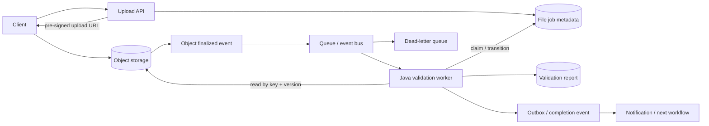

# Implementing the File Validation Worker and Processing State Updates

## 1. Worker Goals

In a serverless file processing system, an API typically accepts upload requests, object storage holds file contents, an event bus/queue notifies of new files, and a worker runs validation before data moves to the next step. The worker can be a Java function triggered by a message or object event. The worker only runs while work exists; the platform manages instance provisioning and scaling.

This lesson builds a worker responsible for:

1. Receiving an event containing the job identifier and file reference.
2. Reading job state from the metadata store and atomically claiming processing ownership.
3. Validating the file against metadata, checksum, size, format, and business rules.
4. Writing a validation report and transitioning state to `VALIDATED` or `REJECTED`.
5. Boundedly retrying infrastructure errors; routing unrecoverable work to a DLQ or manual handling flow.
6. Ensuring duplicate events, concurrent workers, or function timeouts never cause incorrect state updates.

The running example is a service accepting CSV/JSON order files. The API creates a `file_job`, returns `202 Accepted`, and issues a time-limited upload URL. Once upload finishes, the system emits an event. The worker validates the file, stores a validation report, and updates state so clients can query it.

The worker should never receive the full file bytes in the message. The message carries only `job_id`, `tenant_id`, object key/version, and correlation ID; large payloads are streamed directly from object storage. This reduces message size, avoids payload limits, and decouples file lifecycle from invocation lifecycle.

## 2. Overall Architecture



Each component has a distinct responsibility:

| Component | Responsibility |
| --- | --- |
| Upload API | Authenticates callers, checks quotas, creates jobs, and grants scoped upload access |
| Object storage | Stores file bytes; provides version/checksum or metadata for verification |
| Event bus/queue | Buffers bursts, decouples producer/consumer, redelivers on worker failure |
| Java worker | Claims jobs, inspects content, writes reports, and transitions state |
| Metadata store | Persists durable state, lease, attempts, owner, and output references |
| Quarantine | Retains files or records failing validation per retention policy |
| DLQ | Holds messages exceeding retry policy for investigation and controlled replay |
| Outbox/notification | Emits results after business state has been committed |

Typical flow:

1. Client calls the API to create an upload job; the API creates the job in `UPLOAD_PENDING` state.
2. The API returns `job_id` and an expiring upload URL with an object key scoped to the tenant.
3. Client uploads the file. Storage emits a completion event or the producer sends a manifest.
4. The ingestion adapter verifies the object reference and puts a small message onto the queue.
5. The worker claims the job in the metadata store.
6. The worker reads the object by version, validates contents, and produces a report.
7. The worker commits the final state via a conditional update.
8. A completion event is written via outbox and published after commit.
9. Client queries `GET /file-jobs/{jobId}` to inspect state and results.

Event notifications can duplicate or arrive late. Therefore, the state in the metadata store is the source of truth; events are merely signals to wake the worker.

## 3. Event Contract and Job Data

### 3.1. Reference-Only Messages

Example queue payload:

```json
{
  "eventId": "evt_01JCV9QX7A",
  "eventType": "file.upload.completed",
  "schemaVersion": 1,
  "jobId": "job_01JCV9P2K3",
  "tenantId": "tenant-42",
  "object": {
    "bucket": "incoming-files",
    "key": "tenant-42/job_01JCV9P2K3/source.csv",
    "versionId": "v-00017",
    "sizeBytes": 48291,
    "checksumAlgorithm": "SHA256",
    "checksum": "<hex-sha256>"
  },
  "correlationId": "req_01JCV9P1AB",
  "occurredAt": "2026-11-17T08:30:00Z"
}
```

`eventId` identifies a specific event emission; `jobId` identifies the business job. These two values serve different purposes. Multiple events may exist for the same job due to redelivery or multiple signal sources. Worker idempotency must rest on the job and object version, not solely on event ID.

Never trust `tenantId`, bucket, or object key from a message without checking it against the stored job. The worker must load the job by `jobId`, verify the tenant, and compare the object reference against metadata recorded by the API. This prevents a spoofed message from tricking the worker into reading another tenant's file.

### 3.2. The File Job Record

A metadata table may include these fields:

| Field | Meaning |
| --- | --- |
| `job_id` | Unique business key |
| `tenant_id` | Job owner |
| `status` | Current state |
| `object_bucket`, `object_key` | File location assigned to the job |
| `object_version` | Immutable object version if storage supports it |
| `expected_size_bytes` | Expected size from upload completion/manifest |
| `expected_checksum` | Checksum provided by producer or storage |
| `detected_content_type` | Observed content type; not sole proof |
| `schema_version` | Schema version the worker should apply |
| `attempt_count` | Number of claims/attempts performed |
| `owner_token` | Token of the invocation holding the lease |
| `generation` | Fencing/version incremented on every takeover |
| `lease_until` | Timestamp when the claim expires |
| `retry_after` | Earliest eligible retry timestamp |
| `validation_report_key` | Reference to stored report |
| `error_code` | Stable error code for client/ops handling |
| `created_at`, `updated_at` | Storage/DB-managed timestamps |
| `expires_at` | Metadata retention expiration |

Do not store file bytes in the metadata row. Store object reference, checksum, size, state, and report reference; the file lives in object storage.

### 3.3. Reference SQL Schema

```sql
CREATE TABLE file_job (
    job_id                 VARCHAR(80) PRIMARY KEY,
    tenant_id              VARCHAR(100) NOT NULL,
    status                 VARCHAR(32) NOT NULL,
    object_bucket          VARCHAR(200) NOT NULL,
    object_key             VARCHAR(1024) NOT NULL,
    object_version         VARCHAR(300),
    expected_size_bytes    BIGINT NOT NULL,
    expected_checksum      VARCHAR(128),
    checksum_algorithm     VARCHAR(16),
    schema_version         INTEGER NOT NULL,
    validator_version      VARCHAR(80),
    attempt_count          INTEGER NOT NULL DEFAULT 0,
    owner_token            UUID,
    generation             BIGINT NOT NULL DEFAULT 0,
    lease_until            TIMESTAMPTZ,
    retry_after            TIMESTAMPTZ,
    validation_report_key  VARCHAR(1024),
    output_reference       VARCHAR(1024),
    reconciliation_reference VARCHAR(1024),
    error_code             VARCHAR(100),
    error_detail_safe      VARCHAR(500),
    created_at             TIMESTAMPTZ NOT NULL DEFAULT now(),
    updated_at             TIMESTAMPTZ NOT NULL DEFAULT now(),
    expires_at             TIMESTAMPTZ NOT NULL,
    CHECK (status IN (
        'UPLOAD_PENDING', 'RECEIVED', 'VALIDATING', 'VALIDATED',
        'REJECTED', 'FAILED_RETRYABLE', 'FAILED_FINAL',
        'RECONCILIATION_REQUIRED'
    )),
    CHECK (expected_size_bytes >= 0),
    CHECK (attempt_count >= 0),
    CHECK (generation >= 0)
);

CREATE INDEX file_job_status_retry_idx
    ON file_job(status, retry_after);
```

If multiple file types are supported, you can add `file_type` or store a schema contract reference. Never use a client-supplied filename as a primary key or output path without sanitization and control.

## 4. State Machine for File Processing

### 4.1. States

| State | Meaning | Common Transitions |
| --- | --- | --- |
| `UPLOAD_PENDING` | Job created but upload completion not yet confirmed | `RECEIVED` when object finalizes validly |
| `RECEIVED` | Object reference exists and awaits a worker | `VALIDATING` on successful claim |
| `VALIDATING` | A worker holds the lease and is validating | `VALIDATED`, `REJECTED`, `FAILED_RETRYABLE`, or `RECONCILIATION_REQUIRED` |
| `VALIDATED` | File passed all critical checks | Terminal success state |
| `REJECTED` | Content violates contract/rules unrecoverable by retry | Terminal rejection state |
| `FAILED_RETRYABLE` | Transient infrastructure error; eligible for retry after backoff | `VALIDATING` on valid re-claim |
| `FAILED_FINAL` | Retries exhausted or unrecoverable operational error | Requires controlled intervention/replay |
| `RECONCILIATION_REQUIRED` | Commit outcome ambiguous at a dependency or metadata store | Reconcile before proceeding |

`REJECTED` and `FAILED_FINAL` differ: `REJECTED` describes a file failing data rules; `FAILED_FINAL` describes a job failing to complete due to operational errors after retries or policy. Clients can fix the file and create a new job; never silently swap bytes in a rejected job.

### 4.2. State Diagram

```mermaid
stateDiagram-v2
    [*] --> UPLOAD_PENDING
    UPLOAD_PENDING --> RECEIVED: upload finalized
    RECEIVED --> VALIDATING: atomic claim
    FAILED_RETRYABLE --> VALIDATING: retry is eligible
    VALIDATING --> VALIDATED: all critical checks pass
    VALIDATING --> REJECTED: permanent content error
    VALIDATING --> FAILED_RETRYABLE: transient infrastructure error
    VALIDATING --> RECONCILIATION_REQUIRED: outcome is ambiguous
    VALIDATING --> VALIDATING: lease takeover with new generation
    RECONCILIATION_REQUIRED --> VALIDATED: commit confirmed
    RECONCILIATION_REQUIRED --> FAILED_RETRYABLE: no side effect; retry allowed
    FAILED_RETRYABLE --> FAILED_FINAL: retry budget exhausted
    VALIDATED --> [*]
    REJECTED --> [*]
    FAILED_FINAL --> [*]
```



Only valid transitions may be recorded. For example, a `VALIDATED` job must never revert to `VALIDATING` due to a duplicate upload event. To revalidate the same object under a new schema/validator version, create a new processing run with its own identity or a new job per contract.

### 4.3. State Rules

- Only one worker owns a valid lease for a job/generation at any instant.
- Terminal state must be durably persisted before the queue message is acknowledged.
- Never turn permanent data errors into infinite retries.
- Never turn ambiguous timeouts into `FAILED_RETRYABLE` if a side effect might have committed.
- Every worker update must verify `owner_token` and `generation`.
- The Status API must only return committed state; never infer state from logs or received events.

## 5. Reliable Job Creation and Event Emission

### 5.1. Avoiding Dual-Write Between Database and Queue

When the ingestion adapter transitions a job to `RECEIVED`, if the database write succeeds but publishing the message fails, the worker may never wake up. Conversely, if publishing succeeds and the DB transaction rolls back, the worker receives a message for an unconfirmed job.

A transactional outbox solves this:

1. Within a single DB transaction, insert `file_job` and insert `outbox_event`.
2. The outbox publisher reads unsent events and publishes them to the queue.
3. After broker acknowledgement, mark the outbox event as published.
4. If the publisher crashes after publishing but before marking, the event may be republished; workers must be idempotent.

```sql
CREATE TABLE outbox_event (
    event_id       VARCHAR(128) PRIMARY KEY,
    aggregate_id   VARCHAR(80) NOT NULL,
    event_type     VARCHAR(120) NOT NULL,
    payload        JSONB NOT NULL,
    created_at     TIMESTAMPTZ NOT NULL DEFAULT now(),
    published_at   TIMESTAMPTZ
);
```

Object storage events can serve directly as triggers, but when the system must verify ownership, object version, and job metadata before processing, an adapter should verify the event and write a normalized outbox/queue message.

### 5.2. Transitioning `UPLOAD_PENDING` to `RECEIVED`

Upon receiving an object-finalized event, the adapter must:

1. Look up the job by `job_id` in metadata, rather than inferring tenant from prefix alone.
2. Verify the object bucket/key belong to that job.
3. Record actual object version, size, and checksum.
4. Compare size against upload limits and tenant quota.
5. Perform a conditional update from `UPLOAD_PENDING` to `RECEIVED`.
6. Write the `file.validation.requested` outbox event in the same transaction.

If the event duplicates, the conditional update leaves a job already in `RECEIVED` or a later state untouched. The adapter can return success after confirming the job was received; never create a second job.

Example updating metadata and creating the validation message in the same transaction:

```sql
WITH received AS (
    UPDATE file_job
    SET status = 'RECEIVED',
        object_version = :object_version,
        expected_size_bytes = :actual_size_bytes,
        expected_checksum = :actual_checksum,
        checksum_algorithm = :checksum_algorithm,
        updated_at = clock_timestamp()
    WHERE job_id = :job_id
      AND tenant_id = :tenant_id
      AND object_bucket = :bucket
      AND object_key = :object_key
      AND expected_size_bytes = :actual_size_bytes
      AND status = 'UPLOAD_PENDING'
      AND expires_at > clock_timestamp()
    RETURNING job_id, tenant_id, object_bucket, object_key, object_version,
              expected_size_bytes, expected_checksum, checksum_algorithm
)
INSERT INTO outbox_event(event_id, aggregate_id, event_type, payload)
SELECT :stable_event_id,
       job_id,
       'file.validation.requested',
       jsonb_build_object(
           'jobId', job_id,
           'tenantId', tenant_id,
           'bucket', object_bucket,
           'key', object_key,
           'versionId', object_version,
           'sizeBytes', expected_size_bytes,
           'checksum', expected_checksum,
           'checksumAlgorithm', checksum_algorithm
       )
FROM received
RETURNING event_id;
```

`stable_event_id` can be `file-validation-requested:` plus the SHA-256 of `job_id|object_version`; this keeps the ID fixed-length even when version IDs are long. If the statement returns no rows, the adapter re-reads the job: if the same object version was already received, treat the event as a duplicate; if the reference differs or the job expired, record a security/operational audit and handle per policy. Never publish a queue message before the metadata/outbox transaction commits.

The adapter maps `sizeBytes` to `ObjectReference.expectedSizeBytes` and populates `versionId`, `checksum`, and `checksumAlgorithm` into the matching Java record fields. Message fields must match the stored `FileJob`; the worker does not treat the payload as the source of truth.

## 6. Atomic Job Claiming

### 6.1. Why Not Check-Then-Act?

The following code is unsafe:

```java
if (repository.find(jobId).status() == Status.RECEIVED) {
    repository.updateStatus(jobId, Status.VALIDATING);
    validator.validate(file);
}
```

Two invocations can both read `RECEIVED` before either writes `VALIDATING`. Both will then validate and both will write reports. Reading state and then writing state are two separate operations and do not establish exclusive ownership.

Claiming must be an atomic operation in a database or metadata store supporting conditional writes. Common mechanisms are compare-and-set, transaction conditions, or unique claim records.

### 6.2. Conditional Claim in PostgreSQL

```sql
UPDATE file_job
SET status = 'VALIDATING',
    owner_token = :owner_token,
    generation = generation + 1,
    lease_until = clock_timestamp() + make_interval(secs => :lease_seconds),
    retry_after = NULL,
    attempt_count = attempt_count + 1,
    updated_at = clock_timestamp()
WHERE job_id = :job_id
  AND expires_at > clock_timestamp()
  AND (
      status = 'RECEIVED'
      OR (
          status = 'FAILED_RETRYABLE'
          AND (retry_after IS NULL OR retry_after <= clock_timestamp())
      )
      OR (
          status = 'VALIDATING'
          AND lease_until < clock_timestamp()
      )
  )
RETURNING job_id, owner_token, generation, lease_until, attempt_count;
```

If one row is returned, the worker successfully claimed the job. If zero rows are returned, the worker must read the current state using an appropriate read and classify it as `ALREADY_TERMINAL`, `BUSY`, `NOT_READY`, `NOT_FOUND`, or `EXPIRED`. Never synthesize leases in application memory.

`clock_timestamp()` evaluates leases using the database clock. Never compare leases using function instance clocks because clocks can skew across instances. With other databases, use conditional updates/transactions and a storage-managed time source.

### 6.3. Leases and Fencing Tokens

Leases allow another worker to take over if the prior invocation crashed. `owner_token` identifies the current invocation; `generation` increments on every claim/takeover. Every state update statement requires the condition:

```sql
WHERE job_id = :job_id
  AND status = 'VALIDATING'
  AND owner_token = :owner_token
  AND generation = :generation
```

If an old worker wakes up after its lease was taken over, its generation is stale; the update affects 0 rows. This is fencing to stop stale workers from overwriting the new owner's state.

Leases do not automatically cancel an old worker's side effects. If a worker can write objects or call downstream services, stage outputs under `job_id/generation`, use downstream idempotency keys, and publish outputs only via a commit record protected by a conditional update. Fencing works only when target systems accept and check fencing tokens.

### 6.4. Lease Renewal

For large files, a worker may need more than the initial lease. Renew periodically using a conditional update:

```sql
UPDATE file_job
SET lease_until = clock_timestamp() + make_interval(secs => :lease_seconds),
    updated_at = clock_timestamp()
WHERE job_id = :job_id
  AND status = 'VALIDATING'
  AND owner_token = :owner_token
  AND generation = :generation
  AND lease_until > clock_timestamp();
```

If the update affects 0 rows, the worker has lost ownership or the lease expired. The worker must stop before publishing results. Choose a lease longer than the expected heartbeat interval with headroom for network pauses; never set leases so short that healthy workers constantly suffer takeovers.

## 7. File Validation Pipeline

### 7.1. Layered Checks

| Layer | Check | Example Failure |
| --- | --- | --- |
| Reference | Job, tenant, object key/version match metadata | Message points to another tenant's object |
| Existence | Object exists and matches version | Object deleted or version missing |
| Size | Size within limits and matches metadata | Empty file, oversized, size changed |
| Integrity | Recomputed checksum matches expected checksum | Corrupted upload or altered object |
| Type | Magic bytes and parser recognize valid format | `.csv` extension masking executable bytes |
| Syntax | File parses according to format | Broken CSV quotes, malformed JSON, bad encoding |
| Schema | Fields, types, required fields, and version valid | Missing `order_id`, wrong field type |
| Business rules | Ranges, uniqueness, cross-field rules | Negative amount, unsupported currency |
| Security | Archive/path/resource limits, malware scan if required | Zip bomb, path traversal, malware |

Never rely on file extensions or client-sent `Content-Type`. That metadata can be spoofed. Check signatures/magic bytes, parsers, and schemas against an allowlist.

### 7.2. Verifying Object Metadata

Before reading contents, the worker verifies:

- `bucket/container` and `object_key` match the stored job.
- `versionId` is used if object storage supports versioning.
- `sizeBytes` does not exceed global limits or tenant quota.
- Checksum algorithm is on the supported list.
- Job has not exceeded retention and is not in a terminal state.

ETags are not always byte MD5s; multipart uploads, encryption, and provider semantics can make ETags differ from content checksums. For integrity, use a recomputed SHA-256 checksum or a storage-provided checksum with clear semantics.

### 7.3. Streaming Reads and Resource Limits

Do not load large files completely into the heap. Use a streaming parser, cap bytes read, cap elapsed time, and cap record count. For archives, bound entry count, depth, total uncompressed bytes, and compression ratio. Never extract into client-controlled paths.

Java example illustrating streaming checksum verification:

```java
import java.io.IOException;
import java.io.InputStream;
import java.security.DigestInputStream;
import java.security.MessageDigest;
import java.security.NoSuchAlgorithmException;
import java.util.HexFormat;

public final class ChecksumVerifier {
    public void verifySha256(
            InputStream input,
            long maxBytes,
            String expectedHex) throws IOException, NoSuchAlgorithmException {
        MessageDigest digest = MessageDigest.getInstance("SHA-256");
        byte[] buffer = new byte[16 * 1024];
        long total = 0;

        try (DigestInputStream stream = new DigestInputStream(input, digest)) {
            int read;
            while ((read = stream.read(buffer)) != -1) {
                total += read;
                if (total > maxBytes) {
                    throw new FileTooLargeException(maxBytes);
                }
            }
        }
        byte[] expected = HexFormat.of().parseHex(expectedHex);
        if (!MessageDigest.isEqual(expected, digest.digest())) {
            throw new ChecksumMismatchException();
        }
    }
}
```

The method owns and closes the passed `InputStream`. Production code must validate the hex checksum before calling, pass `maxBytes` from validated policy, and can combine `DigestInputStream` with a parser to avoid reading the file twice. If the parser stops early, drain the rest of the stream within bounds so the checksum covers the entire object.

### 7.4. Never Trust Uploaded Content

User-submitted files are untrusted input. Safeguards to consider:

- Allow only required formats, e.g. CSV/JSON/PDF; reject executables and serialized Java objects.
- Use parsers with limits on depth, tokens, record length, and nesting.
- For XML, disable external entities/DTDs to prevent XXE.
- For ZIP, block zip slip, zip bombs, absolute entry paths, and `../`.
- Never execute macros, scripts, or embedded content.
- Scan for malware using a dedicated service when the threat model requires it; scanner timeout is a dependency error, not proof of a clean file.
- Isolate the worker and disallow arbitrary egress if unneeded.
- Never log raw payloads, access tokens, or PII.

## 8. Java Worker: Separating Domain Logic from Cloud Adapters

Java examples target Java 17+ (records, `HexFormat`, and switch expressions). Supporting interfaces are omitted to focus on the processing flow; implement them with SDKs/parsers fitting your cloud provider and file formats.

### 8.1. Domain Types

```java
import java.time.Instant;
import java.util.UUID;

public record FileEvent(
        String eventId,
        String jobId,
        String tenantId,
        ObjectReference object,
        String correlationId) {
}

public record ObjectReference(
        String bucket,
        String key,
        String versionId,
        long expectedSizeBytes,
        String checksumAlgorithm,
        String expectedChecksum) {
}

public record FileJob(
        String jobId,
        String tenantId,
        FileStatus status,
        ObjectReference object,
        int schemaVersion,
        int attemptCount,
        Instant retryAfter) {
}

public enum FileStatus {
    UPLOAD_PENDING,
    RECEIVED,
    VALIDATING,
    VALIDATED,
    REJECTED,
    FAILED_RETRYABLE,
    FAILED_FINAL,
    RECONCILIATION_REQUIRED
}

public record Claim(
        String jobId,
        UUID ownerToken,
        long generation,
        Instant leaseUntil,
        int attemptCount) {
}
```

`ObjectReference` inside an event is only a hint. The worker uses the object reference stored in `FileJob` after reconciling the event with the job. Never use bucket/key directly from a message to access storage.

### 8.2. Repository Contract

```java
import java.time.Duration;
import java.time.Instant;
import java.util.Optional;
import java.util.UUID;

public interface FileJobRepository {
    Optional<FileJob> find(String jobId);

    ClaimResult tryClaim(String jobId, UUID ownerToken, Duration lease);

    boolean renewLease(Claim claim, Duration lease);

    boolean completeValidatedAndAppendOutbox(
            Claim claim,
            String reportKey,
            String outputReference,
            String validatorVersion,
            String completionEventId);

    boolean markRejectedAndAppendOutbox(
            Claim claim,
            String errorCode,
            String safeDetail,
            String reportKey,
            String completionEventId);

    boolean markRetryable(
            Claim claim,
            Duration retryDelay,
            String errorCode);

    boolean markFailedFinal(Claim claim, String errorCode, String safeDetail);

    boolean markReconciliationRequired(
            Claim claim,
            String reconciliationReference);
}

public record ClaimResult(
        Claim claim,
        ClaimDisposition disposition,
        Instant nextEligibleAt) {
}

public enum ClaimDisposition {
    CLAIMED,
    ALREADY_TERMINAL,
    BUSY,
    NOT_READY,
    RECONCILIATION_REQUIRED,
    NOT_FOUND,
    EXPIRED
}
```

Update methods must verify `status`, `owner_token`, and `generation` in the same statement/transaction. Returning `boolean=false` means the worker no longer owns the update; never ignore it and report success.

### 8.3. Validator Contract

```java
import java.util.List;

public interface FileValidator {
    String version();

    ValidationReport validate(
            FileJob job,
            ObjectMetadata metadata,
            InputStreamProvider content);
}

@FunctionalInterface
public interface InputStreamProvider {
    java.io.InputStream open() throws java.io.IOException;
}

public record ValidationIssue(
        String code,
        String field,
        String message,
        Severity severity) {
}

public enum Severity {
    ERROR,
    WARNING
}

public record ValidationReport(
        boolean accepted,
        long bytesRead,
        long recordsRead,
        String checksum,
        List<ValidationIssue> issues) {
}
```

`ValidationReport` should be durably saved under a deterministic key scoped by job and validator version. Never include exception stack traces or raw rows in public reports; client-facing reports must contain only sanitized error codes/messages.

```java
public interface ValidationReportStore {
    String putForGeneration(
            String jobId,
            long generation,
            String validatorVersion,
            ValidationReport report);
}
```

### 8.3.1. Example Order CSV Validation Rules

Separate the parser from business rules so you can swap CSV libraries without changing the worker. `CsvReader` below is a thin adapter around Apache Commons CSV or a tested parser; the parser must limit record length and handle encoding per contract.

```java
import java.math.BigDecimal;
import java.nio.charset.StandardCharsets;
import java.util.ArrayList;
import java.util.List;
import java.util.Set;

public final class OrderCsvValidator {
    private static final Set<String> REQUIRED =
            Set.of("order_id", "customer_id", "amount", "currency");
    private static final Set<String> CURRENCIES = Set.of("VND", "USD", "EUR");

    private final CsvReaderFactory readers;

    public OrderCsvValidator(CsvReaderFactory readers) {
        this.readers = readers;
    }

    public List<ValidationIssue> validate(InputStreamProvider source) throws Exception {
        var issues = new ArrayList<ValidationIssue>();
        try (CsvReader csv = readers.open(source.open(), StandardCharsets.UTF_8)) {
            Set<String> headers = csv.headers();
            for (String required : REQUIRED) {
                if (!headers.contains(required)) {
                    issues.add(new ValidationIssue(
                            "REQUIRED_COLUMN_MISSING", required,
                            "Required column is missing", Severity.ERROR));
                }
            }
            if (!issues.isEmpty()) {
                return List.copyOf(issues);
            }

            while (csv.hasNext()) {
                CsvRow row = csv.next();
                if (row.value("order_id").isBlank()) {
                    issues.add(issue("ORDER_ID_REQUIRED", "order_id"));
                }
                if (row.value("customer_id").isBlank()) {
                    issues.add(issue("CUSTOMER_ID_REQUIRED", "customer_id"));
                }
                try {
                    if (new BigDecimal(row.value("amount")).signum() < 0) {
                        issues.add(issue("AMOUNT_NEGATIVE", "amount"));
                    }
                } catch (NumberFormatException ex) {
                    issues.add(issue("AMOUNT_INVALID", "amount"));
                }
                if (!CURRENCIES.contains(row.value("currency"))) {
                    issues.add(issue("CURRENCY_UNSUPPORTED", "currency"));
                }
                if (issues.size() >= 100) {
                    issues.add(new ValidationIssue(
                            "ISSUE_LIMIT_REACHED", "", "Further issues were omitted",
                            Severity.WARNING));
                    break;
                }
            }
        }
        return List.copyOf(issues);
    }

    private static ValidationIssue issue(String code, String field) {
        return new ValidationIssue(code, field, "Value did not pass validation", Severity.ERROR);
    }
}
```

`CsvReaderFactory`, `CsvReader`, and `CsvRow` are adapter interfaces; `CsvRow.value()` must return an empty string rather than `null` for missing fields. The parser must detect duplicate headers before converting headers to a `Set`. The code illustrates rules; production requires batch-level uniqueness checks, control totals, row/field count limits, whole-file checksums, and separating parse errors (permanent) from I/O errors (transient). Do not store one issue per row if a file has millions of errors; cap the report and store bounded counters/samples.

### 8.4. Worker Orchestration

```java
import java.time.Duration;
import java.util.UUID;

public final class FileValidationWorker {
    private static final Duration LEASE = Duration.ofSeconds(90);
    private static final int MAX_ATTEMPTS = 6;

    private final FileJobRepository jobs;
    private final ObjectStore objects;
    private final FileValidator validator;
    private final ValidationReportStore reports;

    public FileValidationWorker(
            FileJobRepository jobs,
            ObjectStore objects,
            FileValidator validator,
            ValidationReportStore reports) {
        this.jobs = jobs;
        this.objects = objects;
        this.validator = validator;
        this.reports = reports;
    }

    public WorkerOutcome handle(FileEvent event) {
        FileJob observed = jobs.find(event.jobId())
                .orElseThrow(() -> new UnknownJobException(event.jobId()));
        if (!observed.tenantId().equals(event.tenantId())
                || !observed.object().equals(event.object())) {
            // Do not poison a legitimate job because an untrusted event has a bad reference.
            return WorkerOutcome.deadLetter("EVENT_REFERENCE_MISMATCH");
        }

        UUID ownerToken = UUID.randomUUID();
        ClaimResult result = jobs.tryClaim(event.jobId(), ownerToken, LEASE);

        switch (result.disposition()) {
            case ALREADY_TERMINAL -> return WorkerOutcome.acknowledged();
            case NOT_FOUND -> throw new UnknownJobException(event.jobId());
            case EXPIRED -> return WorkerOutcome.discardWithAudit("JOB_EXPIRED");
            case BUSY, NOT_READY ->
                    return WorkerOutcome.deferUntil(result.nextEligibleAt());
            case RECONCILIATION_REQUIRED -> return WorkerOutcome.routeToReconciliation();
            case CLAIMED -> { }
        }

        Claim claim = result.claim();
        FileJob job = jobs.find(event.jobId())
                .orElseThrow(() -> new UnknownJobException(event.jobId()));

        if (!job.tenantId().equals(event.tenantId()) || !job.object().equals(event.object())) {
            return WorkerOutcome.lostClaim();
        }
        if (claim.attemptCount() > MAX_ATTEMPTS) {
            boolean updated = jobs.markFailedFinal(
                    claim, "RETRY_BUDGET_EXHAUSTED", "Maximum validation attempts exceeded");
            return updated ? WorkerOutcome.acknowledged() : WorkerOutcome.lostClaim();
        }

        try {
            ObjectMetadata metadata = objects.head(job.object());
            verifyObjectReference(job, metadata);

            ValidationReport report = validator.validate(
                    job, metadata, () -> objects.open(job.object()));
            String reportKey = reports.putForGeneration(
                    job.jobId(), claim.generation(), validator.version(), report);

            if (!report.accepted()) {
                boolean updated = jobs.markRejectedAndAppendOutbox(
                        claim,
                        "FILE_VALIDATION_FAILED",
                        "File did not pass validation",
                        reportKey,
                        "file-rejected:" + job.jobId());
                return updated
                        ? WorkerOutcome.acknowledged()
                        : WorkerOutcome.lostClaim();
            }

            String completionEventId = "file-validated:" + job.jobId();
            boolean updated = jobs.completeValidatedAndAppendOutbox(
                    claim, reportKey, metadata.canonicalReference(),
                    validator.version(), completionEventId);
            if (!updated) {
                return WorkerOutcome.lostClaim();
            }
            return WorkerOutcome.acknowledged();

        } catch (PermanentFileException ex) {
            return reject(claim, ex.code(), ex.safeMessage());
        } catch (TransientDependencyException ex) {
            boolean updated = jobs.markRetryable(claim, ex.retryDelay(), ex.code());
            return updated
                    ? WorkerOutcome.retry()
                    : WorkerOutcome.lostClaim();
        } catch (AmbiguousOutcomeException ex) {
            boolean updated = jobs.markReconciliationRequired(claim, ex.reference());
            return updated
                    ? WorkerOutcome.deferUntil(ex.recheckAt())
                    : WorkerOutcome.lostClaim();
        }
    }

    private WorkerOutcome reject(Claim claim, String code, String safeDetail) {
        boolean updated = jobs.markRejectedAndAppendOutbox(
                claim, code, safeDetail, null, "file-rejected:" + claim.jobId());
        return updated
                ? WorkerOutcome.acknowledged()
                : WorkerOutcome.lostClaim();
    }

    private void verifyObjectReference(FileJob job, ObjectMetadata metadata) {
        ObjectReference expected = job.object();
        if (!expected.bucket().equals(metadata.bucket())
                || !expected.key().equals(metadata.key())) {
            throw new PermanentFileException("OBJECT_REFERENCE_MISMATCH");
        }
        if (expected.versionId() != null
                && !expected.versionId().equals(metadata.versionId())) {
            throw new PermanentFileException("OBJECT_VERSION_MISMATCH");
        }
        if (metadata.sizeBytes() > FileLimits.MAX_BYTES) {
            throw new PermanentFileException("FILE_TOO_LARGE");
        }
        if (expected.expectedSizeBytes() != metadata.sizeBytes()) {
            throw new PermanentFileException("FILE_SIZE_MISMATCH");
        }
    }
}
```

This is an orchestration skeleton; supporting interfaces and queue-specific mappings are omitted. Points to complete in production:

- `PermanentFileException`, `TransientDependencyException`, `AmbiguousOutcomeException`, `UnknownJobException`, and `LostClaimException` are application-specific exceptions; the example assumes they are unchecked exceptions. Adapters wrap checked exceptions from SDKs/parsers into the right error category before returning to the domain worker.
- `find` must read from a primary/strongly consistent store; object references are treated as immutable after the job transitions to `RECEIVED`.
- `completeValidatedAndAppendOutbox` executes the conditional job update and outbox insertion within the same transaction. If the update affects 0 rows, roll back and return `false`.
- `markRejectedAndAppendOutbox` applies the same principle for `REJECTED` state so clients/consumers receive the rejection outcome only after state commits.
- If the transaction commits successfully but the response times out, redelivery reads the terminal job and acks; do not run side effects again.
- `BUSY`/`NOT_READY` must be mapped by the adapter to defer/visibility timeout/retry per broker. Never acknowledge a single message unless a reliable lease sweeper/redrive mechanism exists.
- `RECONCILIATION_REQUIRED` is handed to a reconciliation worker/sweeper and must not be re-claimed as a normal validation attempt.
- If a worker loses its claim, stop publishing and never overwrite the newer generation's state.

`WorkerOutcome` is an internal result telling the adapter how to settle: `acknowledged` acks only after commit; `retry` asks the broker to redeliver; `deferUntil` extends visibility/lock or reschedules; `deadLetter` moves contract-violating messages to a DLQ/security queue; `discardWithAudit` logs an audit entry and acks expired events; `lostClaim` re-reads the job and acks if terminal, otherwise defers. Adapters must never unconditionally turn `lostClaim` into success.

For long-running files, call `jobs.renewLease(claim, LEASE)` between chunks or on streaming parser callbacks. If it returns `false`, throw `LostClaimException` and stop processing/publishing. Never let a heartbeat thread keep renewing after the invocation ends.

### 8.5. Completing State and Outbox in the Same Transaction

The repository method used by the worker is a single transaction:

```java
boolean completeValidatedAndAppendOutbox(
        Claim claim,
        String reportKey,
        String outputReference,
        String validatorVersion,
        String completionEventId);
```

This method performs within the same transaction:

1. Conditionally update the job from `VALIDATING` to `VALIDATED` with matching owner/generation.
2. If the update affects 0 rows, roll back and return `false`.
3. Insert the outbox event with a unique `completionEventId`.
4. Commit the transaction.

A PostgreSQL implementation can use a CTE to insert into the outbox only when the conditional update succeeds:

```sql
WITH completed AS (
    UPDATE file_job
    SET status = 'VALIDATED',
        validation_report_key = :report_key,
        output_reference = :output_reference,
        validator_version = :validator_version,
        error_code = NULL,
        error_detail_safe = NULL,
        owner_token = NULL,
        lease_until = NULL,
        retry_after = NULL,
        updated_at = clock_timestamp()
    WHERE job_id = :job_id
      AND status = 'VALIDATING'
      AND owner_token = :owner_token
      AND generation = :generation
    RETURNING job_id, tenant_id, validation_report_key
)
INSERT INTO outbox_event(event_id, aggregate_id, event_type, payload)
SELECT :completion_event_id,
       job_id,
       'file.validation.completed',
       jsonb_build_object(
           'jobId', job_id,
           'tenantId', tenant_id,
           'reportKey', validation_report_key
       )
FROM completed
RETURNING event_id;
```

If the statement returns no rows, either the conditional update failed or the outbox row was not created; the repository returns `false`/transaction error so the caller re-reads state. Never split updating the job and inserting into the outbox into two separate transactions.

The outbox publisher may send the event multiple times if it crashes after publishing. Consumers receiving completion events still need idempotency by `job_id`/event ID.

`markRejectedAndAppendOutbox` uses the same conditional update/fencing and inserts the `file.validation.rejected` event. Never publish events from a `catch` block before the state transaction commits; if an operational notification is needed for `FAILED_FINAL`, write the operational event inside the transaction updating that state.

## 9. Error Handling and Retries

### 9.1. Error Classification

| Error Type | Examples | State/Action |
| --- | --- | --- |
| Permanent content error | Malformed CSV, unsupported schema, checksum mismatch | `REJECTED`, save report, and acknowledge |
| Transient dependency error | Object store timeout, database throttling, scanner outage | `FAILED_RETRYABLE`, backoff then retry |
| Capacity/lease busy | Another worker holds the lease | Defer message past lease or await lease recovery |
| Unknown job | Message references a non-existent job | Route to DLQ/investigate; do not auto-create job |
| Authorization/reference mismatch | Tenant or object does not match job | Reject and security audit |
| Ambiguous commit | Unclear whether state/report/outbox committed | `RECONCILIATION_REQUIRED` or read-after-timeout |
| Retry budget exhausted | Exceeded attempts or deadline | `FAILED_FINAL`, DLQ/manual replay |

Parser failures caused by invalid bytes are content errors. Parser failures caused by out-of-memory or dependency timeouts may be infrastructure errors. Maintain a clear exception taxonomy so transient errors are not mistakenly quarantined.

### 9.2. Exponential Backoff with Jitter

A reference policy:

\[
delay_n = random(0, \min(cap, base \times 2^n))
\]

For example `base=2s`, `cap=5m`, max 6 retries. Full jitter prevents many workers from retrying a dependency simultaneously. If a provider returns `Retry-After`, honor that value within policy limits.

Never retry continuously inside the same invocation using long loops. Serverless invocations have timeouts and cost; persist retry state and let the queue/scheduler trigger the next attempt.

### 9.3. Coordinating Database `retry_after` and the Broker

If the DB records `retry_after = 10:05`, but the queue redelivers at `10:01`, the worker must fail to claim and defer the message. If the broker lacks exact delay support, you can:

- Increase visibility timeout according to backoff.
- Use a delay queue or scheduler to re-emit jobs when due.
- Use an outbox/sweeper to periodically find due `FAILED_RETRYABLE` jobs and re-enqueue them.

The sweeper must use conditional claims/unique event keys to avoid generating multiple messages for the same job. Reconcile queue retry counts and `attempt_count` in the DB; the two numbers can diverge due to duplicate events or publish retries.

### 9.4. DLQ Is Not the Sole Business State Store

The DLQ holds messages for investigation. `FAILED_FINAL` state, `error_code`, `attempt_count`, and report references must live in the metadata store. When replaying a DLQ, operators verify the root cause, select a new policy/version if needed, and issue an audited replay command. Never automatically replay every DLQ message in a loop.

The broker's `maxReceiveCount` may be reached before `MAX_ATTEMPTS` in the database because duplicate events also increment receive counts. A DLQ consumer or sweeper should reconcile job state and transition the job to `FAILED_FINAL` per policy; a message landing in the DLQ does not automatically update the `file_job` row.

### 9.5. Acknowledge After Commit

For a queue consumer, acknowledge only when:

- The job is in a terminal state (`VALIDATED`/`REJECTED`/`FAILED_FINAL`) and required reports/outbox entries have committed; or
- A duplicate event has been confirmed against an already-terminal job; or
- Another durable mechanism is responsible for re-driving when the current message is acknowledged.

If the DB is unavailable, state cannot be persisted, and no durable retry record exists, the worker must fail the invocation so the broker redelivers. Never log an error and return success.

## 10. Safe State Updates

### 10.1. Fenced Completion

```sql
UPDATE file_job
SET status = 'VALIDATED',
    validation_report_key = :report_key,
    error_code = NULL,
    error_detail_safe = NULL,
    owner_token = NULL,
    lease_until = NULL,
    updated_at = clock_timestamp()
WHERE job_id = :job_id
  AND status = 'VALIDATING'
  AND owner_token = :owner_token
  AND generation = :generation;
```

If affected rows equals 0, the worker lost its lease, the job transitioned, or another invocation completed it. Re-read state and classify; stop writing.

This statement illustrates a conditional update. Production must execute the `VALIDATED` update alongside the outbox insert in one transaction as shown in Section 8.5; never run this statement alone and then publish an event from application code.

### 10.2. Marking Rejected

```sql
UPDATE file_job
SET status = 'REJECTED',
    error_code = :error_code,
    error_detail_safe = :safe_detail,
    validation_report_key = :report_key,
    owner_token = NULL,
    lease_until = NULL,
    updated_at = clock_timestamp()
WHERE job_id = :job_id
  AND status = 'VALIDATING'
  AND owner_token = :owner_token
  AND generation = :generation;
```

Use `REJECTED` only for permanent/content errors per contract. Never put exception stack traces or PII into `error_detail_safe`.

The repository method used by the worker is `markRejectedAndAppendOutbox`; it performs this update and inserts the rejection event in the same transaction.

### 10.3. Marking Retryable

```sql
UPDATE file_job
SET status = 'FAILED_RETRYABLE',
    retry_after = clock_timestamp() + make_interval(secs => :retry_seconds),
    error_code = :error_code,
    owner_token = NULL,
    lease_until = NULL,
    updated_at = clock_timestamp()
WHERE job_id = :job_id
  AND status = 'VALIDATING'
  AND owner_token = :owner_token
  AND generation = :generation;
```

The repository takes `Duration retryDelay` and converts it to `retry_seconds` to bind into `make_interval`; the database computes `retry_after` using its own clock to avoid clock skew across function instances. Likewise, `Duration lease` converts to `lease_seconds` in claim/renew statements. Only mark retryable when you know which side effects occurred and retrying is safe. If a report/output was already written, retries must use deterministic keys and re-check before writing. If the commit outcome is unclear, read state/report/manifest first.

### 10.4. Marking Failed Final and Reconciliation

When the attempt budget is exhausted, transition state via a conditional update:

```sql
UPDATE file_job
SET status = 'FAILED_FINAL',
    error_code = :error_code,
    error_detail_safe = :safe_detail,
    owner_token = NULL,
    lease_until = NULL,
    retry_after = NULL,
    updated_at = clock_timestamp()
WHERE job_id = :job_id
  AND status = 'VALIDATING'
  AND owner_token = :owner_token
  AND generation = :generation;
```

If a dependency may have committed a side effect without the worker receiving the response, use `RECONCILIATION_REQUIRED` and store a reference for reconciliation:

```sql
UPDATE file_job
SET status = 'RECONCILIATION_REQUIRED',
    error_code = 'AMBIGUOUS_OUTCOME',
    error_detail_safe = 'A downstream result must be reconciled',
    reconciliation_reference = :reconciliation_reference,
    owner_token = NULL,
    lease_until = NULL,
    updated_at = clock_timestamp()
WHERE job_id = :job_id
  AND status = 'VALIDATING'
  AND owner_token = :owner_token
  AND generation = :generation;
```

A sweeper or reconciliation worker picks up these jobs, queries the dependency using the stored idempotency/reference, and resolves them to `VALIDATED`, `FAILED_RETRYABLE`, or `FAILED_FINAL`. Never blindly re-run side effects before determining the prior outcome.

### 10.5. Stale Workers and Output Staging

Workers should write reports/outputs to a namespaced key:

```text
validation/{job_id}/generation={generation}/report.json
```

After writing the report, the worker conditionally updates the job to point to that key. If an old worker loses its lease, the old generation's report is unreferenced by the job and can be cleaned up after retention. Never let downstream list prefixes and guess the latest report; downstream must trust only the reference committed in job metadata.

## 11. Status Query API

### 11.1. Creating an Upload Job

```http
POST /v1/file-jobs
Authorization: Bearer <access-token>
Idempotency-Key: 7d9c...
Content-Type: application/json

{
  "fileName": "orders-2026-11-17.csv",
  "contentLength": 48291,
  "contentType": "text/csv",
  "schemaVersion": 3
}
```

Response:

```http
HTTP/1.1 202 Accepted
Location: /v1/file-jobs/job_01JCV9P2K3
Content-Type: application/json

{
  "jobId": "job_01JCV9P2K3",
  "status": "UPLOAD_PENDING",
  "uploadUrl": "<short-lived-upload-url>",
  "uploadExpiresAt": "2026-11-17T09:00:00Z"
}
```

The API must bind the idempotency key to the request fingerprint. Same key/same payload returns the created job; same key/different payload returns a conflict. The upload URL grants write access only to the exact object key, exact method, exact content constraints if supported by the provider, and has a short lifetime.

### 11.2. Querying Status

```http
GET /v1/file-jobs/job_01JCV9P2K3
Authorization: Bearer <access-token>
```

Response while running:

```json
{
  "jobId": "job_01JCV9P2K3",
  "status": "VALIDATING",
  "createdAt": "2026-11-17T08:29:00Z",
  "updatedAt": "2026-11-17T08:30:12Z",
  "attemptCount": 1,
  "statusUrl": "/v1/file-jobs/job_01JCV9P2K3"
}
```

Response on completion:

```json
{
  "jobId": "job_01JCV9P2K3",
  "status": "VALIDATED",
  "validation": {
    "recordsRead": 1200,
    "recordsAccepted": 1200,
    "recordsRejected": 0,
    "warnings": 2
  },
  "completedAt": "2026-11-17T08:30:14Z"
}
```

A `REJECTED` response should show only safe error codes and remediation hints, never leaking internal buckets, paths, stack traces, parser internals, or another tenant's data. `GET` must verify tenant ownership on every request.

### 11.3. HTTP Status Semantics

| Scenario | Suggested HTTP Status |
| --- | --- |
| Job created and async processing initiated | `202 Accepted` |
| Job retrieved successfully | `200 OK` |
| Idempotency key reused with different payload | `409 Conflict` |
| Job does not belong to tenant or does not exist | `404 Not Found` per anti-enumeration policy |
| Invalid upload metadata | `400 Bad Request` or `422 Unprocessable Content` |
| Client exceeds quota/rate limit | `429 Too Many Requests` |

`202` does not mean the file is valid. It only confirms the job was accepted and can be polled via `Location`/status URL.

## 12. Security and Tenant Isolation

### 12.1. Object Access Control

- The API authenticates callers and checks permission to create jobs for the tenant.
- Upload URLs write only to the exact key and expire quickly.
- Workers use an execution role/service identity, never client-supplied credentials.
- Workers read only the required prefix/bucket and write reports only to permitted namespaces.
- Tenant ID is taken from the verified job, never trusted from message payloads.
- Object version and job metadata must match before reading.

### 12.2. Resource Limits

Enforce limits for:

- Max upload bytes by tenant and file type.
- Max records/row length/field count.
- Max JSON nesting/decompression size/archive entries.
- Max CPU time, memory, and invocation timeout.
- Max concurrent jobs per tenant and system-wide.
- Max retry attempts and DLQ retention.

Quotas prevent one tenant uploading massive files from exhausting compute or storage for other tenants. Separate queues by tier/tenant or admission control can protect critical workloads.

### 12.3. Do Not Turn the Worker into an SSRF Proxy

The worker should read objects using internally stored bucket/key values. Never accept an arbitrary URL in an event and issue HTTP calls to it; that can enable SSRF against metadata endpoints or private networks. If fetching from external URLs is required, use host allowlists, block private/link-local IPs, validate redirects, and bound bytes/time.

## 13. Observability

### 13.1. Structured Logs

Each log event should include:

```json
{
  "service": "file-validation-worker",
  "jobId": "job_01JCV9P2K3",
  "tenantIdHash": "<stable-non-reversible-reference>",
  "eventId": "evt_01JCV9QX7A",
  "correlationId": "req_01JCV9P1AB",
  "generation": 2,
  "attempt": 2,
  "status": "VALIDATING",
  "durationMs": 842,
  "bytesRead": 48291,
  "result": "SCHEMA_CHECK_PASSED"
}
```

Never log presigned URLs, access tokens, raw contents, emails, or PII. Tenant ID hashes are solely for grouping metrics/logs; ensure sensitive details cannot be inadvertently inferred.

### 13.2. Metrics to Track

| Metric | Meaning |
| --- | --- |
| `file_jobs_received_total` | Total jobs received |
| `file_jobs_validated_total` | Total jobs completed successfully |
| `file_jobs_rejected_total` | Total jobs rejected by content rules |
| `file_jobs_retry_total` | Total retry attempts |
| `file_jobs_dlq_total` | Total jobs/messages sent to DLQ |
| `file_validation_duration_seconds` | Validation duration |
| `file_validation_bytes_total` | Total bytes read |
| `file_queue_oldest_message_age_seconds` | Age of oldest message |
| `file_job_lease_takeover_total` | Lease takeover count |
| `file_job_lost_claim_total` | Workers fenced due to lost claim |
| `file_validation_failure_total{error_code}` | Failures by stable code |

Track both queue age and elapsed time from `RECEIVED` to terminal state. Low function duration combined with high queue age still means the file processing SLA is being breached.

### 13.3. Alerts and Runbooks

Alerts should trigger when:

- Queue oldest message age breaches SLA.
- `FAILED_RETRYABLE` or DLQ rate spikes.
- Lease takeovers/lost claims rise abnormally.
- Checksum/schema rejection rates shift sharply.
- Worker timeouts or dependency throttling cross thresholds.
- Jobs stay in `VALIDATING` too long relative to lease/heartbeat policy.

Runbooks should document how to inspect jobs, reports, object versions, attempt history, DLQ, dependency health, and replay steps. Never require operators to edit statuses directly in the database; provide audited admin commands/APIs with conditional transitions.

## 14. Testing the Worker

### 14.1. Unit Tests

- Valid files across each schema version.
- Missing required fields, wrong types, wrong encodings, and malformed CSV/JSON.
- Oversized files and checksum mismatches.
- Spoofed content types and mismatched magic bytes.
- Duplicate events for the same job.
- Tenant mismatches and object version mismatches.
- Permanent errors rejected; transient errors retried.
- Reports contain no raw PII or stack traces.

### 14.2. Concurrency and Failure Tests

| Scenario | Expectation |
| --- | --- |
| Two workers receive the same `job_id` simultaneously | Only one worker claims successfully |
| Worker A holds lease, Worker B receives duplicate | B defers; no concurrent validation |
| A crashes, lease expires, B takes over | B gets a new generation and proceeds |
| A wakes up after B takes over | A's updates affect 0 rows |
| Worker writes report then crashes before status update | Retry uses deterministic key; report is uncommitted until job references it |
| Status commits but queue ack fails | Redelivery reads terminal state and acks safely |
| DB unavailable | Worker does not ack success; broker retries |
| Outbox publishes then publisher crashes | Event may duplicate; consumer is idempotent |
| Job exhausts retry budget | Transitions to `FAILED_FINAL`, retains diagnostic context |

Example integration test for atomic claim (the repository must point to a real test database; do not mock `tryClaim`):

```java
import static org.junit.jupiter.api.Assertions.assertEquals;
import static org.junit.jupiter.api.Assertions.assertTrue;

import java.time.Duration;
import java.util.List;
import java.util.UUID;
import java.util.concurrent.CountDownLatch;
import java.util.concurrent.Executors;
import java.util.concurrent.TimeUnit;

@Test
void onlyOneWorkerCanClaimTheSameJob() throws Exception {
    String jobId = testFixture.createReceivedJob();
    var ready = new CountDownLatch(2);
    var start = new CountDownLatch(1);
    var pool = Executors.newFixedThreadPool(2);
    try {
        var tasks = List.of(
                pool.submit(() -> claimAfterBarrier(jobId, ready, start)),
                pool.submit(() -> claimAfterBarrier(jobId, ready, start)));

        assertTrue(ready.await(5, TimeUnit.SECONDS));
        start.countDown();
        var results = List.of(tasks.get(0).get(), tasks.get(1).get());

        assertEquals(1, results.stream()
                .filter(r -> r.disposition() == ClaimDisposition.CLAIMED).count());
        assertEquals(1, results.stream()
                .filter(r -> r.disposition() == ClaimDisposition.BUSY).count());
    } finally {
        pool.shutdownNow();
    }
}

private ClaimResult claimAfterBarrier(
        String jobId, CountDownLatch ready, CountDownLatch start) throws Exception {
    ready.countDown();
    start.await();
    return repository.tryClaim(jobId, UUID.randomUUID(), Duration.ofSeconds(30));
}
```

This test exercises two real competing transactions. Mocking the repository or calling sequentially fails to prove unique/conditional claiming works under concurrency.

### 14.3. Integration Tests

Test against database/queue/object storage emulators or a compatible test environment:

1. Create a job and upload an object with version/checksum.
2. Emit completion event and confirm queue message creation.
3. Worker claims, streams, writes report, and transitions to `VALIDATED`.
4. Upload an invalid-schema file and confirm `REJECTED` with report.
5. Simulate object store timeout and verify retry/backoff.
6. Send concurrent duplicate events and confirm one business outcome.
7. Crash at points before/after output write, status update, and ack.
8. Verify completion outbox has only one business event ID.

### 14.4. Property/Invariant Tests

- Jobs in terminal state are never reverted to `VALIDATING` by duplicate events.
- Only the current `owner_token`/generation may update state.
- At most one validation result is published per `job_id + object_version + validator_version`.
- `VALIDATED` always references a durably persisted report.
- `REJECTED` records an error code and persisted report or rejection reason.
- Messages are acknowledged only after required state transitions commit.
- Tenants cannot read jobs/reports of other tenants.

## 15. Deploying on Serverless Platforms

### 15.1. AWS Lambda + SQS + S3

A common deployment:

- S3 stores files and versions.
- S3 notifications/EventBridge emit object-created events.
- SQS buffers events to control retries and DLQ.
- Java Lambda processes SQS messages and reads objects from S3 using AWS SDK for Java v2.
- RDS/DynamoDB stores job state and claim conditions.
- CloudWatch monitors duration, errors, throttles, and queue age.

With a Lambda event source mapping for SQS, a successful invocation deletes messages via the built-in mechanism; a failing invocation subjects messages to visibility timeout/redrive per configuration. Enable partial batch responses when you want to retry only failed records in a batch. When a worker handles multiple messages in one batch, do not let one failing message forfeit acknowledgement of already-committed messages.

Set queue visibility timeout higher than the Lambda timeout per AWS recommendations; configure DLQ/redrive `maxReceiveCount`; use reserved concurrency and event source maximum concurrency to protect the database. To retry at a specific time, use a delay queue/scheduler or adjust visibility appropriately instead of busy-looping inside Lambda.

### 15.2. Azure Functions + Storage Queue/Service Bus + Blob Storage

Azure Functions can be triggered by Storage Queues or Service Bus; Blob Storage holds files. Queue triggers have extension- and hosting-plan-specific retry/poison-message semantics. With Service Bus, use message locks/settlement and dead-lettering per policy. Workers update job state in the database before completing messages. When a message lock nears expiration, renew the lock for long runs or split files into chunks.

### 15.3. Google Cloud Run functions/Cloud Run + Pub/Sub + Cloud Storage

Eventarc or Pub/Sub triggers the worker; Cloud Storage holds files; Firestore/Cloud SQL can hold metadata. Pub/Sub provides ack deadlines/redelivery and dead-letter policies. With a Cloud Run pull subscriber service, the worker controls ack/nack; with push/event-triggered functions, adapters map responses to ack/retry according to service semantics.

### 15.4. Provider Abstraction

The domain worker should not depend directly on SQS, Pub/Sub, or Blob SDKs. Create adapters for:

- `QueueDelivery` – ack, retry/defer, or extend visibility/lock.
- `ObjectStore` – head/read by bucket/key/version.
- `FileJobRepository` – conditional claims and state transitions.
- `ValidationReportStore` – deterministic report persistence.
- `OutboxPublisher` – read and publish committed completion events from outbox.

Adapters are responsible for mapping provider semantics. Never assume `return` means the same thing across triggers; some runtimes ack on normal handler return while others require explicit settlement.

## 16. Configuration and Operational Limits

Example per-environment configuration:

```yaml
worker:
  leaseDuration: 90s
  leaseHeartbeat: 25s
  maxAttempts: 6
  retryBaseDelay: 2s
  retryMaxDelay: 5m
  maxFileBytes: 52428800
  maxRecords: 500000
  maxRecordBytes: 65536
  allowedFormats:
    - CSV
    - JSON
  concurrency:
    global: 20
    perTenant: 3
  report:
    retentionDays: 90
  quarantine:
    retentionDays: 30
```

Numbers are illustrative. Validate configuration at startup: lease heartbeat must be less than lease duration, max attempts positive, file/record limits aligned with memory, concurrency within downstream capacity, and retention compliant with business/legal requirements.

Never let clients override worker limits via upload requests. Tenant quotas are separate policies managed in the control plane.

## 17. Operations and Replay Procedures

### 17.1. When a Job Is Stuck in `VALIDATING`

1. Inspect `updated_at`, `lease_until`, owner token (display fingerprint only), generation, and heartbeat.
2. Check whether the invocation is still running or timed out.
3. Check queue message age and redelivery count.
4. If the lease expired, a conditional takeover creates a new generation.
5. The new worker checks the previous generation's report/staging before re-reading the file.
6. If a commit outcome is ambiguous, route to reconciliation rather than executing new side effects.

### 17.2. Replaying Jobs

Replays must be authenticated and audited. The API/operator command must record:

- Requester and reason.
- `job_id`, object version, and checksum.
- Validator/schema version to apply.
- Current state and valid target state.
- Idempotency key/replay ID.
- Timestamp and outcome.

Never reset `VALIDATED`/`REJECTED` rows directly back to `RECEIVED`. To re-run with a new validator version, create a new validation run or a new job to preserve historical results.

### 17.3. Retention-Based Cleanup

Job metadata, reports, quarantine files, raw uploads, and DLQs have distinct retention periods. Deleting reports must not destroy mandatory audit evidence. Clean up old generation staging only after confirming no job references it; never delete raw objects before retention and replay windows expire.

## 18. Common Implementation Mistakes

| Mistake | Consequence | Fix |
| --- | --- | --- |
| Putting file bytes in messages | Exceeds payload limits, wastes network, hard to retry | Carry object references only |
| Trusting object key from events | May read wrong tenant/object | Reconcile against job metadata and version |
| Using `Content-Type` as proof | Spoofed files accepted | Magic bytes + parser + schema allowlist |
| Using check-then-act | Two workers process the same job | Atomic claim/conditional update |
| Missing lease/fencing | Old worker overwrites newer results | Owner token + generation |
| Acking before updating state | Message lost while job incomplete | Commit state before ack |
| Returning success on DB error | Broker does not retry, job hangs | Fail invocation if durable retry wasn't saved |
| Infinitely retrying content errors | Inflates costs and queue backlog | Reject/quarantine permanent errors |
| Writing outputs directly to public keys | Stale worker may publish bad data | Stage by generation and commit reference |
| Assuming ETag is always MD5 | Wrong checksums or false failures | Use checksums with explicit semantics |
| Reading whole file into heap | OOM/cold starts and timeouts | Streaming parsers, size limits, chunking |
| Logging raw payloads or presigned URLs | Leaks data/credentials | Masked structured logs |
| Single role with whole-bucket permissions | Large blast radius | Least privilege by prefix/stage |
| Treating DLQ as job state | Unknown true job status | Durable state in metadata store |

## 19. Production Checklist

- [ ] Messages contain only job/object references and correlation metadata.
- [ ] Workers reconcile tenant, object key, and version against the stored job.
- [ ] Job state machine and transition policies are explicitly defined.
- [ ] Atomic claims include owner token, generation, and lease.
- [ ] Lease renewal and stale-worker fencing are tested.
- [ ] Objects are read by version and streamed.
- [ ] Limits exist for size, record count, parser depth, archive expansion, and timeouts.
- [ ] Checksums use well-defined algorithms/semantics.
- [ ] Content type is never the sole trusted signal.
- [ ] Permanent, transient, ambiguous, and capacity errors are classified.
- [ ] Reports are durably saved before jobs transition to terminal state.
- [ ] Status transitions and completion outbox commit in the same transaction.
- [ ] Queue acks happen only after durable state transitions.
- [ ] Retries/backoff/DLQ have max attempts and replay runbooks.
- [ ] Status API verifies tenant ownership and hides internal details.
- [ ] Metrics track queue age, validation duration, rejections, retries, DLQ, and lease takeovers.
- [ ] Logs exclude raw files, PII, tokens, or presigned URLs.
- [ ] Least-privilege IAM, encryption, and retention are configured.
- [ ] Concurrency/quotas protect databases, scanners, and object storage.
- [ ] Tests cover duplicates, concurrent claims, crashes, stale owners, and ambiguous commits.
- [ ] Replay/audit procedures and safe staging/quarantine cleanup exist.

## 20. Conclusion

A file validation worker is a serverless consumer with durably persisted business state. Events/queues merely carry signals; the metadata store decides where a job stands and who has authority to process it. Atomic claims, leases, and fencing prevent two invocations from owning the same job; layered validation catches corrupted, schema-invalid, or unsafe files; reports and status transitions must commit before messages are acknowledged.

Retries are reserved for recoverable errors. Contract-invalid files become `REJECTED`; infrastructure errors become `FAILED_RETRYABLE`; ambiguous commit outcomes require reconciliation; messages exceeding retry budgets move to a DLQ with corresponding operational job state. Staging outputs per generation and committing manifests keep stale workers from publishing results.

When deploying Java on AWS Lambda, Azure Functions, or Google Cloud Run/functions, keep the domain worker independent of the provider and let adapters handle acks, visibility, locks, retries, and object access according to exact platform semantics. The result is a worker that scales with the queue while maintaining correctness, traceability, and data safety.

## References

- [AWS Lambda – Using AWS Lambda with Amazon SQS](https://docs.aws.amazon.com/lambda/latest/dg/with-sqs.html)
- [AWS Lambda – Handling errors for an SQS event source](https://docs.aws.amazon.com/lambda/latest/dg/services-sqs-errorhandling.html)
- [Amazon SQS – Visibility timeout](https://docs.aws.amazon.com/AWSSimpleQueueService/latest/SQSDeveloperGuide/sqs-visibility-timeout.html)
- [Amazon S3 – Checking object integrity](https://docs.aws.amazon.com/AmazonS3/latest/userguide/checking-object-integrity.html)
- [Azure Functions – Queue storage trigger](https://learn.microsoft.com/en-us/azure/azure-functions/functions-bindings-storage-queue-trigger)
- [Azure Functions – Service Bus trigger](https://learn.microsoft.com/en-us/azure/azure-functions/functions-bindings-service-bus-trigger)
- [Google Cloud Pub/Sub – Subscription overview](https://cloud.google.com/pubsub/docs/subscription-overview)
- [Google Cloud Run – Event-driven functions](https://cloud.google.com/run/docs/functions/overview)
- [OWASP – File Upload Cheat Sheet](https://cheatsheetseries.owasp.org/cheatsheets/File_Upload_Cheat_Sheet.html)
- [OWASP – XML External Entity Prevention Cheat Sheet](https://cheatsheetseries.owasp.org/cheatsheets/XML_External_Entity_Prevention_Cheat_Sheet.html)
