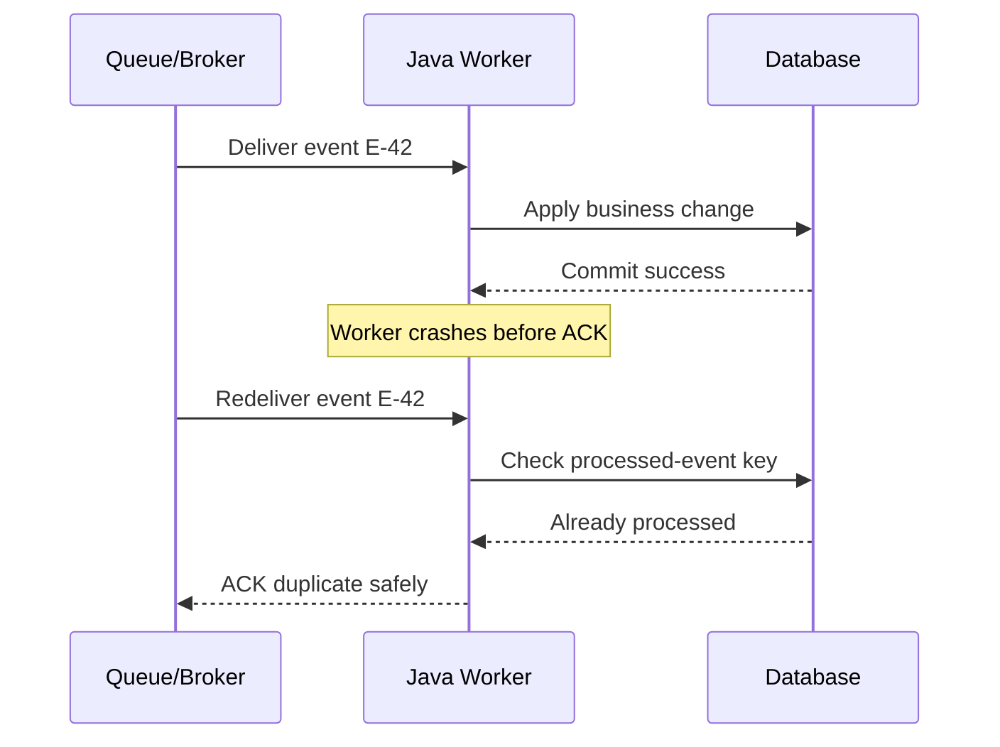
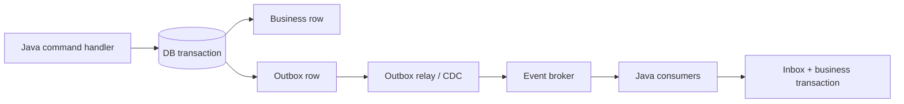

# Preventing Duplicate Processing and Controlling Worker Concurrency

An event processing system cannot assume each message arrives only once. A broker may redeliver a message when a worker times out, disconnects before ACKing, stops mid-transaction, or fails to confirm the outcome. Schedulers, producer retries, and dead-letter queue redrives can also produce extra deliveries. With serverless Java, multiple invocations can also run concurrently across multiple execution environments.

Therefore, an event processor must solve two problems simultaneously: **safe duplicate handling** and **bounding concurrency to actual system capacity**. Idempotency ensures an event delivered multiple times produces no extra business side effects. Concurrency control prevents concurrent workers or requests from exceeding the capacity of the database, partner APIs, and other dependencies. Both mechanisms must coordinate with retries, ordering, checkpoints, and backpressure.

This lesson uses a Java Event Processing Service as its running example: receiving `OrderCreated`, updating a read model, writing an audit record, and emitting notifications. Workers can be triggered by a queue or event bus on AWS, Azure, or Google Cloud. The goal is to design a consumer that withstands duplicate deliveries, parallel workers, and failures at any boundary between processing, commit, and ACK.

## 1. Why Can an Event Be Processed Multiple Times?

Many messaging/event systems provide *at-least-once* delivery: the broker keeps attempting to deliver a message until it receives an acknowledgement or exhausts its retry/retention policy. This reduces the risk of lost messages while allowing a message to appear multiple times.

Common scenarios:

- A worker finishes processing but crashes before ACKing.
- A worker sends an ACK but the connection drops before the broker receives it.
- A function times out after the database transaction has already committed.
- A visibility timeout or message lock expires while the worker is still running.
- A producer resends an event after missing a publish confirmation.
- A broker redelivers after transient errors or consumer restarts.
- An operator redrives messages from a DLQ.
- An event source emits the same business change across multiple integration paths.
- A batch is retried because one record failed, causing already-succeeded records to reappear without partial failure handling.

For example, a worker receives `OrderCreated(order-123)`, writes the order to the read model successfully, and loses connectivity before ACKing. Unaware the transaction committed, the broker redelivers the message. If the consumer unconditionally inserts a new order or sends an email on every delivery, the system creates duplicates.



Duplicate delivery is a normal condition that must be designed for. Never rely solely on the broker "usually delivering once" or cranking up visibility timeouts to eliminate duplicates completely.

## 2. Distinguishing Idempotency, Deduplication, and Exactly-Once

These three concepts are related yet distinct:

| Concept | Meaning | Example |
| --- | --- | --- |
| Idempotency | Executing the same logical operation multiple times yields the same business result as executing it once | Setting order state to `CREATED` by order ID |
| Deduplication | Detecting and skipping an already-processed event/request | Checking `eventId` in an inbox table |
| Exactly-once effect | A business side effect is applied only once within a defined boundary | An order is created only once despite event redelivery |

Deduplication is often part of implementing idempotency, but storing `eventId` only in a cache does not guarantee side effects are applied once. Caches can expire or vanish on instance restarts. A durable state store and appropriate transactions/conditional writes are needed.

"Exactly once" must be understood within an explicit boundary. A broker may offer deduplication or transactional consumption within its own service scope, but that does not automatically cover databases, email providers, payment gateways, and external APIs. The standard design combines at-least-once delivery with idempotent consumers, unique constraints, and outbox/inbox tables.

## 3. Event Identity Must Be Stable from the Producer

Consumers need an identifier to recognize the same event across retries. The event ID must be generated once at the producer and preserved across publish retries, redeliveries, archives, and replays.

An event envelope might look like:

```json
{
  "eventId": "evt-01JQ8M7K3F5A",
  "eventType": "OrderCreated",
  "schemaVersion": 2,
  "aggregateType": "Order",
  "aggregateId": "order-123",
  "sequence": 7,
  "occurredAt": "2026-11-17T08:15:30Z",
  "producer": "orders-api",
  "correlationId": "req-01JQ8M6Y",
  "data": {
    "orderId": "order-123",
    "tenantId": "tenant-42",
    "amountMinor": 125000,
    "currency": "VND"
  }
}
```

Fields serve different roles:

- `eventId`: unique identifier of the event occurrence.
- `aggregateId`: business key used for partitioning or ordering.
- `sequence`: aggregate sequence/version number if supported by the producer.
- `occurredAt`: timestamp when the business fact occurred, not when replayed.
- `correlationId`: links steps across a request/workflow.
- `schemaVersion`: selects the corresponding parser/upcaster.

Never generate a new event ID on each producer publish retry. If the producer generates a fresh ID for the same business operation, consumers cannot tell the two events represent the same intent. Use an application-generated ID created before the transaction, or a business key plus operation version when the contract allows.

### Event ID vs. Business Key

An order can legitimately emit multiple events: `OrderCreated`, `OrderPaid`, `OrderShipped`. Using only `aggregateId=order-123` as a deduplication key would drop every event after the first. Use `eventId` for event deduplication; use a business key like `orderId + operation` when guarding a specific side effect.

## 4. Choosing Idempotency Keys by Business Semantics

Keys must distinguish two cases:

1. The same event delivered multiple times.
2. Two distinct events requesting a business effect that must not repeat.

Examples:

| Operation | Candidate Key |
| --- | --- |
| Apply an event | `eventId` |
| Create order from command | `tenantId + clientRequestId` |
| Send email for an invoice/template | `invoiceId + notificationType + templateVersion` |
| Update projection by aggregate version | `aggregateId + sequence` |
| Pay an invoice | `invoiceId + paymentAttemptId` per payment contract |
| Run a logical scheduled job | `jobName + scheduledPeriod` |

Too broad a key may wrongly drop a legitimate operation; too narrow a key fails to block duplicates. Explicitly define tenant scope, operation type, and key retention duration.

## 5. The Inbox Pattern and Processed Events Table

A consumer can record processed events in an inbox/processed-event table. Minimal structure:

```sql
CREATE TABLE processed_event (
    consumer_name  VARCHAR(120) NOT NULL,
    event_id       VARCHAR(200) NOT NULL,
    processed_at   TIMESTAMP NOT NULL,
    outcome        VARCHAR(40) NOT NULL,
    PRIMARY KEY (consumer_name, event_id)
);
```

`consumer_name` is necessary when multiple independent consumers receive the same event. Both `search-projection` and `billing` consumers must be able to process the same `eventId` once per consumer. A global unique constraint on `event_id` alone would cause the first consumer to block the rest.

### Transaction Boundary

When the inbox and business data reside in the same database, execute in a single transaction:

1. Attempt to insert `(consumer_name, event_id)`.
2. If the key already exists, treat it as a duplicate and skip business effects.
3. If the new insert succeeds, apply the business update.
4. Write an outbox event if downstream events must be emitted.
5. Commit the transaction.
6. ACK the message only after the commit succeeds.

If the transaction rolls back, both the inbox insert and business update roll back together; the message can be retried. If the transaction commits but the ACK fails, the next delivery hits the unique key and is safely skipped.

Never record a processed key prior to a business transaction in a separate system. Marking processed early and then crashing before the business update permanently drops the event while the work remains undone.

## 6. Java Example: Idempotent Consumer with JDBC Transactions

The following example uses PostgreSQL `ON CONFLICT DO NOTHING` syntax. Inbox insert, business update, and outbox insert execute in the same transaction:

```java
import javax.sql.DataSource;
import java.sql.Connection;
import java.sql.PreparedStatement;
import java.sql.SQLException;

public final class OrderCreatedConsumer {
    private final DataSource dataSource;

    public OrderCreatedConsumer(DataSource dataSource) {
        this.dataSource = dataSource;
    }

    public ProcessingResult handle(OrderCreated event) throws SQLException {
        try (Connection connection = dataSource.getConnection()) {
            connection.setAutoCommit(false);
            try {
                int inserted = insertInbox(connection, event.eventId());
                if (inserted == 0) {
                    connection.rollback();
                    return ProcessingResult.DUPLICATE;
                }

                applyOrderProjection(connection, event);
                insertOutbox(connection, event);

                connection.commit();
                return ProcessingResult.APPLIED;
            } catch (SQLException | RuntimeException ex) {
                connection.rollback();
                throw ex;
            }
        }
    }

    private int insertInbox(Connection connection, String eventId)
            throws SQLException {
        String sql = """
                INSERT INTO processed_event
                    (consumer_name, event_id, processed_at, outcome)
                VALUES ('order-projection', ?, CURRENT_TIMESTAMP, 'APPLIED')
                ON CONFLICT (consumer_name, event_id) DO NOTHING
                """;
        try (PreparedStatement statement = connection.prepareStatement(sql)) {
            statement.setString(1, eventId);
            return statement.executeUpdate();
        }
    }

    private void applyOrderProjection(Connection connection, OrderCreated event)
            throws SQLException {
        String sql = """
                INSERT INTO order_projection (order_id, tenant_id, status)
                VALUES (?, ?, 'CREATED')
                ON CONFLICT (order_id) DO UPDATE
                SET tenant_id = EXCLUDED.tenant_id
                """;
        try (PreparedStatement statement = connection.prepareStatement(sql)) {
            statement.setString(1, event.orderId());
            statement.setString(2, event.tenantId());
            statement.executeUpdate();
        }
    }

    private void insertOutbox(Connection connection, OrderCreated event)
            throws SQLException {
        // Write the next event in the same transaction as the projection.
        // The outbox relay will publish asynchronously and may republish.
    }

    public enum ProcessingResult { APPLIED, DUPLICATE }

    public record OrderCreated(
            String eventId, String orderId, String tenantId) {}
}
```

This is a structural example; adapt schema, error handling, and SQL to your actual database. In PostgreSQL, `ON CONFLICT` is atomic against a unique constraint. Never replace it with two unlocked `SELECT` then `INSERT` statements because two workers could both see no record and both apply side effects.

`applyOrderProjection` must match your projection's semantics. The snippet above is not a universal template for all order updates; if older events can arrive after newer ones, check aggregate sequence/version before updating.

### ACK After Commit

The queue adapter only ACKs when `handle` returns successfully (`APPLIED` or `DUPLICATE`). If the transaction throws, do not ACK so the broker retries per policy. Never ACK before the transaction commits.

## 7. Handling Side Effects Outside the Database

An inbox transaction only protects side effects inside the same database transaction. Suppose a worker updates an order and then calls an email provider:

1. Database commit succeeds.
2. Email provider sends the email successfully.
3. Worker crashes before recording `email_sent` or ACKing.
4. Event is redelivered and the worker sends the email again.

A database transaction cannot roll back a sent email. Common approaches:

- Pass an idempotency key to the provider if the provider supports it.
- Write a notification command to an outbox in the same transaction as the business update; the notification worker maintains its own inbox.
- Persist send state and reconcile with the provider when outcomes are ambiguous.
- Use a stable business key so the provider or adapter recognizes the same notification.
- If the provider supports neither idempotency nor lookup APIs, explicitly document the guarantee level and duplicate-handling procedure.

Never claim exactly-once semantics for emails/payments merely because an internal database has a `processed_event` table.

## 8. Transactional Outbox: Avoid Direct Dual-Writes

A producer often needs to both write to a database and publish an event. If the DB write succeeds but publishing fails, consumers miss the event. If publishing succeeds and the DB rolls back, the event describes a change that never existed.

A transactional outbox closes this gap:

1. In a single database transaction, insert the business row and the outbox row.
2. Commit the transaction.
3. A relay/CDC publisher reads the outbox and sends events to the broker.
4. The relay marks entries published or saves a checkpoint upon confirmation.
5. If the relay is unsure whether the broker received an event, it can republish; idempotent consumers handle duplicates.



An outbox does not make broker delivery exactly-once; it guarantees the business change and publish intent are persisted together. Relays can redeliver, so consumers still need an inbox/idempotency.

## 9. Keeping Concurrency at Safe Levels

Concurrency is the number of tasks executing simultaneously. If a worker takes 200 ms on average and receives 100 messages/second, average in-flight work by Little's Law is approximately:

\[
L = \lambda W = 100 \times 0.2 = 20
\]

If latency rises to 1 second due to database slowness, the same 100 messages/second arrival rate produces an average concurrency around 100. Connection pools, memory, and downstream quotas can then be exhausted.

Concurrency limits should be grounded in the tightest bottleneck on the path:

- Database connection/transaction capacity.
- Partner API rate limits and concurrent request quotas.
- Function/container CPU and memory.
- Broker partition/consumer throughput.
- Per-aggregate ordering requirements.
- Timeouts/visibility/lock durations.

Never set max concurrency solely by how fast the cloud can scale. Unbounded scale-out can turn a slow dependency into a system-wide outage.

## 10. System-Wide Concurrency vs. In-JVM Concurrency

A Java `Semaphore(10)` caps concurrency at 10 tasks within one process. If the platform spins up 30 instances, total concurrency can reach 300. Distinguish the layers:

| Layer | Mechanism | Scope |
| --- | --- | --- |
| Cloud account/project | Account quotas or reserved concurrency | Multiple functions/resources within provider scope |
| Function/service | Max instances/reserved concurrency | Entire function/service depending on platform |
| Event source mapping/subscription | Max concurrent consumers, outstanding messages | Single trigger/subscription |
| Container/job | Task parallelism/replica limit | Single execution/job |
| JVM | Thread pools, semaphores, connection pools | Single process/instance |
| Database | Connection limits, transaction/lock capacity | Database/resource |

Use platform/trigger limits as the global cap whenever possible; use semaphores/thread pools to protect individual instances and local dependencies. The two layers do not replace each other.

## 11. Java: Bounded Worker Pools and Rejection Policies

When a Java process handles multiple records in parallel, use a bounded thread pool rather than an unbounded executor queue:

```java
import java.util.concurrent.ArrayBlockingQueue;
import java.util.concurrent.ThreadPoolExecutor;
import java.util.concurrent.TimeUnit;

public final class EventWorkerPool implements AutoCloseable {
    private final ThreadPoolExecutor executor = new ThreadPoolExecutor(
            8,
            8,
            0L,
            TimeUnit.MILLISECONDS,
            new ArrayBlockingQueue<>(100),
            new ThreadPoolExecutor.AbortPolicy());

    public void submit(Runnable task) {
        executor.execute(task);
    }

    public int activeWorkers() {
        return executor.getActiveCount();
    }

    public int queuedTasks() {
        return executor.getQueue().size();
    }

    @Override
    public void close() {
        executor.shutdown();
    }
}
```

When all 8 workers are busy and the queue holds 100 tasks, the next task is rejected instead of growing heap unboundedly. The adapter must catch `RejectedExecutionException` and apply policy: do not ACK the message, fail so the broker retries, or pause pulling more messages.

In serverless, never spawn background threads and return from an invocation before those threads finish. The runtime can freeze/terminate the execution environment. For queue-triggered functions, it is usually safer for each invocation to process a message/batch, await completion of all work, and only then return so the platform can ACK. Thread pools are useful for long-lived consumer processes or invocations that explicitly join/await before returning.

## 12. Semaphores for Specific Dependencies

A worker may process events in parallel while a database or partner API should only receive a limited number of concurrent calls. A local semaphore can bound calls to a dependency:

```java
import java.util.concurrent.Semaphore;

public final class PartnerApiGate {
    private final Semaphore permits = new Semaphore(5);

    public PartnerResponse call(PartnerRequest request) throws Exception {
        if (!permits.tryAcquire()) {
            throw new DependencyCapacityException("Partner API capacity reached");
        }
        try {
            return invokePartner(request);
        } finally {
            permits.release();
        }
    }

    private PartnerResponse invokePartner(PartnerRequest request) {
        // HTTP client must configure connect/request timeouts.
        return new PartnerResponse("accepted");
    }

    public record PartnerRequest(String reference) {}
    public record PartnerResponse(String status) {}

    public static final class DependencyCapacityException
            extends RuntimeException {
        public DependencyCapacityException(String message) {
            super(message);
        }
    }
}
```

This semaphore only bounds 5 calls inside a single JVM. Across multiple instances, the aggregate can be much higher. Pair it with global rate/concurrency limits at gateways, queue subscriptions, platform max instances, or a distributed quota service. Never hold permits while waiting on unrelated steps.

## 13. Distributed Locks, Leases, and Fencing Tokens

Idempotency is not always sufficient. Some tasks require that only one worker process an aggregate/partition at a time, such as sequential balance updates or singleton compaction.

Distributed locks/leases can be used when:

- A shared resource must be protected from concurrent mutation.
- A logical job may be claimed by only one worker.
- Partitions need assignment to workers for a bounded window.

Leases require an expiration so dead workers do not lock resources forever. Workers renew leases while holding ownership. However, a lease can expire while an old worker pauses; a new worker claims and begins processing just as the old worker wakes up.

A **fencing token** is a monotonically increasing generation number issued on each lease grant. On write, the target resource checks the current token; stale tokens are rejected. This prevents old workers from writing after losing ownership.

Do not use locks as the default mechanism for every event. Unique constraints, conditional updates, partition keys, and idempotent transactions are usually simpler and safer. Locks can degrade throughput and create bottlenecks if held too long.

## 14. Ordering: Limiting Concurrency by Aggregate Key

Independent events can run in parallel, but events for the same order/account often require ordering.

Example:

```text
OrderCreated(order-123, sequence=1)
OrderPaid(order-123, sequence=2)
OrderShipped(order-123, sequence=3)
```

If `OrderShipped` runs before `OrderCreated`, the projection can end up in an invalid state. Ways to preserve ordering:

- Partition messages by `aggregateId` so the same aggregate lands in one partition/lane.
- Process sequentially within the same partition/key while processing multiple partitions in parallel.
- Check sequence/version in the database before applying.
- On sequence gaps, retry with backoff or route to a pending buffer/quarantine.
- Never increase parallelism beyond the broker/partition's ordering guarantees.

### Optimistic Sequence Checks

An update can require the incoming sequence to equal the current sequence plus one:

```sql
UPDATE order_projection
SET status = :new_status,
    last_sequence = :incoming_sequence
WHERE order_id = :order_id
  AND last_sequence = :incoming_sequence - 1;
```

If the update count is 0, the event may be a duplicate, out-of-order, a sequence gap, or a missing aggregate. The consumer must read the current state to classify it. Never assume every 0-row update is a duplicate and ACK; a future-sequence event may need to wait for earlier events.

### No Need for Global Ordering When Per-Key Ordering Suffices

Global ordering hurts throughput because every event goes through a single lane. Usually ordering is only needed per `aggregateId`, `accountId`, or business key. Define the exact key in the contract and never assume brokers preserve ordering across partitions.

## 15. Bounded Concurrency, Batch Size, and Queue Flow Control

For queue consumers, batch size and concurrent batch count together determine in-flight work. With a batch of 100 records and 20 concurrent invocations, the system can have roughly 2,000 records in flight simultaneously, even before counting intra-invocation concurrency.

Choose batch size/concurrency based on:

- Payload size and per-record memory.
- p95/p99 processing duration.
- Database transaction/connection capacity.
- Batch retry semantics.
- Visibility timeout/message lock and function timeout.
- Ordering/partition constraints.
- Downstream rate limits.

Pull consumers should bound outstanding messages/bytes. When limits are reached, pause pulling until processing/ACKs complete. With push triggers, configure max concurrent deliveries/instances and return appropriate overload responses.

## 16. Backpressure and Admission Control

When workers hit the concurrency cap, the system must decide:

- Stop pulling more messages until workers free up.
- Leave messages waiting in the durable queue.
- Reject HTTP requests with `429` or `503` and an appropriate retry policy.
- Throttle producers or pause best-effort event types.
- Route unprocessable records to a DLQ/quarantine.

Never build an unbounded in-memory queue inside a function. The broker's durable queue is better suited to absorb bursts. Measure backpressure via queue age, backlog depth, rejection counts, and downstream latency.

### Retries Are Not Load Shedding

When a database is overloaded, fast retries add even more load. Use exponential backoff, jitter, max attempts, and retry budgets. Separate transient errors from poison messages; never retry a schema-invalid payload forever.

## 17. AWS Lambda: Concurrency Limits for SQS Event Sources

With AWS Lambda and SQS, common controls include:

- **Reserved concurrency:** caps a function's concurrency and reserves capacity from the account's unreserved pool.
- **Event source mapping maximum concurrency:** limits how far the poller scales for a specific SQS mapping.
- **Batch size:** max records per invocation by configuration and queue type.
- **Partial batch response:** reports exact failed records so only necessary records retry when configured.
- **Visibility timeout:** hides messages during processing; if processing/ACK does not complete, messages become eligible for redelivery.
- **DLQ/redrive policy:** isolates messages exceeding configured receive/attempt thresholds.

Reserved concurrency and maximum concurrency across multiple event source mappings must be planned together. If total requested concurrency exceeds reserved concurrency, mappings can be throttled. If concurrency is too high, databases can be overwhelmed. Size limits to downstream capacity and leave headroom for other functions.

### Partial Batch Responses

With SQS batches, if one record fails while others succeed, partial batch responses avoid retrying the entire batch. With FIFO queues, preserve ordering: when a record fails, report failures per FIFO semantics so later messages in the same message group do not leapfrog ahead.

Never ACK a batch before every record commits. Consumers must distinguish succeeded records, already-handled duplicates, and records needing retry/DLQ.

## 18. Azure Functions: Queue and Service Bus Concurrency

Azure Functions configures concurrency per trigger extension/host. Common controls:

- Queue Storage trigger: `batchSize`, `newBatchThreshold`, `maxDequeueCount`, and poison queues.
- Service Bus trigger: `maxConcurrentCalls`, session concurrency, prefetch, and lock renewal per extension/runtime.
- Event Hubs trigger: partition ownership, batch size, and checkpoints; concurrency is bounded by partition count.
- Hosting plan: scale/instance limits and per-instance resources.
- API Management/gateway: rate limiting in front of HTTP functions.

Values live in `host.json` and vary by extension version. Per-host configuration is not automatically a global concurrency cap; as the Function App scales across multiple hosts, aggregate concurrency multiplies. Combine plan-level max scale with database capacity.

With Service Bus, message locks can expire before processing finishes if runs are slow or hosts stall. Configure appropriate lock renewal/timeouts, handle duplicates, and never rely on locks alone to guarantee business exactly-once.

## 19. Google Cloud: Pub/Sub Flow Control and Cloud Run Concurrency

With a Pub/Sub pull subscriber, flow control can limit:

- Outstanding message count.
- Total outstanding bytes.
- Concurrent processing count via executor/consumer settings.

When thresholds are reached, the subscriber pauses pulling until ACKs or processing complete. With push subscriptions, endpoints must respond per the delivery contract; errors trigger redelivery.

Cloud Run services configure concurrency per instance and maximum instances. Approximate max in-flight requests:

\[
MaxInFlight \approx MaxInstances \times ConcurrencyPerInstance
\]

This is an approximate cap at the request layer, not requests per second. If each request processes batches or spawns internal thread pools, actual downstream concurrency can be higher. Cloud Run Jobs use task parallelism to bound concurrent tasks.

For Cloud Run functions/Functions Framework, check configuration for the specific generation/runtime; do not assume every function type shares identical concurrency behavior with Cloud Run services.

## 20. Retries, Poison Messages, and DLQs

Retries handle transient errors; DLQs/quarantine handle messages that cannot proceed under normal policy.

Classification:

| Error | Examples | Action |
| --- | --- | --- |
| Transient | Network resets, DB failovers, HTTP 503 | Retry with backoff/jitter |
| Throttling | HTTP 429, database capacity | Reduce concurrency, honor `Retry-After` |
| Duplicate | Inbox key already exists | Do not re-run side effects; ACK |
| Out-of-order | Sequence 12 arrives before 11 | Buffer/retry or quarantine per policy |
| Invalid payload | Malformed JSON, missing required fields | Do not retry indefinitely; DLQ/quarantine |
| Unsupported schema | Consumer doesn't support version yet | Route to compatibility handler or DLQ |
| Permanent business rejection | Closed resource, invalid operation | Record business outcome and ACK if terminal by contract |
| Permission/configuration | AccessDenied, bad secrets | Halt/alert; retries will not fix permissions |

DLQs need an owner, retention, dashboards, and a redrive procedure. Before redriving, fix the root cause, verify schemas/side effects, and rate-limit redrives. Never blindly loop the entire DLQ back onto the main queue.

## 21. Batching and Partial Failure

Batching boosts throughput but changes blast radius. If an invocation receives 100 records and the 80th fails:

- If the adapter only reports invocation failure, the broker may redeliver the entire batch.
- The first 79 records may be processed again.
- If side effects are not idempotent, duplicates occur.
- If partial batch responses are supported, only failed records need retrying.

Even with partial batches, every record still needs idempotency because duplicates can originate from producers or independent redrives. Whole-batch transactions can provide all-or-nothing guarantees within one database, but overly large transactions extend lock durations and risk timeouts. Choose transaction boundaries to match business semantics.

## 22. Idempotency Retention and Cleanup

Processed-event tables cannot grow unboundedly. Retention should reflect:

- Maximum queue retention.
- Broker redelivery/retry windows.
- DLQ retention and redrive windows.
- Event archive/replay horizons.
- Client retry windows and scheduled reprocessing.
- Business audit/legal requirements.

If events can be replayed after 90 days, do not purge inbox keys after 7 days if consumers rely on them to prevent duplicate side effects. Archive old keys, time-partition tables, or enforce business uniqueness in domain tables.

Cleanup must be safe while workers are running. Use partition drops or bounded batch deletes; never delete keys inside active processing windows. When using eventually consistent TTL deletion (e.g., NoSQL), understand records may linger past TTL or vanish according to service timing.

## 23. Preventing Duplicates in NoSQL with Conditional Writes

In databases without SQL transactions like DynamoDB, conditional puts can claim an event ID:

```java
// AWS SDK v2 pseudocode: write only if partition key does not exist yet.
PutItemRequest request = PutItemRequest.builder()
        .tableName("ProcessedEvents")
        .item(Map.of(
                "consumerEventKey", AttributeValue.fromS(consumerName + "#" + eventId),
                "processedAt", AttributeValue.fromS(Instant.now().toString())))
        .conditionExpression("attribute_not_exists(consumerEventKey)")
        .build();

try {
    dynamoDbClient.putItem(request);
    // New claim succeeded; continue processing.
} catch (ConditionalCheckFailedException duplicate) {
    // Key already claimed/processed; read state to distinguish in-progress vs completed.
}
```

This snippet is illustrative and does not combine the claim with business item writes in a transaction. If you only claim the key and then call another database/API, a crash between claiming and applying the effect leaves the key claimed with the work undone—retries would see the key and skip unfinished work. Use an `IN_PROGRESS/COMPLETED` state machine, lease expiry/fencing, or a transactional API like DynamoDB `TransactWriteItems` when all mutations live in the same service/database.

### Idempotency States

For longer operations, a record can track:

| Status | Meaning |
| --- | --- |
| `IN_PROGRESS` | Worker claimed key; work not yet finished |
| `COMPLETED` | Side effect committed |
| `FAILED_RETRYABLE` | Transient error; eligible for retry |
| `FAILED_FINAL` | Terminal error requiring operator/business action |

Claims must be atomic. Lease expiration alone does not prove the old worker stopped; use fencing tokens or conditional versions so stale workers cannot commit after ownership transfers.

## 24. Sizing Concurrency by Capacity and Little's Law

Suppose a database dedicated to the event processor sustains 120 transactions/second. Each worker holds a transaction for 100 ms on average. Theoretical concurrency by Little's Law:

\[
C \approx \lambda W = 120 \times 0.1 = 12
\]

This is the average concurrency to achieve that throughput assuming steady service times. In practice, measure p95 latency, lock waits, connection pools, and transaction CPU. Cap lower to leave headroom for HTTP APIs and other services.

If workers average 500 ms, achieving 120 transactions/second requires theoretical concurrency around 60. Yet if the database only allows 40 connections for this workload, raising concurrency to 60 causes connection-pool waiting and higher latency. Optimize transactions or expand capacity first.

### Calculating Total Multi-Layer Concurrency

Example:

- 10 serverless instances.
- Each instance allows up to 5 concurrent invocations.
- Each invocation processes 4 records in parallel.

Maximum record concurrency approaches:

\[
10 \times 5 \times 4 = 200
\]

Never look at max instances or invocation concurrency in isolation. Multiply every active parallel layer and verify against downstream capacity.

## 25. Per-Tenant Fairness and Noisy Neighbors

One tenant can emit events at massive rates, saturating workers and starving other tenants. Balance aggregate throughput with fairness:

- Rate-limit by authenticated tenant.
- Partition queues/topics by tenant or tenant tier when isolation is needed.
- Cap in-flight events per tenant.
- Use weighted fair scheduling or round-robin across tenants.
- Separate priority queues for critical vs. best-effort events.
- Apply quotas by weighted work units rather than message counts alone.
- Monitor queue age and throughput per tenant group.

You do not necessarily need a dedicated queue per tenant; thousands of queues add operational overhead. Shared queues with partition keys, schedulers, or dispatch layers often suffice. For large tenants requiring strict isolation, dedicated queues/resources can make sense.

## 26. Java Consumer Lifecycle in Serverless

A Java serverless function can be invoked across reused execution environments. Static clients/connection pools reduce initialization cost, but never store user-specific mutable state or assume long-lived processes.

Principles:

- Reuse thread-safe SDK clients/connection pools where recommended by the platform/runtime.
- Never store `processedEventIds` in a static `Set` as the primary deduplication store.
- Never leave background threads running after the handler returns unless the host manages their lifecycle.
- Close transactions/connections cleanly on every code path.
- Size connection pools relative to total max instances.
- Configure timeouts on databases/APIs and respect invocation deadlines.
- Return success only after durable side effects have committed.
- Propagate trace/correlation context via message headers.

### Example Batch Handler

```java
import java.util.ArrayList;
import java.util.List;

public final class EventBatchHandler {
    private final OrderCreatedConsumer consumer;

    public BatchResult handle(List<OrderCreated> events) {
        List<String> failedIds = new ArrayList<>();
        int applied = 0;
        int duplicates = 0;

        for (OrderCreated event : events) {
            try {
                var result = consumer.handle(event);
                if (result == OrderCreatedConsumer.ProcessingResult.APPLIED) {
                    applied++;
                } else {
                    duplicates++;
                }
            } catch (TransientProcessingException ex) {
                failedIds.add(event.eventId());
            }
        }

        return new BatchResult(applied, duplicates, failedIds);
    }

    public record BatchResult(
            int applied,
            int duplicates,
            List<String> failedEventIds) {}
}
```

The cloud adapter must map `failedEventIds` to the provider's partial batch response schema. Terminal errors like invalid payloads may need quarantine/DLQ recording and ACKing per policy; never send every exception into infinite retries. The example assumes consumers clearly separate transient and terminal exceptions.

## 27. Concurrency Controls Across Clouds

| Platform | Common Mechanisms | What to Verify |
| --- | --- | --- |
| AWS Lambda + SQS | Reserved concurrency, event source maximum concurrency, batch size, partial batch response | Total mapping concurrency vs. reserved/account quota; FIFO ordering; visibility timeout |
| Azure Functions + Queue Storage | `batchSize`, `newBatchThreshold`, host/plan scale limit, poison queue | Extension version and concurrency multiplied across hosts |
| Azure Functions + Service Bus | `maxConcurrentCalls`, sessions, prefetch, lock renewal | Aggregate host concurrency, lock duration, and session ordering |
| Azure Functions + Event Hubs | Partition count, batch size, checkpoint, host scale | One active owner per partition in processor model; lag and parallelism |
| Google Pub/Sub pull | Max outstanding messages/bytes, executor/flow control | Ack deadline, lease extension, and subscriber count |
| Google Pub/Sub push | Endpoint capacity, push delivery behavior, retry/backoff | HTTP response semantics, Cloud Run concurrency/max instances |
| Google Cloud Run | Concurrency per instance, max instances | Request concurrency times instance count and resource capacity |
| Google Cloud Run Jobs | Task count, parallelism | Concurrent tasks and downstream quotas |

Setting names and defaults vary across runtimes, trigger extensions, and generations. Read the documentation for your exact deployed version and verify with metrics/load tests; never blindly copy `host.json` or concurrency values from another project.

## 28. Observability: Measuring Duplicates, Concurrency, and Backlog

Tracking invocation counts alone is insufficient. An event processor dashboard should include:

| Metric | Meaning |
| --- | --- |
| `events.received` | Events received |
| `events.applied` | Events that successfully applied business effects |
| `events.duplicate` | Events skipped via inbox/deduplication |
| `events.failed.retryable` | Transient failures retried |
| `events.failed.terminal` | Terminal/quarantined failures |
| `events.processing.duration` | Processing duration p50/p95/p99 |
| `workers.active` | Active workers |
| `workers.rejected` | Tasks rejected due to local capacity |
| `queue.depth` | Current backlog |
| `queue.oldest_age` | Age of oldest message |
| `queue.redelivery` | Redelivery count |
| `dlq.depth` | Messages in DLQ |
| `dependency.in_flight` | Concurrent calls to DB/APIs |
| `dependency.timeout` | Downstream timeouts |
| `ordering.gap` | Missing or out-of-order event sequences |
| `idempotency.in_progress_age` | Claims stuck in progress too long |

Watch duplicate rates alongside applied counts. Rising duplicates can stem from ACK failures, short visibility timeouts, producer retries, or redrives; they do not always indicate a business bug. Yet sharp spikes in duplicate rates often signal worker timeouts or misconfigured brokers.

Never use high-cardinality `eventId`, `aggregateId`, or tenant IDs as metric labels. Use controlled logs/traces to drill down by correlation ID.

## 29. Alerts and Incident Runbooks

Base alerts on user/system impact:

- Oldest message age breaches SLO.
- Queue depth rises continuously while throughput stays flat.
- DLQ depth climbs or poison messages repeat.
- Worker concurrency remains pinned at cap while rejections/throttling rise.
- Database connection waits, lock waits, or API 429s increase.
- `IN_PROGRESS` idempotency claims exceed expected duration.
- Duplicate rate spikes abnormally above baseline.
- Event sequence gaps persist.

During an incident:

1. Identify affected queues/topics, consumers, and event types.
2. Inspect duplicate/redelivery rates, retry counts, queue age, and DLQ.
3. Check worker concurrency, duration, timeouts, and dependency health.
4. Lower concurrency or pause consumers if downstream dependencies are overloaded.
5. Never delete inbox/processed-event records to "retry" without understanding side effects.
6. Inspect business state and reconcile `IN_PROGRESS` events.
7. Fix root cause, redrive in bounded batches, and monitor duplicates/business outcomes.

If the consumer already committed the business effect but the ACK failed, do not delete the idempotency record. Redelivery should hit the duplicate check and ACK safely.

## 30. Testing Concurrency and Duplicates

Single-threaded unit tests cannot prove race conditions are handled. Test concurrently with identical event IDs:

- Fire 50–100 concurrent invocations with the same event ID.
- Verify only one business effect commits.
- Verify remaining invocations return duplicate or in-progress per contract.
- Send multiple distinct event IDs for the same aggregate to test ordering/sequences.
- Simulate worker crashes after DB commit but before ACK.
- Simulate ACK failures or message redeliveries.
- Simulate lease expiration while an old worker is still running.
- Simulate database timeouts, deadlocks, and connection pool exhaustion.
- Simulate poison payloads, unsupported schema versions, and DLQ redrives.
- Verify actual max concurrency never exceeds downstream budgets.

### Failure Injection by Crash Point

| Crash Point | Expected Retry Behavior |
| --- | --- |
| Before inbox insert | Event processed as new |
| After inbox insert, before business update (same tx) | Transaction rolls back; retry can reclaim |
| After business update, before commit (same tx) | Both inbox and business update roll back |
| After commit, before ACK | Redelivery caught by inbox unique key; no duplicate side effect |
| After outbox commit, before publish | Relay republishes from outbox |
| After publish, before marking outbox sent | Duplicate publish possible; consumer deduplicates |
| After external API effect, before local status | Provider idempotency/reconciliation resolves ambiguous outcome |

## 31. Common Mistakes

1. **Using a static `HashSet` to remember processed events.** State vanishes on restarts and is not shared across instances.
2. **ACKing before committing.** Events are lost if the database transaction fails.
3. **Committing without idempotency.** ACK failures cause duplicate side effects.
4. **Generating fresh event IDs on publish retries.** Consumers cannot recognize the same event.
5. **Using plain `SELECT` then `INSERT`.** Two workers can both pass the check and insert.
6. **Claiming an idempotency key in DB then calling external APIs without recovery state.** Crashes leave keys claimed with effects unapplied.
7. **Using one global unique key across all consumers.** Independent consumers block one another.
8. **Using aggregate ID instead of event ID for all deduplication.** Subsequent valid events get dropped.
9. **Increasing concurrency without multiplying parallel layers.** Downstream systems get overwhelmed.
10. **Relying solely on local semaphores for global limits.** Multiple instances multiply the limit.
11. **Locks without leases/fencing.** Stale workers write after locks expire.
12. **Enforcing global ordering for all events.** Unnecessarily bottlenecks throughput.
13. **Ignoring sequence gaps.** Projections enter invalid states.
14. **Retrying poison messages infinitely.** Wastes cost and blocks queues.
15. **Ignoring inbox retention.** Replays past expiry re-apply side effects.
16. **Returning from invocations with active background threads.** Runtime freezes/terminates them mid-work.

## 32. Process for Designing Safe Consumers

1. **Define event contract:** stable event ID, aggregate key, sequence, schema version, and occurred time.
2. **Choose idempotency scope:** event-level, business-operation-level, or both.
3. **Design inbox:** unique constraint by consumer + event ID; retention aligned with replay horizon.
4. **Define transaction:** commit inbox, business state, and outbox together where possible.
5. **Handle external effects:** provider idempotency keys, outbox workers, and reconciliation.
6. **Set ordering:** partition keys/sequence checks per aggregate; avoid unnecessary global ordering.
7. **Set concurrency:** calculate DB/API capacity, platform max concurrency, batch size, and per-instance pools.
8. **Apply backpressure:** bound outstanding messages, worker pools, and producer rates.
9. **Configure retry/DLQ:** transient vs. terminal, backoff/jitter, attempt limits, and redrive policy.
10. **Instrument:** received/applied/duplicate/retry counts, concurrency, queue age, dependency latency, and sequence gaps.
11. **Test failure windows:** crash before/after commit, ACK failures, concurrent duplicates, and lease expiry.
12. **Operate:** runbooks for pause/resume, reconciliation, redrives, and retention cleanup.

## 33. Pre-Production Checklist

- [ ] Producers generate stable `eventId` values preserved across publish retries/redeliveries.
- [ ] Events include `aggregateId`, sequence, and schema version when required by business logic.
- [ ] Consumers maintain a durable inbox/processed-event store with unique constraints.
- [ ] Inbox keys are scoped by consumer and tenant/business operation as needed.
- [ ] Inbox inserts, business updates, and outbox entries commit in one transaction when sharing a DB.
- [ ] Messages are ACKed only after the business transaction commits.
- [ ] External side effects use provider idempotency or reconciliation.
- [ ] Idempotency retention spans retries, DLQ redrives, and replay windows.
- [ ] Ordering is preserved per aggregate key/partition where required.
- [ ] Explicit policies exist for sequence gaps and out-of-order events.
- [ ] Max concurrency is calculated as instances × invocations × per-record parallelism.
- [ ] Database pools/API quotas preserve headroom for other workloads.
- [ ] Bounded executors/queues define rejection policies instead of unbounded memory queues.
- [ ] Platform/trigger concurrency and batch sizes are configured and load-tested.
- [ ] Backpressure, retry budgets, timeouts, and DLQ/redrive processes are defined.
- [ ] Java invocations never return while background threads hold uncommitted work.
- [ ] Dashboards track duplicates, applied counts, retries, concurrency, backlog age, and DLQ.
- [ ] Concurrent same-event-ID tests and commit/ACK crash injection tests exist.
- [ ] Runbooks avoid blind inbox key deletion and include reconciliation steps.

Preventing duplicate processing and controlling worker concurrency are twin pillars of reliable event processors. Stable event IDs, inbox/unique constraints, and transactions let consumers handle redeliveries safely; outboxes and provider idempotency extend that protection to external side effects. Bounded concurrency, partition ordering, flow control, and backpressure keep workers within what databases and APIs can sustain. Combining these mechanisms with retries/DLQs, metrics, and failure-injection tests enables Java serverless workers to scale out without turning duplicate deliveries or traffic bursts into data corruption.

## Official References

- [AWS Lambda – Using Lambda with Amazon SQS](https://docs.aws.amazon.com/lambda/latest/dg/with-sqs.html)
- [AWS Lambda – Configuring maximum concurrency for SQS event source mappings](https://docs.aws.amazon.com/lambda/latest/dg/services-sqs-scaling.html)
- [AWS Lambda – Handling errors for an SQS event source](https://docs.aws.amazon.com/lambda/latest/dg/services-sqs-errorhandling.html)
- [Amazon SQS – Visibility timeout](https://docs.aws.amazon.com/AWSSimpleQueueService/latest/SQSDeveloperGuide/sqs-visibility-timeout.html)
- [Azure Functions – Concurrency](https://learn.microsoft.com/azure/azure-functions/functions-concurrency)
- [Azure Functions – host.json reference](https://learn.microsoft.com/azure/azure-functions/functions-host-json)
- [Azure Service Bus – Message transfers, locks and settlement](https://learn.microsoft.com/azure/service-bus-messaging/message-transfers-locks-settlement)
- [Google Cloud Pub/Sub – Subscriber flow control](https://cloud.google.com/pubsub/docs/flow-control)
- [Google Cloud Pub/Sub – Message replay and seek](https://cloud.google.com/pubsub/docs/replay-message)
- [Google Cloud Run – Concurrency](https://cloud.google.com/run/docs/about-concurrency)
- [Resilience4j – Bulkhead](https://resilience4j.readme.io/docs/bulkhead)
- [Debezium – Outbox Event Router](https://debezium.io/documentation/reference/stable/transformations/outbox-event-router.html)
