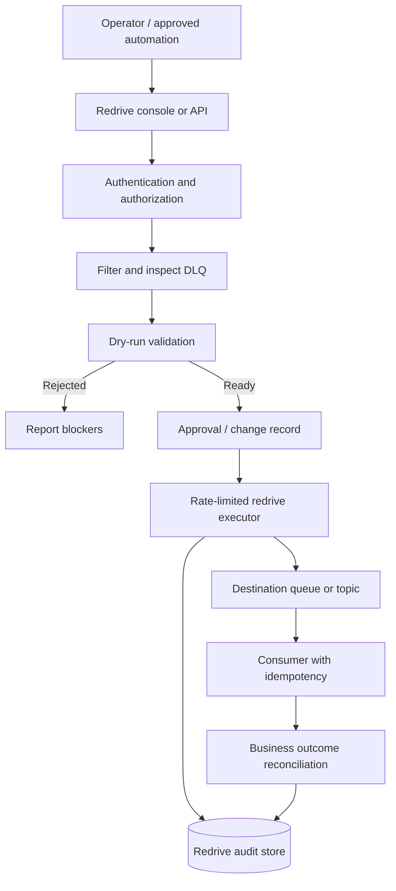

# Designing Dead-Letter Queues and Controlled Redrive Tooling

In an event processing system, a message can fail because a dependency is temporarily unavailable, the payload violates schema, business data is invalid, or the consumer hits a bug. Retrying every failure the same way causes faulty messages to be redelivered repeatedly, consuming worker capacity and inflating backlogs. Dropping messages immediately on error risks losing work and leaving no evidence for investigation.

A dead-letter queue (DLQ) isolates messages that have exceeded the retry policy or cannot be processed through the normal path. Redrive is the workflow for returning isolated messages to a processing path once the root cause is understood and recovery conditions are ready. Safe redrives require data validation, operator authorization, rate limiting, audit history, and idempotent consumers.

Within **CLOUD_SERVERLESS**, this lesson focuses on developing and deploying serverless applications, particularly Java functions triggered by HTTP, messages, or events. Learners handle triggers, state, access control, retries, idempotency, cold starts, scaling, and cost. This lesson walks through designing a DLQ and controlled redrive tooling to recover event-driven workflows without creating extra side effects or overloading the system.

## 1. What Problem Does a DLQ Solve?

Message queues typically deliver messages to consumers under at-least-once semantics. Consumers can time out, crash before acknowledging, lose locks, or return errors. The broker can redeliver the message. After several attempts, the message still fails to process.

Typical scenarios:

- Temporary dependency failures or sustained throttling.
- Payloads violating schema or missing required fields.
- Messages containing invalid business values.
- A consumer bug throwing exceptions on a specific subset of messages.
- Messages exceeding size limits or failing deserialization.
- Expired messages or messages no longer meaningful to the business.
- Poison messages repeatedly failing workers.

A DLQ separates failing messages from the healthy flow so other messages continue processing smoothly. It provides an evidence store to support investigation, data or code fixes, and policy-driven redrives.

A DLQ does not fix errors automatically, does not guarantee messages will succeed later, and is not an indefinite storage archive. Without an owner, retention policy, alerts, and handling procedures, a DLQ simply becomes a second, harder-to-observe backlog.

## 2. Distinguishing Retries, DLQs, and Quarantine

These three mechanisms serve distinct purposes:

| Mechanism | Purpose | When to Use |
|---|---|---|
| Retry | Re-attempt potentially transient failures | Timeouts, network resets, HTTP 503, throttling |
| Dead-letter queue | Isolate messages exceeding redelivery policy or rejected | Exhausted delivery attempts, poison messages, unprocessable errors |
| Quarantine | Hold messages needing manual review or data/schema fixes | Malicious payloads, sensitive data, unclear contracts, policy violations |

Some brokers include built-in DLQs; some systems build separate quarantine topics/queues. Regardless of naming, explicitly define who owns the message, why it was isolated, whether it can be replayed, and who has permission to act on it.

Do not send a message to the DLQ merely because a dependency blipped for a few seconds. Retries with proper backoff absorb transient errors. Conversely, infinitely retrying a schema-invalid payload will never make it valid.

## 3. Classifying Errors Before Choosing a Retry Policy

Consumers must separate transient failures, permanent failures, and business rejections:

| Error Category | Examples | Typically Appropriate Behavior |
|---|---|---|
| Transient infrastructure | Connection reset, timeout, HTTP 503 | Bounded retries with backoff and jitter |
| Throttling | HTTP 429, database capacity exceeded | Throttle back, honor `Retry-After`, retry |
| Dependency configuration | Wrong credentials, missing endpoint | Halt or circuit-break, alert; avoid aggressive retries |
| Invalid contract | Unparseable JSON, unsupported schema version | DLQ/quarantine and alert |
| Permanent business rejection | Closed account, cancelled order | Record business outcome; do not infinitely retry |
| Duplicate/already applied | Event already processed | Acknowledge after verifying idempotency |
| Expired/stale event | Deadline passed or aggregate moved ahead | Skip with logging or compensate per domain |
| Unknown exception | Unclassified bug | Bounded retries; then DLQ and investigate |

Classification must reflect domain and dependency semantics. For instance, HTTP 404 may be permanent if the resource does not exist, or transient if the resource is created asynchronously and eventual consistency applies. Never rely purely on generic exception codes.

## 4. Designing a Retry Budget

A retry policy must bound total attempts and total processing duration. Key parameters:

- Maximum delivery attempts or maximum receives.
- Initial backoff and maximum backoff.
- Exponential multiplier.
- Jitter to spread out retry timestamps.
- Message TTL/deadline.
- Visibility timeout, lock duration, or ack deadline.
- Function timeout and downstream timeout.
- Permitted redrive count after entering the DLQ.

Example exponential backoff:

| Attempt | Example Delay |
|---:|---:|
| 1 | 1 second |
| 2 | 2 seconds |
| 3 | 4 seconds |
| 4 | 8 seconds |
| 5 | 16 seconds |

Full jitter can pick a random delay between 0 and the exponential cap. Actual values depend on dependencies and SLAs; the table above is illustrative only. If every consumer retries on the exact same fixed schedule, recovering dependencies can be hit by a thundering herd.

## 5. Poison Messages and Retry Storms

A poison message is one that repeatedly fails consumers due to an inherent property of the message itself or a recurring code bug. Examples include malformed JSON, unsupported enums, null required fields, or a record triggering a mapper exception.

A retry storm occurs when retry volume surges while a dependency is degraded. Every retry generates extra invocations, logs, and network calls, potentially starving new messages of concurrency.

Mitigations:

- Set retry caps and exponential backoff with jitter.
- Classify permanent failures to dead-letter early.
- Bound consumer concurrency and rate.
- Apply circuit breakers for dependencies.
- Monitor delivery counts, oldest message age, and DLQ rates.
- Avoid multi-layer retries without a shared retry budget.
- Never automatically redrive the entire DLQ before dependencies recover.

## 6. Envelope and Metadata to Preserve in the DLQ

When a message is dead-lettered, operators need to know what the original message was, where it traveled, how many times it failed, and which consumer version handled it. Brokers retain some native metadata; applications should add an envelope or metadata record as service capabilities permit.

Example application envelope:

```json
{
  "eventId": "evt-7812",
  "eventType": "OrderSubmitted",
  "schemaVersion": 3,
  "aggregateId": "order-42",
  "aggregateVersion": 8,
  "correlationId": "order-42",
  "occurredAt": "2026-11-17T10:00:00Z",
  "tenantId": "tenant-17",
  "payload": {
    "orderId": "order-42"
  }
}
```

Processing metadata can be stored separately or in message properties:

- Source queue/topic/subscription.
- Original broker message ID and sequence/partition/offset if available.
- First enqueued timestamp and dead-lettered timestamp.
- Delivery count or attempt count.
- Failure category and normalized error code.
- Consumer/service version.
- Correlation ID and safely filtered trace context.
- Schema version and content type.
- Redrive count, redrive batch ID, and redrive timestamp.
- Tenant or business owner per data classification policy.

Never write full stack traces, secrets, access tokens, or sensitive payloads into message properties. Detailed stack traces belong in logs/incident stores with separate access controls, while the DLQ retains only error codes and needed references.

## 7. Preserving Original Messages and Failure History

The DLQ is evidence of failed messages. Never mutate the original payload in place just to make it pass. If data transformation is needed, create a versioned transformation, record input/output hashes, and preserve lineage to the original message.

A redrive record should reveal:

- Original message and source location.
- Initial dead-letter reason.
- Delivery/retry count before dead-lettering.
- Prior redrive attempts and their outcomes.
- Consumer/schema version used during the redrive.
- Human or automation that initiated the redrive.
- Destination queue/topic.
- Transformation version if applied.
- Timestamp, rate, and count of replayed messages.

This enables auditing, investigation, and answering "how many times was this message processed, with which code, and what side effects occurred?".

## 8. A DLQ Is Not an Infinite Archive

A DLQ still requires retention and capacity planning. An unmanaged DLQ drives up storage costs, expands data exposure risk, and makes old incidents harder to separate from new ones.

Policies must specify:

- Retention by data type and audit obligations.
- Alert thresholds for message count/age.
- Explicit owner for each DLQ.
- Triage and remediation SLAs.
- Archive or purge rules.
- Protection for payloads and audit metadata.
- Handling for messages past TTL or business validity.

Never delete messages solely to drive DLQ counts to zero. Before purging, confirm messages were processed, approved for skip, expired per policy, or archived per compliance.

## 9. Architecture of Controlled Redrive Tooling

A redrive tool should not be a "replay all" button. It must separate inspection, approval, and execution:



Components:

- **Console/API:** search messages and filter by reason, time, tenant, and source.
- **Authorization:** verify role, tenant scope, environment, and redrive permissions.
- **Dry-run validator:** check schema, destination, dependency health, capacity, and duplicate risks.
- **Approval:** require authorized approvers commensurate with blast radius.
- **Executor:** replay in bounded batches/rates with pause/stop controls.
- **Audit store:** record plan, approver, message IDs, outcomes, and errors.
- **Reconciliation:** verify business effects after redrive, not just publish success.

## 10. Stages of a Redrive Operation

A safe workflow can track these states:

| State | Meaning |
|---|---|
| `DRAFT` | Operator creates a redrive request |
| `VALIDATING` | System validates messages and destination |
| `REJECTED` | Blockers found; execution disallowed |
| `AWAITING_APPROVAL` | Pending approval |
| `APPROVED` | Cleared for execution |
| `RUNNING` | Executor is replaying messages within limits |
| `PAUSED` | Paused for incident handling or review |
| `COMPLETED` | Finished sending the planned set of messages |
| `PARTIAL` | Subset of messages sent; remainder failed/skipped |
| `CANCELLED` | Stopped on request |
| `FAILED` | Operation failed and needs investigation |

`COMPLETED` only confirms the redrive sent messages as planned. It does not prove every message succeeded at the consumer. Business outcomes must be tracked separately by event ID, job ID, or business operation ID.

## 11. What Should a Dry-Run Do?

A dry-run generates a preview without sending messages to the destination. It should check:

- Count of messages matching the filter and count to be skipped.
- Source DLQ and destination belong to the correct environment/region.
- Messages are parseable and schema versions are supported by the consumer.
- Error categories are eligible for redrive.
- Messages have not exceeded deadlines or TTLs.
- Current business state still permits applying the events.
- Events have not already been processed or claimed by another redrive operation.
- Destination queue/topic is active and has sufficient capacity.
- Downstream dependencies are healthy and not throttling.
- Total message count, rate, estimated duration, and impact scope.
- Any transformations are versioned, tested, and auditable.

A dry-run should display a summary and a redacted sample rather than exposing full sensitive payloads to operators lacking viewing rights.

A dry-run does not lock system state. Between dry-run and execution, messages might be resolved manually or destination state might change. The executor must re-verify critical preconditions right before sending.

## 12. Filtering Messages by Specific Criteria

Do not redrive the entire DLQ if only one subset of messages has been fixed. Common filters include:

- Source queue/topic/subscription.
- Dead-letter reason/error category.
- Dead-lettered time range.
- Event type and schema version.
- Consumer version from the prior attempt.
- Tenant or business partition.
- Correlation ID, aggregate ID, or event ID.
- Message age/deadline.
- Redrive count and prior redrive status.

Filters require result limits and access controls. An operator may be permitted to redrive their own service's DLQ without accessing another tenant's data.

Avoid filtering on raw exception messages if text is unstable or contains sensitive data. Normalize error categories such as `INVALID_SCHEMA`, `DEPENDENCY_TIMEOUT`, `BUSINESS_REJECTED`, and `UNKNOWN` for predictable filtering.

## 13. Risk-Based Approval

Not every redrive requires identical approval rigor. Tiered controls work well:

| Scenario | Suggested Control |
|---|---|
| Single test message in staging | Operator with test-environment permissions |
| Small batch after transient outage clears | On-call operator and dry-run |
| Thousands of production messages | Service owner/on-call lead approval |
| Financial data or irreversible side effects | Two-person approval and reconciliation plan |
| Involves payload transformation | Code review, test fixtures, versioning, and approval |
| Redrive across tenants or regions | Security/data owner approval per policy |

Approval records should bind to the specific message set or immutable query/filter, destination, rate, max count, and transformation version. If the message set changes after approval, re-run dry-run and re-approve.

## 14. Rate Limiting and Batch Control

Redrives can unleash a massive burst onto consumers and downstream dependencies. The executor must bound:

- Messages per second.
- Batch size.
- Concurrent publish requests.
- Maximum messages per operation.
- Concurrent redrive operations.
- Per-tenant/priority rates.
- Execution duration and batch deadline.

For example, suppose a DLQ holds 100,000 messages, while the system only has 50 messages/second of spare capacity beyond normal traffic. Replaying everything in seconds will spike queue backlogs and database load. The executor should replay at a load-tested rate, watch backlogs, and auto-pause if thresholds breach.

Use a token bucket or leaky bucket for pacing. Throttle down when consumer latency, throttling, or queue age rises; ramp gradually when stable. Never crank up speed merely because the DLQ count is draining slowly.

## 15. Idempotency Is Mandatory

Redrives can introduce duplicate deliveries. The executor may publish a message successfully, lose the response, and resend. Consumers may finish side effects and crash before acknowledging. Never assume "each message runs only once."

Consumers need stable idempotency keys per event/business operation:

```java
public ProcessingResult handle(OrderSubmitted event) {
    return idempotencyStore.executeOnce(
            event.eventId(),
            () -> orderService.submit(event.orderId()));
}
```

`executeOnce` must use unique constraints, conditional writes, or transactions on a shared durable store. `synchronized`, static sets, or local JVM caches do not protect across multiple function instances.

When side effects hit external providers, pass idempotency keys if supported. Otherwise, use outboxes, reconciliation, or saga compensation to handle timeouts after the provider executed without returning a response.

## 16. Distinguishing Event ID, Broker Message ID, and Redrive ID

These three identifiers serve different roles:

| ID | Purpose | Changes on Redrive? |
|---|---|---|
| Event ID | Identifies the original business event | Typically preserved |
| Broker message ID | Identifies a specific publish/delivery in the broker | May be newly assigned by broker |
| Redrive operation/batch ID | Identifies a single replay operation | Newly created per redrive operation |

Correlation IDs are usually preserved to trace the entire workflow. Attempt or redrive counts increment by explicit rules. Never overwrite the event ID with a redrive ID, or consumers lose the ability to deduplicate the original event.

An envelope can carry redrive metadata separately:

```json
{
  "eventId": "evt-7812",
  "correlationId": "order-42",
  "redrive": {
    "operationId": "rd-2026-0041",
    "attempt": 2,
    "source": "orders-dlq",
    "initiatedAt": "2026-11-17T11:00:00Z"
  }
}
```

If the broker supports native message properties, prefer storing operational metadata there or in the audit store to avoid altering the business payload contract.

## 17. Tool-Level Redrive Idempotency

Not only consumers need idempotency. The redrive executor must also avoid recreating the same operation on operator double-clicks, browser retries, or worker restarts.

A simple data model:

```sql
CREATE TABLE redrive_operations (
    operation_id VARCHAR(100) PRIMARY KEY,
    source_name VARCHAR(200) NOT NULL,
    destination_name VARCHAR(200) NOT NULL,
    filter_hash VARCHAR(128) NOT NULL,
    status VARCHAR(30) NOT NULL,
    requested_by VARCHAR(200) NOT NULL,
    approved_by VARCHAR(200),
    max_messages INTEGER NOT NULL,
    rate_per_second INTEGER NOT NULL,
    created_at TIMESTAMP NOT NULL
);

CREATE TABLE redrive_items (
    operation_id VARCHAR(100) NOT NULL,
    source_message_key VARCHAR(300) NOT NULL,
    status VARCHAR(30) NOT NULL,
    destination_message_id VARCHAR(300),
    last_error_code VARCHAR(100),
    updated_at TIMESTAMP NOT NULL,
    PRIMARY KEY (operation_id, source_message_key)
);
```

A unique key on operation and source message lets the executor resume without re-sending already-completed items. Still, if a broker publish succeeds and the `redrive_items` update transaction fails, duplicates remain possible. Consumer idempotency remains the final line of defense.

Never mark an item `SENT` before broker publish confirmation. If the publish outcome is unclear due to a timeout, record `UNKNOWN`/`RECONCILE_REQUIRED` to check by event ID or destination metadata before resending.

## 18. Java Redrive Service with Explicit Policy

Decouple operational logic from specific SDKs via interfaces. This lets you test policies without depending on a live broker:

```java
public record RedriveRequest(
        String operationId,
        String source,
        String destination,
        String filterId,
        int maxMessages,
        int ratePerSecond,
        String requestedBy) {
}

public record RedriveCandidate(
        String sourceMessageKey,
        String eventId,
        String eventType,
        int schemaVersion,
        String failureCode,
        Instant deadlineAt) {
}

public interface DeadLetterSource {
    List<RedriveCandidate> findCandidates(
            String filterId, int limit);
}

public interface RedriveValidator {
    ValidationResult validate(RedriveCandidate candidate);
}

public interface MessagePublisher {
    PublishResult publish(
            String destination, RedriveCandidate candidate,
            String operationId);
}

public interface RedriveAudit {
    boolean claim(String operationId, String sourceMessageKey);
    void markSent(String operationId, String sourceMessageKey,
                  String destinationMessageId);
    void markSkipped(String operationId, String sourceMessageKey,
                     String reason);
    void markUnknown(String operationId, String sourceMessageKey,
                     String reason);
}
```

An executor can process batches:

```java
public void executeBatch(RedriveRequest request) {
    List<RedriveCandidate> candidates =
            source.findCandidates(request.filterId(), request.maxMessages());

    for (RedriveCandidate candidate : candidates) {
        rateLimiter.acquire(request.ratePerSecond());

        ValidationResult validation = validator.validate(candidate);
        if (!validation.allowed()) {
            audit.markSkipped(
                    request.operationId(),
                    candidate.sourceMessageKey(),
                    validation.reason());
            continue;
        }

        if (!audit.claim(
                request.operationId(), candidate.sourceMessageKey())) {
            continue; // already claimed or processed by this operation
        }

        try {
            PublishResult result = publisher.publish(
                    request.destination(), candidate, request.operationId());

            audit.markSent(
                    request.operationId(),
                    candidate.sourceMessageKey(),
                    result.messageId());
        } catch (PublishOutcomeUnknownException uncertain) {
            audit.markUnknown(
                    request.operationId(),
                    candidate.sourceMessageKey(),
                    "PUBLISH_OUTCOME_UNKNOWN");
        } catch (PermanentPublishException failure) {
            audit.markSkipped(
                    request.operationId(),
                    candidate.sourceMessageKey(),
                    failure.code());
        }
    }
}
```

This is an architectural skeleton, not a complete implementation. `claim` requires atomic/conditional updates, rate limiters must work across multiple concurrent executor instances, and unknown publish outcomes must be reconciled. Never run unbounded loops inside an HTTP function; large redrives should be asynchronous jobs supporting checkpoints, pause, and resume.

## 19. Dry-Run Reports and Execution Reports

A dry-run should produce a storable report referenced during approval:

| Field | Example |
|---|---|
| Operation ID | `rd-2026-0041` |
| Source | `orders-dlq-prod` |
| Destination | `orders-retry-prod` |
| Filter | `failureCode=DEPENDENCY_TIMEOUT`, dead-letter time range |
| Candidates | 4,200 |
| Eligible | 4,050 |
| Skipped | 150 |
| Skip reasons | Expired 80, schema unsupported 40, already completed 30 |
| Rate limit | 25 messages/second |
| Estimated duration | Roughly 162 seconds, excluding retries |
| Consumer version | `orders-worker-2026.11.17.2` |
| Transformation | `none` |
| Approval | `change-4821` |

Execution reports must track sent count, skipped count, unknown publish outcomes, errors, and reconciled consumer outcomes. Do not merely report "4,200 messages redriven" if they were only published to the queue without verifying business outcomes.

## 20. Redrives May Require Transformation

Some messages cannot be handled by current consumers due to legacy schemas or malformed fields. Payloads may need transformation before replay, though transformation is a data change with business impact.

Rules:

- Keep raw/original payloads immutable.
- Version transformations and back them with test fixtures.
- Record input and output hashes.
- Log approver and justification.
- Validate outputs against the destination schema.
- Never arbitrarily alter tenant, amount, identity, or business keys.
- Support running transformations in preview mode first.
- Record the original event ID and transformation version in the audit log.

If a transformation alters event semantics, you may need to emit a new correction event rather than pretending the original event never occurred. This depends on your event contract and domain audit trail.

## 21. Redrives and Ordering

Standard queues or multi-consumer setups do not guarantee global ordering. Redriving an old event into a live queue may deliver it after newer events.

Example:

1. `OrderCreated` was dead-lettered.
2. `OrderCancelled` already processed successfully.
3. Operator redrives `OrderCreated`.
4. Consumer receives the old event after the order was cancelled.

Consumers must check aggregate versions/state rather than relying solely on queue order. With FIFO/session/partition ordering, redrives must preserve exact keys and order per contract. If ordering cannot be guaranteed, route to a dedicated repair workflow to reconcile state instead of injecting straight into the live stream.

Never replay an entire DLQ strictly by timestamp if events carry cross-dependencies without verifying sequence order.

## 22. When to Redrive vs. Fix at the Business Layer?

Not every message in a DLQ should be redriven.

| Scenario | Action |
|---|---|
| Dependency timeout has recovered | Rate-limited redrive after verifying health |
| Consumer bug fixed and deployed | Redrive affected subset against the new consumer version |
| Unsupported schema version | Deploy compatible consumer or approved transformation |
| Invalid business data | Fix via audited correction workflow; never edit payloads arbitrarily |
| Event already handled via another path | Mark duplicate/already applied; do not redrive |
| Event past deadline | Expire or compensate per domain rules |
| Message contains malicious data | Quarantine, security review, and never redrive as-is |
| Non-idempotent side effect with unknown result | Reconcile before redriving |
| Dependency still overloaded | Wait for recovery; do not add load |

Operators must understand the event's business impact. "Republished successfully" does not equate to "correct to reprocess."

## 23. Redriving from AWS SQS

SQS supports redrive policies routing messages exceeding `maxReceiveCount` to a DLQ. For supported queues, managed message move tasks can transfer messages from a DLQ back to the source queue or a designated destination queue.

Key considerations:

- The source queue must have a matching redrive policy and DLQ.
- The DLQ's redrive allow policy governs which queues may use it.
- Managed redrives can rate-limit message movement.
- Managed moves do not replace application-level validation of event schemas or business state.
- Filtering by error category, tenant, or applying transformations usually requires a custom redrive worker/tool.
- Consumers still need idempotency because messages may redeliver.

Illustrative command—replace ARNs and region with approved values:

```bash
aws sqs start-message-move-task \
  --source-arn arn:aws:sqs:REGION:ACCOUNT:orders-dlq \
  --destination-arn arn:aws:sqs:REGION:ACCOUNT:orders \
  --max-number-of-messages-per-second 25
```

Managed redrives work well when moving messages without payload transformation or complex business filtering. Before running in production, check task status, rate limits, IAM permissions, queue retention, and consumer dashboards. If dry-runs, per-message approvals, or order-state checks are needed, build a custom control plane on top rather than treating the move task command as the complete workflow.

## 24. Redriving from Azure Service Bus

Azure Service Bus provides a dead-letter subqueue for queues and subscriptions. Messages can enter the DLQ with a dead-letter reason and description. You can read messages from the DLQ, inspect metadata, and send new messages to the target queue/topic.

With the Java SDK, conceptual flow:

```java
ServiceBusReceiverClient dlqReceiver = clientBuilder
        .receiver()
        .queueName("orders")
        .subQueue(SubQueue.DEAD_LETTER_QUEUE)
        .buildClient();

ServiceBusSenderClient sender = clientBuilder
        .sender()
        .queueName("orders")
        .buildClient();

ServiceBusReceivedMessage deadLetter =
        dlqReceiver.receiveMessage(Duration.ofSeconds(5));

if (deadLetter != null) {
    ServiceBusMessage replay = new ServiceBusMessage(deadLetter.getBody());
    replay.setCorrelationId(deadLetter.getCorrelationId());
    replay.getApplicationProperties().putAll(
            deadLetter.getApplicationProperties());

    sender.sendMessage(replay);

    // Complete only after the destination send has been confirmed.
    dlqReceiver.complete(deadLetter);
}
```

This is illustrative; handle batching, lock renewal, client closing, and copying only contract-permitted properties. Not all broker metadata can or should be copied onto a new message. If sending succeeds but the worker crashes before `complete`, the DLQ message may be received again and re-sent. Audit/idempotency is therefore required at both the redrive operation level and consumer level.

Service Bus sessions provide session-based ordering; preserve session IDs during redrives when required by contract. Never invent arbitrary session IDs that alter business ordering or partitioning.

## 25. Redriving with Google Cloud Pub/Sub

Pub/Sub supports configuring a dead-letter topic on subscriptions. Delivery attempts are an approximate count subject to the service's retry and forwarding mechanics; do not treat it as an exact counter for every scenario. Dead-letter topics require a subscription and appropriate publish/subscribe permissions.

Redrives are typically implemented with a subscriber reading the dead-letter topic, inspecting messages, and republishing to the original or repair topic. When doing so:

- Preserve original event ID/correlation ID in attributes or payload.
- Record a separate redrive operation ID.
- Preserve ordering keys if ordering is part of the contract.
- Verify schema version and business state before publishing.
- Acknowledge the DLQ message only after destination publish confirmation and audit persistence per design.
- Ensure consumers are idempotent because publish/ack boundaries can yield uncertain outcomes.

Do not treat a dead-letter topic as an automatic "move back" command. Build inspection and rate-limiting controls matched to subscription and downstream capacity.

## 26. Redriving with Kafka or Event Hubs

Streams like Kafka and Event Hubs differ from traditional queues: consumers manage offsets/checkpoints per partition. There is usually no universal built-in DLQ semantics across deployments; many systems create dedicated quarantine topics or storage.

One pattern:

1. Consumer reads an event at a partition/offset.
2. On permanent error, publish the original envelope and failure metadata to a quarantine topic.
3. Commit the offset only under a strategy guaranteeing the message is durably stored in quarantine.
4. Operators filter and inspect events.
5. A redrive worker publishes events to a repair or source topic per policy.
6. Consumers process with aggregate version checks and idempotency.

Committing the offset before quarantine publish confirmation risks losing events. Publishing successfully but failing to commit offsets risks duplicates. Use transactions or idempotency appropriate to the broker and client library.

With partition ordering, replaying old events can clash with newer events. Often it is safer to emit correction/compensation events or run reconciliation rather than injecting old events mid-stream after state has advanced.

## 27. Redrive Tooling Should Support Pause, Resume, and Stop

A large redrive operation should never be an unstoppable loop. Support:

- Pause to halt new sends while preserving operation state.
- Resume from unfinished items.
- Stop/cancel for controlled termination.
- Max message count and max duration caps.
- Adjustable rate limits within approved bounds.
- Circuit breakers when destinations or downstream services fail.
- Checkpoints to resume after executor restarts.
- Visibility into `SENT`, `SKIPPED`, `FAILED`, `UNKNOWN`, and `RECONCILE_REQUIRED` items.

Stopping cannot recall messages already published. When stopped, display counts of sent and remaining messages so operators know the exact impact scope.

## 28. Security and Redrive Access Control

Redrives can re-trigger payments, send notifications, grant permissions, or execute sensitive business effects. Separate redrive permissions from log-reading or DLQ-viewing permissions.

Potential roles:

- **Viewer:** views metrics and redacted metadata.
- **Investigator:** inspects message details within authorized scope.
- **Requester:** runs dry-runs and requests redrives.
- **Approver:** approves operations per policy.
- **Executor:** service identity performing publishes.
- **Auditor:** inspects immutable history and reconciliation.

Required controls:

- Least privilege scoped by source/destination, environment, and tenant.
- Separate production permissions from staging/development.
- MFA/SSO and risk-tiered approvals.
- Audit all inspect, export, approve, execute, pause, and purge actions.
- Mask PII/secrets in consoles.
- Disallow operators from choosing arbitrary destinations.
- Never grant business functions direct DLQ write permissions unnecessarily.

The executor's service account should only read the source DLQ, publish to allowlisted destinations, and write required audit stores. Never run background workers under user credentials.

## 29. Audit Trail and Operational Evidence

A redrive audit record should capture:

| Field | Purpose |
|---|---|
| `operationId` | Identifies the redrive run |
| `requestedBy` | Requester |
| `approvedBy` | Approver |
| `changeReference` | Ticket/incident/change record |
| `source` and `destination` | Message scope |
| `filterHash` | Proves which message set was selected |
| `dryRunResult` | Eligible count and skip reasons |
| `rateLimit` | Approved rate |
| `consumerVersion` | Target processing version |
| `transformationVersion` | Payload transformation if applied |
| `startedAt`/`completedAt` | Execution timeframe |
| `sent/skipped/failed/unknown` | Send outcomes |
| `reconciliationStatus` | Downstream business outcome |

Audit stores need appropriate retention and access controls. Avoid storing sensitive raw payloads in audit logs when event IDs/hashes/references suffice.

## 30. Observability for DLQs and Redrives

Recommended metrics:

| Metric | Meaning |
|---|---|
| DLQ message count | Currently isolated messages |
| DLQ oldest message age | Oldest unhandled message |
| DLQ arrival rate | Rate of messages entering the DLQ |
| Dead-letter reason count | Common failure categories |
| Redrive requested/sent/skipped/failed | Operation progress |
| Redrive publish rate | Actual replay throughput |
| Redrive outcome unknown | Unconfirmed publish results |
| Consumer success after redrive | Post-send processing outcomes |
| Duplicate/idempotency suppression | Duplicates blocked |
| Queue age/backlog after redrive | Impact on primary flow |
| Downstream latency/throttling | Dependency health |
| Cost per recovered event | Cost to recover one event |

Alert when DLQs grow rapidly, oldest age breaches SLA, one error category spikes abnormally, redrives yield many unknown publish outcomes, or consumer failures rise post-redrive. Zero DLQ count is not always the only valid goal if messages were resolved via corrections or approved audited purges.

## 31. DLQ Handling Runbook

A runbook can follow this sequence:

1. **Detect:** alert triggers on DLQ arrival rate, oldest age, or dead-letter reason.
2. **Scope:** identify source, event type, consumer version, tenant, and onset time.
3. **Classify:** transient, permanent, schema, business, security, or unknown.
4. **Stabilize:** lower consumer concurrency, pause retries/redrives, or trip circuit breakers if downstream is failing.
5. **Fix root cause:** deploy consumer fix, restore dependency, or prepare transformation.
6. **Assess data:** verify events are still valid, deadlines hold, and whether business effects already occurred.
7. **Dry-run:** filter messages, check schemas/destinations/capacity, and estimate impact.
8. **Approve:** link incident/change record and obtain appropriate approval.
9. **Controlled redrive:** start at low rate; watch queue age and dependencies.
10. **Reconcile:** verify business state, duplicates, missing events, and final outcomes.
11. **Close incident:** archive audit records, settle remaining messages, and tune retry policies.
12. **Prevent recurrence:** add tests, metrics, schema compatibility checks, or guardrails.

Never redrive solely to close an incident quickly. Know which messages were sent, which processed, and the final business effects.

## 32. Common Mistakes

| Mistake | Consequence | Fix |
|---|---|---|
| Infinite retries | Poison messages and retry storms | Retry caps, backoff, DLQ |
| Unowned DLQ | Messages pile up and data goes stale | Ownership, handling SLAs, alerts |
| Redriving entire DLQ at once | Bursts overload consumers/dependencies | Filters, dry-runs, rate limits |
| Ignoring business state | Old events cause invalid side effects | Reconciliation, aggregate versions, idempotency |
| Changing event ID on replay | Breaks duplicate detection | Keep event ID; create separate redrive ID |
| Mutating raw payloads without audit | Destroys evidence and reproducibility | Immutable originals + versioned transformations |
| Publishing then completing without idempotency | Crashes create duplicates | Audit item state and consumer idempotency |
| Completing source message before destination publish | Messages can be lost | Settle only after durable publish confirmation |
| Ignoring unknown publish outcomes | Double-sends or dropped messages | Reconcile via event ID/destination metadata |
| Unbounded redrive rate | Backlogs and dependency saturation | Token bucket, pause/resume, capacity budgets |
| Unprotected DLQ console | Data leaks or unauthorized replays | RBAC, masking, approvals, auditing |
| Not tracking post-redrive outcomes | Know publishes, not business success | Reconciliation and outcome metrics |

## 33. Process for Designing DLQ and Redrive from Scratch

1. **Map event flow:** sources, consumers, dependencies, ack/lock mechanics, and business effects.
2. **Classify errors:** transient, permanent, business, schema, security, and unknown.
3. **Define retry policy:** attempts, backoff, jitter, timeouts, TTLs, and retry budgets.
4. **Design DLQ/quarantine:** source mappings, metadata, retention, owners, and alerts.
5. **Define envelope:** event ID, schema version, correlation, tenant, and deadline.
6. **Protect consumers:** idempotency, aggregate versions, and transactions/outboxes.
7. **Design redrive operations:** filters, dry-runs, approvals, executor, and auditing.
8. **Set limits:** rate, batch size, max count, max duration, and downstream capacity.
9. **Design reconciliation:** verify business outcomes after publishing.
10. **Rehearse:** poison messages, dependency outages, duplicates, ordering, and pause/resume.

## 34. Production Checklist

| Question | Required Evidence |
|---|---|
| Are retries bounded? | Max attempts, backoff, jitter, and deadlines |
| Are permanent failures classified? | Error taxonomy and tests |
| Does the DLQ have an owner and retention? | Ownership, SLAs, archive/purge policy |
| Do messages retain sufficient metadata? | Event ID, source, reason, attempts, schema, correlation |
| Are original payloads preserved? | Immutable raw records or hashes/references |
| Are consumers idempotent? | Durable keys and duplicate delivery tests |
| Does redrive support dry-runs? | Eligible/skipped summaries and validation |
| Are approvals risk-tiered? | Approver records and change/incident references |
| Are rate limits and pause/resume supported? | Max rates, batching, checkpoints, stop behavior |
| Are unknown publish outcomes handled? | Reconciliation before retrying |
| Are ordering and stale events checked? | Aggregate version/session/partition policies |
| Are transformations versioned? | Input/output hashes, tests, and approvals |
| Does redrive tooling follow least privilege? | Role matrix, destination allowlists, auditing |
| Are business outcomes tracked? | Consumer results/reconciliation, not just publish counts |
| Has recovery been rehearsed? | Runbooks and fault/recovery test results |

Good DLQ design prevents failing messages from blocking normal traffic while preserving evidence for recovery. Good redrive tooling scopes impact, validates before sending, enforces proper approvals, replays at safe rates, and records complete audits. With serverless Java, consumer idempotency, aggregate versions, retry budgets, and reconciliation are mandatory safeguards so redrives never turn an old incident into a new business bug.
