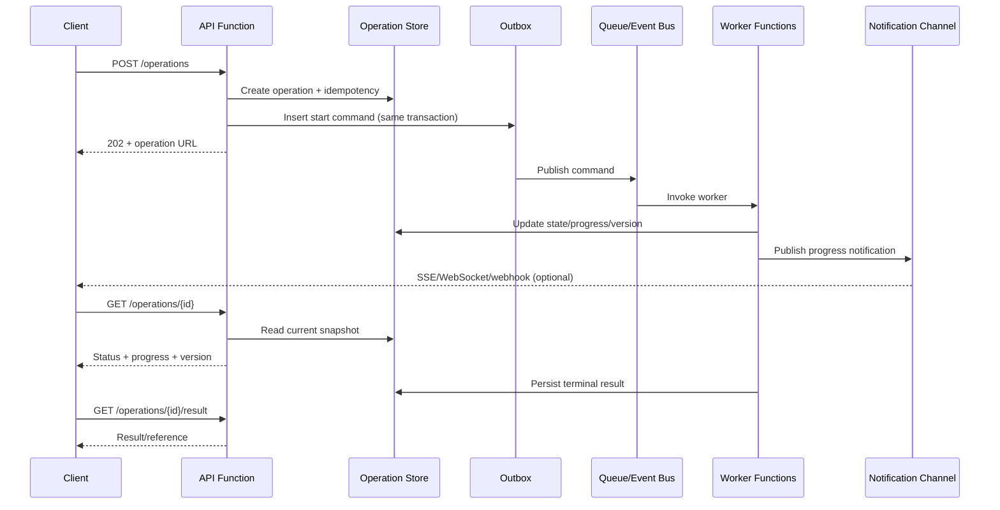
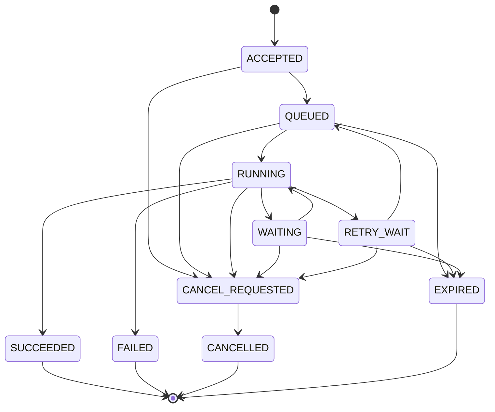

# Tracking Processing Progress and Notifying Clients of Results

A client requesting large data processing, report generation, file imports, or workflow execution may wait seconds, minutes, or even hours. Keeping an HTTP request open for that entire duration invites timeouts at gateways, clients, proxies, or function runtimes. A better model accepts the request quickly, returns an operation identifier, processes asynchronously, and exposes APIs for clients to track progress and retrieve final results.

In a serverless architecture, each invocation may finish before business work completes. Subsequent functions may execute on different execution environments. Progress and state must therefore be stored durably; you cannot rely on static variables, in-JVM sessions, or the initial HTTP connection. Queues, event buses, or workflow orchestrators coordinate steps; an operation store holds authoritative state; polling, Server-Sent Events (SSE), WebSockets, or webhooks deliver updates to clients.

This lesson builds an end-to-end operation tracking model for Java FaaS. We will design the async API, state machine, progress model, durable event log, versioned updates, client notification channels, cancellation/retry/expiry handling, security, testing, and operations.

## 1. Problem Statement and Design Goals

### 1.1. Why Not Keep the Request Open?

A synchronous HTTP request fits short, strictly bounded work. For long-running tasks, common problems include:

- API Gateways or reverse proxies time out before processing finishes.
- Clients close the app, lose connectivity, or background the tab.
- Function runtimes enforce execution duration limits.
- Client retries launch duplicate runs while the first is still running.
- Workflows span multiple steps or wait for external events.
- A single HTTP response cannot reliably report incremental progress.

Holding connections open does not make work more durable. If a connection drops, the client cannot tell whether the operation stopped or kept running.

### 1.2. Asynchronous Request-Response Pattern

General flow:

1. Client sends a request to start work.
2. API authenticates, validates the request, and checks the idempotency key.
3. Service creates a durable operation record and enqueues a command in the same transaction via outbox.
4. API returns `202 Accepted`, `operationId`, and tracking URLs.
5. Workers/functions execute steps, update progress, and emit progress events.
6. Client polls or receives push updates.
7. Upon completion, the operation saves the result or a reference to it.
8. Client fetches the result through an authorized API.



### 1.3. Design Principles to Preserve

- **Durability:** operations remain trackable across function exits or retries.
- **Truthfulness:** progress reflects real completed work; never fabricate percentage increments to feel faster.
- **Monotonicity:** versions and progress never regress due to stale events.
- **Idempotency:** redelivered requests or events never create duplicate operations or side effects.
- **Authorization:** only authorized principals view operations and results.
- **Resilience:** client disconnects never lose work; notification failures never lose results.
- **Bounded cost:** do not write progress too frequently or trigger an invocation per single percent.

## 2. Operation Resource and API Contract

### 2.1. An Operation as a First-Class Resource

Instead of treating the initial request as the entire task, create a resource representing the operation. Clients receive an `operationId` and can query status repeatedly.

Example:

```http
POST /v1/reports
Idempotency-Key: 1e6d9c8f-6d6a-4e35-9a52-3c0a1c1c8a01
Content-Type: application/json

{
  "reportType": "monthly-sales",
  "period": "2026-10",
  "format": "csv"
}
```

Response:

```http
HTTP/1.1 202 Accepted
Location: /v1/operations/op_01JREPORT9X
Retry-After: 3
Content-Type: application/json

{
  "operationId": "op_01JREPORT9X",
  "status": "QUEUED",
  "statusUrl": "/v1/operations/op_01JREPORT9X",
  "resultUrl": "/v1/operations/op_01JREPORT9X/result"
}
```

`202 Accepted` only means the service accepted responsibility per contract. It does not assert the report has started or will definitely succeed. Never return `202` before durably saving the operation and safely scheduling it.

### 2.2. Reading Status

```http
GET /v1/operations/op_01JREPORT9X
If-None-Match: "op_01JREPORT9X-v12"
```

Illustrative response:

```http
HTTP/1.1 200 OK
ETag: "op_01JREPORT9X-v13"
Retry-After: 5
Content-Type: application/json

{
  "operationId": "op_01JREPORT9X",
  "status": "RUNNING",
  "progress": {
    "phase": "EXPORTING",
    "percent": 65,
    "completedUnits": 65000,
    "totalUnits": 100000,
    "unit": "rows"
  },
  "createdAt": "2026-11-17T08:00:00Z",
  "startedAt": "2026-11-17T08:00:02Z",
  "updatedAt": "2026-11-17T08:02:10Z",
  "version": 13
}
```

If the version is unchanged, the API can return `304 Not Modified` when the client sends `If-None-Match`. `Retry-After` is a polling interval hint, not an exact guarantee.

### 2.3. Fetching Results

```http
GET /v1/operations/op_01JREPORT9X/result
```

- If the operation is non-terminal: return `409 Conflict` or `202 Accepted` per API contract, along with the status URL.
- If succeeded: return a small inline result or an authorized download URL.
- If failed: return an error resource with a stable error code and safe support details.
- If results have passed retention: return a clear status such as `410 Gone`.

Never return long-lived presigned URLs or public object URLs for sensitive data. Mint short-lived URLs only after authorizing the client.

### 2.4. Cancelling an Operation

```http
DELETE /v1/operations/op_01JREPORT9X
```

The API can return `202 Accepted` with `CANCEL_REQUESTED` because stopping workers is asynchronous. If work already finished, return the current state per contract without pretending results can be undone.

### 2.5. API Contract and Status Codes

| Scenario | Suggested HTTP Status | Meaning |
| --- | ---: | --- |
| Operation created successfully | 202 | Operation accepted and persisted |
| Invalid request | 400/422 | Validation failed |
| Idempotency key reused with different payload | 409 | Conflict |
| Client lacks permission | 403 or 404 | Per anti-enumeration policy |
| Operation incomplete | 202/409 | Final result not ready |
| Operation missing/expired | 404/410 | Resource unavailable |
| Poll with no changes | 304 | Snapshot unchanged |
| Overload/admission rejected | 429/503 | Client should retry per guidance |

Keep response schemas and error codes stable so clients never depend on free-form message text.

## 3. State Machine for Operations

### 3.1. Core States

A practical state machine may include:

| State | Meaning | Terminal? |
| --- | --- | --- |
| `ACCEPTED` | Request valid and operation created | No |
| `QUEUED` | Waiting for a worker to pick up | No |
| `RUNNING` | Executing | No |
| `WAITING` | Waiting on dependency/event/timer | No |
| `RETRY_WAIT` | Waiting to retry after transient failure | No |
| `CANCEL_REQUESTED` | Cancellation request received | No |
| `SUCCEEDED` | Completed successfully | Yes |
| `FAILED` | Ended in failure | Yes |
| `CANCELLED` | Stopped safely | Yes |
| `EXPIRED` | Exceeded processing deadline per policy | Yes |

Terminal states must never transition back to `RUNNING`. To re-run, create a new operation or a clearly defined retry/recovery generation.

### 3.2. Valid Transitions



Transitions must check preconditions at the persistence boundary. For instance, an old worker must never write `SUCCEEDED` after the operation was cancelled or a new worker acquired a fresh lease.

### 3.3. State Transitions Must Be Atomic

Use version/CAS or conditional updates:

```sql
UPDATE operation
SET status = :newStatus,
    version = version + 1,
    updated_at = CURRENT_TIMESTAMP
WHERE operation_id = :operationId
  AND version = :expectedVersion
  AND status IN ('QUEUED', 'RUNNING', 'WAITING');
```

If update count equals 0, the worker must re-read the latest state and handle the conflict. Never overwrite with a stale snapshot.

### 3.4. State and Progress Are Distinct Concepts

`RUNNING` is a lifecycle state. Progress indicates completion within the current phase. Never infer success solely because progress hits 100%; state transitions to `SUCCEEDED` only after outputs are committed and verified.

## 4. Designing an Honest Progress Model

### 4.1. Progress Needs Semantics

A percentage is meaningless without a denominator. Progress should specify:

- current phase;
- completed units;
- total units if known;
- unit name (rows, files, records, pages, steps...);
- update timestamp;
- version/sequence;
- safe client-facing message if needed.

For instance, `650/1000 files` can be far more trustworthy than `65%` when file count is what is actually measured.

### 4.2. Multi-Phase Progress

A workflow might consist of:

1. `VALIDATING` — 5% weight.
2. `FETCHING` — 20%.
3. `TRANSFORMING` — 35%.
4. `PERSISTING` — 30%.
5. `FINALIZING` — 10%.

Overall percentage can combine phase weights when phase workloads are reasonably predictable. When phase durations vary widely, showing explicit phases and unit counts is usually more honest than fabricated precision percentages.

### 4.3. When Totals Are Unknown

For unbounded streams, unknown-total pagination, or workflows waiting on external events, reliable percentages cannot be computed. Use indeterminate progress:

```json
{
  "phase": "WAITING_FOR_PROVIDER",
  "percent": null,
  "message": "Waiting for confirmation from external system"
}
```

Clients should render a spinner/phase state rather than interpolating percentages locally.

### 4.4. Progress Must Not Regress Arbitrarily

Progress should be monotonic within a phase/generation. Starting a new phase can keep overall percentage flat or advance it by weight. If a phase must re-run, expose `attempt`/`generation` instead of silently jumping backward from 80% to 20%.

### 4.5. Throttling Progress Update Frequency

Do not write to the database and publish events for every single record when workloads span millions of records. Update based on:

- batch size;
- minimum elapsed interval between updates;
- percentage delta;
- phase transitions;
- heartbeats during long steps.

For example, publish only when progress advances by at least 1% or 2 seconds have elapsed, unless a major phase transition occurs. Pick thresholds balancing client UX and cost budgets.

## 5. Durable Data Model

### 5.1. Operation Snapshot

Snapshots store the latest state for fast `GET` lookups:

```sql
CREATE TABLE operation (
    operation_id VARCHAR(80) PRIMARY KEY,
    owner_subject VARCHAR(200) NOT NULL,
    operation_type VARCHAR(100) NOT NULL,
    status VARCHAR(32) NOT NULL,
    phase VARCHAR(80),
    completed_units BIGINT,
    total_units BIGINT,
    unit_name VARCHAR(40),
    percent SMALLINT,
    result_reference VARCHAR(500),
    error_code VARCHAR(100),
    error_reference VARCHAR(200),
    version BIGINT NOT NULL,
    attempt INTEGER NOT NULL DEFAULT 0,
    created_at TIMESTAMP NOT NULL,
    started_at TIMESTAMP,
    updated_at TIMESTAMP NOT NULL,
    completed_at TIMESTAMP,
    expires_at TIMESTAMP
);
```

`owner_subject` is an internal identity or normalized subject from the identity provider. Never treat `operationId` as authorization.

### 5.2. Operation Event History

Snapshots show only current state. Event history enables investigation:

```sql
CREATE TABLE operation_event (
    operation_id VARCHAR(80) NOT NULL,
    sequence_no BIGINT NOT NULL,
    event_id VARCHAR(100) NOT NULL UNIQUE,
    event_type VARCHAR(80) NOT NULL,
    phase VARCHAR(80),
    progress_payload JSON,
    occurred_at TIMESTAMP NOT NULL,
    PRIMARY KEY (operation_id, sequence_no)
);
```

If your database lacks a native `JSON` type, use the equivalent column type. Event history can be partitioned/TTL-expired per retention. Never store sensitive business payloads inside progress events.

### 5.3. Outbox for Progress Notifications

When updating the operation snapshot and emitting events, write the operation update and outbox row in the same transaction. Publishing directly after commit risks function crashes leaving clients without updates even though the snapshot changed.

Outbox publishers can emit duplicates; consumers/client notification layers must deduplicate by `eventId` or `sequenceNo`.

### 5.4. Snapshots and Event Logs Serve Different Purposes

- Snapshots optimize `GET` queries for current state.
- Event history supports timelines, audits, replays, and investigations.
- Outboxes guarantee committed state and notifications stay aligned.
- Notification channels are merely transports, never authoritative sources of state.

## 6. Java Models and Repositories

### 6.1. Operation Status Records

```java
import java.time.Instant;

public enum OperationState {
    ACCEPTED,
    QUEUED,
    RUNNING,
    WAITING,
    RETRY_WAIT,
    CANCEL_REQUESTED,
    SUCCEEDED,
    FAILED,
    CANCELLED,
    EXPIRED;

    public boolean terminal() {
        return this == SUCCEEDED
                || this == FAILED
                || this == CANCELLED
                || this == EXPIRED;
    }
}

public record OperationProgress(
        String phase,
        Long completedUnits,
        Long totalUnits,
        String unit,
        Integer percent,
        String safeMessage) {
}

public record OperationSnapshot(
        String operationId,
        String ownerSubject,
        OperationState state,
        OperationProgress progress,
        long version,
        int attempt,
        Instant createdAt,
        Instant updatedAt,
        Instant expiresAt,
        String resultReference,
        String errorCode) {
}
```

`safeMessage` contains only sanitized text—never stack traces, SQL, secrets, or raw exception messages.

### 6.2. Repository Contract

```java
public interface OperationRepository {
    OperationSnapshot find(String operationId);

    boolean updateProgress(
            String operationId,
            long expectedVersion,
            OperationProgress progress);

    boolean recordProgressAndEnqueueContinuation(
            String operationId,
            long expectedVersion,
            OperationProgress progress);

    boolean transition(
            String operationId,
            long expectedVersion,
            OperationState expectedState,
            OperationState newState);

    boolean confirmCancelled(String operationId, long expectedVersion);

    boolean completeIfRunning(String operationId, String resultReference);
}
```

Implementations must perform conditional updates atomically, increment `version`, and insert operation events/outbox rows in the same transaction. Never implement by loading an entity and saving without optimistic locking.

### 6.3. Validating Progress Inputs

```java
public final class ProgressValidator {
    public void validate(OperationProgress progress) {
        if (progress.completedUnits() != null && progress.completedUnits() < 0) {
            throw new IllegalArgumentException("completedUnits must be non-negative");
        }
        if (progress.totalUnits() != null && progress.totalUnits() < 0) {
            throw new IllegalArgumentException("totalUnits must be non-negative");
        }
        if (progress.completedUnits() != null
                && progress.totalUnits() != null
                && progress.completedUnits() > progress.totalUnits()) {
            throw new IllegalArgumentException("completedUnits exceeds totalUnits");
        }
        if (progress.percent() != null
                && (progress.percent() < 0 || progress.percent() > 100)) {
            throw new IllegalArgumentException("percent must be between 0 and 100");
        }
    }
}
```

If `totalUnits` is 0 or unknown, `percent` should be `null`/indeterminate per domain rules. Never divide by zero or falsely assume completion.

## 7. Safely Creating Operations from an HTTP API

### 7.1. Idempotency Keys

Clients can time out after `POST` before receiving a response. Clients retry the same request with the same `Idempotency-Key`. The server stores:

- key;
- owner subject;
- request hash/canonical payload hash;
- created operation ID;
- creation and expiration timestamps.

Same key + same payload returns the existing operation. Same key + different payload returns `409 Conflict`. Keys must be scoped by caller/tenant to avoid cross-customer collisions.

### 7.2. Transaction Creating Operation and Command

Within a single database transaction:

1. Claim the idempotency key via unique constraint.
2. Create the operation in `QUEUED` state.
3. Insert the outbox command for the worker.
4. Commit.

Return `202` only after commit. The publisher reads the outbox and sends to the queue. Even if publishing lags, the operation already exists in `QUEUED` and is observable.

### 7.3. Illustrative Java Service

```java
public record CreateOperationRequest(
        String operationType,
        String payloadReference) {
}

public record CreateOperationResponse(
        String operationId,
        OperationState status,
        String statusUrl,
        String resultUrl) {
}

public final class OperationApplicationService {
    private final OperationTransaction transaction;

    public OperationApplicationService(OperationTransaction transaction) {
        this.transaction = transaction;
    }

    public CreateOperationResponse create(
            String ownerSubject,
            String idempotencyKey,
            CreateOperationRequest request) {

        CreatedOperation created = transaction.createWithOutbox(
                ownerSubject, idempotencyKey, request);

        String id = created.operationId();
        return new CreateOperationResponse(
                id,
                created.state(),
                "/v1/operations/" + id,
                "/v1/operations/" + id + "/result");
    }
}
```

`OperationTransaction.createWithOutbox` must be a durable transaction enforcing idempotency/unique constraints and returning the existing operation on valid retries. Controllers map the response to HTTP `202` after the transaction commits.

## 8. Workers Updating Progress in Java FaaS

### 8.1. Handlers Hold No In-Memory State

Workers receive `operationId`, load the snapshot, verify state/lease, and execute one batch. After each durable checkpoint, they update progress. If an invocation exits mid-way, the next invocation reads the checkpoint from the store.

### 8.2. Batch Checkpointing

Example processing 100,000 records in batches of 1,000:

```java
public record BatchResult(
        long completedUnits,
        long totalUnits,
        boolean complete) {
}

public interface ExportRepository {
    // Writes one idempotent batch and its durable checkpoint.
    BatchResult processNextBatch(String operationId, int batchSize);

    void finalizeOutput(String operationId);

    String resultReference(String operationId);
}

public interface OperationRepository {
    OperationSnapshot find(String operationId);

    boolean recordProgressAndEnqueueContinuation(
            String operationId,
            long expectedVersion,
            OperationProgress progress);

    boolean confirmCancelled(String operationId, long expectedVersion);

    boolean completeIfRunning(String operationId, String resultReference);
}

public final class ExportWorker {
    private final OperationRepository operations;
    private final ExportRepository exports;

    public void handle(String operationId) {
        OperationSnapshot operation = operations.find(operationId);
        if (operation.state().terminal()) {
            return;
        }
        if (operation.state() == OperationState.CANCEL_REQUESTED) {
            operations.confirmCancelled(operationId, operation.version());
            return;
        }

        // One invocation processes one bounded batch, then exits.
        BatchResult batch = exports.processNextBatch(operationId, 1_000);
        OperationSnapshot current = operations.find(operationId);

        if (current.state() == OperationState.CANCEL_REQUESTED) {
            operations.confirmCancelled(operationId, current.version());
            return;
        }

        if (batch.complete()) {
            exports.finalizeOutput(operationId);
            // Mark SUCCEEDED only after the output is durable and validated.
            operations.completeIfRunning(
                    operationId, exports.resultReference(operationId));
            return;
        }

        Integer percent = batch.totalUnits() <= 0
                ? null
                : (int) Math.min(99.0,
                        ((double) batch.completedUnits() / batch.totalUnits()) * 100.0);
        OperationProgress progress = new OperationProgress(
                "EXPORTING", batch.completedUnits(), batch.totalUnits(), "rows",
                percent, "Exporting data");

        boolean recorded = operations.recordProgressAndEnqueueContinuation(
                operationId, current.version(), progress);
        if (!recorded) {
            OperationSnapshot latest = operations.find(operationId);
            if (latest.state() == OperationState.CANCEL_REQUESTED) {
                operations.confirmCancelled(operationId, latest.version());
                return;
            }
            if (!latest.state().terminal()) {
                throw new IllegalStateException(
                        "Operation changed concurrently; retry from durable checkpoint");
            }
        }
    }
}
```

This is an illustrative skeleton; production implementations require atomic transactions/leases/checkpoints, timeout budgets, and conditional terminal transitions. Each invocation handles one bounded batch and exits. `processNextBatch` must be idempotent and persist a durable checkpoint so redeliveries never double-write. `recordProgressAndEnqueueContinuation` succeeds only while the operation is still `RUNNING` and versions match; the repository writes the snapshot, event history, and next command to the outbox in one transaction. On CAS failure, the worker re-reads state to handle cancellations or stale leases instead of continuing to write. `completeIfRunning` must also be conditional so stale workers cannot overwrite `CANCELLED` or other terminal states. If `total` is unknown or 0, percentage is indeterminate; the `FINALIZING` phase and final transition represent the remaining work.

### 8.3. Splitting Work by Invocation Budget

When functions have execution limits, never try to cram an entire workload into one invocation. Workers process one batch, save checkpoints, and enqueue continuations or let a workflow orchestrator invoke the next step.

Choose batch sizes based on:

- p95 batch duration;
- memory/CPU;
- downstream rate limits;
- retry blast radius;
- checkpoint overhead;
- remaining function timeout.

### 8.4. Heartbeats for Long-Running Tasks

If an operation runs long without clear progress units, workers can update a `lastActivityAt`/phase heartbeat. Heartbeats confirm liveness, not advancing percentages.

Heartbeats should run at intervals sparse enough to avoid write amplification. When a heartbeat goes stale, a watchdog inspects the lease and decides on retry/recovery; never launch a second worker automatically while the first might still be active.

## 9. Client Notification Channels

### 9.1. Polling

Clients call `GET` status respecting `Retry-After` or backoff with jitter.

Pros:

- simple, stateless, and easy to scale;
- traverses most proxies and firewalls;
- clients can reconnect anytime;
- current snapshots do not depend on open connections.

Cons:

- generates repeated requests and cost when many clients poll aggressively;
- updates are not instantaneous;
- requires rate limits and caching/`ETag`.

Polling is usually a solid baseline for long operations with moderate update rates.

### 9.2. Server-Sent Events (SSE)

SSE opens a one-way streaming HTTP response from server to browser/client. Ideal when servers only push progress updates.

```http
GET /v1/operations/op_01JREPORT9X/events
Accept: text/event-stream
Last-Event-ID: 13
```

Illustrative stream:

```text
id: 14
event: progress
data: {"status":"RUNNING","phase":"EXPORTING","percent":70,"version":14}

id: 15
event: completed
data: {"status":"SUCCEEDED","resultUrl":"/v1/operations/op_01JREPORT9X/result","version":15}

```

SSE supports reconnecting with `Last-Event-ID`. Servers must retain enough event history to resume; if events expired past retention, send a snapshot/reset event and continue.

In serverless environments, connection duration limits, gateway capabilities, and concurrent connection quotas can constrain SSE. Not every FaaS/API gateway supports streaming responses identically; verify platform limits.

### 9.3. WebSockets

WebSockets fit continuous bidirectional communication: clients subscribe, send cancel/control commands, and receive progress. However, you must manage connection lifecycles, reconnects, authorization, fan-out, idle timeouts, and connection registries.

Functions computing progress should never rely on a single JVM holding sockets. Use a managed WebSocket gateway/connection manager or dedicated service; store connection IDs, owners, and expirations in a shared store.

### 9.4. Webhook Callbacks

Webhooks suit server-to-server integrations. Clients register callback URLs; the system posts events on state changes.

Webhooks require:

- endpoint ownership verification and HTTPS;
- SSRF protection when accepting client-supplied URLs;
- payload signing with dedicated secrets/keys;
- timestamps, signatures, and replay protection;
- bounded retries, backoff, and DLQs;
- idempotency/event IDs so receivers can deduplicate;
- short timeouts and clear response contracts.

Never treat webhook delivery as the primary state source. Clients still need `GET` operation endpoints to reconcile.

### 9.5. Choosing a Channel by Need

| Channel | Best Fit | Considerations |
| --- | --- | --- |
| Polling | Most async APIs; simple rollout | Rate limits, `Retry-After`, `ETag` |
| SSE | UI needing continuous one-way updates | Gateway streaming, reconnects, event retention |
| WebSocket | Bidirectional continuous interaction | Connection lifecycle, registry, auth |
| Webhook | Server-to-server callbacks | Signatures, SSRF, retries, receiver idempotency |
| Email/push | Offline user notifications | Does not replace operation status APIs |

Polling can serve as a fallback even when SSE, WebSockets, or webhooks are available.

## 10. Client Implementation and Reconnection

### 10.1. Polling with Backoff

Clients should never poll every 100 ms. Honor `Retry-After`, add jitter, and stop at terminal states.

Illustrative JavaScript pseudocode:

```javascript
async function watchOperation(statusUrl, signal) {
  let delayMs = 1000;
  let etag = undefined;

  while (!signal.aborted) {
    const headers = etag ? { "If-None-Match": etag } : {};
    const response = await fetch(statusUrl, { headers, signal });

    if (response.status === 304) {
      // No snapshot change; keep waiting.
    } else if (response.ok) {
      const snapshot = await response.json();
      etag = response.headers.get("ETag") ?? etag;
      renderProgress(snapshot);

      if (["SUCCEEDED", "FAILED", "CANCELLED", "EXPIRED"]
          .includes(snapshot.status)) {
        return snapshot;
      }
    } else if (response.status === 429 || response.status === 503) {
      // Respect Retry-After where present.
    } else {
      throw new Error(`Status lookup failed: ${response.status}`);
    }

    const retryAfter = Number(response.headers.get("Retry-After"));
    const base = Number.isFinite(retryAfter) && retryAfter > 0
      ? retryAfter * 1000
      : delayMs;
    const jitter = Math.random() * Math.min(base, 1000);
    await new Promise(resolve => setTimeout(resolve, base + jitter));
    delayMs = Math.min(delayMs * 2, 15000);
  }

  return null;
}
```

This is a browser example; real applications must handle `AbortSignal`, offline networks, auth token refreshes, and tab visibility/background policies. If the server sends `Retry-After` as an HTTP date, parse it properly rather than assuming seconds.

### 10.2. Clients Must Not Infer Terminal State

Never treat 100% progress as success. Rely strictly on terminal `status`. On `FAILED`, display safe error codes and remediation guidance; never expose stack traces or raw exceptions.

### 10.3. Reconnecting After Going Offline

When reopening the app, clients read the `GET` snapshot first. If a timeline is needed, fetch event history from `afterSequence`. Never assume every push notification arrived while offline.

### 10.4. Client-Initiated Cancellation

Clients can send `DELETE`, while the UI should display `Cancellation requested` until the server confirms `CANCELLED`. If work entered an uncancellable critical section, the server may return `SUCCEEDED` or `FAILED` once safe steps complete.

## 11. Progress Event Contract and Ordering

### 11.1. Event Schema

Example:

```json
{
  "eventId": "opevt_14",
  "operationId": "op_01JREPORT9X",
  "sequence": 14,
  "type": "PROGRESS_UPDATED",
  "status": "RUNNING",
  "phase": "EXPORTING",
  "completedUnits": 70000,
  "totalUnits": 100000,
  "unit": "rows",
  "occurredAt": "2026-11-17T08:02:30Z"
}
```

### 11.2. Sequence Numbers

Each operation maintains a monotonically increasing sequence/version. If a client receives sequence 16 and later receives 15, discard 15 or use it to detect gaps. If a full timeline is required on gaps, query the history API from the last processed sequence.

Never rely strictly on timestamps for ordering due to clock skew, publish delays, and out-of-order callbacks.

### 11.3. Snapshots + Event Streams

Snapshots provide current state; event streams deliver updates. Clients can:

1. `GET` the snapshot and note version `V`.
2. Subscribe to events with `afterSequence=V`.
3. Apply events with sequences greater than `V`.
4. If a gap appears, re-fetch history/snapshot.

If subscribing first and `GET`ting afterward, deduplicate by sequence to avoid races between the two steps.

### 11.4. Never Publish Events Before Commit

If a progress event publishes before the snapshot commits, clients can observe updates absent from `GET`. Persist snapshot + event history + outbox in the same transaction, then let the publisher emit post-commit.

## 12. Results, Artifacts, and Retention

### 12.1. Result References

Large results like CSVs, PDFs, or archives belong in object storage while the operation stores a reference. `GET` result authorizes the owner, verifies `SUCCEEDED` state, and mints a short-TTL download URL.

### 12.2. Result Metadata

Can include:

- content type;
- file size;
- checksum;
- generated timestamp;
- storage key/reference;
- schema/version;
- retention/expiry.

Omit internal storage paths or bucket names unless required.

### 12.3. Retention Policies

Operation status and results may have different retention windows. For instance, status metadata may outlive export files; event history follows audit requirements. Upon expiration, delete results via lifecycle rules and transition the operation to `EXPIRED` or keep a tombstone so clients know the resource expired.

### 12.4. Error Resources

Error responses should contain:

- stable `errorCode`;
- safe message;
- `retryable` flag if helpful to clients;
- support/reference ID;
- failed phase if safe to disclose.

Never return stack traces, database hostnames, internal ARNs, or secrets.

## 13. Cancellation and Deadlines

### 13.1. Cancellation Is Cooperative

A FaaS invocation may not stop immediately just because a client closed a connection or sent `DELETE`. Workers must poll cancel flags at safe checkpoints.

### 13.2. Checkpoint Cancellation

For batch jobs:

1. API transitions the operation to `CANCEL_REQUESTED` via conditional update.
2. Worker checks state before starting the next batch.
3. Worker halts admitting new work.
4. Worker commits/rolls back the current batch per transaction boundaries.
5. Worker saves checkpoint and transitions to `CANCELLED` if safely stopped.

If a side effect already dispatched to an external provider cannot be cancelled, record its state and compensate if domain rules require.

### 13.3. Deadlines and Expiration

Operations should define a deadline or `expiresAt`. Deadlines can differ from queue retention and result retention. Workers should not keep incurring cost for expired work; watchdogs can mark `EXPIRED` when remaining time cannot complete the operation.

### 13.4. Cancellation Racing with Completion

A client sends cancel right as a worker prepares to commit success. Use conditional transitions and define clear linearization points:

- if success commits first, cancel sees the completed state;
- if cancel claims first before critical side effects, the worker stops;
- if side effects are irreversible, enter an explicit intermediate/compensation state.

Never allow two invocations to write conflicting terminal states.

## 14. Multi-Step Workflows and Progress Aggregation

### 14.1. Orchestration vs. Choreography

For workflows with strict ordering, timeouts, retries, and compensation, orchestrators/state machines manage transitions cleanly. For loosely coupled independent events, choreography over an event bus can be simpler.

Never force clients to orchestrate backend steps. Clients track the aggregate operation without knowing internal functions.

### 14.2. Aggregating Child Operations

A parent operation can coordinate multiple child tasks:

| Child | State | Weight |
| --- | --- | ---: |
| Validate input | SUCCEEDED | 10% |
| Fetch source data | SUCCEEDED | 20% |
| Transform partitions | RUNNING | 40% |
| Persist output | QUEUED | 20% |
| Publish completion event | QUEUED | 10% |

Parent progress can sum weights of completed children plus fractional progress of running children. When child workloads vary wildly, display phase/child statuses rather than assuming weights match wall-clock time.

### 14.3. Fan-Out / Fan-In

When splitting an operation into `N` partitions:

- parent persists partition list/manifest;
- each child has its own idempotency key;
- children update their own state/version;
- an aggregator computes parent state from child snapshots/events;
- parent transitions to `SUCCEEDED` only once completion criteria hold;
- child failures follow explicit fail-fast, retry, or partial-success policies.

Never allow two aggregators to update the parent without CAS/transactions. Duplicate events must never double-count child completions.

### 14.4. Partial Success

An import might succeed on 98/100 files. The domain must decide whether that is `SUCCEEDED_WITH_WARNINGS`, `PARTIAL_SUCCESS`, or `FAILED`. Do not lump everything into `SUCCEEDED` if clients must know records were skipped.

If adding a `PARTIAL_SUCCESS` state, specify whether it is terminal and where the result contract exposes the error list.

## 15. Securing Operation APIs

### 15.1. Operation IDs Are Not Access Tokens

Unpredictable IDs impede enumeration but do not replace authorization. Every `GET`, `DELETE`, event stream, and result download must verify principal permissions on that operation.

### 15.2. Owner/Tenant Isolation

Operation records store `owner_subject`/tenant. Scope queries by owner directly at persistence:

```sql
SELECT *
FROM operation
WHERE operation_id = :operationId
  AND owner_subject = :authenticatedSubject;
```

Avoid reading records first and checking ownership only in a branch that could be bypassed. For service-to-service calls, define scopes/roles authorized to view operations on a tenant's behalf.

### 15.3. Progress Messages Must Not Leak Data

Progress text should use normalized strings such as "Processing file 3/10". Never include private filenames, emails, SQL, record contents, or internal endpoints in client-facing events unnecessarily.

### 15.4. Webhook Callback Security

Customer-configured webhook URLs pose SSRF risks. Validate schemes/hosts, block private/link-local/metadata IPs per policy, guard against DNS rebinding, and apply egress controls. Sign callbacks, rotate secrets, and never embed client credentials in URLs.

### 15.5. SSE/WebSocket Authorization

Authenticate on connection open and verify operation scope on subscribe. If tokens expire during long connections, enforce re-auth or close policies. Never trust client-sent operation IDs while skipping ownership checks.

## 16. Observability and Operations

### 16.1. Key Metrics

- operations accepted/completed/failed/cancelled/expired;
- queue wait time;
- operation end-to-end duration;
- time spent per phase;
- progress update rate;
- worker attempt/retry counts;
- stale worker/lease conflicts;
- notification publish/delivery failures;
- polling requests per active operation;
- SSE/WebSocket concurrent connections and reconnects;
- result download/error rates.

Metric labels should carry operation type, phase, outcome, and environment; never use operation IDs, user IDs, or filenames as labels.

### 16.2. Structured Logs and Tracing

Logs should include:

- `operationId`;
- `correlationId`/`traceId`;
- `eventId` and sequence;
- `workerAttempt`;
- phase/state transitions;
- expected/actual versions;
- error categories;
- result reference hash or safe identifier.

Propagate trace context across queues/events. Long operations may outlive trace lifetimes; use correlation IDs and event history to link separate traces.

### 16.3. Alerts

Alert when:

- operations stay `QUEUED` too long;
- `RUNNING` operations lack heartbeats/checkpoints;
- oldest queue age breaches SLO;
- terminal failure rates spike;
- notification outbox backlogs grow;
- progress event sequence gaps rise;
- operations expire abnormally;
- result generation succeeds yet artifacts are missing;
- polling/connection traffic threatens API capacity.

### 16.4. Runbooks

Runbooks must document how to:

- look up operations by ID/correlation ID;
- inspect timelines and worker attempts;
- detect stuck workers/expired leases;
- inspect queues, outboxes, and DLQs;
- retry/resume from checkpoints;
- cancel operations and confirm terminal state;
- regenerate results safely when appropriate;
- reconcile artifacts with database state;
- handle notification delivery failures.

Never manually edit database state just to turn the UI green. Use audited administrative operations with invariant checks.

## 17. Testing

### 17.1. State Machine Unit Tests

Test every valid and invalid transition, terminal states, cancel races, retries, and expirations. Test version conflicts and stale updates.

### 17.2. Outbox and Status Integration Tests

Verify:

- `POST` creates operation and outbox rows in one transaction;
- publish retries do not create duplicate operations;
- workers update snapshot + event history + outbox atomically;
- `GET` reflects new versions post-commit;
- duplicate notification events are deduplicated;
- out-of-order events never regress state/progress.

### 17.3. Failure Injection

Simulate:

- function crashes after processing a batch before ack;
- timeouts after writing outputs before marking success;
- duplicate queue messages;
- worker lease expirations while old workers still run;
- notification publisher outages;
- SSE/WebSocket disconnects;
- webhook endpoints returning 500 or timing out;
- missing/expired result artifacts;
- client `POST` retries with matching and conflicting payloads.

### 17.4. Load Testing

Measure concurrent operations, progress update frequency, polling rates, DB reads/writes, event throughput, and connection counts. Test both many short operations and fewer ultra-long operations; the two profiles have distinct cost/latency characteristics.

### 17.5. Client Contract Testing

Verify:

- `202` + `Location` parsing;
- `Retry-After` and `ETag`/`304`;
- reconnecting via `Last-Event-ID`;
- sequence gap recovery;
- terminal state/result fetching;
- `403`/`404`/`410` handling;
- cancel requested vs. cancelled;
- offline resume from snapshots.

## 18. Cost and Performance

### 18.1. Cost Drivers

- operation store reads/writes;
- outbox/event bus/queue requests;
- worker invocations and billed duration;
- progress event volume;
- polling request volume;
- SSE/WebSocket connection duration;
- notification/webhook retries;
- result storage and data transfer;
- log/trace/metric ingestion.

### 18.2. Reducing Write Amplification

Write progress only on meaningful changes, coalesce updates by batch/time window, and space out heartbeats. Snapshot `GET`s can use short caches or `ETag`s to trim payloads; never cache long enough for clients to see stale state.

### 18.3. Polling Intervals

If 100,000 clients poll every second, the API absorbs 100,000 requests/second even if operations update only a few times per minute. Use `Retry-After`, jitter, adaptive polling, and push channels for clients needing real-time updates.

### 18.4. Unit Economics

Track cost per operation and cost per successful operation, including retries, failed work, progress events, polling, and storage. Never optimize by dropping critical updates that leave clients unable to tell whether work is stuck or finished.

## 19. Step-by-Step Implementation Roadmap

1. Define operation types, owners, inputs, and business outcomes.
2. Define the state machine, terminal states, and cancellation semantics.
3. Design operation APIs (`POST`, `GET`, `GET` result, `DELETE`).
4. Build the operation store, idempotency table, and outbox.
5. Implement batch/checkpoint workers and timeout budgets.
6. Persist progress snapshots, event history, and sequence numbers.
7. Adopt polling as a baseline; add SSE/WebSockets/webhooks as needed.
8. Protect every endpoint with owner/tenant authorization.
9. Add result storage, expiration, and download authorization.
10. Add metrics, logs, traces, and runbooks.
11. Test duplicates, crashes, timeouts, cancel races, and notification outages.
12. Canary workloads, track SLOs/costs, and scale gradually.

## 20. Production Checklist

- [ ] Work-accepting APIs return `202` only after operations and commands are durably persisted.
- [ ] Clients receive operation ID, status URL, and result URL.
- [ ] `POST` supports idempotency keys and detects payload conflicts.
- [ ] Operation state machine defines valid transitions and clear terminal states.
- [ ] Snapshots expose version/`ETag`; updates use CAS/conditional writes.
- [ ] Progress carries phase/unit/total semantics and supports indeterminate states.
- [ ] Progress never regresses from stale events or stale workers.
- [ ] Snapshots, event history, and outbox entries persist consistently.
- [ ] Workers use checkpoints and never rely on local JVM state.
- [ ] Workers honor timeouts, retry budgets, leases, and cancel requests.
- [ ] `SUCCEEDED` is recorded only after results are durable and validated.
- [ ] Notification failures never lose operation results.
- [ ] Polling honors `Retry-After`, jitter, rate limits, and `ETag`/`304`.
- [ ] SSE/WebSockets define reconnects, auth, and connection lifecycles clearly.
- [ ] Webhooks enforce signatures, replay protection, SSRF controls, and DLQs.
- [ ] Clients can reconnect and recover state from snapshots/history.
- [ ] All status/result/cancel endpoints enforce owner/tenant authorization.
- [ ] Progress messages exclude sensitive data or internal errors.
- [ ] Result artifacts enforce TTLs, checksums, authorization, and retention.
- [ ] Metrics track queue wait, phase duration, failures, stale workers, and notify lag.
- [ ] Integration, failure, load, and client contract tests exist.
- [ ] Runbooks cover stuck operations, retry/resume, cancellation, DLQs, and missing artifacts.
- [ ] Cost per operation accounts for workers, stores, events, polling, and result storage.

## Conclusion

Tracking asynchronous work requires a durable operation resource, an explicit state machine, and meaningful progress semantics. APIs accept work quickly with `202 Accepted`; workers process in batches/checkpoints; snapshots serve current state; event history and outboxes broadcast changes; clients receive updates via polling, SSE, WebSockets, or webhooks.

Notifications are merely delivery vehicles; the operation store is the authoritative source. Clients must be able to reconnect and re-read snapshots after going offline; duplicates or out-of-order events must never roll back progress. `SUCCEEDED` is written only after results are durable and verified. Cancellation is cooperative at checkpoints, while authorization must be enforced on every endpoint.

With Java FaaS, break long jobs into small batches, store checkpoints and versions in shared storage, emit progress through an outbox, and throttle update frequency. Test crashes, duplicates, timeouts, cancel races, and notification outages before production. Clients can then track operations reliably even as function instances, HTTP connections, or notification channels change throughout the processing lifecycle.
