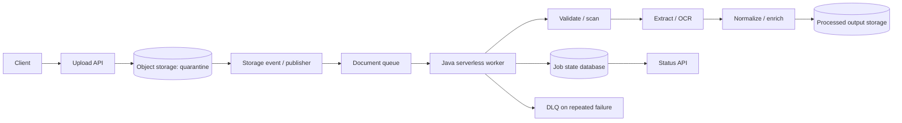

# Measuring Throughput, Queue Latency, and Cost per Document

A serverless document processing pipeline can ingest thousands of files in a short burst, push events onto a queue, and use Java functions to validate, extract content, invoke OCR, enrich metadata, and persist results. As load rises, operational questions extend well beyond whether functions run without crashing. The team needs to know how many documents per second the pipeline completes, how long documents wait in queues, whether backlogs are growing continuously, and how much each completed document costs.

This lab builds an end-to-end measurement model for a document event-processing pipeline. Learners define workloads, instrument producers and Java workers, measure throughput/queue latency/processing latency, calculate cost per successful document, execute load tests, and use findings to tune batch sizes, concurrency, retries, and downstream limits.

The goal is producing repeatable measurements that drive decisions. A high throughput number is meaningless if queue age climbs endlessly, failure rates spike, or cost per document balloons under load. Every result must therefore be evaluated alongside SLOs, data correctness, and dependency budgets.

## 1. Project Context and Goals

Suppose the team is building a service accepting customer documents. Clients upload files to object storage via an API/presigned URL. Once upload finishes, storage events or the API publish an event to a queue. A queue-triggered Java worker processes the document through these steps:

1. Verify metadata, tenant, and object version.
2. Validate file type, size, and checksum.
3. Run malware scanning or content policy checks.
4. Extract text/metadata or call an OCR service.
5. Enrich data, normalize it, and produce outputs.
6. Persist results, update job state, and emit a completion event.



In this project, the queue buffers between upload rates and processing rates. Workers scale with backlog, while OCR providers, databases, or object storage carry distinct limits. Thus we must measure both pipeline capacity and pressure placed on dependencies.

### Target Outcomes

After completing this lab, learners can:

- Distinguish offered throughput, accepted throughput, processing throughput, and successful completion throughput.
- Measure queue wait, processing duration, and end-to-end completion latency.
- Track backlogs, oldest-message age, retries, and DLQs.
- Compute cost per successful document across compute, queues, storage, databases, OCR, and networking.
- Design load tests covering baseline, ramp, spike, and soak workloads.
- Estimate required concurrency using Little's Law and service rates.
- Identify bottlenecks and tune batch sizes/concurrency without overloading downstream services.
- Make capacity/cost decisions grounded in SLOs and empirical measurements.

## 2. Defining Units of Measurement Before Running

One document can generate multiple messages: upload events, validation events, extraction events, and completion events. Therefore, message throughput does not equal document throughput. Choose one canonical unit: **one accepted document version**, identified by `tenantId + documentId + objectVersion` or an equivalent business key.

| Term | Definition |
|---|---|
| Offered documents | Documents the load generator or clients attempt to submit into the pipeline |
| Accepted documents | Documents acknowledged and durably persisted by the API |
| Enqueued documents | Documents whose events were successfully published to the queue |
| Started documents | Document versions that began worker processing for the first time |
| Attempt count | Total processing attempts, including retries/redeliveries |
| Completed documents | Unique document versions that completed business processing successfully |
| Failed documents | Document versions reaching terminal failure per policy |
| Throughput | Completed units per unit of time, e.g., documents/second |
| Queue wait | Elapsed time from message enqueue until a worker starts processing |
| Processing duration | Elapsed time for a worker to execute an attempt or stage |
| End-to-end latency | Elapsed time from API acceptance until the document reaches terminal state |
| Queue age | Age of the oldest waiting message or message-age distribution from broker telemetry |
| Cost per successful document | Total allocated pipeline cost divided by unique completed document versions |

### Count Unique Documents, Never Retries as Throughput

If a document runs three times before succeeding, business throughput is one completed document; attempt throughput is three attempts. Report both:

- `documents_completed_total`: unique document versions completed.
- `processing_attempts_total`: total attempts.
- `retry_attempts_total`: extra attempts caused by retries/redeliveries.

Never use ACKed message counts or successful invocation counts as proxies for completed documents. One invocation may process a batch of multiple documents, and one document may emit multiple events across different stages.

## 3. Designing Timestamps to Measure Latency

To compute queue wait and end-to-end latency, every job needs clearly defined timestamps:

| Timestamp | Meaning |
|---|---|
| `acceptedAt` | API durably recorded the job |
| `enqueuedAt` | Event published/accepted by the queue |
| `firstStartedAt` | First time a worker started processing the document version |
| `lastAttemptStartedAt` | Start of the most recent attempt |
| `completedAt` | Business processing succeeded |
| `terminalAt` | Job reached any terminal state, including final failure |

Core formulas:

\[
QueueWait = firstStartedAt - enqueuedAt
\]

\[
WorkElapsed = completedAt - firstStartedAt
\]

`WorkElapsed` includes retry wait intervals between attempts. Individual attempt duration is measured separately as `attemptCompletedAt - attemptStartedAt`; never conflate the two concepts.

\[
EndToEndLatency = completedAt - acceptedAt
\]

If a document traverses multiple stages/queues, measure queue wait and processing duration per stage while keeping end-to-end latency from initial acceptance to final completion. Total time may include retry waits, external API waits, or workflow step waits.

### Clocks and Timestamp Sources

Producer and worker clocks can drift. Synchronize clocks across runtimes/hosts, use timestamps generated by trusted services, and document timestamp provenance. When brokers expose native age metrics, cross-check against them. Never overwrite the initial `enqueuedAt` with retry timestamps; store attempt timestamps separately if measuring per-attempt waits.

In latency instrumentation, use `Instant` for wall-clock milestones and `System.nanoTime()` for elapsed durations within the same process. `nanoTime` is not an absolute timestamp and must never be transmitted across messages.

## 4. Building Job State and Measurement Data

The job state database is the canonical source for accepted/completed/failed document counts and business milestones. Telemetry metrics provide near-real-time visibility; they can be sampled, dropped, or double-counted on invocation crashes, so they do not replace the ledger/job state for official figures.

Condensed schema example:

```sql
CREATE TABLE document_job (
    tenant_id               VARCHAR(100) NOT NULL,
    document_id             VARCHAR(160) NOT NULL,
    object_version          VARCHAR(160) NOT NULL,
    status                  VARCHAR(32) NOT NULL,
    accepted_at             TIMESTAMP NOT NULL,
    enqueued_at             TIMESTAMP,
    first_started_at        TIMESTAMP,
    last_attempt_started_at TIMESTAMP,
    completed_at            TIMESTAMP,
    terminal_at             TIMESTAMP,
    attempt_count           INTEGER NOT NULL DEFAULT 0,
    output_ref              VARCHAR(500),
    last_error_code         VARCHAR(100),
    PRIMARY KEY (tenant_id, document_id, object_version)
);

CREATE INDEX idx_document_job_status_time
    ON document_job (status, accepted_at);
```

`TIMESTAMP` types, timezones, and index syntax depend on your database. In real systems, prefer UTC storage and consistent timezone semantics. Never use an object key alone as identity if the same key can be re-uploaded as a new version.

### Suggested Job States

| Status | Meaning |
|---|---|
| `ACCEPTED` | API validated and created the job |
| `QUEUED` | Event accepted by the queue |
| `PROCESSING` | Worker currently processing |
| `RETRY_WAIT` | Transient failure; scheduled for retry |
| `SUCCEEDED` | Document processed and outputs committed |
| `FAILED` | Terminal failure per policy |
| `QUARANTINED` | Isolated due to security/policy/format requiring review |
| `MANUAL_REVIEW` | Requires operator decision |

Count `SUCCEEDED` only after outputs and job state are durably persisted. If a function uploads output successfully but fails to update state, retries may re-create outputs; use deterministic output keys, version guards, or appropriate transactions/outboxes.

## 5. Designing the Event Contract for Measurement

Events must carry document identity, object version, and timestamps so workers can deduplicate, measure queue wait, and trace.

```json
{
  "eventId": "evt-doc-01JQ7M",
  "eventType": "DocumentUploaded",
  "schemaVersion": 1,
  "tenantId": "tenant-42",
  "documentId": "doc-10027",
  "objectRef": {
    "bucket": "documents-quarantine",
    "key": "tenant-42/doc-10027/source.pdf",
    "version": "v-17"
  },
  "documentType": "invoice",
  "sizeBytes": 482193,
  "pageCount": 4,
  "acceptedAt": "2026-11-17T09:00:00Z",
  "enqueuedAt": "2026-11-17T09:00:01Z",
  "correlationId": "upload-req-8d31"
}
```

IDs and values are dummy data. Never put document contents, access tokens, or unnecessary PII inside events. Events should contain only object references and minimal metadata; workers fetch files from storage using appropriately scoped execution identities.

### File Size and Document Type as Workload Dimensions

A 2-page PDF and a 300-page PDF have vastly different OCR/CPU costs. When benchmarking, segment by:

- `documentType`: invoice, form, image, contract, or supported categories.
- `sizeBucket`: bounded byte-size tiers.
- `pageCountBucket`: bounded page-count tiers.
- `processingPath`: text extraction, OCR, malware scan, or enrichment.

Use bounded-cardinality dimensions in metrics. Never put `documentId`, object keys, or unbounded tenant IDs into metric labels. Specific IDs belong in logs/traces with appropriate access controls and retention.

## 6. Defining the Lab Workload and SLOs

Before running load tests, define a workload reflecting real traffic rather than picking a single arbitrary RPS.

A workload must describe:

- Average and peak arrival rates.
- Burst sizes and burst durations.
- File size and page count distributions.
- Share of document types requiring OCR or heavy processing.
- Share of invalid/quarantined files.
- Tenant count and traffic distribution across tenants.
- Expected retry rates and dependency errors.
- Retention of inputs, outputs, and state records.

### Example Starting SLOs

The numbers below are sample targets for a lab environment; replace with your product's requirements:

| Indicator | Example Target |
|---|---|
| Accepted throughput | 40 documents/second at target load |
| Completed throughput | Sustain at least 38 documents/second post warm-up |
| Queue wait p95 | Under 30 seconds |
| End-to-end completion p95 | Under 180 seconds for standard document cohort |
| Terminal failure rate | Under 0.5% of valid documents |
| Retry ratio | Under 3% extra attempts over accepted documents |
| Oldest message age | Non-increasing; under 60 seconds at steady-state load |
| Cost per successful document | Within unit budget set by product owner |

SLOs require explicit cohorts. Mixing 2-page and 300-page documents can shift overall p95 purely from workload mix changes. Report latency both per document cohort and as an aggregate distribution.

## 7. Metrics to Instrument

### Throughput and Business Outcomes

- `documents_offered_total`: documents sent by the load generator.
- `documents_accepted_total`: documents persisted by the API.
- `documents_enqueued_total`: documents with published events.
- `documents_started_total`: documents entering processing for the first time.
- `documents_completed_total`: unique completed documents.
- `documents_failed_total`: terminally failed documents.
- `processing_attempts_total`: total attempts.
- `retry_attempts_total`: additional retry attempts.

### Latency and Backlog

- `document_queue_wait_seconds`: queue wait histogram.
- `document_processing_duration_seconds`: duration histogram by stage/attempt.
- `document_end_to_end_seconds`: accepted-to-terminal/success histogram.
- `queue_oldest_message_age_seconds`: age of oldest message.
- `queue_visible_messages`: waiting message count if exposed by broker.
- `queue_inflight_messages`: messages currently held by consumers.
- `document_retry_delay_seconds`: wait time between attempts.

### Resources and Dependencies

- Function invocations/concurrency/throttles/errors/duration.
- CPU/memory/GC/thread counts if exposed by runtime.
- Database connections/pool waits/query latency/transaction errors.
- OCR/API request rate, latency, quotas, and 429/5xx responses.
- Object storage `GET`/`PUT`/bytes and egress.
- Queue send/receive/delete/request counts.
- Log ingestion, trace volume, and exporter failures.

### Cost

- Compute duration and memory/CPU allocation.
- Invocation counts and queue requests.
- OCR pages/billable API units.
- Storage GB-months, requests, and lifecycle tiers.
- Database reads/writes/connections/IOPS.
- Network egress/NAT/private endpoints if billed.
- Log/metric/trace ingestion and retention.

Not every metric needs to be emitted by the application itself. Combine Java business metrics with platform metrics, broker metrics, database metrics, and billing/usage exports.

## 8. Calculating Throughput Properly

Throughput is completed documents per unit time, not total invocation count. Over a measurement window (T):

\[
CompletedThroughput = \frac{UniqueDocumentsCompleted}{T}
\]

If 10,000 document versions complete in 200 seconds, average throughput is 50 documents/second. Report accepted and completed throughput separately to see whether the system is accumulating backlog.

### Time-Windowed Measurement

Do not divide total completed documents since test start by total duration if the run includes warm-up, ramp-up, and cool-down. Instead:

1. Exclude warm-up from the steady-state window.
2. Bucket completions into 1-minute or 10-second intervals.
3. Compute the rate per bucket.
4. Report median/min/max or percentiles of per-bucket throughput.
5. Report total unique completions across the full run.

This shows whether throughput is sustained or merely a brief peak. Also distinguish throughput while producers are actively sending from backlog-drain throughput after producers stop.

### Multi-Stage Throughput

If the pipeline has validation, OCR, and enrichment stages, measure throughput per stage. Overall throughput is capped by the slowest stage or shared dependency. One stage may process 100 documents/s while OCR handles only 30 documents/s; the OCR queue will grow even when the validation queue sits nearly empty.

## 9. Measuring Queue Latency and Queue Stability

Queue wait is the time from when the broker receives a message until a consumer begins processing it. With reliable event timestamps:

\[
QueueWait = ConsumerStartedAt - EnqueuedAt
\]

Measure p50/p95/p99 rather than averages alone. A queue averaging a 2-second wait with a 10-minute p99 still violates SLAs for a subset of documents.

### Backlog and Oldest-Message Age

Queue depth indicates how many messages are waiting; oldest-message age shows how long the oldest message has waited. Track both:

- Rising backlog with stable age may indicate a brief burst being drained.
- Shrinking backlog with persistently high oldest age points to a stuck poison message or long-retrying item.
- Low backlog with low completion throughput indicates either low producer load or consumer blockage upstream.
- Continuously growing backlog under steady producer load means consumer capacity is below arrival rate.

Some brokers expose queue depth/age only as approximate or periodic metrics. Document precision and sampling intervals when analyzing results.

### Little's Law

Little's Law relates average in-system work, arrival rate, and residence time:

\[
L = \lambda \times W
\]

Where:

- (L): average documents/messages waiting or in progress within the measured boundary.
- λ: arrival rate (documents/second).
- (W): average time spent in the system (seconds).

For example, if the pipeline accepts 40 documents/second and average enqueue-to-completion time is 5 seconds:

\[
L = 40 \times 5 = 200\ documents
\]

Roughly 200 documents are waiting or in flight on average within that boundary. When latency rises while arrival rate holds steady, in-flight/backlog work rises proportionally.

### Estimating Queue Drain Time

If backlog is (B), aggregate consumer capacity is μ documents/second, and producers continue sending λ documents/second with μ > λ:

\[
DrainTime \approx \frac{B}{\mu - \lambda}
\]

If producers stop completely, the approximation simplifies to (B/\mu). For example, with a backlog of 12,000 documents, workers completing 80 documents/second, and producers still sending 20 documents/second, drain time is roughly 200 seconds. This is a steady-state estimate; retries, heavy documents, and scale-up delays can lengthen real drain times.

## 10. Estimating Concurrency and Capacity

Suppose one worker processes (b) documents on average in an invocation lasting (d) seconds. Average throughput per invocation slot is approximately:

\[
\mu_{slot} = \frac{b}{d}
\]

With (c) concurrent slots of comparable throughput:

\[
Capacity \approx c \times \frac{b}{d}
\]

For example, batch size 5, duration 2.5 seconds, concurrency 20:

\[
Capacity \approx 20 \times \frac{5}{2.5} = 40\ documents/second
\]

This is an estimation model. Processing time varies with file size, OCR, retries, and downstream behavior; raising concurrency can slow individual invocations due to contention.

### Sizing Concurrency with Little's Law

If the arrival rate is 40 documents/second and average processing time per document is 3 seconds, average in-flight concurrency is roughly 120 documents. If each invocation handles batches of 4 documents, estimated concurrent invocations are roughly 30, assuming batches process fairly uniformly.

Never set max concurrency based solely on function scaling limits. Check database connections, OCR quotas, API rate limits, memory, CPU, and object storage request rates. Dependencies are usually the true ceiling.

### Capacity Headroom

Provision capacity above peak arrival rates so queues can drain after bursts. Headroom must absorb retries and heavy documents without exceeding downstream budgets. Use queues as buffers and throttle worker concurrency to match quotas.

## 11. Calculating Cost per Successful Document

Cost per successful document is total cost attributed to the pipeline divided by unique completed document versions over the same measurement window.

\[
CostPerSuccess = \frac{TotalAllocatedPipelineCost}{UniqueSuccessfulDocuments}
\]

Total cost can include:

\[
\begin{aligned}
TotalCost ={}& Compute + Queue + Storage + Database \\
             &+ OCR/API + Network + Observability + Other
\end{aligned}
\]

Example benchmark run:

| Component | Illustrative Cost |
|---|---:|
| Java function compute/requests | 8.00 USD |
| Queue operations | 0.80 USD |
| Object storage requests/storage | 1.20 USD |
| Database | 2.50 USD |
| OCR provider | 12.00 USD |
| Network egress | 0.50 USD |
| Logs/metrics/traces | 1.00 USD |
| **Total** | **26.00 USD** |

If 10,000 unique documents complete:

\[
CostPerSuccess = \frac{26}{10000} = 0.0026\ USD/document
\]

Amounts only illustrate the math, not current cloud pricing. In practice, use usage exports/billing reports and provider rates for your exact region, tier, discounts, and retention.

### Include Retry and Failure Costs

The numerator must include cost incurred by failed documents, retries, and DLQs within the same pipeline scope. The denominator includes only unique successful documents. Dividing only final-attempt compute cost by successful documents understates unit cost.

Also report:

- `cost_per_accepted_document`: total cost / accepted documents.
- `cost_per_successful_document`: total cost / unique successful documents.
- `cost_per_failed_document`: attributed cost / terminally failed documents.
- `retry_cost_ratio`: retry cost / total cost.
- `ocr_cost_per_page`: OCR cost / pages processed.

### Allocating Shared Resource Costs

Databases, NAT gateways, collectors, or caches may serve multiple services. Define allocation rules by tags/cost centers, request counts, storage, compute time, or another explainable driver. Document which costs are directly measured vs. allocated, along with estimation error margins.

For short load tests, billing exports can lag. Use platform usage metrics to estimate during runs and reconcile against billing data once finalized.

## 12. Instrumenting the Java Worker

Applications should emit low-cardinality business metrics and attach per-stage timestamps. The example below uses the OpenTelemetry API to create counters and histograms. SDKs/exporters are configured once at runtime or via a Java agent/platform extension.

```java
import io.opentelemetry.api.GlobalOpenTelemetry;
import io.opentelemetry.api.common.AttributeKey;
import io.opentelemetry.api.common.Attributes;
import io.opentelemetry.api.metrics.LongCounter;
import io.opentelemetry.api.metrics.LongHistogram;
import io.opentelemetry.api.metrics.Meter;

import java.time.Duration;
import java.time.Instant;

public final class DocumentMetrics {
    private static final Meter METER =
            GlobalOpenTelemetry.getMeter("com.example.document-pipeline");

    private static final AttributeKey<String> STAGE =
            AttributeKey.stringKey("document.stage");
    private static final AttributeKey<String> TYPE =
            AttributeKey.stringKey("document.type");
    private static final AttributeKey<String> OUTCOME =
            AttributeKey.stringKey("processing.outcome");

    private static final LongCounter COMPLETED = METER.counterBuilder(
            "documents.completed")
            .setDescription("Unique document versions completed successfully")
            .setUnit("{document}")
            .build();

    private static final LongCounter ATTEMPTS = METER.counterBuilder(
            "documents.processing.attempts")
            .setDescription("Document processing attempts")
            .setUnit("{attempt}")
            .build();

    private static final LongHistogram QUEUE_WAIT = METER.histogramBuilder(
            "document.queue.wait")
            .ofLongs()
            .setUnit("ms")
            .build();

    private static final LongHistogram PROCESSING = METER.histogramBuilder(
            "document.processing.duration")
            .ofLongs()
            .setUnit("ms")
            .build();

    private static final LongHistogram END_TO_END = METER.histogramBuilder(
            "document.end_to_end.duration")
            .ofLongs()
            .setUnit("ms")
            .build();

    private DocumentMetrics() {}

    public static void attemptStarted(String stage, String type) {
        ATTEMPTS.add(1, Attributes.of(STAGE, stage, TYPE, type));
    }

    public static void recordQueueWait(Instant enqueuedAt, Instant firstStartedAt,
                                       String stage, String type) {
        long millis = Math.max(0, Duration.between(enqueuedAt, firstStartedAt).toMillis());
        QUEUE_WAIT.record(millis, Attributes.of(STAGE, stage, TYPE, type));
    }

    public static void recordProcessing(long elapsedMillis, String stage,
                                        String type, String outcome) {
        PROCESSING.record(elapsedMillis,
                Attributes.of(STAGE, stage, TYPE, type, OUTCOME, outcome));
    }

    public static void completedOnce(String type) {
        COMPLETED.add(1, Attributes.of(TYPE, type));
    }

    public static void recordEndToEnd(Instant acceptedAt, Instant completedAt,
                                      String type) {
        long millis = Math.max(0, Duration.between(acceptedAt, completedAt).toMillis());
        END_TO_END.record(millis, Attributes.of(TYPE, type));
    }
}
```

Only use bounded, controlled values for `stage`, `type`, and `outcome`. Never add `documentId`, tenant ID, object key, or event ID as metric attributes.

### Measuring Processing Duration in the Service

```java
public ProcessingResult process(DocumentQueuedEvent event) {
    Instant startedAt = clock.instant();
    long startNanos = System.nanoTime();
    boolean firstStart = jobRepository.markAttemptStartedAndReturnFirst(event, startedAt);
    DocumentMetrics.attemptStarted("extract", event.documentType());
    if (firstStart) {
        DocumentMetrics.recordQueueWait(
                event.enqueuedAt(), startedAt, "extract", event.documentType());
    }

    try {
        ProcessingResult result = extractionService.extract(event.objectRef());
        jobRepository.commitSuccessIfCurrentVersion(event, result, startedAt);

        long elapsedMillis = TimeUnit.NANOSECONDS.toMillis(
                System.nanoTime() - startNanos);
        DocumentMetrics.recordProcessing(
                elapsedMillis, "extract", event.documentType(), "success");

        if (result.newlyCompleted()) {
            DocumentMetrics.completedOnce(event.documentType());
            DocumentMetrics.recordEndToEnd(
                    event.acceptedAt(), clock.instant(), event.documentType());
        }
        return result;
    } catch (RetryableProcessingException error) {
        long elapsedMillis = TimeUnit.NANOSECONDS.toMillis(
                System.nanoTime() - startNanos);
        DocumentMetrics.recordProcessing(
                elapsedMillis, "extract", event.documentType(), "retryable_error");
        throw error;
    }
}
```

This is a skeleton; `clock`, repositories, and services are injected by the application. `commitSuccessIfCurrentVersion` must commit output/job state idempotently. Metric counters can be dropped or duplicated if a process crashes near commit/export boundaries; official financial and completion totals should be aggregated from the unique job ledger or event audit log. Metric counters serve near-real-time operations.

### Separating First-Start from Attempt-Start

`markAttemptStartedAndReturnFirst` must update `firstStartedAt` conditionally while incrementing `attemptCount` and updating `lastAttemptStartedAt`; it returns `true` only on the very first start. Each redelivery increments `attemptCount` without re-recording initial queue wait. To measure retry wait time, store `retryScheduledAt` and `nextAttemptAt` or rely on broker age metrics.

## 13. Measuring Queue and Platform Metrics

Combine Java business metrics with broker and function platform metrics.

### With Amazon SQS and AWS Lambda

Useful metrics include:

- SQS `ApproximateNumberOfMessagesVisible`: visible messages waiting to be received.
- SQS `ApproximateNumberOfMessagesNotVisible`: messages currently in flight / under visibility timeout.
- SQS `ApproximateAgeOfOldestMessage`: age of the oldest message reported by the queue.
- Lambda `Invocations`, `Duration`, `Errors`, `Throttles`, and `ConcurrentExecutions`.
- Event source mapping configuration: batch size, maximum batching window, and maximum concurrency where supported.
- DLQ visible message count and redrive activity.

Verify exact metric names/semantics for your queue type, region, and current AWS configuration. SQS queue metrics are approximate; never treat a single datapoint as an exact ledger.

### With Azure and Google Cloud

Azure Queue Storage/Service Bus and Google Pub/Sub/Cloud Tasks expose backlog, oldest age, delivery/ack, retry, or subscription lag metrics under different names. Map them onto a shared dashboard while preserving each broker's native semantics. Never compare queue depths directly across two services if visible/in-flight definitions differ.

### Minimum Viable Dashboard

The project dashboard should include rows for:

1. Offered/accepted/enqueued/completed/failed documents per second.
2. Queue depth, in-flight count, and oldest-message age.
3. Queue wait p50/p95/p99 and end-to-end p50/p95/p99.
4. Processing duration by stage and document type.
5. Attempts per unique document, retry ratio, and DLQ count.
6. Worker concurrency, duration, throttles, and CPU/memory.
7. Database pool waits, query latency, and connection usage.
8. OCR/API latency, 429/5xx rates, and quota usage.
9. Estimated cost per success and component breakdown.

## 14. Building the Load Generator and Test Dataset

The load generator must produce controlled traffic and persist run configurations. Never re-upload the exact same object key repeatedly if the system relies on object versioning or event notifications; each test document needs its own ID/version to avoid accidental deduplication.

### Dataset

Prepare a synthetic dataset free of real personal data:

- Small cohort: 1–2 pages, under 500 KB.
- Medium cohort: 3–20 pages, 0.5–5 MB.
- Large cohort: over 20 pages or image-heavy, 5–25 MB.
- Faulty cohort: unsupported formats, bad checksums, or corrupted files.
- OCR-heavy cohort: scanned images across varying resolutions and qualities.

Size ranges are illustrative. Respect system upload limits and never inject real malware into tests; use safe test fixtures or mock scanner results.

### Workload Profiles

| Profile | Load Generation | Purpose |
|---|---|---|
| Baseline | Steady 1–5 documents/s | Smoke-check pipeline and measure baseline cost |
| Ramp | Step 5 → 10 → 20 → 40 → 60 documents/s | Find capacity ceiling and SLO inflection point |
| Spike | Sudden jump to 3–5× baseline briefly | Measure scale-out and backlog absorption |
| Soak | Sustain target load for 1–4 hours | Catch memory leaks, pool exhaustion, and cost drift |
| Drain | Stop producer while queue holds backlog | Measure backlog drain rate |
| Dependency degradation | Mock slow OCR/API or 429/5xx errors | Verify retries, backpressure, and recovery |

### Recording Run Configurations

Every test run must record:

- `testRunId`.
- Artifact version/commit and runtime version.
- Region/environment and queue configuration.
- Worker memory/CPU, timeout, concurrency cap, and batch size.
- Dataset version, size mix, page mix, and document types.
- Arrival rate/stages/duration.
- OCR/API mock profile or provisioned quota.
- Start/end timestamps and operator.
- Expected SLOs and cost budget.

Attach `testRunId` to event metadata/logs/traces or tag resources where appropriate. Never use `testRunId` as a metric label if each test spawns unbounded new time series in a long-lived backend; use logs/traces or dedicated test-environment metric scopes.

## 15. Example Load Test Producer with k6

If the pipeline exposes an API accepting document jobs after objects are uploaded, k6 can drive arrival rates against that endpoint. The script below assumes a test endpoint accepting metadata and creating jobs; adapt URLs/payloads to your real contract.

```javascript
import http from 'k6/http';
import { check } from 'k6';

export const options = {
  scenarios: {
    document_ingest: {
      executor: 'ramping-arrival-rate',
      startRate: 5,
      timeUnit: '1s',
      preAllocatedVUs: 30,
      maxVUs: 250,
      stages: [
        { target: 10, duration: '2m' },
        { target: 20, duration: '3m' },
        { target: 40, duration: '5m' },
        { target: 60, duration: '3m' },
        { target: 0, duration: '1m' }
      ]
    }
  },
  thresholds: {
    http_req_failed: ['rate<0.01'],
    http_req_duration: ['p(95)<500'],
    dropped_iterations: ['count<1']
  }
};

export default function () {
  const runId = __ENV.TEST_RUN_ID;
  const sequence = `${__VU}-${__ITER}`;
  const payload = JSON.stringify({
    testRunId: runId,
    documentId: `doc-${sequence}`,
    objectRef: `test-data/${sequence}.pdf`,
    documentType: 'invoice',
    sizeBucket: 'medium'
  });

  const response = http.post(`${__ENV.BASE_URL}/test/documents`, payload, {
    headers: {
      'Content-Type': 'application/json',
      'X-Test-Run': runId
    }
  });

  check(response, {
    'accepted': (res) => res.status === 202 || res.status === 201
  });
}
```

Run in a test environment:

```bash
k6 run \
  -e BASE_URL=https://test-api.example.internal \
  -e TEST_RUN_ID=doc-pipeline-ramp-001 \
  document-ingest.js
```

This script only generates ingest requests. If the API requires real file uploads, pre-stage fixtures and use presigned URLs or the test upload endpoint per contract. Check `dropped_iterations`, load generator CPU/network, and offered RPS; if the generator fails to sustain target load, you cannot draw conclusions about worker capacity from those results.

### Tracking Completion After Ingest

The load generator should use `testRunId` to query the job ledger or a status/report endpoint after producers stop. Conclude the test only once final accepted, completed, failed, backlog, and DLQ counts are gathered. Never equate throughput with the number of `202` API responses.

## 16. Calculating Cost from Usage Data

During load tests, collect usage counters per component:

| Component | Usage to Record |
|---|---|
| Function compute | Invocation count, memory/CPU allocation, duration, provisioned capacity if any |
| Queue | Send/receive/delete/request operations, payload/retention if billed |
| Object storage | `PUT`/`GET`/`LIST`, GB-months, replication, lifecycle transitions, egress |
| Database | Read/write units or queries/IOPS/CPU/storage/connections |
| OCR/provider | Page count, request count, model/tier type, and retries |
| Network | Egress bytes, NAT processing, cross-region transfers |
| Observability | Log bytes, metric series, trace spans, and retention |

### Per-Stage Cost Model

A document can traverse multiple stages. Cost per document can be decomposed:

\[
Cost_{doc} = Cost_{ingest} + Cost_{queue} + Cost_{validate}
             + Cost_{extract} + Cost_{store} + Cost_{observe}
\]

If OCR is billed per page, OCR cost for a document with (p) pages at an illustrative unit price (r) per page is:

\[
Cost_{OCR} = p \times r
\]

Decomposing by stage highlights high-leverage optimizations. If OCR represents 70% of total cost, cutting invocation compute by 20% only reduces total cost by roughly 6% all else equal. If log ingestion is bloated from logging full payloads, trimming log volume can yield substantial savings without affecting business outcomes.

### Estimated Cost vs. Billed Cost

- **Estimated cost:** calculated from usage metrics and reference unit prices during tests; valuable for rapid feedback.
- **Billed cost:** provider-aggregated billing/usage exports; used for reconciliation and budgeting.

Record pricing effective dates, regions, tiers, discounts, and allocated shared-resource shares. Never compare two test runs if one enabled provisioned capacity, verbose tracing, or cross-region replication while the other did not.

## 17. Analyzing Results and Finding Bottlenecks

Combine throughput, queue wait, processing duration, dependency metrics, and cost to pinpoint bottlenecks.

| Symptom | Likely Cause | Investigation Path |
|---|---|---|
| High accepted, low completed, rising queue age | Consumer capacity below arrival rate | Worker concurrency, batch size, duration, downstream quotas |
| High queue wait, low processing duration | Insufficient consumer capacity or slow scale-out | Max concurrency, trigger polling, scaling limits |
| Low queue wait, high processing duration | OCR/DB/API or CPU bottleneck | Per-stage spans, dependency latency, CPU/GC |
| Higher worker concurrency doesn't raise throughput | Downstream contention, pool exhaustion, or throttling | DB connections, 429s, lock waits, per-instance pools |
| High retry ratio, rising cost per success | Dependency errors, timeouts, or poison documents | Error classification, retry policy, payload quality |
| Low queue depth yet high oldest age | Stuck/retrying message or poison message | In-flight count, visibility timeout, DLQ, per-message attempts |
| High throughput yet rising failures/quarantine | Validation/quality regression or overload | Split valid/invalid cohorts and terminal reasons |
| Cost grows faster than completed docs | Rising retries, OCR pages, logs, storage, or egress | Cost breakdown by stage and document size |
| p99 spikes under bursts while p50 holds steady | Cold scale-out, queue bursts, or tail dependencies | Instance startups, oldest age, downstream p99 |
| Load generator dropped iterations | Generator unable to sustain offered load | Scale up generator or distribute generators |

### Change One Variable at a Time

When testing batch sizes 1, 5, and 10, keep workload, artifacts, region, and downstream profiles identical. Then test different concurrency caps. Changing batch size, memory, retries, and connection pools simultaneously makes it impossible to isolate what caused an improvement or regression.

### Compare Cost/Latency Within the Same Cohort

One configuration may look cheaper solely because it processed small documents while another received more OCR-heavy files. Compare within `documentType`/`sizeBucket` cohorts and compute weighted averages over an identical workload mix. Report cost per success both overall and per cohort.

## 18. Tuning Batch Size, Concurrency, and Retries

### Batch Size

Larger batches cut invocation overhead and boost throughput, yet increase memory, duration, failure blast radius, and records subject to retry. Choose batch size based on:

- Per-document processing time and variance.
- Worker memory/CPU.
- Visibility timeout or ack deadline.
- Partial batch failure support.
- Downstream request/connection budgets.
- Queue age SLO.

### Concurrency

Raising concurrency drains queues faster, yet risks:

- Database connection exhaustion.
- OCR provider 429s/quota exhaustion.
- Object storage request bursts.
- Thread/memory pressure.
- Higher cost from retries and contention.

Cap concurrency at the weakest dependency. With SQS/Lambda, review function reserved concurrency and event source mapping maximum concurrency. On other platforms, use equivalent max instances/concurrency or dispatch limits.

### Retries

Reserve retries for transient failures. Use exponential backoff with jitter, attempt caps, and total deadlines. Validation errors or unsupported files belong in quarantine/terminal failure rather than infinite retries. Watch retry ratios and DLQ age; every retry consumes usage and budget.

## 19. Testing Dependency Degradation and Recovery

A pipeline may hit target throughput when every dependency is healthy yet collapse when an OCR provider slows down. Test under controlled conditions:

| Scenario | How to Simulate | Expected Outcome |
|---|---|---|
| Increased OCR latency | Mock responses 2–5× slower | Queue age rises gracefully; workers do not hang threads indefinitely |
| OCR returns 429 | Mock quota exceeded | Backoff, reduced concurrency, and no retry storm |
| Slow database | Lower sandbox capacity | Pool waits time out cleanly; queue buffers burst |
| Worker timeout | Configure processing past timeout | Safe redelivery; idempotency prevents duplicate outputs |
| Poison document | Corrupted/unsupported fixture | Quarantined or DLQed without blocking pipeline |
| Queue backlog burst | Sudden producer spike | Autoscaling/consumer caps keep downstream within budget |
| Recovery | Restore dependency post-degradation | Backlog drains, oldest age drops, cost per success returns to target |

Never load-test third-party OCR providers or production databases without explicit quotas/agreements. Use mocks/stubs or dedicated sandboxes.

## 20. Optimizing Cost While Protecting SLOs

Evaluate optimization ideas across both latency and cost:

- Batch database/object metadata operations when APIs support it.
- Skip OCR if files have an embedded text layer and business rules permit text extraction.
- Select OCR tiers/models matching required accuracy instead of defaulting to the costliest model.
- Cache results by content hash when semantics and data policies permit.
- Trim log payloads; keep structured logs and error codes sufficient for debugging.
- Sample traces in production while preserving aggregate metrics.
- Size memory/CPU to shorten duration; benchmark cost per success rather than duration alone.
- Apply lifecycle rules to quarantine, intermediate artifacts, and outputs.
- Cap retries and route poison documents to quarantine.
- Match worker concurrency to downstream capacity so you never pay for retry storms.

### Optimal Cost Is Not Always Lowest Cost

A cheaper configuration that pushes p99 completion past SLAs or increases document errors can cost the business more overall. Pick a configuration inside the operating region satisfying SLOs, correctness, and budgets. Plot cost per success alongside throughput and queue p95 to locate a sound operating point.

## 21. Step-by-Step Lab Execution

### Step 1: Prepare the Pipeline

- Deploy ingest API, object storage, queue, Java worker, job database, and status endpoint into a test environment.
- Prepare a synthetic dataset with realistic size/page/type mix.
- Verify event IDs, document versions, and idempotency keys.
- Verify DLQ, IAM, encryption, and retention settings.

### Step 2: Instrument

- Add business counters for offered/accepted/enqueued/started/completed/failed/attempts.
- Add histograms for queue wait, processing duration, and end-to-end latency.
- Enable broker/platform metrics and dependency telemetry.
- Attach `testRunId` to logs/traces for filtering results.

### Step 3: Run Baseline

- Run 1–5 documents/s for several minutes.
- Verify accepted and completed counts match after the queue drains.
- Confirm zero unexpected DLQ entries.
- Record p50/p95/p99, throughput, and estimated cost.

### Step 4: Ramp and Capacity Test

- Step up arrival rates incrementally.
- Hold each step long enough for autoscaling to stabilize.
- Record queue age, backlog, worker concurrency, and dependency load.
- Stop ramping once SLOs or downstream budgets breach.

### Step 5: Spike and Drain

- Generate a brief 3–5× baseline burst in the test environment.
- Stop producers after the burst.
- Measure backlog drain time and oldest-message age.
- Confirm workers stay within downstream quotas.

### Step 6: Soak and Degradation

- Sustain target load long enough to inspect memory, connection pools, log volume, and cost.
- Inject slow OCR/DB responses or 429s.
- Verify retries/DLQ, recovery, and cost per success.

### Step 7: Compare Configurations

- Vary batch sizes.
- Vary concurrency caps.
- Vary memory/CPU allocations.
- Vary sampling/logging policies.
- Keep workloads constant and compare within matching cohorts.

### Step 8: Write the Report

The report should include:

- Goals/SLOs and workload profile.
- Artifacts/configurations/`testRunId`.
- Offered, accepted, and completed throughput.
- Queue wait, processing, and end-to-end p50/p95/p99.
- Backlog/oldest age, retries, and DLQ counts.
- Dependency bottlenecks and concurrency.
- Cost breakdown and cost per successful document.
- Measurement limits, margins of error, and capacity/configuration recommendations.

## 22. Project Acceptance Criteria

| Item | Sample Pass Criterion |
|---|---|
| Correctness | Every document version has at most one valid terminal result; retries create no duplicate outputs |
| Throughput | Completed throughput meets target over steady-state window |
| Queue latency | p95/p99 queue wait stays within chosen SLO |
| End-to-end | p95 completion time meets cohort SLO |
| Backlog | Does not grow continuously at target arrival rate |
| Reliability | Transient errors retry; poison/invalid documents route to quarantine/DLQ |
| Downstream | DB/API/OCR stay within quota/connection budgets |
| Cost | Cost per successful document meets budget with full breakdown |
| Observability | Dashboards correlate job state, queues, workers, and dependencies |
| Reproducibility | Scripts/configs/run IDs enable repeating the benchmark |

Numeric thresholds must be approved by the project owner. Never mark pass merely because the ingest API returned `202` or invocation counts climbed.

## 23. Common Mistakes

| Mistake | Consequence | Fix |
|---|---|---|
| Using invocation count as document throughput | Miscounts batches and retries | Count unique completed document versions |
| Measuring only API ingest latency | Blind to whether queues/workers finished | Measure end-to-end from accepted to terminal |
| Watching only queue depth | Misses stuck older messages | Track oldest-message age and queue-wait percentiles |
| Relying on average latency | Hides tail latency | Report p50/p95/p99 by cohort |
| Not separating retries from new documents | Inflates throughput and obscures cost | Track event ID/document version and attempts separately |
| Calculating cost from function compute alone | Omits OCR, storage, DB, egress, and logs | Build a full-pipeline cost breakdown |
| Dividing cost by message count | Wrong business unit | Divide by unique successful document versions |
| Raising concurrency unboundedly | Overloads downstream and sparks retry storms | Enforce dependency budgets, max concurrency, and rate limits |
| Underpowered load generator | Misjudges capacity | Monitor dropped iterations and generator resources |
| Mixing small/large files without cohorts | Unfair benchmark comparisons | Segment cohorts by size/page/type |
| Using metric counters as accounting ledgers | Crashes/exports drop or double-count | Use the job ledger/audit log as official source |
| Forgetting to drain queues post-test | Misses residual cost and latency | Monitor until backlog/DLQ stabilize |

## 24. Pre-Publication Benchmark Checklist

- [ ] Throughput unit is unique document versions, not invocations or messages.
- [ ] Workload mix records size, page count, type, and OCR ratio.
- [ ] Counters track offered/accepted/enqueued/started/completed/failed and attempts.
- [ ] Timestamps define accepted/enqueued/first-start/completed clearly.
- [ ] Queue wait, processing duration, and end-to-end latency report p50/p95/p99.
- [ ] Metrics cover backlog, oldest-message age, in-flight count, retries, and DLQ.
- [ ] Job ledger serves as the official completion source.
- [ ] Load generator hits offered rates with zero unexpected dropped iterations.
- [ ] Baseline, ramp, spike, soak, drain, and dependency degradation tests ran.
- [ ] Concurrency/batch sizes stay within downstream quotas and connection budgets.
- [ ] Cost covers compute, queues, storage, databases, OCR, networking, and observability.
- [ ] Cost per success divides by unique successful document versions.
- [ ] Retry/failed document costs remain included in the pipeline numerator.
- [ ] Configuration comparisons keep artifacts, regions, datasets, and workloads constant.
- [ ] Recorded `testRunId`, config, timestamps, results, and measurement limits.
- [ ] Queues drained or end-of-test backlog state explicitly documented.

## Conclusion

Measuring an event-processing pipeline requires tracking ingest rate, completion rate, queue wait time, processing duration, and cost per successful document. Use document versions as the business unit, the job ledger as the official completion source, broker/platform metrics for backlog visibility, and OpenTelemetry/business metrics for per-stage breakdowns. Load tests must include realistic workload mixes, ramp/spike/soak/drain profiles, and dependency degradation tests. Throughput is sustainable only when completion rates keep pace with arrivals, queue age stays within SLOs, dependencies remain within budget, and cost per successful document is explainable. Record configurations and `testRunId` values so every batch-size, concurrency, or retry optimization remains comparable and reproducible.
