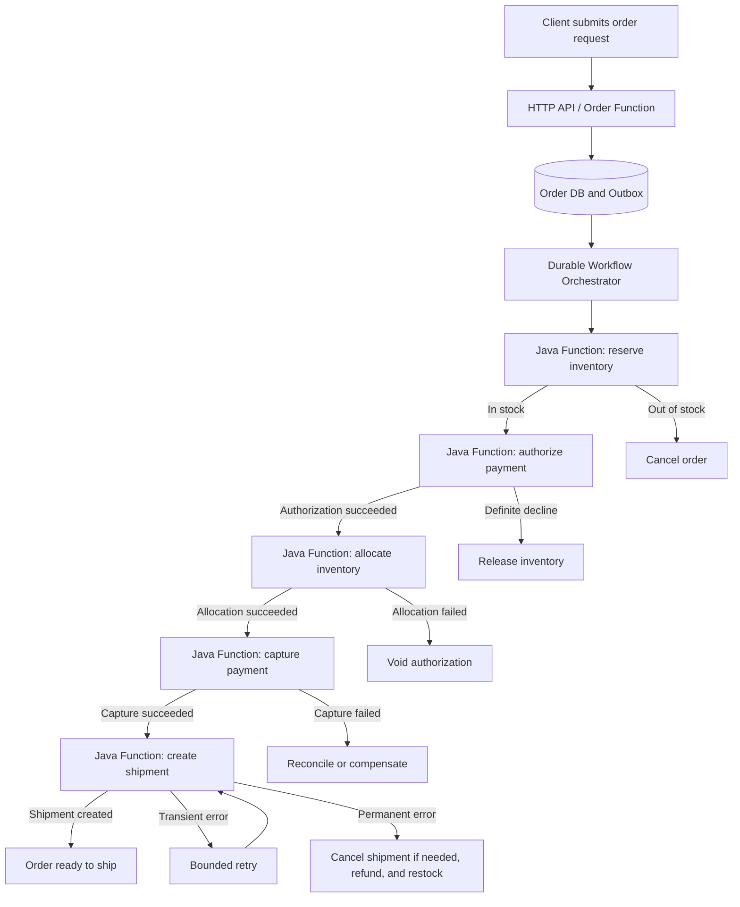

# Building Inventory Reservation, Payment Confirmation, and Shipment Steps

In the **Business Workflow Project** chapter, this lesson builds an order processing flow across three business operations that affect external systems: reserving inventory, confirming payment, and creating a shipment request. This is a classic example for a serverless application: an HTTP request initiates the work, Java functions execute each step, and a durable orchestrator manages state, wait times, retries, and compensation.

The goal is not merely calling three APIs in sequence. Any step may succeed even if the calling function times out; a message may be delivered multiple times; inventory may be contended by multiple orders; and payment or shipping providers may respond slowly. The workflow must maintain correctness in all of those scenarios.

## 1. Target Business Outcomes

Suppose a customer places an order containing one or more SKUs. The system must guarantee:

1. Inventory is only reserved when sellable quantity is sufficient, even when multiple orders request the same SKU concurrently.
2. Funds are not captured for an order that is already certain not to be reservable.
3. Each order creates at most one payment transaction and one shipment request from a business perspective, even if requests or events are delivered repeatedly.
4. The order transitions to ready-to-ship only after all preceding conditions have been confirmed.
5. When a step fails permanently, the system executes appropriate compensating actions and records the outcome for auditing or manual handling.

A workflow cannot create an ACID transaction spanning the inventory database, payment gateway, and shipping carrier. Instead, it coordinates multiple local transactions using the **Saga** pattern: each step completes an independent change; if the process cannot proceed, compensating steps return the business state to a valid condition.

## 2. Proposed Architecture

Use the orchestration model when the workflow has a clear sequence, multiple error branches, wait times, and a requirement for overall state visibility.



Each component has a distinct responsibility:

| Component | Responsibility |
|---|---|
| HTTP API and Order Function | Authenticate request, validate input, generate `orderId`, save the order, and return a tracking ID to the client. |
| Order DB | Store current business state and data needed for reconciliation. |
| Outbox / event publisher | Reliably emit the workflow initiation event after the order has been persisted. |
| Durable Workflow Orchestrator | Persist progress, invoke each function, manage retries, timeouts, conditional branches, and compensation. |
| Java Functions | Perform a small, retryable, idempotent business action. |
| Warehouse, payment provider, carrier | External systems; each has its own state and consistency rules. |

Do not keep a function running and waiting throughout the entire order lifecycle. Functions should terminate after a short operation; the orchestrator saves state and resumes on the next invocation. When waiting for webhooks or delivery events, the workflow uses the platform's event-wait mechanism rather than keeping an execution environment continuously active.

Because the process may take longer than a single HTTP request, the API typically returns `202 Accepted` with `orderId` and a status lookup URL, such as `GET /orders/{orderId}`. The client uses an idempotency key when creating an order so network retries do not create duplicate orders. The API only returns `READY_TO_SHIP` or `PAID` once the corresponding state has been confirmed by downstream steps.

## 3. Designing Order State and Data

Workflow state and order state are related, though not necessarily identical. Workflow state describes technical progress; `order.status` is the business state visible to the API and operators. Define valid state transitions explicitly rather than letting each function assign arbitrary status strings.

| Order State | Meaning |
|---|---|
| `PENDING` | Request received; inventory not yet reserved. |
| `INVENTORY_RESERVED` | Required quantity temporarily reserved for a limited period. |
| `PAYMENT_PENDING` | Confirming or processing payment. |
| `PAYMENT_AUTHORIZED` | Provider approved holding the limit or amount; funds are not necessarily captured yet. |
| `INVENTORY_ALLOCATED` | Inventory dedicated exclusively to the order; quantity is no longer part of sellable stock. |
| `PAID` | Funds have been captured or completed according to the payment method and defined policy. |
| `SHIPMENT_PENDING` | Creating shipment request. |
| `READY_TO_SHIP` | Valid shipment exists, awaiting pickup or handover workflow. |
| `SHIPPED` | Carrier confirmed receipt or order has been dispatched per business definition. |
| `COMPLETED` | Process finished according to business criteria. |
| `CANCELLED` | Order cancelled and reversible effects handled. |
| `COMPENSATION_PENDING` | External side effects need undoing, not yet confirmed complete. |
| `MANUAL_REVIEW` | Situation cannot be resolved automatically; requires reconciliation or operator action. |

A minimal data model can include:

- `orders`: `order_id`, `customer_id`, `status`, `amount`, `currency`, `version`, `created_at`, `updated_at`.
- `order_items`: `order_id`, `sku`, `quantity`, `unit_price`.
- `inventory_reservations`: `reservation_id`, `order_id`, `sku`, `quantity`, `status`, `expires_at`.
- `payments`: `payment_id`, `order_id`, `provider_reference`, `amount`, `currency`, `status`, `idempotency_key`.
- `shipments`: `shipment_id`, `order_id`, `carrier_reference`, `status`, `idempotency_key`.
- `workflow_events` or audit table: `event_id`, `order_id`, `event_type`, `occurred_at`, `correlation_id`, non-sensitive result metadata.

Store monetary amounts in the smallest currency unit (for example cents or whole VND according to system convention) using integer types, paired with `currency`. Do not use floating-point numbers for monetary calculations. Store `version` or use state-conditioned updates to prevent two concurrent executions from overwriting a newer state.

## 4. Safe Inventory Reservation Under Concurrency

### 4.1. Distinguishing Physical, Reserved, and Available Inventory

A common formula is:

\[
available = onHand - reserved - allocated
\]

Here `onHand` is physical quantity remaining in the warehouse, `reserved` is quantity temporarily held, and `allocated` is quantity dedicated exclusively to an order but not yet handed over. On reservation, increment `reserved`; after payment is authorized and the order is accepted for allocation, move quantity from `reserved` to `allocated`; on handover, decrement both `onHand` and `allocated` in the same transaction. If cancelled before handover, decrement `reserved` or `allocated` according to the current state. This ensures the system neither oversells allocated stock nor deducts physical stock prematurely.

### 4.2. Do Not Use Read-Then-Write for Inventory Reservation

A dangerous pattern is reading available quantity, checking it in Java, and updating in a separate statement. Two requests could both read `available = 1` and both claim the last unit. The check and update must be executed atomically in the database.

SQL example:

```sql
UPDATE inventory
SET reserved = reserved + :quantity,
    version = version + 1
WHERE sku = :sku
  AND on_hand - reserved - allocated >= :quantity;
```

If the updated row count is `1`, the quantity has been reserved. If `0`, either the SKU does not exist or insufficient stock remains; distinguish the two cases if the business requires different messages. This statement illustrates a single SKU. For multi-SKU orders, perform the updates and write the reservation within **one database transaction**; if any SKU lacks stock, roll back the entire transaction. Process SKUs in a deterministic order to reduce deadlock risk.

Create reservations with an expiration time, such as `expires_at`, to prevent holding stock indefinitely when a workflow stalls. An expiration job or workflow step releases overdue reservations. Releasing must check the current state and be idempotent: transition `ACTIVE` to `RELEASED` only once. Do not release a reservation that has already moved to `ALLOCATED` or been shipped.

The reservation lease must cover the expected duration for authorization and inventory confirmation. Before calling the payment provider, the workflow checks whether the reservation is still valid; if needed, extend it using a conditional update on state and `expires_at`. The expiration job may only release reservations still in an expirable state. If the payment provider has an undetermined result, do not release stock solely due to a single timeout: reconcile the transaction and reservation status first. A safe pattern is transitioning the reservation to `ALLOCATED` after authorization succeeds and before capture; this locks the stock for the order so it no longer depends on a short-lived lease.

### 4.3. Java Function for Inventory Reservation

The function should receive `orderId` and validated line items; the underlying service owns the transaction and deduplication.

```java
import java.util.List;

public record OrderItem(String sku, int quantity) {}

public record ReserveInventoryCommand(
    String orderId,
    String idempotencyKey,
    List<OrderItem> items
) {}

public record ReservationResult(
    String reservationId,
    boolean reserved,
    String reason
) {}

public interface InventoryService {
    ReservationResult reserve(ReserveInventoryCommand command);
}

public final class ReserveInventoryHandler {
    private final InventoryService inventoryService;

    public ReserveInventoryHandler(InventoryService inventoryService) {
        this.inventoryService = inventoryService;
    }

    public ReservationResult handle(ReserveInventoryCommand command) {
        if (command.orderId() == null || command.orderId().isBlank()) {
            throw new IllegalArgumentException("orderId is required");
        }
        if (command.items() == null || command.items().isEmpty()) {
            throw new IllegalArgumentException("order must contain items");
        }
        if (command.idempotencyKey() == null || command.idempotencyKey().isBlank()) {
            throw new IllegalArgumentException("idempotencyKey is required");
        }
        if (command.items().stream().anyMatch(item ->
                item.sku() == null || item.sku().isBlank() || item.quantity() <= 0)) {
            throw new IllegalArgumentException("each item needs a SKU and positive quantity");
        }
        return inventoryService.reserve(command);
    }
}
```

This snippet illustrates the function boundary and does not replace transactions inside `InventoryService`. The service must store results keyed by `idempotencyKey`, verify the payload on repeated calls, and return the same `reservationId` if the previous call succeeded. If the same key arrives with a different payload, return a conflict error to avoid reusing the wrong result.

## 5. Payment Confirmation Step

Payments typically involve two distinct actions:

- **Authorize**: the provider confirms that the credit limit or amount can be held; funds are not necessarily captured yet.
- **Capture**: request collection of the authorized funds. Some payment methods or providers only support a single direct charge operation.

Therefore, before implementation, agree precisely on whether `PAID` means authorized or captured; the model in this lesson uses `PAYMENT_AUTHORIZED` for authorization and `PAID` for successful capture. For two-phase card flows, a common sequence is reserve inventory, authorize, allocate inventory, capture, then create shipment. A business may choose to capture at another milestone, but must clearly define refund responsibilities if a subsequent step fails.

Call the payment provider using a token or payment method reference issued by the provider; never place card numbers, CVV, or payment secrets into events, logs, or workflow state inputs. Each operation needs a stable idempotency key, such as `orderId + ":authorize"` and `orderId + ":capture"`. Distinct actions must use distinct keys.

Payment outcomes must distinguish at least:

| Outcome | Handling |
|---|---|
| Clear success | Store provider reference and status; advance workflow to the next step. |
| Clear decline | Do not retry indefinitely; void authorization if present, release reservation or undo allocation, then cancel the order. |
| Transient error, certainly unprocessed | Retry according to a bounded policy. |
| Timeout or lost connection, unknown whether provider collected funds | Mark outcome as undetermined; query provider by reference or idempotency key before deciding to retry or compensate. |

The last case is critical. A timeout does not prove the transaction failed. If the function sends a capture request, the provider collects the funds, and the response is lost, a new capture call without idempotency could charge the customer twice. Use provider-supported idempotency and include a reconciliation step to query transaction status when outcomes are unclear.

If the payment provider sends webhooks, the webhook endpoint must verify the signature, check the timestamp or replay protection, store the event ID for deduplication, and only then emit an internal event. Never trust payment status simply because a client claims it paid.

## 6. Shipment Creation Step

Create a shipment only after the workflow confirms prerequisites, such as the order being paid and the reservation still valid or already moved to allocated state. The shipment-creation function should receive `orderId`, validated shipping address, packages, and selected shipping service. Address and shipping fee details should be snapshotted onto the order so they do not change if the customer profile is edited later.

Use an idempotency key such as `orderId + ":create-shipment"` if the carrier supports it. Save `carrier_reference` as soon as it is received. If the request times out, query the carrier by reference or idempotency key before submitting a new request. If the carrier supports neither idempotency nor lookup, an integration layer must persist requests, results, and reconciliation status to minimize the risk of duplicate shipments.

Successful shipment creation usually only means the carrier accepted the request or generated a label. It does not necessarily mean the parcel has been picked up. Track subsequent states such as `LABEL_CREATED`, `PICKUP_SCHEDULED`, `PICKED_UP`, `IN_TRANSIT`, and `DELIVERED` via webhooks or bounded polling. Clearly define which event transitions the order to `SHIPPED` and `COMPLETED`.

If shipment creation hits a transient error, retry with the same idempotency key. On permanent errors (unserviceable address, invalid package dimensions), the workflow transitions to compensation. If funds were already captured, it may be necessary to cancel a partially created shipment, issue a refund, and release or restock inventory depending on whether goods were allocated, packed, or handed over. Only mark `CANCELLED` after compensating actions are confirmed; while waiting, use `COMPENSATION_PENDING`.

## 7. Composing the Steps into a Saga with Retries and Compensation

A reference execution order:

1. Accept the order and create an execution with a stable `orderId`.
2. Reserve all items in a single inventory transaction. If stock is insufficient, end with `CANCELLED`.
3. Verify the reservation is still valid, then authorize payment. On clear decline, release the reservation.
4. After authorization succeeds, transition the reservation to `ALLOCATED` in an inventory transaction: decrement `reserved` and increment `allocated` accordingly. If the reservation expired or allocation fails, void the authorization and do not capture.
5. Capture payment per policy. On definite failure, void authorization if still valid and return allocated stock. If the outcome is unknown, reconcile before retrying or restocking.
6. Create the shipment. Once created, update to `READY_TO_SHIP`; consume carrier events to keep updating delivery status.
7. If a post-capture step fails permanently, cancel the shipment if needed, refund payment, and restock according to the physical state of the goods.

Example compensation table:

| Completed Step | Potential Compensating Action |
|---|---|
| Active reservation | Release reservation. |
| Stock moved to `ALLOCATED` but not handed over | Decrement `allocated` in a conditional transaction to return quantity to sellable stock; execute only once. |
| Payment authorized | Void authorization. |
| Payment captured | Refund; track `REFUND_PENDING` until provider confirms. |
| Shipment created but not handed over | Request shipment cancellation or void label if supported by carrier. |
| Goods handed over to carrier | Do not automatically add back to inventory; requires a return or investigation workflow based on shipping status. |

Compensation is a new business operation, not a historical rollback. Refunds can fail or process asynchronously; reservation release may have already occurred; the carrier may be unable to cancel a parcel already picked up. Therefore, persist the status of each compensating action, retry safely, and route exceeded limits to a manual review queue.

## 8. Retries, Timeouts, and Idempotency in Serverless

Serverless platforms typically deliver messages at least once. Functions may be re-invoked after timeouts, runtime errors, or missed queue acknowledgments. Design under the assumption that the same event may arrive multiple times and two executions may run concurrently.

**Idempotency** means executing the same business request multiple times produces an outcome equivalent to executing it once. One implementation pattern is an `idempotency_records` table containing `key`, `request_hash`, `status`, `result`, `created_at`, and `expires_at`. Inside a transaction:

1. Look up the existing key.
2. If the key is completed and the hash matches, return the stored result.
3. If the key exists with a different hash, return a conflict error.
4. If not present, create an in-progress record, apply the business change, and store the result.
5. On error, clearly determine whether the record is retryable or needs investigation.

Do not rely on short-lived queue deduplication windows to guarantee a financial action happens only once. Business keys must persist long enough to cover the order lifecycle and reconciliation policy. When calling external systems, prefer the provider's native idempotency key and persist the provider reference.

Apply retries only to recoverable errors, such as rate limits, network errors, or temporary service unavailability. Use exponential backoff with jitter, cap attempt counts and total duration, and honor `Retry-After` if returned by the provider. Do not retry invalid data errors or business rejections. For timeouts, classify the outcome as undetermined and reconcile before repeating any financially impactful action.

Set individual timeouts for each provider call, an overall timeout per step, and a deadline for the entire workflow. Steps waiting on webhooks or reservation expiration should use the orchestrator's durable wait state. Size timeouts in order so the function has enough time to write results or allow the orchestrator to detect an interrupted execution.

## 9. Reliable Workflow Initiation with Outbox

A common bug is writing the order to the database and then calling an API to start the workflow. If the database commits successfully but the function crashes before calling the orchestrator, the order exists with no workflow. If the orchestrator is called first and the database transaction rolls back, the workflow processes a nonexistent order.

Transactional Outbox closes this gap: in the same transaction, insert into `orders` and insert an `outbox_events` record such as `OrderAccepted`. A separate publisher reads the outbox, emits the event or starts the workflow, and marks it sent. The publisher can still send duplicates if it crashes after sending and before marking; consumers and the orchestrator must remain idempotent by `orderId` or `eventId`.

Example internal event:

```json
{
  "eventId": "evt-01J...",
  "eventType": "OrderAccepted",
  "eventVersion": 1,
  "orderId": "ord-2026-00042",
  "occurredAt": "2026-11-17T10:30:00Z",
  "correlationId": "req-7f2..."
}
```

The initiation event should only contain identifiers and essential metadata. The workflow can load the order snapshot from a trusted service. Avoid embedding sensitive payment data or large copies of customer profiles in messages.

## 10. Deploying the Workflow on a Serverless Platform

Choose an orchestration service capable of persisting execution state, retries, timeouts, conditional branching, and waiting for callbacks/events. Depending on the cloud provider, this may be a state machine, durable workflow, or equivalent workflow service. Service names differ, while the design requirements remain the same.

Each task should invoke a Java function with a clear input/output contract. For example:

```json
{
  "orderId": "ord-2026-00042",
  "reservationId": "res-123",
  "paymentReference": "pay-456",
  "operation": "CREATE_SHIPMENT"
}
```

Do not place secrets into workflow definitions or events. Functions retrieve credentials from a secret manager and only hold permissions for required resources: the inventory function can update reservations; the payment function can call the payment provider; the shipment function can call the carrier. Use separate roles per function or tight permission groups, restrict data read/write access, and rotate credentials.

Define workflow definitions, functions, queues, database policies, secret references, retry policies, and alarms in Infrastructure as Code. Separate configuration by environment; never share payment accounts or carrier credentials between staging and production. When changing event schemas, increment `eventVersion` and maintain compatibility for reading older events while legacy messages remain in flight.

## 11. Estimating Cost and Choosing an Orchestration Approach

Serverless workflow costs typically span several components: number of state transitions or orchestrator execution duration; invocation counts and runtime of Java functions; queue/event deliveries; database reads and writes; logs, metrics, and traces; plus payment provider or carrier transaction fees. Retries, duplicate webhooks, and overly frequent polling all increase cost without adding business value.

Estimate cost per order rather than looking solely at the price of one function. For example, sum average steps, expected retries, provider queries, state storage size, and audit retention duration. Then multiply by normal throughput and peak load. Using callbacks or events to wait for long-running outcomes is usually cheaper than continuous polling or keeping a function running while waiting.

Orchestration adds per-step or duration charges, which are usually worthwhile when clear execution history, timeouts, retries, and compensation are needed. Choreography via events can reduce central coordination cost, but operational and incident-investigation costs may rise when event chains are hard to trace. Compare total cost and operability at realistic load, and set concurrency limits to avoid overloading databases or providers.

## 12. Observability and Incident Handling

Every related log and event must carry `orderId`, `workflowExecutionId`, `correlationId`, `stepName`, and `attempt`. Do not log tokens, card data, secrets, or unnecessary personal data. Useful metrics include:

- Number of orders per state and order age in that state.
- Inventory reservation success rate, payment decline rate, and shipment creation success rate.
- Retry counts, timeouts, duplicate events, and errors per function.
- Unreleased expired reservations, undetermined payment outcomes, pending refunds, and stale shipments.
- Duration from `PENDING` to `READY_TO_SHIP`, along with execution cost and provider calls per order.

Configure alerts for stuck workflows, growing DLQs, error rates above thresholds, expired reservations, and pending compensations. An operational tool should allow querying full history by `orderId`, showing the last step, provider state, and executed compensating actions. Only allow manual retries or workflow resumption once an operator has verified external state; avoid re-running a capture or shipment creation step without reconciling first.

## 13. Testing Critical Scenarios

Test more than the happy path. Simulate failures at boundaries between systems, especially when an effect succeeded but the response was lost.

| Scenario | Expected Outcome |
|---|---|
| Two orders buy the last unit concurrently | Only one reservation succeeds; the other receives an out-of-stock result. |
| Same `OrderAccepted` emitted twice | Only one business workflow is created, or duplicate initiation is detected. |
| Reservation function re-runs after timeout | Returns the existing reservation; does not increment `reserved` a second time. |
| Payment declined | Releases reservation and cancels the order. |
| Capture succeeded but response lost | Queries provider or uses idempotency to resolve transaction; does not charge twice. |
| Carrier created shipment but response lost | Queries by idempotency/reference before sending a new request. |
| Reservation expires while payment is processing | Does not capture unless stock is confirmed and allocated; voids authorization if needed. |
| Refund temporarily fails | Stays in `COMPENSATION_PENDING`, bounded retries, and alerts when overdue. |
| Duplicate carrier webhook or invalid signature | Ignores duplicate events; rejects unauthenticated events. |
| Workflow interrupted mid-flight | Can resume or reconcile from persisted state without creating duplicate side effects. |

Include unit tests for transition rules and idempotency; integration tests with a real database or compatible environment to verify reservation transactions; contract tests for payment/carrier payloads; and end-to-end tests against provider sandboxes. Add fault injection to simulate timeouts after a provider has processed a request. For long-running workflows, also test deploying a new function version while older executions are still active.

## 14. Design Decisions and Completion Criteria

Orchestration fits when a single place is needed to inspect overall progress, compensation, and wait timers. Event-driven choreography fits simpler processes where consumers have minimal ordering dependencies and no central coordinator is required. For inventory reservation, payment, and shipping flows, orchestration is usually easier to govern because business ordering and compensating actions are explicit.

Before going to production, the development team must confirm the following questions:

- Is provider confirmation of capture/settlement required before emitting `PAID`? For payment methods without a separate capture step, what is the completion convention?
- How long is a reservation lease, and what releases expired reservations?
- When capture succeeds but shipment creation fails, what are the refund and restocking policies?
- Which states support carrier idempotency, shipment lookup, and shipment cancellation?
- What are the event versioning, event ID, correlation ID, and retention policies?
- Who is authorized to handle `MANUAL_REVIEW`, and how are all manual actions audited?
- What are the target completion times, retry limits, alert thresholds, and cost budgets?

The workflow is technically complete when the happy path and error branches are defined; inventory reservation, payment, and shipment creation are idempotent; state is persisted durably; timeouts and retries are bounded; compensation is observable; webhooks are authenticated; and concurrency, duplicates, and unknown-outcome timeouts are tested. Business policies such as hold duration, capture timing, and refund conditions must still be signed off by business owners before live launch.
