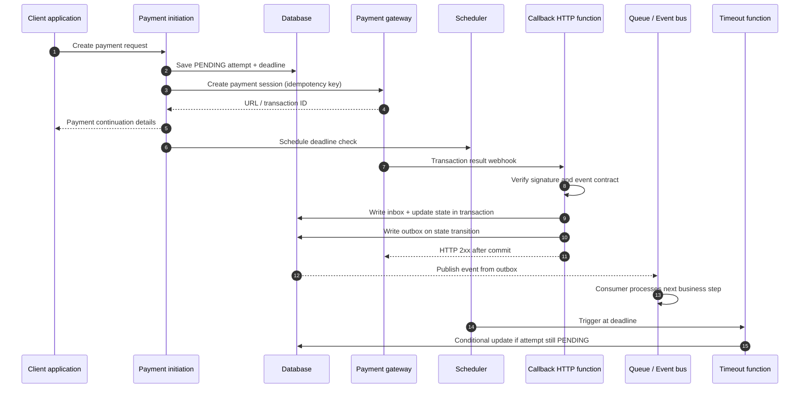

# Implementing Callbacks and Payment Confirmation Timeouts

In an order workflow, successfully sending a payment request does not mean funds have been collected. Payment gateways typically process transactions asynchronously: the application creates a payment session, the buyer completes the flow on the provider's side, and then the provider sends a webhook (HTTP callback) back to the system. Callbacks may arrive late, arrive repeatedly, arrive out of order, or fail to arrive due to network issues. Meanwhile, the order still requires a clear confirmation deadline.

This lesson builds a serverless flow capable of tolerating those scenarios. The focus is a Java function receiving HTTP callbacks, persisting results idempotently, coordinating with a timeout-handling function, and emitting domain events for downstream steps. The design applies across FaaS platforms; specific HTTP adapters, queues, and schedulers depend on the cloud provider.

## 1. Target Outcomes

After this lesson, you will be able to:

- Distinguish between payment initiation, provider transaction processing, and the system confirming an order as paid.
- Design a callback contract containing event identifier, transaction ID, amount, currency, and provider-verified timestamp.
- Persist payment deadlines in durable storage and trigger expiration handling via a scheduler, delayed queue, or periodic sweep job.
- Handle duplicate callbacks, retries, late callbacks, and race conditions between callbacks and timeout tasks.
- Use database transactions, unique constraints, or conditional updates to guarantee a consistent business outcome when multiple functions run concurrently.
- Secure webhook endpoints, observe the processing flow, and test realistic failure scenarios.

## 2. Problem Statement and Responsibility Boundaries

Suppose a store has an Order service integrated with an external payment gateway. When the customer chooses to pay, Order creates a `paymentAttempt` and asks the payment gateway to open a transaction session. The buyer may leave the page, the network may drop, or the gateway may take seconds to minutes to process. The payment gateway sends a callback to the application endpoint once a result is ready.

The system must answer three separate questions:

1. **Was the payment request created?** This is the result of the session initiation call.
2. **What status did the provider record for the transaction?** This information comes from a verified callback or the provider's transaction lookup API.
3. **Is the order allowed to transition to paid?** This is the system's business decision, based on amount, currency, order, deadline, and current state.

Do not treat browser redirects or mobile app notifications as proof of payment. Users can close the browser before redirecting, tamper with client requests, or replay old requests. Only authenticated callbacks or trusted lookup results from the provider may be used to confirm a transaction.

Components can be deployed as separate functions:

| Component | Trigger | Responsibility |
|---|---|---|
| Payment initiation function | HTTP from application | Create payment attempt, save deadline, and ask provider to create payment session |
| Payment callback function | HTTP webhook from provider | Authenticate callback, record event, and update payment state |
| Payment timeout function | Scheduler or delayed message | Check deadline and expire unconfirmed attempts |
| Domain event consumer | Queue or event bus | Handle follow-up steps such as order confirmation, notifications, or refunds |
| Reconciliation job | Periodic schedule | Reconcile ambiguous transactions against the provider's API |

Each function should perform a unit of work that can be retried independently. State data and deadlines must live in durable storage; a function instance's memory is not a place to store workflow state.

## 3. Overall Processing Flow



The diagram depicts the logical flow. In production implementations, the outbox may be published by a dedicated publisher or change data capture. Do not assume a single database transaction can span the database, queue, and payment provider API.

## 4. Designing States and Event Contracts

### 4.1. Separating Order State from Payment Attempt State

An order may have multiple payment attempts. Therefore, do not simply store a single `paid` flag on the order and overwrite every attempt. Each attempt needs its own identifier and history.

Example order states:

| Order State | Meaning |
|---|---|
| `AWAITING_PAYMENT` | Order is waiting for a valid payment |
| `PAID` | Confirmed receipt of the full required amount |
| `PAYMENT_EXPIRED` | Deadline passed without an accepted payment |
| `PAYMENT_REVIEW` | Conflicting outcome or late transaction requiring business handling |
| `CANCELLED` | Order cancelled according to business rules |

Example payment attempt states:

| Attempt State | Meaning |
|---|---|
| `PENDING` | Request created, awaiting result from provider |
| `SUCCEEDED` | Provider confirmed transaction succeeded and system accepted the outcome |
| `FAILED` | Provider confirmed the attempt failed |
| `EXPIRED` | Deadline passed and the attempt still has no accepted outcome |
| `REFUND_REQUIRED` | Funds collected, but policy disallows accepting the late payment |
| `REFUNDING` / `REFUNDED` | Refund in progress / refunded |

Sample transition contract for a payment attempt:

| Current Attempt State | Event/Condition | Next Attempt State | Order Decision / Rule |
|---|---|---|---|
| `PENDING` | Provider confirms success | `SUCCEEDED` | Transition order to `PAID` if data matches and transaction meets deadline policy |
| `PENDING` | Provider confirms failure | `FAILED` | Order may remain `AWAITING_PAYMENT` if time remains and another attempt is allowed |
| `PENDING` | Timeout arrives after deadline | `EXPIRED` | Transition order to `PAYMENT_EXPIRED` only when no other valid attempt exists |
| `EXPIRED` | Verified transaction succeeded before deadline | `SUCCEEDED` | Accept order if policy allows and business resources remain valid; otherwise route order to `PAYMENT_REVIEW` or refund |
| `EXPIRED` | Verified transaction succeeded after deadline | `REFUND_REQUIRED` | Keep order expired or under review; do not auto-confirm order and initiate refund flow |
| `REFUND_REQUIRED` | Refund initiated | `REFUNDING` | Use dedicated refund ID and idempotency key |
| `REFUNDING` | Provider confirms refund | `REFUNDED` | Complete only after verifying refund outcome |
| `SUCCEEDED` | Old callback reports `pending` or `failed` | `SUCCEEDED` | Do not downgrade state due to stale or out-of-order events |

`FAILED` and `SUCCEEDED` are terminal attempt outcomes in this example; refunds have their own state machine, though illustrated here via `REFUND_REQUIRED`, `REFUNDING`, and `REFUNDED` for the late-payment branch. If the customer retries payment after `FAILED`, create a new attempt instead of reopening the old one. If cancellations or chargebacks exist, model them with dedicated events and states per the provider's contract.

An attempt reaching `FAILED` does not necessarily expire the order immediately. The order may allow the customer to try another payment attempt until the overall deadline. Document this rule clearly in business logic so one failed callback does not inadvertently close the order.

### 4.2. Key Data Fields

An attempt record typically needs:

| Field | Purpose |
|---|---|
| `attemptId` | Unique internal identifier of the attempt |
| `orderId` | Associated order |
| `provider` and `providerReference` | Provider name and provider-side transaction ID |
| `amountMinor` and `currency` | Amount in the currency's smallest unit and currency code |
| `status` | Current state of the attempt |
| `deadlineAt` | Absolute expiration timestamp, stored in UTC |
| `version` | Version for optimistic locking or concurrency checks |
| `createdAt`, `updatedAt` | Creation and update timestamps |
| `lastProviderEventAt` | Timestamp of the most recently accepted provider event |

Store amounts as integers in the smallest unit (such as cents or whole VND depending on currency convention), or use `BigDecimal` with controlled scale. Never use `double` for monetary calculations. Never assume every currency has two decimal places.

Callbacks should follow a contract equivalent to this example (field names vary by provider):

```json
{
  "eventId": "evt_8f2d1c",
  "eventType": "payment.succeeded",
  "merchantReference": "attempt_42",
  "providerTransactionId": "txn_7812",
  "amountMinor": 259900,
  "currency": "VND",
  "occurredAt": "2026-11-17T10:15:30Z"
}
```

`eventId` identifies a single provider event emission. `providerTransactionId` identifies the payment transaction. These two IDs may differ: a single transaction can emit multiple event types. `merchantReference` must map back to an internal attempt. `occurredAt` should only be trusted when part of a verified payload and when the provider clearly defines its semantics.

## 5. Creating Durable Deadlines

When creating an attempt, the application determines the deadline per business rules, such as 15 minutes after session creation. Store an absolute timestamp (`Instant`) rather than storing "15 minutes left" in function memory.

Attempt creation should follow this order:

1. Generate `attemptId` and a stable idempotency key for the payment creation request.
2. Save the attempt with `status = PENDING`, amount, currency, and `deadlineAt`.
3. Call the provider's session-creation API using that idempotency key.
4. Save `providerReference` and details needed for the customer to proceed with payment.
5. Schedule the timeout or rely on a periodic sweep job to find due attempts.

If the provider API fails transiently after the record has been saved, retry the call with the same idempotency key. If it is unknown whether the provider created the session due to a network timeout, do not generate a new key right away; first retry with the old key or look up by merchant reference to avoid creating two chargeable sessions.

There are two common ways to trigger timeouts:

- **Per-attempt delayed message or scheduler:** when creating an attempt, schedule a message carrying `attemptId` and `deadlineAt` to run at the deadline. This offers low latency, though you must understand the service's maximum delay limits, precision, and how old schedules are cancelled or ignored.
- **Periodic sweep job:** runs on a schedule, queries `PENDING` attempts where `deadlineAt <= now`, and processes each record. This is simple and easy to recover if an individual schedule is lost, though expiration may lag by the sweep interval.

You can combine a scheduler for fast response with a sweep job for reconciliation. In both approaches, the timeout function must still read the latest state and deadline from the database. A timeout message is merely a signal to "check this attempt," not proof that the attempt definitely needs a state transition.

Do not keep a function alive with `Thread.sleep`, use in-memory timers, or rely on an HTTP request staying open for 15 minutes. FaaS instances can be terminated at any time; long execution times also raise cost and risk hitting platform timeout limits.

## 6. Receiving HTTP Callbacks Safely

### 6.1. Authenticate Before Modifying Data

Webhook endpoints usually do not use user login. Instead, verify that the request genuinely came from the provider:

- Enforce HTTPS.
- Verify the signature using the exact algorithm and canonicalization specified by the provider. If the signature is computed over the raw request body, verify against the exact received bytes before parsing or re-serializing JSON.
- Compare signatures in constant time if supported by the library.
- Validate timestamps or nonces to limit replays within a reasonable window; idempotency is still required because providers can legitimately retry.
- Manage secrets in a secret manager, support secret rotation, and never log secrets.
- Use an IP allowlist as an additional defense layer if the provider publishes stable IP ranges; never treat IP checks as the sole authentication mechanism.

Do not trust `orderId`, `amount`, `status`, or `occurredAt` just because they appear in JSON. Even after verifying the signature, validate the merchant reference, transaction ID, amount, currency, and current state. For providers offering a transaction lookup API, query the API when callbacks have missing data, conflicts, or anomalies.

### 6.2. Distinguishing Retryable vs. Permanent Errors

HTTP status code rules must match the provider's retry documentation:

| Scenario | Typical Response | Action |
|---|---|---|
| Invalid signature or malformed payload | `400` or `401` | Reject; log security event at an appropriate level |
| Previously processed event | `200` or `204` | Return success to stop retries |
| Database or dependency experiencing transient failure | `5xx` | Allow provider to retry per policy |
| Valid callback that cannot be mapped to an attempt | Per provider contract, typically `2xx` after saving to a pending staging area | Save unmatched event for reconciliation; avoid infinite retries if data cannot self-heal |

Only return `2xx` after the callback has been durably persisted or confirmed as a safe duplicate. Returning success before committing risks losing the payment result if the function crashes mid-execution and the provider stops retrying. Conversely, if the database commit succeeds but the response drops over the network, the provider may resend; hence callbacks must be idempotent.

## 7. Idempotency and Concurrency Handling

Most webhook systems have at-least-once delivery semantics. The same event may be sent multiple times if the provider does not receive a response. Queues and schedulers can also redeliver messages. Therefore, never build logic assuming "each event executes exactly once."

### 7.1. Inbox Storage and Unique Constraints

Create a `payment_inbox` table or collection with a unique key such as `(provider, eventId)`. Also store payload hash, receipt timestamp, processing status, and error details. Within the same callback-handling transaction:

1. Attempt to insert the inbox event.
2. If the key already exists with the same payload hash, treat it as a duplicate callback and return the processed outcome.
3. If the key exists with a different payload hash, record a security anomaly and route to investigation; never silently ignore it.
4. If it is a new event, locate the payment attempt, validate the contract, and transition state.
5. Write an outbox event if a business change needs to be emitted externally.
6. Commit inbox, payment attempt, order, and outbox in the same transaction.

If the database does not support multi-record transactions, design an equivalent mechanism using conditional writes, unique constraints, and recoverable processing states. Never store event IDs solely in memory or a short-TTL cache and treat that as a uniqueness guarantee.

### 7.2. Callbacks and Timeouts Can Run Concurrently

The callback function and timeout function may read the same `PENDING` state and attempt to update it concurrently. Let the database arbitrate via transactions or conditional updates. Conceptual SQL example:

```sql
UPDATE payment_attempt
SET status = 'EXPIRED', version = version + 1, updated_at = CURRENT_TIMESTAMP
WHERE attempt_id = :attemptId
  AND status = 'PENDING'
  AND deadline_at <= :now;
```

If the updated row count is 0, the function must re-read the record and decide based on the new state. Callbacks must also perform conditional updates on `status`, `version`, or row locks inside a transaction. Never read state once and perform an unconditional update later.

This rule guarantees only one function wins the transition out of `PENDING`. The losing function sees the committed outcome and proceeds according to the late-callback or duplicate-timeout policy.

### 7.3. Defining "Due" Clearly

There are two distinct timestamps:

- `receivedAt`: when the system received the callback.
- `occurredAt`: when the provider states the transaction actually occurred.

If the deadline is the cutoff for **the transaction to be executed**, a callback may arrive after the deadline yet still be accepted if the provider confirms `occurredAt` is on or before the deadline. If the deadline is the cutoff for **the system to receive confirmation**, a late-arriving callback must follow the late-transaction policy. This is a business decision and should not be left to how the scheduler happens to behave.

Only use `occurredAt` for decisions when the timestamp is protected by a signature and has reliable semantics. If the provider cannot guarantee that, query the transaction status API. Account for clock skew and timestamp precision; you can define a small grace tolerance and route boundary cases to reconciliation.

## 8. Policy for Late Callbacks and Out-of-Order Events

A success callback arriving after a timeout has marked the attempt `EXPIRED` is a critical scenario. Do not automatically transition the order to `PAID` in every case. Inventory may already have been released, the order cancelled, or the customer may have placed a new order.

Define an explicit policy:

| Scenario | Suggested Handling |
|---|---|
| Transaction succeeded before deadline, callback arrived late, order still eligible | Verify with provider then accept payment; emit domain event once |
| Transaction succeeded after deadline | Mark `REFUND_REQUIRED` or `PAYMENT_REVIEW`; do not auto-confirm order |
| Timeout already ran, but callback indicates transaction succeeded before deadline | Re-read state, verify transaction, and apply recovery rules if business resources remain valid |
| Failure callback arrives after success callback | Do not downgrade state to failed; check event ordering and current state |
| Duplicate success callback | Return success without repeating business side effects |
| Callback cannot find matching attempt | Save to unmatched staging area, look up or reconcile; never create an order from a callback |
| Amount or currency mismatch | Quarantine event, alert, and verify with provider |

Some providers emit multiple events such as `pending`, `authorized`, `captured`, and `refunded`. Do not compare status names lexicographically or rely solely on callback arrival order. Build a transition table aligned with the provider's business model. Terminal states such as `SUCCEEDED` must not be overwritten by older events. A refund is a separate transaction requiring its own transaction ID, idempotency key, and state.

If a timeout caused inventory to be released, a late callback must check whether inventory can be re-reserved or re-allocated before accepting the order. If safe recovery is not possible, route to refund or manual handling. Record the decision along with its reason so operations staff can explain it to the customer.

## 9. Java Structure for Business Logic

Keep payment logic in a business layer independent of API Gateway, Cloud Functions, Lambda, or specific HTTP frameworks. The platform adapter converts the request into raw body and headers, calls the service, and maps the result to an HTTP response. The service handles verification, idempotency, and state transitions.

The example below illustrates boundaries and processing order; interfaces `PaymentStore`, `SignatureVerifier`, `CallbackDecoder`, and transaction types are adapters to implement for the chosen database and provider.

```java
import java.time.Clock;
import java.time.Instant;
import java.util.Map;

public final class PaymentCallbackService {
    private final SignatureVerifier signatureVerifier;
    private final CallbackDecoder decoder;
    private final PaymentStore store;
    private final Clock clock;

    public PaymentCallbackService(
            SignatureVerifier signatureVerifier,
            CallbackDecoder decoder,
            PaymentStore store,
            Clock clock) {
        this.signatureVerifier = signatureVerifier;
        this.decoder = decoder;
        this.store = store;
        this.clock = clock;
    }

    public CallbackResult handle(byte[] rawBody, Map<String, String> headers) {
        // Verify against the raw body before parsing the payload.
        VerifiedPayload verified = signatureVerifier.verify(rawBody, headers);
        ProviderPaymentEvent event = decoder.decode(verified.payload());
        Instant receivedAt = clock.instant();

        return store.inTransaction(tx -> {
            InboxClaim claim = tx.claimEvent(
                    event.provider(), event.eventId(), event.payloadHash(), receivedAt);

            if (claim == InboxClaim.DUPLICATE) {
                return CallbackResult.alreadyProcessed();
            }
            if (claim == InboxClaim.PAYLOAD_CONFLICT) {
                tx.recordSecurityAnomaly(event, receivedAt);
                return CallbackResult.quarantined();
            }

            PaymentAttempt attempt = tx.findAttempt(event.merchantReference())
                    .orElse(null);
            if (attempt == null) {
                tx.saveUnmatchedEvent(event, receivedAt);
                return CallbackResult.acceptedForReconciliation();
            }

            validatePaymentDetails(attempt, event);
            PaymentDecision decision = decide(attempt, event, receivedAt);

            if (decision.changesPayment()) {
                tx.applyDecision(attempt.id(), attempt.version(), decision);
                tx.updateOrderIfAllowed(attempt.orderId(), decision);
                tx.appendOutbox(decision.toDomainEvent(attempt, event));
            }

            tx.markEventProcessed(event.provider(), event.eventId());
            return CallbackResult.accepted();
        });
    }

    private static void validatePaymentDetails(
            PaymentAttempt attempt, ProviderPaymentEvent event) {
        if (!attempt.provider().equals(event.provider())
                || !attempt.amountMinor().equals(event.amountMinor())
                || !attempt.currency().equals(event.currency())) {
            throw new PaymentMismatchException(attempt.id(), event.eventId());
        }
    }

    private static PaymentDecision decide(
            PaymentAttempt attempt,
            ProviderPaymentEvent event,
            Instant receivedAt) {
        // The decision function must apply the state machine and late-callback policy.
        // Use occurredAt only after verifying the source and timestamp semantics.
        return PaymentPolicy.evaluate(attempt, event, receivedAt);
    }
}
```

Key implementation points to maintain:

- `claimEvent`, attempt update, order update, outbox insertion, and marking the event processed must stay within the same transaction boundary if the database supports it.
- `PaymentMismatchException` must be classified to roll back the transaction, persist the event to quarantine in an appropriate transaction, and trigger an alert. Never mark a mismatched callback as successfully processed without leaving a trace.
- `PaymentPolicy.evaluate` must be deterministic, testable with a fake `Clock` and fixed inputs.
- Never call refund APIs or send emails inside a database transaction. Write an outbox command, and let another worker execute the side effect with its own idempotency key.
- If the callback function only needs to ingest the event, it can offload processing to a queue after durably writing the inbox. Consumers must remain idempotent; returning `2xx` is allowed only after the queue or database confirms the event is saved.

## 10. Timeout Function and Domain Event Emission

The timeout function should receive a small payload containing `attemptId` and optionally `deadlineAt` or `scheduleGeneration`. It reads the latest attempt, gets the current time from `Clock`, and executes a conditional update.

Conceptual logic:

```java
public TimeoutResult expire(String attemptId) {
    Instant now = clock.instant();

    return store.inTransaction(tx -> {
        PaymentAttempt attempt = tx.findById(attemptId).orElse(null);
        if (attempt == null) {
            return TimeoutResult.notFound();
        }
        if (attempt.status() != PaymentStatus.PENDING) {
            return TimeoutResult.noOp(attempt.status());
        }
        if (attempt.deadlineAt().isAfter(now)) {
            return TimeoutResult.notDue(attempt.deadlineAt());
        }

        boolean changed = tx.markExpiredIfPending(
                attempt.id(), attempt.version(), now);
        if (!changed) {
            return TimeoutResult.concurrentUpdate();
        }

        tx.expireOrderIfNoOtherActiveAttempt(attempt.orderId(), now);
        tx.appendOutbox(PaymentExpired.from(attempt, now));
        return TimeoutResult.expired();
    });
}
```

This is also an example of conditional updating; the real implementation must ensure `expireOrderIfNoOtherActiveAttempt` checks all related attempts in the same transaction or via an appropriate lock. Never expire an order if another valid attempt is still pending.

### 10.1. Transactional Outbox

Once a payment attempt transitions to `SUCCEEDED`, other components may need to confirm the order, deduct inventory, issue an invoice, or send an email. If the database is updated and then the queue is called, crashing before sending loses the domain event. If the queue is sent first and the database rolls back, consumers may process an event without corresponding state.

The transactional outbox closes this gap:

1. In the transaction updating the payment/order, insert an outbox row with a unique event ID.
2. A publisher reads unpublished rows and sends them to the queue/event bus.
3. After broker acknowledgment, the publisher marks the row as published.
4. If the publisher stops after sending but before marking, it may resend; consumers must deduplicate by event ID.

Outbox prevents losing events between the database and broker, though it does not create end-to-end exactly-once delivery. Each consumer still needs idempotency and must durably record processing outcomes.

## 11. Retries, DLQ, and Reconciliation

Retries are a normal part of serverless workflows. Classify errors carefully:

- **Transient errors:** network timeouts, rate limits, temporary database unavailability, provider `5xx` responses. Retry with exponential backoff and jitter, bounded by attempt count or duration.
- **Data or configuration errors:** invalid signature, amount mismatch, unsupported currency, invalid merchant reference. Do not retry indefinitely; quarantine and alert.
- **Undetermined outcome:** request to provider timed out and it is unknown whether the transaction succeeded. Look up status or retry with the same idempotency key before creating a new transaction.

For queues, configure a visibility timeout or message lock duration long enough for expected processing time, set max receive counts, and configure a dead-letter queue (DLQ). DLQs need a process to inspect root causes, fix data or configuration bugs, and redrive safely. Never redrive by deleting idempotency records if doing so could repeat financial side effects.

Periodic reconciliation is the final safety net. The reconciliation job finds attempts stuck in `PENDING` too long, unmatched callbacks, incomplete `REFUND_REQUIRED` transactions, and internal states out of sync with the provider. It calls the lookup API by provider reference, applies the same state machine, and writes an audit trail. Reconciliation must use rate limits, pagination, and retries to avoid creating load spikes on the provider.

## 12. Testing Critical Scenarios

Test beyond the happy path. Use a controllable `Clock`, fake provider, test database, and test queue to verify:

| Test Case | Expected Outcome |
|---|---|
| Valid success callback before deadline | Attempt becomes `SUCCEEDED`, order updated once, outbox event created |
| Same callback delivered two or more times | Only one business change and one corresponding outbox event |
| Same event ID with different payload | Event quarantined and alert raised |
| Invalid signature or tampered body | No changes to payment/order |
| Mismatched amount, currency, or merchant reference | Payment not confirmed; audit/alert recorded |
| Timeout runs before deadline | Does not expire; may reschedule check |
| Timeout runs after deadline while attempt is `PENDING` | Attempt expires exactly once |
| Callback and timeout run concurrently | Database accepts only one valid transition; loser re-reads new state |
| Success callback arrives after timeout, transaction occurred before deadline | Applies late-payment acceptance policy after verification |
| Transaction occurred after deadline | Routes to refund or review per policy |
| Stale failure callback arrives after success callback | Does not overwrite terminal state with failure |
| Database fails before commit | Returns retryable error; does not mark event processed |
| Commit succeeds but HTTP response lost | Retried callback becomes a safe no-op |
| Outbox publisher sends successfully but fails to mark | May redeliver; consumer deduplicates |
| Order has multiple attempts | Expiring one attempt does not expire the order if another attempt remains valid |

Concurrency tests should spawn two real workers or run repeated tests with a barrier to increase the chance that two threads read `PENDING` simultaneously. Sequential tests alone will miss unguarded read-then-write bugs. Include contract tests against sample payloads and signatures from provider documentation, and keep a suite of integration tests against the payment gateway sandbox.

## 13. Observability and Operations

Every log should include correlation fields such as `orderId`, `attemptId`, `provider`, `providerReference`, `eventId`, `functionName`, and `traceId`. Never log secrets, full signatures, card data, or unnecessary personal information. For payloads needed in investigations, store redacted versions in access-controlled storage with appropriate retention policies.

Track at least the following metrics:

- Counts of received callbacks, valid callbacks, duplicate callbacks, and rejected callbacks.
- Latency from `occurredAt` to `receivedAt`, and from receipt to commit.
- Counts of expired attempts, late callbacks, and transactions requiring refund or review.
- Age of the oldest `PENDING` attempt and count of unmatched records.
- Queue depth, retry counts, DLQ message count, and age of unpublished outbox rows.
- Error rate, execution duration, cold starts, and resource consumption per function.

Configure alerts for abnormal DLQ growth, outbox backlogs, pending attempts exceeding thresholds, rising mismatch rates, or successful callbacks failing to translate into corresponding order states. Provide a dashboard for operators to trace an order end-to-end across session initiation, callbacks, state machine decisions, and refunds.

At deployment time, grant least privilege per function: the callback function only needs to read verification secrets and write relevant tables; timeout only reads/updates attempts and outbox; the publisher only reads outbox and sends to the queue. Set concurrency and timeout limits aligned with the database, provider API, and processing throughput. If the provider enforces rate limits, use queues or rate limiters for lookup/refund calls. Track costs from invocation count, execution duration, retries, scheduler, queues, logs, and storage; an infinite retry loop can generate uncontrolled cost and load.

## 14. Recommended Implementation Process

1. **Finalize business policies:** define what timestamp deadlines measure from, whether `occurredAt` or `receivedAt` applies, when late callbacks are accepted, and how refunds are handled.
2. **Design schema and state machine:** separate orders from payment attempts; add unique constraints for event ID, provider reference, and idempotency keys in appropriate scopes.
3. **Build Java business core:** implement verification, contract validation, state decisions, and repository interfaces; inject `Clock` for time testing.
4. **Create HTTP adapter:** read raw body, pass headers, map errors to HTTP status codes, and configure appropriate request limits.
5. **Create timeout trigger:** choose scheduler, delayed queue, or sweeper; every trigger re-reads state from the database.
6. **Add inbox/outbox and DLQ:** ensure events are durably stored, retries are safe, and failed messages have a clear handling path.
7. **Configure secrets and IAM:** store secrets in a secret manager, enable TLS, restrict access permissions, and set up rotation.
8. **Test races and late callbacks:** run concurrency tests, retry tests, mismatch tests, and sandbox tests.
9. **Roll out gradually:** enable dashboards/alerts first, deploy functions and triggers, then enable callback integration in a controlled environment.
10. **Run operational drills:** practice DLQ redrives, reconciling transactions with missing callbacks, handling refunds, and recovering from queue or database disruptions.

## 15. Common Design Pitfalls

- **Trusting browser redirects:** users can spoof them or close before returning; confirm via verified webhooks or provider APIs.
- **Using function memory for countdowns:** instances can be terminated; store deadlines durably and re-verify when timeouts run.
- **Assuming queues or webhooks are exactly-once:** duplicates are normal; use inbox, unique constraints, and idempotent consumers.
- **Returning HTTP 2xx before saving:** callbacks can be lost permanently if the function crashes after responding; only ACK after durable persistence.
- **Unconditional state updates:** callbacks and timeouts can overwrite each other; use transactions, compare-and-set, or optimistic locking.
- **Relying on callback arrival order:** networks and retries reorder deliveries; check current state and transition rules.
- **Auto-accepting all late transactions:** may confirm cancelled or out-of-stock orders; apply late-payment and refund policies.
- **Calling external services inside long database transactions:** increases lock hold times and causes inconsistent outcomes; use outbox/separate workers.
- **Retrying every error indefinitely:** permanent errors clog queues and inflate costs; classify errors, cap retries, and use DLQs.
- **Skipping reconciliation:** callbacks can get lost or payloads fail to map; maintain transaction lookup jobs and unmatched-event procedures.

## 16. Completion Criteria

An implementation meets the requirements when:

- Every payment attempt has a durable `deadlineAt` and a unique identifier.
- Callbacks are authenticated before affecting business data.
- Duplicate events cause no repeated state changes or financial side effects.
- Callbacks and timeouts update state using transactions or atomic conditional writes.
- Policies for late callbacks, out-of-order events, and mismatches are defined with an audit trail.
- Downstream events are emitted via an outbox or equivalent guarantee; consumers are idempotent.
- Retries are bounded, DLQs exist, and redrive/reconciliation procedures are in place.
- Tests cover races, timeouts, duplicates, late successes, invalid signatures, and dependency failures.
- Metrics, correlated logs, alerts, and least-privilege access controls are configured.

Once these criteria are met, callbacks and timeouts become two independent inputs into the same durable state machine. The workflow can continue even if functions restart, messages are redelivered, or events arrive out of order; payment decisions remain grounded in verified data and auditable business rules.
