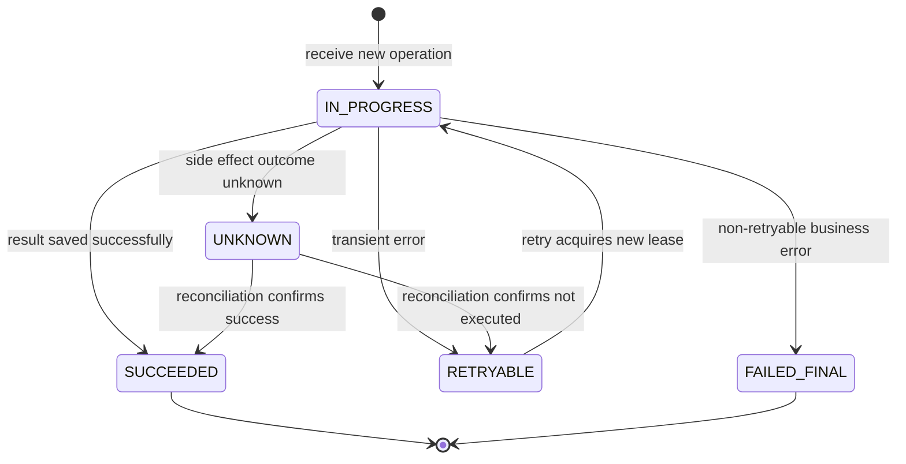
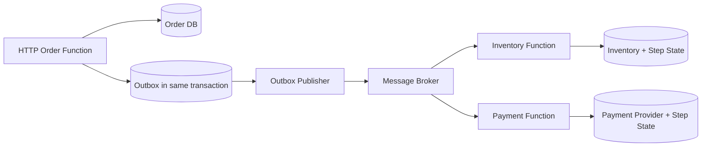

# Designing Idempotency for Each Order Processing Step

An order processing workflow typically passes through multiple independent steps: accepting the request, confirming inventory, capturing payment, creating a shipment order, and sending notifications. In a serverless model, each step can run in a separate function triggered by an HTTP request, message queue, or event from another service. The system may retry on timeouts, a function may crash mid-execution, or a consumer may receive the same message again. Consequently, a single valid request can be processed multiple times even though the user clicked the order button only once.

Idempotency allows the system to tolerate repeated executions: the same business operation can be submitted multiple times while the final state and business effects remain equivalent to executing the operation once. For a multi-step workflow, simply placing one idempotency key at the start of the flow does not solve everything. Each step needs an operation identity, a data boundary, and a duplicate-handling rule tailored to that step's specific side effects.

This lesson explains how to design those boundaries for a Java-based order workflow on a serverless platform, and how to combine idempotency with retries, state management, access control, scaling, and cost.

## 1. Why Must Idempotency Be Designed Per Step?

Suppose a customer submits an order creation request. An HTTP function records the order and emits an `OrderPlaced` event. Downstream functions sequentially reserve inventory, capture payment, create a shipment, and send an email.

An execution can encounter situations such as:

- A function calls the payment gateway successfully but times out before writing the result to the database. On retry, the function does not know whether the prior transaction succeeded.
- A message is processed, but the consumer crashes before acknowledging (ack) it. The queue redelivers the message.
- A payment or shipping provider sends a webhook multiple times because it did not receive a timely response.
- A user resends an HTTP request because the browser never received a response, even though the server already created the order.
- Two copies of the same message are processed concurrently on two different function instances.

Messaging systems and serverless functions typically favor at-least-once delivery. That means a message can be redelivered; it does not guarantee a function runs only once. Even if a platform offers a different delivery mechanism, network failures and boundaries between two services still force applications to handle ambiguous outcomes.

Distinguish three concepts:

| Concept | Meaning | What It Does Not Guarantee |
|---|---|---|
| Retry | Re-attempting execution after a transient failure | Does not prevent duplicated side effects |
| Deduplication | Detecting and skipping previously seen messages or requests | Does not by itself resolve cases where a prior attempt is still running or caused a side effect before saving its result |
| Idempotency | Guaranteeing repeated operations produce the same business outcome | Does not fix invalid data or an ill-defined stateful workflow |

The practical goal is not ensuring a function is invoked only once. The goal is making every business operation safe to invoke repeatedly, even when the system does not know where a previous run stopped.

## 2. Identifying Each Operation

An idempotency key must identify a stable business intent. Do not generate a new random key on every retry, because each attempt would then be treated as a new operation. Nor should you use a single message ID as the key for the entire workflow: one order can be emitted across multiple distinct messages, while inventory reservation and payment capture have different repeat rules.

You can use a key structure such as:

```text
<tenantId>:<aggregateId>:<stepName>:<operationVersion>:<operationId>
```

Where:

- `tenantId` identifies the store or enterprise customer in a multi-tenant system.
- `aggregateId` is the order ID.
- `stepName` is the business step such as `RESERVE_INVENTORY` or `CAPTURE_PAYMENT`.
- `operationVersion` distinguishes rule versions of an operation when processing contracts evolve.
- `operationId` identifies the specific business execution, such as a payment attempt ID or shipment attempt ID.

Examples:

```text
shop-17:ORD-2026-0042:RESERVE_INVENTORY:v1:reservation-01
shop-17:ORD-2026-0042:CAPTURE_PAYMENT:v1:payment-01
shop-17:ORD-2026-0042:CREATE_SHIPMENT:v1:shipment-01
```

For the order creation API, the client sends a stable key in the `Idempotency-Key` header. The server stores that key along with the payload hash and created response. If the client resends the same key and same content, the server returns the previous result. If the same key arrives with a different payload, the server returns a conflict error because one key must not represent two different intents.

For internal messages, producers should include `orderId`, `eventId`, and the business operation ID in the envelope. Consumers construct the key from validated business data. If an event intentionally restarts an operation—such as a second payment capture after the customer changes payment method—the new operation must have a new `operationId`; never reuse the key of the prior attempt.

Do not use timestamps, retry counts, or function instance IDs alone to build keys. Those values change across attempts and break duplicate detection.

## 3. Idempotency State Model

Each step must persist processing state durably outside function memory. Serverless functions can terminate after a single invocation; static variables, singletons, or local memory are not reliable places to store state.

A minimal idempotency record can contain:

| Field | Purpose |
|---|---|
| `idempotency_key` | Unique key of the operation |
| `request_hash` | Detect same key with different payload |
| `status` | Processing status |
| `owner_token` | Token holding current processing ownership |
| `lease_until` | Timestamp when processing ownership expires |
| `result_reference` | Reference to the business outcome |
| `created_at`, `updated_at` | Track record lifecycle |
| `expires_at` | Timestamp when the record may be purged per retention policy |

A common lifecycle:



Meaning of states:

- `IN_PROGRESS`: an invocation has acquired the right to process the operation.
- `SUCCEEDED`: the operation completed; subsequent calls receive the stored result.
- `RETRYABLE`: a transient failure determined to be safe to retry.
- `FAILED_FINAL`: a business error that cannot be resolved by retrying, such as an invalid shipping address.
- `UNKNOWN`: the system cannot determine whether the external side effect occurred. This state requires reconciliation before retrying an impactful operation such as charging payment.

Not every workflow needs every state. However, never fold `UNKNOWN` into `FAILED`: a timeout after sending a payment request does not prove the payment transaction failed.

## 4. Safe Step-Processing Flow Under Retries

A consumer should execute the following steps:

1. Authenticate the message source and validate the schema, tenant, order ID, and operation ID.
2. Compute the idempotency key and hash of the relevant business data.
3. Attempt to create an `IN_PROGRESS` record using an atomic conditional operation. Only one invocation may create the new record.
4. If the record already exists, inspect its state:
   - `SUCCEEDED`: return or re-emit the stored result without repeating the side effect.
   - `IN_PROGRESS` with active lease: do not execute concurrently; let the message retry per policy or return an in-progress status.
   - `IN_PROGRESS` with expired lease: take over only via a conditional update and a new token.
   - `RETRYABLE`: acquire a new lease via an atomic update.
   - `FAILED_FINAL`: stop and forward error details to business error handling.
   - `UNKNOWN`: reconcile with the target system before deciding.
5. Execute the side effect using the same idempotency key if supported by the target service.
6. Persist the result and transition to `SUCCEEDED` via a conditional update keyed on `owner_token`.
7. Acknowledge the message only after the result or retry state is durably persisted.

Acquiring processing ownership must be atomic. A separate `SELECT` followed by `INSERT` is unsafe: two invocations can both see no record and both execute the side effect. Use unique constraints, conditional writes, transactions, or compare-and-set primitives from the data store.

Leases enable recovery when a function crashes mid-flight. However, a lease alone does not prevent an old invocation from continuing to run after its lease expires. That is why a fencing token or an owner token incremented/rotated on every takeover is required. Every state update must check the current token; if the token no longer matches, the stale invocation must not overwrite the new invocation's result.

## 5. Partitioning Idempotency Across Order Steps

Each step has distinct side effects and recovery strategies. The table below provides a reference design:

| Step | Operation Identity | Side Effect | Duplicate Protection |
|---|---|---|---|
| Accept order creation | `clientRequestId` or `Idempotency-Key` | Create order | Unique key per tenant and request; store response |
| Reserve inventory | `orderId + reservationId` | Decrement available stock or create reservation | Conditional update/transaction; reservation has status and expiration |
| Capture payment | `orderId + paymentAttemptId` | Call payment gateway | Pass idempotency key to payment gateway; store provider transaction ID |
| Create shipment | `orderId + shipmentId` | Create shipment at carrier | Use unique client reference; query before recreating on timeout |
| Send email/SMS | `orderId + notificationType + recipient` | Send notification | Outbox/delivery record; accept that messaging providers may have their own semantics |
| Refund/release reservation | `orderId + compensationId` | Refund funds or release inventory | Separate key per compensating action; never reuse original operation key |

### 5.1. Accepting Order Creation Requests

The API must require clients to keep the same `Idempotency-Key` when retrying. Within a single transaction, the system creates the order and persists the response linked to that key. A unique constraint prevents two concurrent requests from creating two orders.

Example PostgreSQL DDL:

```sql
CREATE TABLE api_idempotency (
    tenant_id       VARCHAR(80)  NOT NULL,
    idempotency_key VARCHAR(160) NOT NULL,
    request_hash    VARCHAR(64)  NOT NULL,
    order_id        VARCHAR(80),
    response_json   JSONB,
    status          VARCHAR(24)  NOT NULL,
    created_at      TIMESTAMPTZ  NOT NULL DEFAULT now(),
    PRIMARY KEY (tenant_id, idempotency_key)
);
```

If the key already exists and the hash matches, the API returns `response_json`. If the hash differs, return `409 Conflict`. If the first transaction is still in progress, the second transaction must wait or handle contention using the database's concurrency mechanism. Never return a new order ID for the same key.

### 5.2. Reserving Inventory

Inventory reservation is a contentious operation. Two different orders buying the last unit must be serialized at the data layer. Idempotency prevents the same reservation from deducting stock twice; transactions or conditional updates ensure total reserved quantities never exceed stock.

Example conditional update:

```sql
UPDATE inventory
SET available_quantity = available_quantity - :quantity
WHERE sku = :sku
  AND available_quantity >= :quantity;
```

If the updated row count is 0, stock is insufficient or the SKU does not exist. Reservations should have their own ID and states `ACTIVE`, `RELEASED`, `EXPIRED`. When a workflow fails after reserving stock, the compensating step releases the reservation using a stable `compensationId`. Repeating the release operation must not add stock back multiple times.

### 5.3. Capturing Payment

Payment capture is the highest-risk step when network outcomes are unclear. A function may send a capture command, the provider processes it, and the response is lost. Retrying with a fresh request can charge the customer twice.

Prefer sending a stable idempotency key to the payment gateway. Save the provider's transaction ID and link it to `paymentAttemptId`. On timeout, query transaction status by reference key or wait for a webhook; do not spontaneously create a new payment attempt. If the customer actively tries a different payment method, create a new `paymentAttemptId` after resolving the previous attempt's status.

Not all payment gateways support idempotency identically. Read the provider's documentation on key scope, key retention window, behavior on mismatched payloads, and transaction lookup capabilities. If the target service lacks idempotency support, the application must implement reconciliation and an `UNKNOWN` state; a local table alone cannot promise exactly-once guarantees for external side effects.

### 5.4. Creating Shipments and Sending Notifications

For carriers, send a unique `shipmentId` or client reference so created shipments can be looked up. On timeout, query by reference before sending a new create command.

Email/SMS delivery has different characteristics: many providers do not guarantee strict deduplication. You can use an outbox table with a unique key covering notification type, recipient, and content version. The worker marks `SENT` after receiving confirmation from the provider. If the provider does not support idempotency keys, a failure after the provider accepts the message but before the worker writes `SENT` can still produce a duplicate notification. For notifications, explicitly decide acceptable duplication tolerance, include identifiable notification IDs or content, and monitor undetermined cases.

## 6. Java Example: Consumer Using an Idempotency Store

The following example illustrates processing boundaries in Java. The `IdempotencyStore` and `PaymentGateway` interfaces represent adapters to the database and payment gateway; production implementations must use conditional writes/transactions and the provider's idempotency API.

```java
import java.time.Instant;
import java.util.Objects;

enum StepStatus {
    IN_PROGRESS, SUCCEEDED, RETRYABLE, FAILED_FINAL, UNKNOWN
}

record StepKey(
        String tenantId,
        String orderId,
        String step,
        String operationId
) {
    String value() {
        return tenantId + ":" + orderId + ":" + step + ":" + operationId;
    }
}

record PaymentCommand(
        String tenantId,
        String orderId,
        String paymentAttemptId,
        long amountMinor,
        String currency
) {
    StepKey idempotencyKey() {
        return new StepKey(
                tenantId, orderId, "CAPTURE_PAYMENT", paymentAttemptId
        );
    }
}

record PaymentResult(String providerTransactionId, String status) {}

record Claim(
        boolean acquired,
        StepStatus status,
        String ownerToken,
        PaymentResult previousResult
) {}

interface IdempotencyStore {
    // Claim must be an atomic operation; do not implement as SELECT followed by INSERT.
    Claim claim(StepKey key, String requestHash, Instant now);

    // Only the current owner may complete the record.
    boolean markSucceeded(
            StepKey key, String ownerToken, PaymentResult result
    );

    void markFailedFinal(StepKey key, String ownerToken, String reason);

    void markRetryable(StepKey key, String ownerToken, String reason);

    void markUnknown(StepKey key, String ownerToken, String reason);
}

interface PaymentGateway {
    PaymentResult capture(
            String providerIdempotencyKey,
            long amountMinor,
            String currency
    );

    // Look up by reference key when the previous call had an unknown outcome.
    PaymentResult findByIdempotencyKey(String providerIdempotencyKey);
}

final class PaymentStep {
    private final IdempotencyStore store;
    private final PaymentGateway gateway;

    PaymentStep(IdempotencyStore store, PaymentGateway gateway) {
        this.store = store;
        this.gateway = gateway;
    }

    PaymentResult handle(PaymentCommand command, String requestHash) {
        StepKey key = command.idempotencyKey();
        Claim claim = store.claim(key, requestHash, Instant.now());

        if (!claim.acquired()) {
            return switch (claim.status()) {
                case SUCCEEDED -> Objects.requireNonNull(claim.previousResult());
                case IN_PROGRESS -> throw new IllegalStateException(
                        "Payment operation is already in progress"
                );
                case UNKNOWN -> throw new IllegalStateException(
                        "Payment result must be reconciled before retry"
                );
                case FAILED_FINAL -> throw new IllegalStateException(
                        "Payment operation failed permanently"
                );
                case RETRYABLE -> throw new IllegalStateException(
                        "Retry claim was not acquired"
                );
            };
        }

        try {
            PaymentResult result = gateway.capture(
                    key.value(),
                    command.amountMinor(),
                    command.currency()
            );

            boolean saved = store.markSucceeded(
                    key, claim.ownerToken(), result
            );
            if (!saved) {
                // Lease/token may have been superseded by another invocation.
                // Do not overwrite the new owner's result.
                throw new IllegalStateException("Idempotency claim was lost");
            }
            return result;
        } catch (DefinitivePaymentDecline e) {
            // Explicit business decline; do not retry the same operation.
            store.markFailedFinal(key, claim.ownerToken(), e.getMessage());
            throw e;
        } catch (PaymentOutcomeUnknown e) {
            store.markUnknown(key, claim.ownerToken(), e.getMessage());
            throw e;
        } catch (TemporaryGatewayFailure e) {
            store.markRetryable(key, claim.ownerToken(), e.getMessage());
            throw e;
        }
    }
}

final class DefinitivePaymentDecline extends RuntimeException {}
final class PaymentOutcomeUnknown extends RuntimeException {}
final class TemporaryGatewayFailure extends RuntimeException {}
```

This snippet focuses on business decisions. In production, also ensure:

- Hashes are computed from business-significant fields such as amount, currency, and payment account ID; do not hash volatile fields like retry timestamps.
- `claim` distinguishes new keys, completed keys, keys with active leases, and keys with expired leases. Every state transition must be a conditional write.
- When the payment gateway returns an undetermined error, query the transaction before permitting retries. Marking `UNKNOWN` must be persisted durably even if the invocation is about to end.
- When `markSucceeded` fails due to a lost token, the new worker or reconciliation job must read the outcome from the provider. Never assume the capture command did not happen.
- In HTTP handlers, return appropriate status codes: if a result exists, return the saved response; if in progress, return a retryable status with guidance; if the payload conflicts, return `409`.

In queue-triggered functions, transient errors are typically thrown so the platform retries or routes the message to a dead-letter queue per configuration. Do not infinitely retry permanent business errors. Configure visibility timeout, maximum runtime, retry counts, and DLQ together so a message is not processed concurrently by multiple consumers for too long.

## 7. Consistency Between Data Updates and Event Publishing

A common bug is updating the order in the database and publishing a message as two separate operations. If the function crashes after committing the order but before publishing, the workflow never receives the next event. If publishing succeeds but the function crashes before recording it, the message may be emitted again.

The transactional outbox closes this gap: within the same transaction that updates the order, write an outbox record. A separate publisher reads the outbox and emits the events. Because the publisher may emit duplicates, consumers must remain idempotent.



Outbox does not eliminate the need for consumer idempotency. It guarantees events are saved alongside business changes and can be replayed after failures. Consumers still need an inbox or dedicated idempotency table to recognize already-processed events.

If each step uses a separate data store, do not assume a distributed transaction spans the whole workflow. Design a Saga: each step commits local state and emits an event for the next step; if a downstream step fails, execute predefined compensating actions. Compensating actions must also be idempotent and use their own keys.

## 8. Coordinating Idempotency with Retries, Timeouts, and Scaling

Retries are only safe when a step can recognize prior executions. Classify errors carefully:

| Error Type | Example | Action |
|---|---|---|
| Transient error | HTTP 503, throttling, connection lost before sending request | Retry with exponential backoff and jitter |
| Unknown outcome | Timeout after sending capture command | Move to `UNKNOWN`, reconcile before retrying |
| Business error | Insufficient stock, explicit card decline | `FAILED_FINAL` or alternate business branch |
| Data/contract error | Invalid schema, tenant mismatch | Reject, log safely, optionally route to DLQ |

Key operational principles:

- Set downstream call timeouts shorter than the function's maximum execution time, leaving headroom to persist state and finish the invocation.
- Leases should exceed expected step duration, with a renewal mechanism if steps can run long. Too-short leases cause contention; too-long leases delay recovery.
- Use exponential backoff with jitter so invocations do not retry in lockstep.
- Set retry limits and DLQs. DLQ messages should preserve correlation ID, order ID, step, attempt ID, and failure reason to enable controlled replay.
- Do not hold long-lived distributed locks across network calls. Short claims, bounded leases, and token-checked updates allow functions to scale horizontally.
- Bound concurrency on steps constrained by provider quotas, while still maintaining idempotency because concurrency limits do not prevent retries or duplicate webhooks.

Idempotency carries costs. Each step may require a state read/write, unique index, outbox entry, and reconciliation logs. TTLs help clean up old records but should not be too short. Key retention must exceed the retry window, DLQ replay timeframe, webhook latency, and window during which users might resend requests. For financial operations, retain audit trails per compliance and retention policies; never delete keys just because an invocation ended.

## 9. Security and Access Control

Idempotency keys are not secrets and do not replace authentication. A user must not be allowed to supply another order's key to query its result. APIs must authenticate identity and verify order and tenant ownership before returning stored results.

Functions should follow least privilege:

- The order-intake function only needs write access to orders and required outbox entries.
- The inventory function only needs read/write access to reservations and relevant stock quantities.
- The payment function only needs permission to call required merchant account operations and read/write payment state.
- The notification function only needs minimal read access and permission to send notifications.

Avoid putting card numbers, access tokens, full addresses, or sensitive data into idempotency keys, logs, or messages unless necessary. Store payload hashes instead of copies of sensitive data; if requests/responses must be stored for replay, encrypt them and restrict read access. Verify webhook signatures, timestamps, and event IDs before accepting them. Idempotency only prevents duplicate processing; it does not stop an attacker from sending a forged request with a fresh key.

## 10. Workflow Observability and Reconciliation

To trace an operation across multiple functions, propagate the following fields through logs and messages:

- `correlationId`: trace ID spanning the entire workflow.
- `orderId`: order identifier.
- `eventId`: event identifier.
- `stepName` and `operationId`: business step and execution attempt.
- `idempotencyKeyHash`: trace handle that does not expose the full key if the key contains internal data.
- `attempt`, `status`, `providerReference`: attempt number, status, and provider-side reference ID.

Useful metrics include duplicate-key hit counts, failed claim counts, expired lease counts, operations in `UNKNOWN` state, retry rates, DLQ message counts, per-step latency, and invocation/datastore costs. Alert when `UNKNOWN` persists too long or a step's retry rate spikes.

Maintain a periodic reconciliation process for external side effects: fetch payments/shipments in `UNKNOWN` state, query by provider reference, and transition them to succeeded or retryable. Reconciliation itself must be idempotent because it may run repeatedly.

## 11. When to Use FaaS for This Workflow?

FaaS fits well when steps have clear boundaries, short or decomposable runtimes, variable traffic, and can be triggered by HTTP/messages/events. For instance, accepting orders over HTTP, reserving stock on events, capturing payments via queues, and sending notifications upon completion can each be deployed as separate functions.

Consider a workflow engine or long-running worker when processes involve long wait times, complex branching, detailed state history requirements, timeout/compensation orchestration, or continuous processing exceeding function duration limits. Regardless of whether you choose FaaS or workers, per-operation idempotency principles remain the same.

Evaluate cost beyond function invocation counts alone. Include retries, idempotency store reads/writes, transactions, outbox storage, message deliveries, reconciliation queries, and downstream wait times. A design may add a few extra writes while drastically cutting the cost of duplicate orders, erroneous refunds, and manual support.

## 12. Design Checklist and Test Examples

Before promoting a step to production, verify you can answer:

- Which key represents exactly one business intent? Is the key stable across retries and replays?
- How is the same key with a different payload handled?
- Which atomic operation creates and claims the state record?
- If two invocations run concurrently, how does only one gain permission to trigger the side effect?
- If the function crashes after the side effect but before saving the result, how does the system reconcile?
- Does the external service support idempotency keys or lookup by client reference?
- When is automatic retry permitted, when does it move to `UNKNOWN`, and when does it stop at `FAILED_FINAL`?
- How are leases, fencing tokens, timeouts, retries, DLQs, and TTLs configured?
- Is read access to idempotency results restricted by tenant and order owner?
- Are metrics and alerts in place for duplicates, expired leases, and undetermined states?

A solid test suite should simulate at least the following cases:

| Scenario | Expected Outcome |
|---|---|
| Same order creation request sent twice with the same key | Only one order created; both responses reference the same order |
| Same key with changed quantity or amount | Conflict returned; no side effects created |
| Two consumers receive the same message concurrently | Only one consumer wins a valid claim |
| Consumer crashes after writing state but before ack | Message is redelivered; consumer returns stored result |
| Payment provider succeeds but response times out | State becomes `UNKNOWN`; reconciliation finds transaction and does not charge twice |
| Lease expires while old invocation is still running | Old invocation cannot overwrite because token is no longer valid |
| Release reservation called repeatedly | Stock is restored only once |
| Replay message from DLQ | Already completed steps are skipped; remaining steps continue safely |

Test consumers against a real datastore or integration environment supporting transactions/conditional writes. Pure mocks often fail to expose race conditions between two invocations. Include concurrency tests and fault injection at boundaries: right before the side effect, right after the side effect, before saving the result, and before message acknowledgment.

## Conclusion

Good idempotency design starts by defining the business intent and side effects of each step. Each step needs a stable key, durable state, atomic claim operation, and recovery strategy when outcomes are unclear. Combining these mechanisms with transactional outbox, Saga, bounded retries, DLQs, and reconciliation enables an order workflow to run safely despite duplicate messages, timeouts, and function re-executions. This is the essential foundation for leveraging serverless scalability while preserving business correctness.
