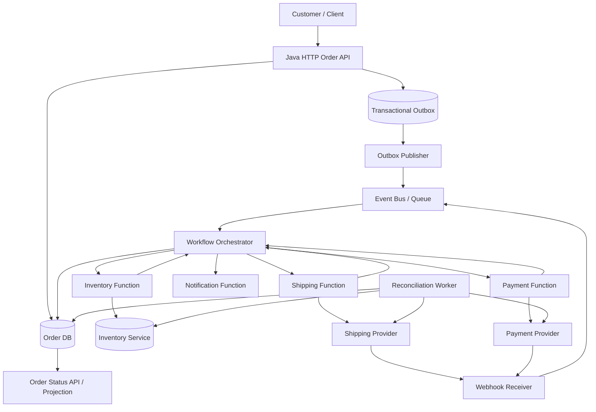
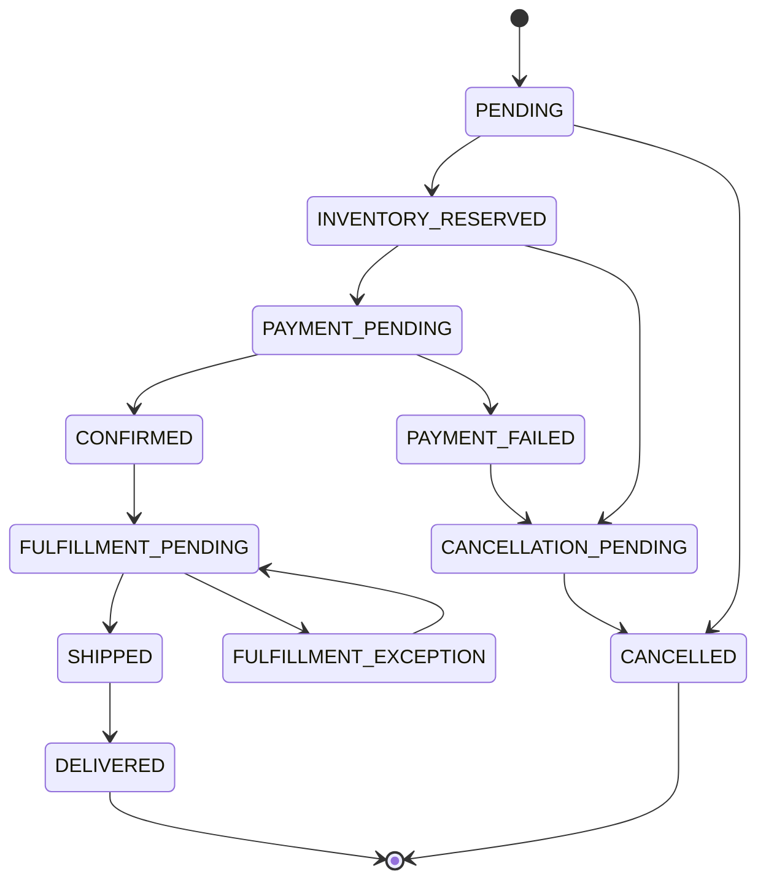
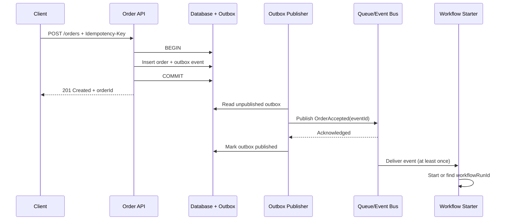
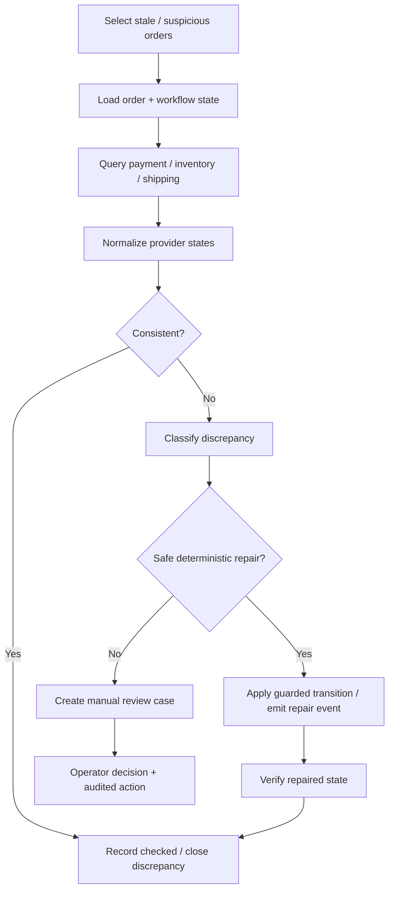

# Tracking Workflow Executions and Reconciling Order State

An order can pass through many services after a customer clicks the place-order button: confirming the order, reserving inventory, capturing payment, requesting shipment, sending notifications, and updating buyer-facing status. Each step can run in a separate Java serverless function triggered by HTTP, a queue, or an event. Steps do not necessarily finish together; a service may time out after performing a side effect, events can be redelivered, and two systems may temporarily display different states.

To operate this flow, the system must track both **workflow execution** (a single run of the process) and **order state** (the business state of the order). These two states are related but not identical: a workflow may be retrying a payment step while the order remains in `PAYMENT_PENDING`; a workflow may terminate in an intervention-required state while the order still exists and needs reconciliation.

This lesson uses the **Order Processing Workflow** project as an example. The goal is to design how workflow executions are created and tracked, persist per-step history, handle retries/timeouts/compensation, keep order state consistent, and reconcile against payment, inventory, and shipping. Examples use Java, databases, queues/events, and workflow orchestrators in a serverless model.

## 1. Business Problem and Design Goals

When a customer creates an order, the API must respond quickly and persist the order durably. Downstream processing steps may take seconds or minutes. The system must allow users to view current status, support staff to look up progress, and operators to pinpoint stalled steps.

A typical workflow:

1. Accept the order creation request and authenticate tenant/customer.
2. Persist the order in `PENDING` state.
3. Check and reserve inventory.
4. Create a payment request or confirm payment.
5. Confirm the order.
6. Create a shipment and track delivery.
7. Send notifications and update read models.
8. If a step fails, retry, compensate, or route to manual handling per policy.

Design goals:

- Maintain a stable identifier for each workflow execution linked to the order.
- Know which step the workflow is currently at, how many attempts ran, and the latest error.
- Avoid duplicate side effects when events/messages are redelivered.
- Prevent workflow state from being conflated with business order state.
- Detect workflows running too long, missing events, or having conflicting states.
- Reconcile state with external systems.
- Support resuming, retrying, cancelling, or manual intervention with an audit trail.
- Prevent a failing workflow from exhausting concurrency or overloading databases/dependent APIs.

## 2. Distinguishing Order, Workflow, and Workflow Execution

These concepts must be separated clearly:

| Concept | Represents | Lifecycle |
| --- | --- | --- |
| Order | The order and business state customers care about | From creation until completion, cancellation, or closure |
| Workflow definition | Process template containing steps, transitions, retry, and timeout policies | Versioned per release |
| Workflow execution/run | A single workflow run for an order or business command | Has startedAt, currentStep, attempts, status, and completedAt |
| Step execution | A specific run of a single step | Has input/output references, attempt, duration, and result |
| Event | Fact that something occurred or a processing request | Has eventId, type, version, occurredAt, and aggregate sequence |

For example, order `ord-8421` has workflow execution `wfr-01J...`. Step `reserve-inventory` may be attempted twice; the workflow execution remains one logical run. If an operator starts a new repair workflow run, link the new execution to the order and original execution instead of overwriting prior history.

### Workflow Status Differs from Order Status

Workflow status describes technical/orchestration progress, such as `RUNNING`, `WAITING`, `RETRY_WAIT`, `COMPENSATING`, `COMPLETED`, or `FAILED`. Order status describes business outcomes, such as `PENDING_PAYMENT`, `CONFIRMED`, `SHIPPED`, `DELIVERED`, or `CANCELLED`.

A workflow may be `COMPLETED` once it finishes dispatching the shipment request while the order remains in `SHIPPING`. Conversely, a workflow may be `FAILED` because the notification provider errored after the order was already `CONFIRMED`; the order should not automatically flip to `FAILED` if core business processing succeeded.

## 3. Actors and Use Cases

| Actor | Need | Action |
| --- | --- | --- |
| Customer | Know where their order is | View order status and customer-facing timeline |
| Order API | Accept requests and initiate workflows | Create order, write outbox, return order ID |
| Workflow orchestrator | Coordinate steps and persist execution state | Start, wait, retry, branch, compensate |
| Java worker/function | Execute individual business steps | Reserve stock, authorize payment, create shipment |
| External provider | Provide payment/shipping outcomes | Send callback or status event |
| Support operator | Investigate stuck orders | Inspect timeline, retry permitted step, open case |
| Reconciliation worker | Detect divergence across systems | Query providers, update projections, or create repair tasks |
| Auditor | Inspect change history | Query actor, transition, reason, and correlation |

Key use cases:

- Logically create an order and workflow execution atomically.
- Retrieve order status and workflow progress.
- Inspect the timeline of step executions.
- Receive callbacks/events from payment and shipping providers.
- Retry a transient step without re-executing an already succeeded side effect.
- Execute compensation when the process cannot continue.
- Detect overdue executions or missing heartbeats.
- Reconcile orders with payment, inventory, and shipment.
- Create audited manual review/repair executions.

## 4. Overall Architecture

A reference architecture comprises an HTTP API, database, transactional outbox, event bus/queue, workflow orchestrator, Java workers, and dependent systems.



This diagram shows one way to organize the system. The workflow orchestrator can be a managed state machine or a self-managed service storing durable state. Regardless of tooling, order state and execution history must still be explicitly modeled for business rules, auditing, and recovery.

### Responsibility Boundaries

- Order API authenticates, validates, persists the order, and writes the workflow start request.
- Outbox publisher delivers committed requests to the broker/orchestrator.
- Orchestrator manages step ordering, timeouts, retries, waits, and compensation flows.
- Workers execute a well-scoped operation and return a structured result.
- Order state service enforces valid business transitions.
- Reconciliation worker compares data across systems and records discrepancies.
- Status API presents appropriate status views for customers/operators.

Do not let arbitrary functions freely update every order field. Critical transitions must go through a domain service or conditional updates enforcing invariants.

## 5. Identifying and Linking Workflow Executions

Each run requires a distinct, stable, traceable identifier:

| Identifier | Purpose | Example |
| --- | --- | --- |
| `orderId` | Identifies the order aggregate | `ord-8421` |
| `workflowId` | Identifies the workflow type/definition | `order-fulfillment-v3` |
| `workflowRunId` | Identifies a single execution | `wfr-01JQ...` |
| `stepExecutionId` | Identifies a single step run | `stp-01JQ...` |
| `eventId` | Deduplicates events | `evt-01JQ...` |
| `correlationId` | Links requests/logs/traces in the same flow | `cor-01JQ...` |
| `causationId` | Indicates the event/command that directly caused the current event | `evt-01JP...` |
| `idempotencyKey` | Prevents creating duplicate operations | `create-order:tenant-7:key-abc` |

`orderId` does not replace `workflowRunId`: a single order can have an initial fulfillment workflow, a refund workflow, and a separate repair workflow. `correlationId` does not replace `eventId`: multiple events in the same flow share a correlation ID but must have distinct event IDs.

### ID Generation Rules

- IDs must not contain secrets, emails, or directly identifying personal data.
- `workflowRunId` is unique and immutable over the execution's lifecycle.
- Step retries keep the logical step key while incrementing attempt number/creating a new step execution ID.
- Repair runs get a new ID and record `parentRunId` or `causedByIncidentId`.
- Client-supplied IDs are never trusted as authorization proof; always verify tenant/owner.

## 6. Order State Model

A simple state machine:



The state machine above is illustrative; real rules depend on the business domain. For example, cancellation after payment may be allowed subject to refund; partial shipments may be supported; or payments may separate `AUTHORIZED` and `CAPTURED` states.

### Transitions Require Guards

Each transition must define:

- Where the current state is allowed to transition.
- Which actor/service is authorized to request the transition.
- Which business conditions must be satisfied.
- Which side effects are triggered.
- Which events are emitted after commit.
- Whether unmet conditions return a conflict or wait.

For example, `PAYMENT_PENDING -> CONFIRMED` is allowed only if the payment provider confirmed capture/authorization per business policy and the inventory reservation remains valid. Never allow workers to send arbitrary `status=CONFIRMED` updates.

## 7. Workflow Execution State Model

Workflow executions have their own lifecycle:

| Status | Meaning |
| --- | --- |
| `CREATED` | Execution created but not yet started |
| `RUNNING` | Executing one or more steps |
| `WAITING` | Waiting for a callback, timer, or external event |
| `RETRY_WAIT` | A step hit a transient error and is waiting to retry |
| `COMPENSATING` | Executing compensating actions |
| `COMPLETED` | Required steps finished per definition |
| `FAILED` | Cannot proceed automatically or retries exhausted |
| `CANCEL_REQUESTED` | Cancellation requested; requires safe handling |
| `CANCELLED` | Cancelled per policy and outcome recorded |
| `MANUAL_REVIEW` | Requires operator decision |

Do not mark `FAILED` merely because a single attempt failed. If policy allows retries, the execution can enter `RETRY_WAIT` and later return to `RUNNING`. Do not mark `COMPLETED` when only the final step has been enqueued; define completion semantics explicitly.

### When a Workflow Fails While the Order Remains Valid

Suppose payment was captured successfully and the order is `CONFIRMED`, but the notification service fails repeatedly. Depending on the definition, the workflow may move to `MANUAL_REVIEW` or end with the notification step `FAILED`, while the order stays `CONFIRMED`. Notification is a secondary side effect and must not erase a successful payment state.

## 8. Storing Execution State and Step History

Do not store only a single `current_status` column on the order. Investigation and resumption require execution and step history.

### Workflow Execution Table

A conceptual schema:

```sql
CREATE TABLE workflow_execution (
    workflow_run_id       VARCHAR(80) PRIMARY KEY,
    workflow_id           VARCHAR(120) NOT NULL,
    workflow_version      INTEGER NOT NULL,
    order_id              VARCHAR(80) NOT NULL,
    tenant_id             VARCHAR(80) NOT NULL,
    status                VARCHAR(32) NOT NULL,
    current_step          VARCHAR(120),
    correlation_id        VARCHAR(100) NOT NULL,
    parent_run_id         VARCHAR(80),
    started_at            TIMESTAMP,
    updated_at            TIMESTAMP NOT NULL,
    completed_at          TIMESTAMP,
    deadline_at           TIMESTAMP,
    last_error_code       VARCHAR(100),
    version               BIGINT NOT NULL DEFAULT 0
);
```

### Step Execution Table

```sql
CREATE TABLE workflow_step_execution (
    step_execution_id     VARCHAR(80) PRIMARY KEY,
    workflow_run_id       VARCHAR(80) NOT NULL,
    step_key              VARCHAR(120) NOT NULL,
    attempt               INTEGER NOT NULL,
    status                VARCHAR(32) NOT NULL,
    input_reference       VARCHAR(500),
    output_reference      VARCHAR(500),
    started_at            TIMESTAMP,
    completed_at          TIMESTAMP,
    duration_ms           BIGINT,
    error_code            VARCHAR(100),
    error_category        VARCHAR(40),
    UNIQUE (workflow_run_id, step_key, attempt)
);
```

These tables are reference schemas; add foreign keys and indexes suited to your database and retention policy. Avoid storing sensitive payloads or very large JSON blobs directly in execution history; store object references/checksums instead. Step history should append new attempts rather than overwriting previous history.

### Execution State Is Not the Sole Audit Log

Current state serves fast queries; step history and audit logs serve investigation and explanation. Maintain a current projection alongside immutable events/history. If only a single row is continuously overwritten, operators lose visibility into prior attempts and transition reasons.

## 9. Creating Orders and Workflows Reliably

A common bug is writing an order to the database and then calling the workflow engine over HTTP. If the database commits but the orchestrator call fails, an order exists without a workflow. If the orchestrator starts and then the database transaction rolls back, the workflow processes a nonexistent order.

Use the transactional outbox:

1. In one database transaction, create the order and an outbox message `OrderAccepted`.
2. Commit the transaction.
3. The outbox publisher reads unpublished messages and sends them to the broker/workflow starter.
4. The publisher marks them published after broker acknowledgment.
5. If the publisher crashes after publishing but before marking, the message may be redelivered; consumers deduplicate by `eventId`.



The API only returns `201 Created` after the order and outbox commit. Workflow initiation may be asynchronous; the response contract should clarify `workflowStatus=CREATED` or provide a tracking endpoint.

## 10. Idempotency When Starting Workflows

Clients may retry `POST /orders` after a timeout. The outbox publisher may also send `OrderAccepted` multiple times. Therefore, idempotency is needed at multiple boundaries:

- Order creation API: keyed by tenant + client key.
- Workflow starter: unique logical execution key by order + workflow type/version policy.
- Step workers: idempotency key by workflow run + step key + business operation.
- Provider calls: provider idempotency key when supported by the API.
- Event consumers: inbox/processed-event table keyed by event ID.

Do not use the same key across all boundaries if semantics differ. An order may later have a refund workflow; a unique constraint solely on order ID would wrongly block valid follow-up workflows.

### Idempotency/Inbox Table

```sql
CREATE TABLE processed_event (
    consumer_name    VARCHAR(120) NOT NULL,
    event_id         VARCHAR(100) NOT NULL,
    processed_at     TIMESTAMP NOT NULL,
    result_reference VARCHAR(500),
    PRIMARY KEY (consumer_name, event_id)
);
```

Unique constraints serve as the final defense when two invocations process the same event concurrently. If the side effect and inbox row live in the same database, write them in the same transaction. For side effects outside the database, use provider idempotency, outbox, or reconciliation for unknown outcomes.

## 11. Tracking Steps and Attempts

A step execution must capture enough data to answer:

- When did the step start and finish?
- How many times was it attempted?
- Was the error transient, business, or configuration?
- Was an external provider called? Which request/reference?
- Could a side effect have happened before timeout?
- Where is the output stored?
- Is it safe to retry, or must reconciliation run first?

### Suggested Step States

| Status | Meaning |
| --- | --- |
| `PENDING` | Not yet executed |
| `RUNNING` | Attempt currently running |
| `SUCCEEDED` | Step completed and output saved |
| `RETRY_WAIT` | Waiting to retry |
| `FAILED` | Retries exhausted or non-retryable failure |
| `SKIPPED` | Not needed based on branch condition |
| `COMPENSATING` | Executing compensating action |
| `COMPENSATED` | Compensating action completed |
| `UNKNOWN_OUTCOME` | Unknown whether provider executed the side effect |

`UNKNOWN_OUTCOME` is vital for external APIs. For example, a payment request times out: the provider may have already charged the card while the response dropped. Do not immediately retry charging; query the provider by merchant reference/idempotency key to resolve the outcome.

## 12. Retry Policy by Error Type

Not every error should be retried:

| Error | Retry? | Action |
| --- | --- | --- |
| Network reset/temporary DNS | Bounded | Backoff, jitter, timeout |
| HTTP 429 | Per policy | Honor `Retry-After`, reduce concurrency |
| HTTP 5xx from dependency | Typically yes | Backoff and circuit breaker |
| Validation/business rejection | Do not auto-retry | Mark business failure or request input fix |
| Authorization 401/403 | Do not retry continuously | Fix identity/permission/credential |
| Resource not found due to eventual consistency | Short retry possible | Only if contract permits and with a deadline |
| Provider timeout after side effect | Do not retry directly | Transition to `UNKNOWN_OUTCOME`, reconcile |
| Unsupported schema version | Do not retry blindly | Upcast or quarantine |

An illustrative exponential backoff policy:

\[
delay_n = \min(delay_{max}, delay_{base} \times 2^n) + jitter
\]

Cap attempts and total deadline. Avoid enabling retries simultaneously in the orchestrator, worker SDK, and provider client without accounting for total attempts; retry amplification can overwhelm downstream services.

## 13. Timeouts and Deadlines for Long-Running Workflows

Multi-step workflows need an overall deadline and per-step timeouts. Examples:

| Step | Illustrative Target Timeout |
| --- | ---: |
| Reserve inventory | 2 seconds |
| Authorize payment | 8 seconds |
| Create shipment | 10 seconds |
| Wait for carrier acceptance | 30 minutes |
| Send notification | 3 seconds |
| End-to-end initial processing | 1 minute excluding delivery time |

A single function timeout does not necessarily mean the workflow has expired. A workflow may wait hours or days for external events; use a durable wait state rather than keeping an invocation alive to sleep.

Propagate deadlines/remaining budgets across services. If 5 seconds remain on the workflow deadline, a worker should not start an API call with a 30-second timeout. When a deadline expires, enforce business policy: retry, compensate, manual review, or keep waiting for a callback.

## 14. Compensation and Sagas

Business steps causing side effects across multiple systems usually cannot share a single database transaction. Use Sagas/compensation when a workflow cannot complete.

Example:

1. Reserve inventory.
2. Authorize payment.
3. Create shipment.
4. If shipment is permanently rejected, void/refund payment and release inventory per policy.

Compensation is not a physical rollback of the initial transaction. It is a new business action that can fail and requires its own retries/reconciliation.

| Forward Step | Potential Compensation |
| --- | --- |
| Reserve inventory | Release reservation |
| Authorize payment | Void authorization |
| Capture payment | Refund payment |
| Create shipment | Cancel shipment if carrier permits |
| Allocate promotion | Restore promotion quota if policy permits |
| Send email | Cannot recall sent email; may send a correction notice |

Compensations must be idempotent and have dedicated status tracking. If payment was captured and a refund is pending, the order may stay in `CANCELLATION_PENDING` rather than transitioning straight to `CANCELLED`.

## 15. Java Model for Workflow Execution

A domain model can represent executions and steps:

```java
import java.time.Instant;
import java.util.List;

public record WorkflowExecution(
        String workflowRunId,
        String workflowId,
        int workflowVersion,
        String orderId,
        String tenantId,
        WorkflowStatus status,
        String currentStep,
        String correlationId,
        Instant startedAt,
        Instant updatedAt,
        Instant deadlineAt,
        long version
) {}

public enum WorkflowStatus {
    CREATED,
    RUNNING,
    WAITING,
    RETRY_WAIT,
    COMPENSATING,
    COMPLETED,
    FAILED,
    CANCEL_REQUESTED,
    CANCELLED,
    MANUAL_REVIEW
}

public record StepResult(
        String stepKey,
        StepStatus status,
        int attempt,
        String outputReference,
        String errorCode,
        Instant startedAt,
        Instant completedAt
) {}

public enum StepStatus {
    PENDING,
    RUNNING,
    SUCCEEDED,
    RETRY_WAIT,
    FAILED,
    SKIPPED,
    COMPENSATING,
    COMPENSATED,
    UNKNOWN_OUTCOME
}
```

Java records are immutable value objects; transitions should execute through a domain service/repository with optimistic version checks, never by constructing a new object and overwriting state without checking version.

### State Transition Service

```java
public final class OrderTransitionService {
    private final OrderRepository orders;
    private final OrderEventOutbox outbox;

    public OrderTransitionService(
            OrderRepository orders,
            OrderEventOutbox outbox
    ) {
        this.orders = orders;
        this.outbox = outbox;
    }

    public Order transition(
            String tenantId,
            String orderId,
            OrderStatus expected,
            OrderStatus target,
            String reason,
            String correlationId
    ) {
        return orders.inTransaction(tx -> {
            Order current = tx.findForUpdate(tenantId, orderId)
                    .orElseThrow(OrderNotFoundException::new);

            if (current.status() != expected) {
                throw new OrderStateConflictException(
                        current.status(), expected);
            }
            if (!OrderPolicy.canTransition(expected, target)) {
                throw new InvalidOrderTransitionException(expected, target);
            }

            Order updated = current.withStatus(target);
            tx.update(updated);
            outbox.append(new OrderStatusChanged(
                    orderId, expected, target, reason, correlationId));
            return updated;
        });
    }
}
```

This is an illustrative skeleton. `findForUpdate`/optimistic update and `outbox.append` must participate in the same transaction. Never call payment/shipping providers inside a database transaction holding locks; write a command/outbox entry and invoke asynchronously.

## 16. Java Worker: Idempotent Step with an External Provider

A worker should receive a command with a stable business key, check current state, and pass a provider idempotency key:

```java
public final class PaymentAuthorizationWorker {
    private final PaymentRepository payments;
    private final PaymentGateway gateway;

    public PaymentAuthorizationWorker(
            PaymentRepository payments,
            PaymentGateway gateway
    ) {
        this.payments = payments;
        this.gateway = gateway;
    }

    public PaymentResult authorize(AuthorizePaymentCommand command) {
        var existing = payments.findByOrderId(command.orderId());
        if (existing.filter(Payment::isAuthorized).isPresent()) {
            return PaymentResult.alreadyAuthorized(
                    existing.get().providerReference());
        }

        String idempotencyKey = "authorize:" + command.orderId()
                + ":" + command.paymentAttempt();

        try {
            ProviderAuthorization response = gateway.authorize(
                    command.amountMinor(),
                    command.currency(),
                    idempotencyKey);
            return payments.recordAuthorization(
                    command.orderId(), response.providerReference(),
                    response.status());
        } catch (ProviderTimeoutException ex) {
            payments.markUnknownOutcome(command.orderId(), idempotencyKey);
            throw ex;
        }
    }
}
```

This example assumes the provider supports idempotency keys and has an authorization lookup API. If the provider does not, use a unique merchant reference and reconciliation to determine outcomes after timeouts. Do not create a new `paymentAttempt` solely because the function timed out; if the same logical authorization is in unknown outcome, query the provider first.

## 17. Receiving Callbacks/Webhooks from Payment and Shipping Providers

External providers can deliver webhooks multiple times, out of order, or late. The webhook receiver must:

1. Verify signature, timestamp, and replay protection per provider contract.
2. Validate event type, provider account, and resource reference.
3. Persist raw event metadata and event ID into a durable inbox.
4. Return a fast response once the event is durably saved.
5. Process the event asynchronously in a worker with deduplication.
6. Validate permitted transitions before updating payment/order state.
7. If an event arrives out of order, query the provider or hold the event awaiting prior state.

Do not trust webhook status merely because the payload parses cleanly. Verify signatures and cross-check merchant reference/order ID. Never log signature secrets or full payloads containing payment details.

### Sample Event Envelope

```json
{
  "eventId": "evt-pay-778",
  "eventType": "PaymentCaptured",
  "schemaVersion": 1,
  "provider": "payment-gateway",
  "providerReference": "pay-ref-990",
  "orderId": "ord-8421",
  "occurredAt": "2026-11-17T10:15:30Z",
  "receivedAt": "2026-11-17T10:15:32Z",
  "correlationId": "cor-order-8421"
}
```

Keep both `occurredAt` and `receivedAt`: they help distinguish late provider emission from delayed consumer processing.

## 18. Reconciling Order State with Payment, Inventory, and Shipping

Event-driven workflows do not guarantee every system updates simultaneously. Scenarios that can occur include:

- Order is `PAYMENT_PENDING`; the payment provider captured funds, but the webhook was lost.
- Order is `CONFIRMED`; the inventory reservation expired due to a worker error.
- Order is `SHIPPED`; the carrier delivered the parcel, but the `Delivered` webhook has not arrived.
- Workflow is `FAILED`, yet an external provider already executed its side effect.
- The order database updated successfully, while the read model/cache has not refreshed.

Reconciliation is a scheduled or event-driven process that compares states across sources and determines corrective actions.

### Authoritative Data Sources by Domain

Do not assume the order database is authoritative for everything:

| Domain | Typical Authoritative Source | Data to Reconcile |
| --- | --- | --- |
| Order | Order service/database | Order state, amount, currency, line items |
| Payment | Payment ledger/provider per contract | Authorization, capture, refund, settlement reference |
| Inventory | Inventory/reservation service | Reserved, committed, released quantities |
| Shipping | Carrier/shipping service | Shipment created, accepted, in transit, delivered |
| Workflow | Orchestrator/execution store | Current step, attempt, wait, failure, compensation |
| Notification | Notification provider/outbox | Sent/failed status; does not govern order state |

A source may be authoritative for a subset of facts. For example, the provider is authoritative for confirming capture, while the order service governs business policy on whether to transition the order to `CONFIRMED`.

## 19. Reconciliation Algorithm

A reconciliation worker can run through these steps:

1. Select candidate orders to inspect: stale states, stuck workflows, missing webhooks, or a random audit sample.
2. Load the order, workflow execution, and provider references.
3. Query current state from payment/inventory/shipping providers within rate limits.
4. Normalize provider states into a canonical model.
5. Compare expected state against observed state.
6. Classify discrepancies: event delay, missing event, duplicate, state conflict, unknown outcome, or data corruption.
7. Auto-repair only via deterministic, pre-approved rules.
8. Create repair tasks/manual review cases for unsafe cases.
9. Persist reconciliation results and audit trail.
10. Re-verify after repair and close the discrepancy.



Do not use reconciliation to force statuses into "desired" states without understanding side effects. For example, if the payment provider reports `CAPTURED` while the order is already cancelled, do not automatically mark the order `CONFIRMED`. A refund or manual review may be needed per policy.

## 20. Designing Discrepancy and Repair Records

A discrepancy record prevents repeated processing and supports auditing:

```sql
CREATE TABLE order_discrepancy (
    discrepancy_id       VARCHAR(80) PRIMARY KEY,
    order_id             VARCHAR(80) NOT NULL,
    workflow_run_id      VARCHAR(80),
    domain               VARCHAR(40) NOT NULL,
    discrepancy_type     VARCHAR(80) NOT NULL,
    expected_state       VARCHAR(80),
    observed_state       VARCHAR(80),
    source_reference     VARCHAR(200),
    status               VARCHAR(32) NOT NULL,
    detected_at          TIMESTAMP NOT NULL,
    resolved_at          TIMESTAMP,
    resolution_code      VARCHAR(80),
    resolution_actor     VARCHAR(120)
);
```

Discrepancy status may be `OPEN`, `AUTO_REPAIR_PENDING`, `MANUAL_REVIEW`, `RESOLVED`, `IGNORED_WITH_REASON`, or `REOPENED`. Never delete resolved records; preserve resolution code, actor, and evidence references.

### Repair Is Not Direct Database Editing

Operators should use validated, audited commands/APIs instead of running ad-hoc `UPDATE order SET status=...` statements. A repair command must:

- Specify order/tenant and expected current version.
- Require a reason/ticket/incident ID.
- Validate business invariants and permissions.
- Execute a guarded transition.
- Record audit/outbox entries in the same transaction.
- Link to the discrepancy and workflow run.
- Be idempotently retryable if the operator does not receive a response.

## 21. Detecting Stuck Workflows

An execution can remain `RUNNING` for too long due to a crashed worker, missing callback, unrenewed lease, or hung downstream service. Define per-step timeouts and per-workflow deadlines.

Signals:

- `updatedAt` or heartbeat older than threshold.
- `RUNNING` with no active step attempt.
- `WAITING` past callback deadline.
- `RETRY_WAIT` lacking a valid `nextAttemptAt`.
- Step attempts incrementing without completion.
- Order state unchanged while provider state changed.
- Execution deadline passed while workflow is non-terminal.
- Outbox event unpublished for too long.

### Sweeper/Monitor Job

A scheduled function can scan stale executions by index and emit a `WorkflowStuckDetected` event. Never let the sweeper blindly retry every step; it must inspect lease expiration, deadlines, retry policies, and unknown outcomes. For external side effects, query the provider/reconcile before resending.

To prevent multiple sweepers from processing the same execution, use leases/conditional claims and unique keys for repair events. Partition scans, bound batch sizes, and limit concurrency.

## 22. Workflow Versioning and In-Flight Executions

Workflow definitions evolve as business rules change. An execution started on version 2 should not silently switch to version 3 mid-flight if semantics differ.

Store `workflowVersion` on each execution and define clear policies:

- New executions use the new version.
- In-flight executions continue on their original definition version if supported by the orchestrator.
- If migrating executions is required, use a controlled, audited migration step.
- Event payloads carry schema versions independent of workflow versions.
- Workers must support message/execution versions still within the retention window.

Never delete old handlers while the queue still holds commands produced by an older release. Maintain a compatibility window or upcast commands/events before invoking business logic.

## 23. Security and Authorization for Viewing Workflows

Workflow history can expose payment details, shipping addresses, provider references, and internal errors. Not everyone permitted to view an order should see every execution detail.

Suggested role permissions:

| Role | Permissions |
| --- | --- |
| Customer | View order status and timeline with internal details filtered out |
| Support | View execution summaries and discrepancies scoped to assigned tenant/customer |
| Operator | View step history, retry metadata, and dependency statuses |
| Finance | View payment/refund references and reconciliation results within scope |
| Workflow service | Read/write execution state under its service identity |
| Auditor | Read audit history and resolution metadata |

APIs must enforce tenant scoping and resource-level authorization. Never return raw provider responses or stack traces to customers. Mask card/payment data, tokens, secrets, and sensitive addresses in logs and history per policy.

## 24. APIs for Tracking Orders and Workflows

An API can expose high-level status alongside dedicated operator endpoints:

| Method | Path | Purpose |
| --- | --- | --- |
| `POST` | `/v1/orders` | Create order and initiate workflow request |
| `GET` | `/v1/orders/{orderId}` | View business order status |
| `GET` | `/v1/orders/{orderId}/timeline` | View filtered timeline for customer |
| `GET` | `/v1/workflow-runs/{workflowRunId}` | View execution summary with operator permissions |
| `GET` | `/v1/workflow-runs/{workflowRunId}/steps` | View step attempts and errors |
| `GET` | `/v1/orders/{orderId}/discrepancies` | View discrepancies with support/operator permissions |
| `POST` | `/v1/discrepancies/{id}/resolve` | Submit audited repair/resolve command |

### Customer-Facing Response

```json
{
  "orderId": "ord-8421",
  "status": "CONFIRMED",
  "statusUpdatedAt": "2026-11-17T10:16:00Z",
  "fulfillment": {
    "status": "PREPARING",
    "estimatedDispatchAt": "2026-11-18T09:00:00Z"
  },
  "timeline": [
    {
      "status": "PENDING",
      "occurredAt": "2026-11-17T10:14:00Z",
      "label": "Order received"
    },
    {
      "status": "CONFIRMED",
      "occurredAt": "2026-11-17T10:16:00Z",
      "label": "Order confirmed"
    }
  ]
}
```

Customer-facing responses must not leak internal step names like `charge-provider-retry-3` or raw error messages. Operator APIs can expose execution IDs, attempts, error codes, and dependency references under appropriate authorization.

## 25. Workflow Orchestrators and Java Workers

There are two common approaches:

### Managed Orchestration

A managed workflow service persists execution state, steps, retries, waits, and branches. Java functions perform specific tasks. Benefits include reduced orchestration code and built-in execution history; you must understand payload limits, execution duration limits, state transition semantics, retry behavior, and costs.

### Self-Managed Durable Orchestration

The application persists workflow state in a database and dispatches commands via queues. Workers execute commands, write results/events, and the coordinator updates state. This is flexible, though the team must build leases, deduplication, timeouts, retries, recovery, and operator tooling.

Do not let both a managed orchestrator govern a step and the worker independently retry the same step using a separate state machine without clear boundaries. Clearly designate which layer owns retries and step state.

## 26. AWS Step Functions with Lambda Workers

An AWS architecture can use:

- API Gateway/Lambda for the HTTP order API.
- DynamoDB or RDS for order state and business data.
- Transactional outbox/broker for reliable workflow initiation.
- AWS Step Functions to coordinate steps, waits, retries, catches, and compensation.
- Java Lambda functions for inventory/payment/shipping adapters.
- EventBridge/SQS for events and async handoffs.
- CloudWatch logs/metrics/alarms and tracing for observability.

Choose Standard or Express workflows based on duration, execution semantics, throughput, and auditing/history requirements. Name `workflowRunId`/executions in relation to the order while respecting the service's uniqueness rules. State payloads should carry IDs/references rather than full sensitive records or large files.

A successful Step Functions execution only proves the state machine definition reached an end state; explicitly define whether the terminal state signifies business completion of the order or completion of a single phase. The callback/wait pattern suits waiting on providers, provided timeouts and duplicate callbacks are handled.

## 27. Azure Durable Functions

Azure Durable Functions provides orchestrators, activities, and durable external events:

- Orchestrator manages step sequencing and workflow state.
- Activity executes side effects such as reserving stock or calling payment APIs.
- External events receive provider callbacks.
- Timers support deadlines and timeouts.
- Fan-out/fan-in supports independent parallel steps.

Orchestrator code can be replayed to reconstruct state. Therefore, orchestrator code must be deterministic: never directly call random, wall-clock time, HTTP, DB, or arbitrary side effects; place those operations inside activities or appropriate durable APIs. Activities must also be idempotent because they may re-execute under certain failure scenarios.

Pay attention to Durable Functions execution history and retention; define purge/archival policies aligned with audit and privacy requirements. Do not rely on unbounded execution history as a business ledger.

## 28. Google Cloud Workflows and Cloud Run Functions/Jobs

Google Cloud Workflows can orchestrate HTTP/API calls, branches, retries, and waits; Cloud Run functions or Cloud Run services/jobs execute Java tasks. Eventarc/Pub/Sub can route events into workflows or workers.

A sample flow:

1. Order API writes the order and outbox.
2. Publisher sends the event to Pub/Sub.
3. Workflow starts with order ID and correlation ID.
4. Workflow invokes Cloud Run functions/services to reserve inventory and authorize payment.
5. Workflow waits for shipping events or callbacks by correlation key.
6. Reconciliation worker checks overdue executions/orders.

Check execution duration limits, payload limits, retry policies, and connector/API quotas for the chosen workflow/service tier. Persist business data and execution references in a database; workflow input is not the place to store entire order records.

## 29. Order Status Projection and Eventual Consistency

Customer APIs often need fast reads of order status while workflow executions and provider events update asynchronously. You can maintain a customer-facing read projection:

- Workflow/execution store holds technical progress.
- Order database holds authoritative business state.
- Projection/cache serves the consolidated read model.
- Events update the projection after business transactions commit.

Projections can lag. APIs should return `statusUpdatedAt` or `lastSyncedAt` so clients know freshness, and should avoid presenting stale status as final if lag can be detected.

### Version/Sequence to Prevent Stale Events from Overwriting

Each order can carry `aggregateVersion` or `statusSequence`. Consumers only apply events with a newer version:

```sql
UPDATE order_status_projection
SET status = :new_status,
    aggregate_version = :incoming_version,
    updated_at = :occurred_at
WHERE order_id = :order_id
  AND aggregate_version < :incoming_version;
```

If the version is equal or lower, the event may be duplicate/out-of-order and should be ignored or investigated. Never rely solely on timestamps when producer clocks may drift or two events share the same timestamp.

## 30. Scheduled and Event-Driven Reconciliation

Reconciliation can be triggered in two ways:

- **Event-driven:** triggered on incoming webhooks/provider events to detect changes immediately.
- **Scheduled sweep:** scans stale orders/workflows to catch lost events, missing callbacks, or failed consumers.

The two approaches complement each other. Webhooks reduce latency; sweeps ensure the system does not depend entirely on single-delivery reliability.

### Selecting Candidate Orders for Reconciliation

Do not query every order every minute. Maintain indexes/queues for:

- `PAYMENT_PENDING` past SLA.
- `INVENTORY_RESERVED` with no workflow progress.
- `SHIPPED` with no carrier updates within the expected window.
- `CANCELLATION_PENDING` past deadline.
- `UNKNOWN_OUTCOME` requiring provider lookup.
- Executions with stale heartbeats or past `deadlineAt`.
- Discrepancies in `OPEN` or `REOPENED` status.

Batch work, use cursors, throttle provider API calls, and persist checkpoints. For each order, record `lastReconciledAt`, `nextReconcileAt`, and `reconcileAttempt` to avoid scanning too aggressively.

## 31. Per-Domain Reconciliation Policy

### Payment

- Compare order amount/currency with the provider transaction.
- Check authorization, capture, void, refund, and settlement references.
- If the provider shows `CAPTURED` while the order is not confirmed, verify inventory/order policy before applying a guarded transition.
- If the order is already cancelled while the provider shows `CAPTURED`, trigger refund/compensation or a manual case.
- If outcome is unknown, query the provider by idempotency/merchant reference before issuing a new command.

### Inventory

- Compare reservation ID, order lines, quantities, and expiration.
- If a reservation expired while payment was captured, follow policy for restock/re-reserve/compensation.
- Never increment stock based solely on order status; the inventory service is authoritative for available/reserved quantities.

### Shipping

- Compare shipment reference, carrier status, and tracking event sequence.
- Handle duplicate or out-of-order callbacks.
- If the shipment is delivered while the order projection still says shipped, update via a guarded transition and audit.
- If the carrier has no record of a shipment while the order says shipped, open a discrepancy rather than immediately creating a new shipment.

## 32. Operator Workflows and Manual Intervention

A production system must support operators handling cases that cannot be resolved automatically.

Operator UI/APIs should display:

- Order summary and tenant/customer scope.
- Workflow run ID, definition/version, status, and current step.
- Timeline of each step/attempt with duration and error codes.
- Masked external references for payment, inventory, and shipment.
- Discrepancies, evidence, and latest reconciliation timestamp.
- Permitted retry/compensation actions per policy.
- Reason/ticket/actor for every manual action.

Do not provide an unrestricted "retry all" button. Every action must describe its effect: retry a step, start a repair run, query provider, release reservation, refund, or mark as manually resolved. Some actions are irreversible and require approval.

## 33. Observability: Metrics, Logs, and Traces

### Workflow Metrics

| Metric | Meaning |
| --- | --- |
| `workflow.started` | Number of executions created |
| `workflow.completed` | Number of completed executions |
| `workflow.failed` | Number of terminally failed executions |
| `workflow.running` | Currently running executions |
| `workflow.waiting` | Executions waiting on external events/timers |
| `workflow.age` | Elapsed time from start to present |
| `workflow.step.duration` | Per-step duration |
| `workflow.step.retry` | Retry count by step/error category |
| `workflow.stuck` | Executions exceeding heartbeat/deadline thresholds |
| `order.transition.conflict` | Transitions rejected due to state/version mismatch |
| `reconciliation.discrepancy` | Discrepancy count by domain/type |
| `reconciliation.age` | Age of open discrepancies |
| `outbox.oldest_unpublished_age` | Age of oldest unpublished outbox message |

Metric labels should include bounded-cardinality values such as `workflowId`, `stepKey`, `environment`, `region`, and `result`. Do not use `orderId`, `workflowRunId`, or `customerId` as metric labels due to extreme cardinality; use structured logs/traces for drill-down.

### Structured Logs

Every workflow-related log should include:

```json
{
  "timestamp": "2026-11-17T10:16:02Z",
  "level": "INFO",
  "service": "order-workflow-worker",
  "environment": "production",
  "orderId": "ord-8421",
  "workflowRunId": "wfr-01JQ...",
  "stepKey": "authorize-payment",
  "attempt": 1,
  "eventId": "evt-01JQ...",
  "correlationId": "cor-01JQ...",
  "result": "SUCCEEDED",
  "durationMs": 420
}
```

Never log access tokens, card data, secrets, full provider payloads, or unnecessary PII. Propagate correlation context across HTTP, queues, and workflow state.

### Traces

Traces can model parent-child spans:

```text
POST /orders
  └── create-order transaction
       └── outbox publish
            └── workflow execution
                 ├── reserve-inventory
                 ├── authorize-payment
                 │    └── payment-provider HTTP call
                 ├── create-shipment
                 └── publish-order-confirmed
```

Because workflows may span hours or days, do not keep a single trace span open for the entire lifecycle. Use trace links/correlation IDs and separate spans per step/event; store `workflowRunId` in execution history to connect traces.

## 34. SLOs for Workflows and Reconciliation

Do not measure HTTP API availability alone. An API can return `201` quickly while the workflow never starts.

| SLI | Illustrative SLO | Meaning |
| --- | --- | --- |
| Order acceptance | 99.9% of valid requests persisted durably | API does not acknowledge before commit |
| Workflow dispatch | 99% of orders have an execution created within 30 seconds | Outbox/broker is not stalled |
| Initial processing | 95% of standard orders reach `CONFIRMED` within 2 minutes when providers are healthy | Tracks initial synchronous/async steps |
| Stuck execution detection | 99% of overdue executions detected within 5 minutes | Prevents runs from hanging indefinitely |
| Reconciliation freshness | Stale orders checked within policy window | Catches event/provider mismatches |
| Duplicate side effects | Zero confirmed duplicate payment captures | Critical correctness control |

These figures are examples only. Product and operations must define provider SLAs, business deadlines, traffic expectations, and wait tolerances. For shipping, end-to-end delivery depends on carriers and is not fully within the system's control.

### Essential Alerts

- Outbox oldest unpublished age exceeds threshold.
- Order remains `PENDING` too long with no workflow run.
- Workflow `RUNNING`/`WAITING` exceeds deadline.
- Payment `UNKNOWN_OUTCOME` remains unreconciled.
- Discrepancy remains `OPEN` past SLA.
- Sudden spikes in retry rate, DLQ count, or step failures.
- Rising order state transition conflicts.
- Rising projection lag or webhook age.

## 35. Backpressure and Concurrency Limits

Workflow fan-out can trigger many concurrent function invocations. If many orders reserve inventory or call the payment provider simultaneously, downstream services can overload.

Mitigations:

- Limit concurrency per step and downstream dependency.
- Use queue buffers for work that does not require immediate completion.
- Apply rate limits aligned with provider/tenant quotas.
- Set timeouts shorter than the workflow deadline.
- Use circuit breakers when dependencies suffer sustained failures.
- Retry with backoff/jitter and an attempt budget.
- Prioritize critical steps; defer best-effort notifications/reports.
- Monitor queue age and workflow wait duration.

Do not try to solve every error by increasing concurrency. If a payment provider is rate-limiting requests, adding more workers only increases 429 errors and retries.

## 36. Workflow Recovery and Replay

When an orchestrator or worker fails, you must know where an execution can safely resume:

- Managed orchestrators provide execution history/checkpoints with platform-specific semantics.
- Custom orchestrators need durable step state, leases, fencing, and command queues.
- Workers need idempotency for every step.
- External side effects need provider references and unknown-outcome reconciliation.
- Event replay must preserve event ID, sequence, and `occurredAt`.
- Repair runs must link to the original execution and discrepancy.

Never replay an entire `OrderAccepted` event for an order that already captured payment without deduplication/guards. A new workflow definition could restart from the beginning and repeat side effects if resume semantics are not designed.

### Manual Resume Policy

Before resuming:

1. Identify the last step with a confirmed side effect.
2. Verify provider state for any step with an unknown outcome.
3. Check the order's current aggregate version and state.
4. Determine which steps may be retried, skipped, or compensated.
5. Record reason/operator/ticket and create a repair execution if appropriate.
6. Monitor the outcome and run reconciliation after repair.

## 37. Test Strategy

Workflow tests must cover happy paths and failure modes:

| Scenario | Expected Outcome |
| --- | --- |
| Inventory, payment, and shipping all succeed | Order advances through valid states |
| Event delivered twice | Only one logical side effect applied |
| Payment times out after provider captured | Marked unknown outcome and provider queried before retry |
| Payment declined | Order not confirmed; inventory compensated per policy |
| Inventory reservation expired | Capture does not proceed if guard requires active reservation |
| Webhook arrives out of order | No backward state transition applied |
| Worker crashes after provider call | Resume/reconcile produces no duplicates |
| Outbox publisher sends duplicate | Consumer deduplicates by event ID |
| Workflow callback wait times out | Timeout path/compensation/manual review triggered |
| Reconciliation detects mismatch | Discrepancy created and guarded repair executed |
| Operator retries step | Full audit trail, idempotency preserved |
| New workflow version deployed | In-flight executions continue per compatibility policy |
| Tenant A reads tenant B's order | Rejected/hidden per security contract |

Run contract tests against simulated providers, fault injection, and concurrency tests for conditional transitions. Do not mock out the entire database/orchestrator; include integration tests to verify transactions, unique constraints, and real retry semantics.

## 38. End-to-End Example: Payment Succeeds While Workflow Times Out

Suppose a worker calls the payment provider to capture 500,000 VND. The provider completes the capture, but the response is lost due to a network timeout.

Safe handling flow:

1. The worker does not mark `PAYMENT_FAILED`; it records `UNKNOWN_OUTCOME` for the step.
2. The workflow transitions to `WAITING` or `RETRY_WAIT` per policy without issuing a new capture with a different key.
3. The reconciliation worker queries the provider by merchant reference/idempotency key.
4. Once the provider confirms `CAPTURED`, save the provider transaction reference and emit the payment result.
5. The order transition service checks the inventory reservation and transitions `PAYMENT_PENDING -> CONFIRMED` if guards pass.
6. Outbox emits `OrderConfirmed` after commit.
7. If the provider confirms capture did not happen, the workflow can retry the same logical operation key or handle the decline.
8. If the provider cannot determine the outcome, open a manual review case.

Key takeaway: a timeout only means the caller did not receive a response within the time limit; it does not prove the side effect never happened.

## 39. Project Implementation Process

1. **Model:** define the order state machine, workflow definition, and step boundaries.
2. **Identity:** define `orderId`, `workflowRunId`, `stepExecutionId`, `eventId`, and `correlationId`.
3. **Persistence:** create schemas for orders, workflow executions, step history, outbox, inbox, and discrepancies.
4. **Start path:** create order + outbox in one transaction; publisher starts workflows idempotently.
5. **Workers:** implement inventory/payment/shipping/notification steps with clear contracts and idempotency.
6. **Orchestration:** configure retries, timeouts, waits, branches, compensation, and workflow versioning.
7. **Status API:** expose customer-facing order status and authorized execution details for operators.
8. **Reconciliation:** build scheduled/event-driven sweepers, provider adapters, and repair queues.
9. **Observability:** dashboards for executions, steps, stale orders, discrepancies, outbox, and dependency health.
10. **Resilience:** test duplicates, out-of-order events, timeouts after side effects, retry storms, and provider outages.
11. **Operations:** write runbooks, manual intervention policies, retention rules, and auditing.
12. **Release:** canary a subset of orders/tenants, reconcile results, and gradually expand traffic.

## 40. Pre-Production Checklist

- [ ] Order state and workflow execution state are separated.
- [ ] Workflow definitions are versioned and executions record their version.
- [ ] Every order/run/step/event has stable IDs and correlation metadata.
- [ ] Order and outbox event are written in the same transaction.
- [ ] Workflow starter and event consumers are idempotent.
- [ ] Step history records attempt, duration, output reference, and error category.
- [ ] Retries apply only to eligible errors with backoff, jitter, and deadlines.
- [ ] External call timeouts handle `UNKNOWN_OUTCOME` and reconciliation.
- [ ] Order transitions have guards, optimistic versioning, and audit/outbox entries.
- [ ] Compensations have their own state, idempotency, and policies.
- [ ] Webhooks verify signatures, prevent replay, and deduplicate.
- [ ] Order status API does not leak raw execution/provider details to customers.
- [ ] Reconciliation covers payment, inventory, shipping, and stale workflows.
- [ ] Discrepancies have owner, status, evidence, and resolution audits.
- [ ] Sweepers use leases/checkpoints, batching, and rate limits.
- [ ] Metrics track workflow age, step retries, outbox lag, and discrepancy age.
- [ ] Alerts have playbooks for stuck executions, unknown payments, and mismatches.
- [ ] Tenant isolation is enforced across APIs, repositories, events, and operator tools.
- [ ] Retention for execution history, webhook payloads, and audits complies with policy.
- [ ] Fault-injection tests verify duplicates, timeouts, out-of-order events, and recovery.
- [ ] Manual retries/repairs require permissions, reasons, approval, and idempotency.

Tracking workflow executions and reconciling order state are complementary practices. Execution history explains which steps ran, how retries behaved, and what the workflow is waiting on; order state represents the business outcome customers care about; reconciliation verifies those states against payment, inventory, and shipping providers. By using consistent IDs/correlation, durable step history, idempotent workers, guarded transitions, outbox/inbox, and audited repairs, a Java serverless workflow can recover from duplicate deliveries, timeouts, or lost callbacks while preserving order correctness.

## Official References

- [AWS Step Functions – Developer Guide](https://docs.aws.amazon.com/step-functions/latest/dg/welcome.html)
- [AWS Step Functions – Error handling](https://docs.aws.amazon.com/step-functions/latest/dg/concepts-error-handling.html)
- [AWS Lambda – Best practices](https://docs.aws.amazon.com/lambda/latest/dg/best-practices.html)
- [AWS Prescriptive Guidance – Saga orchestration pattern](https://docs.aws.amazon.com/prescriptive-guidance/latest/cloud-design-patterns/saga.html)
- [Azure Durable Functions overview](https://learn.microsoft.com/azure/azure-functions/durable/durable-functions-overview)
- [Azure Durable Functions – Orchestrator code constraints](https://learn.microsoft.com/azure/azure-functions/durable/durable-functions-code-constraints)
- [Azure Architecture Center – Scheduler Agent Supervisor pattern](https://learn.microsoft.com/azure/architecture/patterns/scheduler-agent-supervisor)
- [Google Cloud Workflows – Overview](https://cloud.google.com/workflows/docs/overview)
- [Google Cloud Workflows – Retry](https://cloud.google.com/workflows/docs/reference/syntax/retrying)
- [Google Cloud Pub/Sub – Message delivery and ordering](https://cloud.google.com/pubsub/docs/subscriber)
- [OpenTelemetry – Context propagation](https://opentelemetry.io/docs/concepts/context-propagation/)
- [RFC 9457 – Problem Details for HTTP APIs](https://www.rfc-editor.org/rfc/rfc9457)
