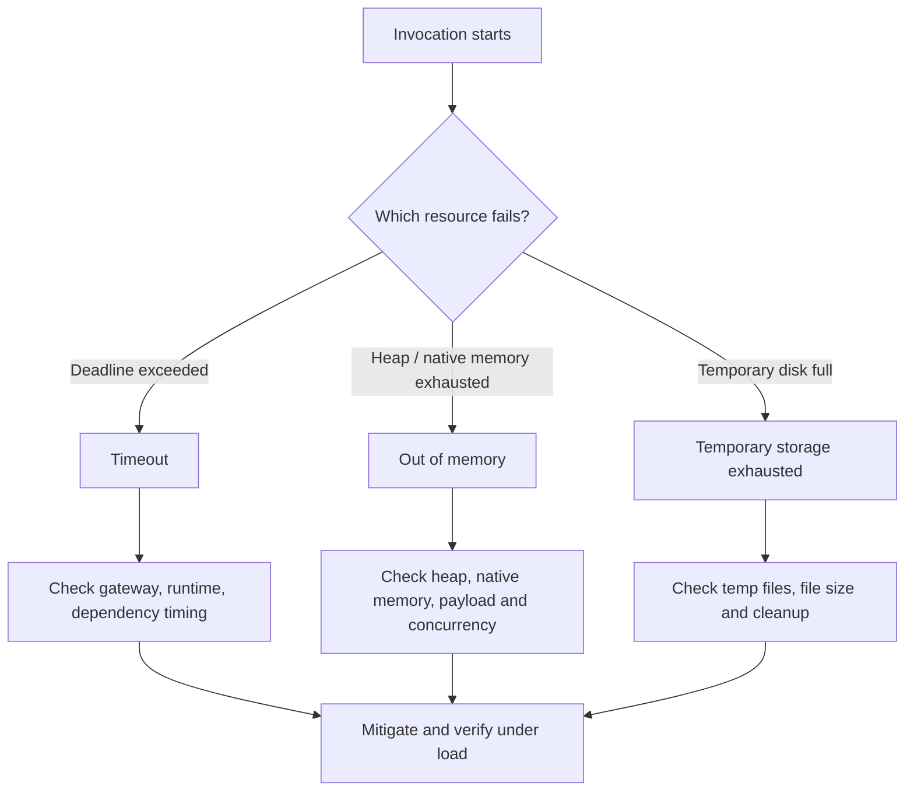
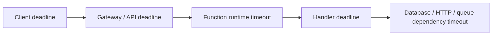

# Diagnosing Timeouts, Out-of-Memory Errors, and Temporary Storage Exhaustion

Java functions on a serverless platform can fail even without code changes: an invocation exceeds its time limit, the JVM runs past its memory limit, or the application runs out of space to write temporary files. These three failures commonly appear when load increases, payloads grow large, dependencies slow down, batches run, or a configuration change increases resource usage.

To fix them properly, you need to identify the **resource tier that is exhausted or the deadline that is exceeded**, then trace the request or event to find the root cause. Increasing timeout, memory, or `/tmp` capacity can be part of the solution, but without inspecting dependencies, concurrency, data sizes, and file lifecycles, the incident will return or turn into higher cost.

## 1. Identify the Three Failure Categories

| Category | Common symptoms | First thing to determine |
|---|---|---|
| Timeout | Slow requests, `Task timed out`, function execution exceeded limit, message redelivered | Did the timeout happen at the client, gateway, runtime, or dependency? |
| Out of memory (OOM) | `OutOfMemoryError`, process killed, restarts, memory near the limit | Was it heap, native memory, threads, direct buffers, or larger payload/batch sizes? |
| Temporary storage exhausted | `No space left on device`, `IOException`, upload/download failures | Which files are taking space, are they cleaned up, and how much ephemeral storage is configured? |

The three failures can be interconnected. For example, a function writes many temporary files until storage fills up; write operations start retrying or blocking on I/O; the invocation times out. Or a function processing a large batch allocates many byte arrays, driving up heap usage, causing continuous GC, and eventually timing out before an OOM occurs.



## 2. Start from the Invocation and Operational Evidence

Before changing configuration, collect data from one failing invocation and a comparable successful invocation. At a minimum, capture:

- Timestamp, request ID/invocation ID, correlation ID, and event ID.
- Function name, version/alias or deployment slot, Java runtime, and region.
- Trigger type: HTTP, SQS/queue, stream, EventBridge, timer, or Azure binding.
- Payload size, number of records in the batch, and type of work being processed.
- Configured memory, timeout, concurrency, batch size, and ephemeral storage.
- Handler duration, init/startup duration, dependency latency, and retry count.
- Peak memory, GC activity, thread count, and temporary directory usage if available.
- Most recent changes: releases, IAM/RBAC, secret rotation, schema, routes, or traffic patterns.

Search logs by invocation ID rather than just searching for the keyword `ERROR`. An invocation may have a start log without a completion log because the runtime killed the process or timed out. Cross-check platform metrics and dependency logs so you do not wrongly conclude that the handler is the root cause.

### 2.1. An Effective Investigation Order

1. Confirm which request/event and which version experienced the failure.
2. Determine whether the invocation hit a timeout, OOM, or file write error; a single invocation can exhibit multiple symptoms.
3. Compare duration and resource usage against a baseline with similar payload/load.
4. Look for slow dependencies, large payloads, large batches, or increased concurrency.
5. Check retries/redeliveries and whether side effects have already been committed.
6. Choose one small change to test your hypothesis.
7. Re-run under representative load and monitor metrics after the change.

Do not delete logs, dump files, or error messages before preserving necessary evidence. For payloads containing sensitive data, retain only metadata or masked copies according to security procedures.

## 3. Diagnose Timeouts Layer by Layer

A timeout is a time limit, yet multiple different deadlines can exist within a single request. A client can time out before the gateway; the gateway can time out before the function; the function can wait on a database or HTTP API longer than its remaining time.



Timeouts should be configured with clear relationships. A dependency timeout should normally be shorter than the remaining invocation time; the handler needs enough time to log, close resources, and return a controlled error. If a dependency can wait indefinitely, the function holds concurrency and resources without making progress.

### 3.1. Distinguish Client, Gateway, and Runtime Timeouts

| Layer | Symptoms | How to verify |
|---|---|---|
| Client | Browser/SDK reports timeout or closes the connection | Client logs, request duration, and retry policy |
| API gateway/proxy | Gateway returns 504 or integration timeout | Gateway access/execution logs, integration latency, and service limits |
| Function runtime | AWS `Task timed out`; Azure host logs execution timeout | Function logs, runtime metrics, and configured timeout |
| Handler/dependency | JDBC timeout, HTTP connect/read timeout, SDK timeout | Trace spans, pool metrics, DNS/TLS, and dependency logs |
| Queue/trigger | Message redelivered, visibility/lock expired, or batch retried | Queue age, receive count, lock/visibility settings, and invocation logs |

A gateway timeout does not always mean the function has stopped. Certain invocation types can keep running after the client disconnects. If the client retries, the same operation may run concurrently or produce duplicate side effects. For write commands, use idempotency keys and operation status tracking.

### 3.2. Break Processing Time into Segments

Measuring total duration does not reveal where time is spent. Add timing around key steps:

- Parse/deserialize the payload.
- Validate and map data.
- Acquire a connection from the pool.
- Database query/transaction.
- Call HTTP services or secret manager.
- Read/write objects or temporary files.
- Serialize the response and clean up.

Java example using `System.nanoTime()` to measure elapsed time:

```java
long started = System.nanoTime();

try {
    long dbStarted = System.nanoTime();
    Order order = repository.load(orderId);
    long dbMs = (System.nanoTime() - dbStarted) / 1_000_000;

    long serviceStarted = System.nanoTime();
    Quote quote = pricingClient.getQuote(order);
    long serviceMs = (System.nanoTime() - serviceStarted) / 1_000_000;

    return buildResponse(order, quote, dbMs, serviceMs);
} finally {
    long totalMs = (System.nanoTime() - started) / 1_000_000;
    logger.info("operation=calculate totalMs=" + totalMs);
}
```

This is an instrumentation example; use an appropriate logger and data types for your application. `System.nanoTime()` is suitable for measuring durations within the same process. Do not subtract wall-clock timestamps for durations because the clock can be adjusted. Do not log payloads or secrets alongside timing.

### 3.3. Compute Deadlines from Remaining Time

AWS Lambda Java `Context` provides `getRemainingTimeInMillis()`. You can use this value to avoid starting a long operation when the invocation is nearly out of time.

```java
int remainingMs = context.getRemainingTimeInMillis();
int cleanupReserveMs = 500;

if (remainingMs <= cleanupReserveMs) {
    throw new IllegalStateException("Insufficient invocation time");
}

int dependencyTimeoutMs = Math.min(2_000, remainingMs - cleanupReserveMs);
```

Timeouts passed to dependencies should leave enough time to process the response and clean up. Do not check remaining time only once at the start of the handler if the workflow has multiple long steps; recalculate before each dependency call or propagate the deadline across layers.

In Azure Functions Java, `ExecutionContext` provides the invocation ID and logger, but there is no direct equivalent API to read remaining execution time like AWS Lambda `Context`. Manage deadlines at the application layer based on the configured timeout, client cancellation/timeout, and any caller-provided deadline. Do not assume you can query exact host remaining time across every binding/runtime.

## 4. Common Timeout Causes in Java Serverless

### 4.1. Slow Dependencies or Missing Timeouts

A JDBC query, HTTP call, or DNS lookup can wait longer than expected. If a client library does not configure connect/read/request timeouts, the thread can remain blocked until the runtime times out.

Check:

- JDBC connection acquisition timeout and query/statement timeout.
- HTTP connect timeout, response timeout, and connection pool wait timeout.
- AWS/Azure SDK API call timeout and per-attempt timeout.
- DNS resolution, TLS handshake, proxies, NAT, and private endpoints.
- SDK/client retry counts and backoff settings.

Java `HttpClient` example with explicit timeouts:

```java
HttpClient client = HttpClient.newBuilder()
        .connectTimeout(Duration.ofSeconds(2))
        .build();

HttpRequest request = HttpRequest.newBuilder()
        .uri(URI.create(serviceUrl))
        .timeout(Duration.ofSeconds(3))
        .GET()
        .build();

HttpResponse<String> response = client.send(
        request,
        HttpResponse.BodyHandlers.ofString());
```

`connectTimeout` bounds connection establishment; the request timeout limits the exchange duration per the `HttpClient` API. Choose values based on the overall deadline and SLO. In production, reuse an appropriate `HttpClient` instead of creating a new one per invocation, and bound response/body sizes.

### 4.2. Connection Pool Exhaustion

Function scale-out creates multiple execution environments; each process may maintain its own pool. If each pool allows 10 connections and there are 40 instances, the database can receive up to roughly 400 connections. Requests wait to acquire a connection and time out even when actual database queries are not particularly slow.

Check:

- Active/idle/pending connections and pool wait time.
- Pool size multiplied by instance count/concurrency.
- Connection leaks, uncommitted/unrolled-back transactions, or unclosed result sets.
- Database max connections and proxy/pooler capacity.
- Whether function concurrency exceeds downstream capacity.

Use try-with-resources for JDBC `Connection`, `PreparedStatement`, and `ResultSet`; cap pool sizes; set connection acquisition timeouts; and consider RDS Proxy/PgBouncer or an appropriate pooling service. Raising function concurrency without accounting for database capacity often accelerates timeouts.

### 4.3. Nested Retries

The API client, function handler, and SDK may all perform retries. If each layer retries multiple times, a single request can trigger many downstream calls, prolonging the invocation and increasing load on a struggling dependency.

Designate a clear retry owner, cap the total retry budget, and use exponential backoff with jitter for transient errors. Do not retry validation, schema, or permission errors as if they will resolve on their own. For write operations, a timeout can occur after the downstream system has committed; use an idempotency key before retrying.

### 4.4. Cold Starts or Dependency Initialization

Java cold starts can include JVM startup, class loading, framework bootstrap, secret retrieval, and client initialization. If logs show the handler had not actually started before the client timed out, inspect initialization metrics/logs rather than optimizing code inside the handler alone.

Do not place heavy work or unnecessary network calls in static initializers. Reuse thread-safe clients within an execution environment, but enforce timeouts and handle initialization errors. If startup depends on a failing secret store or database, every new environment can fail together.

## 5. Timeouts on AWS Lambda and Azure Functions

### 5.1. AWS Lambda

Lambda has a configured function timeout. When exceeded, the runtime stops the invocation and logs may record `Task timed out after ... seconds`. CloudWatch Logs typically emit `START`, `END`, and `REPORT` lines; `REPORT` provides duration, billed duration, memory size, max memory used, and init duration when applicable.

Inspection steps:

1. Find the `REPORT` line by request ID and compare `Duration` against the configured timeout.
2. If `Init Duration` is present, determine whether startup consumed most of the time.
3. Cross-check API Gateway integration latency or client timing.
4. Inspect dependency spans, connection pools, retries, and networking.
5. For async/queue triggers, check retries, event age, receive count, and DLQ.

Increase timeout only when the work is reasonably bounded and genuinely needs more time. If the handler hangs on a connection or query without a timeout, raising the limit only holds concurrency longer and can increase cost.

### 5.2. Azure Functions

Azure Functions configures `functionTimeout` in `host.json`; exact behavior and limits depend on the hosting plan, runtime, and platform version. HTTP requests also have timeouts at the client, reverse proxy, or API Management. Therefore, distinguish host timeouts from caller timeouts.

Check:

- `functionTimeout` in the deployed artifact and app settings.
- Function execution duration, host/worker logs, and Application Insights requests/exceptions.
- Plan/instance scaling, worker restarts, and cold starts.
- Timeouts for bindings, SDKs, databases, and HTTP clients.
- Queue/Service Bus lock duration, retries, and poison message handling.

Do not copy `functionTimeout` across hosting plans without checking current documentation for the target plan. For HTTP-triggered functions, callers may receive a timeout before the host finishes processing; design idempotency and operation status tracking if clients can retry.

## 6. Diagnosing OutOfMemoryError in Java

The JVM has multiple memory regions. `-Xmx` only bounds the Java heap; the process also uses metaspace, code cache, thread stacks, direct/native buffers, JNI/native libraries, and runtime/agent memory. Consequently, a non-full heap does not guarantee the process has enough memory.

### 6.1. Identify the OOM Type

| Symptom | Area likely exhausted | Investigation direction |
|---|---|---|
| `Java heap space` | Object heap | Heap histogram/dump, object retention, collection/batch sizes |
| `GC overhead limit exceeded` | Heap nearly full; GC spends heavy time reclaiming very little | Allocation rate, retained objects, caches, and GC logs |
| `Metaspace` | Class metadata | Classloader leaks, dynamic proxy/class generation, framework scanning |
| `Direct buffer memory` | Off-heap direct buffers | NIO/Netty buffer lifecycle, pools, and native memory |
| `unable to create new native thread` | Native memory or thread/process limits | Thread count, stack size, executors, and concurrency |
| Process killed/exit 137 without Java stack trace | Container/host memory limit or OOM killer | Platform/container memory metrics and runtime logs |

Not every OOM produces a stack trace in function logs. If the platform kills the process before the JVM logs an exception, correlate process restarts, exit codes, platform diagnostics, and memory metrics.

### 6.2. Heap Growth from Large Payloads or Batches

Patterns that commonly inflate heap usage:

- Deserializing an entire large payload into an object graph.
- Reading an entire file/object into a `byte[]` instead of streaming.
- Collecting all records in a batch into a `List` before processing.
- Creating multiple string/JSON copies during mapping.
- Unbounded caches or retaining references in static collections.
- Holding `InputStream`, `ResultSet`, buffers, or objects in internal queues too long.

With queue triggers, large batch sizes can drive peak memory up with record count and body size. Try reducing batch size, processing record by record, capping payload sizes, and measuring peak memory. If records are independent, process them in bounded chunks instead of loading the entire batch onto the heap.

### 6.3. Heap Dumps and GC Diagnostics

In controlled environments, heap dumps help identify which objects retain the most memory. JVM flags such as `-XX:+HeapDumpOnOutOfMemoryError` can be useful if the runtime allows writing dumps to storage with sufficient space. However, dumps can contain sensitive data and grow very large; do not enable them indiscriminately in production.

GC logs help reveal allocation rates, pauses, and live sets. Native Memory Tracking can assist with investigating native memory where the runtime permits the corresponding JVM option, though it adds overhead. Enable diagnostics selectively and protect dump/log files as sensitive data.

## 7. Optimizing Memory for Java Functions

### 7.1. Measure Before Increasing Memory

On AWS Lambda, function memory configuration also affects allocated CPU. Increasing memory can shorten duration and startup, while changing per-invocation pricing. Compare cost per successful invocation and p95 latency, not just peak memory.

On Azure Functions, memory/CPU and process limits depend on the hosting plan and worker configuration. Inspect metrics on the exact plan and instance rather than inferring from Java heap settings alone.

### 7.2. Do Not Set Heap Equal to the Full Memory Limit

When a function has a memory limit, the JVM still needs non-heap regions for metaspace, thread stacks, code cache, direct buffers, TLS, SDKs, and native runtime overhead. Setting `-Xmx` equal to the full memory quota can cause the process to be killed even before the heap throws OOM.

Size the heap for the workload and measure native overhead. When using `MaxRAMPercentage`, verify that the JVM detects the container/platform limit accurately and inspect the final runtime value. Do not copy a percentage straight from a long-running service to FaaS without measuring.

### 7.3. Bound Concurrency and Executors

A single invocation may spawn multiple threads or run parallel work. If every invocation creates an unbounded executor, traffic bursts multiply thread counts rapidly. Use bounded thread pools, bounded-capacity queues, semaphores, or concurrency controls. Reuse thread-safe executors if the lifecycle fits and shut them down properly on application exit.

Do not use `parallelStream()` or unbounded `CompletableFuture` on large payloads without accounting for memory, downstream capacity, and remaining time. Async tasks left behind when an invocation ends may fail to finish as expected.

### 7.4. Reduce Allocations and Process via Streams

- Use streaming parsers for large JSON payloads/files when appropriate.
- Process records individually or in small chunks.
- Avoid repeated conversions between byte arrays, `String`, and objects.
- Cap response sizes and returned result counts.
- Close streams, cursors, response bodies, and JDBC resources.
- Cap cache sizes and TTLs.
- Do not retain full request contexts or payloads in static collections.

## 8. Diagnosing Temporary Directory Exhaustion (`java.io.tmpdir`)

Java can create temporary files via `Files.createTempFile`, upload/download libraries, archives, image processing, or frameworks. The default path is exposed by the JVM via `System.getProperty("java.io.tmpdir")`; do not hardcode `/tmp` across all platforms.

On AWS Lambda, `/tmp` is ephemeral storage attached to the execution environment with configurable capacity. Contents can persist when an environment is reused, but it is not durable storage and disappears when the environment is replaced. On Azure Functions, the temp directory and quota depend on the OS and hosting plan; read the runtime path and check actual limits in the deployment environment.

### 8.1. Common Symptoms

- `java.io.IOException: No space left on device`.
- `FileSystemException` when creating or writing temporary files.
- Uploads, downloads, or unzipping failing midway.
- Function succeeds on small payloads but fails on large batches/files.
- A subsequent invocation fails even with a small payload because files from a prior invocation remain in the environment.
- Memory does not grow noticeably, yet temp storage usage hits quota.

### 8.2. Check Path and Usable Space

```java
import java.io.IOException;
import java.nio.file.FileStore;
import java.nio.file.Files;
import java.nio.file.Path;

public final class TempStorageDiagnostics {
    public static void logTempSpace() throws IOException {
        Path tempDir = Path.of(System.getProperty("java.io.tmpdir"));
        FileStore store = Files.getFileStore(tempDir);

        long total = store.getTotalSpace();
        long usable = store.getUsableSpace();
        long used = total - store.getUnallocatedSpace();

        System.out.printf(
                "tempDir=%s totalBytes=%d usableBytes=%d usedBytes=%d%n",
                tempDir, total, usable, used);
    }
}
```

This measures the filesystem at call time; the reported quota may reflect shared volumes or platform mount behavior. Do not treat `getUsableSpace()` as a guarantee that a single file can consume all that space: other invocations may be using storage concurrently.

### 8.3. Use Temporary Files Safely

```java
Path tempFile = Files.createTempFile("order-export-", ".json");

try {
    try (OutputStream out = Files.newOutputStream(tempFile)) {
        writeExportInChunks(out);
    }

    uploadToObjectStorage(tempFile);
} finally {
    Files.deleteIfExists(tempFile);
}
```

`writeExportInChunks` and `uploadToObjectStorage` represent application logic. Use `try/finally` so cleanup runs even if upload or serialization fails. For multiple files or complex flows, you can create a dedicated temp directory per invocation and delete it recursively when done. Ensure cleanup does not delete another invocation's files if the runtime allows concurrency within the same process.

Never use fixed filenames like `/tmp/output.json` across concurrent invocations. Unique names prevent overwrites and race conditions. If files contain sensitive data, restrict permissions, avoid logging contents, and delete per policy.

### 8.4. Why Do Temporary Files Leak?

Common causes:

- Cleanup runs only on the happy path, not on exceptions.
- Runtime timeout or process kill happens before `finally`.
- A library creates files without the application knowing where to delete them.
- Fixed filenames cause multiple invocations to write concurrently.
- Files are larger than expected or archives decompress with high expansion ratios.
- Static caches hold file handles or paths without releasing them.

Cleanup in `finally` cannot run if the process is hard-killed. Therefore, combine active cleanup with a design resilient to leftover files: use unique prefixes, check file age when safe, cap file sizes, and avoid relying on environment reuse.

## 9. Choosing Between Streaming, Memory, and Temporary Storage

Not every file needs to touch disk. Choose based on size, retryability, memory limits, and dependency APIs.

| Approach | Advantages | Risks/limits |
|---|---|---|
| Hold everything in `byte[]` | Simple, fast for small payloads | High heap peak; easy OOM on large files/batches |
| Stream directly through a pipeline | Memory bounded by buffer size | Harder to retry mid-stream; must manage backpressure and stream lifecycle |
| Write a temp file then upload/process | Useful for libraries requiring seek/random access | Uses ephemeral storage; requires cleanup and quota |
| Upload to object storage then process async | Decouples upload from compute, easy per-object/event retries | Requires managing object lifecycle, duplicate events, and access permissions |

For large files, a solid pattern is for the client to upload directly to object storage using scoped URLs/credentials; the function receives an event with the object key and processes it via streams or chunks. Avoid passing entire large files through an HTTP API gateway/function when platform payload limits or execution timeouts are unsuitable.

## 10. Retries and Idempotency When Functions Time Out or OOM

A timeout or OOM does not prove the business operation failed to commit. The function may have written to the database or called an external service and then been killed before acknowledging the message or returning a response. The next retry can repeat the side effect.

For event-driven functions:

- Use an event ID or stable idempotency key.
- Record processing status in the same business transaction whenever possible.
- Distinguish transient errors from poison messages or invalid data.
- Configure retry count, visibility/lock timeout, batch size, and DLQ per trigger.
- Do not infinitely retry an event that triggers OOM due to an oversized payload.
- For batches, support partial batch failures if the platform and trigger allow it.
- Maintain a redrive/replay runbook and check for duplicates before replaying.

With SQS, visibility timeout must account for processing time and batching; if a message becomes visible again while the previous invocation is still running, two consumers can process it concurrently. With Azure Queue/Service Bus, lock duration and renewal behavior must also match processing time. Exact values and mechanisms vary by trigger and hosting/runtime.

## 11. Symptom and Investigation Matrix

| Symptom | Possible cause | Evidence to look for | Initial remediation direction |
|---|---|---|---|
| `Task timed out` after a fixed interval | Function timeout too short or handler hung | Runtime logs, duration, dependency spans | Identify waiting step; set dependency timeouts; raise function timeout only if workload justifies it |
| Gateway 504 while function logs continue | Gateway/client timeout shorter than runtime | Gateway integration latency, invocation ID | Align deadlines or offload long work to an async job |
| JDBC pool wait rises | Connection leak or pool too small for concurrency | Active/pending connections, pool wait | Close resources, cap concurrency, tune pool sizing and proxies |
| HTTP client timeouts increase | Slow downstream, DNS/TLS/NAT, or retries | Connect/response timing, network errors | Separate timeouts, circuit breakers, check network path |
| `Java heap space` | Payloads/batches/caches retaining too many objects | Heap dump/histogram, GC logs | Stream/chunk, shrink batches, cap caches and allocations |
| `GC overhead limit exceeded` | Heap nearly full, objects not reclaimed | GC logs, retained objects | Find leaks/retention, shrink live set, re-measure heap |
| `Metaspace` | Classloader leak or dynamic class generation | Class count, classloader profile | Control classloader/framework/plugin lifecycle |
| `unable to create new native thread` | Unbounded thread growth or low native memory | Thread count, executor queues, process limits | Bounded executors, reduce parallelism, check stack size |
| Exit 137/restart with no Java exception | Process killed due to memory limit | Platform diagnostics, peak memory | Lower peak memory, adjust memory after measuring |
| `No space left on device` | Uncleaned temp files or large payloads/files | Temp path, usable space, file inventory | Stream/chunk, clean up, cap file sizes, increase ephemeral storage if needed |
| Only later invocations hit disk full | Files left behind in reused environment | File age/size by prefix | Clean files safely, use unique paths and TTL cleanup |
| Queue messages repeat after timeout | Invocation did not ACK or visibility/lock expired | Receive count, event ID, idempotency record | Adjust lock/visibility, make handling idempotent, use DLQ |

## 12. Incident Runbooks

### 12.1. Timeout Runbook

1. Grab the invocation/request ID, function version, and trigger type.
2. Confirm whether the timeout happened at the client, gateway, or runtime.
3. Read duration/init duration and per-dependency timing.
4. Check connection pools, DNS/TLS, retries, and downstream latency.
5. Determine whether the operation already committed before replaying.
6. If backlog grows, throttle producers/concurrency instead of adding infinite retries.
7. Apply timeouts/bulkheads/circuit breakers or offload long tasks to a queue/workflow.
8. Re-run smoke/load tests and watch p95/p99, errors, throttles, and queue age.

### 12.2. OOM Runbook

1. Identify the OOM type or process kill; preserve logs and exit status.
2. Compare memory size, max memory used, heap/GC, and concurrency.
3. Inspect payload size, batch size, caches, static collections, and thread count.
4. Inspect direct buffers/native libraries and classloaders if heap does not explain it.
5. Reduce batch size/concurrency or stream data to lower peak memory.
6. Only raise memory/CPU or adjust JVM heap after understanding the memory profile.
7. Test with the largest expected payload and representative burst concurrency.

### 12.3. Temporary Storage Runbook

1. Inspect `java.io.tmpdir` and usable/total space.
2. Identify which prefix/files are growing and which invocations create them.
3. Verify cleanup across success, exception, timeout, and concurrent invocations.
4. Replace large buffers with streaming/chunking where appropriate.
5. Use unique temp paths, enforce size limits, and clean up safely.
6. Increase ephemeral storage only when the workload truly requires that capacity.
7. Verify leftover files across multiple invocations and after environment recycles.

## 13. Preventing Recurrences

- Set separate timeouts per dependency alongside an overall deadline.
- Size memory, batch size, and concurrency from measured load.
- Bound executors, connection pools, caches, and payload sizes.
- Stream large files and clean up temp files in `finally`.
- Emit metrics for peak memory, GC, threads, temp storage, dependency latency, and queue age.
- Separate transient errors from poison events; cap retries and configure DLQs.
- Design idempotency so timeouts/OOMs never cause duplicate side effects.
- Load-test maximum payloads, burst concurrency, and downstream degradation.
- Alert before memory, storage, or queue age hits hard limits.
- Maintain runbooks with verification commands and owners for each dependency.

## 14. Diagnostic Checklist

1. Have invocation ID, version, trigger, and payload size been identified?
2. Did the timeout occur at the client, gateway, runtime, or dependency?
3. Are timings recorded for deserialization, database, HTTP, storage, and cleanup?
4. Do SDK and per-layer timeouts/retries exceed the overall deadline?
5. Are connection pools, thread pools, and concurrency bounded?
6. Is the OOM in heap, metaspace, direct buffers, native threads, or a process kill?
7. Are GC logs, heap histograms/dumps, or platform memory diagnostics available?
8. Are payloads, batches, or caches driving up peak memory?
9. Where does `java.io.tmpdir` point and how much space remains?
10. Do temp files use unique names, size limits, and cleanup on every branch?
11. Could a timeout or OOM cause message retries or duplicate side effects?
12. Are idempotency, DLQ, replay, and reconciliation in place?
13. Have fixes been validated under representative load and worst-case payloads?
14. Do dashboards/alarms detect issues early before hitting hard limits?

## Conclusion

Timeouts, OOMs, and temporary directory exhaustion are three different manifestations of an invocation exceeding time or resource limits. Diagnose timeouts by separating deadlines across client, gateway, runtime, and dependencies; diagnose OOMs by distinguishing heap from native memory, threads, and process limits; diagnose disk exhaustion by checking `java.io.tmpdir`, file growth, and cleanup. In Java serverless, payloads/batches, scale-out, connection pools, and retries can amplify all three issues. Measure per invocation, bound resources at every layer, stream data where appropriate, and ensure retries are idempotent before raising platform limits.

## Official References

- [AWS Lambda timeout configuration](https://docs.aws.amazon.com/lambda/latest/dg/configuration-timeout.html)
- [AWS Lambda memory configuration](https://docs.aws.amazon.com/lambda/latest/dg/configuration-memory.html)
- [AWS Lambda ephemeral storage](https://docs.aws.amazon.com/lambda/latest/dg/configuration-ephemeral-storage.html)
- [AWS Lambda execution environment lifecycle](https://docs.aws.amazon.com/lambda/latest/dg/lambda-runtime-environment.html)
- [AWS Lambda Java context](https://docs.aws.amazon.com/lambda/latest/dg/java-context.html)
- [Azure Functions host.json reference](https://learn.microsoft.com/en-us/azure/azure-functions/functions-host-json)
- [Azure Functions scale and hosting](https://learn.microsoft.com/en-us/azure/azure-functions/functions-scale)
- [Monitor executions in Azure Functions](https://learn.microsoft.com/en-us/azure/azure-functions/functions-monitoring)
- [Java Runtime troubleshooting](https://docs.oracle.com/en/java/javase/21/troubleshoot/)
