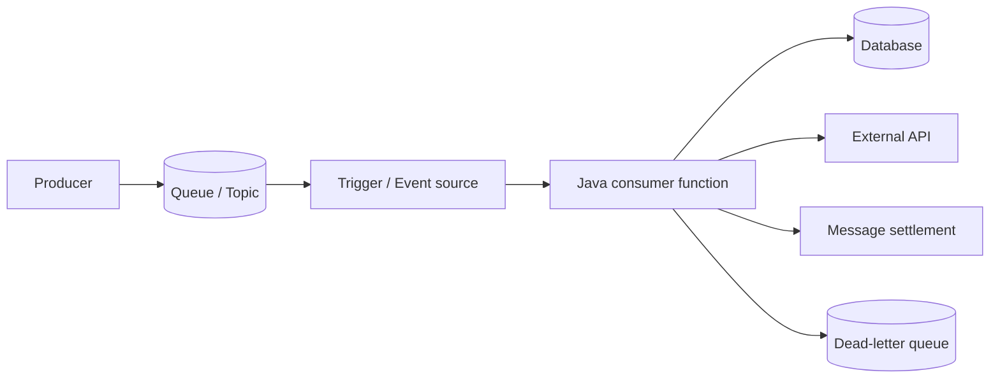

# Resolving Queue Backlogs, Poison Messages, and Throttling

In event-driven serverless systems, queues absorb the difference between the rate at which producers send data and the rate at which consumers process it. A growing queue during a traffic burst is not necessarily an incident. An incident occurs when the backlog keeps growing, oldest messages breach SLAs, consumers repeatedly fail, or throttling at some layer prevents the system from keeping up with incoming traffic.

Three issues often appear together:

- **Queue backlog:** the number of waiting messages rises or messages stay in the queue too long.
- **Poison message:** a message repeatedly causes the consumer to fail, consuming delivery attempts and potentially causing stalls.
- **Throttling:** the broker, function platform, or dependency limits request rate or concurrency; consumers cannot scale throughput as desired.

Fixing them properly requires finding the bottleneck before adding workers. If the database is already overloaded and you simply raise concurrency, the queue may dip for a few minutes while the database degrades severely. If a poison message retries infinitely, scaling out only generates more failed invocations. This lesson explains how to measure, diagnose, and recover queue workloads for Java serverless.

Within the scope of **CLOUD_SERVERLESS**, this lesson focuses on developing and deploying serverless applications, particularly Java functions triggered by HTTP, messages, or events. Learners handle triggers, state, access permissions, retries, idempotency, cold starts, scaling, and cost. The material below applies those principles to operating consumers, controlling backlogs, isolating poison messages, and managing throttling.

## 1. Identify Symptoms

| Symptom | Possible cause | Data to inspect |
|---|---|---|
| Queue depth rises continuously | Arrival rate exceeds processing rate | Enqueue/dequeue rates, active workers |
| Oldest message age rises | Messages waiting too long, stalled partition/consumer | Age, queue/partition distribution |
| Invocations rise but throughput does not | Retry storm, throttling, or slow processing | Attempt counts, durations, errors |
| Consumers frequently time out | Slow downstream, overly large batches, or improper timeouts | p95/p99 duration, dependency latency |
| DLQ spikes suddenly | Poison payload, schema mismatch, post-release bug | Dead-letter reason, event type, release |
| HTTP 429/503 from dependency | Rate/concurrency exceeds quota or dependency overloaded | Status codes, `Retry-After`, quotas |
| One partition has high lag | Hot key or unbalanced consumer ownership | Lag per partition/key |
| Queue drops then rises again | Autoscaling oscillation, producer bursts, or retries | Scale events, arrival/processing rates |

Do not draw conclusions from queue depth alone. A queue with many messages where consumers process fast and oldest age stays low may be a normal burst. Conversely, a small queue depth with high oldest message age can indicate a stuck message or a partition making no progress.

## 2. Processing Flow Model and Bottlenecks

An event-driven pipeline typically includes producers, a broker, an event source mapping/trigger, a Java function, dependencies, and settlement/ack:



Backlogs can build up in the broker, in the trigger's internal buffer, in the worker pool, or downstream. You must determine whether messages have been received from the broker, whether they are invisible/locked or still visible, whether consumers are actively processing or blocked, and whether messages are acknowledged/committed on time.

Some platforms maintain internal queue buffers or an event source polling layer. Therefore, invocation count does not necessarily equal enqueued message count, and received message count does not necessarily equal successfully processed message count.

## 3. Measure Backlogs by Throughput and Message Age

Let:

- λ: message arrival rate, messages/second.
- μ: successful processing rate, messages/second.
- B: number of waiting messages.
- W: average wait time in queue.
- N: number of active worker/consumer instances.

If λ exceeds μ for long enough, the backlog tends to grow. If μ exceeds λ, the system can drain the backlog, provided processing speed remains steady and is not capped by another dependency.

Estimate drain time when no new messages arrive:

```text
drainTime = backlog / processingRate
```

If producers continue sending messages, approximate drain time when μ exceeds λ is:

```text
drainTime = backlog / (processingRate - arrivalRate)
```

For example, with a backlog of 120,000 messages, consumers succeeding at 500 messages/second, and producers still sending 200 messages/second, excess throughput to drain is 300 messages/second, giving a theoretical drain time of around 400 seconds. In practice, actual drain time also depends on retries, message size, batching, partitions, downstream throttling, and traffic fluctuations.

This is an operational estimate, not an SLA. Use actual successful throughput rather than received message count or invocation count.

## 4. Little's Law and Queue Latency

In a stable system, Little's Law describes the relationship:

```text
L = arrivalRate * averageTimeInSystem
```

Where L is the average number of items in the system. For queues, it helps explain the relationship between queue length, arrival rate, and wait time when workload is relatively steady.

For example, if the arrival rate is 100 messages/second and average wait time is 20 seconds, the queue holds around 2,000 waiting messages in steady state. When the backlog grows while throughput stays flat, wait time also grows.

Do not apply this formula directly during an unstable burst or when multiple message types have very different processing times without segmenting them. Track percentiles of age/latency to detect tail behavior.

## 5. Metrics to Collect

At a minimum, collect:

- Queue depth or backlog per queue/subscription.
- Oldest message age or age of the oldest unprocessed message.
- Enqueue/arrival rate.
- Successful processing/dequeue/ack rate.
- In-flight/invisible/locked message count.
- Consumer concurrency and active instance count.
- Invocation duration p50/p95/p99.
- Retry/delivery attempt count.
- DLQ arrival rate and DLQ depth.
- Throttling counts across broker, function platform, and dependencies.
- Downstream latency, connection pool saturation, and error rate.
- Batch size, partial batch failures, and message size.

Distinguish broker metrics from application metrics. For instance, a message being dequeued/received does not mean the business transaction committed. Consumers should emit success metrics only after durable side effects and proper settlement semantics.

## 6. Initial Diagnostic Workflow

When a backlog alert fires:

1. Identify the affected queue, subscription, topic, or partition.
2. Check when backlog and oldest age began rising.
3. Compare arrival rate against successful processing rate.
4. Check worker/function concurrency, throttling, and timeouts.
5. Inspect DLQ, retry attempts, and dominant event types.
6. Check databases, external APIs, caches, and connection pools.
7. Correlate recent releases or config changes around the incident start time.
8. Pick a protective action: pause producers, throttle intake, scale with bounds, or isolate poison messages.
9. Test the change on a slice of traffic if possible.
10. Watch backlog, oldest age, and downstream health after every change.

Do not change multiple parameters such as batch size, concurrency, timeout, and retry count simultaneously without good reason. Changing one variable at a time makes it clear which adjustment helps or hurts.

## 7. Pinpoint Where the Bottleneck Lives

| Layer | Symptoms | Investigation direction |
|---|---|---|
| Producer | Arrival rate spikes abnormally | Releases, producer retries, loops, batch replays |
| Broker | Publish/receive throttled, partition limit | Quotas, partitions, message size, broker capacity |
| Trigger/platform | Invocations throttled, low poll rate | Concurrency quotas, event source settings, account limits |
| Java function | Duration rises, high CPU/heap/GC | Profiling, cold starts, batch size, serialization |
| Database | Connection pool full, high query latency | Indexes, transactions, locks, connection budget |
| External API | 429/503, rising latency | Quotas, rate limits, circuit breakers |
| Settlement | Messages redelivered after finishing processing | Ack/complete/commit timing, lock/visibility |
| Partition/key | One shard lags behind the rest | Hot keys, ordering, partition skew |

Increasing worker count is only appropriate when the bottleneck is consumer capacity and downstream systems still have headroom. If the database is already at its connection limit, scaling workers will worsen the situation.

## 8. Distinguish Traffic-Burst Backlogs from Degradation Backlogs

Traffic bursts typically exhibit:

- Arrival rate jumps suddenly while processing rate stays near baseline.
- Worker scale-out follows after a short lag.
- Oldest age rises during the burst and then drops once traffic subsides.
- Error/throttle rates do not rise significantly.

Consumer degradation typically exhibits:

- Processing rate drops even while arrival rate stays steady.
- Duration, timeouts, or retries increase.
- Oldest age keeps rising even after the burst ends.
- DLQ or dependency errors rise.

Burst-driven backlogs may simply need capacity headroom and proper autoscaling. Degradation-driven backlogs require fixing the bottleneck or isolating errors before scaling.

## 9. What Is a Poison Message?

A poison message is a message that repeatedly fails consumer processing due to its payload, schema, business data, or a processing bug. A poison message can:

- Always throw a deserialization exception.
- Trigger a non-retryable validation error.
- Cause a worker to time out on an anomalous record.
- Trigger an exception in a rare code branch.
- Cause an entire batch to roll back even though other messages are valid.
- Create head-of-line blocking in a FIFO/session/partition stream.

Poison messages differ from transient errors. If a dependency temporarily times out, retrying can succeed. If a payload cannot be parsed, retrying the exact same payload with the exact same consumer code will not make the problem disappear.

## 10. Detect Poison Messages

Symptoms:

- The same event ID or message key appears repeatedly in logs.
- Delivery count climbs up to the dead-letter threshold.
- The same event type/schema version triggers failures.
- A single partition or FIFO message group stops progressing.
- Batches repeatedly fail even though other records can be processed.
- DLQ reasons cluster around deserialization, validation, or unsupported schemas.
- Failures started immediately after a consumer deployment.

Logs should include event ID, message ID, event type, schema version, partition/offset or group ID, attempt count, consumer version, and normalized error code. Do not log sensitive raw payloads just to hunt down poison messages.

## 11. Classify Errors Before Retrying

| Error category | Examples | Action |
|---|---|---|
| Transient | Network timeout, connection reset | Bounded retries with backoff |
| Throttling | HTTP 429, broker quota exceeded | Slow down, respect retry hints |
| Dependency unavailable | HTTP 503, database failover | Retry with jitter, circuit breaker |
| Invalid schema | Malformed JSON, missing required field | DLQ/quarantine |
| Unsupported version | Consumer does not understand new schema | Deploy compatibility or approved transform |
| Business rejection | Order already canceled, account closed | Record business outcome, do not retry infinitely |
| Duplicate | Event already applied | Acknowledge after verifying idempotency |
| Stale/expired | Deadline passed or aggregate moved ahead | Discard/reconcile per domain rules |
| Unknown | Unclassified exception | Bounded retry, then DLQ and investigate |

Do not catch every exception and return success just to avoid the DLQ. That drops the message from the retry flow before its business effect is completed.

## 12. Retry Budgets and Exponential Backoff

A retry policy must bound:

- Maximum attempt count.
- Total retry window.
- Initial and maximum backoff.
- Jitter.
- Message TTL/deadline.
- Visibility timeout or lock duration.
- Function timeout and dependency timeouts.
- DLQ transition policy.

Example capped backoff:

```text
delay = min(maxDelay, initialDelay * 2^(attempt - 1))
actualDelay = random(0, delay)  // full jitter
```

Full jitter spreads out retries so consumers do not all call back at the exact same moment. Backoff values should reflect dependency characteristics and SLAs. Retrying too slowly can make messages lose business value; retrying too fast can trigger retry storms.

If producers, brokers, HTTP SDKs, and consumers all retry independently, total calls can multiply. Choose one primary retry owner and enforce an end-to-end budget.

## 13. Visibility Timeout, Lock Duration, and Ack Deadline

When a consumer receives a message, the broker typically makes the message temporarily invisible or grants a lock/lease for a period. If the worker fails to settle before that period expires, the message can be redelivered even while the worker is still running.

Terminology varies by platform:

- SQS: visibility timeout.
- Azure Service Bus: message lock duration and lock renewal.
- Pub/Sub: ack deadline/lease management.
- Kafka: consumer polling, processing, and offset commits; does not use the same semantics as queue visibility.

Principles:

- Chunk processing time must fit within lock/visibility duration.
- If long processing is needed, renew locks/visibility using supported APIs.
- Do not configure function timeouts longer than lock retention without renewal.
- Do not settle before durable side effects commit.
- If messages are redelivered, consumers must be idempotent.
- Avoid letting lock renewal run indefinitely when a worker is hung.

An expired lock can cause two workers to process the same message concurrently. Use conditional state/idempotency in storage to prevent double side effects.

## 14. Batch Processing and Partial Batch Failures

Batching reduces invoke/poll overhead, but one failing message can force the entire batch to retry if the handler returns only a single pass/fail result.

For example, a batch of 10 messages has 9 succeed and 1 fail schema validation. If the whole batch retries, the 9 good messages are redelivered too. This creates duplicate work and swells the backlog.

Ways to reduce impact:

- Enable partial batch responses if supported by the trigger/provider.
- Report only the failed messages that need retrying.
- Enforce idempotency for every side effect.
- Choose batch size based on memory, duration, and error isolation.
- For FIFO/ordered streams, respect sequential stop/commit semantics.
- Route heavy messages or distinct event types to separate queues if needed.

Do not assume partial batch failure formats are identical across cloud providers. Read the exact event source mapping contract and test with a failing message in the middle of a batch.

## 15. Isolate Poison Messages with DLQs or Quarantine

A DLQ keeps failing messages from consuming the main flow's retry capacity. Quarantine can be used when security review or manual data repair is needed.

A typical workflow:

1. Consumer receives message.
2. Classify the error.
3. Transient error: retry within budget.
4. Permanent error or attempts exhausted: dead-letter.
5. Record metadata: reason, source, event ID, and consumer version.
6. Alert the owner.
7. Investigate, fix code/schema/data, or confirm the message is no longer valid.
8. Run a dry-run redrive and bounded replay.
9. Reconcile business outcomes.

Do not redrive the entire DLQ just to bring the queue count back to 0. Filter messages by reason, age, schema version, tenant, event type, and business state.

## 16. Head-of-Line Blocking and Ordering

A failing message can block subsequent messages in systems requiring ordering. This commonly occurs with FIFO groups, Service Bus sessions, or Kafka partitions.

For example, an aggregate has events:

```text
OrderCreated(version=1)
OrderPaid(version=2)
OrderShipped(version=3)
```

If version 1 is poisoned while versions 2 and 3 were already processed elsewhere, replaying version 1 later could regress state or trigger incorrect side effects.

How to handle it:

- Maintain ordering/partition keys by aggregate.
- Check aggregate version before applying an event.
- Distinguish stale events, duplicates, and missing events.
- Consider per-partition/group quarantine when semantics demand strict sequencing.
- Use repair workflows or compensating events when direct replay is unsafe.
- Never alter partition keys arbitrarily during redrive.

Standard queues generally do not guarantee global ordering; FIFO/sessions/partitions guarantee ordering only within their defined scope. Design around the broker's actual semantics.

## 17. Which Layers Experience Throttling?

Throttling is not solely a function platform issue. It can happen at:

| Layer | Examples |
|---|---|
| Producer | API rate limits, publish quotas |
| Broker | Publish/receive quotas, partition throughput, request quotas |
| Event source | Polling limits, max concurrent invokes |
| Serverless platform | Account concurrency, reserved/max concurrency, invocation throttles |
| Java runtime | Full thread pools, connection pools, or semaphores |
| Database | Connection limits, query/transaction capacity |
| External API | HTTP 429, per-key/per-tenant quotas |
| Object storage | Request rates, multipart limits, or bandwidth |
| Telemetry | Exporter/collector queues and backend ingestion quotas |

Tie throttling metrics to the exact layer. If the function is throttled, raising poller concurrency will not help. If the downstream returns 429, raising function concurrency can worsen failures.

## 18. Distinguish Throttling from Other Transient Errors

Throttling often presents clear signals like HTTP 429, broker-specific quota exceptions, or throttled invocation metrics. However, some providers surface capacity exhaustion as 5xx responses or custom exceptions.

When encountering throttling:

- Read response headers like `Retry-After` if present.
- Check quotas by account, region, resource, API key, or tenant.
- Determine whether the quota is hard or adjustable.
- Reduce concurrency/rate to stop exceeding the threshold.
- Use exponential backoff with jitter.
- Monitor success rates after slowing down.
- Never retry immediately in a tight loop.

A timeout is not necessarily throttling. A dependency may simply be slow, DNS/networking may be failing, or the connection pool may be exhausted. Accurate classification leads to the right fix.

## 19. Calculate Required Throughput and Concurrency

If each worker takes an average of `t` seconds/message and there are `N` concurrent workers, approximate theoretical throughput is:

```text
processingRate ≈ N / averageSecondsPerMessage
```

If a worker processes a batch of `b` messages in `t_b` seconds:

```text
processingRate ≈ N * b / batchProcessingSeconds
```

For example, if each worker processes 20 messages/second and there are 10 workers, theoretical throughput is 200 messages/second. If the arrival rate is 250 messages/second, the backlog grows by 50 messages/second on average until the workload changes.

This is only a simplified model. In practice, measure service time distributions, batch failures, downstream quotas, cold starts, and contention. Increasing batch size can reduce overhead, yet it lengthens each invocation, increases memory usage, and widens retry blast radius when partial failures are unsupported.

## 20. Scale Consumers with Bounds

Scaling out is appropriate when:

- Arrival rate rises legitimately.
- Consumers have not exhausted CPU/memory capacity.
- Databases/APIs/storage still have spare capacity.
- Throttling does not rise with concurrency.
- Queue partitions can distribute work across multiple workers.

Scaling out is inappropriate when:

- The database connection pool is already full.
- An external API is returning 429s.
- A hot key/partition limits ordering.
- Consumers are retrying poison messages.
- Worker duration is rising due to lock contention or slow queries.
- Functions have hit account concurrency quotas.

Set max concurrency according to the downstream budget. You can cap total worker concurrency at the platform level, cap concurrency per event source, or use semaphores/rate limiters in Java. Local per-instance limits must be multiplied by max instance count to calculate total load.

## 21. Autoscale Using Multiple Signals

Queue depth is one signal, but not enough on its own. A solid autoscaling policy can combine:

- Backlog depth.
- Oldest message age.
- Arrival/processing rate gap.
- Consumer utilization/concurrency.
- Downstream latency and throttling.
- Partition lag/hot partitions.
- Target processing latency or queue age.

If backlog grows while downstream is throttled, autoscaling should hold or reduce concurrency instead of scaling up. You can use two control loops: one scales workers up with queue pressure, and the other caps total concurrency based on downstream health.

## 22. Backpressure at Producers and Consumers

Backpressure slows down the source when downstream systems have no remaining capacity.

Producers can:

- Reject new requests with 429/503.
- Return `Retry-After`.
- Buffer in bounded queues.
- Throttle batch publishing.
- Prioritize critical events and defer bulk workloads.
- Enforce per-tenant quotas.

Consumers can:

- Lower polling or receive rates.
- Reduce concurrency.
- Temporarily pause partitions/subscriptions if the broker supports it.
- Stop pulling new batches when downstream is unhealthy.
- Use bounded queues inside the JVM, avoiding unbounded in-memory buffering.

Never use an unbounded in-memory queue to hide a backlog. It merely moves the problem from the broker to the heap, risking OOMs and data loss when instances recycle.

## 23. Fairness Across Tenants and Workload Types

One tenant sending a huge burst can monopolize queue capacity and worker slots. If multiple tenants share a queue, consider:

- Per-tenant rate limits and concurrency caps.
- Dedicated queues/topics for large tenants or critical workloads.
- Priority classes for interactive, standard, and bulk events.
- Weighted fair scheduling instead of unbounded strict priority.
- Per-tenant quotas and alerts.
- Admission control when a tenant exceeds its budget.

Do not create a separate queue for every tenant if operational overhead outweighs the benefit. You can use a shared queue with tenant keys and a scheduler, or shard by tenant tiers.

## 24. Java Consumers: Clear Classification and Settlement

A consumer should separate business processing, error classification, and settlement decisions. Broker-neutral skeleton example:

```java
public void handle(MessageEnvelope message) {
    try {
        processor.processIdempotently(message);
        // ACK/complete/commit only after durable business success.
        settlement.acknowledge(message);
    } catch (RetryableDependencyException retryable) {
        settlement.retry(message, retryPolicy.delayFor(message.attempt()));
    } catch (PermanentMessageException permanent) {
        settlement.deadLetter(message, permanent.code());
    } catch (Exception unknown) {
        settlement.retryOrDeadLetter(
                message, retryPolicy, "UNCLASSIFIED_FAILURE");
    }
}
```

This is pseudocode because ack/retry/DLQ APIs differ across brokers. Some triggers manage settlement automatically based on exceptions; some require explicit acknowledge/complete calls; Kafka requires managing offset commits. Never call both acknowledge and retry for the same delivery.

Never catch every exception, log it, and return normally if the runtime treats a normal return as success. Doing so acknowledges a failed message and forfeits retry/DLQ handling.

## 25. Java: Error Taxonomy Instead of Retrying Every Exception

Define explicit domain failure types:

```java
sealed interface ProcessingFailure
        permits TransientFailure, ThrottledFailure,
                InvalidPayload, BusinessRejected {}

record TransientFailure(Throwable cause) implements ProcessingFailure {}
record ThrottledFailure(Duration retryAfter, Throwable cause)
        implements ProcessingFailure {}
record InvalidPayload(String code) implements ProcessingFailure {}
record BusinessRejected(String code) implements ProcessingFailure {}
```

Adapters map errors from HTTP clients, databases, and parsers into the appropriate failure category. Application services do not need to know about a specific broker; trigger adapters decide retry, dead-letter, or acknowledge according to the broker's contract.

For Java versions without sealed interfaces/records, use equivalent classes/enums. What matters is not classifying every error with a catch-all `RuntimeException`.

## 26. Rate Limiting in Java

If a downstream allows at most a certain number of requests/second, consumers can use a token bucket or rate limiter library. Conceptual example with Resilience4j:

```java
RateLimiterConfig config = RateLimiterConfig.custom()
        .limitForPeriod(20)
        .limitRefreshPeriod(Duration.ofSeconds(1))
        .timeoutDuration(Duration.ZERO)
        .build();

RateLimiter limiter = RateLimiter.of("partner-api", config);

Supplier<Response> protectedCall = RateLimiter.decorateSupplier(
        limiter, () -> partnerClient.send(request));

Response response = protectedCall.get();
```

Choose an appropriate wait or fail-fast policy; never block threads indefinitely waiting for a permit. A `RateLimiter` inside one JVM only limits that single instance. With 20 instances each allowing 20 requests/second, the theoretical total can reach 400 requests/second. Global quotas must be regulated at a gateway, distributed limiter, or shared dispatcher.

If the provider returns `Retry-After`, the policy should honor that duration when valid. Rate limiters proactively prevent quota breaches; retry policies handle failures that already occurred. Both mechanisms must work together.

## 27. Circuit Breakers and Bulkheads During Downstream Throttling

Circuit breakers can open when a dependency repeatedly fails or slows down; bulkheads bound concurrent calls; rate limiters cap request rate. They address distinct dimensions:

| Mechanism | What it bounds |
|---|---|
| Rate limiter | Number of requests per unit time |
| Bulkhead | Number of concurrent operations |
| Circuit breaker | Whether to keep calling a failing dependency |
| Retry budget | Number of retries and total retry duration |
| Backpressure | Rate at which work enters the system |

When receiving 429s, you do not necessarily open the circuit breaker immediately; you can throttle down and honor `Retry-After`. If the dependency fails continuously or does not recover, the breaker protects workers. Fallbacks must preserve business semantics; never report false success.

## 28. Tune Batch Size and Processing Time

Too small a batch size increases invoke/poll overhead; too large increases memory, duration, and retry blast radius. Measure:

- Average and p99 processing time per batch.
- Succeeded/failed record counts.
- Payload sizes and object allocations.
- Database round trips.
- Partial batch failure support.
- Function timeout and visibility/lock duration.

Use smaller batch sizes for heavy messages or side effects that cannot be batched. You can split batches by event type or payload size if workloads are heterogeneous.

Do not pick a batch size solely to maximize raw throughput. The goal is meeting oldest-age/SLA targets while maintaining error isolation and keeping downstream systems within limits.

## 29. Key Differences Across Brokers

| System | How to monitor lag/backlog | Retry/settlement mechanism | Operational notes |
|---|---|---|---|
| AWS SQS + Lambda | Approximate visible/in-flight counts, age, Lambda concurrency/throttles | Visibility timeout, receive count, redrive policy/DLQ, partial batch responses | Max concurrency and account concurrency must align; test partial batch handling |
| Azure Service Bus | Active/dead-letter counts, age, lock loss, processor errors | Complete/abandon/defer/dead-letter, lock renewal, delivery count | Sessions affect ordering; excessive prefetch/concurrency can hold many locked messages |
| Google Cloud Pub/Sub | Undelivered backlog, oldest unacked age, subscriber throughput | Ack deadline/lease extension, retry policy, dead-letter topic | Flow control bounds outstanding messages/bytes; delivery attempts have specific semantics |
| Kafka | Consumer group lag per partition, records lag/max lag | Offset commits, retry/quarantine topics, or pause/resume | Partition count and key distribution cap parallelism/ordering |
| Azure Event Hubs | Consumer lag/checkpoints per partition | Checkpoints, consumer-side retries, quarantine pattern | Partition ownership and checkpoint cadence impact recovery |

Metric names, semantics, and limits vary by tier, region, and runtime. Always consult the documentation for the provider in use. Never transfer a visibility timeout setting from SQS to Service Bus or Kafka without understanding settlement differences.

## 30. AWS Lambda with SQS: Checkpoints

When Lambda reads SQS, the event source mapping polls the queue and invokes the function in batches. When the function succeeds, the mapping deletes the messages; if the batch fails under default behavior, messages can be redelivered. Partial batch responses let you report failed messages individually if enabled and the handler returns the expected structure.

Checkpoints:

- Queue visibility timeout aligns with function timeout and batching configuration per current AWS recommendations.
- DLQ/redrive policy sets an appropriate `maxReceiveCount`.
- Batch size stays within memory/time budgets.
- Partial batch response is enabled if per-message error isolation is needed.
- Event source mapping max concurrency aligns with reserved/account concurrency.
- Downstream connection pools do not multiply excessively during Lambda scale-out.
- IAM role grants only necessary permissions for the queue, DLQ, logs, and dependencies.

Do not raise maximum concurrency before measuring database/API capacity. With FIFO queues, message groups and ordering can limit effective concurrency.

## 31. Azure Service Bus: Locks, Prefetch, and Concurrency

A Service Bus receiver processes messages within a lock duration. If processing takes longer than the lock without renewal, the message can be redelivered. Prefetch pulls messages ahead into a client buffer; too high a prefetch can leave messages sitting in the buffer while their lock timers run down, causing locks to expire before processing.

Check:

- `maxConcurrentCalls` matched to CPU, DB pools, and downstream quotas.
- Prefetch count sized conservatively to avoid holding more locks than can be processed.
- Auto lock renewal with an appropriate maximum renewal duration.
- Dead-letter reason/description recorded clearly.
- Sessions enabled only when per-session ordering is required.
- Receiver settles messages only after the business transaction commits.

When raising concurrency, watch lock lost counts, delivery counts, and database pools. If lock losses rise, adding workers can increase duplicate deliveries instead of draining the backlog.

## 32. Google Cloud Pub/Sub: Flow Control and Ack Deadlines

Subscribers must bound the number of outstanding messages and total bytes. Without proper flow control, a client can pull more messages than it can process, stretching ack deadlines or increasing memory pressure.

Check:

- Max outstanding messages/bytes.
- Ack deadline extensions and lease management bounds.
- Subscriber concurrency and executor size.
- Retry policy and dead-letter topic.
- Ordering keys if ordering is enabled.
- Subscriber throughput relative to publish rate.
- Permissions to publish to the dead-letter topic and subscribe on it.

If workers process messages sequentially while flow control permits thousands of outstanding messages, the client can hold too many unacked messages. Tune flow control to match worker count and actual processing time.

## 33. Kafka / Event Hubs: Lag and Partition Skew

In streams, backlogs are typically represented as consumer lag rather than queue depth. Inspect lag per partition, not just total lag.

If one partition has very high lag while others sit near zero, suspect a hot key, skewed data distribution, or a consumer stuck at an offset. Adding more consumers than partitions does not increase parallelism for a single partition.

Check:

- Lag per partition and event age.
- Consumer group rebalances and ownership changes.
- Processing time relative to poll interval.
- Commit/checkpoint only after durable side effects.
- Partition key distribution.
- Retry/quarantine paths that do not block a partition indefinitely.

Never commit offsets early just to make lag appear lower. Falling lag does not mean business processing succeeded if offsets were committed before side effects committed.

## 34. Protect Databases and External APIs

When downstream systems are the bottleneck:

- Use bounded connection pools.
- Set query timeouts and transaction timeouts.
- Use indexes and avoid N+1 queries.
- Separate reporting/read workloads from OLTP where appropriate.
- Use bulkheads per dependency.
- Use rate limiters per quota.
- Cache read-heavy data when semantics permit.
- Honor `Retry-After`.
- Open circuits when dependencies fail persistently.
- Lower consumer concurrency before the database runs out of connections.

Never retry a timed-out database transaction without determining whether the prior transaction committed. For side effects, use idempotency keys or reconciliation to handle uncertain outcomes.

## 35. Dashboards and Alerting

An operational dashboard should include:

| Panel | Metrics |
|---|---|
| Backlog | Queue depth, visible/in-flight, partition lag |
| Age/SLA | Oldest message age, p95/p99 end-to-end delay |
| Throughput | Arrival rate, successful processing rate, drain rate |
| Consumer | Active instances, concurrency, duration, batch size |
| Failure | Retry count, delivery count, DLQ rate, error categories |
| Throttling | Function throttles, broker throttles, downstream 429/503 |
| Dependency | DB pool usage, query latency, API latency/errors |
| Settlement | Ack/complete/commit rate, lock lost, redeliveries |
| Recovery | Redrive rate, oldest DLQ age, recovered business outcomes |
| Cost | Invocations, compute duration, retry overhead, storage |

Alerts should be based on SLAs and trends rather than a single static depth threshold. For example, alert when oldest message age breaches SLA, when backlog grows continuously across multiple windows, or when successful processing rate stays below arrival rate for a sustained period.

Metric cardinality must be bounded. Use queue, service, region, and event type with controlled value sets; never attach unbounded message IDs or tenant IDs as labels.

## 36. Runbook for Growing Backlogs

An incident response sequence can follow these steps:

1. **Define scope:** queue, subscription, partition, tenant, and event type.
2. **Assess impact:** oldest age, message count, SLA, and business priority.
3. **Compare rates:** arrival, successful processing, retries, and DLQ.
4. **Check throttling:** platform, broker, database, and external APIs.
5. **Identify poison messages:** repeated event IDs, error category, schema version, delivery count.
6. **Protect downstream:** reduce concurrency, rate limit, trip circuit breakers, or pause consumers temporarily.
7. **Isolate failures:** DLQ/quarantine permanent messages; never ack by mistake.
8. **Restore consumers:** deploy tested fixes/configs or scale capacity within bounds.
9. **Controlled drain:** ramp concurrency/rate gradually, watching downstream health and oldest age.
10. **Reconcile:** verify business outcomes, duplicates, and missed events.
11. **Close incident:** document timeline, root cause, changes, and remaining message count.
12. **Prevent recurrence:** poison payload tests, alerts, quotas, schema compatibility, and capacity plans.

If downstream systems are being throttled, do not add workers just to make queue depth drop quickly. First throttle intake or lower concurrency, then recover within measured capacity.

## 37. Safe Backlog Drain Plan

Once the root cause has been fixed:

- Estimate drain time using backlog and excess throughput.
- Start at a concurrency level below downstream limits.
- Ramp up step by step while monitoring latency, throttles, and error rates.
- Reserve capacity for live traffic; do not let bulk backlog starve workers.
- Prioritize events by SLA/priority if contracts allow.
- Pause if downstream crosses thresholds or DLQ rates climb.
- Watch oldest age, not just queue depth.
- Verify recent events produce the expected business effects.
- Scale concurrency back down once the backlog returns to baseline.

If the queue contains old messages past their deadline or no longer valid in business terms, not all of them necessarily need processing. They can be expired, canceled, or routed to domain reconciliation, provided the decision is documented and properly approved.

## 38. Load Testing and Fault Injection

Tests should cover:

- Producer bursts several times higher than baseline.
- Consumer scale-out and scale-in.
- Rising downstream latency without explicit errors.
- Downstream returning 429/503.
- Database connection pool exhaustion.
- Poison messages at the start and middle of a batch.
- Duplicate deliveries and worker crashes before/after commit.
- Lock/visibility timeout expiration while a worker is still running.
- Hot partitions or bursty tenants.
- DLQ growth and redrive while live traffic continues arriving.
- Reaching function account concurrency quotas.
- Collector/logging backend throttling.

Measure backlog, oldest age, successful throughput, business errors, duplicate effects, and cost. Do not measure invocation duration or CPU alone. Run fault injection in staging or under an approved chaos procedure.

## 39. Common Operational Pitfalls

| Pitfall | Consequence | Fix |
|---|---|---|
| Looking only at queue depth | Ignores message age and SLAs | Track oldest age and throughput |
| Scaling workers without bounds | Overloads downstream systems | Concurrency budgets and guarded autoscaling |
| Retrying every exception | Poison messages and retry storms | Error taxonomy and retry caps |
| Acking before business commit | Message loss on crashes | Settle only after durable success |
| Non-idempotent handlers | Duplicate side effects on redelivery | Durable idempotency keys |
| Overly large batches | Single failure retries whole batch | Partial failures or smaller batches |
| Too short visibility/lock | Redelivery while worker still runs | Tune timeout/renewal and chunk size |
| Excessive prefetch | Message locks expire in buffer | Cap prefetch to processing capacity |
| Unisolated hot partitions | One shard lags continuously | Rebalance keys/partitions or isolate hot keys |
| Increasing retries on 429 | Worsens quota exhaustion | Rate limits and `Retry-After` |
| Sending all errors to DLQ | Loses transient retry recovery | Error classification and retry policies |
| Redriving entire DLQ blindly | Fresh backlogs and duplicates | Dry-run, filter, rate limit, reconcile |

## 40. Production Checklist

| Question | Required evidence |
|---|---|
| Are backlog and oldest age measured? | Dashboards per queue/subscription/partition |
| Are arrival and successful processing rates tracked? | Application metrics emitted after business commit |
| Are bottlenecks known? | Analysis across producer, broker, trigger, function, downstream |
| Do retries have a budget? | Max attempts, backoff, jitter, deadline |
| Are poison messages isolated? | Error taxonomy, DLQ/quarantine, and owner |
| Are consumers idempotent? | Durable keys and duplicate tests |
| Is settlement semantics correct? | Ack/complete/commit after durable success |
| Do visibility/lock/ack deadlines fit? | Processing durations and renewal tests |
| Do batches support partial failure? | Provider configuration and integration tests |
| Does concurrency stay within downstream budgets? | DB/API quotas and max instance math |
| Does autoscaling have guardrails? | Backlog/age paired with dependency health |
| Do producers enforce backpressure? | Rate limits, 429/`Retry-After`, or bounded buffers |
| Is partition/tenant fairness addressed? | Per-partition lag and per-tenant quotas |
| Is there a throttling dashboard? | Platform, broker, database, and external APIs |
| Is there a drain runbook? | Rate ramp, pause conditions, reconciliation |
| Have failure modes been rehearsed? | Load tests, poison injection, and recovery results |

Resolving queue backlogs effectively starts with accurately measuring arrival rate, successful processing rate, and oldest message age. Poison messages must be classified and isolated; throttling must be identified at the right layer before tuning concurrency. In Java serverless, retry budgets, idempotency, properly timed settlement, backpressure, and downstream limits must work together with autoscaling. Only add workers when backend systems have spare capacity; after fixing errors, drain backlogs in controlled steps and verify business outcomes to ensure no messages are lost or processed twice.
