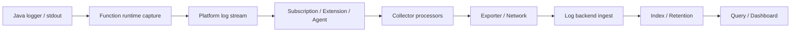
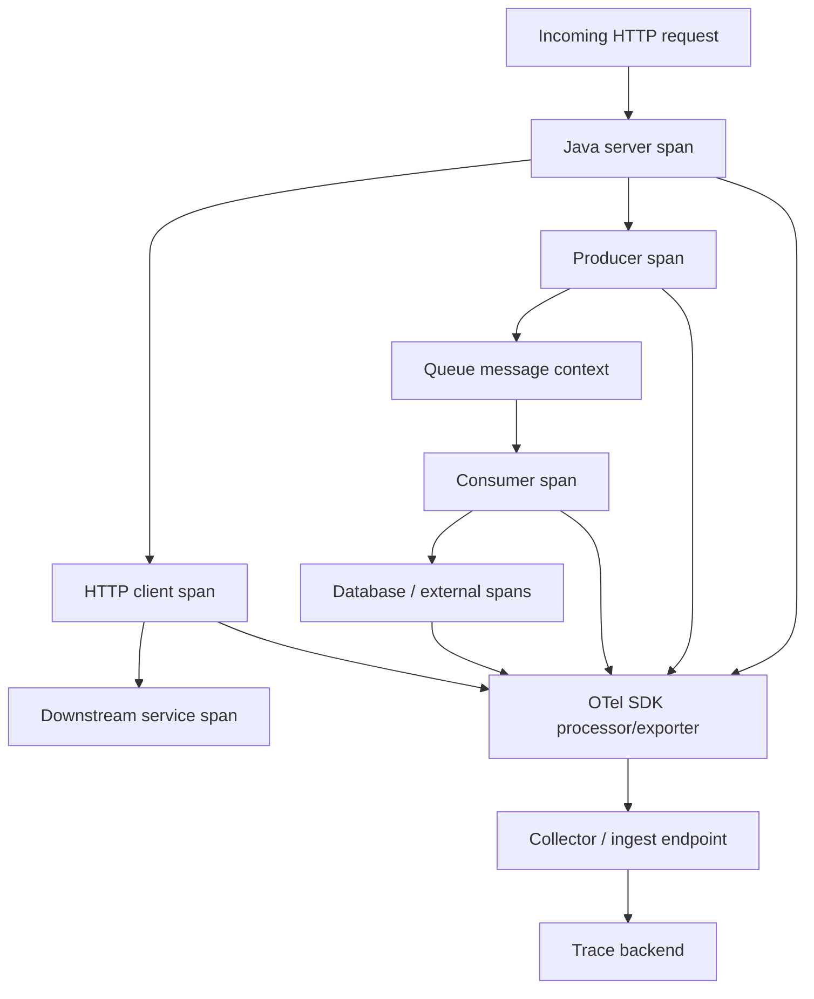

# Finding Root Causes of Missing Logs and Broken Traces Across Services

In a serverless system, an HTTP request may traverse an API gateway, a Java function, a queue, one or more consumer functions, a database, and external services. When an error occurs, the operations team needs to stitch together logs and traces from those components to see how far the request traveled, which step failed, and whether the data was processed. Yet logs may fail to appear in the centralized system, and traces may show only partial spans or split into multiple trace IDs.

Do not immediately conclude that the function did not log or that OpenTelemetry is broken. Telemetry traverses multiple layers: the application emits data, the runtime/agent collects it, the exporter sends it, the collector processes it, the backend ingests and indexes it, and operators query it. A single misconfigured or overloaded link can make data vanish. For traces, failing to propagate context across HTTP/queue/async boundaries leaves spans present but disconnected.

This lesson explains how to find root causes of missing logs and broken traces across Java serverless services. Topics include log/trace pipelines, function lifecycles, OpenTelemetry and W3C Trace Context, propagation over HTTP and messages, async execution, sampling, Java MDC, exporters/collectors, IAM/networking, clock skew, diagnostic workflows, testing, and operational runbooks.

## 1. Distinguish Symptoms Before Investigating

### 1.1. Missing Logs in the Backend Does Not Mean the App Emitted None

A log line can be lost at many points:

1. Code did not reach the log statement or the log level is disabled.
2. Logger/appender is misconfigured or a filter drops the record.
3. Logs are written to stdout/stderr, but the runtime does not capture the right stream.
4. Buffers had not flushed when the invocation ended or the execution environment was frozen/terminated.
5. The function lacks permission to write logs or the agent lacks permission to read logs.
6. The subscription/extension/collector is not receiving the right log group, file, or stream.
7. The collector drops records due to a full queue, memory limit, parse error, or processor filter.
8. Networking, DNS, TLS, proxy, or a wrong endpoint prevents the exporter from sending.
9. The backend rejects data due to quota, authentication, payload size, or schema.
10. Logs were ingested, but landed in another index, project, region, time range, or tenant.
11. Query filters, retention, or sampling prevent operators from seeing the logs.

Therefore, identify the last layer where the record is still visible before changing code.

### 1.2. Broken Traces Take Many Forms

- The root span is present, but downstream spans are missing.
- Each function gets its own trace ID even though they handle the same request.
- The consumer span exists, but as a new root span with no parent or link to the producer.
- Some messages in a batch link properly while others do not.
- The trace contains all spans, but timestamps appear out of order.
- Traces appear intermittently due to sampling or export failures.
- The trace ends before async work completes.
- Traces are sent, but queries miss them due to incorrect service/resource attributes.

Distinguish **context propagation failure**, **sampling**, **export loss**, and **query/index issues**. Each has a different fix.

### 1.3. Symptom and First-Check Table

| Symptom | Check first |
| --- | --- |
| No logs for one invocation | Request ID, stdout/stderr, logger level, execution role, runtime log capture |
| Logs exist in platform, missing in backend | Subscription/agent, collector queue, network/TLS, exporter authentication |
| Logs arrive late | Async batch processor, flush, collector batch/queue, backend ingest delay |
| Logs lost only on short-running functions | Buffering, flush timeout, process freeze/termination |
| Logs lost only under high load | Queue overflow, throttling, rate limits, memory limiter, backend quota |
| Trace splits after an HTTP call | `traceparent` stripped/overwritten, instrumentation, or proxy header handling |
| Trace splits after a queue | Trace context not injected into message attributes/envelope or consumer fails to extract |
| Batch has multiple parent traces | Span links are needed for multiple message contexts instead of picking one arbitrary parent |
| Only part of a trace appears | Sampling decision, exporter drops/retries, retention, or query filters |
| Spans have skewed timestamps | Clock sync, timestamp source, display timezone, and async delay |

## 2. Understand Log and Trace Pipelines

### 2.1. Log Pipeline



Every arrow is a boundary to verify. If logs appear in the platform log stream but not in the backend, raising Java log levels usually will not fix the actual cause.

### 2.2. Trace Pipeline



Trace context determines which spans belong to the same trace and their parent-child/link relationships. The exporter, collector, and backend are responsible for transporting and storing spans. A broken trace can result from broken propagation or from some spans failing to export.

### 2.3. Classify Observability Data

| Type | Purpose | Characteristics |
| --- | --- | --- |
| Log | Record events and error details | Contains message/attributes, typically queried by time and fields |
| Metric | Measure trends/health | Aggregated, cardinality must be controlled |
| Trace | Connect steps of a request/operation | Spans, parents, links, context, and timing |
| Audit event | Record actions significant for control/compliance | Requires integrity, access controls, and policy-based retention |

Do not use sampled traces as a substitute for audit logs. Do not rely on log volume as a primary metric when exact counts are required. Each signal type has distinct semantics and retention.

## 3. Telemetry Specifics in Serverless

### 3.1. Invocation and Execution Environment Are Two Distinct Lifecycles

A function invocation may run inside an execution environment reused across multiple invocations. Environments can be frozen, scaled down, or replaced at any time. Static clients/loggers can be reused, but memory must never be treated as durable telemetry storage.

### 3.2. Flush and Shutdown

Batch exporters typically buffer spans/logs before sending to reduce overhead. In short-lived functions, an invocation may finish before a batch is exported. Check:

- The batch processor has an appropriate queue/timeout.
- The exporter has the right endpoint and timeout.
- Flush is invoked at the invocation boundary when required by the platform/SDK.
- Flushing does not exceed the invocation deadline.
- Flush failures are tracked via an independent channel or metric.
- Shutdown runs only at the appropriate lifecycle hook; do not close the global SDK after every invocation if the environment is reused.

Do not assume shutdown hooks always run when a function is terminated. For platforms with extensions, agents, or managed telemetry integrations, follow the platform's lifecycle guidance.

### 3.3. Flush Per Invocation or Batch Across Invocations?

Both approaches carry trade-offs:

- Flushing per invocation reduces buffer loss when environments are stopped, but increases latency, network requests, and cost.
- Batching across invocations lowers overhead, but depends on lifecycle/reuse and accepts the risk of losing unexported buffers.
- Managed extensions/collectors can receive telemetry independently of the function handler, though queues, retries, and shutdown semantics still need checking.

Choose based on observability requirements, platform support, and tolerance for telemetry loss. Do not blindly add `forceFlush()` if it causes functions to time out or triggers retry storms against the collector.

### 3.4. Cold Starts and Warm Starts

Cold starts can produce initialization logs/spans different from normal invocations. If instrumentation initializes exporters/clients too late, the first logs or first spans may be missed. If the SDK initializes multiple times in a warm environment, it can create duplicate exporters/threads or resource leaks.

Initialize the SDK/clients at the proper lifecycle point, record cold starts as an attribute/event, and separate init duration from handler duration.

### 3.5. Runtime Capture and Logger Output

If relying on stdout/stderr capture, confirm the framework does not redirect logs to a local file or custom appender that the platform does not collect. If using a file appender, verify the agent/extension reads the right path and handles file rotation. Function filesystems are generally not durable log storage.

## 4. Structured Logging for Java Functions

### 4.1. Use Structured Logging

JSON or structured attribute logs make filtering by service, environment, invocation, and trace straightforward. Useful fields:

- `timestamp` in UTC;
- `severity`;
- `service.name`, `service.version`, `deployment.environment`;
- function name/version or revision;
- platform request/invocation ID;
- `trace_id`, `span_id`, `trace_flags` when a valid context exists;
- `correlation_id`, `event_id`, `operation_id`;
- error type/code and phase.

Do not use `operation_id`, user ID, or event ID as metric labels due to high cardinality. They belong in access-controlled logs/traces instead.

### 4.2. Correlation IDs and Trace IDs Differ

- **Trace ID** identifies a distributed trace in the tracing model.
- **Span ID** identifies a specific operation within a trace.
- **Correlation ID** is an application-defined business/request identifier used to link logs/events when traces are sampled out or cannot remain continuous.
- **Event ID** identifies a message/event for deduplication.
- **Invocation ID** identifies one function execution assigned by the platform.

Do not replace trace context with a correlation ID. Also do not treat a correlation ID as proof of authentication or authorization.

### 4.3. Java SLF4J MDC

MDC attaches trace/correlation fields to log patterns:

```java
import io.opentelemetry.api.trace.Span;
import io.opentelemetry.api.trace.SpanContext;
import org.slf4j.MDC;

public final class LogContext implements AutoCloseable {
    public LogContext(String correlationId) {
        SpanContext span = Span.current().getSpanContext();
        if (correlationId != null) {
            MDC.put("correlation_id", correlationId);
        }
        if (span.isValid()) {
            MDC.put("trace_id", span.getTraceId());
            MDC.put("span_id", span.getSpanId());
            MDC.put("trace_flags", span.getTraceFlags().asHex());
        }
    }

    @Override
    public void close() {
        MDC.remove("correlation_id");
        MDC.remove("trace_id");
        MDC.remove("span_id");
        MDC.remove("trace_flags");
    }
}
```

Usage in a handler:

```java
try (LogContext ignored = new LogContext(event.correlationId())) {
    logger.info("Processing event type={}", event.type());
    process(event);
} catch (RuntimeException error) {
    logger.error("Event processing failed eventId={}", event.eventId(), error);
    throw error;
}
```

MDC is thread-local in many logging implementations. Clear it after every invocation/task so context from a previous invocation does not leak into a subsequent invocation on a reused thread. With async executors, intentionally propagate both OpenTelemetry `Context` and MDC; never assume a new thread inherits context automatically.

### 4.4. Avoid Logging Sensitive Data

Do not log passwords, tokens, secrets, raw authorization headers, payment data, or payloads containing PII without justification and controls. Redact before logging, restrict read access, and enforce retention. A complete log containing credentials can create a worse security incident than the original failure.

## 5. W3C Trace Context and Span Relationships

### 5.1. `traceparent`

W3C Trace Context defines the `traceparent` header carrying the trace ID, parent span ID, and trace flags. Common format:

```text
00-4bf92f3577b34da6a3ce929d0e0e4736-00f067aa0ba902b7-01
```

Components:

- `00`: version;
- `4bf...4736`: 16-byte trace ID in hex;
- `00f...02b7`: 8-byte parent span ID in hex;
- `01`: trace flags, including the standard sampled bit.

`tracestate` can carry vendor-specific tracing state. Never parse or assemble headers manually via string manipulation; use OpenTelemetry propagators to avoid formatting and validation bugs.

### 5.2. HTTP Propagation

When an HTTP server receives a request containing `traceparent`, instrumentation creates a server span within that trace. HTTP client instrumentation injects the current context into outbound requests. If a proxy/gateway strips the header or the app constructs an uninstrumented client, downstream services can start a brand-new root trace.

Check:

- Does the inbound header reach the function?
- Does the configured propagator support W3C Trace Context?
- Are server/client instrumentations active?
- Are headers stripped by allowlists, CORS, or proxy rules?
- Does application code accidentally create a root span instead of a child span?

Do not blindly accept trace context from arbitrary external callers where trust boundaries matter. Context is tracing metadata, not authentication. For untrusted traffic, you may restart traces or sanitize baggage per policy while preserving suitable correlation.

### 5.3. Java Injecting Context into HTTP/Message Headers

Example injecting via the OpenTelemetry API into a header map:

```java
import io.opentelemetry.api.GlobalOpenTelemetry;
import io.opentelemetry.context.propagation.TextMapPropagator;
import java.util.HashMap;
import java.util.Map;

public final class TraceHeaders {
    private static final TextMapPropagator PROPAGATOR =
            GlobalOpenTelemetry.getPropagators().getTextMapPropagator();

    public static Map<String, String> injectCurrentContext() {
        Map<String, String> headers = new HashMap<>();
        PROPAGATOR.inject(
                io.opentelemetry.context.Context.current(),
                headers,
                (carrier, key, value) -> carrier.put(key, value));
        return headers;
    }

    private TraceHeaders() {
    }
}
```

Attach the injected headers to HTTP requests or message attributes within transport limits. Do not copy all baggage indiscriminately; forward only necessary and permitted fields.

### 5.4. Java Extracting Context in Consumers

```java
import io.opentelemetry.api.GlobalOpenTelemetry;
import io.opentelemetry.api.trace.Span;
import io.opentelemetry.api.trace.SpanKind;
import io.opentelemetry.api.trace.StatusCode;
import io.opentelemetry.context.Context;
import io.opentelemetry.context.Scope;
import io.opentelemetry.context.propagation.TextMapGetter;
import io.opentelemetry.context.propagation.TextMapPropagator;
import java.util.Map;

public final class MessageTrace {
    private static final TextMapPropagator PROPAGATOR =
            GlobalOpenTelemetry.getPropagators().getTextMapPropagator();

    private static final TextMapGetter<Map<String, String>> GETTER =
            new TextMapGetter<>() {
                @Override
                public Iterable<String> keys(Map<String, String> carrier) {
                    return carrier.keySet();
                }

                @Override
                public String get(Map<String, String> carrier, String key) {
                    return carrier.get(key);
                }
            };

    public static void process(
            Map<String, String> messageAttributes,
            Runnable businessWork) {
        Context parent = PROPAGATOR.extract(
                Context.current(), messageAttributes, GETTER);

        var tracer = GlobalOpenTelemetry.getTracer("orders-consumer");
        var span = tracer.spanBuilder("process order event")
                .setSpanKind(SpanKind.CONSUMER)
                .setParent(parent)
                .startSpan();

        try (Scope scope = span.makeCurrent()) {
            businessWork.run();
        } catch (RuntimeException error) {
            span.recordException(error);
            span.setStatus(StatusCode.ERROR);
            throw error;
        } finally {
            span.end();
        }
    }

    private MessageTrace() {
    }
}
```

This example assumes message attributes have been converted into a `Map<String,String>`. Real adapters must map the exact metadata fields of the queue/broker. If a message lacks a valid context, the propagator returns the current context and the consumer span may become a new root; log correlation/event IDs to investigate.

### 5.5. Queues Do Not Automatically Carry HTTP Context

When a producer handles an HTTP request and enqueues a message, trace context does not automatically travel with the payload. It must be injected into message attributes/headers or an envelope following a shared convention. Consumers must extract it before creating their processing spans.

Do not put only the trace ID into the JSON body while omitting parent span ID and trace flags. Use a W3C propagator for complete inject/extract.

### 5.6. Batch Consumers and Span Links

One invocation can receive a batch containing messages from several different traces. A span can have only one parent span. Never pick the first message's parent and attach all remaining messages to that trace.

Instead, create a new processing span and add **span links** to each message's context. This represents fan-in relationships accurately. For small batches, you can also create child spans per record; weigh cost and cardinality.

### 5.7. Retries and Redeliveries

Message redeliveries should preserve event identity and original trace context when semantics require, while each processing attempt can create a new consumer attempt span. Record `messaging.message.id`, delivery attempt, or retry count as appropriate span/log attributes. Never overwrite trace context with an empty context on retry.

## 6. Async Execution in Java

### 6.1. Context Does Not Automatically Cross Every Thread

OpenTelemetry `Context` is bound to the current execution scope. When using `ExecutorService`, `CompletableFuture`, or reactive schedulers, new threads will lack the caller's context unless the executor is instrumented or wrapped.

### 6.2. Wrap Executors

Example:

```java
import io.opentelemetry.context.Context;
import java.util.concurrent.ExecutorService;
import java.util.concurrent.Executors;

ExecutorService rawExecutor = Executors.newFixedThreadPool(4);
ExecutorService contextualExecutor = Context.taskWrapping(rawExecutor);

contextualExecutor.submit(() -> {
    logger.info("Background step started");
    performBackgroundStep();
});
```

Shut down executors according to the runtime lifecycle. In FaaS, do not create a new thread pool on every invocation if environments are reused; also never assume background tasks will continue running after the handler returns. Work requiring durable execution must be enqueued or orchestrated via a workflow instead of firing background threads before ending an invocation.

### 6.3. CompletableFuture

With `CompletableFuture`, pass a wrapped executor or use compatible instrumentation. If callbacks execute on the common pool without context propagation, spans can turn into new roots or logs will miss trace IDs.

### 6.4. Reactive Pipelines

Reactive frameworks have their own context mechanisms. Verify that the bridge between Reactor context and OpenTelemetry context is enabled at the right version. Thread-local MDC is insufficient across thread hops; use framework-supported context propagation.

### 6.5. Never Keep Spans Open Across Long Waits

Do not open a span and hold it across multiple invocations or hours. Each invocation or processing step should have its own span, connected via trace context, links, correlation IDs, and operation IDs. Trace backends enforce span duration/retention limits, and overly long traces are hard to query.

## 7. Resource Identity and Span Attributes

### 7.1. `service.name` Must Be Stable

Resources describe the service/process/runtime, not individual invocations. For example:

- `service.name=orders-consumer`;
- `service.version=2.4.1`;
- `deployment.environment=production`;
- `cloud.region=...`;
- `faas.name=orders-consumer-function` if supported by semantic conventions/platform.

Invocation ID, request ID, and event ID are span/log attributes, not resource attributes shared across all invocations in an environment.

### 7.2. Inconsistent Service Names Make Traces Hard to Read

If the same service logs `orders`, then `order-service`, then `lambda-handler`, the backend may split it into three services. Standardize service names across instrumentation, deployment metadata, and dashboards.

### 7.3. Useful Attributes

- `http.request.method`, `http.response.status_code`;
- `messaging.system`, `messaging.destination.name`, message ID;
- `faas.invocation_id` if provided by conventions/runtime;
- operation type, phase, and retry attempt;
- database system/operation, without logging queries containing sensitive data;
- `error.type` and exception events.

Semantic conventions evolve across OpenTelemetry versions. Follow the conventions matching your deployed SDK/instrumentation and avoid inventing inconsistent names.

### 7.4. Baggage

Baggage carries metadata across processes, meaning every downstream service may receive those values. Never put PII, secrets, tokens, or large payloads in baggage. Restrict keys/values and allow only necessary fields across trust boundaries.

## 8. Sampling and Incomplete Traces

### 8.1. Head Sampling

Head samplers decide at the start of a trace whether to record/sample it. If the root is dropped, downstream spans are usually dropped too when using a parent-based sampler. A missing trace may simply be normal sampling behavior rather than telemetry loss.

### 8.2. Parent-Based Sampling

A parent-based sampler honors the parent's sampling decision when context is propagated properly. If context is lost and a consumer creates a new root, the consumer may make a different sampling decision; the trace looks broken or half-missing.

### 8.3. Tail Sampling

Tail sampling at the collector retains traces with errors or high latency after seeing their spans. It requires buffering and waiting long enough to assemble the trace; collectors must have adequate capacity, routing, and trace affinity. In serverless, spans may arrive late or pass through different collectors, causing tail sampling to miss traces if misconfigured.

### 8.4. Distinguish Sampling from Exporter Drops

Inspect sampler decisions/trace flags, SDK span processor metrics, exporter failed/dropped counts, and collector telemetry. If spans were not sampled, there will be no exporter errors. If spans were sampled but the exporter queue filled up, that is export loss.

### 8.5. Sampling Does Not Imply Log Sampling

Trace sampling and log filtering are separate mechanisms. Logs may be recorded in full while traces are sampled; or traces may be complete while log appenders filter out records. Dashboards must make these policies clear.

## 9. Exporters and Collectors

### 9.1. Verify Exporter Configuration

Settings to verify:

- OTLP endpoint and protocol (gRPC/HTTP protobuf);
- TLS certificates/CA and hostname;
- authentication headers/API keys;
- timeouts;
- batch size, queue size, and retries;
- compression/payload limits;
- proxy/egress routes;
- enabled signals (traces/logs/metrics).

An endpoint with the wrong protocol/path or a collector configured only for traces and not logs can cause only one telemetry type to disappear.

### 9.2. Collector Pipeline

An OpenTelemetry Collector pipeline typically comprises receivers, processors, and exporters. Check:

- Is the receiver listening on the right port/protocol?
- Are processor filters/transforms dropping fields or records?
- Is the memory limiter refusing data under load?
- Does the batch processor have reasonable queue/timeout values?
- Is the exporter queue/retry buffer full?
- Are there exporter authentication/network errors?
- Are logs and traces pipelines configured separately and both enabled?

### 9.3. Collector Drops Do Not Always Show in App Logs

The collector can drop records due to queue overflow or memory pressure without the function knowing. Monitor collector internal telemetry: accepted/refused/failed spans, exporter send failures, queue size/capacity, retries, and memory limiter events.

### 9.4. Networking and DNS

In VPC/private networks, verify:

- Function subnets have routes to the collector/endpoint.
- Security groups/firewalls allow the required port.
- Private DNS resolves to the right IP.
- NAT/egress is configured if the endpoint is public.
- TLS inspection/proxies do not swap certificates unexpectedly.
- Connection timeouts and DNS caching.

Do not open all outbound egress just to "see if it works". Identify target hostnames/ports and grant least-privilege access.

### 9.5. Exporter Retries and Queues

Exporter retries must be bounded. During a prolonged backend outage, queues can fill up; apply backpressure, clear drop policies, and alerts. Never configure infinite retries that drive memory into OOM or cause functions to time out.

## 10. IAM and Telemetry Access Permissions

### 10.1. Separate Runtime and Collector Permissions

A function may need permission to write platform logs or send telemetry to a collector. An extension/agent may run under a different identity. Verify the exact principal for each component.

### 10.2. Permissions to Audit

- Create/write log streams/groups per service;
- Publish telemetry or invoke ingest endpoints;
- Read log sources if an agent pulls data;
- Decrypt keys if logs/secrets use a customer-managed key;
- Access secrets/API tokens for exporters;
- Network access to collectors/backends.

Never grant admin or wildcard permissions just to fix `AccessDenied`. Check the exact denied action and resource in audit/platform logs.

### 10.3. Collector Identity

If the collector runs as a separate container, agent, or extension, check its workload identity, secret rotation, and backend write permissions. Do not reuse the function's credentials when the collector can use its own identity.

## 11. Timestamps, Ordering, and Clock Skew

### 11.1. Timestamps Do Not Prove Causality

Hosts and regions can have clock skew. Events can sit in queues long before a consumer processes them. Therefore, a consumer span timestamped minutes after the producer is not necessarily a trace bug.

### 11.2. Use a Monotonic Clock for Durations

Within one process, use a monotonic clock (`System.nanoTime()` in Java) to measure durations. Use a wall clock (`Instant.now()`) for timestamps/event times. Never compute durations by subtracting two wall-clock timestamps if clock adjustments can occur.

### 11.3. Base Ordering on Parent, Links, and Sequences

To understand event ordering, rely on parent-child relationships, span links, message sequence/offsets, and business event times. Never sort an entire trace solely by timestamps.

### 11.4. Time Synchronization

Ensure hosts, platforms, and collectors use proper time synchronization. Record timestamps in UTC and avoid ambiguous local timezones. In dashboards, display timezones explicitly and distinguish event timestamps from ingest timestamps.

## 12. Diagnostic Workflow: Finding Missing Logs

### 12.1. Step 1 — Pick One Specific Invocation

Collect function name/version, region, UTC timestamp, platform request ID, event ID, and correlation ID. Do not start with a broad system-wide query that mixes many invocations.

### 12.2. Step 2 — Confirm Code Executed

- Is there an invocation metric/request ID?
- Did the handler enter the branch expected to log?
- Is the log level enabled?
- Did an exception occur before the log statement?
- Does the logger have filters or an async appender?

Add structured canary logs at handler start and end in a safe environment to distinguish start versus completion.

### 12.3. Step 3 — Check stdout/stderr and Platform Logs

Search for the platform request ID in the raw log stream. If missing, check runtime capture, execution role, log group/stream, retention, and region. If present, record the timestamp and exact message to trace onward.

### 12.4. Step 4 — Check Subscriptions, Agents, and Extensions

Confirm the right log source, filter pattern, subscription destination, extension version, file path, and checkpoints. Check whether the consumer/agent has a backlog or permission errors.

### 12.5. Step 5 — Check Collectors and Exporters

Inspect collector internal metrics/logs, exporter queues, failed sends, retries, TLS/auth errors, and payload rejections. If backend ingest accepts records yet queries miss them, move to Step 6.

### 12.6. Step 6 — Check Backend Queries and Indexes

- Right project/account/tenant/region;
- Right index/dataset/log group;
- Time range in UTC vs. local time;
- Field parsers altering timestamps;
- Query filters excluding severity/service/version;
- Retention/TTL deleting records;
- Ingest/indexing delays occurring.

### 12.7. Step 7 — Trace One Canary Record End-to-End

Emit one record with a unique `canary_id` containing no sensitive data. Follow it across each layer: application output → platform logs → collector → backend ingest → query. This quickly identifies the boundary where data drops with concrete evidence.

## 13. Diagnostic Workflow: Finding Broken Traces

### 13.1. Step 1 — Pick the Parent Span and Downstream Call

Record the trace ID and span ID at the outbound call or message producer. Confirm whether the downstream service actually received the request or message.

### 13.2. Step 2 — Check Propagation Carriers

For HTTP, verify `traceparent` and `tracestate` reach the downstream service. For queues, verify message attributes/envelopes carry trace context. Never log full headers if they contain credentials; log only presence or validated trace ID/span ID when policy permits.

### 13.3. Step 3 — Check Instrumentation

- Server instrumentation creates server spans;
- HTTP client instrumentation creates client spans;
- Queue producer/consumer instrumentation is enabled;
- Framework instrumentation matches the deployed version;
- Manual spans call `setParent(extractedContext)` where required;
- Context propagates across executor/reactive boundaries.

### 13.4. Step 4 — Check Samplers and Trace Flags

Compare the sampled flag at the parent/message and downstream. If context was lost, the downstream service may start a new root with a different sampling decision. Verify sampling configurations across every service.

### 13.5. Step 5 — Check Exports Per Service

Each service has its own exporter/collector path. A trace can show spans from service A while service B's spans are dropped due to IAM, networking, or quotas. Inspect span processor/exporter metrics per service.

### 13.6. Step 6 — Check Service and Resource Identity

Search by trace ID first, then inspect `service.name`, version, environment, and region. If service names are inconsistent, spans can be misgrouped in service maps.

### 13.7. Step 7 — Check Batch and Fan-In Handling

If one invocation processes multiple messages, inspect span links and event IDs. A trace with multiple producers cannot be accurately represented by attaching every message to one arbitrary parent.

## 14. Common Scenarios and Fixes

### 14.1. Final Function Logs Are Lost

**Possible causes:** async appender did not flush, exporter queue still buffered data, function timed out, or runtime terminated the environment.

**Fix:** inspect appender/exporter queues; call bounded-timeout flush at the invocation boundary if needed; reduce log volume; use managed extensions/collectors when platform-supported; monitor flush failures. Do not assume shutdown hooks always run.

### 14.2. Logs Are Lost Only During Traffic Bursts

**Possible causes:** collector/backend throttling, full queues, memory limiters, rate limits, or concurrency exceeding capacity.

**Fix:** check accepted/refused/failed counters; scale capacity with bounds; tune batch/queue sizes; trim unnecessary debug logs; retain error/audit records per policy; alert before queues fill.

### 14.3. Logs in One Region Do Not Appear

**Possible causes:** cross-region endpoint/collector mismatch, cross-account IAM, private DNS, or missing resource policy.

**Fix:** compare deployment configs, region/account, endpoints, roles, and network routes; do not search only the default region dashboard.

### 14.4. HTTP Trace Connects, Queue Consumer Creates New Trace

**Cause:** producer fails to inject context into message attributes or consumer fails to extract it.

**Fix:** use W3C propagators in both producer and consumer; test round-trip context; verify the broker preserves message attributes on redrive/retry.

### 14.5. Trace Breaks When Using CompletableFuture

**Cause:** callbacks execute on a thread pool lacking OTel Context/MDC.

**Fix:** wrap executors with `Context.taskWrapping`, use compatible framework instrumentation, or explicitly capture context and wrap tasks. Check MDC cleanup to prevent context leaks.

### 14.6. Traces Are Complete Sometimes and Missing Other Times

**Causes:** sampling, exporter queue overflow, collector load, retry timing, or query time ranges.

**Fix:** compare sampled flags, export failure metrics, and collector drop counters; run a canary with a known sampling policy; never disable sampling system-wide impulsively.

### 14.7. Batch Consumer Shows One Wrong Parent

**Cause:** attaching the batch span to the first message's parent.

**Fix:** create a new consumer/batch span and link to each message context, or create individual child spans per record when appropriate.

### 14.8. Trace Has Spans, but Service Map Is Wrong

**Causes:** `service.name` differs across deployments, instrumentation, and environments; resource attributes overwritten.

**Fix:** standardize resource builders/env vars; do not put invocation IDs in resource attributes; verify service version/environment.

### 14.9. Log Has Trace ID, but Trace Is Not Found

**Causes:** spans were not sampled/exported, trace backend retention differs from log retention, or trace ID was logged from an invalid context.

**Fix:** log trace IDs only when `SpanContext.isValid()`, log the sampled flag, inspect trace export counters, and check trace retention. Correlation IDs still enable investigation when traces are not stored.

## 15. Configuring OpenTelemetry in Java

### 15.1. Shared Resources and SDK

Initialize the SDK once per execution environment lifecycle with stable resources and appropriate exporters. Never instantiate a new `OpenTelemetrySdk` on every request when the runtime reuses environments.

Conceptual initialization example:

```java
import io.opentelemetry.api.OpenTelemetry;
import io.opentelemetry.api.common.AttributeKey;
import io.opentelemetry.api.common.Attributes;
import io.opentelemetry.sdk.OpenTelemetrySdk;
import io.opentelemetry.sdk.resources.Resource;
import io.opentelemetry.semconv.ResourceAttributes;

public final class Telemetry {
    private static final OpenTelemetry INSTANCE = create();

    private static OpenTelemetry create() {
        Resource resource = Resource.getDefault().merge(
                Resource.create(Attributes.of(
                        ResourceAttributes.SERVICE_NAME, "orders-consumer",
                        ResourceAttributes.SERVICE_VERSION, "2.4.1",
                        AttributeKey.stringKey("deployment.environment"),
                        System.getenv().getOrDefault("APP_ENV", "unknown"))));

        // Configure trace/log exporters and processors according to the platform.
        return OpenTelemetrySdk.builder()
                .setTracerProvider(
                        io.opentelemetry.sdk.trace.SdkTracerProvider.builder()
                                .setResource(resource)
                                .build())
                .build();
    }

    public static OpenTelemetry get() {
        return INSTANCE;
    }

    private Telemetry() {
    }
}
```

This skeleton illustrates resource lifecycle only; it configures no exporters or processors, so it does not send spans to any backend by itself. In real applications, use a compatible OpenTelemetry SDK/agent/distribution and semantic convention version; register providers once per runtime lifecycle.

### 15.2. Exporter Endpoints and Protocols

Common configuration variables:

```text
OTEL_SERVICE_NAME=orders-consumer
OTEL_EXPORTER_OTLP_ENDPOINT=https://otel-collector.example.internal
OTEL_EXPORTER_OTLP_PROTOCOL=http/protobuf
OTEL_PROPAGATORS=tracecontext,baggage
OTEL_TRACES_SAMPLER=parentbased_traceidratio
OTEL_TRACES_SAMPLER_ARG=0.10
```

Supported names/values depend on the SDK/distribution and version. Secret headers should come from a secret manager or runtime secret injection, never committed to repositories or logged at startup.

### 15.3. Batch Processors

Batch processors require tuning queue size, max export batch size, schedule delay, and exporter timeout. Values must balance invocation duration, memory, and backend capacity. When using managed collectors/extensions, verify where telemetry is buffered and what queue limits apply.

### 15.4. Logs and Traces Are Separate Pipelines

An SDK may export traces successfully while log appenders still write to stdout or send to another endpoint. Clearly verify:

- Whether application logs travel via stdout/platform logs or OTLP Logs;
- Which OTLP exporter/collector handles traces;
- Which pipeline handles metrics;
- Each pipeline's authentication, retention, and alerting.

Do not assume configuring a trace exporter automatically configures a log exporter.

## 16. Collector Pipelines and Preventing Data Loss

### 16.1. What to Measure

Monitor the collector for:

- receiver accepted/refused;
- processor dropped;
- exporter sent/failed;
- exporter queue size/capacity;
- retry counts;
- memory limiter refusals;
- batch size and batch timeouts;
- scrape/health status.

Exact metric names vary by collector version and exporter. Verify against the telemetry emitted by your running collector.

### 16.2. Full Queues

When exporter queues fill up, collectors may apply backpressure or drop data depending on configuration. Enlarging queues merely delays the problem if the backend lacks throughput. Inspect producer rates, exporter capacity, and backend ingest quotas together.

### 16.3. Parse and Transform Filters

Processors can strip fields, rewrite timestamps, or filter by severity/service. Check config versions and sample records before and after processors. Watch especially for parsers expecting JSON while the app writes plain text, or timestamp parsers misparsing event times.

### 16.4. Payload Limits and Truncation

Oversized log payloads can be truncated or rejected by the runtime or backend. Never log entire request/response bodies; log safe metadata and references. Check maximum event sizes at every layer.

### 16.5. Retries and Backpressure

Exporter retries must have bounded queues and timeouts. If the backend slows down, collectors can grow in memory. Enable memory limiters, persistent queues where appropriate, and queue saturation alerts. Never enable infinite retries without capacity planning.

## 17. Testing Propagation and Log Pipelines

### 17.1. Inject/Extract Unit Tests

Create a parent span, inject context into a map, extract it in the consumer, and assert that trace ID matches and parent span ID is preserved. Test missing headers, malformed headers, and policy-based baggage stripping.

### 17.2. HTTP Integration Tests

- Send a request with `traceparent`;
- Verify the server span;
- Call downstream via an instrumented HTTP client;
- Verify matching trace IDs and proper parent-child relationships;
- Test proxy/gateway configs to catch stripped headers.

### 17.3. Queue Integration Tests

- Producer injects context into message attributes;
- Broker stores/forwards attributes;
- Consumer extracts context;
- Verify retries/redrives preserve event IDs and context;
- Test batches with multiple parents using span links;
- Test messages without context creating valid root spans.

### 17.4. Async Executor Tests

Create a span on the caller thread, submit a task through the contextual executor, and verify task logs/spans share the trace. Also test an unwrapped executor to prove the regression test catches context loss.

### 17.5. End-to-End Log Canary

Emit a canary log with a unique ID from a test invocation and confirm the record appears in:

1. application/stdout;
2. platform log stream;
3. collector receiver;
4. exporter/backend ingest;
5. query/index.

Do not stop at checking HTTP 200 from the function; verify the record is actually queryable in the backend after a reasonable ingest window.

### 17.6. Failure Injection

Test:

- unreachable collector endpoint;
- denied exporter authentication;
- DNS/TLS failures;
- backend throttling;
- full collector queue;
- function exiting immediately after logging;
- invocation timeout before flush;
- cold starts and warm reuse;
- sampling drop decisions;
- malformed log payloads;
- message redeliveries and duplicates.

Measure telemetry loss, recovery time, and impact on function latency/cost.

## 18. Metrics and Alerts for Telemetry Health

### 18.1. Application Level

- log records emitted by severity;
- spans started/ended;
- invalid/missing trace context rate;
- context extraction failures;
- exporter force-flush duration/failures if used;
- invocations with start logs but no completion logs.

Never add trace ID or request ID as metric labels. Keep those IDs inside logs/traces.

### 18.2. Collector/Backend Level

- accepted/refused/dropped spans/logs;
- exporter send failures/retries;
- queue utilization;
- ingest throttling/quotas;
- indexing delay;
- retention/deletion counts;
- authentication/network error rates.

### 18.3. Synthetic Canaries

Periodically generate canary logs and traces across critical HTTP and queue paths. Alert if the canary fails to appear in the backend within the ingest SLO window or if traces miss expected spans.

Canaries should use dedicated test service/operation names, harmless payloads, and low volume. Never generate large synthetic traffic that skews costs or sampling.

### 18.4. Alerts Must Name an Owner

Collector/backend alerts belong to the platform/observability owner; missing propagation alerts in a service belong to the application owner. Attach runbooks and escalation paths so alerts do not go unacknowledged.

## 19. Quick Diagnostic Runbooks

### 19.1. Invocation Logs Missing

1. Grab platform request/invocation ID and UTC timestamp.
2. Confirm the invocation actually ran.
3. Check logger level, stdout/stderr, and canary logs.
4. Search the raw platform log stream.
5. If missing in platform: check runtime capture, IAM, log group/region, and timeouts.
6. If present in platform: check subscriptions/extensions/collectors.
7. Check collector queues, drops, and exporter errors.
8. Check backend project, index, time range, retention, and query.
9. Record the first layer where the canary record vanishes and route to the right owner.

### 19.2. Trace Splits Between HTTP and Queue

1. Grab trace ID and span ID of the producer span.
2. Verify `traceparent` or context attributes are injected before publishing.
3. Inspect an actual message after passing through the broker for attributes.
4. Verify the consumer extracts using the same propagator.
5. Check the consumer span's parent or span links.
6. Check sampler decisions and exporter metrics on both producer and consumer.
7. Compare service names, environments, regions, and trace retention.

### 19.3. Trace Missing Spans on Async Functions

1. Identify the thread/executor running the callback.
2. Check whether OTel Context is wrapped/propagated.
3. Check whether MDC is set and cleared properly.
4. Verify spans end on every execution branch.
5. Verify the invocation does not return before durable tasks finish.
6. For long tasks, split into message/workflow steps instead of background threads.

### 19.4. Logs/Traces Lost Under Backend Overload

1. Check ingest quotas and collector exporter queues.
2. Check retry, drop, and memory limiter metrics.
3. Trim debug logs and large payloads per policy.
4. Bound sampling/traffic intentionally instead of turning off all telemetry.
5. Scale capacity or adjust batch/queue settings after accounting for memory.
6. Verify canary records/traces recover.

## 20. Anti-Patterns to Avoid

- Searching only dashboards without checking the raw platform log stream.
- Assuming stdout always flushes before a function exits.
- Calling SDK shutdown after every invocation in warm environments.
- Using `ThreadLocal`/MDC without cleaning up or propagating across executors.
- Creating a new root span in every function despite an incoming `traceparent`.
- Omitting context injection into queue message attributes.
- Attaching a batch consumer span to the first message's parent.
- Using timestamps to infer absolute ordering across regions.
- Putting user IDs or trace IDs into metric labels.
- Putting PII or secrets into baggage or logs.
- Enabling infinite exporter retries that exhaust collector memory.
- Disabling sampling system-wide just to find one trace.
- Using trace IDs as correlation/business identities or security tokens.
- Treating backend ingest success as proof logs are indexed/queryable.
- Lacking canary tests for observability pipelines.

## 21. Production Checklist

- [ ] Every service has stable `service.name`, version, and environment.
- [ ] Invocation ID/request ID is recorded on spans/logs, not as resource identity.
- [ ] Logs use structured format and UTC timestamps.
- [ ] Log levels, filters, and appenders are verified in production configs.
- [ ] stdout/stderr or file agent capture is verified.
- [ ] Function runtime has permissions to log to the right resource.
- [ ] Collectors/extensions have their own appropriate identity and permissions.
- [ ] Exporter endpoints, protocols, TLS, auth, timeouts, and retries are verified.
- [ ] Collector queues, memory limiters, drops, and exporter metrics have dashboards.
- [ ] Flush behavior aligns with invocation lifecycles and timeout budgets.
- [ ] Telemetry delivery does not rely on shutdown hooks.
- [ ] W3C Trace Context is injected/extracted across HTTP.
- [ ] Queue/event messages carry trace context in attributes/envelopes.
- [ ] Batch consumers use span links when multiple parent contexts exist.
- [ ] Async executors/reactive pipelines propagate OTel Context properly.
- [ ] MDC is cleaned up after every invocation/task.
- [ ] Sampling policies are understood and consistent across services.
- [ ] Trace export failures are distinguished from sampling.
- [ ] Timestamps are UTC, durations use monotonic clocks, and ordering uses context/sequences.
- [ ] Logs/traces exclude secrets, credentials, and unauthorized PII.
- [ ] Metric cardinality is bounded.
- [ ] Canary logs/traces verify the pipeline end-to-end.
- [ ] Runbooks isolate app, runtime, collector, and backend layers.
- [ ] Integration, failure, and load tests cover HTTP, queues, async, and exporter outages.

## Conclusion

Missing logs and broken traces are two symptoms that can originate at many different layers. For logs, trace the pipeline from logger/stdout to runtime capture, collector, exporter, backend ingest, indexing, and query. For traces, inspect context propagation, instrumentation, async boundaries, queue metadata, sampling, and exports at every service.

In Java serverless, execution environments can be reused or terminated unexpectedly, so never depend on local state or shutdown hooks to guarantee telemetry. Use structured logging, OpenTelemetry context, W3C Trace Context, outbox/message attributes, and executor propagation. For batch fan-in, span links represent multiple parents accurately. Include correlation, event, and operation IDs so investigations still work when traces are sampled out or cannot remain continuous.

When an incident happens, pick one specific invocation or canary record and find the last layer where data is still visible. Inspect collector drops/queues, exporter auth/networking, sampling, and backend queries before editing code. Maintain synthetic canaries, telemetry health metrics, runbooks, and failure tests to catch broken observability pipelines before you need them in a production incident.
