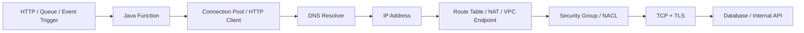

# Handling Connection Exhaustion, DNS Errors, and VPC Connectivity Failures

A Java function running on a serverless platform may work reliably under low load yet start failing when traffic rises, when many instances start simultaneously, or when network dependencies change. Failures commonly appear as timeouts, inability to resolve hostnames, inability to open database connections, or connections being refused even while the target service is up. Three failure groups must be distinguished: **connection exhaustion** (running out of connection resources), **DNS failure** (name resolution errors), and **VPC connectivity failure** (network path or access policy errors in private networks).

In serverless, every concurrency increase can spin up additional execution environments, connection pools, sockets, and DNS queries. A function scaling out faster than a database, NAT gateway, or DNS resolver can absorb can break its own downstream dependencies. Consequently, troubleshooting must look at the function lifecycle, instance count, per-layer connection limits, and the actual network path from the execution environment.

This lesson explains how to identify, isolate, and fix connectivity failures in Java serverless applications triggered by HTTP, messages, or events. Examples use common cloud VPC terminology; exact service names, limits, and configuration details must be cross-checked against your target platform.

## 1. Look at the Exact Failing Layer

A request from a function to a target service typically passes through several stages:

1. Acquire a connection from a pool or open a new socket.
2. Resolve the hostname to an IP address via DNS.
3. Find a route through route tables, gateways, peering, or network endpoints.
4. Establish a TCP handshake to the IP and port.
5. Perform a TLS handshake if using HTTPS or encrypted connections.
6. Authenticate with the database or target service.
7. Execute the query or application request.

An error at one stage can surface as a generic timeout at the caller layer. For instance, `SocketTimeoutException` can happen while waiting on DNS, during TCP connect, during TLS handshake, or while reading the response; inspect the stack trace and timeout timing to pinpoint it.

Connection path diagram:



Distinguish common errors:

| Symptom or exception | Layer to check first | Hint |
|---|---|---|
| `SQLTransientConnectionException`, Hikari pool timeout | Pool or database connection limit | Function waited to borrow a connection; packets may not have left the host |
| `UnknownHostException` | DNS | Resolver failed to return an address or name does not exist |
| `ConnectException: Connection refused` | TCP and target service | IP is reachable, but port has no listener or actively refuses |
| `NoRouteToHostException` | Routing or network policy | No valid route or network appliance returned an error |
| `SocketTimeoutException` during connect | TCP, routes, firewall, or overloaded endpoint | SYN received no timely reply |
| `SSLHandshakeException` | TLS, certificates, hostname, or system clock | TCP connected, but TLS negotiation failed |
| HTTP 401/403 | Authentication or authorization at target | Network may already work; check tokens and policies |
| HTTP 502/503 | Proxy, load balancer, or target service | Check health, quotas, upstream, and retries |

Do not start by increasing timeouts for every exception. Longer timeouts cause invocations to hold resources longer, filling pools faster and piling up queues.

## 2. What Is Connection Exhaustion?

Connection exhaustion happens when a component runs out of resources to create or maintain connections. The exhausted resource can be:

- Maximum database connections.
- Maximum connections in a function instance's pool.
- Execution environment sockets or file descriptors.
- Ephemeral source ports for outbound connections or NAT/SNAT.
- Connection or concurrent stream limits at a proxy, load balancer, or target service.
- Connection tracking (`conntrack`) tables or quotas on a network appliance.

These failure modes share similar symptoms but require different fixes. For example, raising `maximumPoolSize` may reduce local pool timeouts while exhausting database connections even sooner.

### 2.1. Why Does Serverless Create Many Connections So Easily?

An application running on a long-lived server usually maintains a relatively stable pool count. With FaaS, the platform can spin up many execution environments to handle concurrency. Each environment can initialize its own `DataSource`, HTTP client, or pool.

If a function has 40 active environments and each allows up to 8 database connections, total connections can reach 320. Actual numbers depend on on-demand connection creation, number of pools, instance lifecycles, and how the platform reuses environments.

Limit estimation formula:

\[
C_{\text{potential}} =
I_{\text{warm}} \times P_{\text{per-instance}} \times D_{\text{pools}}
\]

Where:

- \(I_{\text{warm}}\): number of execution environments able to run concurrently.
- \(P_{\text{per-instance}}\): connection limit of one pool per environment.
- \(D_{\text{pools}}\): number of pools each environment creates to the same target service.

Also add connections from other applications, migrations, admin tools, batch jobs, and read replicas. Never allocate the database's entire `max_connections` to one function.

For example, suppose a database allows at most 500 connections. If 100 are reserved for admin and other apps, plus 50 for headroom, the serverless workflow budget is only 350. If concurrency can hit 70 environments, average max pool size should be below 5 connections per environment (70 × 5 = 350), and in practice even lower headroom is needed for sudden concurrency spikes.

| Variable | What happens if set too high? | How to control |
|---|---|---|
| Function concurrency | Many environments and pools open at once | Reserved concurrency, cap consumer concurrency |
| Pool size per environment | Each instance holds many idle connections | Size pools small based on actual parallel queries |
| Pools per instance | Multiplies connections unnecessarily | Reuse one pool per target service and config |
| Connection hold time | Connections stay occupied too long | Close resources properly, shorten transactions |
| Simultaneous retries | Triggers connection spikes after failures | Backoff, jitter, retry budgets, and circuit breakers |

### 2.2. Distinguish Pool Exhaustion from Database Exhaustion

**Pool exhaustion**: the function fails to acquire a connection from its pool within `connectionTimeout`. The database itself may still have capacity for connections. Common causes are slow queries, connection leaks, an undersized pool, or high concurrency inside one environment.

**Database exhaustion**: the database has hit its connection limit or lacks workers/resources to accept new connections. Many function instances can fail simultaneously even when individual pools are not full.

**Network/NAT exhaustion**: the app cannot allocate or sustain sockets/source ports. Existing database connections may keep working while new connections to a destination or through a specific NAT path fail.

To distinguish them, compare simultaneously:

- Open connections and limits on the database.
- Active, idle, pending, and timed-out connections in function pools.
- Execution environment count and concurrency.
- Open sockets and `TIME_WAIT`/`CLOSE_WAIT` states if observable on the platform.
- NAT gateway, proxy, or network appliance metrics.
- Timing of errors relative to traffic peaks and retry counts.

## 3. Diagnose and Fix Connection Pools in Java

### 3.1. Reuse Pools Within the Execution Environment Lifecycle

Do not create a new `DataSource` or connection pool per invocation. On Java runtimes that reuse execution environments, initialize the pool at the class or dependency container level so sequential invocations in the same environment reuse that pool.

HikariCP example:

```java
import com.zaxxer.hikari.HikariConfig;
import com.zaxxer.hikari.HikariDataSource;

import javax.sql.DataSource;
import java.sql.Connection;
import java.sql.SQLException;

public final class DatabaseResources {
    private static final HikariDataSource DATA_SOURCE = createDataSource();

    private DatabaseResources() {}

    private static HikariDataSource createDataSource() {
        HikariConfig config = new HikariConfig();
        config.setJdbcUrl(System.getenv("JDBC_URL"));
        config.setUsername(System.getenv("DB_USER"));
        config.setPassword(System.getenv("DB_PASSWORD"));

        // Start with a small pool; tune based on concurrency and DB budget.
        config.setMaximumPoolSize(4);
        config.setMinimumIdle(0);

        config.setConnectionTimeout(3_000);
        config.setValidationTimeout(1_000);

        // Set below the DB/proxy idle limit if the system enforces one.
        config.setMaxLifetime(25 * 60_000L);
        config.setIdleTimeout(5 * 60_000L);

        return new HikariDataSource(config);
    }

    public static DataSource dataSource() {
        return DATA_SOURCE;
    }

    public static void checkConnection() throws SQLException {
        try (Connection connection = DATA_SOURCE.getConnection()) {
            if (!connection.isValid(1)) {
                throw new SQLException("Database connection is not valid");
            }
        }
    }
}
```

These values are illustrative starting points only. Set `maximumPoolSize` according to the system-wide connection budget, not the function's CPU count. `minimumIdle=0` can cut idle connections in horizontally scaled environments, though you must weigh connection-open latency at low traffic. `maxLifetime` should be shorter than connection lifetime limits enforced by the database, proxy, or firewall; do not pick an arbitrary number without knowing those limits.

Connections must be closed with try-with-resources. Closing a `Connection` in application code returns it to the pool; it does not necessarily close the physical socket immediately.

```java
import javax.sql.DataSource;
import java.sql.Connection;
import java.sql.PreparedStatement;
import java.sql.ResultSet;
import java.sql.SQLException;

public final class OrderRepository {
    private final DataSource dataSource;

    public OrderRepository(DataSource dataSource) {
        this.dataSource = dataSource;
    }

    public int countOpenOrders(String customerId) throws SQLException {
        String sql = "SELECT COUNT(*) "
                + "FROM orders "
                + "WHERE customer_id = ? AND status = ?";

        try (Connection connection = dataSource.getConnection();
             PreparedStatement statement = connection.prepareStatement(sql)) {
            statement.setString(1, customerId);
            statement.setString(2, "OPEN");

            try (ResultSet resultSet = statement.executeQuery()) {
                resultSet.next();
                return resultSet.getInt(1);
            }
        }
    }
}
```

Common mistakes that exhaust pools:

- Failing to close `Connection`, `Statement`, or `ResultSet`.
- Holding a connection while making HTTP calls to another service.
- Opening a transaction and waiting on file processing, messages, or user actions.
- Queries missing indexes or holding row locks too long.
- Creating a new pool per invocation or per repository.
- Setting `maximumPoolSize` higher than the database can sustain.

Keep transactions short and hold connections only for actual database access. Never call external APIs inside an open transaction if those steps can be separated.

### 3.2. Put Concurrency and Pool Size in the Same Budget

If each environment has a max pool of 4 connections and the function can run 80 environments concurrently, the theoretical ceiling is 320 connections. If the database only allocates 250 connections to this workload, that configuration is unsafe even if local pools never fill up.

Choose among these measures:

1. Reduce `maximumPoolSize` per environment.
2. Cap function or consumer concurrency.
3. Use a database proxy/pooling service if offered by the platform, and understand how the proxy manages client versus backend connections.
4. Partition workloads across databases or read replicas where architecture allows.
5. Shorten query and transaction times so connections return to the pool faster.

A database proxy can multiplex many client connections onto fewer backend connections, but it does not erase resource limits. Proxies also have their own session, pinning, transaction, and throughput limits. Monitor metrics on both the proxy and the database.

### 3.3. Reuse HTTP Clients and Avoid Unnecessary Sockets

With Java 11 and later, reuse one `HttpClient` across invocations in the same execution environment:

```java
import java.net.URI;
import java.net.http.HttpClient;
import java.net.http.HttpRequest;
import java.net.http.HttpResponse;
import java.time.Duration;

public final class PartnerApi {
    private static final HttpClient CLIENT = HttpClient.newBuilder()
            .connectTimeout(Duration.ofSeconds(2))
            .version(HttpClient.Version.HTTP_2)
            .build();

    private PartnerApi() {}

    public static String getOrder(String baseUrl, String orderId)
            throws Exception {
        HttpRequest request = HttpRequest.newBuilder()
                .uri(URI.create(baseUrl + "/orders/" + orderId))
                .timeout(Duration.ofSeconds(5))
                .GET()
                .build();

        HttpResponse<String> response = CLIENT.send(
                request, HttpResponse.BodyHandlers.ofString());

        if (response.statusCode() / 100 != 2) {
            throw new IllegalStateException(
                    "Partner API returned " + response.statusCode());
        }
        return response.body();
    }
}
```

Never create a new client per request when a client can be reused. The client manages keep-alive connections and multiplexing depending on protocol. Still, set timeouts for both connect and request, close body streams when using streaming body handlers, and never buffer unbounded response bodies in memory.

When calling many distinct hostnames or services, monitor socket and connection counts per destination. Even a properly reused client can open many connections if the app hits too many hosts or fails to share configurations.

## 4. Ephemeral Port Exhaustion, NAT, and Socket Limits

Every TCP connection requires a tuple of source address/port and destination address/port. Opening too many short-lived connections to the same destination can leave source ports waiting for reuse. When traffic traverses NAT/SNAT, the NAT device must also allocate and track mappings.

Common symptoms:

- New connections to certain destinations fail while existing connections still work.
- Errors spike during burst traffic or heavy retries.
- Only functions running in a specific subnet or behind one NAT gateway are affected.
- NAT or proxy metrics show rising connection counts, active ports, allocation errors, or dropped packets.
- Repeatedly creating new clients/sockets pushes connection counts up even after requests finish.

Measures:

- Reuse HTTP clients and connection pools.
- Avoid opening many short-lived connections; use keep-alive where appropriate.
- Set timeouts and cap connections per upstream.
- Bound concurrency according to NAT and destination capacity.
- Use private service endpoints when supported by the target service so traffic bypasses public NAT.
- Distribute traffic across multiple NAT gateways or network paths per provider design and limits.
- Monitor NAT gateway, proxy, and connection-tracking metrics, not just function metrics.

Do not try to fix this by slashing every timeout or closing sockets immediately after every request. Closing sockets too aggressively increases handshakes, TLS negotiations, and source port pressure.

## 5. DNS Errors in Serverless Environments

DNS translates hostnames into IP addresses. Functions may call services via public hostnames, private VPC names, or provider-issued endpoint names. DNS can fail during resolution, return wrong addresses, return stale addresses, or stall due to an overloaded resolver.

### 5.1. Identify DNS Error Types

| Symptom | Common meaning | What to check |
|---|---|---|
| `UnknownHostException` | Java cannot resolve the hostname | Is the name spelled right, does the record exist, is the resolver reachable |
| DNS timeout | No timely reply from resolver | Path to resolver, UDP/TCP 53, DNS proxies, quotas, and packet loss |
| `NXDOMAIN` | Name does not exist in the queried DNS zone | Record, zone, suffix, split-horizon, and FQDN |
| `SERVFAIL` | Resolver failed to complete the query | Authoritative servers, DNSSEC, forwarders, or zone config |
| Stale IP returned | Cache or TTL not yet expired | Record TTL, JVM cache, resolver cache, and intermediate caches |
| Fails only inside VPC | Private DNS or VPC DNS resolver | VPC DNS support, zone associations, DHCP options, and custom resolvers |
| Fails in only one AZ/subnet | Subnet config, resolver path, or endpoint mismatch | Compare configuration and network paths across subnets |

`UnknownHostException` does not automatically mean the record was deleted. It can also appear when the resolver is unreachable, queries time out, or the environment uses the wrong DNS suffix.

### 5.2. Verify Names and Records

Start by verifying the exact hostname from runtime configuration. Check for trailing whitespace, missing domain suffixes, wrong environment values, or wrong endpoint names after changing regions/accounts.

In a diagnostic environment with DNS tools:

```bash
# Query A/AAAA records
dig service.internal.example A
dig service.internal.example AAAA

# Inspect TTL and answering DNS server
dig service.internal.example A +noall +answer

# Query a specific resolver
dig @10.0.0.2 service.internal.example A

# Inspect response type and query time
dig service.internal.example A +stats
```

Or:

```bash
nslookup service.internal.example
getent hosts service.internal.example
```

Run commands from an environment sharing the function's DNS path. Results from a laptop or a VM in another subnet do not prove the function has the same resolution path.

In Java, you can log resolution time and returned addresses while diagnosing:

```java
import java.net.InetAddress;
import java.net.UnknownHostException;
import java.util.Arrays;

public final class DnsDiagnostics {
    private DnsDiagnostics() {}

    public static void resolve(String hostname) throws UnknownHostException {
        long startedAt = System.nanoTime();
        InetAddress[] addresses = InetAddress.getAllByName(hostname);
        long elapsedMillis =
                (System.nanoTime() - startedAt) / 1_000_000;

        String[] values = Arrays.stream(addresses)
                .map(InetAddress::getHostAddress)
                .toArray(String[]::new);

        System.out.printf(
                "dns hostname=%s elapsedMs=%d addresses=%s%n",
                hostname, elapsedMillis, Arrays.toString(values));
    }
}
```

Do not log sensitive details. The snippet above is an active diagnostic probe; do not run it on every request since it adds DNS load and alters cache behavior.

### 5.3. DNS Caching in the JVM

Java can cache name resolution results via `InetAddress`. Consequently, DNS record updates may not take effect immediately inside a running execution environment. Positive and negative caching policies depend on Java version, security properties, and runtime environment.

Check security properties such as:

- `networkaddress.cache.ttl`: cache duration for successful resolutions.
- `networkaddress.cache.negative.ttl`: cache duration for failed resolutions.

These are Java security properties; how they are configured can differ from standard system properties. Never assume passing `-Dnetworkaddress.cache.ttl=...` takes effect across every runtime. Check JDK security configuration and documentation for your exact runtime version before changing them.

Avoid setting an overly long TTL if the hostname points to changing endpoints, as the JVM can keep using stale IPs. An overly short TTL is not a default silver bullet either: it increases DNS queries, pressures resolvers, and can slow cold paths. Choose TTLs based on service characteristics, failover behavior, and platform DNS policies.

DNS caches can coexist across multiple layers: JVM, VPC DNS resolver, forwarders, authoritative DNS, and apps/proxies. When investigating stale IPs, identify which layer still holds the record and its corresponding TTL.

### 5.4. Private DNS, Split-Horizon, and DNS Resolvers

Inside a VPC, the same hostname can return different IPs depending on where the query originates. Split-horizon DNS is commonly used so an internal hostname returns a private IP from inside the private network and a public IP outside.

Points to check:

- Are VPC DNS resolution and DNS hostnames enabled as required by the platform?
- Is the private hosted zone associated with the right VPC?
- Does the record have the exact name, A/AAAA/CNAME type, and alias target?
- Do custom resolvers forward the right zones?
- Are DHCP options or DNS servers assigned to the subnet correct?
- Are DNS firewalls, resolver rules, or policies blocking the queried name?
- If resolving names from on-premises, are inbound/outbound resolver endpoints and VPN/Direct Connect/peering paths configured properly?

If a private hostname returns a public IP, the function may take the wrong network path and hit timeouts or policy denials. If a public hostname is shadowed by a private zone lacking a record, queries can return NXDOMAIN even though the public record exists.

## 6. Diagnose VPC Connectivity Layer by Layer

When a function is attached to a VPC or private network, verify both where the function is deployed and the path to the destination. Being able to resolve a hostname does not prove the function can open a TCP connection to that IP.

### 6.1. Verify Subnets and Route Tables

First, document:

- Which subnets and security groups the function is attached to.
- Which subnet, VPC, and region host the database or target service.
- Whether the IP returned by DNS is private or public.
- Whether route tables attached to each subnet have appropriate routes.
- Whether a NAT gateway, internet gateway, VPC endpoint, peering, or transit gateway sits along the path.

A function in a private subnet typically needs NAT or a private endpoint to reach public services. Attaching a function to a VPC does not automatically grant Internet egress. Likewise, routes to another VPC do not exist automatically simply because two VPCs are peered or belong to the same cloud organization.

Common cases:

| Target | Path usually required |
|---|---|
| Database in the same VPC | VPC local route and policies allowing the database TCP port |
| Private service in another VPC | Peering or transit gateway with bidirectional routes |
| Public service from a private subnet | NAT gateway or supported egress path |
| Cloud service with private endpoint | Route to the endpoint and proper private DNS |
| On-premises service | VPN/Direct Connect or equivalent private link, plus bidirectional routes |

Peering is generally non-transitive. For example, VPC A peered with B and B peered with C does not mean A can automatically reach C. Design routes through a transit gateway or network hub if transitive connectivity is needed.

### 6.2. Security Groups and Network ACLs

Security groups are typically stateful firewalls: once an outbound connection is allowed, return traffic for that connection is generally permitted automatically. However, ingress rules on the destination service must still allow the appropriate source.

Network ACLs are typically stateless: both outbound and inbound directions must be explicitly permitted. A TCP connection to a service port may require an outbound rule from the function to the target port and an inbound rule for return ephemeral ports on the function side; the target side needs matching rules as well. Exact ephemeral port ranges depend on the OS and platform.

Example of a function calling PostgreSQL:

- The function's security group allows TCP 5432 egress to the database's security group or CIDR.
- The database's security group allows TCP 5432 ingress from the function's security group.
- Both subnets' NACLs permit requests and responses on the target port and ephemeral port range.
- Route tables connect the two subnets.

Never open all ports or all CIDRs just for a quick test in production. Use narrow rules scoped by port and source; if testing is needed, run it in a controlled environment and restore configurations right after gathering evidence.

### 6.3. NAT Gateways, VPC Endpoints, and Egress

A common pitfall is a function in a private subnet needing to call object storage, secrets services, queues, or cloud APIs while the subnet lacks a NAT route or private endpoint.

Before changing architecture, check whether the target service supports a private endpoint. Endpoints can reduce NAT traffic, lower egress costs, and limit Internet exposure. However, endpoints have their own security groups, routes, DNS, and endpoint policies; having an endpoint does not automatically allow every request.

Check:

- Does the `0.0.0.0/0` or `::/0` route point to the right NAT/egress gateway when needed?
- Is the NAT gateway deployed in a subnet with a valid outbound route?
- Is the function placed in subnets/AZs compatible with the network design?
- Is private DNS enabled on the endpoint, and does the hostname resolve to the endpoint IP?
- Do both the endpoint policy and IAM/resource policies allow the action?
- Do NAT metrics show connection errors, port allocation errors, or unusual byte spikes?

Do not place a function in a public subnet and assume it receives a public IP or Internet access. That behavior depends on the serverless service; many platforms do not assign public IPs to functions merely because the subnet has a route to an Internet gateway.

### 6.4. Peering, Transit Gateways, and Hybrid Connectivity

For databases or APIs in another VPC, inspect routes on both sides. The source VPC needs a route to the destination CIDR; the destination VPC needs a return route to the source CIDR. Overlapping CIDR ranges can prevent traffic from routing as intended.

For on-premises networks, check VPN tunnel or dedicated link state, BGP routes if used, route propagation, intermediate firewalls, and DNS forwarding. If DNS resolves to the right IP yet TCP times out, packets may not be traversing the tunnel or the return route may be missing.

## 7. Test TCP and TLS from the Right Environment

After verifying DNS, test TCP to the exact IP and port. Use a diagnostic function or test host inside the exact same VPC, subnet, security group, and route path as the real function. Tools run from a laptop rarely share the same DNS or policies.

Examples:

```bash
# Test TCP to database port
nc -vz -w 3 db.internal.example 5432

# Test TLS to HTTPS endpoint
openssl s_client -connect api.internal.example:443 \
  -servername api.internal.example -brief

# Inspect route on a Linux host authorized for diagnostics
ip route get 10.20.4.15
```

Interpreting results:

- DNS returns no IP: fix resolvers, records, and zones.
- DNS returns an IP but TCP times out: check routes, firewalls, NACLs, NAT, endpoints, and service health.
- TCP connection refused: check port listeners, service health, target port, and policies actively rejecting connections.
- TCP succeeds but TLS fails: check hostname/SNI, certificate chains, truststores, protocols/ciphers, and system clocks.
- TLS succeeds but HTTP 403/401: investigate authentication, IAM, or resource policies.
- HTTP/database connects but operations are slow: inspect queries, locks, connection pools, quotas, and destination load.

If the function lacks a shell or diagnostic tools, deploy an access-protected temporary diagnostic handler running in the same network configuration that logs only essential details. Never leave diagnostic endpoints publicly exposed in production.

## 8. Timeouts, Retries, and Circuit Breakers

A request can spend time across several layers. Set timeouts within an overall budget:

\[
T_{\text{total}} =
T_{\text{pool}} +
T_{\text{DNS}} +
T_{\text{connect}} +
T_{\text{TLS}} +
T_{\text{response}} +
T_{\text{cleanup}}
\]

The total must be less than the maximum invocation timeout and leave room for logging, state updates, or message settlement. Timeouts are not always executed strictly sequentially in every client, but this budget prevents one downstream call from consuming the function's entire runtime.

Guidelines:

- `connectionTimeout`: bounds time waiting to acquire a connection from the pool.
- `connectTimeout`: bounds time to establish the TCP connection.
- `request/readTimeout`: bounds time waiting for a response or reading data.
- `validationTimeout`: bounds time validating connections in the pool.
- Function timeout: bounds total invocation duration.

Retries are appropriate only for transient errors and safe-to-retry operations. Never infinitely retry DNS errors from bad hostnames, permission errors, schema errors, or business errors. For requests with side effects, use idempotency keys to avoid duplicate side effects when clients fail to receive responses.

Use exponential backoff with jitter so instances do not retry in lockstep:

\[
d_n = \min(d_{\max}, d_0 \times 2^n) + jitter
\]

Cap both retry attempts and total retry duration. For prolonged failures, a circuit breaker can temporarily pause upstream calls to protect both the function and the upstream; after a cooldown, allow a few probe requests. Circuit breakers must fit serverless execution environments: in-memory state in one instance does not represent the entire fleet, so shared coordination or rate limiting may be needed for global limits.

## 9. Observability and Evidence Collection

You cannot diagnose effectively if logs only say `"connection failed"`. Every failure record should include:

- `requestId` or `correlationId`.
- `functionName`, deployment version, and trigger.
- `orderId` or message ID where appropriate.
- Target hostname and port (never log credentials or sensitive query strings).
- Failing stage: pool, DNS, TCP, TLS, auth, or query.
- Time spent per stage if exposed by the client.
- Exception class and root cause.
- Subnet/AZ or network identifier if safe to log on the platform.
- Retry attempt, configured timeout, and circuit breaker state.

Metrics to monitor:

| Layer | Metrics |
|---|---|
| Function | Concurrent executions, duration, timeouts, cold starts, throttling |
| Pool | Active, idle, pending, max, acquisition timeouts, connection creations |
| Database | Current connections, max connections, query latency, lock waits, CPU/memory |
| DNS | Query latency, timeouts, NXDOMAIN/SERVFAIL, resolver throttling |
| NAT/Network | Active connections, port allocation errors, dropped packets, bytes |
| Endpoint/Proxy | Connection count, target health, rejected connections, latency |
| Message broker | Queue depth, oldest message age, retry count, DLQ count |

Analyze over the same time window. For example, if pool pending rises before the database hits max connections, the cause may be slow queries or connection leaks. If database connections hit their limit right as function concurrency climbs, lower pool/concurrency or add a proxy. If only functions in one subnet fail while DNS resolves properly, compare that subnet's route table, NACL, and NAT.

Flow logs or network telemetry help determine where packets are accepted or dropped. However, flow logs do not explain JVM DNS caching or pool state; combine them with application logs and service metrics.

## 10. Incident Response Runbook

When an alert triggers, follow a clear order to avoid changing multiple variables at once.

### Step 1: Define the Scope

- Does the failure affect all functions or just one?
- All requests or only one trigger, region, AZ, or subnet?
- All hostnames or only one target service?
- Did it start after a deployment, DNS change, security group change, route change, or traffic spike?
- Does it occur on cold starts, during scale bursts, or after long-running periods?

Record start time, deployment version, request IDs, and several complete stack traces.

### Step 2: Pinpoint the Failing Stage

- Pool timeout: inspect pool metrics and connection leaks.
- `UnknownHostException`: verify hostname, DNS records, and resolvers.
- TCP timeout/refused: inspect IP, port, routes, SGs, NACLs, NAT, and listeners.
- TLS handshake: inspect SNI, certificates, and truststores.
- Post-connect failure: inspect auth, queries, quotas, and target service health.

### Step 3: Compare Failing vs. Healthy Functions

If possible, run a diagnostic invocation in the same region and VPC but in another subnet or security group. Compare DNS answers, routes, TCP reachability, and metrics. Change one factor at a time to isolate the cause.

### Step 4: Relieve Pressure While Remediating

If the database or NAT is overloaded, reduce concurrency or consumer speed to halt new connections. Pause aggressive retries and enforce backoff and retry caps. Do not increase pool sizes or concurrency without knowing destination limits.

### Step 5: Fix Root Cause and Verify

Fix the right layer: pool, DNS, routes, firewalls, endpoints, or quotas. After changes, retest from an environment matching the function; monitor metrics across peak hours and scale-in/scale-out cycles. Verify message retries and DLQs do not spike abnormally.

### Step 6: Document and Prevent Recurrence

Record root cause, detection signals, changes applied, side effects, and alert thresholds. Update runbooks so on-call engineers can isolate the failing layer faster next time.

## 11. Real-World Scenarios

### Scenario A: Database Rejects Connections After Raising Concurrency

A message-consuming Java function had concurrency raised from 20 to 100. Minutes later, the database reported exceeding connection limits. Each environment has a Hikari pool max of 5 connections; theoretical total jumped from 100 to 500 connections, excluding other services.

Remediation:

1. Lower consumer concurrency so the database recovers.
2. Confirm connection counts from the function, active/idle pools, and DB limits.
3. Shrink pool size to match true parallel query needs.
4. Consider a database proxy and monitor backend connection metrics.
5. Ramp load gradually while monitoring connection peaks and query latency.
6. Set concurrency limits tied to the DB budget with headroom for other applications.

### Scenario B: Function Cannot Resolve Private Database Name

The app throws `UnknownHostException` after moving the function to a new VPC. The database name still works from the old VPC.

Remediation:

1. Run DNS queries from the new function's subnet.
2. Confirm the private hosted zone is associated with the new VPC.
3. Inspect records, resolver rules, and VPC DNS settings.
4. Check JVM negative caching if the record was edited recently.
5. Invoke from both a fresh execution environment and an existing one to compare.
6. Monitor DNS timeouts/NXDOMAIN after the fix.

### Scenario C: DNS Resolves, but TCP Times Out

The function resolves the database hostname to the right private IP, yet TCP connections to port 5432 time out.

Remediation:

1. Check route tables for both the function subnet and database subnet.
2. Check the function's outbound security group and the database's inbound security group.
3. Check bidirectional NACLs, especially return ephemeral port ranges.
4. Confirm the database is listening on the expected port and subnet.
5. Use flow logs to see whether packets are rejected or never arrive.
6. Check return routes and CIDR overlaps if traversing peering or transit gateways.

### Scenario D: Failures Appear Only After Several Hours

The function works fine initially, then after several hours starts timing out when calling a partner API.

Remediation:

1. Verify the HTTP client is reused and response bodies are properly consumed/closed.
2. Check connection counts, socket states, pool pending, and stale connection errors.
3. Check idle timeouts on proxies/firewalls and upstream keep-alive settings.
4. Configure connection lifetime/keep-alive limits aligned with infrastructure.
5. Run sustained load tests including scale-in/scale-out, not just single-request tests.

## 12. Security While Diagnosing Networks

Diagnostic tools can inadvertently expose internal details. Follow these rules:

- Never log passwords, tokens, JDBC URLs with credentials, or auth header contents.
- Never expose public diagnostic endpoints or let users supply arbitrary hostnames/IPs for the function to connect to; that introduces SSRF vulnerabilities.
- Never open security groups to `0.0.0.0/0` or all ports just to verify connectivity.
- Restrict access to logs, flow logs, DNS query logs, and network topology.
- Only run packet captures or active probes within authorized scopes.
- Use TLS and verify certificates; never disable hostname verification to "fix" handshake errors.
- Delete or lock temporary diagnostic endpoints once the investigation ends.

## 13. Pre-Production Checklist

- [ ] Pools and HTTP clients are reused within the execution environment.
- [ ] All connections, statements, result sets, and response streams are closed properly.
- [ ] Pool size × concurrency fits within the database/proxy budget.
- [ ] Function concurrency and consumer rates match upstream capacity.
- [ ] Separate timeouts exist for pool, connect, request, and full invocation.
- [ ] Retries are bounded with exponential backoff, jitter, and idempotency for side effects.
- [ ] Hostnames, DNS zones, private DNS, and JVM TTL behavior are well understood.
- [ ] Function runs in the right subnets, route tables, and security groups.
- [ ] NACLs allow both requests and responses; bidirectional routes are verified.
- [ ] NAT or private endpoints satisfy egress demand and quotas.
- [ ] Metrics cover pools, databases, DNS, NAT, endpoints, and function concurrency.
- [ ] A diagnostic runbook exists using the same network path as the function.
- [ ] Logs exclude credentials and sensitive data.
- [ ] Tested under concurrent load, burst traffic, DNS failures, timeouts, and failovers.

## Conclusion

Connection exhaustion, DNS errors, and VPC connectivity failures often appear together during load spikes, yet they originate at different layers. Determine whether a request stopped at the pool, DNS, TCP, TLS, or target service; then cross-check execution environment counts, connection budgets, DNS caching, and network paths. Reusing clients, capping concurrency, configuring bounded timeouts and retries, and verifying routes, security groups, NACLs, NAT, and private endpoints enable Java serverless functions to maintain stable connectivity at scale.
