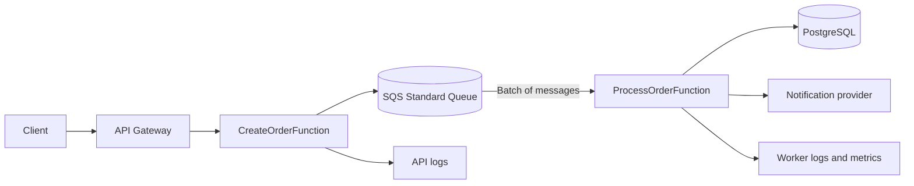
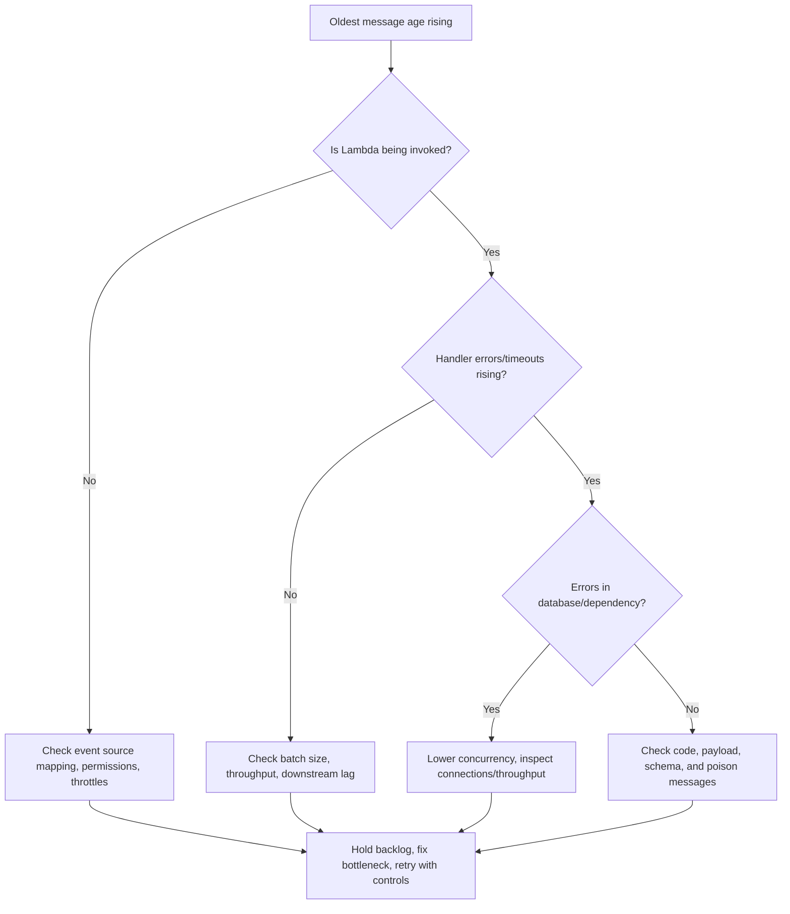

# Writing a Postmortem and Updating Runbooks from a Simulated Incident

When a serverless system suffers an incident, restoring service is only part of the work. The operations team also needs to understand what happened, why guardrails failed to prevent the impact, which signals helped detect the incident, and how runbooks must change to respond faster next time. A **postmortem** documents the events, impact, root causes, and improvement actions; a **runbook** guides on-call responders through detecting, isolating, mitigating, recovering, and verifying the system.

This lesson uses a simulated scenario of a Java Lambda reading from SQS and writing to PostgreSQL. During a traffic surge, Lambda spins up too many execution environments, and each environment's connection pool exhausts database connections. Database errors fail the batches; because partial batch response is not enabled, entire batches are redelivered. Retries and a short message visibility timeout drive rapid backlog growth. From this scenario, we practice writing a blameless postmortem and turning its findings into an actionable on-call runbook.

## 1. Postmortems and Runbooks Solve Different Problems

| Document | Core question | Audience | Expected outcome |
|---|---|---|---|
| Incident timeline | What happened and when? | Incident commander, on-call, investigators | Evidence-backed chronological timeline |
| Postmortem | What caused the impact, and what did the system learn? | Engineering, SRE, platform, product owners | Root causes, contributing factors, and action items |
| Runbook | When seeing this signal, what should I do next? | On-call and support teams | Triage, mitigation, recovery, and escalation procedures |
| Playbook | How do we coordinate a recurring class of incidents? | Operations and incident commanders | Role-based coordination steps per scenario |

A postmortem is not a report to find someone to blame. A good postmortem examines design, technical limits, observability signals, permissions, deployment processes, and operational assumptions. Likewise, a runbook should not merely copy the root cause; it must help responders recognize symptoms and take safe actions even before the root cause is known.

## 2. Simulated Scenario: Queue Backlog and Database Connection Exhaustion

### Pre-Incident Architecture

An API accepts order-creation requests. API Gateway invokes a Java Lambda `CreateOrderFunction`; the function validates input, writes a command to an SQS Standard Queue, and returns HTTP `202 Accepted`. Another Java Lambda, `ProcessOrderFunction`, is triggered in batches by an SQS event source mapping to write orders into PostgreSQL. The function sends a notification after writing succeeds.



Relevant pre-incident configuration:

| Component | Simulated configuration |
|---|---|
| Worker batch size | 10 messages |
| Batch window | 1 second |
| Lambda timeout | 15 seconds |
| SQS visibility timeout | 30 seconds |
| Worker maximum concurrency | Uncapped on the event source mapping |
| Lambda reserved concurrency | Not set on the worker |
| HikariCP max pool size | 5 connections per execution environment |
| PostgreSQL max connections | 120 |
| Partial batch response | Disabled |
| Idempotency | Unique order key for order writes; notifications lack an outbox/idempotency key |

These numbers are hypothetical for this exercise, not universal recommended defaults. Real system numbers and thresholds must come from dashboards, IaC configurations, and active service limits.

### What Happened?

During a sales campaign, order creation jumped from roughly 30 to 180 messages/second. SQS absorbed the burst so the API kept returning `202`, while the worker scaled rapidly. Around 85 execution environments ran concurrently; each environment maintained a pool of up to 5 connections, creating a theoretical demand of up to 425 connections. PostgreSQL only allowed 120 connections and also served other workloads.

Once connections ran out, some records failed to acquire a connection before timing out. The handler threw an exception, failing the invocation. Because `ReportBatchItemFailures` was not enabled on the event source mapping, one failing record forced the entire batch to be redelivered. Unprocessed messages could become visible again after 30 seconds, whereas the function timeout was 15 seconds and AWS recommends that visibility timeouts for Lambda SQS event sources include sufficient margin—typically at least six times the function timeout plus the batch window. Retries increased processing volume and connection contention.

Several orders had already been written before the invocation failed on another record. The unique order key prevented duplicate orders, but the notification step had no outbox or idempotency key, resulting in 23 duplicate notifications during the incident window.

### Business Impact

- 8.4% of orders during the incident window took more than 5 minutes to complete processing.
- Maximum delay from API acceptance to order persistence reached roughly 17 minutes.
- 23 duplicate notifications were sent; no lost or duplicate orders were found.
- The API continued returning `202` because messages were accepted into the queue; users saw a "processing" state longer than normal.
- No database corruption was observed; the team still ran reconciliation before closing the incident.

When writing a real postmortem, specify the exact time window, affected tenants/users, error rates, delayed or failed transactions, lost/duplicate data, and financial impact if any. Never treat these simulated numbers as production data.

## 3. Incident Detection and Classification

Signals observed during the incident:

- SQS `ApproximateAgeOfOldestMessage` climbed continuously.
- Visible messages and receive counts rose.
- Lambda `Errors`, `Duration`, and `ConcurrentExecutions` climbed.
- Worker logs showed pool connection acquisition errors and transaction-open timeouts.
- PostgreSQL active connections approached the limit; connection acquire latency spiked.
- The DLQ began receiving messages after exceeding `maxReceiveCount`.
- API Gateway kept returning `202` responses because ingress and worker are decoupled.

The incident was classified as **SEV-2** in this example because transactions were still accepted yet delayed significantly, some notifications duplicated, and the backlog degraded customer experience. Real severity levels must follow your organization's incident policy; never infer severity from a single technical metric alone.

### Metrics to Inspect Together

| Layer | Metrics/logs | Question to answer |
|---|---|---|
| API ingress | Request rate, 4xx/5xx, latency, accepted count | Are requests reaching the queue? |
| SQS | Visible, not visible, oldest age, receive count, DLQ depth | Is the backlog growing? Are messages being redelivered? |
| Lambda worker | Concurrent executions, throttles, errors, duration, timeouts | How high did the worker scale, and in which phase does it fail? |
| JVM/pool | Active/idle/pending connections, acquire timeouts, heap, GC | Is the worker waiting on the database or out of resources? |
| Database | Active connections, connection errors, CPU, query latency, locks | Does the database still have capacity? |
| Business | Orders accepted/completed, processing age, duplicate notifications | What is the impact on customers? |

A single metric in isolation is rarely sufficient. For instance, high Lambda concurrency may be normal during higher traffic; only combining it with pool wait, database connections, and queue age reveals the bottleneck.

## 4. Simulated Incident Timeline

Times in the table use UTC to avoid timezone confusion. In a real postmortem, standardize on UTC or explicitly state the timezone for every entry.

| Time | Event | Evidence |
|---|---|---|
| 09:00 | Campaign starts; message rate climbs rapidly | SQS incoming messages, API request rate |
| 09:04 | Worker concurrency climbs to ~85; DB nears 120 connections | Lambda concurrency, PostgreSQL connection metrics |
| 09:06 | Connection pool begins timing out; worker errors climb | Java logs, Hikari pool metrics |
| 09:08 | Batch retries increase; oldest message age exceeds 2 minutes | SQS receive counts and queue age |
| 09:10 | Queue age alarm fires; on-call declares SEV-2 | Alert event and incident channel timeline |
| 09:14 | Incident commander caps worker concurrency and trims non-essential traffic | Change record, event source mapping config |
| 09:20 | DB connections drop; worker error rate begins falling | Database and Lambda metrics |
| 09:25 | Worker stabilizes; backlog begins draining steadily | SQS visible messages, oldest age |
| 10:10 | Queue age returns to normal; incident moves to monitoring | Queue and business completion dashboards |
| 10:40 | Reconciliation confirms zero lost orders; duplicate notifications documented | Order ledger and notification provider report |

Timelines should record both when an event occurred and when the team became aware of it if those times differ. Cite the data source for each entry: alert, log, dashboard, deployment event, or responder confirmation. If uncertain, mark it as "estimated" rather than presenting guesses as fact.

## 5. Triage: Identify the Bottleneck Before Changing Configuration

When receiving a rising queue-age alert, on-call should answer in order:

1. Are producers still sending messages normally?
2. Are consumers polling and invoking?
3. Is Lambda experiencing throttling, timeouts, or handler errors?
4. Is the worker failing at parsing, database access, external API calls, or acknowledgement?
5. Do databases/HTTP dependencies still have capacity?
6. Are messages being redelivered or piling into the DLQ?
7. Are there signs of duplicate, missing data, or repeated side effects?

Do not raise concurrency immediately just because a queue backlog is growing. If the database is already overloaded, raising worker concurrency may shrink the backlog briefly while triggering a much worse database outage. Find the dependency's sustainable ceiling first.

### Quick Decision Tree



## 6. Root Cause and Contributing Factors

### Root Cause

The worker Lambda lacked a concurrency limit aligned with database capacity. Each execution environment created a connection pool of up to 5 connections; when the event source mapping scaled out during the burst, total connection demand exceeded PostgreSQL's capacity. Connection acquisition timeouts failed invocations and drove processing throughput below the incoming message rate.

### Contributing Factors

1. **No concurrency cap on the event source mapping:** Lambda scaled with backlog without a bound reflecting database capacity.
2. **Oversized per-environment connection pool:** `maxPoolSize=5` was chosen assuming an app running on a small fixed number of instances, ignoring multiplication by serverless concurrency.
3. **Partial batch response disabled:** one failing record forced already-succeeded records in the batch to retry.
4. **Too-short visibility timeout:** 30 seconds lacked adequate margin over the 15-second timeout and batch window; messages could redeliver sooner than operationally expected.
5. **Idempotency did not cover all side effects:** order writes had a unique key, but notification delivery lacked an outbox or idempotency key.
6. **Missing pool saturation alerts:** dashboards showed database connections, yet lacked combined alarms for pool pending/acquire timeouts and queue age.
7. **Runbook lacked a safe concurrency-reduction step:** on-call had to hunt for event source mapping settings mid-incident.

### 5 Whys

| Question | Answer based on the scenario |
|---|---|
| Why did order processing slow down? | The worker could not keep up with messages; the queue backlog grew. |
| Why could the worker not keep up? | Many invocations waited on database connections and timed out. |
| Why did the database run out of connections? | Lambda scaled out; each execution environment had a max pool of 5 connections with no matching concurrency cap. |
| Why did retries make it worse? | One failing record retried the entire batch; short visibility timeout and incomplete side-effect idempotency amplified load. |
| Why didn't the team shed load sooner? | Runbooks and alerts did not link queue age, Lambda concurrency, pool saturation, and DB connection capacity. |

The 5 Whys is a way to organize inquiry, not automatic proof. If investigation reveals an answer is inaccurate, update it with new data. Multiple causal branches can contribute simultaneously.

## 7. Distinguish Direct Cause, Contributing Factors, and Underlying Conditions

Never collapse everything into "Lambda scaled too fast." A postmortem should distinguish:

- **Trigger:** the campaign caused a sudden surge in message rate.
- **Direct cause:** total worker connection demand exceeded PostgreSQL capacity.
- **Amplifiers:** whole-batch retries, short visibility timeout, and lack of concurrency caps.
- **Underlying conditions:** pool size designed for fixed servers; no high-concurrency load tests; runbook missing load-shedding steps.
- **Delayed detection:** no combined alert on connection pool waits and oldest message age.
- **Secondary impact:** non-idempotent notifications duplicated when batches reran.

A trigger is not necessarily the root cause. Rising traffic was expected behavior for a campaign; the serverless system needed limits and backpressure to handle bursts within its designed capacity.

## 8. Service Recovery: Safe Action Order

During an incident, the goals are protecting data, halting further dependency overload, restoring processing, and verifying the backlog. Do not try to change everything at once.

### Phase A: Confirm and Assign Roles

- Open an incident record and set severity per policy.
- Assign an incident commander, technical lead, and timeline scribe.
- Confirm affected queues, functions, databases, and tenants.
- Establish a single operational source of truth so multiple people do not alter configs concurrently.

### Phase B: Isolate and Shed Load

- Temporarily trim producer traffic or enable API throttling/admission control if needed.
- Set a maximum concurrency limit on the SQS event source mapping aligned with verified database capacity.
- Set function reserved concurrency greater than or equal to the sum of maximum concurrencies of active event source mappings, leaving headroom for other operations.
- Reduce per-execution-environment connection pool size.
- If the database is in critical danger, pause consumers in a controlled way; messages remain in the queue within the retention window.
- Never purge the queue or delete messages just to "clear" the backlog.

### Phase C: Fix Delivery and Retry Settings

- Inspect function timeout, batch window, and SQS visibility timeout.
- Configure a sufficiently long visibility timeout; for Lambda SQS event sources, AWS generally recommends at least six times the function timeout plus the batch window.
- Enable partial batch response (`ReportBatchItemFailures`) once code returns the exact list of failed message IDs.
- Temporarily lower batch size if memory, duration, or failure isolation requires it.
- Check redrive policies and DLQs; never replay the DLQ before fixing the root cause.

### Phase D: Recover and Verify

- Monitor DB connections, pool waits, Lambda errors/throttles, and queue age.
- Raise concurrency step by step if the database still has headroom.
- Confirm processing throughput exceeds incoming message rate so the backlog genuinely shrinks.
- Inspect the DLQ, duplicate side effects, and order ledger.
- Run reconciliation to verify no lost or duplicate data.
- Transition the incident to monitoring once queue age and business metrics stabilize over an agreed window.

## 9. Recompute Concurrency and Connection Pools

A simple estimate for maximum connections from the Lambda worker:

\[
Connections_{worker} \approx Concurrency_{worker} \times PoolSize_{per\ environment}
\]

Suppose PostgreSQL allows 120 max connections. Other workloads require 25 connections; the team reserves 15 more for admin, migrations, and headroom. Remaining capacity for the worker is:

\[
120 - 25 - 15 = 80
\]

With a max pool size of 2 connections per environment, the theoretical concurrency ceiling by this formula is 40. The team chooses a maximum concurrency of 30 to leave extra margin for fluctuations, lingering connections, and failover behavior. This is initial sizing; verify with load tests and database metrics.

Example post-mitigation configuration:

| Parameter | Before | After mitigation |
|---|---:|---:|
| SQS batch size | 10 | 5 |
| Batch window | 1 second | 1 second |
| Lambda timeout | 15 seconds | 15 seconds |
| SQS visibility timeout | 30 seconds | 120 seconds |
| Event source maximum concurrency | Unset | 30 |
| Lambda reserved concurrency | Unset | 35 |
| Hikari max pool size | 5 | 2 |
| Partial batch response | Off | On |

Reserved concurrency of 35 exceeds the event source maximum concurrency of 30 so the mapping is not throttled below its configured scale ceiling and still leaves a small margin for other invocations by design. If a function has multiple event source mappings, sum the maximum concurrencies across all mappings plus any other invocations.

## 10. Java SQS Handler with Partial Batch Response

When `ReportBatchItemFailures` is enabled, the handler can report only failed records instead of failing the entire batch. Each record must be processed independently and idempotently.

```java
import com.amazonaws.services.lambda.runtime.Context;
import com.amazonaws.services.lambda.runtime.RequestHandler;
import com.amazonaws.services.lambda.runtime.events.SQSEvent;
import com.amazonaws.services.lambda.runtime.events.SQSBatchResponse;
import org.slf4j.Logger;
import org.slf4j.LoggerFactory;

import java.util.ArrayList;
import java.util.List;

public final class ProcessOrdersHandler
        implements RequestHandler<SQSEvent, SQSBatchResponse> {

    private static final Logger log =
            LoggerFactory.getLogger(ProcessOrdersHandler.class);
    private final OrderService orderService = OrderService.create();

    @Override
    public SQSBatchResponse handleRequest(SQSEvent event, Context context) {
        List<SQSBatchResponse.BatchItemFailure> failures = new ArrayList<>();

        for (SQSEvent.SQSMessage message : event.getRecords()) {
            try {
                orderService.processIdempotently(
                        message.getMessageId(), message.getBody());
            } catch (RetryableDependencyException ex) {
                log.warn("Retryable order failure; messageId={}",
                        message.getMessageId(), ex);
                failures.add(new SQSBatchResponse.BatchItemFailure(
                        message.getMessageId()));
            } catch (PermanentMessageException ex) {
                log.error("Permanent message failure; messageId={}",
                        message.getMessageId(), ex);
                failures.add(new SQSBatchResponse.BatchItemFailure(
                        message.getMessageId()));
            }
        }

        return new SQSBatchResponse(failures);
    }
}
```

This example assumes `OrderService` classifies errors and completes a record only after its side effects commit. For permanent failures, depending on policy, you may persist the record to a quarantine store and treat it as handled; if you simply return a failure, the message retries until it reaches the DLQ. Never swallow unexpected exceptions and never log raw payloads or customer data.

The event source mapping must have the corresponding response type enabled; otherwise, the `BatchItemFailure` list may not be applied as expected. With FIFO queues, preserve ordering: when one record in a message group fails, stop processing subsequent records in that group if continuing would violate business ordering.

### Idempotency for Side Effects

A unique constraint on `order_id` prevents duplicate orders, yet it does not protect an external notification API already called before an invocation retry. A stronger design:

1. Within the database transaction, write the order and an outbox record with a unique key such as `order-created:<orderId>`.
2. A publisher reads the outbox and sends the notification/event.
3. If the provider supports idempotency keys, pass the same key on every retry.
4. Persist delivery state and the provider response ID.
5. If the provider lacks idempotency support, design deduplication on the consumer or handle/reconcile duplicates per contract.

Exactly-once side effects between a database and an external HTTP API cannot be guaranteed by a local transaction alone. Outboxes and idempotent receivers make at-least-once delivery safe.

## 11. Runbook: Rising Queue Age and Worker Errors

The runbook below is an operational procedure ready to be adapted into internal systems. Resource names and thresholds must be replaced with real environment values.

### Runbook Metadata

| Attribute | Sample value |
|---|---|
| Name | SQS worker backlog / database connection exhaustion |
| Service | Orders API |
| Trigger | Oldest message age breaches SLO or worker errors climb |
| Severity | Per incident policy; e.g., SEV-2 when transactions are significantly delayed |
| Primary owner | Orders on-call |
| Secondary owner | Database/platform on-call |
| Dependencies | API Gateway, producer Lambda, SQS, worker Lambda, PostgreSQL, notification provider |
| Dashboards | API health, SQS queue, Lambda worker, DB connections/pool |
| Escalation | Incident commander → platform/database owner → service owner |

### Activation Conditions

Activate this runbook when one or more conditions occur:

- `ApproximateAgeOfOldestMessage` breaches SLO across multiple consecutive periods.
- Queue visible messages rise steadily while completion rate lags behind ingress rate.
- Worker errors/timeouts rise alongside database connection saturation.
- DLQ depth grows abnormally.
- Business processing age or `PENDING` order count exceeds thresholds.

Do not activate solely because queue depth ticks up during a brief burst if oldest age stays low and consumers are keeping up. Combine age, rates, and business impact.

### Step 1 — Confirm Scope

1. Record alert timestamp and take a dashboard snapshot.
2. Identify the queue URL, function name, event source mapping UUID, database cluster, and region.
3. Check whether producers are still actively sending messages.
4. Check queue visible/in-flight/DLQ counts and oldest message age.
5. Identify any tenant, route, or campaign generating abnormal traffic.

Example AWS CLI command to inspect queue state:

```bash
aws sqs get-queue-attributes \
  --queue-url "$QUEUE_URL" \
  --attribute-names All
```

This command returns attributes such as visibility timeout, redrive policy, and approximate message counts. Count attributes are eventual/approximate; use CloudWatch metrics for trends rather than treating a single read as exact.

### Step 2 — Check Event Source Mapping and Function

```bash
aws lambda get-event-source-mapping --uuid "$ESM_UUID"

aws lambda get-function-concurrency \
  --function-name "$FUNCTION_NAME"
```

Cross-check:

- Is the mapping `Enabled`?
- What are the batch size and maximum batching window?
- Does the function have reserved concurrency?
- Does the event source mapping have maximum concurrency?
- Is partial batch response enabled?
- Are Lambda throttles, timeouts, or durations rising?

Do not adjust concurrency before checking database connection capacity. Record current settings so you can roll back or explain changes.

### Step 3 — Check the Database

- Compare active connections against max connections.
- Inspect connection pool active/idle/pending counts and acquire timeouts.
- Check query latency, lock waits, CPU, memory, and database throttling.
- Identify other workloads using connections.
- Check for connection leaks or overly long transactions.

If the DB is nearly out of connections, prioritize lowering worker concurrency and pool size. Do not raise connection limits immediately if the database instance lacks CPU/memory or service quotas prohibit it.

### Step 4 — Isolate and Shed Load

- Trim non-essential producer traffic or apply API throttling per the incident commander.
- Set event source maximum concurrency to a level the database can sustain.
- Set Lambda reserved concurrency to align with total event source maximum concurrency.
- Pause the event source mapping if the database risks instability; confirm queue retention is long enough to hold the backlog.
- Never delete/purge messages or replay the DLQ before understanding the failure.

Example updating SQS event source mapping maximum concurrency:

```bash
aws lambda update-event-source-mapping \
  --uuid "$ESM_UUID" \
  --scaling-config '{"MaximumConcurrency":30}'
```

Example setting reserved concurrency:

```bash
aws lambda put-function-concurrency \
  --function-name "$FUNCTION_NAME" \
  --reserved-concurrent-executions 35
```

The numbers 30 and 35 belong only to the simulated scenario. Pick real values based on connection budgets, mapping counts, and other workloads. For production changes, use an approved role and record change/incident logs.

### Step 5 — Check Timeout and Retry Configuration

Example raising visibility timeout to 120 seconds for a 15-second function timeout and 1-second batch window:

```bash
aws sqs set-queue-attributes \
  --queue-url "$QUEUE_URL" \
  --attributes VisibilityTimeout=120
```

Before applying, check whether the queue is shared with other consumers. Visibility timeout is a queue-level attribute; changing it affects every consumer. If multiple consumers share the queue, align with their owners.

Also verify:

- Does batch size fit memory and processing time budgets?
- Is `ReportBatchItemFailures` enabled on the event source mapping?
- Are `maxReceiveCount` and the DLQ configured appropriately?
- Does the consumer enforce idempotency for database and external side effects?
- Are retries generating repeat load faster than recovery speed?

### Step 6 — Controlled Recovery

1. Confirm database connections and pool waits have dropped.
2. Re-enable the event source mapping if it was paused.
3. Raise maximum concurrency in small steps, monitoring DB and queue age after each step.
4. Confirm completion rate exceeds ingress rate long enough to drain the backlog.
5. Watch the DLQ and messages with high receive counts.
6. Replay the DLQ only after fixing the root cause and confirming replay is safe/idempotent.

### Step 7 — Verify Business Outcomes and Close Incident

- Queue oldest age returns below threshold for the agreed stabilization period.
- Visible/in-flight messages drain as expected; DLQ stops growing.
- Worker errors, throttles, and database connection waits stabilize.
- Accepted order count reconciles with completed, failed, or validly pending orders.
- Duplicate notifications are identified and handled per policy.
- Reconciliation shows zero lost or corrupted business data.
- Incident commander announces transition to monitoring/resolved and records timestamps.

## 12. Reusable Postmortem Template

Copy the template below for each incident. Unknown fields must be marked `TBD` with an assigned owner to verify; never fill in guesses.

```markdown
# Postmortem: <incident name>

## Metadata
- Incident ID:
- Service / environment / region:
- Severity:
- Start / end time (UTC):
- Incident commander:
- Authors / reviewers:
- Status: Draft / Reviewed / Closed

## Executive summary
One-paragraph summary: what happened, primary impact, and current status.

## Customer and business impact
- Affected users/tenants:
- Failed or delayed requests/transactions:
- Lost/duplicate/corrupted data:
- Duration of impact:

## Detection
- First alert or report:
- Time to detect:
- Signals available:
- Signals missing:

## Timeline (UTC)
| Time | Event | Evidence / source |
|---|---|---|

## Technical explanation
- Architecture and request/event flow:
- Trigger:
- Root cause:
- Contributing factors:
- Why guardrails failed to prevent impact:

## Response and recovery
- Mitigations applied:
- What worked well:
- What slowed recovery:
- How data and service were verified:

## What went well
- ...

## What was difficult / unclear
- ...

## Action items
| Action | Owner | Priority | Due date | Success measure | Status |
|---|---|---|---|---|---|

## Runbook / dashboard changes
- Runbook section updated:
- New or changed alerts:
- Validation / game day:

## Review notes
- Open questions:
- Follow-up review date:
```

## 13. Completed Postmortem for the Simulated Incident

### Executive Summary

Between 09:04 and 10:10 UTC, the Java Lambda order worker processing SQS messages could not keep up with a sudden traffic spike. Lambda scale-out pushed total connection pool demand beyond PostgreSQL's limit; connection acquire timeouts caused worker failures. Because partial batch response was disabled, a single failing record retried the entire batch. Queue age climbed, some orders finished late, and 23 duplicate notifications were sent. No lost or duplicate orders occurred. The team capped worker concurrency, shrank pool sizes, adjusted visibility timeout, recovered the consumer in steps, and ran reconciliation.

### Impact

- 8.4% of orders in the impact window took longer than 5 minutes to complete.
- Maximum latency reached approximately 17 minutes.
- 23 duplicate notifications.
- Zero lost or duplicate orders confirmed after reconciliation.
- API ingress continued accepting most requests; impact centered on asynchronous processing time.

### Root Cause

The worker Lambda lacked concurrency bounds matched to database capacity. Each execution environment configured a Hikari pool up to 5 connections; concurrency around 85 created theoretical demand for 425 connections, far exceeding PostgreSQL's `max_connections` of 120. Connection exhaustion caused record processing failures and backlog growth.

### Contributing Factors

- No event source maximum concurrency configured.
- Partial batch response disabled.
- 30-second visibility timeout too short relative to 15-second function timeout and 1-second batch window.
- Notifications lacked an outbox/idempotency key.
- Missing alerts on pool pending/acquire timeouts and missing concurrency-reduction runbook steps.

### What Went Well

- SQS retained messages, allowing the team to shed load and drain the backlog once the database stabilized.
- The API returned `202` only after the queue accepted the message.
- The unique order key prevented duplicate orders on message redelivery.
- The queue age alert notified on-call before retention expired.

### What Was Difficult

- Dashboards did not place Lambda concurrency beside database connections and pool waits.
- The runbook omitted event source mapping maximum concurrency instructions.
- Notification side effects lacked idempotency, causing duplicates.
- Visibility timeout was not reviewed when function timeout/batch settings changed.

### Action Items

| Action | Owner role | Priority | Success measure |
|---|---|---|---|
| Set event source maximum concurrency to 30 and reserved concurrency to 35 per capacity tests | Platform | P0 | Load test at 2× forecast stays within DB connection budget |
| Lower Hikari max pool size from 5 to 2; add pool wait/acquire timeout metrics | Service team | P0 | Peak worker connections stay within budget; zero pool exhaustion in soak tests |
| Enable partial batch response and add record-level retry tests | Service team | P0 | One failing record never retries succeeded records |
| Tune visibility timeout and add synchronized timeout/batch-window checks | Platform | P0 | Messages never redeliver during valid invocations |
| Add an outbox/idempotency key for notifications | Service team | P1 | Replaying the same event never sends a second notification |
| Alert on queue age, DLQ depth, DB connections, and pool waits | SRE | P1 | Test alerts trigger within target detection windows |
| Update runbooks and run a retry/backlog game day | SRE + Platform | P1 | On-call completes tabletop and game day per checklist |
| Add burst load tests with DB connection caps | QA/Performance | P1 | p95, throughput, connections, and backlog reports archived in CI |

Each action item needs an assigned owner role/person, due date, priority, and verification criteria. "Improve monitoring" or "optimize database" are too vague to close. Mark an item done only with concrete evidence such as a test report, dashboard, pull request, or runbook revision.

## 14. Updating Runbooks from Postmortem Lessons

A postmortem must drive concrete runbook updates. In this example, the following sections were updated:

| Runbook section | Before incident | Updated after incident |
|---|---|---|
| Trigger | Lambda errors alert | Combine oldest message age, completion rate, DLQ, and business processing age |
| Triage | Check Lambda logs | Add ordered checks: SQS → event source mapping → Lambda concurrency → pool → DB |
| Mitigation | Pause function on errors | Prioritize lowering event source max concurrency per DB budget; controlled pause if needed |
| Retry | Check DLQ | Verify partial batch response, visibility timeout, receive count, and idempotency before replay |
| Database | Check CPU and connections | Add pool pending/acquire timeouts, active connections, and lock/query latency |
| Recovery | Watch Lambda errors drop | Add backlog drain rate, oldest age, order reconciliation, and duplicate notification checks |
| Escalation | Page platform on function errors | Page database owner when connections/pool wait breach thresholds; incident commander coordinates changes |

### Runbook Update Principles

- Write actions with clear verbs: "inspect", "compare", "reduce", "verify".
- Include exact metric names, dashboards, log queries, and resource identifiers to look up.
- Mark which steps are read-only versus which modify production.
- For mutating actions, document preconditions, capacity-based values, and rollback steps.
- Never put credentials, tokens, or secrets inside runbooks.
- Include an owner and review date; verify links and commands after every architecture change.
- Define clear criteria for "recovered" and "safe to close incident."

## 15. Alerts and Dashboards to Add

A strong operational dashboard for an SQS–Lambda–database pipeline should align panels on a shared timeline:

1. Producer incoming rate and SQS messages sent.
2. SQS visible/in-flight messages and oldest message age.
3. Lambda concurrent executions, invocations, errors, throttles, and duration.
4. Event source mapping maximum concurrency and enabled/disabled state.
5. Database active/max connections, CPU, query latency, and connection errors.
6. Hikari active/idle/pending connections and acquisition timeouts.
7. Orders accepted/completed/failed and duplicate notification counts.
8. DLQ depth and message receive-count distribution.

Example alerts defined by logic:

| Alert | Suggested condition | Response |
|---|---|---|
| Queue age high | Oldest message age breaches SLO over multiple periods | Trigger queue backlog runbook |
| Consumer falling behind | Ingress rate persistently exceeds completion rate | Check concurrency and downstream capacity |
| DB connection saturation | Active connections near budget or pool pending climbs | Lower consumer concurrency, page DB owner |
| Worker retry storm | Errors + receive counts rise simultaneously | Check partial batch, visibility timeout, and dependencies |
| DLQ growth | New DLQ messages exceed threshold | Classify poison/permanent/transient before replay |
| Business processing delay | P95 accepted-to-completed breaches SLO | Assess user impact and incident severity |

Never base alarms on a single brief data point. Configure duration, evaluation periods, missing-data behavior, and service criticality appropriately. Every alarm must link to a runbook and name an owner.

## 16. Game Day: Rehearse Before Production Sees It Again

After fixing, rehearse in staging or an isolated environment. The goal is validating guardrails and runbooks, not causing a production outage.

### Game Day Scenario

1. Inject a controlled traffic burst into the queue.
2. Simulate reduced database capacity or slow down dependencies via fault injection.
3. Observe pool waits, worker errors, and queue age.
4. Confirm event source maximum concurrency caps load.
5. Send one malformed record in a batch and verify partial batch response retries only that record.
6. Kill a worker mid-processing to verify idempotency/outbox behavior.
7. Restore database capacity and watch the backlog drain.
8. Check DLQ, duplicate side effects, and reconciliation.
9. Have a different on-call engineer execute the runbook without help from the author.
10. Record time to detect, time to mitigate, and time to recover.

### Success Criteria

- Database stays within its allocated connection budget.
- Queue age does not breach SLO past allowed bounds, or mitigation triggers on time.
- Partial batch response never retries succeeded records.
- Duplicate deliveries never produce duplicate business side effects.
- DLQ is handled per procedure with no blind replays.
- Responders identify the right owners/escalation paths and complete steps safely.
- Dashboards/alerts surface enough signals to explain system behavior.

## 17. Write Postmortems Blamelessly

Postmortem wording shapes how an organization learns from incidents. Avoid phrases like "on-call forgot to set concurrency" or "a developer misconfigured the pool." Such statements point at individuals without explaining why the system allowed a risky configuration without guardrails.

Replace them with questions about systemic conditions:

- Why did the template default to uncapped concurrency?
- Did code reviews surface the impact of pool size multiplied by Lambda concurrency?
- Did load tests simulate bursts and database connection caps?
- Did alerts display worker scale and DB saturation on the same dashboard?
- Did runbooks provide load-shedding guidance and authorization?
- Did the deployment pipeline enforce policy checks on visibility timeout and partial batch response?

Blameless does not mean avoiding accountability or skipping action. It means focusing on improving working conditions, design, tooling, and processes so a single mistake cannot easily turn into a major outage.

### Distinguish Fact, Hypothesis, and Unknown

In postmortems, label statements explicitly:

- **Fact:** backed by logs, metrics, or configs.
- **Hypothesis:** plausible explanation lacking complete proof.
- **Unknown:** missing data or non-reproducible.

For example, "Lambda concurrency reached 85" is a fact if metrics confirm it. "Retries added 40% more DB connections" is only a hypothesis without time-series attempt/connection data. Create an action item to measure it next time rather than presenting hypotheses as conclusions.

## 18. Postmortem Review and Publishing Process

1. Assemble the timeline from logs, metrics, deployment events, and incident notes.
2. Verify customer impact using business data, not infrastructure metrics alone.
3. Write a concise executive summary without drawing conclusions beyond the evidence.
4. Separate root cause, contributing factors, detection gaps, and recovery gaps.
5. Review with service owners, platform, database, and SRE teams.
6. Convert findings into action items with owners, due dates, and success measures.
7. Update runbooks, dashboards, and alerts in the same follow-up cycle.
8. Run a tabletop or game day to confirm runbooks are executable.
9. Track action items until completion evidence is provided.
10. Archive the postmortem by incident ID per organizational retention policies.

Do not wait until every single question is answered before publishing a first draft. Publish an initial draft with `TBD` items, then update as new evidence arrives; record revisions and editors clearly.

## 19. Postmortem and Runbook Checklist

### Postmortem

- [ ] Includes incident ID, severity, service, region, and UTC timestamps.
- [ ] Impact clearly describes users, transactions, data, and duration.
- [ ] Timeline cites evidence sources for every milestone.
- [ ] Root cause is separated from triggers and contributing factors.
- [ ] Facts, hypotheses, and unknowns are clearly distinguished.
- [ ] Analyzes retries, duplicates, idempotency, and side effects.
- [ ] Covers what went well and what was difficult.
- [ ] Action items have owners, priorities, due dates, and success measures.
- [ ] Uses blameless language focused on systemic conditions.

### Runbook

- [ ] Trigger/alert and severity are described.
- [ ] Dashboards, log queries, metrics, and resource IDs are easy to find.
- [ ] Includes an ordered triage flow to pinpoint bottlenecks.
- [ ] Read-only steps are distinguished from production-mutating steps.
- [ ] Includes preconditions for load shedding, pause/resume, and rollback.
- [ ] Covers queues, visibility timeouts, batch failures, and DLQs.
- [ ] Covers database connection/pool checks and downstream capacity.
- [ ] Includes business data verification and reconciliation steps.
- [ ] Lists escalation contacts, owners, and document review dates.

### Rehearsal and Follow-Up

- [ ] Game day simulated bursts, dependency failures, and retries.
- [ ] Partial batch response and idempotency were verified.
- [ ] Alerts detected queue age and pool saturation in time.
- [ ] Another on-call responder can execute the runbook independently.
- [ ] Action items are tracked until completion evidence exists.

Postmortems help organizations understand incidents through evidence and improve systems; runbooks turn those lessons into clear actions for the next on-call responder. In Java serverless, inspect the entire chain across API, queue, Lambda concurrency, connection pools, and database rather than looking only at function errors. By capping concurrency to downstream capacity, handling partial batches, designing idempotent side effects, alerting on queue age, and maintaining tested runbooks, teams cut both recurrence likelihood and recovery time.
