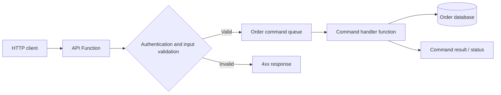
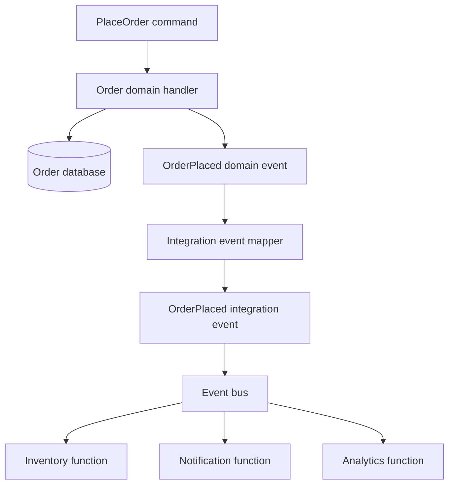
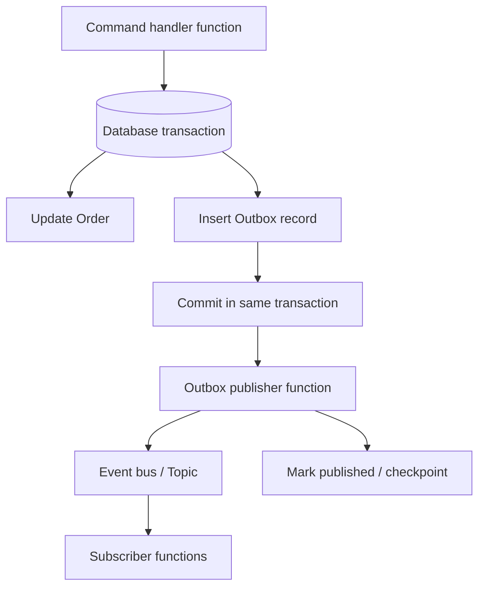

# Distinguishing Command, Domain Event, and Integration Event

In a serverless application, a Java function can be invoked by an HTTP request, a message in a queue, or an event from an event bus. These inputs can all be represented as JSON, yet they do not carry the same meaning. Some inputs request that the system perform an action; others notify that something has happened. Mixing these two meanings causes functions to become tightly coupled, execute duplicate work, or misinterpret the responsibilities of sender and receiver.

Three concepts need to be distinguished: **command**, **domain event**, and **integration event**. A command expresses what a sender wants a component to do. A domain event records a meaningful fact within the domain model of a bounded context. An integration event publishes a fact that has occurred so other systems or bounded contexts can react. Distinguishing these three types helps select the right trigger, design the data contract, and determine appropriate error handling.

## 1. Look at Semantics Before Format

A message does not automatically become an event simply because it is sent over a queue or has a `type` field. Ask what the sender intends:

- If the sender asks a receiver to perform an action, it is a command.
- If the content asserts that something has happened in the domain, it is an event.
- If that fact is published across system or bounded context boundaries, it is an integration event.

| Characteristic | Command | Domain Event | Integration Event |
| --- | --- | --- | --- |
| Meaning | Request to perform an action | Business fact that has occurred | Fact published for other systems |
| Naming convention | Imperative, usually verb + noun | Fact that happened, usually past tense | Fact that happened, clear name in a public contract |
| Examples | `PlaceOrder`, `CancelOrder` | `OrderPlaced`, `OrderCancelled` | `OrderPlacedV1`, `OrderCancelledV1` |
| Receiver | A designated handler or processing group | Components within the same domain model | One or more subscribers in other systems |
| Outcome | Succeeded, rejected, or failed processing | Recorded when a valid domain change occurs | Subscribers independently decide how to react |
| Relationship to sender | Sender wants the action carried out | Event emitter confirms the fact | Producer publishes the fact without controlling individual subscribers |

Naming and payload structure are design conventions; semantics remain decisive. A JSON message named `OrderPlaced` that actually carries the intent "please create an order" is misnamed: it is a command and should be renamed to `PlaceOrder` or an equivalent imperative name.

## 2. Command: Requesting an Action

A command describes the sender's intent. The sender typically knows which component is responsible for handling the command and expects an observable outcome: accepted, rejected due to business rules, or failed due to technical errors.

Example in an order system:

```text
PlaceOrder
  customerId: C-1042
  items:
    - productId: P-18
      quantity: 2
  idempotencyKey: checkout-7f2a
```

This command means "attempt to create an order for the customer with the above items." It does not assert that the order has been created yet. The handler may reject it if products are out of stock, inputs are invalid, or the customer is ineligible.

Key design characteristics:

- **Targeted handler:** a command is usually sent to a specific responsible handler, such as `OrderService` or a queue dedicated to `OrderCommandHandler`.
- **Expresses intent:** uses clear verbs like `PlaceOrder`, `ReserveInventory`, or `CancelPayment`.
- **Can be rejected:** business rules may prevent the command from executing. Never emit a success event before the action is actually confirmed.
- **May require a response:** an HTTP caller may receive the result immediately; asynchronous processing may return `202 Accepted` with a job ID or correlation ID to poll status.
- **Requires duplicate control:** the same command can be resent due to client retries, timeouts, or message redelivery. Use an idempotency key and persist the processing result.

A command does not have to be an HTTP request. It can travel via a queue for asynchronous processing. Conversely, not every HTTP request is a command: a request that only reads data is a query. Distinguish commands from queries by whether they request a state change.

### Commands in a Serverless Flow

An API function can authenticate the request, check permissions, normalize data, and push a command onto a queue. A worker function receives the command, validates business rules, and applies changes in the database. If processing takes time, the API can return a job ID for the caller to query instead of keeping the HTTP connection open.



In this flow, the queue holds requests waiting to be processed. The worker is responsible for completing or rejecting the command and recording status. If the message is redelivered, the worker must recognize that the command was already processed using the idempotency key.

## 3. Domain Event: A Fact Within a Business Domain

A domain event is a record of something business-significant that has occurred within a bounded context. Event names should express facts in the past tense, such as `OrderPlaced`, `InventoryReserved`, or `PaymentCaptured`.

For example, after the `PlaceOrder` command is accepted, the order model can raise the `OrderPlaced` domain event. That event is not a request to create an order; it confirms that the order has been created according to the order domain's rules.

Domain events typically serve the following roles:

- Record a confirmed business change.
- Trigger subsequent steps within the same bounded context.
- Decouple internal components from calling each other directly.
- Provide information to update projections or maintain consistency rules.

A domain event typically belongs to the internal language and model of the bounded context that raises it. For instance, `OrderPlaced` may carry `OrderId`, `CustomerId`, line items, and internal state needed by the domain model. Never assume that internal payload is automatically an appropriate contract to publish to all external systems.

A domain event should only be emitted after the business event has genuinely occurred. If a command is rejected due to insufficient inventory, the system must not emit `OrderPlaced`. It may emit another event such as `OrderPlacementRejected` if that rejection is a business fact worth recording; whether to emit it depends on modeling and audit needs.

### Domain Events Are Not Statements of Intent

Compare these two names:

```text
ReserveInventory  -> command: request to reserve inventory
InventoryReserved -> event: inventory has been successfully reserved
```

If a consumer receives `InventoryReserved`, it may update order status or prepare the next step. The consumer should not interpret this message as a request to attempt reserving inventory again.

A domain event may be handled in-process or dispatched via an internal mechanism. Whether implemented with an in-memory event dispatcher or a message broker, its semantics remain a fact that occurred within the domain.

## 4. Integration Event: Publishing Facts Across System Boundaries

An integration event is a contract published by one service so other services can react to a fact that has occurred. It is typically published via a message broker, event bus, stream, or webhook. The producer does not need to know everything subscribers do; subscribers register for the event types they care about.

For example, after an order is successfully created, the Order system can publish `OrderPlaced` to other systems. Inventory can reserve stock, Notification can send an email, Analytics can update metrics, and Shipping can prepare fulfillment. The producer simply announces the fact "an order was placed"; it does not command each system to run a specific algorithm.

An integration event must be designed like a public API:

- **Stable:** structural changes must account for independently deployed consumers.
- **Versioned or compatibility-governed:** older consumers can continue reading events when the producer upgrades.
- **Sufficient data to react:** the payload includes necessary identifiers and data without broadcasting the entire internal model.
- **Identifiable and traceable:** consumers can trace, deduplicate, and reconcile events.
- **Free of excess sensitive data:** publish only information necessary for integration purposes.

An integration event can be produced by mapping a domain event to a public schema. This mapping lets the domain model evolve without forcing every consumer to change alongside it.



For example, an internal domain event may contain detailed data serving Order logic, whereas the integration event publishes only `orderId`, `customerId`, total amount, currency, and creation timestamp. Inventory does not need email addresses, phone numbers, or internal notes if they do not serve its responsibilities.

## 5. Data Contract Examples for the Three Types

Suppose a customer places an order. Three messages may look structurally similar yet differ in semantics.

### Command

```json
{
  "commandId": "cmd-8c1f",
  "commandType": "PlaceOrder",
  "idempotencyKey": "checkout-7f2a",
  "customerId": "C-1042",
  "items": [
    { "productId": "P-18", "quantity": 2 }
  ]
}
```

This message instructs the Order service to create an order. `commandId` identifies the request; `idempotencyKey` identifies retries of the same intent. The handler validates inputs, permissions, and business rules before changing state.

### Domain Event

```json
{
  "eventType": "OrderPlaced",
  "orderId": "O-9021",
  "customerId": "C-1042",
  "items": [
    { "productId": "P-18", "quantity": 2, "unitPrice": 125000 }
  ],
  "aggregateVersion": 7
}
```

This event states that order O-9021 was created in the Order domain. `aggregateVersion` can help determine the order of aggregate mutations if the storage model and consumers use that information.

### Integration Event

```json
{
  "specversion": "1.0",
  "id": "evt-4e29",
  "source": "/services/orders",
  "type": "com.example.orders.order-placed.v1",
  "subject": "orders/O-9021",
  "time": "2026-11-17T12:30:00Z",
  "datacontenttype": "application/json",
  "data": {
    "orderId": "O-9021",
    "customerId": "C-1042",
    "total": 250000,
    "currency": "VND"
  }
}
```

This example uses a CloudEvents-style envelope to illustrate common metadata. `id` identifies the event, `source` identifies the emitter, `type` describes the event type, and `subject` identifies the related entity. `data` contains the curated integration payload. Systems can use CloudEvents or another internal envelope, provided the contract is well defined and consumers interpret it identically.

Do not mechanically copy a command's `idempotencyKey` into an integration event. Command ID, event ID, correlation ID, and causation ID serve distinct purposes. Keep them separate and link them when tracing is needed.

## 6. Designing the Contract: Envelope, Schema, and Versioning

An integration event should separate common metadata from business data. The envelope enables platform routing, observability, and deduplication; the `data` payload describes the specific fact.

Commonly useful fields include:

| Field | Purpose |
| --- | --- |
| `id` | Unique event identifier for tracing and deduplication |
| `source` | Component or service emitting the event |
| `type` | Event type name, optionally including contract version |
| `time` | Timestamp when the event was created per published convention |
| `subject` | Identifier of the related business entity |
| `correlationId` | Links steps belonging to the same processing flow |
| `causationId` | Indicates the command or event that caused the current event |
| `data` | Business payload conforming to a defined schema |
| `schemaVersion` | Schema version if the version is not encoded in `type` |

Not every field above is mandatory. Choose a consistent convention and document required fields, data types, timestamp semantics, currency units, timezones, and nullability rules.

### Compatibility Principles

Consumers and producers are often deployed at different times. Therefore, contracts should support compatible upgrades:

- Adding optional fields with sensible defaults is usually safer than adding required fields.
- Consumers should ignore unknown fields if the contract allows extensibility.
- Never rename or change the type of an actively used field.
- Never reuse an old enum value with a new meaning.
- Do not remove a field immediately when the producer stops sending it; allow a deprecation window and confirm consumers have migrated.
- For incompatible changes, release a new event version or schema version with a clear migration plan.

For example, adding an optional `salesChannel` field can be compatible if older consumers ignore unknown fields. Changing `total` from an integer in dong to a decimal string breaks consumer parsing and requires a new contract or a new field with explicitly defined units.

For monetary amounts, do not simply write `amount`: define whether it is minor or major units, its numeric type, rounding rules, and currency code. For timestamps, clarify whether the timestamp represents when the business event occurred or when the message was published; use an explicit timezone format, typically UTC.

## 7. Mapping a Domain Event to an Integration Event in Java

The Java example below demonstrates keeping domain events and integration events as separate data types. The records show only the structure; persistence, publishing, and error handling must be implemented using the application's storage and broker technologies.

```java
import java.time.Instant;
import java.util.List;

public final class OrderEventMapper {
    // Internal type within the Order bounded context.
    public record OrderPlaced(
            String orderId,
            String customerId,
            List<OrderLine> lines,
            long aggregateVersion,
            Instant occurredAt
    ) {}

    public record OrderLine(
            String productId,
            int quantity,
            long unitPriceMinor
    ) {}

    // Published contract for external services.
    public record OrderPlacedV1(
            String orderId,
            String customerId,
            long totalMinor,
            String currency,
            Instant occurredAt
    ) {}

    public OrderPlacedV1 toIntegrationEvent(OrderPlaced event) {
        long total = event.lines().stream()
                .mapToLong(line -> Math.multiplyExact(
                        line.unitPriceMinor(), line.quantity()))
                .reduce(0L, Math::addExact);

        return new OrderPlacedV1(
                event.orderId(),
                event.customerId(),
                total,
                "VND",
                event.occurredAt()
        );
    }
}
```

In this example, `OrderPlaced` keeps line items and aggregate version for internal use. `OrderPlacedV1` publishes only the data consumers need. The currency code should come from the order context or real domain configuration; the example uses `VND` for illustration and should not be hardcoded in a multi-currency system.

A handler can create a domain event after a business change is confirmed, then map it to an integration event. However, avoid simply saving the order and publishing directly as two independent operations without safeguards. If the process crashes after committing the database transaction but before publishing, the system loses the integration notification.

## 8. Ensuring Reliable Event Publishing: Transactional Outbox

When updating state in a database and sending a message via a broker, the two operations usually cannot share a single distributed transaction. Two failure modes can arise:

- The database commit succeeds, but the function times out or crashes before publishing the event.
- The event is published, but the database transaction rolls back or a subsequent run fails to confirm the outcome.

The transactional outbox pattern closes this gap by writing the business change and an outbox record in the same database transaction. A publisher function or relay process reads the outbox and sends events to the broker. After sending, it marks the record as published according to system rules.



The publisher may resend the same outbox record if a timeout occurs after the broker receives the message but before the publisher marks it sent. Therefore, a transactional outbox typically provides at-least-once publishing and does not by itself guarantee consumers receive each event only once. Consumers still need idempotency based on event ID or business keys.

A consumer can use an inbox table or processed-events table to record processed event IDs in the same transaction as the business update. When an event is redelivered, the consumer sees the ID already exists and avoids repeating side effects. Recording the marker and updating the business data must be atomic to avoid marking an event processed without updating data, or updating data without marking it processed.

## 9. Idempotency, Ordering, and Eventual Consistency

In serverless architectures, brokers or event sources can often deliver a message multiple times. A function may time out after writing data but before acknowledging; the event source does not know processing completed and resends it. Therefore, consumers must design for at-least-once delivery and prepare for duplicates.

Principles to apply:

1. Keep the event ID stable across redeliveries; do not generate a new ID for the same event on each retry.
2. Persist the processed-event marker alongside business changes in a single transaction whenever possible.
3. Design operations to be idempotent, such as conditional state updates or upserts by unique key.
4. Do not assume events arrive in order if the broker, partitioning, or subscription configuration does not guarantee that order.
5. If order matters, use a partition key by aggregate ID, sequence/version numbers, or state checks before applying events.
6. Handle stale, late-arriving, and missing events using version-gap detection, bounded retries, or reconciliation against the authoritative data source.

Integration events naturally introduce eventual consistency: after Order publishes `OrderPlaced`, Inventory and Shipping may update at different times. During the transition window, read models may not yet reflect the latest state. APIs and user interfaces should represent in-progress states where business requirements dictate, rather than assuming all services update simultaneously.

Do not use an event bus to replace every synchronous call. If a user needs to know immediately whether a command was rejected due to business rules, the command handler should return the outcome or provide a queryable processing status. Events are well suited for announcing facts and triggering independent reactions.

## 10. Choosing Between Command and Event in Function Design

Some common scenarios:

| Scenario | What to Use | Reason |
| --- | --- | --- |
| Client requests creating an order | `PlaceOrder` command via HTTP or queue | Carries intent to mutate state and requires a processing outcome |
| Order has been created successfully | `OrderPlaced` domain event | Records a fact within the Order domain |
| Inventory, Notification, and Analytics need to react to a new order | `OrderPlaced` integration event | Multiple independent subscribers care about the same fact |
| User requests canceling an order | `CancelOrder` command | Handler must verify whether cancellation is permitted |
| Order cancellation has completed | `OrderCancelled` event | Announces that state has changed |
| Service needs to read current order details | Query or HTTP GET | Reads data; neither a command nor an event |

When a command succeeds, the handler may raise a domain event. From the domain event, the application can produce an integration event for other services. This flow separates intent, domain facts, and integration contracts into steps with distinct responsibilities.

## 11. Security and Access Control for Event Contracts

Event buses and queues are trust boundaries. Whether a function can send or receive a message must be restricted using IAM or an equivalent authorization mechanism:

- Producers may publish only to the specific topics, buses, or queues they require.
- Consumers may read only from their assigned subscriptions or queues.
- Never place access tokens, passwords, secrets, or sensitive payment details in event payloads.
- Publish personal data only when there is a clear business purpose and explicit authorization; consider tokenization or ID references so consumers fetch data under their own permissions.
- Authenticate event origins on webhooks or public integration channels; verify signatures, identity, and replay protection where protocols require.
- Encrypt data in transit and at rest; configure appropriate log retention and access controls.
- Validate schemas and payload sizes before processing; never trust data solely because it came from an internal broker.

The contract is also a security boundary: any field published becomes data that multiple downstream systems may store and replicate. Design minimal payloads from the start.

## 12. Pre-Publication Message Contract Checklist

- [ ] Is the message a command, domain event, or integration event? Does its name reflect its semantics?
- [ ] Does a command have a clear target handler, expected outcome, and idempotency rules?
- [ ] Are events emitted only after the business fact has actually occurred?
- [ ] Have internal domain events been mapped to an appropriate integration payload?
- [ ] Does the envelope include required ID, source, type, timestamp, and correlation/causation metadata?
- [ ] Does the schema specify types, units, nullability, required fields, and version?
- [ ] Can older consumers continue processing when producers add fields?
- [ ] Are policies in place for retries, duplicates, ordering, DLQs, and poison messages?
- [ ] Do producers and consumers follow least-privilege permissions?
- [ ] Does the payload avoid secrets and unnecessary personal data?
- [ ] Are traces, metrics, and reconciliation procedures in place for delayed or lost events?

In serverless applications, commands route requests to the component responsible for executing them; domain events record what occurred inside the business model; and integration events publish those facts across service boundaries via a stable contract. When these three concepts are cleanly separated, Java functions can coordinate across HTTP, queues, and event buses with looser direct coupling, safer retries, and independent service evolution.
