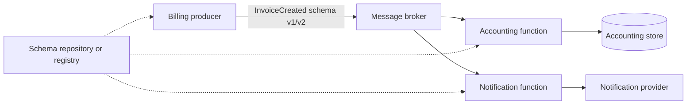

# Schema Versioning and Producer–Consumer Compatibility

In an event-driven serverless system, producers and consumers are typically deployed independently. A producer emits a message to a broker or event bus; one or more Java functions receive it at different times, potentially running different code versions and even replaying historical data. As a result, changing an event's structure can impact multiple services that the development team does not directly see.

A **schema** describes the structure and data types of a message. A **data contract** describes more broadly how parties exchange data: field semantics, validation rules, versioning, ownership, delivery semantics, and compatibility commitments. Managing schemas and data contracts well enables producers to evolve without breaking existing consumers.

Within the scope of **CLOUD_SERVERLESS**, this lesson focuses on events emitted by applications and handled by Java functions via message or event triggers. Developers need to know how to design schemas, increment versions, check compatibility, roll out changes in phases, and handle invalid events in a distributed environment.

## 1. Producer, Consumer, Schema, and Data Contract

An event flow involves at least two roles:

- **Producer** creates and emits events. The producer owns the semantics of the event, the published data, and the structural guarantees consumers can rely upon.
- **Consumer** receives and processes events. The consumer depends on part or all of the published data, and should consume only the fields required for its business logic.
- **Broker or event bus** accepts, routes, and delivers events according to the service's characteristics. It may store, retry, or retain events for a period of time; it does not inherently understand the business semantics of the schema.

A schema typically describes field names, data types, required fields, optional fields, and nested structures. A data contract adds conventions such as:

- Event name and the business meaning of the event.
- Units of measure, currency, timezone, date-time formats, and rounding rules.
- Which fields may be absent, which may accept `null`, default values, and valid value domains.
- Rules for identity, ordering, delivery, retries, and deduplication.
- Ownership, versioning, compatibility policies, and retention duration.
- Data classification, access permissions, and protection requirements for sensitive information.

For example, a schema might state that `amount` is a number. The data contract must specify whether it is an amount in minor units or a decimal, which currency is used, whether negative numbers are allowed, and how refunds are represented. Two parties can read the exact same JSON and still misprocess the business logic if they do not agree on semantics.

## 2. Designing a Stable Event Contract

An event should describe a fact that has happened, typically using a past-tense name such as `InvoiceCreated`, `PaymentCaptured`, or `OrderCancelled`. An event is a fact that has occurred; it differs from a command, which requests that a component perform an action in the future.

Separate common metadata from business data. Example:

```json
{
  "eventId": "evt-8f31c2",
  "eventType": "InvoiceCreated",
  "schemaVersion": 1,
  "occurredAt": "2026-11-17T09:30:00Z",
  "producer": "billing-service",
  "correlationId": "req-42a91d",
  "data": {
    "invoiceId": "inv-2048",
    "customerId": "cus-1024",
    "amountMinor": 1250000,
    "currency": "VND"
  }
}
```

In this example, `eventId` identifies a single event emission; `eventType` describes the kind of event; `schemaVersion` indicates the structural version of the data section; `occurredAt` is when the business fact happened; `correlationId` links steps in a processing flow. `data` contains the business information.

Some platforms support standardizing envelopes with CloudEvents or a similar specification. Using an existing standard helps unify metadata across services, but you still must define the schema and semantics of `data`. Avoid placing broker-specific details inside the domain payload when consumers should not depend on that broker.

Useful design principles:

1. Name events after the business fact that occurred; avoid overly generic names like `DataChanged` if consumers need to know the kind of change.
2. Use stable identifiers for both events and business entities. Never use array index or receipt timestamp as a unique identifier.
3. Keep events immutable after emission. If information needs correction, emit a clear adjustment event or new event.
4. Publish only the data consumers need; avoid copying entire database records into events.
5. Document units, timezones, null rules, and the meaning of every field in the contract specification.
6. Decouple schema version from the producer application's version. An application release may not change any schema; conversely, a schema may change without renaming the application.

## 3. Schema Version vs. Event Version

Versions help producers and consumers identify which structure is in use. Distinguish three concepts:

| Concept | Question Answered | Example |
|---|---|---|
| Event type | Which business event is this? | `InvoiceCreated` |
| Schema version | Which structure does the payload follow? | `1`, `2` |
| Application version | Which software version is the producer running? | `billing-service 3.8.0` |

Do not bump the schema version on every producer build or release. Bump it only when the data contract changes according to the organization's versioning policy. Conversely, do not keep the same schema version after changing structure or semantics in a way that requires consumers to handle it differently.

The version can live in the envelope, in broker metadata, or as a schema ID issued by a schema registry. What matters is that the consumer can determine the exact schema needed to decode the event. Do not rely solely on topic names if a topic carries multiple event types or multiple schema versions.

For compatible changes, you can keep the event type and increment the schema version according to governance conventions. For breaking changes, you can create a new event type, a new topic, or a new major version per your published strategy. Avoid creating a new topic for every minor change, as doing so multiplies the streams that must be operated and monitored.

## 4. Understanding Compatibility Modes Correctly

Compatibility must be evaluated from both the producer and consumer perspectives, as well as according to the schema format in use. Three common concepts are backward, forward, and full compatibility.

| Mode | Common Meaning | Example Scenario |
|---|---|---|
| Backward compatibility | A consumer using the new schema can read data written under the old schema | A new consumer accepts old events lacking the `salesChannel` field |
| Forward compatibility | A consumer using the old schema can read data written under the new schema | An old consumer ignores the newly added `salesChannel` field |
| Full compatibility | Both directions are guaranteed within the rules of the format and registry | Old and new consumers can both process old and new data |

These terms can be defined rigorously by a schema registry for formats such as Avro, Protobuf, or JSON Schema. Read the rules of the tool in use, especially regarding defaults, optional fields, enums, and schema references. Not every change considered compatible in one format is automatically compatible in another.

An intuitive example: a producer adds a `salesChannel` field to an event. Old consumers ignore unknown fields so they keep running; new consumers can read old events if the new field is optional or has an appropriate default. If new consumers require this field to be present, old events no longer satisfy the contract.

When choosing a policy, account for event retention and replay capabilities. A consumer deployed today may have to read events emitted weeks ago. Testing compatibility only against the latest data is therefore insufficient.

## 5. Typically Compatible Changes vs. Breaking Changes

Compatibility depends on the schema format, validator, and how consumers read data. The table below is a general design guide for JSON events and does not replace the specific rules of your schema tool.

| Change | Risk | Recommended Handling |
|---|---|---|
| Adding an optional field | Generally low risk if old consumers ignore unknown fields | Document meaning, type, and default; test consumers using strict parsers |
| Adding a required field | Old events lack the new field; new consumers may fail to read them | Add as optional first, backfill, or release a major version if mandatory |
| Removing a field | Old consumers may still rely on that field | Deprecate first, measure usage, then remove in a breaking version |
| Renaming a field | Old consumers cannot find the old name | Add the new field alongside, migrate consumers, then phase out the old field |
| Changing a data type | May cause parse errors or alter calculations | Keep the old type; add a new field with clear name and semantics |
| Narrowing value bounds | Consumers may see previously valid values now rejected | Audit existing data and announce the change as a business rule change |
| Adding an enum value | Consumers with exhaustive switches may fail or misbehave | Design an `UNKNOWN`/default branch and specify behavior for unknown values |
| Changing semantics while keeping name/type | Schema validator still passes, yet business logic breaks | Treat as a contract change; use a new field or event and document semantics |

Semantic changes are often more dangerous than structural changes. For example, an `amount` field remains a number but changes from "dong" to "thousands of dong"; JSON Schema validation may still pass while consumers miscalculate by a factor of a thousand. Treat units, timezones, rounding rules, statuses, and null semantics as part of the contract.

## 6. Example of Compatible Schema Evolution

Suppose the initial version of `InvoiceCreated` has the following data:

```json
{
  "invoiceId": "inv-2048",
  "customerId": "cus-1024",
  "amountMinor": 1250000,
  "currency": "VND"
}
```

Later, the business needs to know which channel created the invoice. `salesChannel` can be added as an optional field:

```json
{
  "invoiceId": "inv-2048",
  "customerId": "cus-1024",
  "amountMinor": 1250000,
  "currency": "VND",
  "salesChannel": "ONLINE"
}
```

Old consumers must ignore unknown fields. New consumers must accept old events lacking `salesChannel` and assign an explicit state such as `UNKNOWN` or `UNSPECIFIED` per business rules. Do not assume `ONLINE` merely because the field is absent; missing data does not equate to a specific business value.

Java example illustrating mapping external events into an internal model:

```java
public record InvoiceCreatedV1(
        String invoiceId,
        String customerId,
        long amountMinor,
        String currency) {}

public record InvoiceCreatedV2(
        String invoiceId,
        String customerId,
        long amountMinor,
        String currency,
        String salesChannel) {}

public record CreateInvoiceCommand(
        String invoiceId,
        String customerId,
        long amountMinor,
        String currency,
        String salesChannel) {}

public final class InvoiceEventMapper {
    public CreateInvoiceCommand fromV1(InvoiceCreatedV1 event) {
        return new CreateInvoiceCommand(
                event.invoiceId(),
                event.customerId(),
                event.amountMinor(),
                event.currency(),
                "UNSPECIFIED");
    }

    public CreateInvoiceCommand fromV2(InvoiceCreatedV2 event) {
        return new CreateInvoiceCommand(
                event.invoiceId(),
                event.customerId(),
                event.amountMinor(),
                event.currency(),
                event.salesChannel() == null
                        ? "UNSPECIFIED"
                        : event.salesChannel());
    }
}
```

This is a modeling example; the actual deserialization layer must check the schema version and validate data before calling the mapper. Converting an event into an internal command prevents the domain model from depending directly on the wire format. When the schema changes, the team can update the adapter without forcing all business logic to change simultaneously.

## 7. Strategy for Rolling Out Breaking Changes

Sometimes a schema change cannot be made compatibly, such as changing `amount` from an integer to an object containing value and unit. In such cases, a controlled migration process is required.

A common strategy is **expand and contract**:

1. **Expand:** the producer adds the new field or emits a new version in parallel while still preserving the old representation.
2. **Deploy consumer:** update consumers to read both old and new structures, normalizing into the same internal model.
3. **Verify:** monitor counts of old/new events, deserialization errors, business outcomes, and any consumers still relying on the old field.
4. **Switch producer:** switch the producer to emit only the new structure once all required consumers are ready.
5. **Contract:** stop emitting the old field or version once the compatibility window ends and no consumer still requires it.

For example, when changing `amountMinor` to `amount: { value, currency }`, the producer can emit both fields during the transition period. New consumers prefer the new object while still reading `amountMinor` from old events. Only after confirming all consumers have migrated and old events have aged out of retention/replay windows does the team remove the old field.

If the change is too large or the two structures carry different meanings, creating a new event type can be clearer than cramming multiple branches into one schema. Whether choosing a new topic or a new event type, publish the migration schedule and the owner of each consumer.

Never deploy the new producer first and hope consumers adapt on their own. An older consumer may keep running for hours or days after the producer starts emitting the new structure. The rollout sequence must account for deployment lead times, retries, and queue backlogs.

## 8. Tolerant Consumers Must Still Validate

Consumers should generally ignore optional fields they do not use so producers can add data without forcing every consumer to redeploy. However, being a tolerant reader does not mean accepting arbitrary payloads.

A Java function acting as a consumer must:

- Identify event type and schema version before deserializing into the appropriate DTO.
- Validate required fields that business logic genuinely needs.
- Handle optional fields, null values, and unknown enum values according to published rules.
- Reject or route to an error stream payloads with wrong types, missing identifiers, or business-constraint violations.
- Never silently assign default values that could corrupt business outcomes.
- Separate permanent data errors from transient infrastructure errors to avoid infinite retries.

With JSON, a parser can be configured to ignore unknown properties, yet schema validation still needs to check critical fields. If configured too permissively, a consumer might accept an event missing an identifier field and write untraceable data.

A useful rule of thumb: **producers validate strictly before publishing; consumers validate what their business logic requires and tolerate contract-permitted extensions**.

## 9. Schema Registry and Version Governance Policies

A schema registry is a centralized service or repository for managing schemas. It can store versions, issue schema IDs, enforce compatibility checks, and help producers/consumers locate the right schema during serialization or deserialization. Not every serverless architecture requires a registry; with few events and few consumers, a schema folder in a repository may suffice. As the number of producers and consumers grows, a registry prevents fragmented version management.

If using a registry, define:

- Who is authorized to create, modify, or publish schemas.
- Whether schemas are keyed by event type, subject, topic, or another rule.
- Whether the compatibility policy is backward, forward, full, or custom.
- Whether checks run against the latest version or the entire schema history.
- How incompatible schemas are handled and the exception-approval process.
- How long old schemas are retained for replaying historical events.
- How schemas are synchronized across development, staging, and production environments.

A registry helps verify structure but does not replace business review. A change may pass schema compatibility checks yet still alter units, semantics, or data access rights. Event owners must review both the schema and the contract description.

## 10. Contract Testing in the Pipeline

Do not wait until a function receives live events to discover producer–consumer incompatibilities. Integrate contract checks into CI/CD to catch errors before deployment.

Testing layers should include:

1. **Schema validation:** sample payloads generated by the producer must validate against the published schema.
2. **Compatibility check:** the new schema must satisfy the compatibility policy against supported historical versions.
3. **Consumer contract test:** the consumer can read sample payloads from all versions within the support window and properly handle optional fields and unknown values.
4. **Producer contract test:** the producer emits the promised event type, metadata, data types, and semantics.
5. **Integration test:** verify serialization/deserialization through the actual broker or adapter, including encoding, headers, partition keys, and acknowledgment behavior.
6. **Replay test:** run the new consumer against a set of old events representative of historical data.
7. **Failure test:** verify invalid payloads are routed to the appropriate dead-letter queue or quarantine stream with sufficient logs for investigation.

An example schema-checking pipeline can be organized as follows:

```text
Pull request
    |
    v
Build producer/consumer
    |
    v
Validate example payloads
    |
    v
Compare schema with supported history
    |
    v
Run producer and consumer contract tests
    |
    v
Run integration/replay tests
    |
    v
Publish artifact and schema together
```

Schemas and sample payloads should live alongside source code or in a version-controlled contract repository. Pull requests modifying a schema should require reviews from the producer owner and affected consumer teams whenever the change could affect compatibility.

## 11. Handling Invalid Events and Safe Replay

Even with contract testing, systems can still receive malformed payloads due to stale producers, corrupted data, misconfiguration, or changes in external event sources. Clear handling rules are essential.

- Transient errors such as database timeouts can be retried with limits and backoff.
- Schema errors or invalid data rarely heal on retry; quarantine the event, log the reason, and route it to a dead-letter queue or error store.
- Never log entire sensitive payloads. Log the event ID, schema version, validation errors, and correlation ID.
- When fixing bugs and replaying, specify which events are replayed, who approves, the replay rate, and how duplicate business side effects are prevented.
- Retain old schemas long enough to read historical events throughout the committed retention and replay window.

Event delivery is frequently at-least-once. Therefore, contract testing must go hand in hand with idempotency testing: redelivering the same `eventId` must never produce duplicate business side effects. If a consumer supports only the new schema, replaying old events requires an adapter or data transformation step prior to replay.

## 12. Ownership and Governance of Data Contracts

When an event has multiple consumers, each team cannot be allowed to interpret the schema its own way. Every contract needs clear ownership and an authoritative reference location.

| Responsibility | Producer Owner | Consumer Owner | Platform / Operations Team |
|---|---|---|---|
| Define event semantics and schema | Primary owner | Provides input on needed fields | Provides conventions and tooling |
| Publish versions and changes | Creates proposals, writes release notes | Tracks impactful changes | Manages registry/catalog if present |
| Validate payload before publishing | Primary owner | — | Provides shared pipeline or validator |
| Handle unknown fields and old events | Publishes rules | Responsible inside consumer | Supports replay and broker observability |
| Access control and sensitive data | Classifies published data | Accesses only authorized portions | Provides IAM, encryption, and auditing |
| Contract incidents | Helps trace emission source | Reports errors and provides event ID | Coordinates broker, DLQ, and ops flows |

A minimal contract catalog should record the event type, business description, owner, current schema, supported versions, compatibility policy, topic/source, data classification, retention period, and list of registered consumers. Knowing the consumer list enables impact analysis before removing old fields or versions.

Data contracts are also security boundaries. Producers must not emit personal data or secrets merely because a consumer might find them useful someday. Define purpose, data classification, access permissions, retention periods, and masking rules for logs and test environments.

## 13. Example of Rolling Out a Schema Change for a Java Function

Suppose `billing-service` emits `InvoiceCreated` to a broker. Two consumers are `accounting-function` and `notification-function`. The billing team wants to add `salesChannel` for reporting.



A safe rollout can proceed as follows:

1. The billing owner proposes adding an optional `salesChannel`, documenting valid values and the meaning of `UNSPECIFIED`.
2. The pipeline checks the new schema against the compatibility policy and tests sample payloads against both consumers.
3. Accounting and notification confirm their parsers ignore unknown fields; updated versions of the consumers are deployed to use the field when present.
4. Billing deploys the producer emitting the new schema. Old events may still be redelivered, so new consumers continue accepting schema v1.
5. Dashboards monitor deserialization errors, event counts by schema version, retries, and dead-letter queues.
6. After the announced support window, the team evaluates whether the old schema can be retired. If historical events still require replay, v1 adapters must be kept or the data must be transformed.

In this example, adding a field does not require every function to deploy simultaneously. Compatible contracts and phased rollouts allow components to deploy independently.

## 14. Checklist Before Publishing a New Schema

| Question | Required Evidence |
|---|---|
| Does the event type accurately describe a business event? | Clear name, description, emission timing, and trigger conditions |
| Does every field have concrete semantics? | Type, unit, timezone, nullability, value domain, and examples |
| Does the event carry required identifiers and metadata? | `eventId`, event type, schema version, timestamp, and appropriate correlation ID |
| Is the new schema compatible with required history? | Compatibility check results and list of compared schemas |
| Can old consumers handle new fields? | Contract tests with current consumers and actual parsers |
| Can new consumers read old events? | Replay tests with historical payloads |
| Do breaking changes have a migration plan? | Expand-and-contract steps, parallel versions, and end-of-support criteria |
| How are malformed events handled? | Validation, retry policy, DLQ, and replay procedure |
| Can events be processed repeatedly? | Idempotency by event ID or business key |
| Who owns the contract? | Owner, catalog entry, release notes, and consumer list |
| Is the data authorized to be shared? | Data classification, IAM, retention, and logging rules |

## 15. Maintaining Compatibility Across the Event Lifecycle

A contract does not end when a producer releases its first schema. New consumers may be deployed after the producer; old events may sit in brokers, archives, or backups; another team may start consuming the event months later. Schema changes must therefore account for the full lifetime of the data.

Maintain three ongoing practices:

- **Change management:** version-control schemas, review field semantics, automate compatibility checks, and publish support timelines.
- **Consumer management:** track active consumers, test against both old and new events, handle unknown fields safely, and roll out in phases.
- **Operations management:** monitor deserialization errors, retries, DLQs, events per version, replays, and data access permissions.

When producers and consumers evolve independently, the data contract is the agreement that lets teams coordinate without synchronized deployments. Designing semantically clear schemas, choosing appropriate compatibility policies, and testing against historical events ensure Java functions continue processing data accurately as the serverless system evolves over time.
