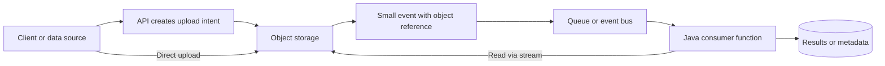
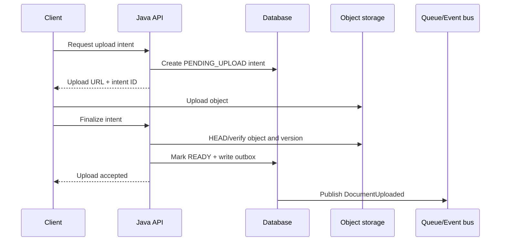

# Passing References Instead of Large Payloads

In serverless architectures, functions frequently communicate over HTTP, queues, or event buses. These channels work well for commands and small data payloads, yet they are not always suited for carrying the full contents of a large file. Images, videos, audio recordings, PDF documents, CSV data exports, or compressed archives can push payloads beyond intermediary service limits, inflate transfer costs, and force multiple functions to hold large data in memory.

A common design pattern is to **store large content in object storage and pass only a reference to that object**. The message or event then carries enough information for the consumer to locate the object to process, verify its integrity, and access it with appropriate permissions. This pattern is commonly known as the *claim check pattern* or *large message payload pattern*.

In Java serverless applications, this pattern allows functions to receive small events, open a read stream from object storage, and process data incrementally. However, it introduces an additional storage dependency, object lifecycle, authorization mechanism, and failure scenarios that must be managed. This lesson covers how to select the pattern, design reference contracts, structure upload/download flows, and operate safely.

## 1. Why Not Put the Entire File Inside the Event?

Suppose an API receives an 80 MB data file that must subsequently be validated, parsed, and persisted. If the API places the raw file inside a message, that message must pass through a broker or event bus before the consumer processes it. Depending on the platform, channels impose message size limits, retention limits, or volume-based pricing. Even when a payload fits under the limit, repeated copying and serialization still increase memory consumption and latency.

If three consumers need the same file, embedding the contents into each message causes large data to be transmitted and stored repeatedly. In a Java function, reading an entire file into a `byte[]` also creates heap and garbage collection pressure. When multiple invocations run concurrently, total memory consumption can climb rapidly.

Instead, the producer uploads the file to object storage and emits a small event containing a reference. Consumers use the reference to read the content when needed.



The event does not carry the file content. It carries the object identifier, version, size, and necessary checksum. Consumers can run independently of the upload API, and multiple consumers can read the same object without the producer resending the content.

### When Should You Use It?

The reference pattern is well suited when:

- Content is large or varies widely in size, making it hard to guarantee it always fits within intermediary payload limits.
- Multiple consumers need to read the same content.
- Processing work can execute asynchronously after the upload completes.
- Content must be stored durably, audited, versioned, or retained under its own lifecycle policy.
- Object storage read permissions can be managed per producer and consumer.

You do not need this pattern for every message. When data is just a small command, a few metadata fields, or a compact business event, passing it inline is simpler. When data is large but exists only for a short-lived connection without needing persistence, streaming over an appropriate protocol may be considered. Base the decision on platform limits, actual sizes, consumer count, data durability, and end-to-end cost.

## 2. What Does an Object Reference Contain?

A reference must enable consumers to locate the exact content and verify that it matches the event. A generic path like `uploads/report.csv` is usually insufficient because the object could be overwritten, moved, or deleted before the consumer reads it.

A reference contract can include:

| Field | Meaning | Notes |
|---|---|---|
| `storage` or `provider` | Storage system or adapter to use | Can be omitted if the entire system uses one configured storage service |
| `bucket` or `container` | Object container | Never allow consumers to access arbitrary containers from untrusted payloads |
| `key` | Object identifier within the container | Should be a server-generated key without personal data unless needed |
| `versionId` or `generation` | Immutable version of the object | Use when storage supports versioning |
| `sizeBytes` | Expected size | Used to check bounds before reading and detect anomalous data |
| `checksum` | Content digest, e.g., SHA-256 | Verifies integrity; do not confuse checksum with ETag if the provider defines it differently |
| `contentType` | Declared content type | Treat as a hint; verify against actual content when making security decisions |

Not every field is mandatory in every system. The contract must select a sufficiently stable identifier. If storage versioning is not enabled, use a unique object key per upload and never overwrite published objects. When using versioning, consumers must read the exact `versionId`/generation from the event rather than fetching the latest version by key.

### Example Event Envelope

An event can be structured as follows:

```json
{
  "eventId": "evt-8f2a4c",
  "eventType": "DocumentUploaded",
  "schemaVersion": 1,
  "occurredAt": "2026-11-17T09:30:00Z",
  "correlationId": "req-72d19a",
  "data": {
    "tenantId": "tenant-42",
    "documentId": "doc-913",
    "object": {
      "bucket": "private-ingress",
      "key": "tenant-42/2026/11/9a7f.../source.bin",
      "versionId": "v-003",
      "sizeBytes": 83886080,
      "checksumAlgorithm": "SHA-256",
      "checksum": "base64-encoded-digest",
      "contentType": "application/octet-stream"
    }
  }
}
```

This is an illustrative example; real identifiers and checksums must be generated by the actual system. `tenantId` or `documentId` in the event serve only for routing and correlation. Consumers must still verify access permissions using their execution identity and server-side ownership records. Never treat a self-declared `tenantId` in a payload as proof that the sender is authorized to read that tenant's objects.

The event should have a stable `eventId` for deduplication, `schemaVersion` for contract evolution, and `correlationId` to connect logs and traces from upload through processing. Never place access keys, tokens, passwords, or pre-signed URLs in events. A pre-signed URL is a bearer capability: anyone possessing the URL can perform the granted action while it remains valid. When consumers need access, let them use their own role/service identity to fetch the object; if a URL must be issued to an external party, generate a short-lived, narrowly scoped URL just in time for use.

## 3. Designing the Upload Flow

A secure upload flow must distinguish between **authorized to upload**, **upload finished**, and **object accepted for processing**. Never emit a processing event the moment a client merely starts uploading.

### Step 1: Create Upload Intent

The client calls an API to request a file upload. The API authenticates the user, checks tenant and business permissions, enforces size/type limits, and records an upload intent in the database. The server generates an unguessable, unique object key and associates the intent with the owner, expiration time, maximum size, expected content type, and a `PENDING_UPLOAD` status.

The API can issue a pre-signed URL or an equivalent direct-upload mechanism. The URL must restrict:

- One specific object key, never allowing the client to choose arbitrary containers or paths.
- Allowed HTTP methods, typically `PUT` or multipart upload steps.
- A short expiration window just long enough for the upload session.
- Signed headers or conditions on content type/checksum where supported by the platform.
- Size limits or upload policies matched to storage capabilities.

A pre-signed URL is sensitive information. Never log it in logs, analytics, or events; never expose it where it could be shared publicly. Upon expiration, the client must request a new intent or URL per policy rather than reusing old URLs indefinitely.

### Step 2: Direct Upload to Object Storage

The client transfers data directly to object storage. This relieves the API/function from receiving and proxying every byte. For very large files, use multipart/resumable uploads where supported by the provider so transfers can resume after network interruptions without resending the entire file.

The client may supply an expected checksum, yet the server must verify the result using trusted metadata or by reading and recomputing the checksum as required. Never trust client-declared `Content-Type`, filename, or size. Filenames should only be stored as sanitized display metadata; object keys should be server-generated.

### Step 3: Confirm Upload Completion

Once the upload finishes, the client calls a finalize API or the system receives an object storage notification. The API/consumer verifies that the object exists, matches the corresponding upload intent, resides in the issued container and key, falls within size limits, passes checksum verification, and records the object version.

Only after verification does the system transition status to `UPLOADED` or `READY_FOR_PROCESSING` and publish the event. When updating the database alongside emitting an event, write an outbox record in the same transaction as the upload status update. A publisher reads the outbox and sends the event; consumers must remain idempotent because the publisher may retry if it fails to receive an acknowledgment.

If using native object storage notifications, specify clearly which event signifies upload completion. For multipart uploads, never process the object before the complete operation succeeds. Notifications can arrive duplicated or out of order, so consumers should check version and current state before processing.

### Step 4: Publish the Small Event

The event should contain only the metadata needed for routing, validation, and tracing. Avoid repeating unnecessary fields or stuffing full user metadata into the event. Consumers retrieve the content from object storage using an authorized identity.



In practice, the outbox publisher is usually a separate process or a schedule/stream-triggered function. The simplified diagram shows logical ordering and does not imply that a database can atomically publish to a queue inside a standard database transaction.

## 4. Java Consumer Streaming the Object

The consumer receives only the small event. It validates the schema, checks required fields, verifies business state and access permissions, and then opens the object using the storage SDK or adapter. For large content, use `InputStream` or an equivalent streaming API to process incrementally.

The following example illustrates a cloud-vendor-neutral structure. The `ObjectStore` adapter can be implemented using the SDK for S3, Google Cloud Storage, Azure Blob Storage, or an equivalent service.

```java
import java.io.IOException;
import java.io.InputStream;

public record ObjectReference(
        String bucket,
        String key,
        String versionId,
        long sizeBytes,
        String checksumSha256,
        String contentType
) {}

public record DocumentUploadedEvent(
        String eventId,
        int schemaVersion,
        String correlationId,
        String tenantId,
        String documentId,
        ObjectReference object
) {}

public record StoredObjectMetadata(
        long sizeBytes,
        String checksumSha256,
        String versionId
) {}

public interface ObjectStore {
    StoredObjectMetadata head(ObjectReference reference);
    InputStream open(ObjectReference reference) throws IOException;
}

public interface ProcessingClaims {
    // Claim must be atomic and carry a lease for recovery after a crash.
    ClaimResult claimIfNotCompleted(String eventId, String objectVersion);
    void markCompleted(String eventId, String objectVersion);
}

public enum ClaimResult {
    CLAIMED,
    ALREADY_COMPLETED,
    BUSY
}

public final class RetryableProcessingException extends RuntimeException {
    public RetryableProcessingException(String message) {
        super(message);
    }
}

public interface DocumentParser {
    void parseAndStoreResult(InputStream input, String documentId) throws IOException;
}

public final class DocumentUploadedHandler {
    private final ObjectStore objectStore;
    private final ProcessingClaims claims;
    private final DocumentParser parser;

    public DocumentUploadedHandler(
            ObjectStore objectStore,
            ProcessingClaims claims,
            DocumentParser parser
    ) {
        this.objectStore = objectStore;
        this.claims = claims;
        this.parser = parser;
    }

    public void handle(DocumentUploadedEvent event) throws IOException {
        if (event.schemaVersion() != 1 || event.object() == null) {
            throw new IllegalArgumentException("Unsupported or incomplete event");
        }

        ObjectReference ref = event.object();
        String version = ref.versionId() == null ? ref.key() : ref.versionId();
        ClaimResult claim = claims.claimIfNotCompleted(event.eventId(), version);
        if (claim == ClaimResult.ALREADY_COMPLETED) {
            return; // Redelivery of already-completed work.
        }
        if (claim == ClaimResult.BUSY) {
            throw new RetryableProcessingException("Another invocation holds the processing lease");
        }

        StoredObjectMetadata actual = objectStore.head(ref);
        if (actual.sizeBytes() != ref.sizeBytes()) {
            throw new IllegalArgumentException("Object size does not match event");
        }
        if (ref.versionId() != null && !ref.versionId().equals(actual.versionId())) {
            throw new IllegalArgumentException("Object version does not match event");
        }
        if (ref.checksumSha256() != null
                && !ref.checksumSha256().equals(actual.checksumSha256())) {
            throw new IllegalArgumentException("Object checksum does not match event");
        }

        try (InputStream input = objectStore.open(ref)) {
            parser.parseAndStoreResult(input, event.documentId());
        }

        claims.markCompleted(event.eventId(), version);
    }
}
```

This is a structural example; adapters, authorization checks, and error handling must be completed for your deployment platform. `claimIfNotCompleted` must be an atomic operation in durable state storage; leases must expire or be renewed so another invocation can take over if a function terminates abruptly. Simply writing a permanent `PROCESSING` status risks leaving work stuck after a crash.

The example also assumes `parseAndStoreResult` is safely retryable or protects itself with idempotency. If the parser produces external side effects, calling `markCompleted` afterward still leaves a gap: the side effect succeeds, then the function crashes before marking completion, causing a retry to repeat the side effect. Use idempotency keys on target systems, transactions/outbox for local results, or reconciliation/compensation workflows.

### Streaming Instead of Loading Everything onto the Heap

Avoid writing:

```java
byte[] content = input.readAllBytes();
```

for large files without strict size limits and sufficient memory. Doing so forces the entire file to reside on the heap at once. Instead, parsers should read record by record, chunk by chunk, or through a fixed-size buffer. If a processing library strictly requires seeking or multiple passes, use a temporary file in `/tmp` or platform-provided ephemeral disk, while bounding capacity, cleaning up afterward, and encrypting sensitive data.

Example of copying with a bounded buffer:

```java
import java.io.IOException;
import java.io.InputStream;
import java.io.OutputStream;

static void copyBounded(InputStream in, OutputStream out, long maxBytes)
        throws IOException {
    byte[] buffer = new byte[64 * 1024];
    long total = 0;
    int count;
    while ((count = in.read(buffer)) != -1) {
        total += count;
        if (total > maxBytes) {
            throw new IOException("Input exceeds configured size limit");
        }
        out.write(buffer, 0, count);
    }
}
```

The limit in this example must come from business policy and function resource budgets. Even when metadata specifies a size, count actual bytes while reading because metadata or events can be inaccurate. For compressed formats, decompressed size can be orders of magnitude larger; enforce limits on decompressed size, entry counts, and processing time to guard against archive bombs and denial of service.

## 5. Securing References and Object Access Permissions

An object key is an identifier, not an authorization mechanism. Hard-to-guess keys may reduce enumeration risk, but they do not replace IAM, ACLs, or access policies. Buckets/containers should remain private; consumer functions should use an execution role/service identity granted read access strictly to the required bucket or prefix.

Essential principles:

- **Least privilege:** the upload API may create objects only under permitted prefixes; consumers may read only the objects they must process; result-processing functions should not hold delete permissions on source data unless required.
- **Verify ownership:** map upload intents to users/tenants in the database; never infer authorization solely from a prefix name or a tenant field in an event.
- **Server-generated keys:** avoid using raw client filenames as object keys; generate random identifiers and store display names separately.
- **Encryption:** enable encryption in transit and at rest; manage encryption keys according to data classification and audit requirements.
- **Pre-signed URLs:** constrain expiration, HTTP method, object key, and upload conditions; treat URLs as secrets usable by anyone who obtains them.
- **Never log secrets:** never write pre-signed URLs, access tokens, sensitive data, or file contents into logs or traces.
- **Inspect content:** never trust client-declared extensions or content types; verify format signatures, size, and scan for malware if the data type warrants it.
- **Prevent cross-tenant access:** enforce server-side authorization when creating every intent and whenever a consumer retrieves an object; never let payloads dictate arbitrary buckets or endpoints.

If an external consumer lacks direct storage access, a short-lived read pre-signed URL can be generated once that consumer is authenticated. The URL must be short-lived and scoped strictly to the exact object/version. Never embed such URLs in messages that may outlive the URL's validity; consumers should request fresh URLs when needed.

Never construct an arbitrary HTTP URL from an object key and have a function fetch it without host verification. If a consumer receives an external URL, validate its origin and protect against SSRF using endpoint allowlists, blocking unauthorized internal addresses, and configuring HTTP clients safely. For internal object storage, prefer native SDKs and execution identities over fetching an event-supplied URL.

## 6. Object Lifecycle and Business State

Object storage holds content; the database typically holds business state, ownership, search metadata, and processing progress. Never rely on listing objects in a bucket as the sole source of truth for whether a business record is complete.

A lifecycle might include:

| Status | Meaning | Typical Actions |
|---|---|---|
| `PENDING_UPLOAD` | Upload intent issued; no verified object yet | Expire intent if client never uploads |
| `UPLOADED` | Object verified | Record version, size, and checksum |
| `READY_FOR_PROCESSING` | Event published or ready to publish | Await consumer processing |
| `PROCESSING` | A consumer holds a lease | Renew lease or allow reclaim upon expiration |
| `COMPLETED` | Business outcome persisted | Archive, tier down, or delete temporary artifacts per policy |
| `FAILED` | Processing ended in an error requiring intervention | Preserve evidence, surface appropriate error, and support reprocessing |

These statuses are illustrative. Systems must define valid state transitions, who is authorized to trigger them, and which operations must be atomic. For example, transition to `READY_FOR_PROCESSING` only after the object is verified and the event/outbox record is durably persisted.

### Avoid Overwriting Objects While Consumers Use Them

If a producer overwrites the same key after emitting an event, a consumer may read new content while the event describes old content. Safe approaches are using an immutable key per upload or enabling versioning and storing the exact version/generation in the event. When a document needs updating, create a new version and emit a new event.

Incomplete objects can live in a separate staging/quarantine prefix. Only after validation succeeds should status transition or the object be copied/promoted to the processing zone. Copying across prefixes or buckets incurs extra cost and requires cleaning up the original; choose based on security and storage policies.

### Retention and Cleanup

Objects can be large and long-lived, requiring clear lifecycle policies:

- Delete expired upload intents and aborted/incomplete multipart uploads.
- Clean up orphaned objects lacking business records after a grace window sufficient to handle transient failures.
- Retain source objects for the duration needed by retries, investigations, and reconciliation.
- Transition to cheaper storage tiers or delete according to retention policies, legal obligations, and user deletion requests.
- Audit who accessed or deleted objects where audit requirements apply.

Never delete an object immediately after the first consumer finishes reading if other consumers, retry windows, or replay procedures still need the data. When multiple consumers reference the same object, deletion policies must consider completion across all consumers or a shared retention window.

## 7. Error Handling, Retries, and Idempotency

Notifications from object storage, queues, and event buses can be delivered more than once. Consumers must assume events may be duplicated, delayed, or out of order. Sending a small event does not turn object processing into exactly-once execution.

### Choosing an Idempotency Key

You can use `eventId` if the producer assigns a stable ID per event and preserves it across retries. For storage-emitted notifications, keys can combine bucket/container, key, and version/generation. Never rely on key alone if keys can be overwritten.

The processing state store should support conditional claims so two concurrent invocations do not execute the same work simultaneously. Persist state such as `PROCESSING`, `COMPLETED`, `FAILED`, lease owner, lease expiration, and attempt count. When an event is already `COMPLETED`, consumers can skip redeliveries. When a lease expires after a crash, a new invocation can resume according to policy.

### Error Classification

| Error | Suggested Handling |
|---|---|
| Timeout or transient network failure reading object | Bounded retries with backoff and jitter |
| Storage returns throttling or service unavailable | Slow consumption rate, retry per policy, and monitor quotas |
| Object does not exist yet due to early event or incomplete upload | Short retry if eventual consistency applies; route to investigation past threshold |
| Object was deleted or version no longer exists | Reconciliation error; do not retry indefinitely |
| Size/checksum mismatch | Quarantine object, record integrity failure, and request re-upload or investigate |
| Invalid format or malware detected | Mark business/validation failure, quarantine, and do not retry indefinitely |
| Read permission denied | Alert on IAM/tenant misconfiguration; retry only after permissions are fixed |
| Results persisted before function timed out prior to ack | Use idempotency at the result-write step so retries avoid duplicate records/side effects |

Retries help only for recoverable errors. Invalid data, checksum mismatches, or insufficient permissions rarely resolve themselves without intervention. Maintain a DLQ or error store to capture the event, metadata, and failure reason; replay operations must be authorized, audited, and explicit about any side effects reprocessing could trigger.

### Avoid Deleting Data Before Processing Completes

Never let a consumer delete the object as soon as it opens the stream. If the function times out after reading but before saving results, subsequent retries will have lost the source data. Delete only after completion state is durably recorded and any necessary retry/reconciliation window has elapsed. With multiple consumers, define a shared retention policy or maintain separate copies per stream for explicit reasons.

## 8. High Load, Concurrency, and Cost

Passing references shrinks messages, yet it does not eliminate the cost of reading objects. If a single event triggers multiple consumers and each downloads the full object, read bandwidth and storage request costs scale with the number of consumers. Determine which consumers need raw content and which need only metadata or normalized derived results.

### Protecting Functions and Downstream Dependencies

- Enforce object size limits before processing.
- Bound concurrency according to CPU, heap, `/tmp`, network bandwidth, and downstream capacity.
- Use queues to absorb bursts; pace consumer throughput so storage or databases are not overwhelmed.
- Stream or chunk reads; avoid holding multiple copies of the same file on the heap.
- For long-running work, consider splitting files into parts or using workflows/batch processing instead of pushing a single invocation near its timeout.
- Track bytes read, download duration, parse duration, retry rate, and temporary disk usage.

Functions can scale out faster than a database can accept connections. If each invocation opens a fresh connection, traffic bursts can exhaust connection limits. Use connection pooling sized for the execution environment lifecycle, managed proxies/pooling services where supported, and function concurrency caps.

### Accounting for Full Costs

When comparing inline payloads against reference passing, account for:

- Object storage costs by capacity and retention duration.
- Request costs for uploads, multipart operations, HEAD/metadata checks, and downloads.
- Data transfer across regions, availability zones, or out to the internet.
- Repeated consumer reads caused by retries or multiple consumers.
- Invocation counts, execution duration, memory/CPU, and workflow/queue/event costs.
- Logs, traces, malware scanning, encryption key operations, and cleanup jobs.

If multiple consumers frequently read the same object, consider caching or producing compact derived artifacts tailored to each consumer. Ensure caches enforce proper authorization, expiration, and invalidation; caches must never become unguarded stores of sensitive data.

## 9. Common Design Mistakes

| Mistake | Consequence | Fix |
|---|---|---|
| Putting pre-signed URLs in long-lived events | Consumers receive expired URLs or URLs leak | Pass object references; consumers fetch via role or request short-lived URLs on demand |
| Passing only key without version | Consumers may read overwritten content | Use immutable keys or explicit version/generation |
| Trusting client-reported size/content type | Risk of oversized files or spoofed formats | Verify metadata and content server-side |
| Reading entire files into `byte[]` | Heap spikes, heavy GC, or OOM | Stream, chunk, or use bounded temporary files |
| Treating object keys as authorization | Anyone knowing the key can access if policies fail | Enforce IAM/identity and server-side permission checks |
| Emitting events before upload completes | Consumers read incomplete or missing objects | Finalize upload, verify object, and publish events afterward |
| Deleting objects after the first consumer | Retries or other consumers lose the data | Retain across the full flow and recovery window |
| Not preventing duplicate events | Results or side effects occur multiple times | Idempotency keys and atomic lease-based claims |
| Failing to clean up multipart uploads/orphans | Unnecessary ongoing storage costs | Lifecycle rules and reconciliation jobs |
| Unbounded concurrency | Overwhelms storage, databases, or external APIs | Queues, backpressure, and concurrency caps |

## 10. Process for Applying the Reference Pattern

When designing a large-file processing pipeline, follow this sequence:

1. **Measure payloads and channels.** Determine typical size, maximum size, consumer count, and limits of HTTP, queues, or event buses in use.
2. **Select content storage.** Define buckets/containers, regions, encryption, versioning, retention, and access policies.
3. **Define the object reference.** Choose immutable keys, version, size, checksum, content type, and minimal business metadata.
4. **Design upload intents.** Authenticate owners, generate server-side keys, scope pre-signed URLs, and define upload finalization.
5. **Design the event envelope.** Include event ID, schema version, correlation ID, and the reference; never embed credentials or pre-signed URLs.
6. **Design consumers.** Fetch the exact object/version using execution identity; stream reads, enforce limits, verify checksums, and ensure idempotency.
7. **Design error handling and recovery.** Define retries, DLQs, leases, replays, orphan reconciliation, and deletion conditions.
8. **Measure operations and cost.** Monitor bytes read, processing time, backlogs, retries, cold starts, concurrency, storage, and request costs.

Before going to production, test these scenarios: client disconnects mid-multipart upload; finalize is called twice; storage notification arrives duplicated; object is overwritten after event emission; consumer times out after saving results; object expires during retries; checksum mismatches; and many large files arrive simultaneously. Each scenario requires a defined end state, recovery path, and corresponding metrics/alerts.

## Conclusion

Passing references instead of large payloads keeps messages and events compact, reduces redundant content copying, and lets consumers retrieve data on demand. Making this pattern secure and reliable requires stable object identification, immutable keys or versions, checksums, upload intents, completion verification, least-privilege access, streaming reads, and retention policies. In Java serverless applications, consumers must handle duplicate events, timeouts, and missing or mismatched object versions using idempotency, bounded retries, and DLQs. Evaluate the combined costs of uploads, storage, downloads, invocations, and operations before adopting this pattern.
