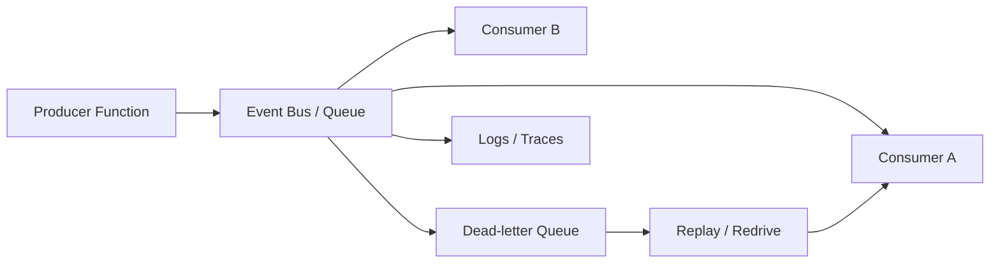
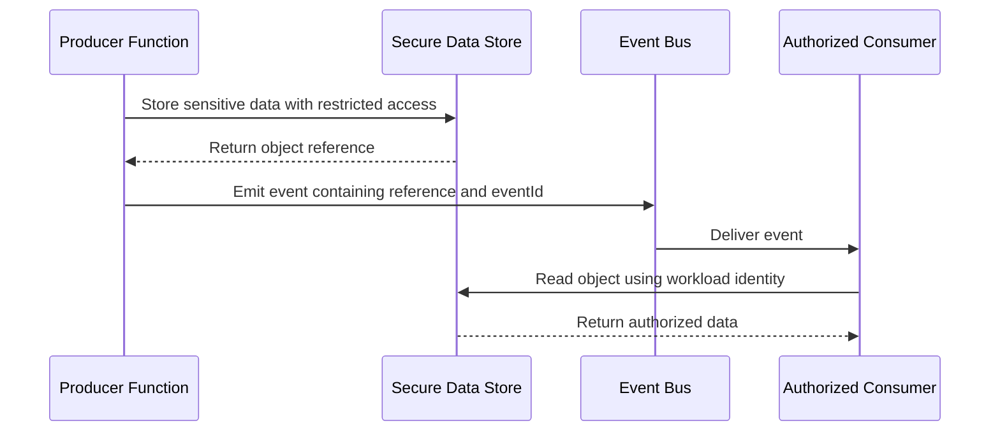
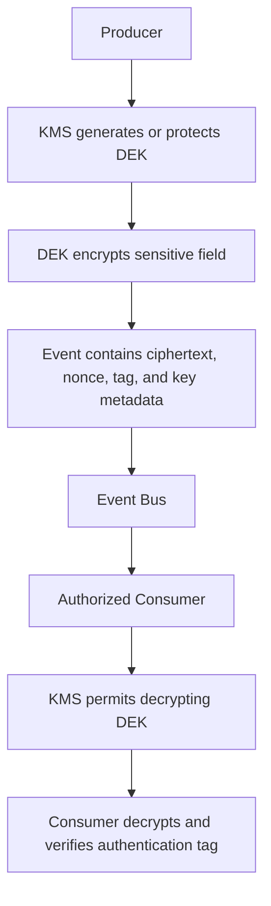

# Protecting Sensitive Data in Event Payloads

In a serverless system, an event can pass through many components: the emitting function, an event bus or queue, one or more consumers, logging systems, dead-letter queues (DLQs), archives, and replay tools. The payload may therefore be copied and persist well beyond the initial function invocation. If a payload contains personal information, payment details, access secrets, or restricted business data, every copy becomes an asset that must be protected.

Protecting sensitive data starts with the event contract: include only the fields consumers genuinely need, define clearly who is permitted to read them, limit retention duration, and control how data appears in logs, traces, DLQs, and replays. Encryption is an essential defense layer, but it cannot substitute for data minimization and strict access control.

## 1. Why Must Event Payloads Be Protected?

A function may process a request and terminate, while the event it emitted remains in a queue, fans out to multiple subscribers, or is retained for reprocessing on failure. A payload containing an email address, phone number, or access token can surface in places the development team does not see along the primary business path.



These pathways create several risks:

- **Wide blast radius:** an event may reach more consumers than originally anticipated. A field unnecessary for Consumer A is still copied to A alongside the rest of the payload.
- **Long-lived copies:** queues, DLQs, logs, backups, and analytics stores may retain payloads long after the function completes.
- **Uneven access permissions:** broker operators, log viewers, or personnel authorized to run replays may hold different permissions from business consumers.
- **Retries and replays:** a failed payload may be retained, inspected, or replayed multiple times.
- **Leakage through metadata:** sensitive data can appear in message attributes, headers, partition keys, topic names, exceptions, or trace baggage rather than only in the body.

Consequently, treat the entire event lifecycle as part of data and security design.

## 2. Classify Data Before Designing the Schema

Not every field in an event carries the same sensitivity. Before authoring a schema, identify which data may be exposed system-wide, which is internal-only, and which requires strict controls.

| Data Category | Examples | Recommended Handling |
|---|---|---|
| Low-sensitivity technical data | Event type, schema version, emission timestamp | May reside in the envelope if it reveals no sensitive internal details |
| Business identifiers | `orderId`, `invoiceId`, `jobId` | Include only when consumers need them; avoid values that reveal personal information |
| Personal data | Full name, email, phone number, address, government IDs | Omit from events if unnecessary; if needed, restrict consumers, encrypt, or use reference tokens |
| Financial data | Account numbers, card details, transactions, balances | Transmit only the minimum needed; never put payment auth data or full card details in events |
| Authentication secrets | Passwords, access tokens, refresh tokens, API keys, private keys | Never place in payloads, attributes, headers, or logs; use a secret manager and workload identity |
| Highly sensitive data | Health records, biometrics, legal records, policy-restricted data | Process only with valid justification and authorization; consider keeping out of events in dedicated stores |

Exact classification names and rules must follow organizational data policies and applicable regulations. The table above is a technical starting framework and does not replace formal data classification processes.

Inspect both direct data and inferable data. A customer code may look anonymous, yet if it can be joined against a lookup table it still identifies an individual. An event recording exact time, location, and transaction type can also reveal sensitive facts when combined with other sources.

## 3. Minimize Event Content

The single most important principle is to emit only the fields consumers need to perform their tasks. Never copy raw HTTP requests or entire database entities into an event simply because it is convenient for the producer.

### 3.1. Avoid Emitting Full Business Objects

Example of an inappropriate payload:

```json
{
  "eventType": "OrderPlaced",
  "order": {
    "id": "ord-1042",
    "customer": {
      "name": "Nguyen Van A",
      "email": "customer@example.com",
      "phone": "+84901234567",
      "address": "..."
    },
    "payment": {
      "cardNumber": "...",
      "accessToken": "..."
    },
    "items": []
  }
}
```

This payload broadcasts customer data and payment credentials to every consumer receiving the event, even if a consumer only needs to know an order was placed. Emitting raw objects also accidentally turns database schema changes into breaking event contract changes.

Example of a minimized payload:

```json
{
  "specversion": "1.0",
  "id": "evt-7f31",
  "type": "com.example.order.placed.v1",
  "source": "order-service",
  "time": "2026-11-17T10:15:30Z",
  "data": {
    "orderId": "ord-1042",
    "customerRef": "cust-ref-82",
    "total": 1250000,
    "currency": "VND"
  }
}
```

In the second example, the consumer receives a reference code instead of name, email, phone number, and payment details. A consumer retrieves additional data only when it has a valid business reason and holds the appropriate permissions.

### 3.2. Use References Instead of Embedding Large or Sensitive Data

When a consumer needs sensitive data to complete a task, store that data in a dedicated store and pass a reference in the event. The consumer uses its own workload identity to fetch the specific object.



The reference should be an opaque object identifier that reveals no data, such as `customerRecordRef` or `secureObjectId`. Never embed passwords, bearer tokens, access keys, or long-lived pre-signed read URLs in events. If a pre-signed URL is used, it acts as a bearer credential; it requires a very short expiration, narrow scope, and careful risk evaluation regarding exposure in logs or DLQs. Granting access through IAM/workload identity is generally easier to govern over its lifecycle.

The reference pattern reduces copies of sensitive data in brokers and logs. However, it adds an extra lookup and depends on data store availability. Define object retention periods, read permissions, handling for expired objects, and how replays behave after an object is deleted.

### 3.3. Tokenization and Pseudonymization

**Tokenization** replaces a sensitive value with a token mapped in a separately controlled system. Consumers receive only the token and cannot derive the original value without authorization to access the mapping service.

**Pseudonymization** replaces a direct identifier with a pseudonym or reference code. The data can still be re-linked to an individual via additional information, so pseudonymization must not be mistaken for full anonymization.

Never use a plain SHA-256 hash of an email address or phone number as an anonymization solution. The input domain of those values is predictable, allowing attackers to run dictionary attacks. If deterministic correlation is needed without emitting raw values, consider HMAC with a securely managed secret key or a tokenization service. Never place HMAC keys in source code or event payloads.

## 4. Encrypting Data in Transit and at Rest

Encryption reduces unauthorized reading if a payload is exposed at an infrastructure layer. Design protections across transport, brokers, storage, and sensitive fields.

### 4.1. Encryption in Transit

Producers, brokers, and consumers must communicate over protected channels, typically TLS. Verify server certificates; where appropriate, use mutual TLS or platform-supported workload authentication. Never disable certificate verification to work around connection errors.

TLS protects data in transit between endpoints. Once a broker receives a payload, the service may decrypt the data to route or deliver it to consumers. Thus, TLS alone does not shield payloads from anyone authorized to read the broker, logs, or DLQ.

### 4.2. Encryption at Rest

Enable encryption at rest on queues, event buses, databases, object storage, DLQs, backups, and log stores according to platform capabilities. Use keys managed by a Key Management Service (KMS) when key usage permissions, rotation, and auditing must be controlled.

Service-level encryption primarily protects data on physical storage media. Administrators or workloads with read permissions on the service can still retrieve decrypted payloads through its API. If you need to restrict even broker operators or isolate read access per consumer, consider application-level encryption before emitting events.

### 4.3. Field-Level or Application-Level Encryption

For sensitive data that must travel inside the payload, the producer can encrypt the specific field using a vetted encryption mechanism. Only consumers authorized to decrypt can read the value. A common implementation is envelope encryption: KMS protects a data encryption key (DEK), and the DEK encrypts the data using an authenticated cipher such as AES-GCM.



The payload can carry the ciphertext, nonce/IV, authentication tag, and metadata identifying the key version or algorithm. Never include the plaintext DEK or root key. Ensure nonces are never reused with the same key under AES-GCM, verify integrity tags during decryption, and maintain a key rotation plan. Never invent custom encryption algorithms or cryptographic protocols; use standard libraries and KMS services approved by your organization.

Field-level encryption adds complexity. An event bus cannot inspect encrypted fields for filtering or routing. Therefore, necessary routing attributes should use carefully vetted non-sensitive metadata, while private data stays inside the encrypted portion. Avoid leaking sensitive information into unencrypted fields solely to enable routing.

## 5. Managing Secrets and Workload Identity

Secrets are not business data. Passwords, API keys, access tokens, refresh tokens, private keys, and database credentials must never be placed in events, message attributes, custom headers, logs, or traces.

When a consumer needs to call another service, assign a workload identity to the function and allow it to obtain short-lived credentials or fetch secrets from a secret manager. Scope permissions by function, environment, and purpose. Never share a single broad-privilege credential across all producers and consumers.

An event may carry a `customerRef` or `resourceId` so a consumer can look up data, yet it must never carry a token for the consumer to impersonate the producer. A producer's authorization to read data does not automatically grant every event subscriber permission to read that same data.

If a secret is accidentally published in an event, treat it as a credential compromise: revoke or rotate the credential, identify all queues/DLQs/logs/backups that received copies, restrict access, and purge copies following your incident response procedure. Deleting a message from a queue does not guarantee the secret has vanished from all downstream copies.

## 6. Enforcing Access Control by Producer and Consumer

Grant least-privilege permissions to each component:

- Producers may publish only to the specific topics, queues, or event buses they require.
- Consumers may read only their assigned subscriptions or queues, and decrypt only the fields their task requires.
- Storage services allow only the intended workloads to read corresponding objects.
- Administrative permissions for brokers, DLQs, replays, and logs must be restricted separately, as those permissions allow viewing or re-emitting payloads.
- KMS key permissions for encryption and decryption must be separated; never grant broad decrypt access merely because a function is permitted to receive an event.

Beyond platform IAM or policies, validate event origin and authenticity. Never trust `source`, `tenantId`, `role`, or `userId` fields inside a payload as proof of authentication if the producer is unauthenticated and the event lacks integrity protection. In multi-tenant environments, consumers must derive the tenant from a trusted context and check resource authorization before accessing data.

When using digital signatures or HMAC to verify integrity and origin, manage keys separately via KMS/secret manager, specify key versions, enforce expiration, and include replay protection. Signatures prove the data was not altered by someone lacking the key; they do not replace consumer authorization checks.

## 7. Protecting Logs, Traces, Metrics, and Error Messages

A common failure occurs when a payload is protected inside the broker yet written verbatim to logs when parsing fails. Logs, traces, and metrics have their own viewer audiences, retention periods, and export pipelines; apply equivalent protection policies to them.

Log using an allowlist: event type, event ID, correlation ID, processing outcome, and standardized error codes. Log only necessary business identifiers. Never log entire objects, HTTP bodies, authorization headers, message bodies, access tokens, card numbers, or personal data.

Unsafe logging example:

```java
logger.error("Cannot process event: {}", objectMapper.writeValueAsString(event));
```

Controlled logging example:

```java
logger.error(
        "Cannot process eventId={} type={} errorCode={}",
        event.eventId(),
        "order.placed.v1",
        "INVALID_ORDER_REFERENCE");
```

Do not rely entirely on regex masking after dumping an entire payload. Regex patterns can miss new formats, nested structures, or custom fields. Logging only explicitly permitted fields is far safer. Event IDs and correlation IDs should also be opaque values—never encode emails, phone numbers, or personal data inside IDs. Even if a centralized logging system applies redaction, data minimization at the producer remains essential because payloads can be recorded at multiple intermediate points.

For traces, never place emails, phone numbers, tokens, or message bodies in span attributes or baggage. For metrics, never use user IDs or order IDs as high-cardinality labels. Use aggregate counters such as events by type, error rates, and processing latency.

Error messages returned to clients or callers should use stable error codes and a correlation ID. Stack traces, queries, payload contents, and internal details belong only in access-controlled operational logs after sensitive data has been stripped.

## 8. DLQs, Retries, Retention, and Replay

DLQs typically store raw failed messages for investigation or replay. Therefore, a DLQ stores sensitive data whenever the original payload contained such data. Apply the same encryption, read-access controls, auditing, and retention limits to DLQs as to primary queues.

Before enabling replay or redrive, establish:

1. Who is permitted to inspect and replay messages? Is approval required for restricted data?
2. Are current consumers still compatible with older schemas and event versions?
3. Does referenced data still exist, and does the replay operator/consumer hold access permissions?
4. Does the event contain secrets or data past its retention limit? Must payloads be stripped or replaced before replay?
5. Are consumers idempotent so replaying does not duplicate business side effects?
6. Does replay record who executed it, when, message scope, and outcome?

Configure appropriate retention periods on queues, DLQs, logs, traces, object storage, and backups. Never retain payloads indefinitely merely because they might be useful for debugging. When handling data deletion requests, identify all copies and downstream systems responsible for processing them; event immutability means deleting a field from a primary record does not automatically purge data from historical copies.

For events requiring long-term replayability, consider keeping events to identifiers and minimal business data. Sensitive data is fetched from a store with its own retention policy. When data is deleted or expires, replays may encounter expired-reference errors and must have explicit handling for that case.

## 9. Example of Safe Event Design in Java

The following example uses Java records to represent an event contract carrying only the data consumers need. `customerRef` is a reference code issued by a tokenization system or internal identity service; it is not an email address or phone number.

```java
import java.math.BigDecimal;
import java.time.Instant;

public record OrderPlacedEvent(
        String eventId,
        String orderId,
        String customerRef,
        BigDecimal total,
        String currency,
        Instant occurredAt
) {}
```

The producer builds the event after the order transaction commits:

```java
public final class OrderEventPublisher {
    private final EventBus eventBus;
    private final CustomerReferenceService references;

    public OrderEventPublisher(
            EventBus eventBus,
            CustomerReferenceService references) {
        this.eventBus = eventBus;
        this.references = references;
    }

    public void publish(Order order) {
        String customerRef = references.referenceFor(order.customerId());

        OrderPlacedEvent event = new OrderPlacedEvent(
                order.eventId(),
                order.id(),
                customerRef,
                order.total(),
                order.currency(),
                Instant.now());

        eventBus.publish("order.placed.v1", event);
    }
}
```

`EventBus`, `Order`, and `CustomerReferenceService` are illustrative application interfaces. In production systems, event emission timing must remain consistent with the business transaction, for example using a transactional outbox. `customerRef` must be generated and managed by a trusted service; never construct tokens by hashing personal data without a secret key.

A consumer retrieves private data only when its task requires it and its workload identity is authorized:

```java
public final class OrderNotificationHandler {
    private final CustomerProfileService profiles;
    private final NotificationService notifications;

    public OrderNotificationHandler(
            CustomerProfileService profiles,
            NotificationService notifications) {
        this.profiles = profiles;
        this.notifications = notifications;
    }

    public void handle(OrderPlacedEvent event) {
        CustomerContact contact = profiles.getContact(event.customerRef());
        notifications.sendOrderConfirmation(event.orderId(), contact);
    }
}
```

This example assumes the notification function is granted permission to read contact details via `CustomerProfileService`. A revenue analytics consumer might need only `orderId`, `total`, and `currency`, requiring no permission to read customer profiles. Separating permissions this way limits blast radius if one consumer is compromised.

## 10. Testing and Operating Data Protection

Before releasing an event schema, run checks both during development and at runtime:

- **Schema review:** flag sensitive fields, data owners, intended purpose, authorized consumers, and retention limits.
- **Contract tests:** verify producers do not emit undeclared fields and consumers depend only on committed fields.
- **Logging tests:** send synthetic payloads containing emails, tokens, and ID numbers; verify none appear in logs, traces, or error responses.
- **Permission tests:** attempt to read queues, DLQs, objects, and decrypt fields using unauthorized identities; operations must be denied.
- **Replay tests:** replay historical events, duplicate events, and events with expired references; verify idempotency and error handling.
- **Auditing:** monitor DLQ reads, key usage, policy changes, and replay executions.
- **Alerting:** alert on abnormal DLQ growth, unauthorized access attempts, or unexpected payloads appearing in logs.

When sensitive data is accidentally emitted, identify the event IDs and potentially affected copies; restrict access; pause replays or fan-out if necessary; revoke credentials if secrets were exposed; audit logs, DLQs, backups, and downstream consumers; and delete or replace the data per organizational incident response procedures. Record scope, timestamps, responders, and remediation decisions for future auditability.

## 11. Safe Payload Design Checklist

Before promoting an event to production, answer these questions:

1. Does every field serve a clear business purpose and have a consumer that genuinely needs it?
2. Can personal data be omitted, tokenized, or replaced by an opaque reference instead of the raw value?
3. Could the payload, message attributes, headers, partition key, or resource names inadvertently contain sensitive data?
4. Is data encrypted in transit and at rest across brokers, DLQs, backups, and logs?
5. Is field-level encryption needed to limit which consumers can read plaintext? Who holds decryption rights?
6. Do producers, consumers, operators, log viewers, and replay operators adhere to least privilege?
7. Are secrets retrieved from a secret manager or via workload identity instead of residing inside events?
8. Do logs, traces, metrics, and exceptions contain only allowlisted data?
9. Do retention, deletion, backup, DLQ, and replay share a clear, cohesive policy?
10. Are contract tests, permission tests, redaction tests, and audits in place to detect drift?

## Conclusion

Protecting sensitive data in events begins with minimizing payload contents and restricting recipients. Use tokens or references when consumers do not need raw values; encrypt in transit, at rest, and at the field level when needed; grant permissions by workload identity; and safeguard logs, DLQs, backups, and replays. A secure event contract enables functions to exchange just enough information for business needs without needlessly expanding where sensitive data is replicated and accessed.
