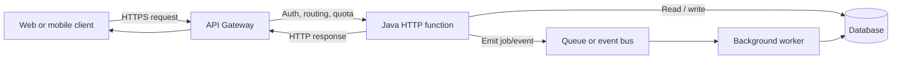

# Designing REST APIs for Serverless Backends

A REST API is a way of organizing HTTP communication around resources and operations on those resources. In a serverless backend, an API typically passes through an API gateway or HTTP router and then triggers a Java function. The function authenticates and validates the request, executes business rules, reads or writes state in external services, and returns a response according to the HTTP contract.

A good REST API should tell clients which resources exist, what operations can be performed, what structure the data follows, how errors are represented, and how long an operation takes to complete. Serverless architecture adds decisions around triggers, timeouts, concurrency, retries, idempotency, and how to offload long-running work to asynchronous processing.

This lesson focuses on API design for serverless backends using HTTP triggers. REST and HTTP principles still apply to backends running on traditional servers; the key point to note is that a function has its own invocation lifecycle, should not hold business state in memory, and may be invoked again by the platform when the client or infrastructure retries.

## 1. REST APIs and the Resource Model

REST organizes an API around **resources**, identified by URIs. A resource can be a business entity such as an order, customer, or report, or a collection such as a list of orders. The HTTP method describes the desired operation on the resource.

Example with an order system:

| Resource | Sample URI | Meaning |
|---|---|---|
| Order list | `/v1/orders` | Collection of orders within the caller's authorized scope |
| Single order | `/v1/orders/{orderId}` | A specific order |
| Order line items | `/v1/orders/{orderId}/items` | Collection of line items belonging to an order |
| Single line item | `/v1/orders/{orderId}/items/{itemId}` | A specific line item |
| Payment status | `/v1/orders/{orderId}/payment` | Payment status or payment resource of the order |
| Report generation job | `/v1/report-jobs/{jobId}` | Status of an asynchronous processing job |

URI names usually use plural nouns for collections and identifiers for individual elements. Use a consistent structure so clients can predict paths. Avoid naming URIs after functions such as `/createOrder`, `/getOrder`, or `/runReport`; that is action-oriented naming tied to implementation rather than resources.

A special operation that is hard to represent as a resource can be modeled as a sub-resource or a command resource. For example, instead of creating an arbitrary endpoint `/payNow`, you can create a payment intent or payment attempt associated with the order. The representation should make clear which object is being created or which business state is being changed.

REST does not require every API to expose every CRUD operation. Only expose the business operations that clients are allowed to perform. A paid order might not allow modifying line items even though the database technically supports updates.

## 2. Choosing Semantically Correct HTTP Methods and Status Codes

The HTTP method communicates the meaning of the operation. Clients, proxies, caches, and observability tools rely on these semantics to handle requests.

| Method | Common Purpose | Semantic Characteristics |
|---|---|---|
| `GET` | Read a collection or resource | Safe; does not request business state changes |
| `POST` | Create a resource or submit a command | Not idempotent by default |
| `PUT` | Create or replace a representation at a known URI | Semantically idempotent |
| `PATCH` | Partially modify a resource | May not be idempotent, depending on patch semantics |
| `DELETE` | Delete or request deletion of a resource | Semantically idempotent, even though responses across calls may differ |
| `HEAD` | Retrieve metadata similar to GET without a response body | Safe |
| `OPTIONS` | Discover methods or support CORS preflight | Safe |

**Safe** means the client does not request the method to change business state. Logging, metrics, or internal cache updates may still occur. **Idempotent** means executing the same request multiple times has the same business effect as executing it once; responses across calls do not necessarily have to be identical.

Examples:

- `GET /v1/orders/ord-1042` reads an order.
- `POST /v1/orders` creates a new order.
- `PUT /v1/customers/cus-42/preferences` replaces all preferences at that URI.
- `PATCH /v1/orders/ord-1042` updates a subset of allowed fields.
- `DELETE /v1/orders/ord-1042` requests deletion or transitions the resource to a deleted state according to business policy.

Do not use GET to perform operations with side effects such as processing payments, sending emails, or creating orders. Clients, crawlers, or proxies may call GET again for caching, prefetching, or inspection purposes. Data-mutating operations must use semantically appropriate methods and include retry protection.

Common status codes:

| Status | When to Use |
|---|---|
| `200 OK` | Request succeeded and includes a representation in the response |
| `201 Created` | Resource was created; should return a `Location` header pointing to the new resource |
| `202 Accepted` | Work was accepted for later processing; does not yet confirm business completion |
| `204 No Content` | Succeeded with no response body needed |
| `304 Not Modified` | Representation has not changed per cache conditions |
| `400 Bad Request` | Request is syntactically invalid or fails basic input checks |
| `401 Unauthorized` | Missing or invalid credentials; client needs to authenticate |
| `403 Forbidden` | Caller is identified but not permitted to perform the action |
| `404 Not Found` | Resource does not exist or is not disclosed within the access scope |
| `409 Conflict` | Conflicts with the current state or a business rule |
| `412 Precondition Failed` | A condition such as `If-Match` no longer holds |
| `415 Unsupported Media Type` | Content type is not supported |
| `422 Unprocessable Content` | Content is syntactically valid but cannot be processed under validation rules |
| `429 Too Many Requests` | Caller exceeded rate limit or quota |
| `500 Internal Server Error` | Unexpected error in the backend |
| `502 Bad Gateway` | Gateway received an invalid response from upstream |
| `503 Service Unavailable` | Service is temporarily unavailable |
| `504 Gateway Timeout` | Gateway did not receive an upstream response within the deadline |

Status codes must be consistent across the entire API. For instance, an authorization error should not sometimes return 400 and other times return 500. Decide how to handle 404 for resources belonging to another tenant according to security policy: some systems return 404 to avoid disclosing that the resource exists; other systems return 403 when such disclosure is acceptable.

## 3. Designing Usable Requests and Responses

JSON is typically the standard interchange format for REST APIs. Use consistent field names, data types, units of measurement, and null rules. A field representing a monetary amount must specify its currency or unit rules; a timestamp should include a timezone, typically ISO 8601 in UTC.

Example order creation request:

```http
POST /v1/orders HTTP/1.1
Content-Type: application/json
Authorization: Bearer <access-token>
Idempotency-Key: 4e9f3d2a-2f63-4db1-9d40-0f5a90b31a12

{
  "items": [
    {
      "productId": "prd-12",
      "quantity": 2
    }
  ],
  "currency": "VND"
}
```

Example response on successful creation:

```http
HTTP/1.1 201 Created
Content-Type: application/json
Location: /v1/orders/ord-1042

{
  "id": "ord-1042",
  "status": "PENDING_PAYMENT",
  "currency": "VND",
  "totalAmount": 250000,
  "createdAt": "2026-11-17T10:15:30Z"
}
```

Responses should return enough data for the client to continue its workflow, but should not return the entire database record. Do not expose internal IDs if doing so increases risk, nor table names, stack traces, SQL, secrets, internal provider details, or operational-only fields.

Useful principles:

- Use the same identifier type for a given resource kind across all endpoints.
- Use integers or decimals with clear rules for money; avoid binary floating point for monetary calculations.
- Use UTC and a consistent timestamp format.
- Distinguish between omitted fields, null-valued fields, and empty fields.
- Keep response schemas stable; adding optional fields is usually more compatible than changing types or the meaning of existing fields.
- Do not require the client to resend data the server can already determine reliably, such as the user ID from an access token.
- Use content negotiation when the API genuinely supports multiple representations; if only JSON is used, explicitly declare `application/json`.

Do not echo arbitrary input verbatim into responses or logs. Input data may contain HTML, sensitive information, or large strings crafted to cause overload.

## 4. Routing Requests Through an API Gateway to a Java Function

In a serverless architecture, an API gateway is usually the HTTP entry point. The gateway can route by path and method, verify tokens, enforce rate limits, apply quotas, configure CORS, forward requests to a function, and map responses. Some responsibilities may live in the function or a separate identity service, depending on the platform.

General flow:



A request can be processed through these steps:

1. The gateway receives the HTTPS request and applies baseline limits.
2. The gateway or authorizer verifies the credentials.
3. The gateway selects a route based on method and path.
4. The function receives the request along with trusted context provided by the adapter.
5. The function validates the payload, resource permissions, and business rules.
6. The function reads/writes state or dispatches work to a queue.
7. The adapter converts the result into HTTP status, headers, and body.
8. The gateway returns the response to the client.

Clearly define where responsibility lies for each control. If the gateway validates a JWT, the function must still authorize access to the resource. If the gateway partially validates a schema, the domain layer must still protect business invariants. If the gateway injects headers containing identity information, prevent clients from sending headers with the same name to spoof context.

Do not trust an identity header solely because it appears in the request. Only trust context created by the gateway or runtime after verification, and secure the transport between the gateway and the function. If the function can be invoked directly, apply equivalent authentication mechanisms or restrict invocation permissions so the gateway cannot be bypassed.

## 5. Validating Requests and Enforcing Business Rules

Validation should be performed at both the HTTP boundary and the business layer. The gateway can reject oversized requests or invalid content types; the function must parse and check the schema; the domain service must enforce rules such as item quantities being positive, an order not being paid twice, or users acting only within their authorized tenant.

Distinguish the categories of checks:

- **Syntax:** valid JSON, correct field types, properly formatted path parameters.
- **Bounds:** string length, element count, file size, numeric ranges, and page numbers.
- **Semantics:** supported currency, quantity greater than 0, end date not earlier than start date.
- **Authorization:** caller is allowed to read or modify the specific resource.
- **State:** resource is in a state that permits the operation, e.g., only unpaid orders can be canceled.
- **Consistency:** prices, inventory, and versions remain valid at write time.

Java example illustrating validation and authorization before creating an order:

```java
public CreateOrderResult createOrder(
        VerifiedIdentity identity,
        CreateOrderRequest request) {

    if (request.items() == null || request.items().isEmpty()) {
        throw new ValidationException("items must not be empty");
    }

    for (CreateOrderItem item : request.items()) {
        if (item.quantity() <= 0) {
            throw new ValidationException(
                    "quantity must be greater than zero");
        }
    }

    authorization.requireCanCreateOrder(
            identity,
            identity.tenantId()
    );

    return orderService.create(
            identity.tenantId(),
            identity.subject(),
            request
    );
}
```

This is an example of responsibility structure; actual request types, identity, exceptions, and adapters depend on the Java framework in use. In real applications, do not take the tenant or subject from the request body in place of the verified identity. The domain service must continue enforcing business conditions during data writes, especially under concurrency.

Validation does not replace parameterized queries or ORM binding. Never concatenate SQL strings, table names, or query expressions from untrusted input. For user-supplied destination URLs, validate the scheme, hostname, and resolved IP addresses to prevent SSRF. For file uploads, check the size, actual file format, and object access permissions.

## 6. Authentication, Authorization, and CORS

Public REST APIs must clearly define how callers are identified. Common choices include OAuth 2.0/OIDC access tokens, JWTs verified by an authorizer, session cookies, or API keys for limited use cases. An API key is usually suitable for identifying an application or applying quotas; it should not be treated as sufficient proof of user identity.

Authentication answers who is calling. Authorization answers what that identity is allowed to do on which resource. A valid token does not mean the caller can read every order. Enforce per-resource and per-tenant permissions on the server side, even when the client sends a valid ID.

Key principles:

- Verify token signature, issuer, audience, expiration, and required claims.
- Use scopes or roles to restrict action groups; check permissions on specific resources.
- Extract subject and tenant from a trusted identity context.
- Use IAM/workload identity when a function calls cloud services or other functions.
- Grant least-privilege permissions to the function's execution role.
- Do not embed secrets or long-lived access keys in source code or responses.
- Use TLS for all transport carrying authentication or business data.
- Maintain revocation, rotation, and expiration policies for credentials.

**CORS** is a browser mechanism controlling whether an origin is allowed to read responses from another origin. CORS is not an authentication mechanism and does not stop non-browser clients from calling the API. CORS configuration must specify allowed origins, methods, headers, and whether credentials are permitted. If cookies or credentials are used, do not combine a wildcard origin with credentials; return the specific allowed origin and configure cookies appropriately.

Preflight requests using the OPTIONS method can be handled at the gateway. If the gateway already handles CORS, avoid configuring conflicting response headers in the function. Test simple requests, preflight requests, allowed origins, and disallowed origins.

## 7. Idempotency and Retries for Mutating Operations

In serverless environments, clients may resend requests on timeouts or dropped connections, even if the function already performed side effects. Gateways, SDKs, or network layers may also retry according to their own policies. If every POST creates a new order, users can end up with duplicate orders or double charges.

An idempotency key allows a client to send a unique identifier for a business intent. The server stores the key along with caller/tenant scope, operation type, request fingerprint, and result. Upon receiving the same key with the same payload, the server returns the stored result or an in-progress status. If the same key is reused with a different payload, return a conflict error.

A typical processing flow:

1. The client generates an idempotency key and sends it with the request.
2. The function authenticates the caller, validates the request, and builds a scoped key.
3. The backend claims the key using an atomic transaction or conditional write.
4. If the key is already completed and the fingerprint matches, return the stored result.
5. If the key is currently in progress, return an appropriate status or instruct the client to query again.
6. If the key is new, execute the business logic and record the result along with idempotency state.
7. Retain the key for a duration matching the window in which the client may retry.

Do not store keys only in a static map inside the function. Multiple execution environments can receive the same request; per-environment memory is not shared and can be reclaimed. Idempotency must be enforced in a shared state store with atomicity guarantees.

Distinguish technical retries from business retries. A timeout when calling an external service can leave an ambiguous outcome: was the request processed or not? For payment providers, use idempotency keys on the provider side as well if supported, and query the status before resending an operation with an uncertain outcome.

## 8. Designing Endpoints for Asynchronous Work

Serverless functions typically have invocation time limits. If a request needs to generate a large report, process video, call multiple systems, or wait for a long workflow, keeping the HTTP request open can cause client or gateway timeouts. The API can accept the job and process it asynchronously.

Example:

```http
POST /v1/report-jobs HTTP/1.1
Content-Type: application/json

{
  "reportType": "monthly-sales",
  "month": "2026-10"
}
```

Response:

```http
HTTP/1.1 202 Accepted
Location: /v1/report-jobs/job-91ac
Retry-After: 3
Content-Type: application/json

{
  "id": "job-91ac",
  "status": "QUEUED",
  "statusUrl": "/v1/report-jobs/job-91ac"
}
```

The client polls the status:

```http
GET /v1/report-jobs/job-91ac HTTP/1.1
```

When complete, the response can include status `SUCCEEDED` along with a download link for the result. On failure, the job resource can store a public error code, retryability info, and last updated timestamp. Do not return stack traces or internal worker details.

A simple state model:

```text
QUEUED -> RUNNING -> SUCCEEDED
                  -> FAILED
                  -> CANCELLED
```

Clearly define:

- The job is created and durably persisted before the API returns 202.
- Queue messages carry the job ID or minimal required data.
- Workers update state using conditional updates or versions to prevent overwrites.
- Retries are bounded; unrecoverable jobs can be routed to a DLQ.
- Clients can query status and know when results are ready.
- Read, cancel, and result download permissions are checked by owner or tenant.
- Jobs and results have a clear retention policy.

Do not return 202 if the request has only been placed into an in-memory queue or a non-durable background thread. Durable evidence of acceptance must be persisted before responding with success.

## 9. Pagination, Filtering, Sorting, and Caching

Collection endpoints can grow rapidly in size. Returning all data in a single response consumes excessive memory, increases latency, and can exceed gateway payload limits. Support pagination and cap page sizes.

There are two common approaches:

- **Offset pagination:** uses `limit` and `offset`; easy to understand, but can be slow at large offsets, and data changes between pages can cause duplicate or skipped records.
- **Cursor pagination:** the response returns a cursor to fetch the next page. The cursor should be encoded or signed, bound to the query conditions, and may include a stable sort key.

Example:

```http
GET /v1/orders?limit=25&status=PAID&sort=-createdAt
```

Response:

```json
{
  "items": [
    {
      "id": "ord-1042",
      "status": "PAID",
      "createdAt": "2026-11-17T10:15:30Z"
    }
  ],
  "nextCursor": "eyJjcmVhdGVkQXQiOi..."
}
```

Rules:

- Set a default limit and a maximum limit on the server.
- Allow filtering and sorting only on published fields.
- Check permissions and tenant before returning data.
- Use a deterministic ordering, typically combining a timestamp with a unique ID.
- Do not let a cursor allow users to access another tenant or different query conditions.
- Do not return total record counts if counting is too expensive or leaks information.

For cacheable GET responses, consider `Cache-Control`, `ETag`, `Last-Modified`, `If-None-Match`, and `If-Modified-Since`. Personal or tenant-specific data must not be cached publicly. Set `Cache-Control: private` or `no-store` as appropriate. Caching does not replace authorization; prevent returning one user's response to another due to cache keys missing partitioning factors.

## 10. Error Standardization and API Contracts

Clients need to recognize errors in a consistent structure. You can use Problem Details per RFC 9457 with content type `application/problem+json`.

Example:

```http
HTTP/1.1 422 Unprocessable Content
Content-Type: application/problem+json

{
  "type": "https://api.example.com/problems/invalid-order",
  "title": "Order cannot be created",
  "status": 422,
  "detail": "At least one item has an invalid quantity.",
  "instance": "/v1/orders",
  "code": "INVALID_ITEM_QUANTITY",
  "traceId": "req-91ac"
}
```

Meanings of the standard fields:

- `type` identifies the problem type, typically a URI.
- `title` is a short summary.
- `status` is the corresponding HTTP status code.
- `detail` explains the specific occurrence of the error.
- `instance` identifies the related request or resource.

You can add `code` for stable programmatic handling by clients and `traceId` to assist with operations support. Do not include internal exception messages, stack traces, SQL, tokens, or sensitive data in error responses.

Categorize errors to guide retry decisions:

| Error Category | Examples | Typical Client Behavior |
|---|---|---|
| Validation | 400, 415, 422 | Fix request; do not retry as-is |
| Authentication | 401 | Obtain or refresh credentials |
| Authorization | 403 | Do not retry unless permissions change |
| Conflict | 409, 412 | Read latest state and resolve conflict |
| Rate limit | 429 | Honor Retry-After and back off |
| Transient server/dependency | 502, 503, 504 | Bounded retry with backoff and jitter; keep idempotency key |
| Unexpected failure | 500 | Retry only when the operation is safe and governed by a clear policy |

Not every 5xx is guaranteed safe to retry. If a payment creation request reached the provider but the response timed out, retrying could create a new transaction if the provider does not support idempotency. Clients must use a stable key and the backend must handle ambiguous outcomes.

## 11. API Versioning and Evolution

APIs are often consumed by clients longer than a single backend deployment. Producers and consumers may not be updated simultaneously, so contract changes must plan for compatibility.

A common approach is path versioning, such as `/v1/orders`, `/v2/orders`. Versioning in media types or headers can also be used, provided it is consistent and observable. Do not bump the major version merely for adding an optional field with a sensible default; prefer backward-compatible changes.

The following changes are generally considered more compatible:

- Adding an optional response field that older clients can ignore.
- Adding a new endpoint.
- Adding an enum value only when clients are designed to handle unknown values.
- Adding an optional query parameter with well-defined default behavior.

Changes likely to break clients:

- Removing or renaming a field.
- Changing the data type or meaning of a field.
- Changing status codes or error rules in ways that break old client handling.
- Making an optional field required.
- Changing method semantics or processing order.

Maintain an OpenAPI specification as a verifiable contract in CI. From the spec, you can generate client SDKs, documentation, and contract tests. Check for breaking changes before releasing; track usage by version and announce deprecation timelines before removing old endpoints.

## 12. Security, Load Limits, and Cost at the API Gateway

Public APIs are entry points susceptible to abuse. Both the gateway and functions need appropriate layers of control:

- Rate limiting by IP, API key, user, tenant, or operation type.
- Quotas by service tier or business limits.
- Limits on body size, element count, query length, and processing duration.
- Timeouts for database and external service calls.
- Concurrency limits to protect downstream dependencies.
- WAF or request filtering rules where appropriate.
- Egress restrictions and SSRF controls when functions call external URLs.
- Selective payload logging configuration with sensitive data redaction.
- Least-privilege permissions for functions and called services.

Serverless can scale invocations automatically, but databases or partner APIs do not necessarily scale at the same rate. Without concurrency limits, a traffic spike can exhaust connections, exceed quotas, or overload dependencies. Treat queues, backpressure, batch sizes, and concurrency caps as part of API design.

Costs can arise from gateway requests, invocations, execution duration, memory, logs, network transfer, databases, queues, and supporting services. An endpoint returning excessive data or calling many dependencies sequentially can increase both latency and cost. Designing pagination, sensible caching, payload limits, and offloading long work to queues helps control both factors.

## 13. Observability and Request Tracing Across Functions

A request may traverse a gateway, functions, databases, queues, and workers. Logging a single "request failed" line is insufficient for root-cause analysis. Generate or accept a request ID and propagate correlation/trace context across steps.

Each structured log should include appropriate fields:

- Timestamp, severity, service/function name, and environment.
- HTTP method, route template, and status code.
- Request ID, trace ID, or correlation ID.
- Processing duration and dependency latency.
- Validation/authentication/authorization outcomes without leaking sensitive data.
- Idempotency outcome such as new, replayed, or in-progress.
- Job ID or event ID when the request transitions to asynchronous processing.

Do not log access tokens, cookies, passwords, secrets, full request bodies, or unnecessary personal data. Use route templates such as `/v1/orders/{orderId}` rather than logging URIs containing sensitive IDs if logging policy requires it.

Useful metrics:

- Request count, success/error rate by route and status.
- p50, p95, p99 latency.
- Rates of 401, 403, 429, and validation errors.
- Function timeouts, throttling, and cold starts.
- Dependency latency and error rates.
- Queue depth, job age, retries, and DLQ counts.
- Cost per endpoint or business group if tagging is available.

End-to-end tracing helps pinpoint whether time is spent in the gateway, function, or dependencies. Preserve the same trace context when handing messages off to workers according to the telemetry standards supported by the platform and libraries.

## 14. Testing and Releasing Serverless REST APIs

API testing must verify both the HTTP contract and business behavior, not just check that the function returns 200.

A solid strategy includes:

1. **Unit tests:** verify validation, authorization policies, mappings, and domain rules.
2. **Contract tests:** verify requests/responses match the OpenAPI specification and key client contracts.
3. **Integration tests:** verify HTTP adapters, gateway mappings, databases, queues, and identity providers in a test environment.
4. **Security tests:** test expired tokens, wrong audiences, cross-tenant access, IDOR, oversized payloads, invalid CORS origins, and injection.
5. **Resilience tests:** test dependency timeouts, retries, duplicate requests, reusing an idempotency key with a different payload, and queue delays.
6. **Load tests:** measure latency, concurrency, throttling, database connections, and cost under representative load.
7. **Deployment verification:** verify routes, stages, environment variables, secret access, IAM permissions, CORS, and health endpoints post-deployment.

API gateway and function deployments must remain compatible on routes, methods, payload formats, and response mappings. When changing function versions, you can use aliases or stages for controlled rollouts, then monitor error rates and latency. Have a rollback plan if the new version increases errors or alters semantics.

Do not treat tests that run only on a developer workstation as proof that the production API gateway and runtime behave identically. Payload limits, timeouts, concurrency, header mappings, and CORS must be verified in a production-like environment.

## 15. Endpoint Design Checklist

Before publishing an endpoint, verify you can answer:

1. What is the resource, and does the URI accurately represent it?
2. Does the HTTP method match safe/idempotent semantics?
3. Are status codes clear for success, validation, conflict, auth, and transient errors?
4. Are request/response schemas, content types, units, and timestamps documented?
5. Who authenticates the caller, and who enforces resource-level authorization?
6. Are tenant checks and IDOR protections enforced server-side?
7. Does the request enforce size, count, timeout, and rate limits?
8. Do side-effecting operations have an idempotency strategy?
9. Do long-running tasks have a job resource and status-polling mechanism?
10. Are pagination, caching, and conditional requests appropriate?
11. Do errors use a stable structure without leaking internal details?
12. Are versioning and OpenAPI contracts automatically validated?
13. Are logs, traces, and metrics sufficient for observability without containing sensitive data?
14. Do concurrency limits and quotas protect databases, queues, and dependencies?
15. Has the API been tested against duplicate requests, timeouts, burst traffic, and invalid tokens?

## Conclusion

Designing REST APIs for serverless backends starts with a clear resource model and HTTP semantics. Each endpoint needs consistent URIs, methods, schemas, status codes, access controls, and error policies. The gateway handles appropriate edge responsibilities; the Java function performs validation, resource authorization, and business rules; critical state is durably persisted in the appropriate database or service.

Because invocations can time out, be retried, or run in new execution environments, the API needs idempotency for side-effecting operations, load limits to protect dependencies, and offloading of long-running work to queues or workflows when necessary. OpenAPI contracts, stable error formats, end-to-end tracing, and testing in production-like environments make the API easier to integrate, operate, and evolve over time.
