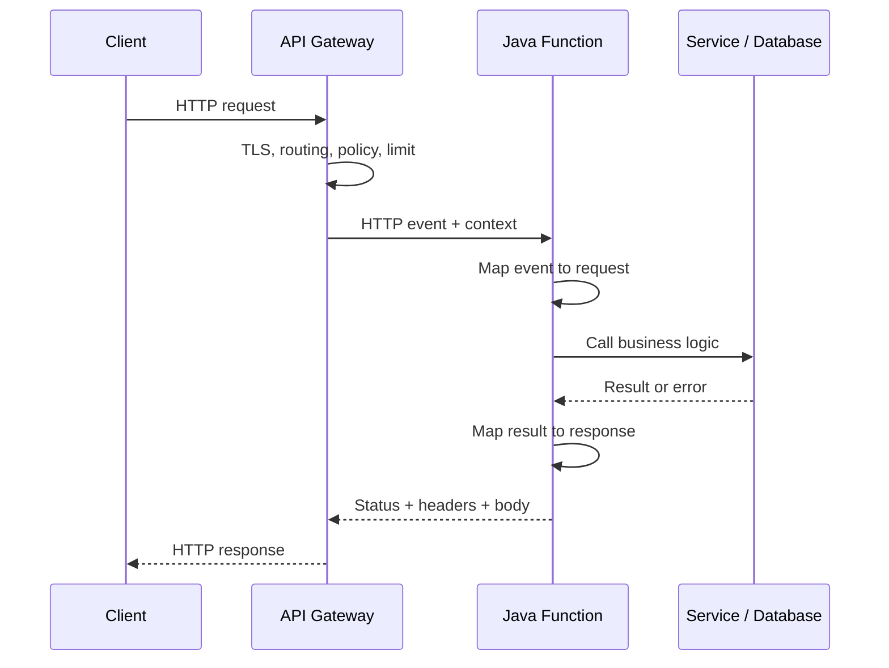

# Mapping HTTP Requests, Responses, Headers, and Status Codes

When a Java function is triggered by HTTP, the platform typically translates the HTTP request into an intermediate event or object and invokes the handler. The function processes that data and returns a response structure so the platform can convert it into an HTTP response sent to the client. This conversion process is called request/response mapping.

In the **CLOUD_SERVERLESS** module, HTTP is one of the primary triggers alongside messages and events. Understanding HTTP mapping helps developers build APIs and webhooks with clear contracts, validate inputs, return accurate status codes, handle errors consistently, and avoid accidental coupling to a specific cloud provider's implementation details.

## 1. HTTP Request Flow Through a Serverless Function

A serverless HTTP API typically consists of the following components:

1. The client sends an HTTP request to a public URL.
2. An API gateway, load balancer, or HTTP frontend receives the request and applies TLS, routing, size limits, authentication, or throttling according to configuration.
3. The platform translates the HTTP details into an event containing method, path, query, headers, body, and context.
4. The runtime invokes the Java handler with the event and execution context.
5. The handler maps the event into the application's request model, calls business logic, and produces a response.
6. The adapter converts the application response into the format required by the platform; the gateway sends the HTTP status, headers, and body back to the client.



This diagram illustrates the general model. Exact field names and event structures differ across API Gateway, Function URLs, Cloud Functions, Azure Functions, and other platforms. Some platforms wrap the request in a typed object; others pass a JSON event with fields such as `httpMethod`, `rawPath`, `queryStringParameters`, `headers`, `body`, or `isBase64Encoded`.

It is important to distinguish between two contracts:

- **HTTP contract:** method, URI, headers, body, status code, and semantics visible to the client.
- **Provider event contract:** the data structure the runtime passes into the function and the output structure expected by the gateway.

The application should have an adapter layer responsible for translating between these two contracts. Business logic should not depend on the field names of a specific cloud event.

## 2. Parts of an HTTP Request to Map

A familiar HTTP/1.1 request has a method, target URI, headers, and an optional body. With HTTP/2 or HTTP/3, some information is represented as pseudo-headers at the protocol layer. By the time the request reaches the function, the gateway usually normalizes them into separate fields.

| Component | Meaning | How It Is Used in the Function |
|---|---|---|
| Method | Action such as GET, POST, PUT, PATCH, DELETE, OPTIONS | Select route and verify supported methods |
| Path / route | Resource path, e.g., `/orders/42` | Identify endpoint and extract path parameters |
| Query string | Parameters after `?`, e.g., `?page=2&tag=a&tag=b` | Filter, paginate, sort; validate types and bounds |
| Headers | Metadata, authentication, content type, caching, tracing | Read case-insensitively; validate and normalize |
| Body | Payload sent in the request, usually JSON, form, or binary | Check size, media type, encoding, and schema before processing |
| Cookies | Client cookie data | Use only when the API explicitly relies on session/cookies; set security attributes when returning |
| Context | Request ID, stage, identity from authorizer, gateway metadata | Logging, tracing, and using authenticated identity from a trusted source |

### Method and Routing

The method expresses the client's intent. Common methods include:

- `GET`: reads a resource; should not cause business state changes.
- `POST`: creates a resource or performs an action that does not fit other methods.
- `PUT`: creates or replaces the state of a resource at a known URI; usually designed to be idempotent.
- `PATCH`: partially updates a resource according to a published patch format.
- `DELETE`: requests deletion of a resource; API design should define behavior when the resource has already been deleted.
- `OPTIONS`: discovers endpoint capabilities and is commonly used for CORS preflight.
- `HEAD`: similar to GET, but the response carries no body.

Routes should not be chosen by checking an arbitrary path string alone. The router should match both method and route, resolve path parameters, reject unsupported methods, and distinguish a nonexistent endpoint from a nonexistent resource.

For example, `GET /orders/42` and `DELETE /orders/42` share the same path but represent two different actions. If the path exists but the method is not supported, the API returns `405 Method Not Allowed` and must include an `Allow` header listing the supported methods. If no route matches, return `404 Not Found`.

### Path Parameters and Query Parameters

Path parameters identify part of a resource, such as `/customers/{customerId}/orders/{orderId}`. Query parameters typically represent options or presentation preferences, such as pagination, filtering, and sorting.

```http
GET /customers/c-18/orders?status=PAID&page=2&tag=gift&tag=priority HTTP/1.1
Host: api.example.test
Accept: application/json
```

In the request above, `c-18` and `orderId` (if present in the route) are path parameters; `status`, `page`, and the two `tag` values are query parameters. Do not assume each query parameter name appears only once. If the API allows repeated parameters, the data model should retain a list of values rather than collapsing them into a single string. If the API forbids duplicates, reject duplicate cases according to the contract.

Query values are URL-encoded on the wire. The platform may return already-decoded values or also provide the raw query string. Understand your adapter's behavior to avoid double-decoding or mishandling `+`, `%2F`, and Unicode characters. Never concatenate query values directly into SQL or query expressions; validate them and use parameter binding.

### Headers

Headers carry request metadata. Commonly used headers:

| Header | Purpose | Notes |
|---|---|---|
| `Content-Type` | Data type of the incoming body | Validate media type before parsing |
| `Accept` | Response type the client wants | May require content negotiation; return `406` if the contract cannot be satisfied |
| `Authorization` | Credentials or access token | Do not log its value; verify using appropriate middleware/authorizer or library |
| `Content-Length` | Body size in bytes | May be normalized by the gateway; still enforce payload limits on the server |
| `Accept-Language` | Client's preferred language | Apply only if the API supports multiple languages |
| `If-Match`, `If-None-Match` | Conditions based on entity tags | Useful for conditional updates and caching |
| `Idempotency-Key` | Client-supplied key to identify repeated operations | Must be persisted and checked durably on the server; the header alone does not create idempotency |
| `X-Request-Id` or `traceparent` | Request correlation and tracing | Choose a trusted source, validate, and prevent clients from spoofing internal IDs |

Header names are case-insensitive. When mapping into Java, normalize header names—for example, lowercase with `Locale.ROOT`—or use a header data type with case-insensitive lookup rules. Do not assume the gateway preserves header casing or ordering.

Some headers can appear multiple times. Do not mechanically join all values with commas: combining rules depend on the header type. In particular, `Set-Cookie` must be kept as separate headers because each cookie has its own attributes. Some event schemas provide `multiValueHeaders`, while others provide a dedicated cookies list.

Do not blindly trust client-supplied headers such as `X-Forwarded-For`, `X-Forwarded-Host`, or `X-Forwarded-Proto`. Only use them according to your trusted proxy chain and gateway configuration; if clients can call the function directly or an untrusted proxy injects headers, values can be spoofed. Whenever possible, use platform-provided request context.

### Body, Encoding, and Media Types

A body may be empty, JSON, form data, plain text, or binary data. Gateway events typically represent the body as a string. If the body is binary, the gateway may Base64-encode it and set the `isBase64Encoded=true` flag. The adapter must Base64-decode it before feeding bytes to a parser or saving a file.

Safe body handling workflow:

1. Check whether a body is present and whether the endpoint requires one.
2. Enforce size limits at both the gateway and in the application. Do not rely solely on `Content-Length`, as requests may be chunked or headers may be altered by proxies.
3. Read `Content-Type`, verifying a supported media type and charset if allowed by the contract.
4. If the event indicates Base64, decode before parsing; if the flag is false, convert the event string to bytes using the adapter's encoding convention.
5. Parse with a safe parser, validating schema, data types, lengths, enum values, and cross-field relationships.
6. Perform business mutations only after authentication and authorization succeed.

For example, a JSON endpoint should reject `text/plain` or `application/octet-stream` if the contract only accepts `application/json`. JSON exchanged between systems should use UTF-8. If an endpoint accepts file uploads, clearly define allowed media types, maximum size, filename handling, and actual file format verification; do not trust only the file extension declared by the client.

## 3. Internal Request Model in Java

A testable way to structure this is to convert the provider's event into an internal request type. This type contains only the data needed by the application layer, without carrying the entire provider event object.

```java
import java.util.List;
import java.util.Map;

public record HttpRequest(
        String method,
        String path,
        Map<String, String> pathParameters,
        Map<String, List<String>> queryParameters,
        Map<String, List<String>> headers,
        byte[] body,
        String requestId,
        AuthenticatedPrincipal principal) {
}
```

`AuthenticatedPrincipal` represents an identity verified by a trusted mechanism such as an authorizer or middleware. Do not construct a principal merely by reading an arbitrary header or trusting unverified claims. If an endpoint is public, the principal may be absent; routes requiring login must check for its presence before invoking business logic.

An internal response can be modeled as follows:

```java
import java.util.Map;

public record HttpResponse(
        int statusCode,
        Map<String, String> headers,
        byte[] body) {
}
```

In a production application, use a response abstraction that supports multiple `Set-Cookie` headers, repeated headers, and binary bodies if required by the gateway. The example above is simplified to illustrate the contract.

### Adapter Converting Events to Requests

The adapter handles differences between the provider's event schema and the internal request. The code below is intentionally Java pseudocode: `GatewayEvent` and `GatewayContext` are types defined by a specific adapter, not a universal API across all clouds.

```java
public final class GatewayAdapter {

    public HttpRequest toRequest(GatewayEvent event, GatewayContext context) {
        byte[] body = decodeBody(
                event.body(), event.isBase64Encoded());

        return new HttpRequest(
                normalizeMethod(event.httpMethod()),
                event.path(),
                event.pathParameters(),
                normalizeQuery(event.queryParameters()),
                normalizeHeaders(event.headers()),
                body,
                context.requestId(),
                context.authenticatedPrincipal());
    }

    private byte[] decodeBody(String body, boolean base64Encoded) {
        if (body == null || body.isEmpty()) {
            return new byte[0];
        }
        if (base64Encoded) {
            return Base64.getDecoder().decode(body);
        }
        return body.getBytes(StandardCharsets.UTF_8);
    }
}
```

In real implementations, the adapter must handle missing event fields, duplicate headers, repeated query parameters, invalid Base64 bodies, and encoding according to the gateway's exact contract. If the gateway returns raw path/query alongside already-decoded path parameters, do not decode them a second time. If the event provides both single-value and multi-value headers, establish clearly which field is the canonical source.

Do not pass the entire `GatewayEvent` into business services. Doing so lets you unit-test services without constructing cloud events, while reducing blast radius when changing gateways or event schema versions.

## 4. Mapping Responses Back to HTTP

An HTTP response has three main components:

- **Status code:** protocol-level processing outcome, such as `200`, `201`, `400`, or `500`.
- **Headers:** response metadata such as `Content-Type`, `Location`, `Cache-Control`, `ETag`, and `Set-Cookie`.
- **Body:** returned payload, usually JSON or binary content. Certain statuses/methods are not allowed or should not have a body.

The gateway may expect a response object formatted like:

```json
{
  "statusCode": 201,
  "headers": {
    "content-type": "application/json",
    "location": "/orders/ord-42"
  },
  "body": "{\"id\":\"ord-42\",\"status\":\"CREATED\"}",
  "isBase64Encoded": false
}
```

This is a common envelope example, not a mandatory schema across all providers. Some adapters use `statusCode`, `headers`, `body`, `cookies`; other platforms use typed objects or dedicated response APIs. If the function returns an invalid structure, the gateway may return an integration error such as `502 Bad Gateway` even though the business logic executed.

### Common Response Headers

| Header | When Used |
|---|---|
| `Content-Type` | Declares media type and charset of the body, e.g., `application/json; charset=utf-8` |
| `Location` | URI of the newly created resource or redirect target |
| `Cache-Control` | Caching policy, e.g., `no-store` for sensitive data |
| `ETag` | Validator for client caching and conditional `If-Match`/`If-None-Match` requests |
| `Retry-After` | Suggests when to retry when the server is throttling or temporarily unavailable |
| `WWW-Authenticate` | Challenge for HTTP authentication schemes when returning `401` |
| `Access-Control-Allow-Origin` | Allows a specific origin to read the response via browser CORS |
| `Set-Cookie` | Creates or updates a cookie with security attributes |
| `X-Request-Id` | Correlation ID for clients to include when seeking support; avoid leaking internal details |

Do not manually set hop-by-hop headers such as `Connection` or `Transfer-Encoding` in function responses. Gateways and proxies manage framing and connections at the HTTP layer. Also avoid manually setting `Content-Length` if the platform is responsible for computing it or may compress/transform the body.

### Response Body and Content Negotiation

If an API returns JSON, serialize objects with a JSON library and set `Content-Type: application/json`. Never concatenate JSON strings manually from user data. If the client sends `Accept`, the API can select a compatible media type; if no supported format matches, return `406 Not Acceptable` per the contract.

Responses have no body in several cases:

- `HEAD`: returns no body even though the endpoint may return metadata similar to GET.
- `204 No Content`: indicates successful processing with no response content.
- `304 Not Modified`: used in conditional GETs; sends no representation body.

If the API creates a new resource, `201 Created` typically includes a `Location` pointing to the new resource and may include a representation. If it only accepts work for asynchronous processing, `202 Accepted` signals that the request was accepted; it does not assert completion. Return a URI or tracking identifier so the client can query status.

## 5. Choosing Appropriate HTTP Status Codes

Status codes are part of the API contract. Clients, proxies, caches, SDKs, and monitoring tools rely on these codes to decide on retries, display errors, or record successes. Do not return `200 OK` for every scenario and bury a custom error code inside the JSON body.

### 2xx Group — Request Processed Successfully

| Code | Meaning | Usage Example |
|---|---|---|
| `200 OK` | Processing succeeded with a representation or result | GET returning data; POST performing an action and returning a result |
| `201 Created` | New resource created | POST creating an order; include `Location` if a resource URI exists |
| `202 Accepted` | Request accepted, processing not yet complete | Function enqueuing a job for background execution |
| `204 No Content` | Succeeded, no body | Successful DELETE or update needing no returned representation |

Do not use `202` just because the function runs on serverless. If the function finished the business operation synchronously, return the code reflecting the actual outcome. If it accepted a job that is not yet finished, `202` is more appropriate.

### 3xx Group — Redirects or Cache Usage

| Code | Meaning | Notes |
|---|---|---|
| `301 Moved Permanently` | URI has permanently moved | Clients may cache the redirect; consider method changes per client behavior |
| `302 Found` | Temporary redirect | Some clients may change POST to GET; avoid if preserving method/body is required |
| `303 See Other` | Directs client to fetch another resource via GET | Commonly used after form POST or interactive task creation |
| `307 Temporary Redirect` | Temporary redirect, preserves method | Useful when method and body must remain intact |
| `308 Permanent Redirect` | Permanent redirect, preserves method | Used when an endpoint moves while preserving semantics |
| `304 Not Modified` | Representation unchanged per validator | Used with `If-None-Match` or `If-Modified-Since`; no body |

Redirects require a valid `Location` header. Never build redirect URLs from untrusted input without checking against a host allowlist to prevent open redirects.

### 4xx Group — Client Request or Permission Errors

| Code | Meaning | Usage Example |
|---|---|---|
| `400 Bad Request` | Malformed syntax or unparseable request | Invalid JSON, malformed query parameter |
| `401 Unauthorized` | Missing or invalid credentials | Missing, expired, or invalid-signature token; response must include `WWW-Authenticate` challenge |
| `403 Forbidden` | Client identified but lacks permission | User not allowed to view another user's order |
| `404 Not Found` | Route or resource does not exist | Order not found; may be used to avoid disclosing resource existence |
| `405 Method Not Allowed` | Route exists but method is unsupported | Sending DELETE to a GET-only endpoint; must include `Allow` |
| `406 Not Acceptable` | No response representation matches `Accept` | Client accepts only XML but API supports only JSON |
| `409 Conflict` | Request conflicts with current state | Invalid order state transition or idempotency key reused with different payload |
| `412 Precondition Failed` | HTTP precondition such as `If-Match` failed | ETag changed before client update |
| `413 Content Too Large` | Payload exceeds limit | File upload exceeds API limit |
| `415 Unsupported Media Type` | Body media type is unsupported | Sending XML to a JSON-only endpoint |
| `422 Unprocessable Content` | Syntactically valid content fails business/validation rules | Valid JSON but invalid date or data relationships |
| `429 Too Many Requests` | Client is throttled | Exceeded rate limit or quota; may include `Retry-After` |

Distinguish `401` and `403`: `401` indicates the client is not validly authenticated and the response must provide at least one `WWW-Authenticate` challenge; `403` indicates the identity is known but not permitted to perform the action. Do not return credential details, internal policies, or sensitive data in error bodies.

### 5xx Group — Server or Intermediary Errors

| Code | Meaning | Usage Example |
|---|---|---|
| `500 Internal Server Error` | Unexpected processing failure | Unhandled exception not mapped to a specific client error |
| `502 Bad Gateway` | Gateway received invalid response from upstream | Function crashed, returned malformed envelope, or integration failed |
| `503 Service Unavailable` | Temporarily unable to serve | Overload, maintenance, or dependency not ready; may include `Retry-After` |
| `504 Gateway Timeout` | Gateway waited too long for upstream | Function or downstream service exceeded integration timeout |

Function code does not always determine the final status code for every error. The gateway itself can return `413`, `429`, `502`, or `504` before or after the function runs. Inspect logs from both the gateway and the function to identify which layer produced the error.

## 6. Standardizing Errors and Response Bodies

A well-designed API returns errors in a consistent structure so clients can handle them programmatically without guessing from free-form text. You can use the Problem Details format for HTTP APIs with media type `application/problem+json`.

Example:

```json
{
  "type": "https://api.example.test/problems/invalid-order-state",
  "title": "Order state conflict",
  "status": 409,
  "detail": "The order cannot be paid in its current state.",
  "instance": "/orders/ord-42",
  "code": "ORDER_STATE_CONFLICT",
  "requestId": "req-7f9c"
}
```

`type`, `title`, `status`, `detail`, and `instance` are standard Problem Details fields; `code` and `requestId` are API-defined extensions. The `detail` content should be helpful to clients without containing stack traces, SQL, internal hostnames, secrets, or unnecessary personal data.

An exception mapper can convert application errors into responses:

```java
public final class ErrorMapper {

    public HttpResponse toResponse(
            RuntimeException error, String requestId) {
        if (error instanceof ValidationException) {
            return problem(422, "Validation failed",
                    "One or more fields are invalid.",
                    "VALIDATION_FAILED", requestId);
        }

        if (error instanceof OrderConflictException) {
            return problem(409, "Order state conflict",
                    "The order cannot be changed in its current state.",
                    "ORDER_STATE_CONFLICT", requestId);
        }

        // Log full exception on the server, do not expose stack trace to the client.
        logUnexpected(error, requestId);
        return problem(500, "Internal server error",
                "The request could not be completed.",
                "INTERNAL_ERROR", requestId);
    }

    private HttpResponse problem(
            int status, String title, String detail,
            String code, String requestId) {
        ProblemDetails body = new ProblemDetails(
                status, title, detail, code, requestId);
        return new HttpResponse(
                status,
                Map.of("content-type", "application/problem+json"),
                serialize(body));
    }
}
```

This example assumes application-specific exceptions and serialize/log helpers. In a real system, clearly distinguish which exceptions represent input errors, authentication errors, authorization errors, business conflicts, or system failures. Never catch all exceptions and return `200`; equally, do not turn every error into `500` when a more accurate mapping exists.

## 7. CORS, Cookies, and Special Headers

### CORS for Browsers

Cross-Origin Resource Sharing (CORS) is a browser mechanism used to decide whether JavaScript from one origin may read responses from another origin. CORS does not replace authentication or authorization.

For certain cross-origin requests, browsers send an `OPTIONS` preflight before the actual request. The response typically needs headers such as:

- `Access-Control-Allow-Origin`: allowed origin, e.g., `https://app.example.test`.
- `Access-Control-Allow-Methods`: allowed methods, e.g., `GET, POST, PATCH, DELETE, OPTIONS`.
- `Access-Control-Allow-Headers`: request headers the browser is allowed to send, e.g., `authorization, content-type, idempotency-key`.
- `Access-Control-Allow-Credentials: true`: only when the API genuinely uses cross-origin credentials/cookies and the origin is explicitly specified.
- `Access-Control-Max-Age`: how long the browser may cache preflight results within supported limits.

If credentials are allowed, never use `Access-Control-Allow-Origin: *`. Only echo origins present in an allowlist. Decide whether CORS is handled at the gateway or in the function, and avoid configuring both places in ways that produce conflicting headers. For disallowed requests, CORS headers must not accidentally grant response read access.

### Cookies

When returning cookies, set appropriate security attributes:

```http
Set-Cookie: session=opaque-value; Path=/; HttpOnly; Secure; SameSite=Lax
```

- `HttpOnly` prevents JavaScript from accessing the cookie via the `document.cookie` API.
- `Secure` sends the cookie only over secure connections.
- `SameSite` controls cookie transmission in cross-site contexts.
- `Path`, `Domain`, and `Max-Age`/`Expires` define scope and lifetime.

Session cookies should contain an identifier or protected opaque value; important session data should be stored durably with an expiration mechanism. If a response needs multiple cookies, the adapter must keep each `Set-Cookie` separate; do not join multiple cookies into a comma-separated string.

### Caching and Validators

Read APIs for infrequently changing data can use `Cache-Control`, `ETag`, or `Last-Modified` to reduce load and bandwidth. For responses containing personal data or permission-scoped data, set appropriate cache policies—typically `private` or `no-store` depending on requirements. Never enable public caching for responses that depend on Authorization if the cache key does not partition by identity and permissions.

## 8. Webhooks: HTTP Requests from External Systems

A webhook is also an HTTP request, usually a `POST` sent by an external system when an event occurs. The function must handle it as a public endpoint with a well-defined contract:

1. Verify the sender using an HMAC signature or the authentication mechanism published by the webhook provider.
2. Verify the signature over the exact raw body bytes before parsing or normalizing JSON, if the signature algorithm requires the raw payload.
3. Use constant-time comparison for signatures and validate timestamps/windows to mitigate replay attacks.
4. Check the event ID and durably record processing markers to detect duplicate deliveries.
5. Acknowledge receipt quickly with an appropriate status after durably saving the event/job; offload heavy business processing to a queue if needed.
6. Return intentional error status codes so the webhook provider applies retries according to contract; do not assume every provider retries the same way.

Webhooks are typically delivered at least once or resent when no successful response is received. Consequently, the function must be idempotent. You can use the event ID as a unique key in the database; event persistence and job creation should be designed to avoid returning `2xx` before the event has been durably saved.

Abbreviated HMAC verification example:

```java
boolean isValidSignature(
        byte[] rawBody, byte[] suppliedSignature, byte[] secret)
        throws GeneralSecurityException {
    Mac mac = Mac.getInstance("HmacSHA256");
    mac.init(new SecretKeySpec(secret, "HmacSHA256"));
    byte[] expected = mac.doFinal(rawBody);
    return MessageDigest.isEqual(expected, suppliedSignature);
}
```

This example only illustrates the algorithm; header formats, canonical string construction, signature encoding, timestamps, and secret rotation depend on the webhook provider. Do not replace a provider's signature specification with this snippet. Secrets must be fetched from a secret manager or secure configuration—never hardcoded in source code or logged to the console.

## 9. Complete Example: Order Creation API

Suppose an API exposes `POST /orders` accepting JSON:

```json
{
  "customerId": "cus-18",
  "items": [
    { "sku": "book-1", "quantity": 2 }
  ]
}
```

A successful response might look like:

```http
HTTP/1.1 201 Created
Content-Type: application/json; charset=utf-8
Location: /orders/ord-42
Cache-Control: no-store
X-Request-Id: req-7f9c
```

```json
{
  "id": "ord-42",
  "customerId": "cus-18",
  "status": "PENDING"
}
```

Processing steps in Java:

```java
public final class OrderController {
    private final OrderService orderService;
    private final JsonCodec json;

    public HttpResponse create(HttpRequest request) {
        if (!"POST".equals(request.method())) {
            return response(405,
                    Map.of("allow", "POST, OPTIONS"), new byte[0]);
        }

        if (!isJson(request.headers())) {
            return problem(415, "UNSUPPORTED_MEDIA_TYPE",
                    "This endpoint accepts application/json.");
        }

        CreateOrderCommand command;
        try {
            command = json.read(request.body(), CreateOrderCommand.class);
        } catch (InvalidJsonException error) {
            return problem(400, "INVALID_JSON",
                    "The request body is not valid JSON.");
        }

        ValidationResult validation = validate(command);
        if (!validation.valid()) {
            return problem(422, "VALIDATION_FAILED",
                    "One or more order fields are invalid.");
        }

        AuthenticatedPrincipal principal = request.principal();
        if (principal == null) {
            return problem(401, "UNAUTHENTICATED",
                    "Authentication is required.");
        }

        if (!principal.canCreateOrderFor(command.customerId())) {
            return problem(403, "FORBIDDEN",
                    "You cannot create an order for this customer.");
        }

        Order created = orderService.create(command, principal);
        byte[] body = json.write(created);
        return response(201, Map.of(
                "content-type", "application/json; charset=utf-8",
                "location", "/orders/" + created.id(),
                "cache-control", "no-store"), body);
    }
}
```

This is a structural example, not a complete immediately compilable program: types such as `HttpRequest`, `HttpResponse`, `JsonCodec`, `OrderService`, `AuthenticatedPrincipal`, and response helpers belong to the application. In real implementations, method checks usually live in the router; authentication/authorization should be handled by middleware or a trusted authorizer; and the response must be converted by an adapter into the provider's exact event schema. Idempotency should also be implemented for order creation if clients or the gateway can retry.

The endpoint's error flows can be specified as follows:

| Scenario | Recommended Status | Notes |
|---|---:|---|
| Malformed JSON | 400 | Client fixes payload before resending |
| Missing or invalid token | 401 | Do not invoke business service |
| Authenticated but unauthorized to create order for customer | 403 | Do not disclose data outside permission scope |
| Unsupported media type | 415 | Specify accepted media types |
| Valid JSON but invalid quantity | 422 | May return field-level error list |
| Idempotency key reused with different payload | 409 | Client must use a new key or inspect prior request |
| Order created successfully | 201 | Include Location and representation |
| Database temporarily unavailable | 503 or 500 depending on cause/contract | Do not leak internal details; retries must be controlled |

## 10. HTTP Mapping Design Checklist

Before deploying a serverless endpoint, check:

- **Request contract:** Are method, route, path parameters, query parameters, headers, body, and content types defined?
- **Event mapping:** Does the adapter properly handle the gateway schema, repeated headers, repeated query parameters, Base64 bodies, and request context?
- **Validation:** Are size limits, encoding checks, schema, data types, and valid values enforced before invoking business logic?
- **Security:** Are authentication and authorization based on trusted sources; are forwarded headers and cookies properly validated?
- **Response contract:** Do status, headers, and body follow HTTP semantics; do JSON responses carry the exact `Content-Type`?
- **Error mapping:** Are client errors, business errors, system errors, and gateway errors distinguished; do error bodies avoid leaking internal details?
- **CORS/cache:** Do browser origins, preflight, credentials, and caching policies match security requirements?
- **Webhooks:** Are signatures, timestamps, event IDs, replay protection, idempotency, and retries handled?
- **Observability:** Are request ID/trace ID logged alongside logs without recording tokens, cookies, or sensitive payloads?
- **Platform limits:** Have timeouts, payload sizes, response sizes, binary media types, concurrency, and gateway integration timeouts been verified against the real service?

Test the adapter with sample events matching the platform schema, then run end-to-end HTTP tests through the gateway. Service unit tests only verify business logic; they do not prove the gateway correctly maps headers, bodies, binary payloads, CORS, or status codes.

## 11. Conclusion

HTTP mapping in serverless works in two directions: converting the gateway's request event into a Java request model and converting the application's result into a response the gateway understands. Requests must be accurately mapped across method, path, query, headers, body, and context; responses need status codes, headers, and bodies matching HTTP semantics.

Place conversions in the adapter, keep business logic independent of event schemas, validate data before processing, and choose status codes that accurately reflect outcomes. For webhooks, add signature verification, replay protection, and idempotency. When these contracts are clear, a Java function can deliver a consistent HTTP API even when runtimes or cloud providers change.
