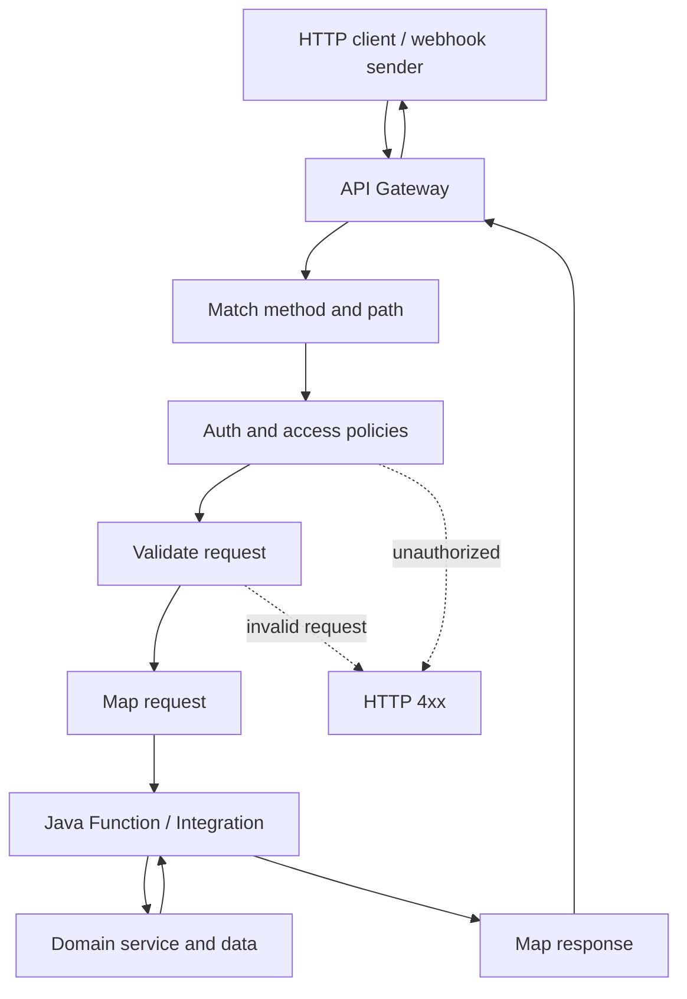

# Routing, Validation, and Data Transformation at the API Gateway

## 1. Role of the API Gateway in Serverless Applications

An API gateway is the centralized HTTP entry point for an application or group of services. The gateway receives requests from client applications or partner systems, applies edge policies, selects the processing target, and forwards requests to the destination function or service. Once the backend returns a result, the gateway can standardize the response before sending it back to the client.

In serverless architectures, a gateway typically connects HTTP routes to Java functions. It handles cross-cutting concerns shared across many endpoints, such as routing, entry-level authentication, rate limiting, request structure validation, format transformation, and request logging. The function continues by enforcing business rules, accessing data, and checking per-resource permissions.

The three functional areas of this lesson are closely connected:

- **Routing:** deciding which endpoint a request belongs to and which integration to invoke.
- **Validation:** rejecting requests with invalid structure or failing declared input constraints.
- **Transformation:** mapping requests and responses between the public HTTP contract and the format used by the backend.

The gateway is one part of the overall processing pipeline. It does not replace domain services, database constraints, or per-resource authorization. Good design clearly divides responsibilities between the gateway and functions so endpoints behave consistently and remain easy to test and operate.

## 2. Routing: From HTTP Request to Function

### 2.1. Components Used for Routing

An HTTP request typically provides information the gateway can use to select a route:

| Component | Example | Role |
| --- | --- | --- |
| HTTP method | `GET`, `POST`, `PATCH`, `DELETE` | Distinguishes operations on a resource |
| Path | `/v1/orders/ord-42` | Identifies the resource group and endpoint |
| Path parameter | `orderId = ord-42` | Passes an identifier embedded in the path |
| Query parameter | `?status=PAID&page=2` | Passes filters, pagination, or query options |
| Header | `Content-Type`, `Authorization`, `X-Request-Id` | Carries metadata, authentication info, and content controls |
| Host/domain | `api.example.com` | Can distinguish APIs or tenants if supported by the gateway |

Most gateways route primarily by method and path. Some platforms also support host, header, or advanced matching conditions. Route declaration syntax and precedence rules when multiple routes match depend on the provider; read the platform documentation before relying on specific behavior.

For example, an order management API might declare the following routes:

| Method | Path | Integration | Purpose |
| --- | --- | --- | --- |
| `POST` | `/v1/orders` | `CreateOrderFunction` | Create an order |
| `GET` | `/v1/orders/{orderId}` | `GetOrderFunction` | Retrieve order details |
| `GET` | `/v1/orders` | `ListOrdersFunction` | Search and paginate orders |
| `PATCH` | `/v1/orders/{orderId}` | `UpdateOrderFunction` | Partially update order details |
| `DELETE` | `/v1/orders/{orderId}` | `CancelOrderFunction` | Cancel an order per business policy |

`{orderId}` is a path parameter. For `GET /v1/orders/ord-42`, the gateway matches `GET /v1/orders/{orderId}` and passes `ord-42` in the integration input data. For `GET /v1/orders`, the list route is selected; both method and path participate in identifying the endpoint.

### 2.2. Static Routes, Parameterized Routes, and Default Routes

Static routes like `/v1/orders/search` are generally more specific than parameterized routes like `/v1/orders/{orderId}`. When a gateway supports static routes, parameterized routes, and wildcards together, precedence follows platform rules. Do not assume every provider resolves route conflicts identically.

Wildcard or catch-all routes—such as a single route representing multiple paths—can be useful when forwarding to a shared backend. However, they easily mask missing route declarations and accidentally widen the API surface. Use them only when clearly needed, restrict allowed methods, and validate paths in the backend.

Avoid declaring two routes that could match the same request for different purposes. In particular, check these cases:

- A static route colliding with a possible path parameter value.
- The same path missing a declaration for a specific HTTP method.
- Paths with or without a trailing `/`.
- Differences in casing, percent-encoding, and repeated slashes.
- Wildcards that might accept unintended paths.

Do not silently normalize paths differently across multiple layers. Clients, the gateway, and the backend must agree on URL decoding, trailing-slash handling, and path parameter interpretation so a single request is not interpreted as two different resources.

### 2.3. Stages, Domains, and API Versions

Many gateways support stages or deployment environments such as `dev`, `test`, and `prod`. Stages isolate configuration, hostnames, quotas, and integrations across environments. Some platforms embed the stage in the URL, while others use custom domains and base path mappings to hide that detail.

Public API versions are commonly expressed in the path, such as `/v1/orders` and `/v2/orders`, or via another versioning mechanism. Versioning enables controlled contract changes when request/response structures change incompatibly. Even for additive changes like optional fields, consider older clients, schema validation, and how the backend handles unknown fields.

Establish a deprecation plan for older versions: announce timelines, monitor request volume by version, guide clients through migration, and remove routes only when stakeholders are ready. Never change the meaning of an existing field while keeping the same version if doing so causes older clients to misinterpret data.

### 2.4. Integrations and Forwarding Requests to the Backend

After matching a route, the gateway invokes an integration. An integration can be a function, an HTTP service, or a managed cloud service. Two common integration styles exist:

- **Proxy/pass-through integration:** the gateway forwards most of the request along with context to the backend. The backend reads method, path, headers, query, and body. This style is flexible and reduces mapping configuration, but couples the function to the gateway's event structure.
- **Non-proxy/mapped integration:** the gateway selects fields to forward, renames them, or transforms data before invoking the backend. The backend receives a cleaner, more stable contract, though complex mappings can be harder to trace and test.

Some platforms also support direct integrations with cloud services without an intermediate function. Choosing an integration style depends on control requirements, complexity, and provider capabilities.

The conceptual configuration below illustrates the relationship between routes, validation, and integrations. This is pseudoconfiguration to explain the architecture, not a deployment file for a specific provider:

```yaml
routes:
  - method: POST
    path: /v1/orders
    integration: CreateOrderFunction
    authorization: customer-jwt
    requestSchema: CreateOrderRequest
    throttlingProfile: orders-write

  - method: GET
    path: /v1/orders/{orderId}
    integration: GetOrderFunction
    authorization: customer-jwt
    pathParameters:
      orderId: required
```

### 2.5. Overall Processing Flow



The actual order of authentication, validation, quotas, and mapping may vary across gateways. The diagram represents the logical steps required, not a strict internal execution order across all products.

## 3. Validation: Checking Requests at the Right Layer

### 3.1. Structural Checks vs. Business Checks

Gateway validation fits conditions that can be checked from the request alone without accessing business state. For example:

- Method and path must match a published route.
- Required headers must be present; `Content-Type` must be a supported type.
- Query parameters and path parameters must be present, properly formatted, or within allowed bounds.
- Body must be valid JSON, within size limits, and compliant with the schema.
- Tokens or API keys must pass authentication checks per gateway policy.

Conditions depending on stored data or domain rules belong in the function/domain service. For example: whether the customer owns the order, whether the product is in stock, whether the price is still valid, or whether the current state allows canceling the order. The gateway should not query business databases on every request just to replace these checks.

Checks can be divided into three layers:

| Layer | Examples | Appropriate Location |
| --- | --- | --- |
| Syntax and protocol | Parseable JSON, valid headers, body matches media type | Gateway and request decoder |
| Data structure | Required fields, data types, lengths, quantity bounds | Gateway if schema validation is supported; function still re-checks critical constraints |
| Business semantics | Resource ownership, order state, account limits | Function/domain service and data layer |

A request that passes schema validation can still be invalid in business terms. For example, `quantity: 2` is a valid positive integer according to the schema, yet only one unit may remain in inventory.

### 3.2. Validating Path, Query, and Headers

Path parameters typically identify a resource; restrict length and format to prevent unexpected values. Query parameters usually control search and pagination. Bound `pageSize`, validate numeric types and enums, and define how repeated parameters such as `?tag=a&tag=b` are handled.

Headers can carry `Content-Type`, `Accept`, `Authorization`, `Idempotency-Key`, `X-Correlation-Id`, or webhook signatures. Clearly define which headers are required, which are client-supplied, and which only the gateway may produce. Never trust a self-asserted identity header from the client if the backend treats it as an authenticated identity.

HTTP headers are case-insensitive by standard, though some intermediaries normalize or merge headers. For security-sensitive headers such as signatures, verify precisely how the gateway forwards values, ordering, and duplicate headers according to platform documentation.

### 3.3. Schema Validation for JSON Bodies

A schema describes body structure: data types, required fields, bounds, enums, patterns, and nested object shapes. JSON Schema or schemas defined in OpenAPI are commonly used to document request contracts.

Abbreviated schema example for an order creation request:

```json
{
  "type": "object",
  "required": ["customerId", "items"],
  "additionalProperties": false,
  "properties": {
    "customerId": {
      "type": "string",
      "minLength": 1,
      "maxLength": 64
    },
    "items": {
      "type": "array",
      "minItems": 1,
      "maxItems": 50,
      "items": {
        "type": "object",
        "required": ["sku", "quantity"],
        "additionalProperties": false,
        "properties": {
          "sku": { "type": "string", "minLength": 1 },
          "quantity": { "type": "integer", "minimum": 1 }
        }
      }
    }
  }
}
```

This is a sample JSON Schema; the level of JSON Schema support, supported keywords, and how schemas attach to routes depend on the gateway. Check platform compatibility before relying on a specific keyword.

`additionalProperties: false` helps reject out-of-contract fields. This is useful when an API wants strict input control, though it can complicate rollouts when clients send new fields. Another option is to allow unknown fields while ensuring the function safely ignores them. Choose a deliberate policy and keep it consistent across the gateway, OpenAPI, and backend.

### 3.4. Size, Content Type, and Rate Limits

A valid schema does not guarantee a request is resource-safe. The gateway should enforce body size limits, timeouts, requests-per-interval limits, and appropriate burst limits. Rejecting oversized payloads early reduces data transfer costs and prevents the function from reading or parsing unnecessary data.

Check `Content-Type` before parsing the body. If an endpoint accepts only `application/json`, requests sending `text/plain` or unsupported media types should receive an appropriate response, typically `415 Unsupported Media Type`. The `Accept` header can be used to negotiate response format if the API supports multiple content types.

Rate limits can be applied per API key, client, tenant, route, or authenticated identity. Rate limiting protects the backend and controls usage; it does not replace access control. When thresholds are exceeded, the gateway typically returns `429 Too Many Requests`, optionally with `Retry-After` if the policy can determine when to retry.

### 3.5. Gateway Validation Does Not Replace Checks in the Java Function

Functions must re-validate critical conditions because they may be invoked from multiple sources, such as queues, events, test harnesses, or another gateway. Never assume every invocation passed through the same gateway.

The Java example below illustrates the function's boundary layer: converting decoded data into a command, checking basic invariants, and calling the domain service. Types `CreateOrderRequest`, `CreateOrderCommand`, `OrderService`, and `ApiResponse` are illustrative application types; provider-specific API event conversion depends on the runtime.

```java
import java.util.List;

public record OrderLineRequest(String sku, int quantity) {}

public record CreateOrderRequest(
        String customerId,
        List<OrderLineRequest> items) {}

public record ValidationError(String field, String message) {}

public final class CreateOrderHandler {
    private final OrderService orderService;

    public CreateOrderHandler(OrderService orderService) {
        this.orderService = orderService;
    }

    public ApiResponse handle(
            CreateOrderRequest request,
            AuthenticatedPrincipal principal) {

        if (request == null
                || request.customerId() == null
                || request.customerId().isBlank()
                || request.items() == null
                || request.items().isEmpty()) {
            return ApiResponse.badRequest("INVALID_REQUEST");
        }

        for (OrderLineRequest item : request.items()) {
            if (item == null
                    || item.sku() == null
                    || item.sku().isBlank()
                    || item.quantity() <= 0) {
                return ApiResponse.badRequest("INVALID_ORDER_ITEM");
            }
        }

        // Identity comes from a trusted authentication context,
        // not from the customerId self-reported by the client.
        CreateOrderCommand command = new CreateOrderCommand(
                principal.subject(), request.customerId(), request.items());

        Order order = orderService.create(command);
        return ApiResponse.created("/v1/orders/" + order.id(), order);
    }
}
```

In production systems, return a structured list of errors rather than a single generic code if clients need to fix multiple fields at once. The example above focuses on where validation occurs and where identity comes from. The domain service must still verify that the customer is authorized to create an order for that account and apply inventory, pricing, and state rules.

## 4. Transformation: Mapping Requests and Responses

### 4.1. Why Transform Data?

Public HTTP contracts are usually designed around client needs and may need to be maintained for years. The backend may use different field names, event structures, or data models. The gateway can translate between the two shapes to reduce direct coupling between clients and functions.

For example, the client sends:

```json
{
  "customer_id": "cus-81",
  "items": [
    { "sku": "BK-7", "qty": 2 }
  ]
}
```

The gateway can map this to an internal payload:

```json
{
  "customerId": "cus-81",
  "lines": [
    { "productCode": "BK-7", "quantity": 2 }
  ]
}
```

As a result, the public API can keep `customer_id` and `qty` while the Java domain model uses `customerId`, `productCode`, and `quantity`. However, perform only straightforward mappings at the gateway. Transformations requiring data lookups, price calculations, policy enforcement, or multi-step orchestration belong in the function/domain service.

### 4.2. Request Mapping

Request mapping may perform one or more of the following:

- Selecting which method, path, query parameters, and headers are forwarded.
- Renaming or normalizing fields in the body.
- Adding metadata such as request ID, stage, or authenticated identity into the integration context.
- Converting between JSON, form data, or event structures supported by the backend.
- Stripping internal headers that should not reach the backend, or overwriting headers that clients could spoof.

Use an allowlist for forwarded headers and query parameters when the backend does not need everything. If the gateway adds `principalId` to the context, that value must come from an authorizer or trusted identity context. Never copy a header like `X-User-Id` from the client and treat it as an authenticated identity.

### 4.3. Response Mapping

Response mapping translates internal results into a stable HTTP contract. The gateway can map:

- Internal result codes to HTTP status codes.
- Internal fields to public field names.
- Headers such as `Content-Type`, `Location`, `Cache-Control`, and `Retry-After`.
- Internal error structures into a unified error envelope.
- Metadata that should remain private so it is stripped from the response.

For example, the backend returns an internal result:

```json
{
  "orderId": "ord-42",
  "state": "PAYMENT_PENDING",
  "internalRiskScore": 17
}
```

The public response might contain only:

```json
{
  "id": "ord-42",
  "status": "PENDING_PAYMENT"
}
```

Do not expose table names, stack traces, connection details, internal codes, or risk scores if the client is not authorized to see them. Sensitive field filtering should also be enforced in the domain/API layer; do not rely solely on a gateway mapping if other paths can invoke the backend.

### 4.4. Standardizing Error Responses

APIs should return consistent error structures so clients can handle errors by error code and field rather than parsing message strings. Example:

```json
{
  "error": {
    "code": "INVALID_ORDER_ITEM",
    "message": "One or more items are invalid.",
    "requestId": "req-7f2a",
    "details": [
      {
        "field": "items[0].quantity",
        "reason": "must be greater than zero"
      }
    ]
  }
}
```

The gateway can convert integration errors into a common format, but should not obscure the distinction between client errors, authentication errors, and system errors. Preserve the correlation/request ID for log lookup. Messages sent to clients should be helpful without leaking internal details.

### 4.5. Limits of Mapping at the Gateway

Complex mappings make gateway configuration hard to read, hard to test, and hard to observe. If a mapping needs significant computation, calls to external services, or business branching, move that logic into the function. The gateway should focus on request orchestration and edge format translation.

When changing mappings, test both requests and responses across all supported API versions. A new mapping can alter default values, drop fields, or change data types without any changes to function code; therefore, gateway configuration also requires code review, versioning, and controlled rollouts.

## 5. HTTP Status Codes and Route Behavior

The gateway and function must agree on how outcomes are represented. The table below reflects common conventions; specific APIs may choose different details provided they are consistent and documented.

| Status | When to Use | Example |
| --- | --- | --- |
| `200 OK` | Request succeeded and has a response | Reading or updating a resource succeeded |
| `201 Created` | Resource created | Order created; may return a `Location` header |
| `202 Accepted` | Asynchronous processing request accepted | Submitted a job to a queue for later processing |
| `204 No Content` | Succeeded with no body | Deletion or update requiring no response content |
| `400 Bad Request` | Malformed syntax or unprocessable request | Invalid JSON, missing required parameter |
| `401 Unauthorized` | Missing or invalid authentication credentials | Expired token or missing token |
| `403 Forbidden` | Authenticated but not permitted | Principal lacks permission to invoke operation |
| `404 Not Found` | Route or resource does not exist | No matching endpoint or order not found |
| `405 Method Not Allowed` | Path exists but method is unsupported | Calling `PUT` on a `GET`-only endpoint |
| `409 Conflict` | Conflicts with current state | Canceling an already-shipped order |
| `413 Content Too Large` | Payload exceeds limit | Upload body exceeds allowed size |
| `415 Unsupported Media Type` | Media type is unsupported | Sending XML to a JSON-only endpoint |
| `422 Unprocessable Content` | Valid syntax but fails published rules | Field value is unacceptable |
| `429 Too Many Requests` | Rate limit or quota exceeded | Client sends too many requests |
| `502 Bad Gateway` | Gateway received invalid response from upstream | Integration closed connection abnormally |
| `503 Service Unavailable` | Backend temporarily unavailable | Out of capacity or under maintenance |
| `504 Gateway Timeout` | Backend did not respond within gateway timeout | Function or downstream service ran too long |

Do not turn every backend error into `200 OK` with a `success: false` field, because clients, caches, monitoring, and retry policies rely on status codes to interpret outcomes. Conversely, do not return `500` for input errors that the client can fix.

## 6. Security and Special Cases for HTTP APIs

### 6.1. Authentication, Authorization, and Trusting Context

The gateway can authenticate requests using JWT/OAuth 2.0, API keys, IAM mechanisms, or custom authorizers depending on the platform. API keys are generally suited for identifying applications, applying quotas, or metering usage; do not treat an API key by default as sufficient proof of end-user authentication.

After authentication, the function still needs to check permissions on resources. For example, a valid token identifies the caller as `user-17`, but the function must verify whether `user-17` is allowed to read `ord-42`. This is resource-level authorization and typically requires business data.

If the gateway injects principal, scopes, or claims into the integration context, the backend should trust only context sources protected by the gateway. Strip or overwrite headers with matching names sent by clients. Network configuration and function invocation permissions must also prevent clients from bypassing the gateway to invoke the integration directly if doing so would violate security policy.

### 6.2. CORS and Preflight

Browsers enforce Cross-Origin Resource Sharing (CORS) when a web page calls an API at another origin. The gateway can add headers such as `Access-Control-Allow-Origin`, `Access-Control-Allow-Methods`, and `Access-Control-Allow-Headers`; some requests require handling an `OPTIONS` preflight before the actual request.

Allow only necessary origins. Do not combine wildcard origins with credentials in ways browsers forbid. CORS is a policy browsers use to control JavaScript's ability to read responses; it is not an authentication mechanism and does not stop other types of clients from calling the API.

### 6.3. Webhooks and Request Signatures

Webhooks are HTTP requests sent by an external system to an application endpoint when an event occurs. Beyond routing and schema checks, webhooks typically require HMAC signature verification or equivalent authentication, timestamp validation to curb replays, and duplicate event ID handling.

Some providers sign over the exact raw bytes of the request body. If the gateway parses and re-serializes JSON, changes to whitespace, field ordering, or encoding can invalidate the signature. For such webhooks, preserve the raw body and signature headers exactly as required by the provider, and verify the signature inside the function or a component designed to preserve raw bytes. Never verify signatures over a transformed payload.

Webhooks are often retried when the receiver times out or returns an error. The handler must be idempotent: persist processed event IDs, define behavior when receiving an old event, and return appropriate responses. If processing takes significant time, validate the request, durably persist the event, enqueue it, and return `202 Accepted`; a consumer processes it later. Ensure event persistence and message publishing do not create data-loss gaps, for example by using transactions or an outbox appropriate for the system.

### 6.4. Input Normalization and Anti-Spoofing

Gateway, proxy, and function layers may interpret URLs, headers, or bodies differently if normalization is inconsistent. Such discrepancies can create vulnerabilities like route-control bypasses or broken signature verification. Test percent-encoding, duplicate headers, repeated query parameters, empty bodies, Unicode characters, and unusual content types.

Never concatenate path parameters directly into SQL queries, filenames, or system paths. Use parameterized queries, ID format allowlists, and safe data access APIs. Bound request sizes and processing times at both the gateway and backend to reduce the risk of excessive resource consumption.

## 7. Observing and Testing Routing, Validation, and Transformation

### 7.1. Observability Data

Every request should have a request ID or correlation ID propagated across the gateway and function. Structured logs can record method, route template, status code, integration, latency, validation results, and error codes. Avoid logging full bodies, tokens, signatures, or personal data unless necessary.

Useful metrics include:

- Request counts by route, method, and status code.
- Rates of requests rejected due to validation, authentication, or throttling.
- Latency at the gateway, integration, and total response time, typically at p50/p95/p99.
- Counts of timeouts, integration connection errors, throttling, and 5xx responses.
- Traffic by API version, client, or tenant to support deprecation and capacity planning.

If both the gateway and function emit logs, share the same request ID to correlate both sides. Do not monitor only overall success counts; per-route error rates reveal when one endpoint is failing while other routes appear healthy.

### 7.2. Route Test Matrix

Each route should have tests for valid method/path combinations as well as near-match invalid cases. For example, for `POST /v1/orders`:

| Case | Expected Outcome |
| --- | --- |
| `POST /v1/orders` with valid JSON | Invokes the order creation function |
| `GET /v1/orders` | Invokes the list function, not the creation function |
| `POST /v1/orders/ord-42` | Does not match the order creation route |
| `PUT /v1/orders` | Returns a method error per API contract |
| Syntactically invalid JSON body | Rejected before or at the parse layer |
| Missing `customerId` | Validation returns a structured error |
| `quantity` equals 0 | Rejected by validation or domain rule |
| Oversized body | Rejected by gateway with appropriate status |
| Invalid token | Does not invoke business function |
| Valid token without order ownership | Function rejects via authorization |

### 7.3. Mapping and Contract Testing

Mapping tests must verify both data that is preserved and data that must be stripped. For requests, check field names, data types, encoding, headers, and context. For responses, check status, body, headers, and that no internal fields leak.

Maintain contract tests based on OpenAPI or shared schemas to catch drift between the gateway and functions. Schema changes must be checked against existing clients, webhook consumers, and deployed API versions. Beyond function unit tests, run integration tests through a real gateway or equivalent environment to verify route precedence, authorizers, CORS, mappings, and timeouts.

## 8. Workflow for Designing a New Endpoint

When adding an endpoint for a Java function, you can follow this sequence:

1. **Write the HTTP contract:** define method, path, query, headers, request body, response body, and status codes.
2. **Choose route and integration:** identify the target function, stage, version, and proxy vs. mapped integration style.
3. **Define access policies:** choose authentication mechanism, quotas, and required permissions; separate authentication from per-resource authorization.
4. **Declare validation:** body schema, required parameters, content types, maximum sizes, and rate limits.
5. **Design mappings:** decide which fields/headers are forwarded, which are renamed, which context values are added, and which responses need normalization.
6. **Handle errors:** standardize error codes, HTTP statuses, request IDs, and how client errors are distinguished from integration errors.
7. **Ensure operational safety:** enforce timeouts, structured logging, per-route metrics, and alerts for abnormal 4xx/5xx rates.
8. **Test through the gateway:** test valid/invalid routes, methods, validation, auth, mappings, CORS, and boundary payload cases.
9. **Deploy safely:** version configuration, review changes, roll out by stage/canary if supported, and prepare a rollback plan.

## 9. Common Design Mistakes

| Mistake | Consequence | Fix |
| --- | --- | --- |
| Using catch-all routes for many unrelated endpoints | Unexpected requests reach the backend and missing routes are hard to spot | Declare explicit routes, restrict methods, and test unmatched paths |
| Validating only at the gateway | Functions invoked via other paths may receive invalid data | Re-check invariants and critical inputs inside the function/domain layer |
| Putting complex business rules into mappings | Configuration becomes hard to read, test, and debug | Keep mappings limited to format translation; place business logic in services |
| Trusting client-supplied identity headers | Clients can spoof principals | Obtain identity from trusted auth context, strip or overwrite spoofable headers |
| Omitting body size and rate limits | Increases risk of resource exhaustion and cost spikes | Configure payload limits, quotas, throttling, and timeouts |
| Changing responses without version management | Older clients may fail or misinterpret data | Maintain compatible contracts and a versioning/deprecation plan |
| Modifying raw body before webhook signature verification | Valid signatures may be rejected or verified against altered data | Preserve original bytes and verify using the provider's exact algorithm |
| Returning all errors under status `200` | Clients and monitoring misinterpret outcomes | Use consistent HTTP statuses and error contracts |

## 10. Conclusion

An API gateway establishes the HTTP boundary for serverless applications. Routing directs requests to the right integration based on method, path, and route configuration. Validation checks protocol rules, structure, and input limits before requests consume backend resources. Transformation translates between public contracts and internal formats while standardizing responses so clients depend less on implementation details.

When designing endpoints, keep routes explicit, schemas versioned, mappings simple, authentication contexts trustworthy, and error rules consistent. Java functions remain responsible for enforcing business invariants and per-resource permissions. Combining both layers with observability and gateway-level testing keeps serverless APIs scalable, secure, and resilient as the backend evolves.
