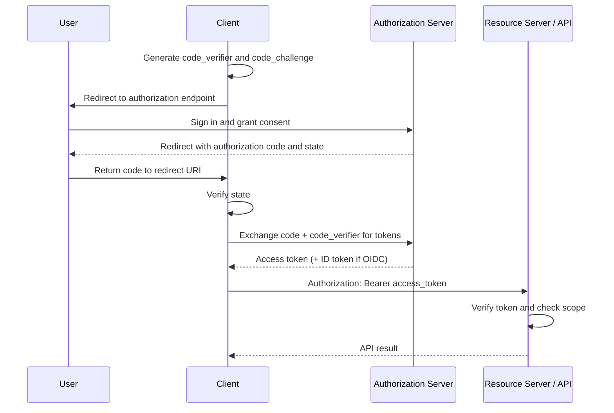
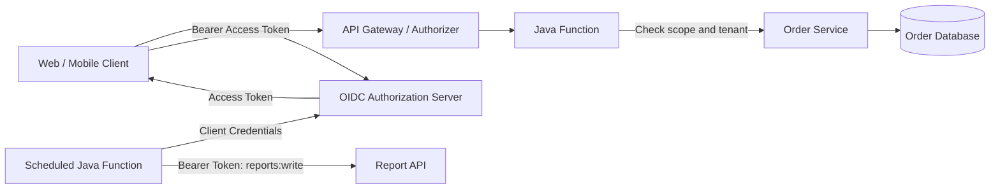

# Authenticating APIs with OAuth 2.0, OpenID Connect, and JWT

An HTTP API needs to know who is sending a request, what the request is allowed to do, and whether the token proving that authority is still valid. In a serverless system, authentication can be performed at the API Gateway, an authorizer, or directly inside the Java function. Regardless of which layer handles it, the system must distinguish identity, access permissions, and credential validity.

OAuth 2.0, OpenID Connect (OIDC), and JSON Web Tokens (JWT) frequently appear together, yet they solve different problems. OAuth 2.0 is an authorization framework enabling clients to obtain permission to access resources. OIDC adds a user identity authentication layer on top of OAuth 2.0. JWT is a format for representing claims that can be signed or encrypted; it is commonly used as an access token or ID token, though JWT itself is not an authorization protocol.

Understanding these boundaries prevents common mistakes such as using an ID token to call an API, decoding a JWT without verifying its signature, or accepting a validly signed token that was not issued for the current API.

## 1. Distinguishing OAuth 2.0, OpenID Connect, and JWT

### 1.1. OAuth 2.0: Access Authorization

OAuth 2.0 describes how a client obtains an access token from an authorization server to access resources protected by a resource server. An access token represents granted permissions for a specific scope, target audience, and lifetime.

The core roles are:

- **Resource owner:** the entity capable of granting access; typically an end user.
- **Client:** the application seeking to access resources on behalf of the resource owner or using its own application identity.
- **Authorization server:** authenticates the user or client, enforces authorization policies, and issues tokens.
- **Resource server:** the API that receives access tokens, validates them, and decides whether to allow an operation.

For example, an order management application needs to read an order list. The user signs in through the authorization server and grants the `orders:read` scope. The client receives an access token and sends it to the API. The API validates the token and scope before returning data.

OAuth 2.0 answers the question: *which resources is the client allowed to access?* It does not itself define how users sign in or standardize user profile information. That is why OIDC was built on top of OAuth 2.0.

### 1.2. OpenID Connect: Identity Authentication

OIDC is an identity layer built on top of OAuth 2.0. When a client requests the `openid` scope, the authorization server can additionally issue an **ID token**. The ID token contains claims about the authentication event and the user, such as `sub` (a stable identifier for the subject within the issuer), `iss`, `aud`, `exp`, and optionally `auth_time` and `nonce`.

The ID token is meant for the client to understand the sign-in result. **The access token is meant for the resource server/API to verify access permissions.** Do not use an ID token in place of an access token when calling an API unless a dedicated protocol is explicitly designed for that purpose.

OIDC also defines discovery metadata and a UserInfo endpoint. Clients can retrieve the issuer configuration, authorization endpoint, token endpoint, and JWKS URI from the provider's discovery document. Clients must verify the expected issuer and trusted configuration; never accept an arbitrary URL from user input and automatically trust the metadata found there.

### 1.3. JWT: Token Format

JWT is a representation format for claims. A JWT is commonly signed as a JWS; in that case, the compact token has three dot-separated segments:

```text
base64url(header).base64url(payload).base64url(signature)
```

- **Header:** metadata about the token type and signing algorithm, optionally containing `kid` to identify the key.
- **Payload:** claims such as issuer, audience, subject, expiration, scopes, or application data.
- **Signature:** cryptographic signature allowing the recipient to verify the token was signed by a trusted key and its contents have not been tampered with.

The header and payload segments are only Base64URL-encoded for representation—they are not kept secret. Anyone holding the token can decode the payload of a JWS. Never put passwords, secrets, card numbers, or sensitive data into a JWT assuming the signature hides the contents.

JWTs can also be encrypted using JWE; the compact JWE structure typically has five segments. However, most JWT access tokens used in APIs are signed JWS tokens rather than encrypted tokens. Always check the token profile and contract of the authorization server in use.

### 1.4. Access Tokens Do Not Have to Be JWTs

OAuth 2.0 does not require access tokens to be JWTs. An authorization server can issue opaque tokens (unstructured strings that clients cannot read themselves). Resource servers can validate opaque tokens via an introspection endpoint or a provider-supplied lookup mechanism.

| Characteristic | JWT Access Token | Opaque Access Token |
| --- | --- | --- |
| Verification method | Verify signature and claims per profile | Call introspection or trusted lookup service |
| Verifiable offline | Yes, with appropriate keys and policy | Typically no |
| Immediate revocation | Harder if verified purely locally | Can reflect revocation status via introspection |
| Network dependency at verification | Reduced if JWKS is cached appropriately | Usually requires calling authorization server or cache |
| Size | Can be large due to claims and signature | Usually smaller, depending on implementation |

Do not choose JWT solely because you can decode it. Choose based on revocation needs, latency, availability, system scale, and key management capabilities.

## 2. Common OAuth 2.0 Flows

The token issuance flow must fit the client type and how users or services interact. Never use a single grant type for every scenario.

### 2.1. Authorization Code with PKCE

This is the appropriate choice for user-facing applications, including web apps, mobile apps, and public clients. PKCE (Proof Key for Code Exchange) protects the authorization code from being intercepted and reused by another application.

High-level workflow:

1. The client generates a random `code_verifier` and computes `code_challenge` using SHA-256 (method `S256`).
2. The client redirects the user to the authorization endpoint with `response_type=code`, `client_id`, `redirect_uri`, `scope`, `state`, `code_challenge`, and `code_challenge_method=S256`.
3. The authorization server authenticates the user, requests consent if needed, and redirects the browser back to the redirect URI with the authorization code and `state`.
4. The client verifies `state`, then sends the code, redirect URI, and `code_verifier` to the token endpoint.
5. The authorization server verifies PKCE and issues an access token; if OIDC is used, it may also issue an ID token.
6. The client sends the access token to the API via the `Authorization: Bearer` header.



`state` binds the callback response to the initiated sign-in request and protects against CSRF in the redirect flow. `nonce` in OIDC binds the ID token to the client's authentication session and helps prevent ID token replay in that context. `state` and `nonce` serve different purposes; do not arbitrarily substitute a single value for both.

For server-side web applications acting as confidential clients, the client can authenticate at the token endpoint using a method supported by the authorization server. For mobile apps or SPAs acting as public clients, a client secret cannot be kept safe in code distributed to users; PKCE is a critical safeguard and static secrets must not be embedded in the application.

### 2.2. Client Credentials

Client Credentials is suited for service-to-service communication when a workload needs to access an API using its own identity rather than acting on behalf of a signed-in user.

1. The service calls the token endpoint using its registered client identity.
2. The authorization server authenticates the client, e.g., via a protected client secret, private key, or another supported authentication mechanism.
3. The authorization server issues an access token with the granted scopes and audience.
4. The service sends the access token to the target API.

For example, a scheduled report-aggregation Java function needs to call a report storage API. The function uses its workload identity to request a token with the `reports:write` scope, then sends the token to the resource server. There is no need to impersonate a user to run this background task.

Client Credentials does not create a user session and typically does not issue an ID token. Do not store client secrets in source code, container images, unprotected configuration variables, or logs. Prefer workload identity, managed identity, or platform-provided short-lived credentials when available.

### 2.3. Flows to Avoid

- **Implicit grant:** do not use for new applications; Authorization Code with PKCE is a better replacement.
- **Resource Owner Password Credentials grant:** do not use; applications should not collect user passwords to exchange for tokens.
- **Ad-hoc custom tokens:** do not mint your own JWTs with a shared secret across services without well-defined issuer, key management, audience, and rotation processes.

When designing a new system, choose Authorization Code + PKCE for user sign-in and Client Credentials for service-to-service tasks, unless the provider or architecture has an evaluated requirement otherwise.

## 3. How Access Tokens Are Sent to HTTP APIs

After obtaining an access token, the client typically sends it in an HTTP header:

```http
GET /v1/orders HTTP/1.1
Host: api.example.com
Authorization: Bearer eyJ...<access-token>
Accept: application/json
```

Bearer means whoever holds the token can use it. Consequently, access tokens must be protected like credentials: transmit only over HTTPS, never place them in URL query strings, never write them to logs, and never send them to untrusted domains.

The API must determine whether the token was issued by a trusted issuer, intended for this specific API, unexpired, and authorized for the requested operation. Signature verification is only one step in that process.

## 4. Verifying JWT Access Tokens

A resource server must not trust a token simply because it has three segments or its payload contains a familiar `sub`. It must verify the signature and all token contract conditions before trusting claims.

### 4.1. Verifying Signatures with Trusted Keys

The authorization server signs tokens with a private key. The resource server retrieves the corresponding public key from a trusted JWKS endpoint. JWKS is a published set of public keys enabling recipients to verify signatures.

The JWT header may contain `kid` (key ID). The resource server uses `kid` to select the matching key from the JWKS. If the key is not found, it can refresh the JWKS in a controlled manner to handle key rotation; never fetch an arbitrary URL supplied by the token.

Key principles:

- Obtain the issuer and JWKS URI from trusted configuration or verified OIDC discovery.
- Allow only the set of signing algorithms configured by the system and committed to by the provider.
- Never let the token dictate which algorithm is accepted; reject `alg=none`.
- Select the exact key by `kid`, verifying key type and algorithm compatibility.
- Cache the JWKS with a reasonable TTL to reduce latency and load; support refreshing on an unseen `kid` with rate limits to prevent request storms.
- Reject the token if signature verification fails or a trust chain cannot be established.

### 4.2. Validating Claims

After signature verification succeeds, the API must still validate claims according to the access token profile:

| Claim | Meaning | Resource Server Check |
| --- | --- | --- |
| `iss` | Issuer that minted the token | Must match the configured trusted issuer exactly |
| `aud` | Intended token audience | Must include the current API/resource server identifier |
| `exp` | Expiration timestamp | Token must not be expired; allow only small clock skew per policy |
| `nbf` | Not valid before this timestamp | Reject token prior to valid time, accounting for small clock skew |
| `iat` | Issued-at timestamp | Can validate sanity and token age policy |
| `sub` | Subject represented by the token | Use as identifier scoped to the issuer; do not treat `sub` alone as globally unique |
| `scope` or `scp` | Granted permissions | Must contain the permission required for the endpoint/action |
| `client_id` | Client granted the access token in the relevant JWT access token profile | Check if API policy restricts allowed callers; claim name depends on token profile |
| `jti` | Token identifier | Useful for auditing or revocation lists if supported by the architecture |

Claim names and data types can differ across authorization servers. Some tokens represent scopes as a space-delimited string; some profiles use an array or the `scp` claim. Follow the issuer's contract rather than guessing claim names.

In particular, checking `aud` prevents tokens issued for another API from being accepted here. Checking `iss` blocks tokens using the same key or format from an untrusted issuer. Never accept an empty audience or wildcard just to make validation easier.

### 4.3. Authorization by Scope and Resource

A valid access token does not mean the holder can do everything. After authenticating the token, the API must check permissions against both the endpoint and the target data.

For example:

- `orders:read` permits reading orders.
- `orders:write` permits creating or updating orders.
- `reports:write` permits generating reports.

Scopes typically express API-level permissions. The API still needs per-resource authorization: is this user allowed to read the order with this `orderId`, does the tenant in the token match the data's tenant, and is the action valid in the current business state?

Never rely on `sub` or `scope` alone to skip ownership and tenant isolation checks. A token carrying `orders:read` does not automatically authorize reading every customer's orders.

### 4.4. ID Tokens and Access Tokens Must Be Handled Differently

An OIDC ID token typically has `client_id` (the sign-in application) as its audience. An access token has the API/resource server as its audience. An API must not accept an ID token as an access token simply because both are JWTs signed by the same issuer.

Clients verify ID tokens per OIDC rules, including issuer, client audience, expiration, signature, and nonce when sent in the authentication request; `azp` must also be checked per OIDC rules when present or required. Resource servers verify access tokens per the API's token profile, including the API audience and relevant scopes/permissions. Do not assume `azp` is a universal replacement for `client_id` across all access tokens.

## 5. Integrating Authentication into Java FaaS

In serverless architectures, there are two common places to verify access tokens:

1. **API Gateway or authorizer:** verifies the token before forwarding the request to the function. This reduces invalid traffic reaching business code and enables centralized policy management.
2. **Java function / resource server:** verifies the token inside the application. This is useful when the function is invoked through multiple paths, needs fine-grained scope checks, or must protect invocations that do not pass through the gateway.

Both layers can participate together. The gateway can verify the signature and baseline claims, while the function enforces business permissions, tenant boundaries, and ownership. If verification happens only at the gateway, ensure no direct or internal invocation path bypasses the gateway. IAM/resource policies should restrict function invocation permissions strictly to the required gateway and principals.

### 5.1. Separating Token Verification from the Handler

Do not hand-roll JWT validation by splitting strings, Base64-decoding, and comparing fields. Use a maintained OAuth/JWT library configured with the issuer, audience, JWKS URI, and allowed algorithms. The adapter below illustrates the boundary between the token verification library and HTTP logic; the types represent an application contract, not the standard API of a specific library.

```java
public interface AccessTokenVerifier {
    // Returns only after the signature and required claims have been verified.
    VerifiedAccessToken verify(String compactToken);
}

public record VerifiedAccessToken(
        String subject,
        String issuer,
        Set<String> audiences,
        Set<String> scopes,
        String clientId) {
}

public final class OrdersHandler {
    private final AccessTokenVerifier tokenVerifier;
    private final OrderService orderService;

    public OrdersHandler(
            AccessTokenVerifier tokenVerifier,
            OrderService orderService) {
        this.tokenVerifier = tokenVerifier;
        this.orderService = orderService;
    }

    public ApiResponse listOrders(ApiRequest request) {
        String token = bearerToken(request.header("Authorization"));
        if (token == null) {
            return ApiResponse.unauthorized(
                    "Bearer authentication is required");
        }

        final VerifiedAccessToken principal;
        try {
            principal = tokenVerifier.verify(token);
        } catch (InvalidAccessTokenException error) {
            return ApiResponse.unauthorized("Invalid access token");
        }

        if (!principal.scopes().contains("orders:read")) {
            return ApiResponse.forbidden("Insufficient scope");
        }

        // Service continues checking tenant/ownership according to business policy.
        return ApiResponse.ok(
                orderService.listVisibleTo(principal.subject()));
    }

    private static String bearerToken(String authorization) {
        if (authorization == null) {
            return null;
        }
        String prefix = "Bearer ";
        if (!authorization.regionMatches(
                true, 0, prefix, 0, prefix.length())) {
            return null;
        }
        String value = authorization.substring(prefix.length()).trim();
        return value.isEmpty() ? null : value;
    }
}
```

The code assumes `AccessTokenVerifier` returns only a verified principal. In implementation, the adapter should use a reputable JOSE/OIDC library and explicitly configure:

- exact issuer;
- API audience;
- JWKS URI derived from trusted issuer configuration;
- signing algorithm allowlist;
- `kid` lookup, caching, and key rotation handling;
- `exp`, `nbf`, and clock skew checks;
- access token profile and scope parsing rules;
- allowed client policies for calling the API, if required.

Never construct a `VerifiedAccessToken` from an unverified payload. Never use a `decode()` method in place of `verify()`. If using a security framework such as Spring Security Resource Server, configure the JWT decoder/issuer and audience validator in the security layer and pass the verified principal to the handler.

### 5.2. Per-Endpoint Authorization Example

Suppose an API exposes these endpoints:

| Endpoint | Minimum Scope | Additional Business Checks |
| --- | --- | --- |
| `GET /v1/orders` | `orders:read` | Return only orders belonging to the authorized tenant or user |
| `POST /v1/orders` | `orders:write` | Check order creation permission, quotas, and input data |
| `GET /v1/reports/{id}` | `reports:read` | Verify the report belongs to the current tenant |

Do not assign overly broad scopes like `admin` to every function just to reduce configuration. Follow least privilege and separate read/write scopes when the domain requires that boundary.

### 5.3. HTTP Error Handling

APIs commonly use:

- **401 Unauthorized:** missing credentials or invalid, expired, bad-signature, wrong-issuer, or wrong-audience access token.
- **403 Forbidden:** valid token lacking the required scope or business permission.
- **400 Bad Request:** malformed header or request according to the API contract.
- **429 Too Many Requests:** client exceeded rate limits; this is load throttling, not an authentication error.

For Bearer tokens, the API can return a `WWW-Authenticate` header per RFC 6750, such as `Bearer error="invalid_token"` or `Bearer error="insufficient_scope"`. Never return stack traces, key material, internal issuer details, or sensitive verification reasons to clients.

## 6. Managing Token and Key Lifecycles

### 6.1. Access Token Lifetime

Access tokens should have lifetimes aligned with risk and user experience. Short-lived tokens shrink the window in which a stolen token can be abused. However, overly short lifetimes increase token requests and dependency on authorization server availability.

Refresh tokens are typically issued to clients per issuer policy to obtain new access tokens. Resource servers must not accept refresh tokens to invoke business APIs. Clients must store refresh tokens securely, use rotation or sender constraints if supported by the provider, and handle refresh token reuse detection per policy.

### 6.2. JWT Revocation

Locally verified JWTs remain valid until `exp`, even if the user has logged out or permissions were revoked, unless the API performs additional checks. Options include:

- short-lived access tokens;
- opaque tokens with introspection;
- revocation lists keyed by `jti` or session ID;
- checking account/session state in an authoritative store;
- sender-constrained tokens such as mTLS or DPoP when supported by the client model and provider.

Revocation lists or state lookups add latency and introduce a new dependency. Balance immediate revocation needs against availability and cost.

### 6.3. Key Rotation and JWKS Caching

Authorization servers may rotate signing keys on a schedule or in response to incidents. Resource servers must support multiple keys during transition periods:

1. The issuer publishes the new public key in the JWKS.
2. The issuer begins signing new tokens with the new private key.
3. The resource server fetches or refreshes the JWKS, identifying keys via `kid`.
4. The issuer keeps the old public key published long enough for previously signed tokens to expire or the transition window to finish.
5. The old key is retired according to policy.

If the JWKS is cached for too long, the API may fail to recognize new keys. If refreshed on every request, the API creates heavy load and becomes fragile when the JWKS endpoint is slow. Use a TTL-based cache, controlled refresh on an unknown `kid`, refresh rate limiting, and strict verification failure when keys cannot be retrieved.

Never fetch `jku` or `x5u` headers from a JWT by default to obtain keys. Doing so can trick the API into querying attacker-controlled URLs. Use the JWKS URI configured from the trusted issuer.

## 7. Security Practices for OAuth, OIDC, and JWT

### 7.1. Protecting Tokens in Transit and at Rest

- Transmit tokens only over HTTPS with proper certificate validation enabled.
- Never place access tokens in URLs, query strings, or fragments.
- Never write tokens to application logs, access logs, tracing attributes, or error reports.
- Store tokens on the client in platform-appropriate storage; avoid long-term storage in local storage if the web app's threat model does not accept XSS risks.
- Do not share tokens across audiences or services outside their granted purpose.
- Do not embed secrets or sensitive data in JWT payloads assuming the signature encrypts the contents.

### 7.2. CORS and CSRF

CORS is a browser policy controlling which web pages can read cross-origin responses. CORS does not authenticate clients and does not replace OAuth or API authorization checks.

If an application relies on cookies automatically attached by browsers, evaluate CSRF risks and configure cookie attributes such as `Secure`, `HttpOnly`, and `SameSite` alongside appropriate CSRF protections. If using bearer tokens explicitly attached to headers by JavaScript, the CSRF model differs, though XSS and token theft risks still require mitigation. Never rely on CORS as your sole security boundary.

### 7.3. Multi-Tenancy and User Identifiers

For multi-tenant APIs, verify the tenant claim or a trusted tenant mapping from the issuer. Never accept a client-supplied `tenantId` and assume the token grants access to that tenant. The API must validate the token's tenant, the requested resource, and business access rights within the same authorization decision.

`sub` is unique only within the context of an issuer. If a system supports multiple issuers, the user identifier key should include both `iss` and `sub`, or use a controlled internal identity mapping.

### 7.4. Protecting Webhooks

Webhooks are HTTP requests actively sent by an external system to an application endpoint when events occur. Webhooks can be secured with OAuth bearer tokens if supported by the provider, though many webhooks use HMAC or asymmetric signatures over the request payload.

For HMAC webhooks, the receiver typically needs to:

1. Read the exact original raw request body.
2. Compute the signature from the secret and data per the provider's convention.
3. Compare signatures in constant time.
4. Validate timestamps or time windows to reduce replay risk.
5. Use event IDs or delivery IDs to prevent duplicate processing.
6. Acknowledge receipt only after durably persisting the event or processing according to contract.

You cannot replace webhook signature verification by decoding an arbitrary JWT. If a webhook uses JWTs, the receiver must still verify signature, issuer, audience, expiration, and specified claims. The webhook provider's security contract is the authoritative source for verification rules.

## 8. Common Implementation Mistakes

| Mistake | Why It Is Dangerous | Fix |
| --- | --- | --- |
| Only Base64-decoding the JWT | Attackers can forge arbitrary payloads | Use a library that verifies signatures and claims |
| Accepting any algorithm in the header | Can enable weak verification paths or misconfiguration | Configure an algorithm allowlist and check key types |
| Not checking `iss` | Accepts tokens from other issuers | Match the exact expected issuer |
| Not checking `aud` | Tokens issued for another API can be replayed | Require the audience matching this resource server |
| Checking only `exp` | Unexpired tokens may still have bad signatures or wrong purpose | Validate the full token profile |
| Using ID tokens to call APIs | Confuses sign-in identity with resource access rights | Use an access token with the proper audience |
| Not checking scopes | Any valid token can invoke any endpoint | Check scopes and resource permissions on every action |
| Trusting `sub` without `iss` | Subject collisions can occur across multiple issuers | Use the issuer/subject pair or an internal mapping |
| Trusting `kid` to fetch keys from token URLs | Can cause SSRF or load untrusted keys | Use only a trusted configured JWKS URI |
| Caching JWKS without refresh | Tokens signed with newly rotated keys get rejected | Use TTL caching with controlled refresh |
| Logging raw access tokens | Tokens can be extracted from logging systems | Redact Authorization headers and secrets |
| Using client secrets in SPAs/mobile apps | Secrets can be extracted from distributed code | Use public clients + PKCE or appropriate workload identity |

## 9. Design and Testing Workflow

Before deploying OAuth/OIDC/JWT to production, follow these steps:

1. **Identify client types.** Is this a user-facing app, a confidential backend client, or a service-to-service workload?
2. **Choose the right flow.** Use Authorization Code + PKCE for user login; Client Credentials for service-to-service tasks.
3. **Define issuer and audience.** Which issuer does the API trust, what is its resource identifier, and which endpoints need protection?
4. **Define scopes and business permissions.** Separate read/write scopes, tenant checks, and ownership; do not rely solely on a valid token.
5. **Select token format and verification method.** JWT with JWKS or opaque token with introspection? What are the revocation and latency requirements?
6. **Integrate at gateway/function.** Define the signature-verification layer, scope/resource authorization layer, and protect direct invocation paths.
7. **Design token/key lifecycles.** Access token lifetimes, refresh tokens, rotation, JWKS caching, and handling issuer outages.
8. **Test valid and invalid cases.** Bad signatures, wrong `iss`, wrong `aud`, expired tokens, future `nbf`, unknown `kid`, missing scopes, and tenant mismatches.
9. **Test operational scenarios.** Temporary JWKS endpoint unavailability, key rotation, high concurrency, log redaction, gateway timeouts, and observability.
10. **Monitor and audit permissions.** Track 401/403 rates, introspection/JWKS errors, verification latency, token issuance, and scope changes.

### Token Test Matrix

| Scenario | Expected Outcome |
| --- | --- |
| Valid signature, matching issuer/audience, unexpired, sufficient scope | Allowed if resource permissions also pass |
| Missing Authorization header | 401 |
| Invalid signature or untrusted `kid` | 401 |
| Expired token or before `nbf` | 401 |
| Issuer not in allowlist | 401 |
| Audience does not include current API | 401 |
| Valid token missing required scope | 403 |
| Token has scope but accesses another tenant's resource | 403 or policy-defined response avoiding resource disclosure |
| JWKS temporarily unreachable and no matching cached key | Fail closed; log verification error and handle availability per policy |
| Valid token but request exceeds rate limit | 429 |

When the JWKS endpoint is unavailable, never bypass signature checks to let requests through. If the cache still holds valid keys and policy permits, continue verifying with cached keys. If no trusted key is available, reject authentication and emit an alert for the dependency.

## 10. Serverless Architecture Example

An order management system has a web client, an authorization server, and Java functions behind an API Gateway:



The web/mobile client signs in via Authorization Code + PKCE. The authorization server issues an access token intended for the Order API. The API Gateway verifies the token before forwarding requests to the Java function. The function further checks scopes, tenant, and access rights on specific orders. Another scheduled function uses Client Credentials to call the Report API with `reports:write` permission.

This model separates user identity from workload identity. Both use access tokens, yet their tokens differ in client, subject, audience, and scopes. Each API accepts only the issuer/audience and permissions configured for itself.

## Conclusion

OAuth 2.0 provides the authorization mechanism for clients to obtain access tokens; OIDC adds identity authentication and ID tokens; JWT is a claims format commonly used for signed tokens. Access tokens and ID tokens serve different purposes, audiences, and validation rules.

A secure resource server must verify signatures using trusted keys, validate issuer, audience, expiration, and required claims, and then enforce scopes and per-resource permissions. In Java FaaS, the API Gateway can verify early, while the function protects business logic and tenant boundaries; direct invocation paths must be restricted with appropriate policies.

Choices around flows, token lifetimes, revocation strategies, JWKS caching, key rotation, and retries during authorization service outages all affect both security and availability. Using maintained libraries, testing invalid tokens, and keeping controlled logs make OAuth 2.0, OIDC, and JWT a reliable part of serverless HTTP API architectures.
