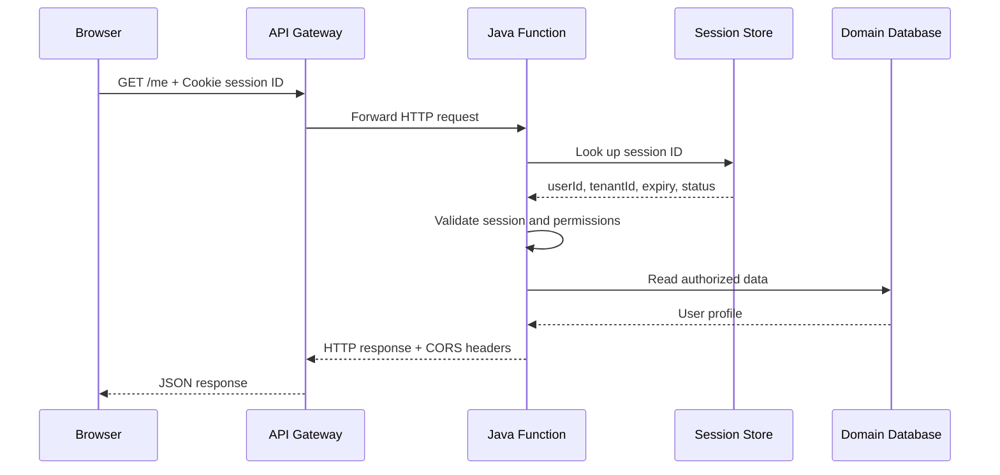

# CORS, Cookies, and User Sessions in Serverless APIs

## 1. Context: Browsers, HTTP APIs, and Java Functions

A web application often serves its frontend from one address and calls an API at another address. For example, a UI at `https://app.example.com` calls an API at `https://api.example.com`. Browsers treat these two addresses as different origins because their hostnames differ, even though they may belong to the same website. When the API authenticates users with cookies, the browser also enforces cookie, credential, and privacy policies.

In a serverless model, requests may pass through a CDN or API gateway before triggering a Java function. The gateway may handle CORS, TLS, initial authentication, and routing; the function checks sessions, enforces business permissions, and returns responses. If CORS is configured across multiple layers inconsistently, responses can end up with duplicate or incorrect headers. If sessions are stored in a function's in-memory state, the next request may route to a different instance and fail to find the session.

Three concepts must be distinguished:

- **CORS (Cross-Origin Resource Sharing):** a mechanism for a server to declare which origins the browser may allow JavaScript to read cross-origin responses from.
- **Cookie:** small pieces of data the server asks the browser to store and send back based on domain, path, expiration, and SameSite policy.
- **Session:** authentication or user state maintained across multiple HTTP requests. Cookies usually carry only a session ID or a token referencing that state.

CORS is not an authentication mechanism. A cookie does not prove a request is valid without checking the session. Sessions also should not depend on a specific FaaS instance. All three must be designed alongside CSRF, XSS, access control, and deployment lifecycles.

## 2. Origin, Site, and Same-Origin Policy

An origin is defined by the tuple **scheme, host, and port**. Two URLs with the same hostname but different schemes or ports are still different origins.

| First URL | Second URL | Same Origin? | Reason |
|---|---|---:|---|
| `https://app.example.com` | `https://app.example.com/api` | Yes | Same scheme, host, and default port |
| `https://app.example.com` | `https://api.example.com` | No | Different hosts |
| `https://app.example.com` | `http://app.example.com` | No | Different schemes |
| `https://app.example.com` | `https://app.example.com:8443` | No | Different ports |

The same-origin policy restricts a web page from reading resources from another origin. CORS is the mechanism that grants controlled permission to read responses for certain requests. This rule is enforced by browsers; a backend program calling an API with Java, curl, or another service is not blocked by browser CORS.

**Site** is a different concept from origin. In the context of SameSite cookies, browsers evaluate scheme and registrable domain (along with public suffix rules), not just the exact hostname. For instance, `https://app.example.com` and `https://api.example.com` are cross-origin yet usually same-site. By contrast, `https://app.example.com` and `https://api.other.net` are cross-site.

This distinction matters: requests from a frontend to an API may need CORS because they are cross-origin, while cookies are still considered same-site. Conversely, an embedded app or frontend on a different domain may require cross-site cookies and face additional browser restrictions on third-party cookies.

## 3. How Does CORS Work?

When JavaScript sends a cross-origin request, the browser decides whether a preflight is needed. For certain simple requests, the browser sends the request directly but lets JavaScript read the response only if valid CORS headers are present. For non-simple requests, the browser sends an `OPTIONS` request first to ask whether the server permits the origin, method, and intended headers.

Example request from a frontend:

```javascript
const response = await fetch("https://api.example.com/orders", {
  method: "POST",
  headers: {
    "Content-Type": "application/json",
    "X-Request-Id": "req-81"
  },
  body: JSON.stringify({ productId: "BOOK-01", quantity: 2 })
});

if (!response.ok) {
  throw new Error(`HTTP ${response.status}`);
}

const order = await response.json();
```

`Content-Type: application/json` and the custom header `X-Request-Id` trigger a preflight when sent cross-origin. The browser sends a request like:

```http
OPTIONS /orders HTTP/1.1
Host: api.example.com
Origin: https://app.example.com
Access-Control-Request-Method: POST
Access-Control-Request-Headers: content-type,x-request-id
```

The server may respond with:

```http
HTTP/1.1 204 No Content
Access-Control-Allow-Origin: https://app.example.com
Access-Control-Allow-Methods: GET, POST, PATCH, DELETE, OPTIONS
Access-Control-Allow-Headers: Content-Type, X-Request-Id, Authorization
Access-Control-Max-Age: 600
Vary: Origin
```

Only after the preflight succeeds does the browser send the actual request. The actual response also needs appropriate CORS headers for JavaScript to read it. If the preflight is rejected, the browser does not send the actual request on that flow.

Preflights are not business requests and typically do not carry authentication cookies. Therefore, the `OPTIONS` route must be able to respond without requiring user login. If the gateway enforces authentication before routing `OPTIONS`, browsers may never be able to send the actual request. Nevertheless, the actual request must still undergo normal authentication and authorization.

## 4. Key CORS Headers

| Header | Role | Notes |
|---|---|---|
| `Access-Control-Allow-Origin` | Specifies the origin permitted to read the response | A single specific origin, or `*` when credentials are not used |
| `Access-Control-Allow-Methods` | Permitted HTTP methods | Preflight response; list the exact methods the API supports |
| `Access-Control-Allow-Headers` | Request headers the client is allowed to send | Include custom headers and `Authorization` if needed |
| `Access-Control-Allow-Credentials` | Allows CORS requests to use credentials such as cookies | Valid value is `true`; cannot be combined with `Allow-Origin: *` |
| `Access-Control-Expose-Headers` | Allows JavaScript to read specific response headers | E.g., `ETag`, `X-Request-Id` |
| `Access-Control-Max-Age` | How long browsers may cache preflight results | Browsers may cap the duration independently |
| `Vary: Origin` | Signals caches that responses vary by Origin | Required when the server dynamically echoes origins from an allowlist |

`Access-Control-Allow-Origin` is not a comma-separated list. A response returns only a single specific origin or the wildcard according to CORS rules. If the server permits multiple origins, check `Origin` against an allowlist and return only the matching accepted origin.

Never blindly reflect whatever `Origin` value the client sends. If the server echoes the request's `Origin` straight into `Access-Control-Allow-Origin`, any website can gain permission to read responses. Compare origins using parsed, normalized values—including scheme, hostname, and port; avoid string checks like `endsWith("example.com")`, which could mistakenly accept `example.com.attacker.net`.

If an API does not use cookies or HTTP authentication credentials, `Access-Control-Allow-Origin: *` can be suitable for a public API. When credentials are used, return a specific origin and `Access-Control-Allow-Credentials: true`. Do not set `Access-Control-Allow-Credentials: true` just because the API has login; enable it only when browsers actually need to send or receive credentials on cross-origin requests.

## 5. Requests with Credentials and Cookie-Based CORS

By default, `fetch` does not send cookies on cross-origin requests. The frontend must declare:

```javascript
const response = await fetch("https://api.example.com/me", {
  method: "GET",
  credentials: "include"
});
```

The server must return corresponding headers on the actual response:

```http
Access-Control-Allow-Origin: https://app.example.com
Access-Control-Allow-Credentials: true
Vary: Origin
```

If the request triggers a preflight, the `OPTIONS` response must also permit the origin, method, and headers requested by the actual call. The preflight itself usually carries no cookies; `Allow-Credentials` does not turn a preflight into a session-authenticated request. Browsers still enforce cookie rules such as Domain, Path, Secure, SameSite, and third-party cookie policies when sending the actual request.

For actual requests using credentials, the preflight response must also permit credentials with `Access-Control-Allow-Credentials: true`, even though the `OPTIONS` request carries no cookies. Example preflight response:

```http
HTTP/1.1 204 No Content
Access-Control-Allow-Origin: https://app.example.com
Access-Control-Allow-Credentials: true
Access-Control-Allow-Methods: GET, POST, OPTIONS
Access-Control-Allow-Headers: Content-Type, X-CSRF-Token
Vary: Origin
```

For requests with credentials, never use `Access-Control-Allow-Origin: *`. Also do not rely on wildcards for `Access-Control-Allow-Headers` or `Access-Control-Allow-Methods` expecting broad access when credentials are enabled; explicitly list the required headers and methods. `Access-Control-Allow-Credentials` must have the exact value `true` (case-sensitive per header value syntax).

If the server dynamically selects an origin from an allowlist, the response needs `Vary: Origin` so intermediate caches do not serve a response permitted for one origin to another origin. CDN/API gateway configurations must also forward `Origin` and apply an appropriate cache key. When personalized responses should not be cached, set private caching policies or `Cache-Control: private, no-store` on sensitive endpoints.

## 6. Preflights and API Gateway Configuration

A preflight is an `OPTIONS` request containing `Origin`, `Access-Control-Request-Method`, and optionally `Access-Control-Request-Headers`. The server should:

1. Determine whether the origin is in the allowlist.
2. Check whether the requested method is allowed.
3. Check whether each requested header is in the allowed list.
4. Return `204 No Content` or an equivalent success response with exact CORS headers.
5. Never run business logic that creates orders, mutates data, or consumes sessions during preflight.

In serverless architectures, `OPTIONS` can be handled at the API gateway so the function does not even spin up. If the function handles it directly, the `OPTIONS` route must be mapped properly and not blocked by authentication middleware. Choose one primary owner for CORS: either the gateway or the application. If both add headers, responses can end up with duplicate `Access-Control-Allow-Origin` headers or conflicting policies.

Do not add CORS headers only to success responses. Authentication errors, validation errors, `404`, `429`, and `5xx` responses also need CORS headers so the frontend can read the status and error details. If the gateway generates error responses before the function runs, the gateway's CORS configuration must cover those responses too.

`Access-Control-Max-Age` reduces preflight frequency, though it should not be set excessively long if allowed origins or permissions change frequently. Browsers may cap actual cache durations. Updating CORS configuration does not immediately invalidate preflight results already cached by a browser until the cache expires.

## 7. Cookies in the Browser

Cookies are sent by the server via `Set-Cookie`; browsers manage them and decide when to send them back via the `Cookie` header. JavaScript on a web page cannot read cookies marked `HttpOnly`. This is an important property when using cookies as session credentials.

Example session cookie:

```http
Set-Cookie: __Host-session=opaque-random-value; Path=/; Secure; HttpOnly; SameSite=Lax; Max-Age=1800
```

Key attributes:

| Attribute | Effect | Recommendation |
|---|---|---|
| `Secure` | Sends cookie only over HTTPS connections | Enable for sessions in production |
| `HttpOnly` | Blocks JavaScript from reading the cookie via `document.cookie` | Enable for session IDs and refresh tokens in cookies |
| `SameSite` | Restricts cookies on cross-site requests | Choose `Strict`, `Lax`, or `None` based on navigation and auth flows |
| `Path` | Restricts which request paths receive the cookie | Use `/` for application-wide sessions |
| `Domain` | Expands cookie scope to matching domain and subdomains | Omit to create a host-only cookie unless subdomain sharing is needed |
| `Max-Age` / `Expires` | Sets browser-side cookie lifetime | Must align with server-side session lifetime |

If `Domain` is omitted, the cookie is host-only and sent exclusively to the host that set it. This is generally safer than sharing cookies across all subdomains. Do not set `Domain=.example.com` if a frontend or a less-trusted subdomain does not need to receive the cookie.

`Path` is not a reliable security boundary. A cookie with `Path=/admin` does not replace server-side authorization checks. Likewise, a cookie being restricted to one host does not prove the user has rights to every resource on that host.

### Cookie Security Prefixes

Modern browsers support cookie prefixes with extra constraints:

- `__Host-`: requires `Secure`, `Path=/`, and no `Domain`. Suitable for session cookies bound to a single host.
- `__Secure-`: requires the cookie to be set over a secure context and include the `Secure` attribute.

For example, `__Host-session` reduces the risk of another subdomain setting a cookie of the same name with a broad domain scope. Server-side session validation and CSRF protection are still required.

### Choosing SameSite

| Value | General Behavior | Use Cases |
|---|---|---|
| `Strict` | Restricts sending cookies during cross-site navigations | High-security apps willing to accept external links not auto-signing in |
| `Lax` | Allows cookies on certain safe top-level navigations, but restricts many other cross-site requests | Practical default for most web sessions |
| `None` | Allows cookies in cross-site contexts if Secure requirements are met | Genuine cross-site integrations, iframes, or frontends on another site |

`SameSite=None` cookies must include `Secure`. Even so, this configuration does not guarantee cookies will always be sent: browsers may block third-party cookies or enforce user privacy settings. If a product requires reliable sign-in, consider hosting the frontend and API on the same site or using a Backend-for-Frontend (BFF) so the browser communicates only with an origin/site controlled by the application.

## 8. CORS and Cookies Do Not Replace CSRF Protection

Cross-Site Request Forgery (CSRF) happens when a browser automatically sends valid cookies to a website where the user did not intend to perform an action. An attacker can cause the browser to issue requests on the user's behalf. CORS primarily governs whether JavaScript at another origin can read the response; it is not a mechanism that blocks all cross-site requests from being sent.

For example, a malicious page can submit an HTML form POST to a website where the user is signed in. The browser may send that request with cookies per cookie rules, even though the malicious page cannot read the response. Therefore, APIs authenticating via cookies need CSRF protection for state-changing operations.

Common layers of defense:

- Set `SameSite=Lax` or `Strict` where product flows allow.
- Use CSRF tokens via the synchronizer token pattern: the server issues a token bound to the session, the frontend sends it in a header or body, and the server verifies it.
- With the double-submit cookie pattern, use a dedicated signed token or one bound to the session; do not merely compare a plain cookie that could be overwritten from a subdomain.
- Check `Origin` and, where appropriate, `Referer` on state-changing requests. Reject origins not on the trusted list.
- Require a custom header for browser APIs and permit it only via CORS; this is an additional layer, not a replacement for CSRF tokens when needed.
- Never use GET for data-mutating actions.

Not every endpoint needs the exact same measures. APIs accepting only bearer tokens in the `Authorization` header without relying on automatically sent cookies are generally less exposed to traditional CSRF, though they still require protection against XSS, token theft, and other auth flaws. If cookies hold JWTs, requests still exhibit automatic cookie transmission and still require CSRF evaluation.

## 9. User Sessions in Serverless Environments

HTTP is a stateless protocol: each request is independent. Sessions create continuity by sending an identifier or credential on each request and looking up corresponding state. A session typically holds:

- A random, unguessable session ID.
- Authenticated user ID and tenant ID.
- Creation time, last activity time, and expiration time.
- Revocation status or authentication version if needed.
- Minimal information needed for authorization checks; sensitive permission data should be read from authoritative sources when needed.

In serverless, never store canonical sessions in static variables, function singletons, or instance memory. The platform may spin up multiple instances, reuse instances nondeterministically, or route the next request to a different instance. Local memory is suitable only as a short-lived cache that can vanish at any time, never as the canonical session store.

A common design puts only an opaque session ID in the cookie; the Java function reads session state from a shared store such as Redis, DynamoDB, or a relational database. The data store should support TTL expiration, ID lookups, and atomic updates matching the workload. If using a distributed cache, understand replication lag, eviction, and cache-loss behavior.



If the session store becomes temporarily unavailable, clearly decide which endpoints fail closed (deny access) and how to return retryable errors. Never bypass session checks just to keep the system "running." For sensitive data, session store failures should fail requests safely and trigger monitoring alerts.

## 10. Creating, Extending, Rotating, and Ending Sessions

A secure session lifecycle typically includes:

1. **Sign-in:** verify login credentials or identity provider assertion; generate a session ID using a cryptographic random generator.
2. **Persist session:** write ID, user, tenant, creation timestamp, idle expiry, and absolute expiry to the shared store.
3. **Set cookie:** send the session ID via `Set-Cookie` with `Secure`, `HttpOnly`, `SameSite`, and appropriate host/path scope.
4. **Authenticate requests:** read cookie, look up session, check expiration/revocation, then verify action permissions.
5. **Extend:** update idle expiry per policy; never extend indefinitely past absolute expiry.
6. **Rotate:** issue a new session ID after sign-in, permission changes, or privilege escalation events; invalidate the old ID.
7. **Sign-out:** revoke the session on the server and return an expired cookie to the browser.

Never keep a pre-login session ID and elevate that same ID after sign-in; doing so enables session fixation. After successful authentication, issue a fresh ID. Also rotate session IDs when users change passwords, toggle MFA, or undergo sensitive role changes per security policy.

Two time limits can be enforced:

- **Idle timeout:** the session expires if the user is inactive for a configured duration.
- **Absolute timeout:** the session expires after a maximum total duration since creation, even if active requests continue arriving.

Session store TTL and cookie expiration should be aligned. A cookie remaining in the browser after the server expires the session does not grant access, but causes poor UX. Conversely, if the cookie expires before the session, orphaned sessions remain until TTL cleanup runs. Sign-out must revoke state on the server; deleting the cookie client-side alone does not invalidate a copied session ID.

Example cookie deletion:

```http
Set-Cookie: __Host-session=; Path=/; Secure; HttpOnly; SameSite=Lax; Max-Age=0
```

Cookie name, Path, and scope attributes must match the original cookie so the browser removes the right cookie. At the same time, the server marks the session revoked or deletes the corresponding record.

## 11. Three Common Session Management Patterns

| Pattern | How It Works | Advantages | Trade-offs |
|---|---|---|---|
| Opaque session ID + session store | Cookie holds a random ID; server looks up state in shared store | Immediate revocation, centralized permission updates, small cookies | Every request needs a store read; requires operating and scaling session store |
| Signed/encrypted cookie session | Cookie holds signed or encrypted session payload | Fewer store reads, simpler function scaling | Hard to revoke immediately without denylist/versioning; larger cookies; key management required |
| JWT access token | Client sends signed token; server verifies claims | Locally verifiable, well suited for distributed APIs | Hard to revoke, old tokens stay valid until expiration, requires key and claim management |

Signed cookies guarantee only integrity, not confidentiality. If storing private data, use authenticated encryption or store only a reference ID. Even when cookies are signed or encrypted, still set `Secure`, `HttpOnly`, `SameSite`, and evaluate CSRF if browsers send cookies automatically.

JWT is a claims token format, not automatically a complete session system. When using JWTs, the server must verify the signature using safely configured algorithms, `iss`, `aud`, `exp`, `nbf`, and required claims. Never accept arbitrary algorithms declared by the token itself. Access tokens should have short lifetimes commensurate with risk; refresh tokens must be protected, rotated, and checked for reuse where possible.

If immediate logout or revocation is required, opaque sessions are usually easier to operate. When using stateless JWTs, you can shorten token lifetimes, use refresh token rotation, store session versions, or maintain a denylist for revocation needs. These mechanisms reintroduce state; weigh their cost and complexity before choosing.

## 12. Cookies, Bearer Tokens, and BFF

With session cookies, the browser automatically attaches credentials according to cookie policy. JavaScript does not need to read the session ID if the cookie is `HttpOnly`. This reduces the ability of scripts to directly steal the session ID under certain XSS bugs, though XSS can still perform actions on the user's behalf within the compromised page.

With bearer tokens, the frontend typically sends:

```http
Authorization: Bearer eyJ...
```

If tokens are stored in `localStorage`, scripts running on the same origin can read them during an XSS attack. Keeping tokens in memory reduces persistence across reloads, though it does not stop active malicious scripts. No browser storage choice replaces XSS prevention, CSP, and dependency hygiene.

Backend-for-Frontend (BFF) is a helpful pattern for web applications: the browser talks to a same-origin BFF using `HttpOnly` cookies; the BFF stores access/refresh tokens server-side and calls internal APIs. This reduces exposing OAuth tokens to JavaScript and often simplifies CORS. The BFF still needs CSRF protection for its cookies and must manage sessions in a shared store when running serverless.

Native mobile apps or service-to-service callers often fit bearer tokens better than browser cookies. Do not force every client type into a single session mechanism when their threat models and credential storage capabilities differ.

## 13. Java HTTP Function: Checking Sessions and Returning Cookies

The following example illustrates cloud-provider-independent application logic. An API gateway adapter passes the request to `handle` and maps `HttpResponse` into the platform's response format.

```java
import java.util.List;
import java.util.Map;

public record HttpRequest(
        String method,
        String origin,
        Map<String, String> headers,
        Map<String, String> cookies) {}

public record HttpResponse(
        int statusCode,
        Map<String, List<String>> headers,
        String body) {}

public record Session(
        String userId,
        String tenantId,
        boolean active) {}

public interface SessionService {
    Session findActive(String sessionId);
}

public final class ProfileFunction {
    private static final String ALLOWED_ORIGIN = "https://app.example.com";
    private final SessionService sessions;

    public ProfileFunction(SessionService sessions) {
        this.sessions = sessions;
    }

    public HttpResponse handle(HttpRequest request) {
        if ("OPTIONS".equalsIgnoreCase(request.method())) {
            return new HttpResponse(204, corsHeaders(request.origin()), "");
        }

        if (!ALLOWED_ORIGIN.equals(request.origin())) {
            return new HttpResponse(403, Map.of(), "Forbidden origin");
        }

        String sessionId = request.cookies().get("__Host-session");
        if (sessionId == null || sessionId.isBlank()) {
            return new HttpResponse(401, corsHeaders(request.origin()), "Unauthenticated");
        }

        Session session = sessions.findActive(sessionId);
        if (session == null || !session.active()) {
            return new HttpResponse(401, corsHeaders(request.origin()), "Session expired");
        }

        // Check permissions by userId and tenantId before reading actual data.
        String body = "{\"userId\":\"" + session.userId() + "\"}";
        return new HttpResponse(200, corsHeaders(request.origin()), body);
    }

    private Map<String, List<String>> corsHeaders(String origin) {
        if (!ALLOWED_ORIGIN.equals(origin)) {
            return Map.of("Vary", List.of("Origin"));
        }
        return Map.of(
                "Access-Control-Allow-Origin", List.of(ALLOWED_ORIGIN),
                "Access-Control-Allow-Credentials", List.of("true"),
                "Access-Control-Allow-Methods", List.of("GET, OPTIONS"),
                "Access-Control-Allow-Headers", List.of("Content-Type, X-CSRF-Token"),
                "Vary", List.of("Origin"),
                "Cache-Control", List.of("private, no-store"));
    }
}
```

This is an illustrative example that should be adapted to your real API Gateway and framework. In production, do not build JSON via string concatenation; use a JSON serializer. Do not return `403` without CORS headers if the frontend needs to read errors; apply the same CORS headers to every response for allowed origins. The `OPTIONS` handling here is simplified for GET; real preflights must check `Access-Control-Request-Method` and `Access-Control-Request-Headers` before responding.

`HttpRequest.cookies()` assumes the adapter parsed the Cookie header safely. Many API gateways supply cookies in a dedicated field or aggregate headers differently; read the exact trigger specification. If a response sets multiple cookies, the adapter must emit separate `Set-Cookie` headers. Never join multiple cookies into a comma-separated `Set-Cookie` header because `Expires` attributes contain commas and cookie syntax is not equivalent to standard comma-separated header lists.

`SessionService` must access a shared session store. Never store a session map in a static field of `ProfileFunction`; instance reuse is merely a runtime optimization, not a state guarantee. If caching sessions, account for cache misses, evictions, and consistent revocation.

## 14. Safe Dynamic CORS Configuration

An API serving multiple frontends can use a per-environment allowlist. For example:

```text
Production:
  https://app.example.com
  https://admin.example.com

Staging:
  https://staging-app.example.net
```

Do not put `http://localhost:*` in the production allowlist. Development environments can allow specific localhost origins via separate configuration. Avoid wildcard subdomains unless every subdomain is strictly controlled, because a compromised subdomain can become a trusted origin.

When a request arrives, parse the origin and compare it exactly against the configured list. If valid, echo that exact origin; otherwise, grant no CORS headers. Never return multiple `Access-Control-Allow-Origin` headers. For requests without an `Origin` header (such as certain server-to-server clients), the API can still proceed with normal authentication; CORS is no reason to reject non-browser clients.

Explicitly decide which methods and request headers are actually needed. If the API uses only `GET`, `POST`, and `X-CSRF-Token`, do not expose `PUT`, `PATCH`, `DELETE`, and arbitrary headers by default. `Access-Control-Expose-Headers` should list only headers the frontend needs to read, such as `X-Request-Id` or `ETag`.

## 15. Operating a Session Store with FaaS

The session store can become a critical dependency on every request. Design it for traffic spikes as FaaS scales out:

- **Connection limits:** many Java instances may create connection pools concurrently; total connections must stay within database/cache limits.
- **Short, explicit timeouts:** session lookup timeouts must fit within the API latency budget; avoid hanging requests until the function times out.
- **TTL and cleanup:** configure TTL in the session store, while also checking expiration in application code because TTL mechanisms may delete lazily.
- **Atomic updates:** idle timeout extensions, session rotation, and revocation must avoid overwriting each other under concurrent requests.
- **Bounded caching:** caching reduces lookups but complicates logout and revocation; use short TTLs, clear invalidation, and never treat cache as the sole authentication authority.
- **Resilience:** monitor errors, latency, connection exhaustion, and expired session counts; test behavior when the store loses connectivity.
- **Multi-region:** define which regions a session is valid in, replication lag, and how revocation behaves before data syncs.

A common bug is extending a session by rewriting the entire record from stale data read earlier in the request. If request A and B both read a session, A updates a role, and B writes back its stale copy to bump TTL, B can accidentally revert A's change. Use conditional updates, targeted field patches, or version checks to avoid lost updates.

You do not need to write to the session store on every single request if neither idle timeout nor state changed. Continuous TTL writes can inflate write throughput and cost. Choose a sensible renewal interval—such as renewing only when remaining lifetime drops below a threshold—and evaluate against security requirements.

## 16. Common Pitfalls and How to Fix Them

| Pitfall | Symptom | Cause and Fix |
|---|---|---|
| `Access-Control-Allow-Origin: *` with credentials | Browser reports CORS errors even when API returns 200 | Return a validated specific origin and `Access-Control-Allow-Credentials: true` |
| Preflight receives 401/403 | POST/PATCH requests never reach the business function | Allow OPTIONS routes through the gateway without requiring a session on preflight |
| Adding CORS only to 200 responses | Frontend cannot read 401/500 errors | Add matching headers to error responses produced by functions or the gateway |
| Reflecting every Origin | Any website can read responses with credentials | Match strictly against an allowlist; never echo arbitrarily |
| Missing `Vary: Origin` | Cache may serve one origin's CORS response to another origin | Add `Vary: Origin` and configure cache keys properly |
| Cookies not sent | API always returns 401 | Check `credentials: include`, Domain, Path, Secure, SameSite, and third-party cookie policy |
| Cross-site cookie missing Secure | Browser rejects `SameSite=None` cookie | Require HTTPS and `Secure` |
| Session cookie missing HttpOnly | Scripts can read the session ID | Set `HttpOnly`; also mitigate XSS since scripts can still act on the user's behalf |
| Using CORS instead of CSRF protection | Cross-site requests still mutate data | Use SameSite, CSRF tokens, and Origin/Referer checks |
| Storing sessions in function memory | Requests intermittently lose login state | Use a shared, durable session store |
| Only deleting cookie on logout | Copied session IDs remain usable | Revoke the session on the server and expire the cookie |
| Not rotating session after login | Risk of session fixation | Issue a new ID after login and privilege changes |
| Long-lived JWTs with no revocation | Leaked tokens remain valid for a long time | Reduce TTL, rotate refresh tokens, and design revocation where needed |

## 17. Testing CORS, Cookies, and Sessions

Testing must include real browsers because CORS and cookie policies are enforced by browsers. Java unit tests only verify header generation or session lookup logic; they do not fully simulate same-site, third-party cookies, preflight caching, and browser-specific privacy policies.

Scenarios to test:

1. An allowed origin calls the API and reads the response successfully.
2. A disallowed origin does not receive CORS permissions.
3. Preflight `OPTIONS` answers with the right methods and headers; login is not required.
4. Actual requests still require valid sessions and appropriate permissions.
5. Cookie-based requests use `credentials: include` and receive accurate CORS headers.
6. 401, 403, 404, 429, and 5xx responses still include CORS headers for valid origins.
7. Cookies carry proper `Secure`, `HttpOnly`, `SameSite`, `Path`, and Domain attributes; logout clears the right cookie and revokes the session.
8. Sessions expire on idle timeout and absolute timeout; old sessions fail after rotation.
9. CSRF requests from untrusted origins/sites are rejected.
10. Multiple function instances read and update sessions concurrently without losing state.
11. Session store timeouts or disconnects produce monitored fail-safe behavior.
12. CDNs/caches do not serve a response carrying `Access-Control-Allow-Origin` to the wrong origin.

You can use curl to inspect headers and simulate preflights, though curl does not enforce browser CORS policies:

```bash
curl -i -X OPTIONS 'https://api.example.com/orders' \
  -H 'Origin: https://app.example.com' \
  -H 'Access-Control-Request-Method: POST' \
  -H 'Access-Control-Request-Headers: content-type,x-csrf-token'
```

Then test actual requests in browser DevTools, checking requests, responses, blocked cookies (if any), and CORS console messages. Do not look only at 200 statuses in backend logs; browsers can block JavaScript from reading a response even when the function succeeded.

## 18. Architecture Selection Workflow

When designing a frontend and serverless HTTP API, follow this sequence:

1. **Identify client types:** browser SPA, server-rendered web, native mobile, or service-to-service.
2. **Choose origin/site topology:** determine whether frontend and API are same-origin, same-site, or cross-site; consider a BFF if cross-site cookies add complexity.
3. **Select authentication mechanism:** opaque session cookies, signed cookies, or bearer tokens; specify logout, revocation, and lifetime requirements.
4. **Design CORS:** origin allowlists, methods, headers, credentials, exposed headers, preflight, and caching.
5. **Design cookies:** names, host-only/domain, path, Secure, HttpOnly, SameSite, expiry, and prefixes.
6. **Design CSRF/XSS protections:** tokens, Origin validation, CSP, output encoding, and third-party script controls.
7. **Select session store:** stored fields, TTL, atomic updates, connections, caching, multi-region behavior, and failure modes.
8. **Integrate with serverless:** decide what lives at the gateway vs. the Java function; ensure every response path sets required headers.
9. **Test with browsers:** confirm cookies are actually sent, preflights succeed, and error responses are readable.
10. **Observe and operate:** log request IDs and session lookup outcomes without leaking credentials; track session store latency/errors; alert on CORS misconfigurations.

## 19. Pre-Deployment Review Checklist

- [ ] Origins are matched strictly against an environment-specific allowlist.
- [ ] Origins are never arbitrarily reflected, and wildcards are not paired with credentials.
- [ ] `Vary: Origin` and cache keys are configured when origins are returned dynamically.
- [ ] Preflight OPTIONS requests are not blocked by auth and allow only necessary methods/headers.
- [ ] Both success and error responses carry proper CORS headers.
- [ ] Frontend sets `credentials: include` when cross-origin cookies are required.
- [ ] Session cookies carry `Secure`, `HttpOnly`, `SameSite`, and appropriate host/path scope.
- [ ] `SameSite=None` is always paired with `Secure`; third-party cookie restrictions have been evaluated.
- [ ] CSRF protection is in place for cookie-authenticated mutations.
- [ ] Session IDs have sufficient entropy, rotate on login, and revoke on logout.
- [ ] Session state resides in a shared store, independent of function memory.
- [ ] Idle timeouts, absolute timeouts, TTLs, and atomic update policies are configured.
- [ ] JWTs or signed cookies have proper verification rules, key rotation, and lifetimes.
- [ ] The session store has timeouts, connection limits, monitoring, and failure handling.
- [ ] Cookies, raw session IDs, bearer tokens, and CSRF secrets are never logged.
- [ ] Tested in real browsers, including gateway-generated error responses.

## Conclusion

CORS lets browsers read cross-origin responses according to server policy; cookies determine which credentials browsers send; sessions maintain authentication state across multiple requests. In serverless applications, sessions must live in a shared store, and Java functions must validate them on every request. When using cookies, configure `Secure`, `HttpOnly`, `SameSite`, expiration, and CSRF protections; when using CORS with credentials, allow only specific origins and handle preflights properly. Clear origin/site boundaries, access controls, session lifecycles, and caching rules keep APIs reliable as functions scale out while protecting user accounts.
