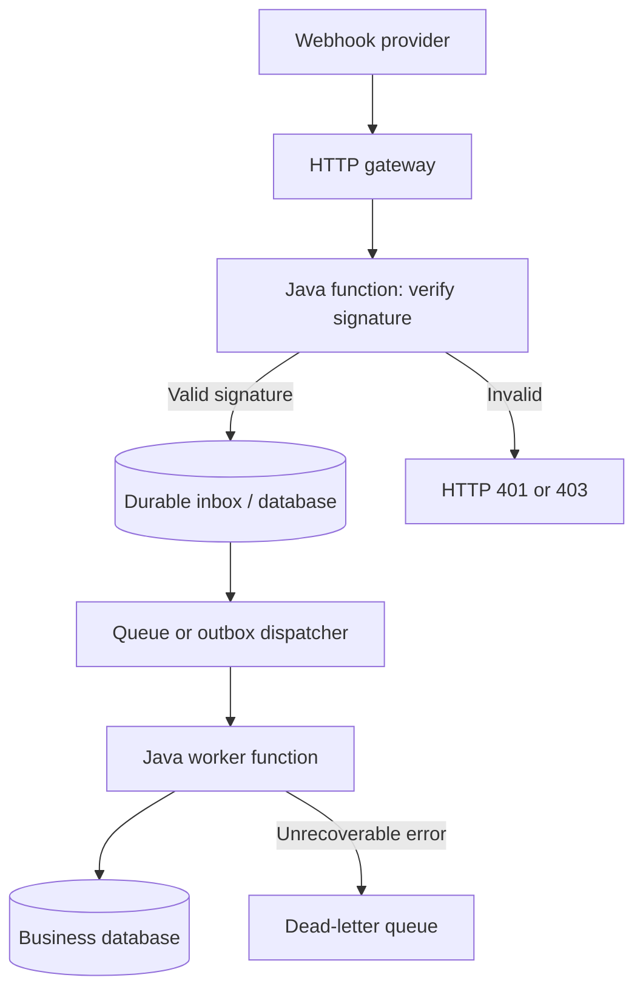

# Receiving Webhooks and Verifying Provider Signatures

A webhook is a mechanism where one system proactively sends an HTTP request to another system's endpoint when an event occurs. For example, a payment gateway sends a notification when a transaction succeeds, a source code hosting platform sends an event on a push, or an e-commerce service notifies when an order changes status.

In serverless architectures, a webhook endpoint is typically an HTTP function or an API running on a serverless container platform. The function receives the request, verifies the sender and payload integrity, and accepts the event for processing. Because the endpoint is reachable from the internet and providers may resend the same event multiple times, the system needs signature verification, replay protection, idempotent processing, and timely responses.

This lesson focuses on securely receiving webhooks in Java, especially verifying HMAC signatures over the exact bytes of the request body and structuring asynchronous processing suited to serverless characteristics.

## 1. How Do Webhooks Work?

A webhook is an HTTP callback. When an event happens, the provider sends a request to the URL registered by the receiver. The payload is typically JSON accompanied by headers describing content type, signatures, or event identifiers.

Example of a provider sending an order notification:

```http
POST /webhooks/orders HTTP/1.1
Host: api.example.com
Content-Type: application/json
X-Provider-Event-Id: evt_91ab
X-Webhook-Timestamp: 1794910530
X-Webhook-Signature: 4f1c...e2a9

{"id":"evt_91ab","type":"order.paid","data":{"orderId":"ord_123","amount":250000}}
```

This is an illustrative example with hypothetical header names. Each provider may specify different header names, algorithms, signed string construction rules, and signature formats.

General flow:

1. The user registers a webhook URL and configures a secret or verification key according to the provider's instructions.
2. The provider emits an event and builds a payload.
3. The provider signs the payload per its protocol and sends an HTTP request to the endpoint.
4. The endpoint receives the raw body and headers, verifying the signature and security checks.
5. If valid, the endpoint durably records the event or enqueues it for asynchronous processing.
6. The endpoint returns an HTTP response per the provider's convention.
7. A worker executes business logic, updates state, and records the result to prevent duplicate processing.

Webhooks differ from an application actively polling an API. With polling, the application repeatedly asks the provider whether new data exists. With webhooks, the provider proactively calls the endpoint when an event occurs, reducing periodic check requests and usually shortening notification latency.

## 2. Why Verify Signatures?

Webhook endpoints usually have public URLs. Any client that knows the URL can attempt to send requests to it. If the system trusts any incoming JSON, an attacker can forge payment events, alter orders, or trigger internal workflows.

Signatures let the receiver verify two things:

- The payload was created by a party holding the corresponding signing key.
- The received content has not been modified since it was signed.

Signatures do not replace TLS, authorization, or business checks. A valid signature does not prove a transaction was actually settled in your system; it only authenticates the message per the provider's mechanism. For critical events, you may still need to query the provider's official API to reconcile transaction state.

### HMAC vs. Asymmetric Signatures

Two common approaches:

- **HMAC:** the provider and receiver share a secret. The provider generates a MAC using the secret; the receiver recomputes the MAC over the received data and compares them. HMAC-SHA256 is a common choice.
- **Asymmetric signatures:** the provider signs with a private key, and the receiver verifies with a public key. The receiver does not need to hold a secret capable of forging signatures.

Do not pick an algorithm arbitrarily simply because it is familiar. Use the exact algorithm, encoding, headers, and canonicalization rules published by the provider. If the provider offers an official verification library, prefer that library and keep it updated.

### Signatures Are Not Encryption

HMAC does not conceal the payload contents. Anyone who can read the request can still read the JSON; TLS protects data in transit. Signatures provide authentication and integrity verification, while TLS provides an encrypted transport channel and server authentication.

## 3. Verifying Over the Raw Request Body

A common mistake is parsing JSON into an object and re-serializing it before computing the signature. Doing so can alter whitespace, property ordering, character escaping, or number formatting. Two JSON documents can carry identical meaning yet differ byte-for-byte.

For example:

```json
{"orderId":"ord_123","amount":250000}
```

and

```json
{
  "amount": 250000,
  "orderId": "ord_123"
}
```

The two documents are semantically equivalent but do not share the same byte sequence. If the provider signed the original bytes, re-serializing will cause verification to fail.

Rules to remember:

1. Receive the body as `byte[]`.
2. Extract the exact signature and timestamp headers specified by the provider documentation.
3. Construct the signed string or byte sequence strictly per the provider's rules.
4. Compute the MAC or verify the signature over that data.
5. Compare signatures using a safe comparison function.
6. Only after verification succeeds, parse JSON and execute business logic.

Do not trim the body, change encodings, parse and re-serialize, or normalize JSON before verifying. If the API Gateway passes the body as a Base64 string, decode it according to the gateway's encoding flag to recover the exact original bytes before computing the signature.

## 4. How Does HMAC-SHA256 Work?

HMAC is a mechanism for producing a message authentication code using a cryptographic hash function and a secret key. With HMAC-SHA256, the provider and receiver use the same secret and identical input data to compute the MAC value.

Conceptually:

```text
signature = HMAC-SHA256(secret, signedMessage)
```

Where:

- `secret` is the shared secret exchanged securely.
- `signedMessage` is the byte sequence defined by the protocol.
- `signature` is the MAC output, usually encoded as hexadecimal or Base64 for inclusion in an HTTP header.

Some providers sign only the raw body. Others include a timestamp in the signed string to prevent replay. The illustrative example in this lesson assumes a protocol using:

```text
signedMessage = timestamp + "." + rawBody
signature = hex(HMAC-SHA256(secret, signedMessage))
```

This is solely a sample protocol to explain implementation mechanics. Never apply this formula blindly to every provider. You must follow the exact signing specification in the provider's documentation, including separators, encodings, prefixes, and handling of multiple signatures.

### Safe Signature Comparison

Never use standard string equality operators for secret signatures. Some comparison routines short-circuit at the first differing byte, leaking match-position information through timing differences. In Java, use `MessageDigest.isEqual` to compare two byte arrays.

Also validate signature formatting before comparing. Malformed hexadecimal signatures, missing bytes, or unexpected lengths must be rejected. Never guess and coerce formats.

## 5. Java Example for HMAC Verification

The following example illustrates a hypothetical protocol with two headers:

- `X-Webhook-Timestamp` containing a Unix timestamp in seconds.
- `X-Webhook-Signature` containing the hexadecimal HMAC-SHA256 of the timestamp, a dot, and the raw body.

In production, replace header formatting and signed-message construction with an adapter matching the provider's exact documentation.

```java
import java.nio.charset.StandardCharsets;
import java.security.GeneralSecurityException;
import java.security.MessageDigest;
import java.time.Instant;
import java.util.HexFormat;
import javax.crypto.Mac;
import javax.crypto.spec.SecretKeySpec;

public final class HmacWebhookVerifier {

    private final byte[] secret;
    private final long toleranceSeconds;

    public HmacWebhookVerifier(byte[] secret, long toleranceSeconds) {
        if (secret == null || secret.length == 0) {
            throw new IllegalArgumentException("Webhook secret is required");
        }
        if (toleranceSeconds <= 0) {
            throw new IllegalArgumentException("Tolerance must be positive");
        }
        this.secret = secret.clone();
        this.toleranceSeconds = toleranceSeconds;
    }

    public boolean verify(
            byte[] rawBody,
            String timestampHeader,
            String signatureHex,
            Instant now) throws GeneralSecurityException {

        if (rawBody == null || timestampHeader == null
                || signatureHex == null || now == null) {
            return false;
        }

        final long timestamp;
        try {
            timestamp = Long.parseLong(timestampHeader);
        } catch (NumberFormatException ex) {
            return false;
        }

        long ageSeconds = now.getEpochSecond() - timestamp;
        if (ageSeconds > toleranceSeconds || ageSeconds < -toleranceSeconds) {
            return false;
        }

        final byte[] suppliedSignature;
        try {
            suppliedSignature = HexFormat.of().parseHex(signatureHex);
        } catch (IllegalArgumentException ex) {
            return false;
        }
        if (suppliedSignature.length != 32) {
            return false;
        }

        Mac mac = Mac.getInstance("HmacSHA256");
        mac.init(new SecretKeySpec(secret, "HmacSHA256"));

        // Sample protocol: timestamp + "." + raw body.
        mac.update(timestampHeader.getBytes(StandardCharsets.UTF_8));
        mac.update((byte) '.');
        byte[] expectedSignature = mac.doFinal(rawBody);

        return MessageDigest.isEqual(expectedSignature, suppliedSignature);
    }
}
```

Key details in the example:

- `secret` is defensively copied during construction to prevent external mutation of the byte array.
- `Mac` is instantiated per verification because `Mac` objects are stateful and must not be shared concurrently across invocations.
- The timestamp is checked before executing business logic.
- The signature is decoded into `byte[]` and compared using `MessageDigest.isEqual`.
- The method accepts `rawBody` directly and does not parse JSON before verification.

The example uses Java 17's `HexFormat`. On older Java versions, use a reputable hexadecimal decoding library. Never write a custom decoder that skips input length and format checks.

### Adapting to Provider Protocols

Details to confirm in provider documentation:

- Algorithm: HMAC-SHA256, HMAC-SHA512, or asymmetric signatures.
- Header carrying the signature and how to strip prefixes.
- Signed payload: raw body, timestamp plus body, or another structure.
- Signature encoding: hex or Base64.
- Whether multiple signatures can appear in a single header.
- Whether timestamps are in seconds, milliseconds, or another format.
- How the provider rotates secrets and supports multiple active secrets during transition windows.

Do not take sample code and merely swap header names. Being off by even one byte in the canonical message produces an entirely different signature.

## 6. Timestamps and Replay Attack Prevention

A validly signed request can still be replayed. For example, an attacker captures a valid payment webhook and resends the same payload multiple times. If the system executes actions on every delivery, one event could trigger duplicate updates or repeated fulfillment.

This is a replay attack.

### Checking Timestamps

If the provider includes a timestamp inside the signed data, the receiver can bound the age of incoming requests. For example, accept only requests whose timestamp is within 5 minutes of the server clock. The actual tolerance window must reflect provider documentation and service retry characteristics.

The timestamp must be covered by the signature. If the timestamp is merely an unsigned header, an attacker can rewrite the timestamp to bypass the time-window check.

Synchronize system clocks using a reliable time service. Clock drift can cause valid webhooks to be rejected or widen the acceptance window unnecessarily.

### Timestamps Do Not Replace Idempotency

Within the allowed time window, the exact same request can still be delivered multiple times. Thus, timestamps only limit replaying stale requests; they do not guarantee an event is processed only once.

Use the provider's unique event ID as a deduplication key. Store the pair `provider + eventId` in an inbox table with a unique constraint. When a duplicate arrives, the system recognizes the event was already accepted and returns an appropriate response without creating extra side effects.

If the provider does not supply a stable event ID, identify an appropriate business key per the provider's documentation and event semantics. Never hash the payload as a unique key if two distinct valid events can share identical payloads.

## 7. Receiving Webhooks in a Java HTTP Endpoint

An endpoint can use Spring Boot, a platform HTTP adapter, or API Gateway invoking a Java function directly. Regardless of framework, keep the processing order intact: bound the request, verify the signature over raw bytes, parse and validate data, then durably accept the event.

The controller example below assumes a verifier and inbox service already exist:

```java
import java.io.IOException;
import java.security.GeneralSecurityException;
import org.springframework.http.HttpStatus;
import org.springframework.http.ResponseEntity;
import org.springframework.web.bind.annotation.PostMapping;
import org.springframework.web.bind.annotation.RequestBody;
import org.springframework.web.bind.annotation.RequestHeader;
import org.springframework.web.bind.annotation.RestController;

@RestController
public class WebhookController {

    private static final int MAX_BODY_BYTES = 256 * 1024;

    private final HmacWebhookVerifier verifier;
    private final WebhookInbox inbox;

    public WebhookController(
            HmacWebhookVerifier verifier,
            WebhookInbox inbox) {
        this.verifier = verifier;
        this.inbox = inbox;
    }

    @PostMapping("/webhooks/provider")
    public ResponseEntity<Void> receive(
            @RequestHeader("X-Webhook-Timestamp") String timestamp,
            @RequestHeader("X-Webhook-Signature") String signature,
            @RequestBody byte[] rawBody)
            throws GeneralSecurityException, IOException {

        if (rawBody.length > MAX_BODY_BYTES) {
            return ResponseEntity.status(HttpStatus.PAYLOAD_TOO_LARGE).build();
        }

        boolean valid = verifier.verify(
                rawBody, timestamp, signature, java.time.Instant.now());

        if (!valid) {
            return ResponseEntity.status(HttpStatus.UNAUTHORIZED).build();
        }

        // Service parses, validates the event, and persists inbox/outbox durably.
        inbox.acceptVerifiedEvent(rawBody);

        return ResponseEntity.accepted().build();
    }
}
```

This is an illustrative skeleton. `WebhookInbox` must parse the payload, extract and check the event ID, persist the event, and create durable processing work. The controller returns 202 only after the system has accepted the event according to its durability guarantees.

Body size limits should also be enforced at the API Gateway or ingress before the framework buffers the full request into memory. Checking `rawBody.length` in the controller is an extra safeguard; checking only after allocating the byte array still allows large requests to consume memory beforehand.

### When a Java Function Receives an API Gateway Event

Some platforms convert HTTP requests into an event object rather than invoking Spring MVC directly. The event may carry the body as a `String` alongside a flag indicating whether it is Base64-encoded.

In that case:

1. Read the body and the `isBase64Encoded` flag from the event.
2. If the flag is true, Base64-decode to recover the exact original bytes; otherwise, convert the body to bytes using the encoding defined by the adapter/provider.
3. Verify the signature over that `byte[]`.
4. Only after verification succeeds, parse JSON.
5. Return status code and headers matching the API Gateway HTTP contract.

Never parse the body into a JSON object and re-serialize it before verification. Decoding must preserve the exact byte sequence signed by the provider.

## 8. Durable Ingestion and Asynchronous Processing

Webhook endpoints typically need to respond quickly. If all business logic runs inside the HTTP request, the provider may time out and resend the request while the function is still working. This amplifies load, increases response latency, and invites duplicate processing.

A common architecture is:

1. Verify the signature.
2. Parse and validate the minimum required structure.
3. Persist the event into a durable inbox or queue.
4. Return HTTP 2xx once ingestion has succeeded.
5. Let a worker process business logic asynchronously.

Diagram:



### Why Persist Durably Before Returning 2xx?

HTTP 2xx tells the provider that the endpoint successfully accepted the request. If you return 2xx before saving the event, the function could terminate right after responding and lose the event. The provider may never resend it because it received an acknowledgment.

Conversely, if durable persistence succeeds but the response is lost in transit, the provider may resend. That is why the system must still be idempotent.

When using a separate database and queue, bridge the gap between database write and message publish. Transactional outbox is a common pattern: in the same database transaction, save both the inbox event and an outbox record; a dispatcher reads the outbox, publishes to the queue, and marks it sent. The dispatcher can still publish duplicates if it fails right before marking sent, so the queue consumer still requires idempotency.

### Choosing When to Return Responses

- Return 2xx after the event is durably persisted or enqueued.
- Return 5xx when ingestion fails due to a transient database or queue error, giving the provider a chance to retry per its policy.
- Return 401/403 when the signature is invalid.
- Return 400 when the payload is malformed or violates a fixed contract, if the provider's conventions permit rejecting such errors.
- For duplicate events already accepted, return 2xx without creating additional business work.

Provider retry policies vary. Some providers retry on any non-2xx response; others have distinct retry schedules, timeouts, and limits. Confirm provider documentation to avoid prolonged retries on permanently invalid payloads or accidentally acknowledging an unpersisted event.

## 9. Idempotency in Webhook Processing

Idempotency means processing the same request or event multiple times without producing unintended extra side effects. For webhooks, this is critical because providers resend on timeouts, dropped responses, or network failures.

For example, a `payment.succeeded` event is delivered three times. The system must record only one payment and must not fulfill three orders or dispatch three shipments.

### Inbox Pattern with Unique Constraints

You can store fields such as:

| Field | Purpose |
|---|---|
| `provider` | Provider name or identifier |
| `event_id` | Provider-assigned event ID |
| `received_at` | Timestamp when the system received the event |
| `status` | `RECEIVED`, `PROCESSING`, `PROCESSED`, or `FAILED` |
| `payload_hash` | Audit fingerprint of the payload if needed |
| `processed_at` | Completion timestamp |

Create a unique constraint on `(provider, event_id)`. When an event arrives:

1. Attempt to insert the inbox record.
2. If the insert succeeds, this is a new event and processing work can be created.
3. If a unique constraint violation occurs, the event was already accepted earlier; do not trigger side effects again.
4. Return 2xx if the existing record was already accepted successfully.

Do not rely solely on a static variable or `ConcurrentHashMap` in the function for deduplication. Serverless environments can run multiple instances, terminate, or reinitialize. Local memory is neither shared across instances nor durable.

### Idempotency for External Side Effects

Even when the inbox ensures an event is picked up by a worker only once in application logic, the worker might call an external service and crash before marking `PROCESSED`. On retry, that external call could repeat.

For payments, dispatches, or creating resources in external systems, pass an idempotency key if the target API supports it. If not supported, design reconciliation or compensation workflows to resolve ambiguous outcomes.

Never mark an event complete before external side effects are confirmed. Likewise, never assume a queue or webhook provides end-to-end exactly-once delivery; in practice, pair at-least-once delivery with idempotent processing.

## 10. Secret Management and Key Rotation

Webhook secrets are sensitive credentials. If leaked, an attacker can forge payloads with valid HMAC signatures.

Follow these principles:

- Store secrets in a secret manager or platform key management service.
- Never commit secrets to Git, Docker images, public config files, or source code.
- Grant least-privilege secret read permissions only to functions verifying webhooks.
- Never log secrets, full signatures, or sensitive payloads.
- Separate secrets by environment and endpoint/provider whenever possible.
- Plan for rotation and verify against both old and new keys during transition windows if supported by the provider.

During secret rotation, coordinate with the provider per their process. While two keys are valid simultaneously, the verifier can check sequentially against the active key list. Never accept legacy secrets indefinitely; enforce an explicit rotation cutoff and monitor until old keys are retired.

With HMAC, any component holding the secret can also generate signatures. To minimize how many systems hold signing capability, use asymmetric signatures if the provider supports them: only the provider holds the private key, while the receiver needs only the public key to verify.

## 11. Additional Defense Layers

A valid signature does not justify skipping other HTTP and application protections.

**HTTPS.** Accept webhooks only over HTTPS with valid certificates. Never allow production endpoints to accept plain HTTP.

**Request limits.** Enforce body size limits, request rate limits, timeouts, and concurrency caps at the gateway or ingress. Tune limits to match the provider's payload sizes and retry behavior.

**Sender verification.** If the provider publishes fixed IP ranges, an allowlist can serve as an extra layer. IP ranges can change and do not prove payload authenticity; never rely on IPs as the sole authentication mechanism. Always verify signatures.

**Endpoint isolation.** Bind each endpoint to a clear provider or event category. Avoid sharing one secret across all integrations when separation is feasible.

**Business checks.** Verify transaction states, resource ownership, and state-transition validity before updating data.

**Abuse protection.** Monitor failed request counts, invalid signatures, out-of-window timestamps, oversized payloads, and sudden rate spikes. You can rate-limit by endpoint and sender while accounting for legitimate provider retries.

**Log protection.** Log provider, event ID, event type, request correlation ID, verification outcome, and processing duration. Never log secrets or unnecessary personal data.

## 12. Observability and Operations in Serverless

A webhook flow typically traverses a gateway, verification function, database or queue, and worker. Without an end-to-end correlation ID, diagnosing slowdowns or lost events becomes difficult.

Track these metrics:

- Webhook requests received by provider and event type.
- Valid vs. invalid signature rates.
- Requests rejected for stale or future timestamps.
- Latency from receipt to durable persistence.
- Worker processing duration and retry counts.
- Queue depth, oldest message age, and DLQ counts.
- Duplicate events and unparseable events.
- Function cold starts, concurrency, and timeout errors.

In Java functions, avoid reinitializing heavy database clients, secret manager clients, or validators on every invocation when safe reuse is possible. However, never share non-thread-safe stateful objects across concurrent requests. The `Mac` instance in the verification example must be created per call.

Cold starts can make initial requests slower. If a provider has tight timeouts, keep verification and ingestion lightweight, avoiding long-running business logic inside the HTTP invocation. Align concurrency and scaling limits with database and queue capacity so downstream systems are not overwhelmed.

## 13. Testing Webhooks

Before deploying to production, test both valid and invalid scenarios:

| Case | Expected Outcome |
|---|---|
| Valid body and signature | Verification succeeds |
| Single-byte modification in body | Signature invalid |
| Different secret used | Signature invalid |
| Missing signature header | Request rejected |
| Wrong signature encoding or length | Request safely rejected |
| Stale timestamp | Rejected if protocol requires timestamp check |
| Timestamp too far in the future | Rejected |
| Invalid JSON syntax with valid signature | Payload error per endpoint contract |
| Same event ID sent multiple times | Accepted only once |
| Two duplicate requests arrive concurrently | Unique constraint allows only one acceptance |
| Database or queue temporarily unavailable | Do not acknowledge success before durable persistence |
| Secret rotation | Accepts valid keys within transition window and retires old key on schedule |

Use the provider's sandbox or webhook testing tools to generate sample requests. When creating custom test vectors, use test-only secrets and compute signatures strictly per the provider's rules. Never place production secrets in unit tests or fixtures.

For time-based tests, inject a `Clock` into the verifier instead of coupling directly to system time. This lets you accurately test stale timestamps, future timestamps, and acceptance-window boundaries.

## 14. Common Implementation Mistakes

- **Parsing JSON before verifying:** re-serializing can alter bytes and break signatures; always verify the raw body.
- **Using `String.equals` on signatures:** decode signatures to `byte[]` and compare with `MessageDigest.isEqual`.
- **Ignoring timestamps:** valid signatures can be replayed; validate timestamps if supported by the provider and include them in the signed canonical message.
- **Using timestamps alone for deduplication:** identical events can still be resent within the time window; durably persist event IDs.
- **Returning 2xx before saving the event:** the function may stop and drop the event after the provider stops retrying.
- **Running full business logic inside the HTTP request:** risks timeouts and triggers retries under load; persist durably and process asynchronously.
- **Using function memory as an idempotency store:** instances do not share memory and can be recycled.
- **Assuming every provider uses the same HMAC format:** algorithms, headers, encodings, and canonicalization rules differ.
- **Logging full requests:** risks exposing personal data, tokens, or payment details.
- **Checking only source IP:** IPs do not prove payloads were not forged; signatures remain the primary verification mechanism.

## 15. Practical Implementation Workflow

When integrating a new webhook provider, follow this sequence:

1. Read the provider's webhook docs: event types, retries, timeouts, headers, algorithms, and signature format.
2. Register a dedicated HTTPS endpoint for the provider and configure the secret or public key.
3. Configure body limits, timeouts, and rate limits at the gateway.
4. Receive the raw body and headers without transforming the payload.
5. Verify the signature using the provider's exact canonicalization and encoding.
6. Check timestamps/replay protection if supported by the protocol.
7. Parse JSON, validate schema, and extract the event ID.
8. Save to a durable inbox/outbox or enqueue with idempotency.
9. Return 2xx only after durable acceptance succeeds.
10. Process business logic in a worker, retry transient errors, and route unrecoverable failures to a DLQ.
11. Monitor metrics, sanitize logs, and test secret rotation.

## 16. Takeaways

A webhook is an HTTP callback from an external system. Endpoints must treat every incoming request as untrusted data until its signature is verified strictly according to the provider's protocol.

With HMAC, use the exact secret, algorithm, and signed byte sequence; verify against the raw body, validate timestamps when supported, and compare MACs safely. Next, combine event IDs with durable storage to prevent duplicate processing, acknowledge quickly, and execute business logic asynchronously.

In serverless architectures, functions can restart, run concurrently, or be retried. Consequently, secrets, idempotency state, and processing progress must be managed in durable services. A reliable webhook pipeline integrates signature verification, replay protection, controlled retries, idempotency, observability, and cost management.
