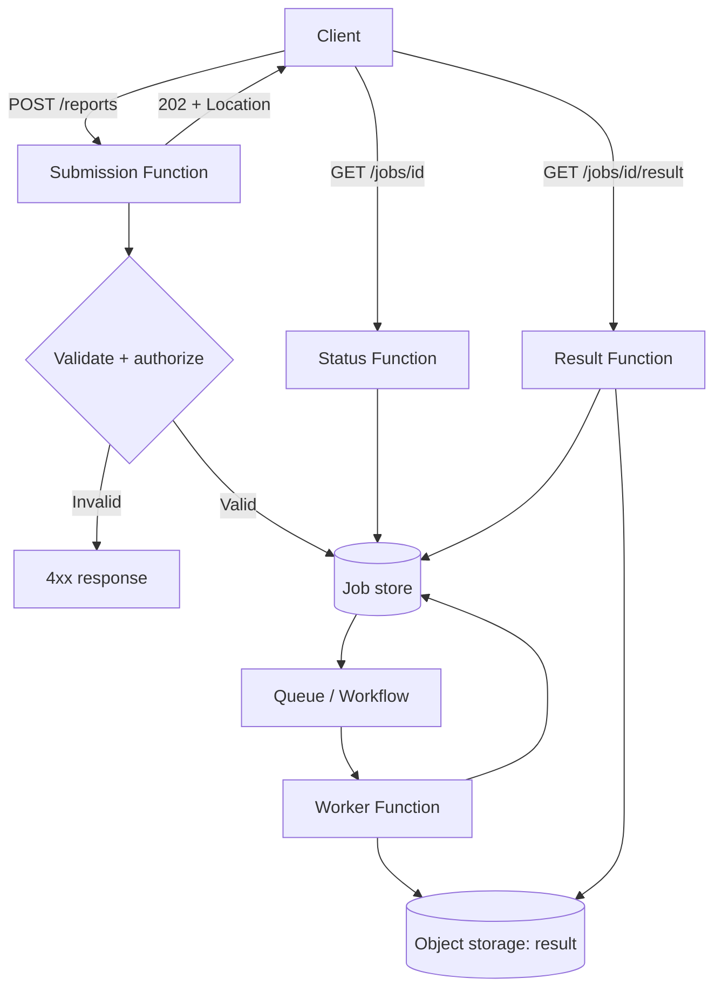
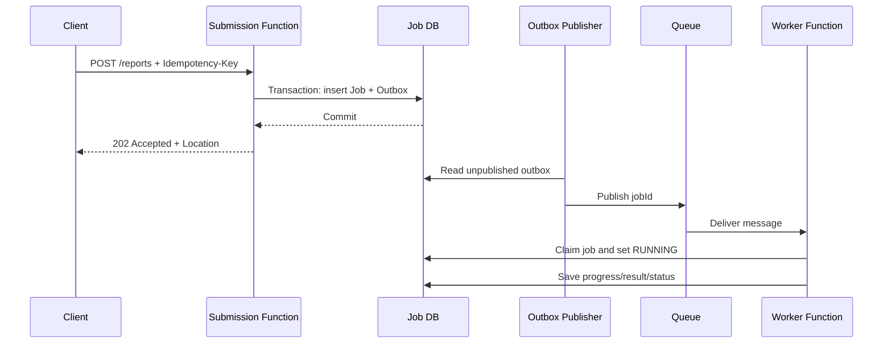

# Handling Long-Running Tasks with HTTP 202 and Status Tracking Endpoints

A standard HTTP request suits work that completes quickly: the client sends a request, the server processes it, and the result returns in the same call. However, many business operations take longer than the wait limits of clients, API gateways, or serverless functions. Examples include generating large reports, importing data, processing images, aggregating invoices, syncing multiple systems, or running multi-step workflows.

Keeping the HTTP connection open throughout the entire process risks client timeouts even while work is still running. The function may be terminated by platform execution limits. Callers also struggle to tell whether the task was accepted, is still running, or has finished. A common design pattern is **asynchronous acceptance with HTTP 202 Accepted**, creating a resource representing the job (job resource), and exposing endpoints for clients to track status and retrieve results.

This pattern is especially effective with Java FaaS: an HTTP function authenticates and accepts the request, persists state durably, and dispatches the job to a queue or workflow; worker functions process steps incrementally; another endpoint reads status for client queries. The initial HTTP request finishes quickly while the business lifecycle is managed via recoverable state.

## 1. Why You Should Not Hold HTTP Requests Open for Long Tasks

In a synchronous flow, several components impose wait budgets:

- Browsers or calling services enforce client timeouts.
- API gateways, load balancers, or proxies enforce backend timeout limits.
- Functions have platform execution duration limits.
- Downstream dependencies such as databases, object storage, or external APIs enforce their own timeouts.

If total processing time exceeds any layer's limit, the connection may close or the client may receive a timeout error. That does not prove server-side work was canceled. The function might continue running, writing data, or calling payment services after the client stopped waiting. When the client retries, business side effects can repeat unless idempotency is enforced.

Holding connections open also ties up resources while waiting. In FaaS, a long invocation consumes compute time, approaches timeout caps, and is hard to resume if the runtime is killed mid-flight. With queues, workers can process step-by-step and save checkpoints; with workflow engines, per-step state is persisted and retried independently.

The asynchronous pattern separates two questions:

1. **Was the request accepted?** The API responds quickly with `202 Accepted` after durably persisting the job.
2. **How far has the work progressed?** The client reads the job resource via the status endpoint; once complete, the client fetches output from the result resource.

## 2. Meaning of HTTP 202 Accepted

`202 Accepted` indicates the server accepted the request for processing, though processing is not yet complete. It does not guarantee the task will ultimately succeed. The job may be queued, running, awaiting retry, or later fail due to business rules or technical errors.

An acceptance response might look like:

```http
HTTP/1.1 202 Accepted
Location: /v1/jobs/job_7f31a2
Retry-After: 3
Content-Type: application/json
Cache-Control: no-store

{
  "jobId": "job_7f31a2",
  "status": "QUEUED",
  "statusUrl": "/v1/jobs/job_7f31a2",
  "submittedAt": "2026-11-17T12:30:00Z"
}
```

In this example:

- `202 Accepted` signals the request was accepted for asynchronous processing.
- `Location` points to the status-tracking resource.
- `Retry-After` suggests how long the client should wait before the next check; the exact value depends on the API.
- `jobId` identifies the job for subsequent client requests.
- `Cache-Control: no-store` prevents inappropriate caching of responses containing state or private data.

The API may also return `resultUrl` once complete or a documentation link describing how to query it. Do not return massive results inside the acceptance response. If the system returns only `202` with no identifier or lookup path, clients cannot know which job to track.

A critical rule is **return 202 only after the server has durably recorded the job so execution can proceed**. If the API returns 202 and the process dies before saving the job or publishing the message, the client believes work was accepted while no worker ever runs it.

## 3. Designing the Job Resource and Status Endpoint

The job resource represents a task's lifecycle. Clients do not need to know which function is running, which queue holds the message, or which host runs the worker. Clients only need a stable ID and a clear status contract.

A simple API might include:

| Method and Endpoint | Purpose | Typical Response |
| --- | --- | --- |
| `POST /v1/reports` | Create a report export request | `202 Accepted` and tracking URL |
| `GET /v1/jobs/{jobId}` | Read job status | `200 OK` with job resource |
| `GET /v1/jobs/{jobId}/result` | Fetch output once the job succeeds | `200 OK`, redirect, or download URL |
| `DELETE /v1/jobs/{jobId}` | Request cancellation if the job type supports it | `202 Accepted`, `200 OK`, or state-appropriate error |

`DELETE` here represents a cancellation request per the API contract. It does not guarantee side effects that already occurred can be undone. If cancellation is unsupported, do not expose this endpoint.

Example client request to generate a report:

```http
POST /v1/reports HTTP/1.1
Authorization: Bearer <access-token>
Idempotency-Key: report-2026-11-customer-42
Content-Type: application/json

{
  "reportType": "MONTHLY_USAGE",
  "from": "2026-10-01",
  "to": "2026-10-31",
  "format": "CSV"
}
```

After acceptance, the client receives the job ID and uses the `Location` URL to poll. The job resource path should stay stable throughout the job's lifecycle, even across retries or worker changes.

### Job States

A simple state machine can use these states:

| State | Meaning | Possible Next States |
| --- | --- | --- |
| `QUEUED` | Request saved, awaiting worker | `RUNNING`, `CANCELLED`, `FAILED` |
| `RUNNING` | Worker is executing | `SUCCEEDED`, `RETRY_WAIT`, `FAILED`, `CANCELLED` |
| `RETRY_WAIT` | Waiting for next retry attempt | `QUEUED`, `FAILED`, `CANCELLED` |
| `SUCCEEDED` | Job completed successfully | Terminal state |
| `FAILED` | Job failed with no automatic retries left | Terminal state |
| `CANCELLED` | Job canceled per policy | Terminal state |

`SUCCEEDED`, `FAILED`, and `CANCELLED` are terminal states in this model. Never transition a terminal job back to `RUNNING` simply because a message was redelivered. If business logic must be rerun after completion, create a new job or expose an explicit retry operation with separate run history.

Not every system needs to expose `RETRY_WAIT` to clients. Retries can remain internal while exposing only `QUEUED` or `RUNNING`. What matters is that state transitions are well-defined, conditional, and durably recorded.

### Job Status Payload

While the job is running, the endpoint can return:

```http
HTTP/1.1 200 OK
Content-Type: application/json
Cache-Control: no-store
ETag: "job_7f31a2-v4"

{
  "jobId": "job_7f31a2",
  "status": "RUNNING",
  "submittedAt": "2026-11-17T12:30:00Z",
  "startedAt": "2026-11-17T12:30:02Z",
  "updatedAt": "2026-11-17T12:30:08Z",
  "progress": {
    "completed": 420,
    "total": 1000,
    "percent": 42
  }
}
```

On success:

```json
{
  "jobId": "job_7f31a2",
  "status": "SUCCEEDED",
  "submittedAt": "2026-11-17T12:30:00Z",
  "startedAt": "2026-11-17T12:30:02Z",
  "completedAt": "2026-11-17T12:31:14Z",
  "resultUrl": "/v1/jobs/job_7f31a2/result"
}
```

On failure:

```json
{
  "jobId": "job_7f31a2",
  "status": "FAILED",
  "completedAt": "2026-11-17T12:31:14Z",
  "error": {
    "code": "SOURCE_FILE_INVALID",
    "message": "The input file format is invalid.",
    "retryable": false
  }
}
```

Error details should give clients enough information to decide next steps without exposing stack traces, SQL, internal hostnames, tokens, or sensitive data. Business errors may be non-retryable; transient infrastructure errors may already have been retried internally before the job transitioned to `FAILED`.

## 4. HTTP Status Codes for Tracking Endpoints

Distinguish errors on the job submission request from the outcome of the job itself:

- `POST /v1/reports` can return `400 Bad Request` for invalid payloads, `401 Unauthorized` if unauthenticated, `403 Forbidden` if unauthorized, `409 Conflict` if the same idempotency key is reused with different content, or `202 Accepted` upon acceptance.
- `GET /v1/jobs/{jobId}` returns `200 OK` when the job exists and the caller is permitted to view it, even if the job is `QUEUED`, `RUNNING`, or `FAILED`. A failed job status is data on the job resource, not a failure of the read operation.
- `GET /v1/jobs/{jobId}` can return `404 Not Found` if nonexistent or if the API intentionally does not distinguish missing resources from unauthorized resources. Keep the policy consistent to avoid leaking job existence.
- `GET /v1/jobs/{jobId}/result` returns the result only when the job succeeded and the result has not expired. If not ready yet, the API can return `409 Conflict` or `404` per published contract; never pretend to return an empty result as success.
- Once a job passes its retention period, the API can return `410 Gone` to indicate expiration if the system distinguishes expired jobs from never-existing IDs.

These codes are common design choices. Explicitly document API behavior so clients do not have to guess state solely from an HTTP code.

## 5. Architecture Flow with Java Functions, Queues, and Job Store

A typical architecture comprises three function groups:

1. **Submission function:** receives the HTTP request, authenticates, validates input, enforces idempotency, saves the job, and emits a processing signal.
2. **Worker function:** receives the job ID or message, reads task inputs, processes incrementally, and updates progress and state.
3. **Status/result function:** reads the job store, enforces access permissions, and returns status or results to the client.



The job store is typically a database supporting conditional updates. Large outputs belong in object storage, with the job resource storing only a reference. A queue or workflow engine handles dispatch and orchestration; the job store serves as the state source read by the API.

Never let the status endpoint read directly from a function runtime's internal memory. Invocations may have ended, workers may have been replaced, and multiple retries may occur. State must outlive any individual container or process lifecycle.

## 6. Durable Acceptance and the Database-to-Queue Gap

A common mistake is performing two separate operations:

1. Write the job to the database.
2. Send a message to the queue.

If the database commits but queue publishing fails, the job gets stuck in `QUEUED` with no worker processing it. If queue publishing succeeds but the database write fails, the worker receives a nonexistent job ID or one lacking authoritative state.

This can be solved with the transactional outbox pattern:

- Within a single database transaction, insert both the job record and an outbox record.
- Commit them atomically together.
- A publisher function reads the outbox, publishes a message containing the job ID to the queue, and marks it published.
- If the publisher times out after sending but before marking published, the message may be sent again; workers must be idempotent.

Another option is using an orchestration service or execution API with built-in durable acceptance. Regardless of approach, the API should return `202` only after durable proof exists that the job is persisted and dispatchable.



If queue publishing fails transiently, the outbox record remains for the publisher to retry. If a message is delivered multiple times, the worker checks status and claims execution before running. You do not need exactly-once broker delivery to build a reliable pipeline.

## 7. Idempotency When Clients Retry POST

A frequent scenario: the client sends `POST /v1/reports`, the server creates the job, and the 202 response drops on the network. Unsure whether the request succeeded, the client retries. If each request creates a new job, the same report runs twice, wasting resources and generating duplicate outputs.

Clients can send a unique `Idempotency-Key` for a business intent. The server stores the key alongside caller/tenant, operation type, request hash, job ID, and acceptance outcome. When the same key arrives again:

- If the payload and caller scope match, return the existing job ID and tracking URL.
- If the key was already used with a different payload, return `409 Conflict`.
- If the key does not exist yet, create the new job and record the key in the same transaction.

Keys must be scoped per user or tenant so two customers cannot collide in the same idempotency namespace. Key retention must at least cover the client's retry window and the period during which duplicate job creation would cause harm.

Example response on a replayed request:

```http
HTTP/1.1 202 Accepted
Location: /v1/jobs/job_7f31a2
Idempotency-Replayed: true
Content-Type: application/json

{
  "jobId": "job_7f31a2",
  "status": "QUEUED",
  "statusUrl": "/v1/jobs/job_7f31a2"
}
```

The `Idempotency-Replayed` header is merely an example API convention, not a mandatory standard header. What matters is that repeated requests do not create unintended duplicate work.

Idempotency at submission does not replace idempotency in workers. Queues can still deliver the same message multiple times, and workers can time out after writing partial results. Enforce idempotency at both layers.

## 8. Java Implementation: Creating a Job and Returning HTTP 202

The following example uses Spring Web to illustrate the controller contract. Persistence and publishing sit behind interfaces so they can be backed by a concrete database, transactional outbox, and queue. These classes are illustrative structures independent of any cloud provider.

```java
import java.net.URI;
import java.time.Instant;

public record CreateReportRequest(
        String reportType,
        String from,
        String to,
        String format
) {}

public record JobAcceptedResponse(
        String jobId,
        String status,
        URI statusUrl,
        Instant submittedAt
) {}

public record AcceptedJob(
        String jobId,
        String status,
        Instant submittedAt
) {}
```

The controller can return `202` with `Location`:

```java
import java.net.URI;
import org.springframework.http.HttpHeaders;
import org.springframework.http.ResponseEntity;
import org.springframework.web.bind.annotation.PostMapping;
import org.springframework.web.bind.annotation.RequestBody;
import org.springframework.web.bind.annotation.RequestHeader;
import org.springframework.web.bind.annotation.RequestMapping;
import org.springframework.web.bind.annotation.RestController;

@RestController
@RequestMapping("/v1/reports")
public class ReportSubmissionController {
    private final ReportJobService jobService;

    public ReportSubmissionController(ReportJobService jobService) {
        this.jobService = jobService;
    }

    @PostMapping
    public ResponseEntity<JobAcceptedResponse> submit(
            @RequestBody CreateReportRequest request,
            @RequestHeader("Idempotency-Key") String idempotencyKey
    ) {
        // Principal/tenant should be obtained from the authenticated security context.
        String tenantId = CurrentTenant.requireId();
        AcceptedJob job = jobService.accept(tenantId, idempotencyKey, request);

        URI statusUrl = URI.create("/v1/jobs/" + job.jobId());
        JobAcceptedResponse body = new JobAcceptedResponse(
                job.jobId(), job.status(), statusUrl, job.submittedAt());

        return ResponseEntity.accepted()
                .location(statusUrl)
                .header(HttpHeaders.RETRY_AFTER, "3")
                .header(HttpHeaders.CACHE_CONTROL, "no-store")
                .body(body);
    }
}
```

`CurrentTenant` is a placeholder for retrieving the tenant from the security context. Never trust a client-supplied tenant ID in the request body for authorization. In a real application, the controller must validate requests, limit payload sizes, check permissions for the requested report type, and handle missing or malformed `Idempotency-Key` headers.

The submission service must guarantee consistent job persistence and dispatch signaling. The pseudocode below shows responsibilities rather than a complete repository implementation:

```java
public interface ReportJobService {
    AcceptedJob accept(
            String tenantId,
            String idempotencyKey,
            CreateReportRequest request
    );
}

// In implementation:
// 1. Validate the request and compute a canonical request hash.
// 2. Look up idempotency record by tenant + operation + key.
// 3. If it already exists: compare hash, return existing job or report conflict.
// 4. If absent: within the same transaction insert Job,
//    insert IdempotencyRecord, and insert OutboxRecord.
// 5. Commit and return AcceptedJob.
```

Do not publish to the queue from the controller before saving the job, or save the job and then publish without a recovery mechanism. A transactional outbox ensures submission never loses jobs when either system fails temporarily.

## 9. Java Implementation: Reading Job Status

The status endpoint reads from the job store. It must verify which tenant's jobs the caller is allowed to view, then return a consistent state snapshot.

```java
import java.time.Instant;
import java.net.URI;

public record JobStatusResponse(
        String jobId,
        String status,
        Instant submittedAt,
        Instant startedAt,
        Instant updatedAt,
        Instant completedAt,
        Integer progressPercent,
        URI resultUrl,
        JobError error
) {}

public record JobError(
        String code,
        String message,
        boolean retryable
) {}
```

Illustrative controller:

```java
import org.springframework.http.CacheControl;
import org.springframework.http.ResponseEntity;
import org.springframework.web.bind.annotation.GetMapping;
import org.springframework.web.bind.annotation.PathVariable;
import org.springframework.web.bind.annotation.RequestMapping;
import org.springframework.web.bind.annotation.RestController;

@RestController
@RequestMapping("/v1/jobs")
public class JobStatusController {
    private final JobQueryService queryService;

    public JobStatusController(JobQueryService queryService) {
        this.queryService = queryService;
    }

    @GetMapping("/{jobId}")
    public ResponseEntity<JobStatusResponse> getStatus(
            @PathVariable String jobId
    ) {
        String tenantId = CurrentTenant.requireId();
        JobStatusResponse status = queryService.getForTenant(tenantId, jobId);

        return ResponseEntity.ok()
                .cacheControl(CacheControl.noStore())
                .body(status);
    }
}
```

`JobQueryService` must check both job ID and tenant. Knowing or guessing a job ID does not confer permission to read it. If the API supports ETags, you can derive the version from `updatedAt` or a monotonically increasing job version and return `304 Not Modified` when the client sends a matching `If-None-Match`. ETags reduce payload transfers when state has not changed, though they do not replace authentication and authorization.

## 10. Worker Functions and Safe State Updates

Workers must never assume a message arrives only once. Upon receiving `jobId`, a worker should:

1. Read the job and inspect its current state.
2. Use a conditional update or lease to claim the job—for example, transitioning from `QUEUED` to `RUNNING` only if no other worker has claimed it.
3. Read input from appropriate storage; avoid stuffing large payloads into queues.
4. Process in chunks, recording controlled progress or checkpoints.
5. Persist output durably, then update state to `SUCCEEDED` with the result reference.
6. On transient failures, record attempt metadata and let the retry policy requeue the job; on unrecoverable failures, update to `FAILED` with a safe error code.

If a worker times out, its lease can expire and the message is redelivered. The new worker must inspect job state, attempt number, and checkpoints to resume safely. If the old worker is still running after its lease expired, conditional updates and idempotency must prevent two workers from writing conflicting final outcomes.

Progress updates should be versioned or conditional so a stale worker cannot overwrite newer state. Do not report arbitrary percentages if total work cannot be measured. For tasks without measurable progress, return `progress: null` or publish named phases such as `VALIDATING`, `PROCESSING`, and `UPLOADING`.

## 11. Efficient Polling and Push Notification Alternatives

The simplest client tracking method is polling: calling `GET /v1/jobs/{jobId}` periodically. However, overly frequent polling places unnecessary load on APIs, databases, and metered systems.

A sensible strategy includes:

- Wait the duration suggested by `Retry-After` after the 202 response.
- If incomplete, increase wait intervals gradually (exponential backoff) with jitter so clients do not poll in lockstep.
- Cap minimum/maximum intervals and bound total client polling time per session.
- Stop polling once the job reaches a terminal state; offer follow-up actions to fetch results or display errors.
- Use `ETag`/`If-None-Match` if supported by the API to avoid resending unchanged representations.

An example polling schedule might be 3s, 5s, 10s, 20s, and then capped at 30s. These are merely illustrative numbers; choose intervals based on typical processing times, SLAs, cost, and API capacity.

For applications requiring near-real-time updates, consider Server-Sent Events, WebSockets, or webhook callbacks instead of continuous polling. Even when using push, keep the job resource as the authoritative state source so clients can recover after disconnects or missed notifications.

Webhook callbacks introduce their own delivery lifecycle: callback endpoints can fail, respond slowly, or receive duplicates. Producers need bounded retries, message signing or sender authentication, event IDs, and idempotent consumers. Never call arbitrary user-supplied callback URLs without SSRF controls, domain allowlists, or destination verification.

## 12. Large Results, Retention Periods, and Cleanup

For CSV reports, compressed archives, or large exports, the job resource should hold only metadata and a reference to the output. Workers write files to object storage; the result API verifies permissions and returns a file stream or time-limited download URL.

Clearly specify:

- How long results are retained and when they are deleted.
- How long job status remains accessible after results expire.
- Whether clients receive `410 Gone` or an `EXPIRED` status once outputs are cleaned up.
- How long download URLs remain valid and what access constraints bind them.
- Whether inputs, outputs, logs, and replicas share the same retention policy.

A scheduled cleanup function can delete expired outputs and mark jobs as expired. Cleanup itself should be idempotent since scheduled runs may retry. Also ensure cleanup never deletes files actively being written by a worker or belonging to unfinished jobs.

## 13. Security and Resource Limits

Job IDs are not secrets and do not replace authentication. Submission, status, result, and cancellation endpoints must all enforce per-user or per-tenant access controls. One tenant must never read another tenant's output merely by knowing an ID.

Key measures:

- Authenticate callers on every endpoint and enforce authorization per job resource.
- Generate unpredictable job IDs, while still enforcing ownership or sharing checks.
- Validate inputs and cap file sizes, row counts, query durations, and report types.
- Enforce quotas on pending/running jobs, submission rates, and concurrency to stop one caller from exhausting resources.
- Never let clients arbitrarily choose queue names, bucket names, roles, or internal URLs called by workers.
- Store secrets in a secret manager or secure configuration service; never put secrets in job payloads or status responses.
- Encrypt data, restrict object storage read permissions, and issue short-lived download URLs.
- Audit-log job creation, result downloads, cancellations, and administrative actions.

With Java workers, pass only the job ID and minimal parameters in messages. Store large inputs beforehand in object storage or a database and pass a controlled reference. Workers must verify the reference belongs to the corresponding tenant and job before reading.

## 14. Observability, Operations, and Cost

A job can traverse an API function, database, outbox publisher, queue, multiple workers, and object storage. Logging only the initial HTTP request is insufficient to trace the entire lifecycle. Attach `jobId`, `correlationId`, verified `tenantId`, and `attempt` to logs and traces at every step; avoid putting high-cardinality sensitive identifiers into metric labels.

Metrics to monitor:

| Metric | Operational Meaning |
| --- | --- |
| Job submission rate | Number of new jobs accepted |
| Queue depth and age of oldest message | Backlog size and wait time before execution starts |
| Queued-to-running latency | Time from acceptance until a worker starts |
| Job duration p50/p95/p99 | Completion times by task type |
| Success/failure/timeout rate | Processing quality and reliability |
| Retry count and DLQ depth | Jobs encountering repeated or unrecoverable errors |
| Stale RUNNING jobs | Jobs stuck due to dead workers or unrenewed leases |
| Result storage size and age | Storage footprint and cleanup effectiveness |
| Cost per successful job | Cost to complete one job successfully |

Costs do not come solely from submission function invocations. Account for worker invocations, queue operations, database reads/writes, outbox relays, object storage, data transfer, logs, and status polling. Overly aggressive polling can scale status API costs with the number of watching clients.

To optimize:

1. Tune batch sizes and concurrency based on database and downstream capacity.
2. Apply backoff and jitter to retries while bounding retry attempts.
3. Reduce polling overhead using `Retry-After`, backoff, and ETags.
4. Store large outputs in object storage rather than passing them through multiple functions.
5. Set retention policies for jobs, results, and logs; clean up expired data automatically.
6. Measure cost per successful job, not only cost per invocation.

## 15. When to Use HTTP 202 and Job Status Resources

This pattern fits when work cannot finish within standard HTTP wait budgets, can execute independently after acceptance, and produces state or output the caller needs to retrieve. It also fits workloads needing retries, task splitting, multi-step orchestration, or burst smoothing.

You do not need a job resource for every endpoint. If an operation normally completes quickly with a small output, synchronous HTTP is simpler. If the caller needs immediate feedback to decide how to proceed, keep required validation or decisions in the synchronous request and offload the long-running work to a queue once accepted. If work exceeds a single function's maximum duration, split it or use a workflow engine—do not simply crank timeouts up to the platform ceiling.

Before deploying, confirm:

- [ ] `202 Accepted` is returned only after the job and processing signal are durably persisted.
- [ ] The response contains clear `jobId`, `Location`, or `statusUrl` fields.
- [ ] The state machine and terminal states are clearly defined.
- [ ] `GET` status operates independently of worker runtime lifecycles.
- [ ] Results are readable only when the job succeeded and the caller is authorized.
- [ ] POST enforces idempotency so client retries do not create duplicate jobs.
- [ ] Workers safely handle duplicates, timeouts, retries, and checkpoints.
- [ ] The database-to-queue gap is protected via an outbox or equivalent mechanism.
- [ ] Polling uses appropriate backoff, jitter, and cache validation.
- [ ] Retention, cleanup, quotas, observability, and backlog/DLQ alerts are in place.

With Java FaaS, HTTP 202 and job status resources create a clear boundary between accepting a request and completing the work. The API responds quickly; queues or workflows coordinate workers; the job store holds durable state; clients track progress via a stable URL and retrieve outputs once ready. Combined with idempotency, outboxes, bounded retries, per-tenant authorization, and end-to-end observability, this pattern handles long-running tasks while keeping API behavior predictable and recoverable.
