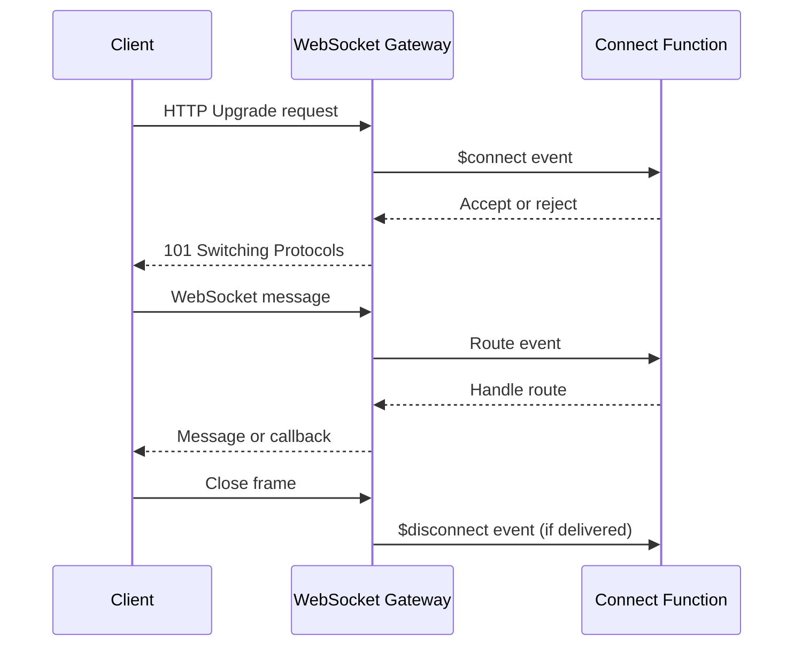
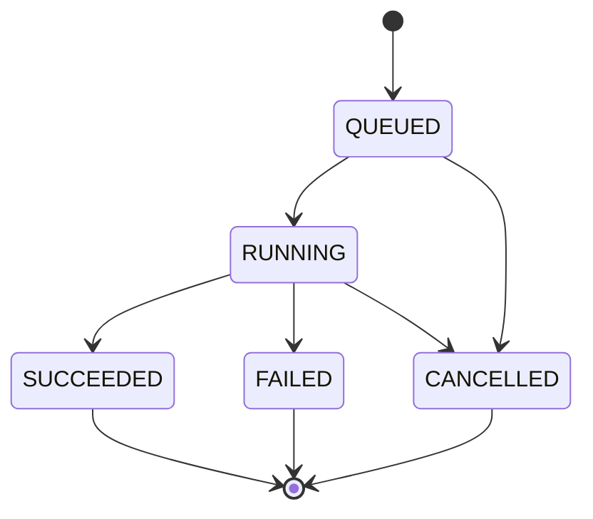
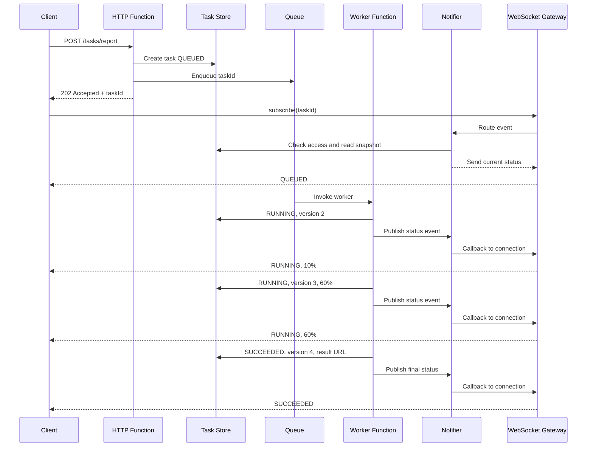

# WebSockets and Task Status Updates for Clients

HTTP request/response fits operations that return results quickly. However, some business workflows take longer to complete: generating large reports, processing videos, importing data, running workflows, or waiting on multiple external services. If the client must hold an HTTP request open throughout, the connection can time out, resources remain tied up, and user experience degrades.

WebSockets allow clients and servers to exchange data bidirectionally over a long-lived connection. In serverless architectures, WebSockets are typically paired with a connection-management API, Java functions handling individual routes or messages, a queue for background work, and a data store holding task state. Functions remain short-lived; connection state and business state are managed outside the function.

This lesson sits within **CLOUD_SERVERLESS**, focusing on Java functions triggered by HTTP or messages/events to manage connections, launch tasks, and push progress updates to clients. The goal is to choose the right protocol, design recoverable update flows, secure connections, and control both latency and cost.

## 1. What Problems Do WebSockets Solve?

With standard HTTP, a client sends a request and receives a response. The server typically ends the exchange after returning the result. To track background task progress, the client can either call an API periodically (*polling*), or the server can push data to the client over a bidirectional connection such as WebSocket.

WebSockets are useful when an application needs:

- Progress or task status updates immediately when state changes.
- Continuous bidirectional exchange, e.g., clients sending control commands and the server responding.
- Broadcasting notifications to multiple connected clients, such as operations dashboards or live collaboration.
- Reducing repeated polling requests when many updates occur within a session.

For example, a client submits a report generation request. The server accepts the request, returns `202 Accepted` with a `taskId`, and processes the report in a background worker. As the task transitions from `QUEUED` to `RUNNING`, reaches 50%, succeeds, or fails, the server pushes notifications over WebSocket. The client updates its UI without constantly polling the server.

WebSockets do not replace all HTTP APIs. HTTP remains ideal for creating tasks, querying current state, downloading outputs, and performing CRUD operations. WebSockets fit bidirectional messaging or instant updates. Combining both usually produces a more manageable design.

## 2. WebSocket Handshake and Connection Lifecycle

A WebSocket begins with an HTTP handshake. The client sends a request with protocol upgrade headers, typically `Upgrade: websocket` and `Connection: Upgrade`. If the server accepts, it responds with `101 Switching Protocols`; from there, both sides exchange WebSocket frames over the established TCP connection.



In serverless architectures, distinguish between the **WebSocket connection** and **function invocations**:

- A managed gateway or WebSocket service maintains sockets, handles frames, ping/pong, and routes messages per service capabilities.
- Functions are invoked on events such as new connections, disconnects, or messages arriving on a route. The function handles the event and exits.
- When the server needs to push messages after a function has exited, it typically calls the gateway's connection-management/callback API using the connection ID.
- Connection IDs and client subscription metadata must be stored in an external data store when multiple functions or workers need to look them up.

Therefore, do not keep a Java function running indefinitely waiting on a socket as you might in a traditional application server. The serverless model separates connection maintenance (handled by the gateway) from business processing (handled by functions). Handshake details, connection lifetimes, idle timeouts, and callback APIs depend on the provider.

## 3. Common Routes in a WebSocket API

A managed WebSocket API typically routes messages to functions based on a route key. Exact route names are defined by the application or provider. Common routes include:

| Route | When Triggered | Typical Responsibilities |
|---|---|---|
| `$connect` | Client initiates handshake | Authenticate, check permissions, record connection ID and metadata |
| `$disconnect` | Connection closes or drops | Clean up subscriptions, mark connection inactive |
| `$default` | Message does not match a specific route | Reject unsupported messages or handle per default convention |
| `subscribe` | Client subscribes to updates | Verify access to task/channel and persist subscription relationship |
| `unsubscribe` | Client unsubscribes | Remove subscription relationship |
| `cancelTask` | Client requests task cancellation | Verify ownership and send cancellation request to worker |

Example message sent by a client to subscribe to a task:

```json
{
  "action": "subscribe",
  "taskId": "task-73f2"
}
```

A message sent back by the server may carry the current state:

```json
{
  "type": "task.status",
  "eventId": "evt-901",
  "taskId": "task-73f2",
  "version": 4,
  "status": "RUNNING",
  "progressPercent": 35,
  "updatedAt": "2026-11-17T10:15:00Z"
}
```

Do not trust a `taskId` or channel sent by a client simply because the client connected successfully. The `subscribe` route must verify the current user is permitted to view that task. A client must not be able to subscribe to another user's task status by guessing IDs.

## 4. Serverless Architecture for Background Tasks

A common design separates request acceptance, task execution, and status broadcasting into distinct components:

```mermaid
flowchart TD
    C[Web or mobile client] -->|HTTP POST /tasks| A[HTTP API]
    C <-->|WebSocket| W[WebSocket Gateway]
    A --> F[Java API function]
    F --> S[(Task status store)]
    F --> Q[Work queue]
    Q --> R[Java worker function]
    R --> S
    R --> E[Status event or outbox]
    E --> P[Notifier function]
    P --> S
    P -->|Post to connection IDs| W
    W -->|task.status| C
    C -->|GET /tasks/{id}| A
```

Each component has a clear responsibility:

- **HTTP API function:** authenticates requests, validates inputs, generates task IDs, writes initial state, and enqueues messages.
- **Task store:** durably persists status, progress, timestamps, ownership, and outputs or safe error details.
- **Queue/event source:** decouples request acceptance from execution time; absorbs load and dispatches work to workers per service semantics.
- **Worker function:** executes work per invocation, updates status, and emits progress events.
- **Notifier function:** looks up subscribed connection IDs, sends messages via the connection management API, and handles stale connections.
- **WebSocket gateway:** maintains sockets and delivers messages to clients.

The task store is the authoritative source of truth for state. WebSockets are merely a notification channel signaling that state changed. If a client loses connectivity or a push fails, the client can still call HTTP GET to retrieve the latest state.

## 5. Designing Task Lifecycles and States

Task state requires explicit transition rules. A simple state machine might look like:



Terminal states are reachable from `RUNNING`; cancellation rules while a task is still `QUEUED` must be defined explicitly.

`QUEUED`, `RUNNING`, `SUCCEEDED`, `FAILED`, and `CANCELLED` are illustrative states. Depending on business needs, you may add `RETRYING`, `WAITING_FOR_INPUT`, or `PARTIALLY_COMPLETED`. Avoid creating excessive states without distinct behavior.

Each status update should carry:

- `taskId`: task identifier.
- `status`: current state.
- `version` or `sequence`: monotonically increasing number per state change.
- `progressPercent` or meaningful progress info; not every task can measure exact percentages.
- `updatedAt`: update timestamp in UTC.
- `eventId`: notification identifier so clients can deduplicate messages.
- `message` or `errorCode` safe for display; never send stack traces or internal secrets.

Transitions must be enforced at the data store. For example, a worker may transition a task from `QUEUED` to `RUNNING` only if no other worker has claimed it. Use conditional updates, optimistic locking, or transactions to prevent concurrent invocations from overwriting state.

## 6. Creating Tasks via HTTP and Subscribing to Updates

An API starting a long-running task should return quickly, typically using `202 Accepted` instead of holding the request open until completion.

Example request:

```http
POST /tasks/report
Authorization: Bearer <access-token>
Idempotency-Key: report-2026-11-user-42
Content-Type: application/json

{
  "reportType": "MONTHLY",
  "month": "2026-10"
}
```

Illustrative response:

```http
HTTP/1.1 202 Accepted
Location: /tasks/task-73f2
Content-Type: application/json

{
  "taskId": "task-73f2",
  "status": "QUEUED",
  "statusUrl": "/tasks/task-73f2"
}
```

`Idempotency-Key` lets clients retry on timeouts without spawning multiple tasks for the same request. The server must store the key along with owner scope, request hash, and created `taskId` for a defined retention period. If the key is reused with a different payload, return an error instead of silently reusing the old task.

Saving the task and publishing to the queue can also partially fail: the task is saved but enqueuing fails, or the message enters the queue while the HTTP function never receives confirmation. When zero lost jobs is required, write the task alongside an outbox record in the same transaction; a dispatcher reads the outbox and enqueues with retries. Workers must be idempotent because the dispatcher may re-send the same task. Without an outbox, implement a sweep to detect tasks stuck in `QUEUED` too long and recover them.

After receiving `taskId`, the client can send a `subscribe` message over WebSocket. To avoid missing updates that occurred between task creation and subscription, the client should fetch a state snapshot upon subscribing. The server returns the current `version`; any push message with a version less than or equal to the already-processed version can be ignored.

An alternative order is opening the WebSocket and subscribing first, then sending the task creation request. Either sequence needs synchronization to handle race conditions. The simplest, most reliable approach uses durable state as the source of truth, paired with a snapshot API and version numbers to detect missing or out-of-order messages.

## 7. Managing Connection IDs and Subscriptions

When the gateway accepts a connection, it typically assigns a connection ID. The `$connect` function can store a record such as:

| Field | Purpose |
|---|---|
| `connectionId` | Callback address of the connection at the gateway |
| `principalId` | Authenticated user or service |
| `connectedAt` | Timestamp when connection was recorded |
| `expiresAt` | Expiration time for cleaning stale records via TTL |
| `tenantId` | Tenant scope if the application is multi-tenant |

Subscriptions can be stored per `(taskId, connectionId)` pair or modeled to match the data store's query patterns. Maintain an index to quickly look up connections by task, while supporting cleanup when connections become invalid.

Never store connection IDs in static variables or function memory. Instances can be reclaimed, multiple instances do not share memory, and task workers may run in an entirely different environment. Use a durable data store or shared cache with an appropriate TTL.

The `$disconnect` event is useful for cleanup, though it is not always delivered when networks or devices drop abruptly. Therefore, add TTLs, periodic cleanup jobs, or stale-connection detection when sending callbacks. When the gateway reports a connection no longer exists, the notifier should delete the matching subscription and not retry indefinitely.

## 8. Java Functions Handling Routes and Status Updates

Specific adapters and SDKs vary across providers. The example below defines application-level interfaces to decouple business logic from the API gateway:

```java
public record SubscribeCommand(String taskId) {}

public record ConnectionContext(
        String connectionId,
        String principalId) {}

public record TaskStatusMessage(
        String type,
        String taskId,
        long version,
        String status,
        Integer progressPercent,
        String eventId) {}

public interface TaskAccessPolicy {
    void assertCanRead(String principalId, String taskId);
}

public interface SubscriptionStore {
    void add(String taskId, String connectionId);
}

public interface TaskStatusRepository {
    TaskStatusMessage getCurrent(String taskId);
}

public interface WebSocketPublisher {
    void send(String connectionId, TaskStatusMessage message);
}
```

A `subscribe` route handler can coordinate these components:

```java
public final class SubscribeHandler {
    private final TaskAccessPolicy accessPolicy;
    private final SubscriptionStore subscriptions;
    private final TaskStatusRepository tasks;
    private final WebSocketPublisher publisher;

    public SubscribeHandler(
            TaskAccessPolicy accessPolicy,
            SubscriptionStore subscriptions,
            TaskStatusRepository tasks,
            WebSocketPublisher publisher) {
        this.accessPolicy = accessPolicy;
        this.subscriptions = subscriptions;
        this.tasks = tasks;
        this.publisher = publisher;
    }

    public void handle(
            ConnectionContext connection,
            SubscribeCommand command) {
        accessPolicy.assertCanRead(
                connection.principalId(), command.taskId());

        subscriptions.add(
                command.taskId(), connection.connectionId());

        TaskStatusMessage snapshot = tasks.getCurrent(command.taskId());
        publisher.send(connection.connectionId(), snapshot);
    }
}
```

This is an illustrative example, not a handler ready to deploy verbatim on every platform. The provider's adapter must translate route events into `ConnectionContext` and `SubscribeCommand`, validate payloads, invoke the handler, and send messages via the callback API. In production, subscribing and reading snapshots must be designed to avoid race conditions; for example, subscribing before reading the latest state as shown above, paired with version numbers so clients discard stale messages.

## 9. Workers Emitting Progress and Notifiers Sending Messages

Workers should not send directly to a specific socket when a task may be watched from multiple devices or clients. Instead, the worker updates durable state and emits a status event. An independent notifier reads the event, resolves subscriptions, and sends to each connection ID.

A progress event might look like:

```json
{
  "eventId": "evt-task-73f2-v5",
  "type": "task.status",
  "taskId": "task-73f2",
  "version": 5,
  "status": "RUNNING",
  "progressPercent": 70,
  "updatedAt": "2026-11-17T10:18:00Z"
}
```

If a worker updates the database and then publishes an event, the database write might succeed while publishing fails. If it publishes first and writes second, clients could receive state that was never persisted. To prevent lost notifications in high-reliability systems, use a **transactional outbox**: write the task state and an outbox record in the same transaction; a separate publisher reads the outbox, publishes the message, and marks it sent. Consumers and outbox publishers still need idempotency because the same outbox record may be processed more than once.

For non-critical progress updates, dropping some intermediate updates can be acceptable as long as the final state is guaranteed persisted. For instance, a client might see 10%, 40%, 90%, or jump from 90% straight to `SUCCEEDED`; what matters is that the snapshot API always returns the latest state. Explicitly define delivery guarantees before adopting full outbox complexity.

## 10. Reconnects, Duplicate Messages, and Update Ordering

WebSocket connections can drop when users switch networks, devices sleep, proxies close idle sockets, or gateways enforce max lifetimes. Clients need a reconnect strategy:

1. Detect socket closure or missed heartbeats.
2. Reconnect using exponential backoff and jitter so clients do not reconnect simultaneously.
3. Re-authenticate according to system policy.
4. Re-subscribe to tasks/channels the user is still authorized to watch.
5. Fetch the latest snapshot via HTTP or a snapshot-emitting subscribe message.
6. Compare version/sequence numbers to ignore duplicates and detect gaps.

WebSockets do not inherently provide exactly-once guarantees for business logic. Gateways can redeliver messages, notifiers can retry callbacks, and clients can reconnect after handling a message before persisting their cursor. Give every status event a stable `eventId`; clients track the highest applied `version` per task. If an incoming `version` is less than or equal to the current version, ignore it. If version jumps from 5 to 8, the client can fetch a snapshot to resynchronize.

Never assume callback arrival order across multiple functions or threads matches database update order. When ordering matters, assign a sequence number upon state persistence and apply only newer updates. For tasks with parallel steps, progress may not increase monotonically; define calculation and display rules rather than leaving clients to guess.

## 11. Heartbeats, Timeouts, and Connection Limits

WebSockets are long-lived connections, which does not mean they stay alive automatically. Gateways or proxies may close idle connections after a timeout; mobile devices may suspend background apps.

Parameters to check in service documentation:

- Maximum connection duration and idle timeout.
- Supported ping/pong or heartbeat mechanisms and sensible intervals.
- Maximum frame/message size and send/receive rate limits.
- Concurrent connections, message counts, and quotas per account or region.
- Route integration timeouts and function execution limits.
- Behavior when clients send messages too fast or functions fall behind.

Overly frequent heartbeats increase cost and drain device batteries; overly sparse heartbeats delay detecting dead connections. Pick an interval based on gateway idle timeouts, network characteristics, and disconnect-detection needs. Never use heartbeats to try keeping a connection alive beyond the service's hard maximum connection lifetime.

Message-handling functions must finish within the integration timeout. Offload long work to queues or workflows to run in the background; the route merely acknowledges receipt. Never hold a route invocation open waiting on a multi-minute task.

## 12. WebSocket Security and Status Viewing Permissions

Long-lived connections require careful authentication and permission revocation design. Key principles:

1. **Use WSS:** encrypt connections with TLS; never send tokens or sensitive data over unencrypted connections.
2. **Authenticate on connect:** verify identity using gateway-supported mechanisms, such as authorizers or handshake tokens. Avoid putting long-lived secrets in query strings since URLs appear in logs.
3. **Authorize per task:** `subscribe`, `cancelTask`, and all sensitive routes must enforce permissions on the specific resource. Being authenticated does not grant access to every task.
4. **Validate Origin:** if accepting only web apps from specific domains, configure an Origin allowlist. Origin checks do not replace user authentication.
5. **Handle token expiration:** define socket lifetimes, refresh flows, or reconnect requirements. Never assume an expired token automatically closes all open sockets.
6. **Bound messages:** validate message size, schema, rate, and message type; apply rate limits to curb spam and cost.
7. **Avoid sending excess data:** status messages must contain only data the client is authorized to see; never broadcast stack traces, credentials, sensitive profile fields, or cross-tenant data.
8. **Audit:** log principal, task ID, subscribe/cancel actions, and authorization outcomes without logging tokens or secret payloads.

If a user's permissions are revoked while a socket remains open, the system needs a way to invalidate subscriptions or close the connection. For sensitive data, re-check permissions before emitting each status event or enforce short-lived subscriptions.

## 13. Handling Callback Errors and Stale Connections

A notifier sending a message to a connection ID can fail because the client disconnected, the gateway no longer recognizes the connection, or the service is temporarily overloaded.

Classify errors accordingly:

- **Connection gone/stale:** remove the connection and its subscriptions; do not retry indefinitely.
- **Rate limit or throttling:** bounded retry with backoff and jitter; consider queueing messages.
- **Transient network or service errors:** retry under a bounded policy with metrics and logs.
- **Oversized or invalid messages:** fix the schema/payload; never retry a permanently invalid payload forever.
- **Unauthorized callback:** verify the notifier's IAM role, API endpoint, and permission to call the right gateway.

When broadcasting to many clients, avoid sending sequentially in a single invocation if connection counts are large. Batch work, use queues, cap concurrency, and control send rates to stay within quotas. One slow or failing client must not block delivery to all remaining clients.

## 14. Task Cancellation and Final Updates

Clients may request cancellation via HTTP or a WebSocket route. Cancellation is a business request, not a guarantee that work stops instantaneously. A worker might be mid-way through an irreversible step or an external service call.

A safe design:

- Authenticate the client and verify task ownership.
- Set `cancelRequested=true` or transition to `CANCEL_REQUESTED` using a conditional update.
- Workers check the cancellation flag at safe checkpoints between processing steps.
- If stoppable, the worker completes the transition to `CANCELLED`; if already finished, keep `SUCCEEDED`; if non-cancelable, return an outcome matching the contract.
- Emit the final status event and record completion time.

Do not immediately transition a task to `CANCELLED` upon receiving the request if a worker can still write data or call external services. Separating `CANCEL_REQUESTED` from `CANCELLED` signals to clients that cancellation is in progress.

## 15. When to Choose WebSockets, SSE, or Polling?

Not every application needs WebSockets. Pick the simplest mechanism that satisfies requirements and operational limits.

| Mechanism | Data Direction | Best Fit When | Considerations |
|---|---|---|---|
| HTTP polling | Client asks server periodically | Infrequent updates, small scale, simple API desired | Repeated requests; latency depends on polling interval |
| Long polling | Client holds HTTP request until data or timeout | Near-realtime needed without a continuous bidirectional channel | Managing timeouts and pending requests is harder than regular polling |
| Server-Sent Events (SSE) | Unidirectional server-to-client push | Dashboards or progress needing only server-to-client updates | Clients send commands via separate HTTP requests; verify platform streaming support |
| WebSocket | Bidirectional over one connection | Chat, collaboration, interactive control, and realtime updates | Requires thorough connection, reconnect, subscription, quota, and security management |

If clients only receive task progress and never send commands over the realtime channel, SSE can be simpler. If updates happen only a few times per minute, polling with backoff may suffice. WebSockets fit when the benefits of a low-latency bidirectional channel outweigh connection management overhead.

## 16. Cost and Scalability

The cost of a serverless WebSocket architecture is not just function invocation counts. Depending on the service, charges may accrue for connection duration, message counts, route invocations, data transfer, callback API requests, connection/subscription storage, and queues.

Factors to measure:

- Concurrent connections and average connection duration.
- Messages per connection and payload sizes.
- Route invocations, notifier invocations, and retries.
- Subscriptions per task and average fan-out.
- Rates of stale connections, callback errors, and throttled messages.
- Storage footprint for task store, outbox, queues, and data retention duration.

To control cost and load:

- Emit updates only when state genuinely changes; coalesce overly frequent progress updates.
- Avoid broadcasting to all connections when only a subset subscribed to the task.
- Keep messages small; never send large results over WebSockets—send a properly authorized download URL instead.
- Use queues and concurrency caps for large fan-outs.
- Clean up expired connections/subscriptions and set TTLs on temporary data.
- Configure quotas, rate limits, and budget alerts.
- Measure cost per completed task or per user to compare against polling/SSE.

Gateway auto-scaling does not mean every downstream component scales infinitely. Task stores, notifiers, queues, callback APIs, and business services each have their own limits. Run end-to-end load tests, especially for bursts where many tasks finish simultaneously and thousands of clients reconnect together.

## 17. Complete End-to-End Flow Example: Creating and Tracking a Report

Suppose a user selects a month to generate a report. The client calls `POST /tasks/report`, receives `taskId`, and subscribes over WebSocket. The API function persists the task in `QUEUED` state and sends a message to the queue. The worker reads the message, transitions to `RUNNING`, processes stages, updates progress, and finally saves the result URL.



In this example, the worker can be retried after transient errors. Therefore, progress updates must be keyed by task ID and version; report creation needs an idempotency key or deduplication mechanism if re-running incurs cost or duplicate side effects. Clients treat `SUCCEEDED`/`FAILED`/`CANCELLED` as terminal states and can call HTTP APIs to retrieve details or download results.

If the client disconnects at 60%, the worker keeps running. When the client reconnects, it re-subscribes and fetches the current snapshot. If the task already finished, the client immediately receives the final state; the server does not need to buffer full message history in the socket. If the product requires viewing progress history, persist status events in an event store or history table and expose a query API.

## 18. Pre-Production Checklist for WebSockets and Task Updates

| Question | Required Evidence or Configuration |
|---|---|
| Are WebSockets genuinely needed? | Compare bidirectional needs, latency, and update frequency against SSE/polling |
| Who is allowed to connect? | TLS, handshake authentication, Origin policy, and rate limits |
| Who is allowed to watch a task? | Per-`taskId` permission checks on subscribe/cancel routes |
| Where are connection IDs stored? | Shared data store, subscription indexes, and TTL |
| What if `$disconnect` never arrives? | Stale connection cleanup via TTL or callback errors |
| Where is authoritative state stored? | Durable task store and conditional state transition rules |
| What if a client misses messages? | Snapshot API, version/sequence numbers, and resubscribe flow |
| What about duplicate or out-of-order messages? | `eventId`, monotonic versions, and idempotent client handling |
| What if a worker retries? | Idempotency for task work and status updates |
| What if status publishing fails? | Retry policy; outbox if guaranteed event emission is required |
| How are callback errors handled? | Classify stale connections, throttling, retries, and DLQ |
| What if connections or messages exceed limits? | Quotas, idle timeouts, payload sizes, and concurrency controls |
| Can tasks be canceled safely? | `CANCEL_REQUESTED`, cancellation checkpoints, and terminal states |
| How are costs monitored? | Metrics for connections, messages, invocations, fan-out, storage, and budget alerts |

## 19. Keeping Operations Stable Over Time

WebSockets are only one part of a realtime flow. Experience reliability depends on the task store, queues, workers, notifiers, gateway, and client recovery logic. By design, ensure clients always have a way to recover authoritative state even when the socket is no longer active.

Three practices to maintain continuously:

- **Observability:** track concurrent connections, reconnect rates, latency from task state change to client receipt, callback errors, queue depth, and stuck tasks.
- **Failure testing:** simulate network drops, client reconnects, duplicate messages, throttled callbacks, worker retries, missed `$disconnect` events, and tasks completing before clients subscribe.
- **Security and cost reviews:** audit subscription permissions, socket payloads, connection lifetimes, fan-out, quotas, and workload-level costs.

In the serverless model, the gateway manages long-lived connections while Java functions handle short-lived events. Persisting task state and subscriptions durably, using WebSockets for change notifications, and using HTTP to re-query state gives applications both a realtime experience and resilience across connection interruptions.
