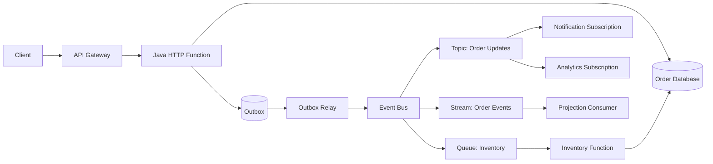

# Choosing Queues, Topics, Event Buses, and Streams

In a serverless architecture, functions often need to exchange work through messages or events rather than calling other functions directly. This communication style allows components to operate independently, absorb sudden traffic spikes, and continue processing when a consumer is temporarily unavailable. However, queues, topics, event buses, and streams have different storage, delivery, and consumption models. Choosing the wrong model can lead to losing replay capability, duplicate processing, out-of-order execution, or unnecessary operational overhead.

The key point to clarify before selecting a service is the nature of the data in transit: is it **a task that needs one worker to process**, **a notification that needs to reach multiple subscribers**, **an event that needs conditional routing**, or **a record in a data stream that must be retained and re-read by position**. These models can be combined; for example, an event bus routes an event to multiple queues, while a stream stores history for analytics and replay.

## 1. Four Messaging Models

### Queue: Work Queue

A queue holds messages until a consumer receives and processes them. Multiple workers can read from the same queue using the competing consumers pattern; typically, each message is delivered to one worker at a time for processing. After processing succeeds, the consumer acknowledges (acknowledges/deletes) the message so the queue removes it from the pending list. If the consumer fails or does not acknowledge within the lease/visibility timeout, the message can be redelivered.

Queues fit independent tasks such as generating thumbnails, sending emails, processing invoices, or syncing data. The producer only needs to send work to the queue without knowing which worker will pick it up. A queue also provides a buffer between ingestion rate and processing rate: if the producer sends faster than the consumer can handle, the backlog grows instead of forcing the consumer to process immediately.

Queues typically have the following characteristics:

- Messages are retained until processed, expired, or moved to a dead-letter queue (DLQ), depending on configuration.
- There is an acknowledgement, visibility timeout, or lease mechanism to manage delivery and reprocessing.
- They may support retries, delays, dead-lettering, and delivery attempt limits.
- Ordering is not always guaranteed. Some services provide FIFO or per-message-group ordering with separate throughput limits.
- Multiple workers typically share message processing; each worker does not automatically receive its own copy.

### Topic: Publish-Subscribe Channel

A topic provides a publish endpoint for producers and one or more subscriptions for subscribers. When a producer sends a message to a topic, the broker distributes a copy or reference of the message to each subscription. Each subscription can have its own backlog, retry policy, and consumers. Subscriber A handles notifications, Subscriber B updates search, and Subscriber C writes analytics data; a slow subscriber does not necessarily block other subscribers from progressing.

Topics fit scenarios where the same notification must reach multiple systems. The producer does not need to call each subscriber directly or know the list of active subscribers. If a subscription needs multiple workers to share the load, that subscription can be connected to a queue or implemented with a consumer group depending on the broker.

The term "topic" can refer to two different implementations:

- In a pub/sub broker, a topic is a broadcast point where each subscription receives an independent copy. This is the common usage in notification topic services.
- In distributed log ecosystems such as Kafka, a topic is a partitioned log retained according to a retention policy. Consumers read by offset; multiple consumer groups can read the same data independently. This type of topic exhibits stream characteristics.

Therefore, when designing, you need to ask whether "topic" refers to subscription fan-out or an append-only log. Having the same name does not mean having the same delivery semantics.

### Event Bus: Rule-Based Event Routing

An event bus receives events from multiple producers, applies rules to filter by event type or payload attributes, and forwards them to targets. A target can be a function, queue, topic, workflow, or another bus. A bus allows business domains to publish events without knowing the specific consumers.

For example, an `OrderSubmitted` event can be routed to an inventory queue if `region` belongs to a certain area, to an anti-fraud function if the total exceeds a threshold, and to a notification topic for interested systems. A bus can have many rules and many targets; each target needs error handling, retry, and storage policies suited to the platform's capabilities.

An event bus fits event-driven integration across multiple services or business domains. Buses typically focus on receiving, filtering, and routing events. Do not assume an event bus is a long-term historical store or an arbitrarily re-readable log. Event storage, archiving, replay, retries, and DLQ capabilities depend on the specific service; if those capabilities are required, they must be verified and configured explicitly.

### Stream: Event Stream with Read Positions

A stream is a sequence of records appended to a log, usually divided into multiple partitions. Records are retained according to a configured retention period or storage limit. Consumers read data by offset/sequence number and can save checkpoints to resume from a prior position.

Streams fit telemetry, clickstreams, audit feeds, change data capture (CDC), real-time analytics, and cases where multiple consumers need to replay the same history. A consumer group can distribute partitions across multiple workers to increase throughput. Multiple independent consumer groups can read the same stream at their own positions, so a single data stream can serve analytics, alerting, and building read models.

Common characteristics:

- Records remain in the log for a time period or capacity limit, even after a consumer has read them.
- Consumers manage their own offsets or checkpoints; replaying means rewinding to an older offset within the retention window.
- Ordering is usually guaranteed within a single partition, not across the entire stream when there are multiple partitions.
- Throughput typically scales via partitions and parallel consumers.
- Consumers must handle duplicate reads, checkpointing, and rebalancing; a read record does not automatically disappear from the stream.

## 2. Semantics Comparison

| Criterion | Queue | Pub/Sub Topic | Event Bus | Stream/Log |
|---|---|---|---|---|
| Purpose | Distribute work | Fan-out a notification to multiple subscriptions | Filter and route events | Store a sequence of records for offset-based reading |
| Consumer model | Multiple workers share work | Each subscription receives its own copy; workers within a subscription can share load | One or more targets per rule | Consumer groups split partitions; other groups read independently |
| After consumer reads | Usually acked to delete/complete | Depends on each subscription's state | Depends on target delivery mechanism | Records remain according to retention |
| Replay | Usually redriven from DLQ or resent | Depends on broker and subscription retention | Only with archive/replay or an upstream source | Re-read older offsets within retention |
| Ordering | Queue-dependent; FIFO may have scoped limits | Broker- and subscription-dependent | Should not assume global ordering | Usually per partition only |
| Backpressure | Backlog grows in the queue | Backlog per subscription or downstream queue | Depends on target, retries, and service limits | Lag grows when consumers fall behind producers |
| Best fit | Work items needing processing | One notification needed by multiple systems | Service integration by event type/attributes | Data history, replay, analytics, CDC |

The rows in this table describe common semantics, not identical guarantees across all providers. Always check the limits on messages, retention, ordering, retries, batching, throughput, payload size, and DLQs of the actual service.

## 3. Combining the Models

An ordering system can use all four models, with each solving a different part of the problem:



The HTTP function validates the request and saves the order. The outbox relay publishes `OrderSubmitted` after the database transaction commits. The event bus filters and routes the event to the inventory queue, the notification topic, and the history stream. The queue allows inventory workers to share work; the topic distributes updates to multiple subscriptions; the stream retains records so projections or analytics can read by offset.

Not every architecture needs all four. An email-sending service might only need a queue. A system that sends one notification to three subscribers might only need a topic. An event bus is useful when many routing rules are needed between services. A stream is valuable when retention, replay, or multiple consumers processing history independently are required.

## 4. Selection Criteria

Start from business and operational requirements, not from cloud service names.

### One Task or Multiple Copies?

If each work item only needs one worker to process it successfully, choose a queue. If the same notification needs to be received by multiple independent subscribers, choose a pub/sub topic or event bus fan-out. If you need both fan-out and per-consumer throttling, you can route the event bus to a dedicated queue for each subscriber.

### Is Historical Replay Needed?

If you only need to retry failed messages for a short window, a queue with a DLQ is usually enough. If multiple consumers need to re-read history from an arbitrary position, a stream is a better fit. If you want to store events from an event bus to replay during an incident, you must configure archiving or a separate event store; do not assume the bus keeps data indefinitely.

### Is Ordering Required?

If work for the same entity must be ordered, choose a service supporting FIFO or partition/group keys. FIFO queues typically group ordering by message group; streams preserve order within a partition. For event buses and topics, verify the ordering semantics of both the broker and subscription. If ordering is a business requirement, put the aggregate ID into the appropriate partition/group key and check versions to detect late-arriving events.

### Is Load Spiky or Continuous?

Queues are suited to absorbing bursts and throttling worker counts. Streams suit continuous, high-throughput record flows with consumers running in parallel across partitions. Topics/event buses support fan-out, though each target still has its own limits. Cap function concurrency based on downstream database and API capacity; autoscaling does not make downstream systems scale infinitely.

### Do Consumers Have Different Speeds and Error Policies?

If subscribers have different speeds, deadlines, or retry requirements, create separate subscriptions/queues to isolate backlogs and error policies. If multiple consumers share a single queue, a slow worker group or failing messages can affect the entire group. If multiple consumers read a stream, use separate consumer groups to keep offsets independent.

## 5. Quick Selection Matrix

| Scenario | Model to Consider | Reason |
|---|---|---|
| Send an email after an order is created | Queue | Each email is a work item that can be retried and load-shared |
| Send `OrderSubmitted` to notifications, search, and analytics | Topic or event bus | Multiple subscribers need to receive the same event |
| Route `PaymentFailed` to a support workflow and `PaymentCaptured` to accounting | Event bus | Rules filter by event type and attributes |
| Collect clickstreams with multiple analytics consumers | Stream | Retention, partitions, and offsets allow independent reading/replay |
| Process large files in chunks with parallel workers | Queue or stream depending on work model | Queue for work items; stream when log records and checkpoints are needed |
| Build read models from data changes | Stream or event bus + queue | Stream is useful for rebuilds; queue fits per-event task processing |
| One subscriber must be protected from another slow subscriber | Dedicated queue after fan-out | Backlogs, retries, and concurrency are isolated |

## 6. Delivery, Acknowledgement, and Duplicate Handling

Distributed systems commonly provide at-least-once delivery at one or more hops. This means a message may be redelivered after a timeout, function error, or lost acknowledgement. Some platforms offer at-most-once modes or deduplication within a scoped window, but you should not assume the entire end-to-end flow is exactly-once.

### Queue

The consumer receives the message, performs durable side effects, and only then acknowledges the message. If it acknowledges before committing to the database, the function could crash after acking and the work is lost. If the database commits but the ack fails, the message may be redelivered; therefore, the consumer needs idempotency.

The visibility timeout or lease must be longer than the expected processing duration, with buffer added for networking and shutdown. If the lease expires while the function is still running, another worker may pick up the same message. With batch triggers, understand the platform's partial batch failure mechanism: if only part of a batch fails, proper configuration allows retrying only the failed items instead of reprocessing the entire batch, when supported by the service.

### Topic and Event Bus

Each subscription or target has its own delivery state. One target succeeding does not mean all other targets have completed. Monitor retries, DLQs, and delivery failures per subscription/target. If a target invokes a function directly and the function fails, the platform may retry according to its own policy; if the target is a queue, the queue takes over the backlog and subsequent retries.

### Stream

The consumer reads records and updates the offset/checkpoint. Only commit the offset after durable side effects have succeeded. If you commit before finishing processing, records may be skipped after a restart. If processing completes before committing the offset, records may be re-read. Thus, data writes and checkpoints must be coordinated or handled idempotently. With multiple partitions, offsets are managed independently per partition.

### Idempotency Pattern

A common approach is using an inbox/processed-message table with a unique key `(consumer_name, message_id)`. Within the same database transaction, the consumer records the message ID and updates business state. If the message ID already exists, the consumer skips the already-completed side effect and acknowledges the message. For side effects outside the database, use an idempotency key supported by the target API when available, or design a compensating workflow.

## 7. Retries, DLQs, and Poison Messages

Retries fit transient errors such as timeouts, throttling, or 5xx service errors. Use exponential backoff with jitter to avoid many workers retrying simultaneously. Do not infinitely retry errors that cannot self-heal, such as invalid schemas, missing required fields, or business rule violations.

After a maximum number of receive attempts or retry duration, move failed messages to a DLQ or equivalent error store. A DLQ isolates poison messages from the main flow, but requires operational procedures:

1. Monitor message count and the age of the oldest message in the DLQ.
2. Capture event ID, event type, correlation ID, error details, and receive count; do not log secrets or full sensitive payloads.
3. Classify errors as data, code, configuration, or dependency issues.
4. Fix the root cause and determine whether the consumer can safely reprocess the message or needs a compensating action.
5. Perform controlled redrives, preserving the original message identifier if it is still the same event.

For streams, a failing message can stall a consumer group on a partition if the application lacks a strategy to skip or quarantine records. Decide explicitly: retry in place, write errors to a dead-letter topic/stream, record the failed offset and move on, or halt the partition to preserve ordering. Skipping records can break projection completeness; this decision must be documented with a path to repair or replay later.

## 8. Ordering, Partitions, and Scalability

Do not assume global ordering when using multiple queue workers, topic subscriptions, or stream partitions. In many systems, ordering exists only within a group or partition.

With streams, the partition key is usually chosen from an aggregate ID or business key so records for the same entity land in the same partition. A consumer group distributes partitions among workers; the number of useful workers is usually bounded by the number of partitions. Increasing partitions can change key distribution and affect ordering between old and new data, depending on the broker.

With FIFO queues, a message group ID can preserve ordering within each group while allowing different groups to be processed in parallel. If a message at the head of a group fails and must retry, subsequent messages in the same group may be blocked. This is a trade-off between ordering and throughput.

With event buses, rules can send multiple events to different targets, and processing timing across targets is not necessarily synchronized. If business logic requires step B to run only after step A completes, model the dependency using workflow state, a follow-up event, or orchestration; do not rely solely on publish order.

## 9. Replay, Retention, and Schema Evolution

Queues typically retain messages for a limited duration and delete them upon acknowledgement. To re-run an already completed task, issue a new command, recover from a DLQ, or maintain a separate audit/outbox/event journal. Pub/sub topics may retain messages per subscription retention settings, though rewind capability depends on the broker.

Streams keep records according to retention, and consumers can re-read from older offsets while records still exist. Replay is useful for rebuilding read models, testing new consumers, or analyzing historical data. However, replay will repeat side effects if the consumer sends emails, charges payments, or calls external systems. Replay consumers should have a projection-only mode, an isolated environment, or business-level idempotency/guards to avoid re-executing side effects.

Event buses may support archiving and replay, though this capability varies by platform. If event history is a business or audit requirement, define durable storage, retention, encryption, access controls, and replay procedures independently of the bus.

Message schemas need versioning and compatibility rules. Producers should add optional fields in a backward-compatible manner; consumers should ignore unknown fields when the contract permits and handle missing required fields explicitly. When changing a field's data type or meaning, a new event type/version or a transition period where both producers and consumers are compatible may be necessary.

## 10. Java Example: Shared Envelope for Queues, Topics, Buses, and Streams

The business layer should use event types decoupled from vendor SDKs. Separate adapters translate these types into message bodies/attributes, bus events, or stream records.

```java
import java.time.Instant;

public record EventEnvelope<T>(
        String id,
        String type,
        int schemaVersion,
        Instant occurredAt,
        String aggregateId,
        String correlationId,
        T data) {}

public record OrderSubmitted(
        String orderId,
        String customerId,
        long total) {}

public interface EventPublisher {
    void publish(EventEnvelope<?> event);
}

public final class OrderEvents {
    private final EventPublisher publisher;

    public OrderEvents(EventPublisher publisher) {
        this.publisher = publisher;
    }

    public void publishSubmitted(
            String eventId,
            String correlationId,
            OrderSubmitted data) {
        EventEnvelope<OrderSubmitted> event = new EventEnvelope<>(
                eventId,
                "OrderSubmitted",
                1,
                Instant.now(),
                data.orderId(),
                correlationId,
                data);
        publisher.publish(event);
    }
}
```

In production, events should be written to an outbox in the same transaction as the order change. A relay reads the outbox and invokes the `EventPublisher` adapter. If the relay publishes successfully but fails before marking the outbox entry, it may publish the same event ID again; consumers must be idempotent.

## 11. Java Example: Idempotent Consumer

The following code illustrates how to protect a projection when a message is redelivered. The inbox and projection repositories must participate in the same database transaction. Unique constraint handling details depend on the database engine.

```java
import java.util.function.Supplier;

public interface TransactionRunner {
    <T> T execute(Supplier<T> work);
}

public interface InboxRepository {
    // Insert a unique (consumerName, messageId) marker.
    // Return false when this message was already committed.
    boolean insertIfAbsent(String consumerName, String messageId);
}

public interface OrderProjectionRepository {
    void markSubmitted(String orderId, long total);
}

public final class OrderSubmittedHandler {
    private static final String CONSUMER = "order-projection-v1";

    private final TransactionRunner transactions;
    private final InboxRepository inbox;
    private final OrderProjectionRepository projection;

    public OrderSubmittedHandler(
            TransactionRunner transactions,
            InboxRepository inbox,
            OrderProjectionRepository projection) {
        this.transactions = transactions;
        this.inbox = inbox;
        this.projection = projection;
    }

    public void handle(EventEnvelope<OrderSubmitted> event) {
        transactions.execute(() -> {
            if (!inbox.insertIfAbsent(CONSUMER, event.id())) {
                return null;
            }

            projection.markSubmitted(
                    event.data().orderId(), event.data().total());
            return null;
        });
    }
}
```

The queue adapter only acknowledges the message after `handle` commits successfully. The stream adapter only checkpoints the offset after record processing succeeds. If the function stops after commit but before acknowledgement/checkpoint, the redelivery or re-read will encounter the inbox marker and will not apply the projection again.

The code above suits side effects inside the same database. If the handler sends an email or calls a payment API, a database transaction cannot automatically roll back external side effects. In that case, you need an idempotency key supported by the external API, an outbox for outgoing commands, or a workflow with compensating steps.

## 12. Integrating with the Java Function Runtime

A function can be triggered by HTTP, a queue, a topic subscription, an event bus target, or a stream consumer. Input adapters differ, but the business layer should receive a standardized envelope or command.

| Trigger | Data Received by Function | Completion Confirmed By |
|---|---|---|
| HTTP | Request, headers, path/query, body | HTTP response; client may retry on timeout |
| Queue | Single message or batch of messages | Ack/delete or platform-specific batch item success response |
| Topic subscription | Subscription's message copy | Ack/response per subscriber protocol |
| Event bus | Event envelope/target payload | Invocation result or delivery response per platform |
| Stream | Record, partition, offset/sequence | Checkpoint/offset commit after processing |

With queue or stream triggers, the platform may deliver a batch in a single invocation. The function should track whether each record succeeded or failed and use partial batch responses if supported. Returning a generic error for the entire batch may cause already-processed records to rerun; idempotency reduces impact but still consumes compute and database queries.

Functions typically have finite timeouts. If work takes longer than the limit, split it into smaller messages, persist workflow state, and emit an event for the next step. Do not hold an invocation open waiting on a long chain of tasks when queues or workflows can represent progress more durably.

## 13. Backpressure and Concurrency Limits

Backpressure is how you prevent producers from generating load exceeding the capacity of consumers or dependencies. Queues provide explicit buffering via backlog. Streams expose pressure via consumer lag. Topics and event buses can fan out into multiple load branches; each subscription or target requires separate limits and monitoring.

A consumer function can scale based on message count or processing latency. If concurrency grows too quickly, the database may exhaust connections, external APIs may throttle requests, or costs may spike. You should:

- Set maximum concurrency according to dependency capacity.
- Tune batch size and messages per invocation based on processing time and memory.
- Monitor queue depth, age of oldest message, or consumer lag.
- Use queues to throttle writes to databases or low-quota APIs.
- Apply rate limits, timeouts, and circuit breakers for external dependencies.
- Separate queues/subscriptions for workloads with different SLAs or processing speeds.

Low queue depth does not always mean a healthy system: messages may be retrying repeatedly, or consumers may process incorrectly yet still ack. Combine backlog metrics with error rates, message age, completion throughput, and business metrics.

## 14. Security and Data Contracts

Producers should only have permission to publish to the required queue/topic/bus/stream; consumers should only have permission to consume and access the business data they own. Use IAM or equivalent per-function permissions, encrypt in transit and at rest, manage secrets via a secret manager, and restrict DLQ read access because failed messages may contain sensitive payloads.

Do not treat messages in a broker as trustworthy simply because they originate from an internal network. Consumers must validate schemas, event types, sources, and business preconditions. Check tenant and resource ownership at the business layer; correlation IDs or aggregate IDs are not authentication credentials.

Keep payloads small and include only fields the consumer needs. For large files, store the file in object storage and pass the object key or a time-limited URL in the message. Verify access permissions, URL expiration, and file lifecycle policies. Avoid sending tokens, passwords, or secrets in event bodies.

## 15. Observability and Cost

Different models require different metrics:

| Model | Metrics to Monitor |
|---|---|
| Queue | Queue depth, age of oldest message, receive count/redeliveries, DLQ message count, processing duration |
| Topic | Delivery success/failure per subscription, backlog/retention per subscription, retries, and DLQs |
| Event bus | Events ingested, events matching rules, failed target invocations, retries, throttling, and archive/replay if enabled |
| Stream | Records in/out, consumer lag by group/partition, offset age, rebalances, partition skew, and retention usage |

Logs should include event ID, event type, correlation ID, causation ID, consumer name, attempt/offset, and processing outcome. Use distributed tracing to link producers to consumers whenever possible. Do not put high-cardinality IDs into metric labels; keep them in controlled logs and traces.

Cost calculations must include broker requests or operations, storage and retention, delivery/retry counts, partition counts, throughput, function invocations/duration, logs/traces, data transfer, and downstream target services. Fan-out increases delivery counts or the number of subscriptions storing data. Long stream retention and high partition counts increase both storage and operational cost. Large, persistent queue backlogs can increase storage costs and cause SLA misses.

Measuring cost per business unit—such as per completed order, per processed file, or per analyzed event—is often more useful than looking solely at raw message counts. Optimize by filtering events early, trimming payloads, setting appropriate retention, capping retries, batching where possible, and disabling unused consumers.

## 16. Questions to Answer Before Implementation

1. Is the message a work item, notification, domain event, or record in a data log?
2. Is it processed by one consumer or needed by multiple independent subscribers?
3. Is historical replay needed, and how long must data be retained?
4. At what scope is ordering required: global, per aggregate, or not needed?
5. Can the system tolerate at-least-once delivery, and where is idempotency enforced?
6. How many retries are allowed, what backoff is used, and how is the DLQ operated?
7. Can the consumer process batches, and after which durable operation does checkpoint/ack occur?
8. What maximum concurrency is safe for databases and downstream dependencies?
9. How are schemas versioned and changed compatibly?
10. Who owns permissions to publish, consume, replay, and read the DLQ?
11. Which metrics detect backlog, lag, delivery failures, and stuck workflows?
12. Have retention, partition, fan-out, retry, and function costs been estimated against expected load?

## 17. Selection Checklist

- [ ] Use a queue when distributing work items across competing workers.
- [ ] Use a pub/sub topic when multiple subscriptions need independent notification copies.
- [ ] Use an event bus when filtering and routing domain events by rules to multiple targets.
- [ ] Use a stream when needing a log with retention, offsets, consumer groups, and replay.
- [ ] Clearly distinguish pub/sub topics from partitioned-log topics.
- [ ] Verify ack, retry, retention, ordering, batching, and DLQ semantics of the specific service.
- [ ] Ensure consumers are idempotent and only ack/checkpoint after durable side effects.
- [ ] Set concurrency and batch limits according to dependency capacity.
- [ ] Establish poison message, DLQ, and controlled redrive policies.
- [ ] Maintain schema versions, event IDs, and consistent tracing metadata.
- [ ] Track metrics for backlog/lag, message age, delivery failures, and processing duration.
- [ ] Account for broker, retention, fan-out, function, network, and observability costs.

## Conclusion

Queues distribute work to workers; pub/sub topics broadcast notifications to multiple subscriptions; event buses filter and route events by rules; streams store records in partitioned logs with offsets so multiple consumers can read or replay them. When you understand the semantics of each model and combine them in the right places, serverless applications can decouple producers from consumers, absorb load, recover from failures, and support historical analysis. The final decision should always be grounded in consumer count, ordering requirements, retention/replay needs, retry behavior, dependency limits, and actual workload cost.
