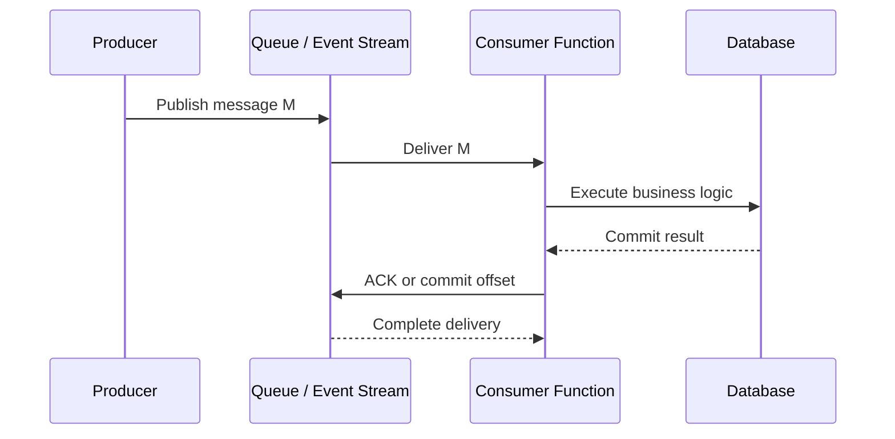
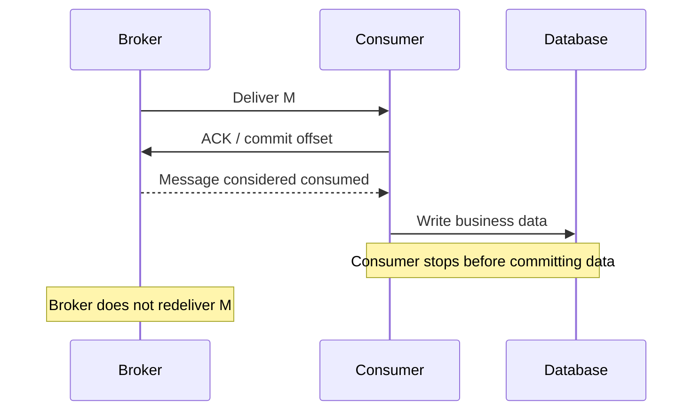
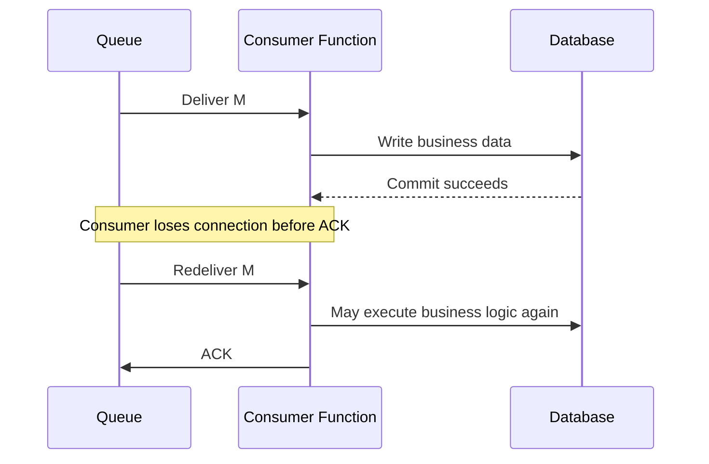
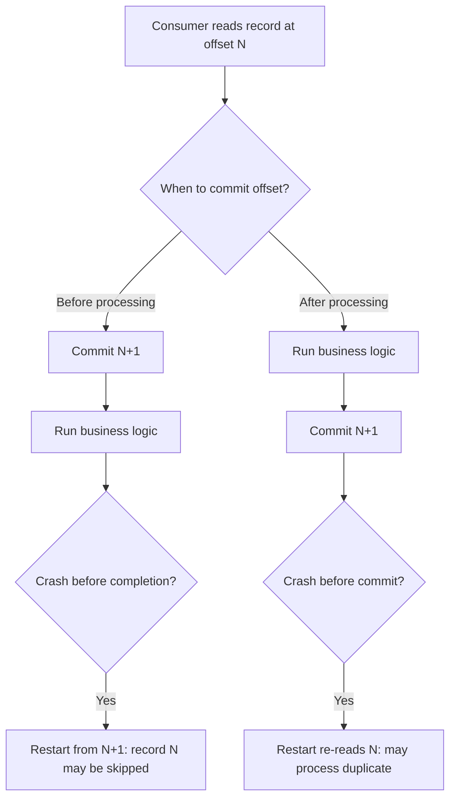

# At-Most-Once and At-Least-Once Delivery Semantics

When a Java function receives a message from a queue or event stream, the system must decide what happens if the consumer stops, encounters an error, or loses connectivity right when acknowledging the message. That decision is described by **delivery semantics**. Two common models are **at-most-once** and **at-least-once**.

At-most-once prioritizes avoiding duplicate processing: a message is delivered no more than once, though it may be lost if a failure occurs at an inopportune moment. At-least-once prioritizes redelivery until acknowledged: messages are less likely to be dropped within retention and retry policies, though the consumer may receive the same message multiple times. Therefore, designing an idempotent consumer is an essential requirement when using at-least-once.

## 1. What Do Delivery Semantics Describe?

A message typically moves through these steps: the producer sends the message, the broker stores or writes the message, the consumer receives the message, executes business logic, and then acknowledges or commits the read position. The broker uses acknowledgements, message states, or offsets to decide whether to redeliver or move on.



The key point is that an acknowledgement does not necessarily mean business logic completed in the way the application expects. The exact meaning depends on when the consumer acknowledges, where data has been durably persisted, and which mechanism the broker uses to track messages.

Delivery semantics also do not automatically describe whether the producer sends duplicate messages, whether message ordering is preserved, or whether the result of an external service call happens strictly once. These are separate properties that must be designed and verified.

## 2. At-Most-Once: Deliver No More Than Once

With at-most-once, the broker or consumer does not attempt to redeliver a message after treating it as consumed. A message may be delivered once or zero times. If the consumer fails after the message has been acknowledged or the offset has been committed, the message is not replayed under that mechanism.

One way at-most-once occurs is acknowledging the message or committing the offset before processing business logic:



In this scenario, the message can be lost from the consumer's perspective even though business logic was never executed. This approach can suit data where losing occasional samples has minimal impact—such as certain telemetry or transient metrics—if the system explicitly accepts data loss risk.

The advantage of at-most-once is reducing duplicate processing risk and potentially lowering retry overhead. The drawback is having no automatic recovery when the consumer fails after the acknowledgement point. If a message represents a transaction, order, payment, or required command, message loss is usually unacceptable.

At-most-once does not mean a message is guaranteed to be processed once. The name *at most* means **no more than once**, so the processing count can be zero.

## 3. At-Least-Once: Deliver One or More Times

With at-least-once, the broker retains the message until a valid acknowledgement arrives or the delivery policy expires. If the consumer fails to acknowledge, crashes, or times out, the broker can redeliver the message. This increases the likelihood that the message is processed, while also introducing the possibility of duplicates.



In this example, the database committed, but the broker never received the acknowledgement. The broker cannot tell for sure whether business processing finished, so it redelivers the message. If the consumer does not recognize the redelivery, it could send another email, charge a customer twice, or create duplicate records.

At-least-once generally fits business workflows where losing messages must be avoided, provided the consumer is designed to tolerate duplicate deliveries. The system needs bounded retries or appropriate retention policies, a DLQ to isolate failing messages, and metrics to detect backlogged messages.

## 4. Comparing the Two Models

| Criterion | At-Most-Once | At-Least-Once |
|---|---|---|
| Delivery count | 0 or 1 | 1 or more times within delivery policy limits |
| Risk of message loss due to consumer failure | Can happen | Greatly reduced while broker retains the message and retries remain active |
| Risk of duplicate delivery | Low under the delivery mechanism | Present; consumer must handle it |
| Typical acknowledgement timing | Before processing or no retry after error | After successful processing |
| Consumer complexity | Can be simpler, but must accept message loss | Requires idempotency, deduplication, and retry handling |
| Scenarios to consider | Telemetry or droppable data | Orders, background jobs, business updates requiring reliability |

There is no single right choice for every system. Base the decision on the consequences of losing a message, the cost of duplicate processing, storage capabilities, latency requirements, and business criticality.

## 5. Acknowledgement in Queues

With queues, the broker typically manages message state until the consumer acknowledges. The implementation varies by service, but can be thought of in two operations: receiving a message and acknowledging/deleting a message.

### 5.1. Visibility Timeout

Some queues use a *visibility timeout* mechanism. When a consumer receives a message, the message is temporarily hidden from other consumers for a period of time. If the consumer acknowledges before the timeout expires, the broker removes the message from the queue. If the timeout expires without acknowledgement, the message reappears and can be delivered to another consumer.

The visibility timeout must be configured based on actual processing time, batch size, and function timeout limits. If processing regularly takes longer than the visibility timeout, messages can be redelivered while the first consumer is still running. For variable-duration work, some services allow extending visibility while processing.

Do not increase timeouts indefinitely to mask hung consumers. Set processing time bounds, monitor message age, and ensure functions can terminate or renew leases in a controlled way.

### 5.2. Acknowledging After Business Completion

With at-least-once, the consumer should only acknowledge a message after business changes have been durably committed. If it acknowledges first and writes to the database afterward, a failure between the two steps can lose the message.

However, acknowledging after commit still leaves a failure window: the database committed, but the acknowledgement was lost. The message is redelivered. That is why consumers still require idempotency even when the processing-then-ACK order appears correct.

### 5.3. Message Batches

A single function invocation may receive multiple messages. If the handler returns only a single pass/fail result for the whole batch, one failing record can cause the entire batch to be redelivered. Already-succeeded records will show up again.

If the platform supports partial batch responses, the handler can report exactly which records failed so only those are redelivered. Enable the corresponding feature in the event source mapping configuration and return the exact format required by the runtime. Even with partial batch responses, each record must remain idempotent because failures can still occur after commit and before acknowledgement.

## 6. Committing Offsets in Event Streams

Event streams like Apache Kafka typically store records by partition and offset order. Consumer groups track read or processed offsets so they can resume from the right position after a restart or rebalance.

When offsets are committed affects delivery semantics:

- **Commit before processing:** if the consumer stops after committing but before finishing business logic, upon restart it may resume from the next offset. Unprocessed records are skipped, producing behavior close to at-most-once.
- **Commit after processing:** if the consumer stops after finishing business logic but before committing the offset, records may be re-read. This is at-least-once behavior; the consumer needs to be idempotent.



In Kafka, offset commits can be managed automatically or manually depending on the client and configuration. If you need at-least-once, only commit offsets after business results are durably saved. For batch processing, manage offsets so later records are not marked complete while earlier records have not yet succeeded.

Event streams typically allow re-reading data within the active retention window by resetting offsets. This replay capability differs from queues: queues usually delete messages after acknowledgement, whereas streams retain records per retention settings and each consumer group tracks its own read position. Even so, stream replay can still cause duplicate business side effects if the consumer lacks deduplication.

## 7. Does Exactly-Once Truly Mean Processed Strictly Once?

The term *exactly-once* frequently appears in broker or platform documentation, but its scope must be clearly defined. Exactly-once guarantees can exist within a specific technical boundary—such as an idempotent producer or read-process-write transactions inside the same stream system. That does not automatically guarantee an external side effect—like writing to another database, sending an email, or charging a payment—occurs only once.

For example: a consumer reads an event, calls a payment gateway successfully, and then crashes before committing the offset. Upon restart, the event is re-read. The broker cannot know on its own that the payment gateway already charged the card previously. If the consumer calls it again without an idempotency key, the customer could be charged twice.

So whenever you hear a service supports exactly-once, ask:

- Does the guarantee apply to the producer, broker, consumer, or the entire pipeline?
- Does it include transactions with external databases or APIs?
- When a consumer restarts or rebalances, how is transaction state recovered?
- Is the guarantee scoped to a single transaction, partition, consumer group, or time window?

For business operations outside the broker, the practical approach is typically at-least-once combined with consumer idempotency, database transactions, and outbox/inbox patterns when consistent event publishing or consumption is required.

## 8. Idempotency: The Foundation for Tolerating Duplicates

An idempotent operation can be executed multiple times with the same input identifier while producing a final business outcome equivalent to executing it once.

For example, setting an order status to `SHIPPED` can be idempotent if repeating it does not create another shipment. Conversely, adding 100,000 VND to an account balance is not idempotent if each invocation adds it again.

### 8.1. Using Event IDs and Unique Constraints

Every event should have a stable ID. The consumer stores processed event IDs with a unique constraint to detect redeliveries. Recording the processed marker and applying the business change should reside in the same database transaction.

```java
public final class OrderPlacedHandler {
    private final ProcessedEventRepository processedEvents;
    private final OrderRepository orders;

    public OrderPlacedHandler(
            ProcessedEventRepository processedEvents,
            OrderRepository orders) {
        this.processedEvents = processedEvents;
        this.orders = orders;
    }

    @Transactional
    public void handle(OrderPlacedEvent event) {
        // insertIfAbsent must be atomic and rely on UNIQUE(event_id).
        boolean firstDelivery = processedEvents.insertIfAbsent(event.eventId());
        if (!firstDelivery) {
            return;
        }

        orders.markPlaced(event.orderId());
    }
}
```

`@Transactional` illustrates an application-managed transaction, such as in Spring. `insertIfAbsent` is a repository operation that must be implemented using an atomic database mechanism and a unique constraint on `event_id`; do not implement it as a separate unlocked `SELECT` followed by `INSERT`, as two concurrent invocations could both pass the check. If the transaction fails, both the processed marker and the order update roll back together. If the transaction commits but the ACK is lost, a redelivery finds the existing event ID and skips applying the change again.

### 8.2. Side Effects Outside the Database

A database transaction cannot automatically roll back a sent email, an external API call, or a completed payment transaction. For such side effects:

- Use idempotency keys supported by the external API, typically derived from the event ID or business operation ID.
- Persist job state and external call outcomes so you can determine whether a prior attempt succeeded.
- Use a transactional outbox to emit events after the business transaction commits.
- Use an inbox or processed-event table on the consumer to deduplicate incoming messages.
- For multi-step workflows that cannot span distributed transactions, design sagas and appropriate compensating actions.

Idempotency keys need an appropriate scope and retention period. If an external service only retains keys for 24 hours while messages might be replayed after 30 days, your system needs its own long-term state-checking mechanism.

## 9. Retries, Backoff, and Dead-Letter Queues

At-least-once typically pairs with retries. When a consumer returns an error or fails to acknowledge, the broker can redeliver the message immediately or after a delay. Retries recover from transient errors, but endlessly retrying an unprocessable message causes bottlenecks and drives up costs.

A retry policy should define:

- Maximum delivery attempts or maximum retry duration.
- Wait intervals between attempts; typically exponential backoff with jitter to avoid many consumers retrying simultaneously.
- Visibility timeout or maximum processing duration per invocation.
- How transient errors are distinguished from non-recoverable errors.
- Maximum receive count before routing a message to the DLQ.
- Queue and DLQ retention periods, along with a redrive procedure after fixing root causes.

A DLQ isolates failing messages for investigation, but does not fix root causes on its own. Set up alerts when new messages enter the DLQ, log event IDs and error codes carefully, define who is authorized to replay, and verify consumer idempotency before redriving.

Do not retry every error identically. Network glitches or throttling can be retried with backoff. Malformed schemas, missing required fields, or business rule violations generally need separate handling. Infinite retries allow a single bad message to consume resources and block other messages.

## 10. Choosing Semantics for Serverless Java Applications

| Scenario | Recommended Direction | What to Implement |
|---|---|---|
| Non-critical telemetry where samples can be dropped | Consider at-most-once | Measure sample loss rate; acknowledge early if risk is acceptable |
| Sending notification emails from events | Typically at-least-once | Idempotency key or send-status table to prevent duplicate emails |
| Processing orders or updating inventory | At-least-once | Transactions, unique event IDs, idempotent state transitions |
| Consumer reading an event stream and updating a database | At-least-once is usually practical | Commit offsets after database commit; deduplicate by event ID |
| Payments or API calls with irreversible side effects | At-least-once with service-side idempotency | Idempotency keys, outcome persistence, and reconciliation on ambiguous timeouts |

When deploying Java functions, account for both the function timeout and the broker's delivery deadline. A function can time out after the database commits but before the runtime acknowledges the message. This is a classic duplicate-creation path. Design transactions and idempotency so redelivery is safe.

For queues, monitor pending message counts, age of oldest message, receive counts, processing duration, and DLQ counts. For streams, monitor consumer lag, offset commits, read/write throughput, and rebalance frequency. These metrics help catch slow or failing consumers before backlogs grow too large.

## 11. Design Checklist

Before choosing or configuring delivery semantics, answer these questions:

1. If a message is lost, what is the business impact? If a message is redelivered, what is the impact?
2. At what point does the broker acknowledge a message or commit an offset?
3. What happens if the consumer stops before processing, during processing, after business commit, or before ACK?
4. Do events have stable IDs? Does the consumer have unique constraints or an idempotency mechanism?
5. Are the business state change and processed-event marker in the same transaction?
6. For external APIs, are there idempotency keys or reconciliation flows for ambiguous timeout outcomes?
7. Do retries have caps, backoff, a DLQ, and a replay procedure?
8. Are visibility timeout, function timeout, batch size, and processing duration compatible?
9. For streams, are offsets committed only after business state is durably persisted?
10. Do metrics and logs report message age, duplicates, retries, DLQ depth, and consumer lag?

## Conclusion

At-most-once delivers messages no more than once and accepts potential message loss when failures happen after acknowledgement. At-least-once redelivers when acknowledgement is missing, reducing message loss risk while introducing potential duplicates. For most serverless workloads requiring reliability, at-least-once paired with idempotent consumers, transactions, bounded retries, and a DLQ is the practical choice. Always verify the exact scope of any exactly-once claim, especially when processing touches databases or services outside the broker.
