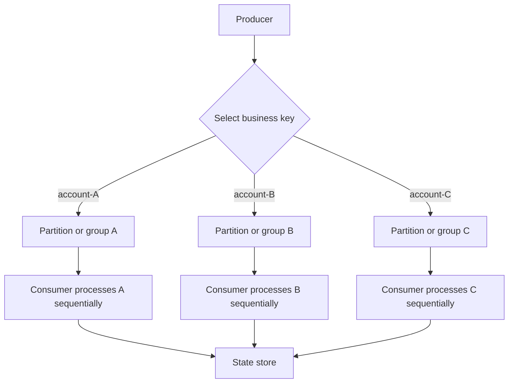

# Ordering, Partitions, and Message Groups

In serverless systems, queues and event streams decouple producers from consumers, absorb traffic spikes, and enable asynchronous processing. When multiple messages are sent close together, the system must answer another critical question: which message must be processed before which? If ordering is altered, business logic can fail even when every individual message is valid.

For example, an account has three commands: `Deposit`, `Withdraw`, and `CloseAccount`. If `CloseAccount` is processed before `Deposit`, the final balance may differ from what the user intended. Similarly, an order has the events `OrderCreated`, `PaymentAuthorized`, and `OrderShipped`; processing `OrderShipped` before payment authorization can leave the order in an invalid state.

To control ordering while preserving scalability, queue and stream systems typically divide messages into **partitions** or **message groups**. Messages with the same business key are routed into the same ordered lane, while different groups can be processed in parallel. Good design starts by identifying the exact scope that needs ordering, then selecting the partitioning key, how producers emit messages, and how consumers confirm results.

## 1. What Does Ordering Mean?

Ordering is the rule governing the sequence among related messages. Distinguish at least three concepts:

- **Send order:** the order in which the producer calls the send or write operation.
- **Broker acceptance order:** the order in which the broker records messages after receiving them from producers.
- **Processing/completion order:** the order in which the consumer starts and finishes work.

These three orders can differ. Two Java threads may send simultaneously; the second request may reach the broker before the first. A consumer may receive messages in order yet dispatch them to two different threads, causing the later message to finish first. Retries can also cause an older message to reappear after newer messages have already been processed.

Therefore, saying "the queue preserves order" is not enough. You must ask at what scope ordering is guaranteed, at what point, and under what conditions. A service may guarantee order within a FIFO group or partition, without guaranteeing global order across groups/partitions. Nor does that mechanism automatically ensure side effects in external systems complete in order.

### Global Ordering vs. Per-Entity Ordering

**Global ordering** means all messages must pass through a single sequence. This is simple to reason about, but usually requires a single sequential lane, limits concurrency, and creates a bottleneck as load grows.

**Per-entity ordering** only requires messages related to the same entity to be processed in order. For example:

- Changes to the same `accountId` must be ordered to preserve balance integrity.
- Events for the same `orderId` must be ordered to preserve the order lifecycle.
- Telemetry for the same `deviceId` must be ordered if calculations depend on prior samples.

Different accounts, orders, or devices can be processed concurrently. This is usually the right balance between correctness and scalability.



In this diagram, ordering is maintained per account. There is no guarantee that account-A's messages finish before or after account-B's messages.

### Business Ordering Is Not Timestamps

Timestamps in payloads are useful for auditing and analytics, but do not reliably determine business ordering. Clocks across producers can drift; a timestamp may be generated before sending while the message arrives at the broker later; a retry may carry the old timestamp.

If business logic requires strict ordering, use a monotonically increasing sequence number or version per entity, generated by the state owner. Timestamps can add context, but should not be the sole basis for applying state transitions.

## 2. Partitions and Message Routing

A partition is a slice of a data stream with its own ordering. In partitioned log/stream systems, each partition typically stores messages by increasing offset. Consumers read records within a partition in offset order. A consumer group can assign partitions across multiple consumers for parallel processing; within the same consumer group, a partition is typically assigned to only one consumer at a time.

The producer supplies a **partition key**. The broker or client partitioner uses that key to pick a partition, usually via hashing. When messages with the same key go to the same partition, they can be read in the partition's append order.

Example:

| Event | Partition Key | Desired Routing Outcome |
|---|---|---|
| `OrderCreated(order-17)` | `order-17` | Same partition as other order-17 events |
| `PaymentAuthorized(order-17)` | `order-17` | Same partition as other order-17 events |
| `OrderShipped(order-17)` | `order-17` | Same partition as other order-17 events |
| `OrderCreated(order-18)` | `order-18` | May land on another partition |

If the partition key is `orderId`, changes for an order stay together. If a fresh random UUID is used per message, messages for the same order can land in different partitions and lose per-order sequencing.

### Choosing a Partition Key Based on Business Invariants

The key should represent the unit of data whose mutations must be serialized. Examples:

| Invariant to Protect | Typical Suitable Key |
|---|---|
| Prevent concurrent balance mutations for an account | `accountId` |
| Update order state along its lifecycle | `orderId` |
| Preserve measurement sequence for a device | `deviceId` |
| Apply sequential updates to a customer profile | `customerId` |
| Serialize all operations for a tenant | `tenantId`, if truly required by business rules |

Do not pick an overly broad key if child entities can be processed independently. For example, using `tenantId` for every message of an enterprise customer can serialize all activity for that tenant, even when individual orders are independent. Conversely, an overly narrow key like `eventId` fails to preserve order across events of the same order.

Identify the scope of data updated together before picking a key. If a transaction modifies multiple accounts or aggregates, a single partition key cannot establish global ordering for the whole transaction; you need transactions, workflows, or coordination at the business layer.

### Hash Partitioning and Its Limits

With hash partitioning, different keys are distributed across partitions. Hashing distributes load relatively evenly when keys have good distribution, but does not guarantee balanced load. A few dominant keys can create a **hot partition**.

For example, if most messages belong to one large `tenantId` and that tenant is the partition key, the partition holding that tenant can become a bottleneck. Increasing the total partition count does not split a single key if all messages for that key must still land on the same partition to keep order.

You can mitigate hot partitions by:

- Choosing a key with cardinality and distribution aligned with the ordering scope you actually need.
- If business rules allow, splitting a large entity into independent subgroups, such as `accountId + ledgerType` or `tenantId + shardId`.
- Separating workloads that do not share ordering requirements.
- Applying rate limits or intermediate queues to absorb bursts.
- Monitoring per-partition load rather than only aggregate throughput.

Do not arbitrarily append random suffixes to a partition key. That spreads load, yet breaks ordering among messages of the same entity. Only shard by sub-key when you can prove the slices are independent or there is a downstream aggregation/coordination step.

### Changing the Partition Count

With some brokers, partitions are selected via a calculation akin to `hash(key) mod partitionCount`. When increasing partitions, the same key may hash to a new partition. If older messages remain in the old partition while newer messages go to the new partition, ordering for that key can split during the transition.

Before increasing partitions, verify the partitioner's behavior and broker policies. You may need to pause producers, drain old data, switch routing versions, use stable key mappings, or create a new topic/stream and migrate in a controlled manner. Never assume adding partitions is always safe for strictly ordered flows.

## 3. Message Groups in FIFO Queues

Some queues support FIFO and let producers attach a `MessageGroupId` (or equivalent) to each message. Messages with the same group are processed in the order accepted by the service; different groups can be dispatched to consumers in parallel.

For example, with an order-processing queue:

- `MessageGroupId = order-17` for all messages related to order 17.
- `MessageGroupId = order-18` for all messages related to order 18.
- Consumers can process both groups concurrently, while messages within a single group follow the order provided by the queue.

This resembles a partition key, though queues and streams do not share identical semantics. A message group is a routing/serialization concept in certain FIFO queues. A partition is a storage and distribution unit in log/stream systems. When selecting a service, inspect its exact guarantees for groups, ordering, visibility, batching, retries, and consumer concurrency.

### Message Groups and Parallelism

If there is only one group, the system may be constrained to nearly sequential processing, even if the queue supports multiple consumers. With many independent groups, multiple consumers can run concurrently. However, group count alone does not guarantee active consumer count: it also depends on backlog, concurrency caps, available messages, and the service's dispatch rules.

| Group Design | Ordering | Parallelism |
|---|---|---|
| One group for the whole system | Global order | Low; easily becomes a bottleneck |
| One group per order | Per-order sequencing | High across different orders |
| One group per tenant | Per-tenant sequencing | Can be low for high-volume tenants |
| One group per message | Virtually no ordering across messages | High, but fails to protect business order |

Choose groups using the same rule as partition keys: the group represents the unit needing sequential execution. If a tenant owns multiple independent accounts, `accountId` gives better concurrency than `tenantId`, provided business rules do not require cross-account ordering.

### Visibility Timeout and Sequential Processing

With visibility-timeout queues, once a message is received, it is temporarily hidden from other consumers for a period. If a consumer takes longer than the deadline without extending or acknowledging, the message can reappear. With FIFO groups, services usually gate delivery of the next message in the group to preserve order, though exact behavior varies by provider.

Set the visibility timeout longer than expected processing time and add renewal mechanisms for long tasks. A timeout that is too short causes redelivery while the first consumer is still running; one that is too long delays recovery when a consumer dies. Even with FIFO, consumers still need idempotency because messages can be redelivered after failures or timeouts.

## 4. Producers Must Emit Messages in Order

A broker can only preserve the order in which it receives messages. If two threads send two events for the same aggregate concurrently, the broker may accept the newer event before the older one. If a producer retries an old request after a timeout without an idempotent/sequence mechanism, duplicates or out-of-order messages can appear.

Ways to reduce risk:

1. **Serialize sends per key:** for each aggregate, allow only one producer flow to emit messages at a time. Different aggregates can still emit in parallel.
2. **Business sequence/version:** attach an incrementing per-aggregate sequence number to every event. Consumers can detect duplicates or missing versions.
3. **Transactional outbox:** write the business change and outbox record in the same database transaction; the publisher dispatches records in aggregate sequence order.
4. **Idempotent producer or broker deduplication:** use platform features where available, while understanding their scope and deduplication window.
5. **Stable partition key:** all events for the same aggregate must use the same key throughout the stream lifecycle.

### Transactional Outbox and Sequences

Suppose an order command updates status from `CREATED` to `PAID` and needs to emit `PaymentAuthorized`. If the database commits successfully but publishing fails, state changed while consumers never receive the event. If it publishes first and the database rolls back, consumers receive an event describing an uncommitted change.

A transactional outbox writes both the aggregate change and the event inside the same local transaction. A publisher reads the outbox and dispatches afterward. Each aggregate can increment `aggregateVersion` in that same transaction:

```text
BEGIN TRANSACTION
  UPDATE orders
     SET status = 'PAID', version = version + 1
   WHERE order_id = 'order-17'
     AND version = 4;

  INSERT INTO outbox(event_id, aggregate_id, aggregate_version, event_type, payload)
  VALUES ('evt-501', 'order-17', 5, 'PaymentAuthorized', ...);
COMMIT
```

The publisher must preserve order for records of the same aggregate. If multiple publishers read outbox rows concurrently without proper locking/claiming, version 6 could be published before version 5. You can shard publishers by aggregate, claim rows in version order, or enforce dispatching the next event only after the prior one is accepted. The broker key/group should use `aggregate_id`.

An outbox typically provides at-least-once delivery from publisher to broker, not automatic end-to-end exactly-once. The publisher may send an event successfully and crash before marking the outbox row sent; the next run will resend it. Consumers must still be idempotent by `event_id` or aggregate version.

## 5. Parallel Consumers Without Breaking Order

A consumer can run multiple invocations to scale throughput, but should not concurrently process two messages from the same partition/group when business logic requires strict order. The standard pattern is sequential within a partition/group and parallel across partitions/groups.

With partitioned streams, a consumer inside a consumer group typically owns one or more partitions. If there are more consumers than partitions, some consumers stay idle. If there are more partitions than consumers, one consumer may handle multiple partitions. Adding consumers scales parallelism only up to the partition count and downstream resource limits.

With message-group FIFO queues, multiple groups can be processed concurrently. Consumers should not dump messages from the same group into an unbounded executor and ack immediately, as completion order could flip. If internal async work is needed, maintain per-group sequential queues and only acknowledge messages after durable side effects complete.

### Java Example: Consumer Checking Aggregate Version

A defensive business-layer pattern is attaching an incrementing version to events. The consumer persists the last applied version per aggregate. The example below shows how to classify stale events, the next expected event, and version gaps.

```java
public record OrderEvent(
        String eventId,
        String orderId,
        long aggregateVersion,
        String eventType
) {}

public enum ApplyResult {
    APPLIED,
    DUPLICATE_OR_OLD,
    GAP_DETECTED
}

public interface OrderEventStore {
    long currentVersion(String orderId);

    // Must check expectedVersion and write changes in the same transaction.
    boolean applyIfVersionMatches(OrderEvent event, long expectedVersion);
}

public final class OrderedOrderConsumer {
    private final OrderEventStore store;

    public OrderedOrderConsumer(OrderEventStore store) {
        this.store = store;
    }

    public ApplyResult handle(OrderEvent event) {
        long current = store.currentVersion(event.orderId());

        if (event.aggregateVersion() <= current) {
            return ApplyResult.DUPLICATE_OR_OLD;
        }

        if (event.aggregateVersion() != current + 1) {
            return ApplyResult.GAP_DETECTED;
        }

        boolean applied = store.applyIfVersionMatches(event, current);
        return applied ? ApplyResult.APPLIED : ApplyResult.GAP_DETECTED;
    }
}
```

This example assumes the first version is 1 and `applyIfVersionMatches` checks the expected version atomically. Reading the version and updating in two separate operations allows two concurrent invocations to both read version 4 and both apply version 5. Use transactions, compare-and-set, or conditional writes to prevent race conditions.

When `GAP_DETECTED` occurs, the consumer must not skip the event and keep applying later ones. It can perform bounded retries, park the event in a per-aggregate holding area, request a broker replay, or fetch a fresh snapshot and reconcile. The choice depends on replay support, retention, and latency requirements.

### Offset Commits and Batching

With logs/streams, the offset is a record's position in a partition. If a consumer processes multiple records in parallel and commits the highest offset while an earlier record is still unfinished, the broker may consider the unfinished record consumed. Upon restart, that record could be skipped.

Only commit offsets up to the highest contiguous position where all preceding records are durably processed. You can parallelize across partitions; within a partition, process sequentially or track completions to commit accurately. When using frameworks that manage offsets/checkpoints, verify when the framework confirms a batch and how it handles single-record failures.

With batch-delivering queues, a batch may contain messages from multiple groups. Consumers must preserve order within each group and follow per-message failure reporting if the platform supports partial batch responses. If a message in one group fails, subsequent messages in that same group may need to wait for retry or recovery, while messages in other groups can continue if the service permits. For FIFO queues, some platforms require halting processing for subsequent messages in the batch after the first failure and returning both the failed message and the unprocessed ordered messages. Follow your provider's exact semantics.

## 6. Retries, Poison Messages, and DLQs Can Affect Ordering

Retries cause messages to reappear, which can affect ordering. A persistent failing message can stall an entire group if the system enforces strict FIFO. This is intentional to prevent later mutations from bypassing an incomplete step, though it can grow the group's backlog.

If a failing message is moved to a dead-letter queue (DLQ) while subsequent messages keep processing, business ordering can break. For instance, version 5 goes to the DLQ while version 6 is applied. When version 5 is replayed later, the consumer must detect the stale version or gap and apply an explicit recovery policy.

Teams should pick one of these business-aligned strategies:

- **Block the group:** hold subsequent messages until the failing message is fixed and processed. Fits cases where skipping corrupts state.
- **Controlled skip:** skip only with an explicit business decision, log the reason, and emit compensating events or state adjustments if needed.
- **Quarantine the aggregate:** pause the affected entity while continuing to process other entities. Requires dedicated tracking and recovery for that entity.
- **Rebuild from source of truth:** load a snapshot or replay the log to reconstruct state when an event sequence is broken or missing.

Do not automatically shunt every error into a DLQ and treat the stream as healthy. A DLQ merely holds failures for investigation; it does not resolve sequence gaps by itself. Replay procedures must check sequences, idempotency, and prior side effects.

## 7. Choosing Between a FIFO Queue and a Partitioned Stream

FIFO queues and partitioned streams can both deliver ordering by group/key, yet serve different usage patterns.

| Aspect | FIFO Queue with Message Groups | Partitioned Event Stream / Log |
|---|---|---|
| Consumption model | Messages typically deleted/acked after success | Records retained per retention; consumers track offsets |
| Ordering | Per group per queue semantics | Per record order within each partition |
| Parallelism | Across message groups | Across partitions and consumer groups |
| Replay | Usually requires a DLQ or separate resend mechanism | Can re-read from older offsets while within retention |
| Independent consumers | Typically compete for messages in the same queue | Multiple consumer groups can read the same log independently |
| Best fit | Work items distributed and acked upon completion | Event logs, multiple consumers, replay, and continuous streams |

Exact names and limits vary by provider. A queue may support per-group FIFO; a stream may offer per-partition ordering; do not assume all queues are FIFO or all streams replay indefinitely. Verify message size limits, retention, throughput, group/partition quotas, batching, and retry behavior for your chosen service.

## 8. Measuring Ordering and Partition Health

Monitoring only total message count and error rate misses hot partitions or broken ordering. Track these metrics:

| Metric | Warning Sign |
|---|---|
| Lag per partition/consumer group | One partition falls behind while total throughput looks normal |
| Oldest message age per group | A group is stalled by a failing message or slow consumer |
| Throughput and latency per key/group | A few keys dominate traffic |
| Retry and redelivery counts | Old messages keep returning, blocking the group |
| Sequence gap or out-of-order count | Producers or consumers may be breaking order |
| Rebalances and partition reassignments | Consumers are disrupted or temporarily lose partition ownership |
| DLQ depth and age in DLQ | Unresolved ordering errors may be accumulating |
| Consumer processing duration | One message type is bottlenecking a partition/group |

Logs should include `eventId`, `aggregateId` or partition key, `aggregateVersion`, correlation ID, and processing outcome. Avoid logging sensitive data. Traces can link producer, broker, and consumer to pinpoint where messages slow down.

## 9. Common Design Mistakes

| Mistake | Consequence | Correction |
|---|---|---|
| Assuming global order across the entire queue/stream | Events from different partitions/groups finish out of order | Define ordering scope clearly and use stable keys/groups |
| Using a random message ID as partition key | Events for the same aggregate land in different partitions | Use the business entity's key |
| Using a single group for all tenants/entities | Reduces throughput and creates a bottleneck | Pick the smallest group that still protects invariants |
| Splitting a hot entity with random suffixes | Breaks ordering across slices | Shard only when slices are independent or aggregated downstream |
| Increasing partitions without a plan | Keys remap across partitions and split order | Execute a controlled routing migration |
| Consumer processes same-group messages in parallel | Side effects complete out of order | Sequential within a group, parallel across groups |
| Committing offsets before durable processing | Records can be lost after restart | Commit contiguous completed offsets only |
| Moving poison messages to DLQ and ignoring them | Leaves gaps in the version sequence | Block, quarantine, controlled skip, or rebuild |
| Using timestamps instead of sequences | Clock drift or retries scramble order | Use versions/sequences generated by the aggregate owner |
| Not idempotent on redelivery | Duplicate side effects even when order holds | Deduplicate and use conditional writes |

## 10. Designing Ordering for a Serverless Java Flow

When starting a design, follow this sequence:

1. **Identify business invariants.** Document what breaks if two messages for the same entity run out of order.
2. **Choose the ordering scope.** Decide whether ordering is needed globally, per aggregate, account, order, device, or tenant.
3. **Choose the partition key/message group.** Use a stable key representing the state-owning entity.
4. **Analyze load distribution.** Check cardinality, per-key frequency, and hot partition risk; define concurrency limits.
5. **Ensure ordered publishing.** Use per-key serialization, sequence/version numbers, and an outbox if syncing database writes with publishing.
6. **Design the consumer.** Process sequentially within a partition/group, in parallel across groups; ack/commit only after durable results.
7. **Design retries and recovery.** Choose blocking, DLQ, replay, sequence gap handling, and idempotency policies.
8. **Measure and test.** Track lag, group backlogs, hot keys, out-of-order counts, and inject mid-flight failures.

A test suite should cover: two messages for the same key sent concurrently; producer timeout after broker acceptance; first message failing while subsequent messages are queued; consumer crashing after database write but before ack; a group experiencing skewed heavy traffic; partition count changes; mid-processing rebalances; and message replays from the DLQ. For each case, define the expected final state and how you verify ordering was preserved.

## Conclusion

Ordering must be defined by business scope. Partition keys and message groups gather related messages into a single ordered lane while allowing independent entities to run in parallel. Choose keys based on the aggregate or state unit being protected; avoid single global groups that bottleneck throughput and avoid arbitrary key splitting that breaks ordering. Producers must emit with stable sequences, and consumers must process sequentially per group, commit only after durable completion, and remain idempotent under retries. When poison messages or DLQs occur, address ordering gaps deliberately. In serverless Java, designing the right ordering scope preserves correctness while still leveraging the scalability of queues and event streams.
