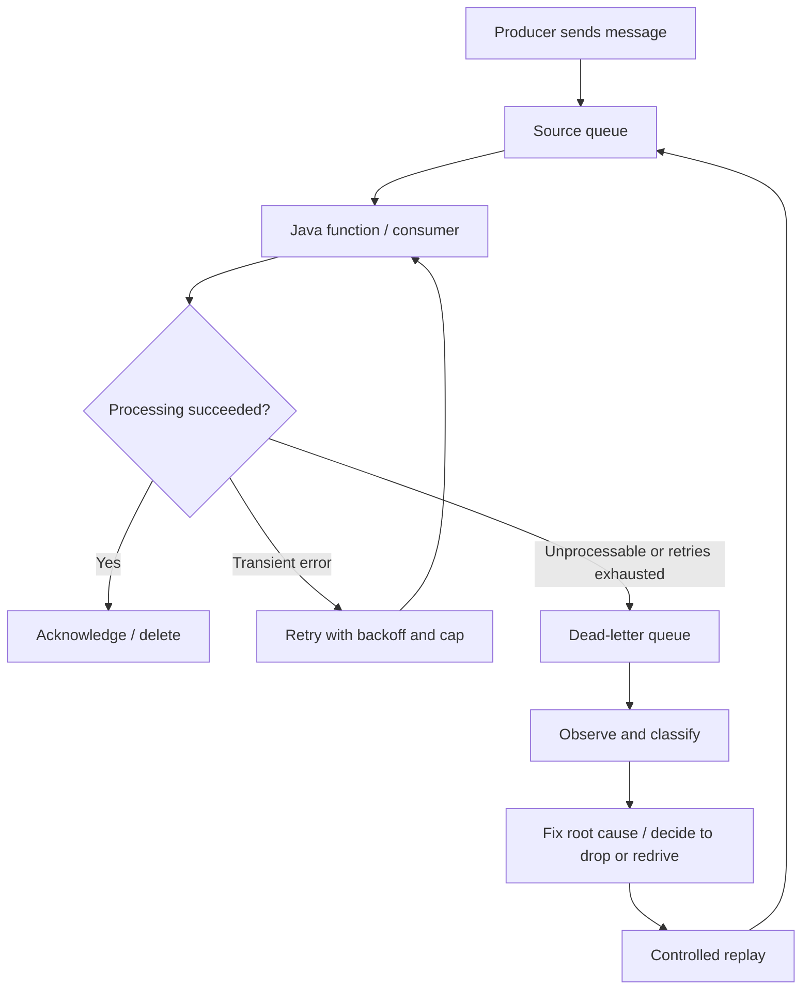

# Dead-Letter Queues and Classifying Unprocessable Messages

In asynchronous processing systems, a message may fail due to invalid data, a temporarily unavailable downstream service, a function timeout, or a software bug. If a consumer keeps receiving the same message without limits, a single failing message can continuously burn resources, delay other messages, and obscure real incidents.

A dead-letter queue (DLQ) is a destination for messages that cannot be processed successfully after the configured retry policy or forwarding conditions are met. A DLQ isolates failing messages for investigation, root-cause remediation, and controlled replay. It does not fix data automatically, does not guarantee exactly-once processing, and does not replace designing consumers capable of safe retries.

In the **CLOUD_SERVERLESS** module, Java functions are commonly triggered by message queues or event streams. Developers need to know which errors should be retried, which should go to a DLQ, how to capture context for investigation, and how to redrive messages without creating duplicate business effects.

## 1. What Problem Does a DLQ Solve?

A queue typically retains a message until a consumer finishes processing and confirms it (acknowledges/deletes) per the broker's protocol. If processing fails, the message may be redelivered after a visibility timeout, retry delay, or according to the event source's mechanism. That is helpful for transient failures, yet dangerous when a message consistently fails.

A message that causes repeated failures is commonly called a **poison message**. Examples:

- Truncated or malformed JSON so the parser always throws an exception.
- Message uses a schema version unsupported by the consumer.
- A required field is missing or a value cannot be converted.
- A business operation always violates an invariant, such as a negative quantity.
- An oversized payload that consistently causes the function to run out of memory.
- A code bug where a specific message shape always triggers an exception.

Without limits, a poison message can be redelivered infinitely. With ordered queues, it can also block subsequent messages behind it. A DLQ provides an escape hatch for messages that cannot proceed through the normal flow.



A DLQ separates failing messages from the main queue so consumers can keep processing other work. A message entering a DLQ is a signal requiring attention, not proof that the error has been resolved.

## 2. Distinguishing Retries, DLQs, and Error Storage

The mechanisms below serve distinct purposes:

| Mechanism | Purpose | When to Use |
|---|---|---|
| Consumer- or broker-level retry | Retry the same work when failure is likely transient | Timeouts, throttling, network glitches, dependency 503 |
| Delay / backoff queue | Defer the next attempt to reduce pressure | Downstream service needs recovery time or returned `Retry-After` |
| Dead-letter queue | Isolate messages that exceeded retry limits or cannot be processed | Poison messages, unsupported schemas, exhausted attempts |
| Quarantine / parking-lot queue | Hold messages requiring human or dedicated workflow review | Suspicious payloads, policy violations, security investigation |
| Error log / telemetry | Record diagnostic traces | All observable errors, including errors that eventually succeed on retry |
| Event archive / object storage | Long-term storage for audit or large-scale replay | Retention, compliance investigation, or historical rebuilds |

Logs do not replace a DLQ: logs usually lack enough fidelity to recover payloads and re-inject messages cleanly. Conversely, a DLQ does not replace logs/metrics: a message sitting in a DLQ needs an error code, request ID, timestamp, and trace context to explain why it landed there.

Some platforms attach DLQs directly to source queues; others configure retry policies and destinations on the event source mapping or consumer. With event streams, a DLQ is often a topic or store written to by the consumer rather than a built-in automatic feature of every broker. Always read the exact semantics of the service in use.

## 3. Classifying Errors Before Retrying

Not every exception should be handled the same way. Consumers must distinguish errors that can resolve upon retrying, errors that cannot resolve unless the payload changes, and system/configuration errors that require halting or alerting.

### Transient Errors (Transient / Retryable)

These errors are likely to succeed after waiting and retrying:

- Timeouts calling a database or HTTP service.
- Reset network connections or transient DNS resolution failures.
- Downstream service returning `429 Too Many Requests`, `502`, `503`, or `504`.
- Retryable database deadlocks or transaction serialization conflicts.
- Temporary rate limits, throttling, or concurrency caps.
- Short-lived resource exhaustion such as a connection pool briefly saturating under load.

Retries require backoff, caps, and jitter. If downstream returns `Retry-After`, honor it within application policy bounds. Never retry immediately in a tight loop, as that amplifies load on an already struggling system.

### Permanent Per-Message Errors (Permanent / Non-Retryable)

These errors generally cannot be fixed by redelivering the exact same payload:

- Invalid JSON/XML/Avro or corrupted payload.
- Missing required fields, wrong data types, or out-of-range values.
- Schema version unsupported by the consumer with no compatibility fallback.
- Messages violating business rules that waiting will not change.
- Unsupported file format or event type at the endpoint.
- Invalid message signature or untrusted sender source.

Route these straight to the DLQ/quarantine after recording the reason. If the broker only moves messages to a DLQ after retries, set a small retry count and avoid unnecessary delays.

### Widespread Operational or Configuration Errors

Some failures belong to the consumer or environment rather than a specific message:

- IAM role revoked read permissions on the database or write permissions on object storage.
- Invalid or expired secret due to a broken rotation workflow.
- Misconfigured downstream endpoint.
- Wrong consumer version deployed or missing dependency.
- Broad database outage.

If every message fails due to a bad configuration, dumping all valid messages into the DLQ forfeits automatic recovery once the configuration is fixed. Detect systemic errors, open a circuit breaker, pause consumers or throttle concurrency, alert operators, and resume only once the dependency/configuration recovers. Exact policy depends on risk tolerance and broker retention capacity.

### Initial Decision Table

| Scenario | Typical Classification | Recommended Action |
|---|---|---|
| Downstream HTTP returns 503 | Transient | Retry with backoff and cap |
| Downstream returns 429 with `Retry-After` | Transient / throttling | Wait per `Retry-After`, reduce concurrency |
| Unparseable JSON | Permanent per message | Log validation error and move to DLQ |
| Unsupported schema version | Permanent or needs coordinated rollout | Quarantine/DLQ; verify producer-consumer compatibility |
| Occasional database timeout | Transient | Retry; operation must be idempotent |
| IAM missing permissions across entire consumer | Widespread configuration error | Pause/throttle consumer, alert, and fix permissions |
| Malformed email address | Permanent if contract disallows | DLQ or data-correction workflow |
| Order not yet in allowed state due to out-of-order event | Business-dependent | Delay/retry if earlier event will arrive; DLQ if state can never become valid |
| Unknown error | Unclear | Bounded retry, log full safe context, then DLQ and alert after threshold |

This is a starting point, not an absolute taxonomy. For instance, a `404` from an API might be a permanent missing-resource error, or it might be eventual consistency if the resource was just created in another system. Rules must reflect dependency contracts and business logic.

## 4. Designing Retries and DLQ Thresholds

A retry policy must answer four questions:

1. **Which errors to retry?** Retry only potentially recoverable errors; never infinitely retry validation or authorization errors.
2. **How many attempts?** Set caps based on fault tolerance, message validity window, and overall chain timeouts.
3. **How long to wait between attempts?** Use exponential backoff or appropriate delays, plus jitter to prevent synchronized consumer retries.
4. **What happens when retries are exhausted?** Move the message to the DLQ, record metadata, and raise an alert; never silently drop the message.

### Exponential Backoff and Jitter

A common bounded backoff formula:

\[
delay_n = \min(delay_{max}, delay_{base} \times 2^{n-1} + jitter)
\]

Where `n` is the next attempt number and jitter is a small random interval to spread load. Full jitter can also be used:

\[
delay_n = random(0, \min(delay_{max}, delay_{base} \times 2^{n-1}))
\]

For example, with `delay_base = 1s` and `delay_max = 30s`: maximum wait intervals grow as 1, 2, 4, 8, 16, then 30 seconds before applying jitter per the chosen strategy. Actual numbers should reflect dependency latency, SLAs, and maximum message age.

### Delivery Count Does Not Always Equal Execution Count

A broker may count message receives, handler invocations, batch failures, or redeliveries using its own rules. Visibility timeouts, function timeouts, and acknowledgement mechanics can make delivery count differ from how many times your code actually started processing. Understand how the service defines `receive count`, retry attempts, and redrive thresholds before configuring `maxReceiveCount`.

Setting the threshold too low can shunt messages into the DLQ over a brief network blip. Setting it too high keeps poison messages circulating in the queue too long, wasting cost and inflating work age. Monitor actual attempt counts and queue residence times to tune it.

### Visibility Timeout and Processing Time

With visibility-timeout queues, after a consumer receives a message, the broker temporarily hides it from other consumers for a period. If the consumer does not acknowledge before that period expires, the message can be redelivered even while the first execution is still running.

- Visibility timeout must exceed expected processing duration with safety margin for networking/ack.
- For variable-duration work, consumers can renew visibility if supported by the broker.
- Function timeout, visibility timeout, and retry delays must be configured cohesively.
- Avoid holding messages invisible for overly long spans when work can be split or moved to a workflow.

Even with well-tuned timeouts, a consumer can still finish business logic and fail while sending the acknowledgement. The message is then redelivered. Thus, retries and DLQs must always pair with idempotency.

## 5. What Should a DLQ Contain for Investigation?

A DLQ record should preserve the original message plus enough metadata to answer: where did it come from, what failed, how many attempts occurred, which consumer version processed it, and who can replay it.

Useful fields:

| Field | Purpose |
|---|---|
| Original payload / body | Raw data for analysis and replay |
| Original message ID / event ID | Stable identifier for deduplication and correlation |
| Source queue/topic/stream | Identifies which flow the message came from |
| Original enqueue/publish timestamp | Computes message age and wait time prior to failure |
| DLQ timestamp | Records when the message entered the DLQ |
| Receive count / attempt count | Evaluates how many times it failed under broker semantics |
| Error category / error code | Distinguishes validation, dependency, timeout, business conflict, or config |
| Sanitized error summary | Brief error description without secrets or sensitive payloads |
| Consumer/function version | Identifies which code processed the message |
| Schema version | Selects the right parser or migration during replay |
| Correlation/trace ID | Links the message to producer/consumer logs and traces |
| Tenant / partition / ordering key | Investigates specific tenants or ordering when permitted to store |

Not every broker attaches sufficient metadata automatically. You may need to wrap messages in an envelope at publish time or construct DLQ records in the consumer. Preserve the original payload intact or store an immutable reference to it if large; metadata must never alter the message's meaning.

Never place access tokens, passwords, secrets, raw authorization headers, or unnecessary personal data in error fields. DLQs often hold failing messages that may contain sensitive data; protect them with least-privilege IAM, encryption at rest/in transit, access auditing, and proper retention. Anyone authorized to read the DLQ can typically read raw business data.

## 6. How Messages Move to a DLQ

There are three common implementation patterns:

### Broker-Managed Redrive

The source queue is configured with a DLQ destination and a receive/failure threshold. When a message crosses the threshold under broker rules, the broker moves it to the DLQ automatically. This is usually the simplest option for queue services offering redrive policies.

The benefit is that the broker handles transfer and reduces consumer orchestration code. The drawback is that detailed error metadata may only contain receive counts and broker info; separate logs/metrics are needed for root-cause analysis. Also verify retention, permissions, and FIFO/ordering behavior on the service.

### Event-Source or Platform-Managed Failure Destination

Some serverless platforms configure retry policies and destinations on the invocation or event source mapping. The function may be retried per platform policy, after which the event is sent to a failure destination upon retry exhaustion or age expiration. Depending on the service, the destination may be a queue, topic, or object storage.

Distinguish function failures from event source mapping failures. For example, an entire batch event might fail if the handler throws an exception, even when only one record failed. If the platform supports partial batch responses, the consumer can report exactly which records need retrying to avoid reprocessing succeeded records.

### Consumer-Managed Dead-Letter Publish

The consumer classifies the error, constructs a DLQ record, publishes it to the DLQ, and only then acknowledges the original message. This approach lets you attach error codes, sanitized stack traces, consumer versions, and business metadata.

The operation sequence is critical:

1. Classify the error as permanent per policy.
2. Construct the DLQ record with the original message ID and safe metadata.
3. Publish the DLQ record and wait for broker confirmation.
4. Only after publish confirmation, acknowledge/delete the original message.
5. If publishing to the DLQ fails, do not acknowledge the original message; let the broker redeliver or report failure to retry.

Many systems lack atomic cross-queue transactions. If the consumer publishes to the DLQ successfully but crashes before acknowledging the source, the same message may be published to the DLQ again. Therefore, DLQ consumers and investigation tools should deduplicate by original message ID. Even if a system supports cross-entity transactions, verify transaction boundaries and broker semantics.

## 7. Java Example: Classifying Errors and Routing to a DLQ

The example below depicts a generic queue consumer. `Message`, `QueueClient`, `OrderService`, and `DlqRecord` are application abstractions; actual acknowledgement/publish APIs vary by provider.

```java
public final class OrderMessageHandler {
    private final OrderService orderService;
    private final QueueClient queueClient;

    public OrderMessageHandler(
            OrderService orderService,
            QueueClient queueClient) {
        this.orderService = orderService;
        this.queueClient = queueClient;
    }

    public void handle(Message message) {
        try {
            OrderPaid event = parseAndValidate(message.body());
            orderService.markPaidIfNotProcessed(
                    event.orderId(), event.eventId());

            // Ack only after business logic commits successfully.
            queueClient.acknowledge(message);
        } catch (PermanentMessageException error) {
            DlqRecord record = DlqRecord.from(
                    message,
                    "PERMANENT_MESSAGE_ERROR",
                    safeMessage(error));

            // Publish must be confirmed by the broker before acking the source.
            queueClient.publishToDlq(record);
            queueClient.acknowledge(message);
        } catch (RetryableDependencyException error) {
            // Do not ack: the broker/platform will redeliver per retry policy.
            throw error;
        }
    }
}
```

This example assumes `publishToDlq` only returns once the broker confirms the publish; if using an async API, await completion or use the equivalent callback. If publishing to the DLQ fails, the exception must propagate so the source message is not acknowledged. In production, handle unexpected errors with bounded retries and fallback policies; never let unclassified errors loop endlessly without alerting.

A subtle point: `orderService.markPaidIfNotProcessed` must enforce idempotency in the database. If the database commits successfully but the function times out before acking, the message will be redelivered. On the next attempt, the service sees the event ID was already processed and returns success without repeating business side effects.

### Classifying Exceptions in Java

You can define a clear exception taxonomy:

```java
public abstract class MessageProcessingException extends RuntimeException {
    protected MessageProcessingException(String message, Throwable cause) {
        super(message, cause);
    }
}

public final class PermanentMessageException
        extends MessageProcessingException {
    public PermanentMessageException(String message, Throwable cause) {
        super(message, cause);
    }
}

public final class RetryableDependencyException
        extends MessageProcessingException {
    public RetryableDependencyException(String message, Throwable cause) {
        super(message, cause);
    }
}
```

Parsers can wrap malformed JSON into `PermanentMessageException`; HTTP clients can wrap timeouts or `503` into `RetryableDependencyException`. Do not mechanically wrap every exception as retryable or permanent. Preserve the underlying cause for internal logs/traces while sending only sanitized error messages to the DLQ.

If using a Java function receiving batches, verify the platform's partial batch failure mechanism. Throwing an exception for the whole batch can cause every record to be redelivered. With partial failure support, report only failed records; already-committed records must remain idempotent since redelivery can still happen in edge cases.

## 8. Queues and Event Streams Have Different DLQ Behavior

Do not assume queues and streams share the same retry mechanics:

| Trait | Message Queue | Partitioned Event Stream / Log |
|---|---|---|
| Consumption unit | Message delivered by broker to consumer | Record by partition/shard and offset/sequence |
| Confirmation | Typically ack/delete per message or batch | Consumer commits offset/checkpoint after processing |
| Retry | Broker redelivers message after visibility timeout or delay | Consumer/platform retries batch/record before committing checkpoint |
| DLQ | Usually a dedicated queue attached to source queue or consumer-published | Usually a topic/stream/quarantine store written by consumer or connector |
| Poison record | Can be received repeatedly and eventually routed to DLQ | Can block checkpoint/partition advancement if bad record is not handled or skipped |
| Ordering | Queue-dependent; FIFO may preserve order per group | Ordering usually guaranteed within one partition, not across the stream |

With FIFO queues or message-group queues, moving a failing message to a DLQ lets subsequent messages proceed but creates a gap in business order. For example, if `OrderCreated` moves to the DLQ while `OrderPaid` continues processing, state can become invalid. Decide whether skipping that message is allowed, whether same-group messages must be held back, and how to restore ordering when redriving.

With event streams, if a consumer holds back committing an offset due to one bad record, later records in the same partition may be reprocessed or stalled. Writing the poison record to a DLQ and advancing the offset lets the stream progress, meaning the system accepts skipping the bad record in the primary flow. Document that decision explicitly and maintain a replay procedure to restore state after fixing the bug. Some platforms support partial batch responses, per-record retries, or batch bisection; verify exact behavior per platform.

## 9. Redriving: Replaying Messages from a DLQ

Redrive is the process of moving messages from a DLQ back to the source queue or a recovery pipeline once the root cause is understood and fixed. Never bulk-redrive immediately upon spotting messages in a DLQ.

Safe procedure:

1. **Determine scope:** count messages and group by error code, source, schema version, consumer version, and occurrence window.
2. **Find root cause:** distinguish bad payloads, code bugs, dependency outages, IAM errors, schema rollouts, or event ordering issues.
3. **Fix and deploy:** fix the consumer/parser or data via a controlled rollout; verify with a few representative messages.
4. **Select target messages:** select only messages eligible for replay; malicious, invalid, or expired messages may need retention, manual correction, or policy-based disposal.
5. **Throttle rate:** redrive in small batches with rate limits to avoid retry storms or overloading databases/downstream services.
6. **Preserve original identity:** keep the original message ID/event ID and source metadata so idempotency, auditing, and tracing still work.
7. **Monitor results:** watch success/failure rates, message age, backlog, DLQ depth, and new errors; halt redrive if error rates rise.
8. **Close the incident:** document the root cause, fix, number of replayed messages, dropped messages, and owner sign-off.

Some brokers offer built-in redrive features. Even then, configure rate limits per second, batch caps per run, time windows, target destinations, and abort controls. If a payload must be patched before replay, emit a new record linked to the original message with an audit trail; never silently alter history.

### Idempotency During Redrive

Redriven messages may carry the same event ID. Consumers must enforce expected behavior:

- If the event already succeeded before an acknowledgement failure, replaying it must be a no-op.
- If the event never committed, replaying it should execute business logic normally.
- If the payload was corrected, have clear rules determining whether it is the corrected version of the same event or a new event; never arbitrarily swap event IDs just to bypass deduplication.

A common pattern is storing `event_id` in a `processed_events` table with a unique constraint and updating business state in the same database transaction. If processing involves sending emails or calling external APIs, use an outbox/inbox or downstream idempotency keys to avoid repeating side effects when the database already committed.

## 10. DLQ Retention, Monitoring, and Alerting

A DLQ is only useful if messages survive long enough to be investigated and someone or a process handles them. Configure retention to cover incident detection time, response time, audit requirements, and storage limits. Retention mechanics between source queues and DLQs vary by provider: some calculate age from initial enqueue time, while others measure from DLQ entry time. Verify exact semantics so messages are not lost before investigation.

Metrics to monitor:

- Message count in the DLQ (DLQ depth).
- Age of the oldest message in the DLQ.
- Rate of new messages entering the DLQ per minute/hour.
- Error breakdown by error category, source, consumer version, and schema version.
- Average retry count and receive-attempt distribution.
- Source queue message age, backlog, and consumer throughput.
- Redrive rate and post-redrive success rate.
- Failures when publishing to the DLQ or when a DLQ consumer is down.

Do not alert only when DLQ depth grows large. A single failed message might represent a security issue or a high-value transaction. For high-value flows, alert on the first message entering the DLQ; for high-volume flows, use thresholds based on count, growth rate, and message age. Maintain dashboards and runbooks specifying owners, safe payload inspection procedures, redrive steps, and incident closure.

## 11. Common Mistakes

| Mistake | Consequence | How to Avoid |
|---|---|---|
| Retrying every exception infinitely | Poison messages burn resources and stall backlogs | Classify errors, set retry caps, and use a DLQ |
| Sending every error straight to DLQ on first failure | Brief network glitches turn into manual-intervention failures | Apply bounded retries for transient errors |
| Using DLQ to mask system-wide IAM or dependency failures | Valid messages get quarantined en masse | Use circuit breakers, pause/throttle consumers, and alert |
| Acking source before DLQ publish succeeds | Messages can be lost if DLQ publish fails | Ack only after DLQ publish is confirmed |
| Assuming DLQ publish + crash cannot create duplicates | DLQ may hold multiple copies of the same message | Deduplicate by original message ID |
| Unthrottled bulk DLQ redrive | Triggers retry storms and overloads downstream systems | Filter subsets, canary test, and rate-limit |
| Omitting schema/consumer version metadata | Hard to reproduce and pick the right parser | Record version metadata on DLQ records |
| Logging full payloads or sensitive exceptions | Leaks tokens, PII, and business secrets | Use structured logs, scrub data, and restrict access |
| Moving poison stream records to DLQ and committing without audit | Loses ability to reconstruct state and order | Persist records, log explicit skip decisions, and maintain replay |
| Ignoring message age and retention | Messages expire before being handled | Alert on oldest age and set deliberate retention |

## 12. Deployment Checklist for Serverless Java Consumers

Before promoting a consumer to production, verify:

- **Classification:** Are there explicit rules for validation, business, dependency, timeout, throttling, and configuration errors?
- **Retries:** Are max attempts, backoff, jitter, timeouts, and total duration caps defined?
- **DLQ:** Does the destination exist in the right region/account/namespace, with write permissions and proper retention?
- **Acknowledgement:** Are messages acked only after business logic commits or DLQ publish succeeds?
- **Idempotency:** Does reprocessing the same event ID avoid duplicate side effects?
- **Batching:** When one record fails, can partial failure be reported or must the whole batch retry, and has that behavior been tested?
- **Ordering:** Does DLQ routing break message group or partition order, and must subsequent events be blocked?
- **Metadata:** Are original ID, source, timestamps, attempts, error category, consumer version, and schema version preserved?
- **Security:** Does the DLQ enforce encryption, least-privilege IAM, access auditing, and secret/PII scrubbing?
- **Operations:** Are metrics, alerts, dashboards, runbooks, and on-call owners in place?
- **Redrive:** Can replays run in small batches with rate limits, preserve original IDs, and halt if errors spike?
- **Retention:** Are messages kept long enough for incident response times and storage requirements?

Test at minimum: valid messages, malformed JSON, unsupported schemas, downstream timeouts, downstream 429/503 responses, consumer crashes after commit but before ack, DLQ publish failures, duplicate messages, a batch with one failing record, redriving while downstream is under heavy load, and ordered messages sharing a group/partition.

## 13. Conclusion

A DLQ isolates messages that cannot succeed through normal processing after applying a retry policy. To make a DLQ effective, Java consumers must classify errors accurately: retry transient failures with backoff and limits; route poison messages or unretryable errors to the DLQ; and respond to systemic configuration failures by throttling/pausing consumers and alerting.

Preserve original payloads alongside enough metadata for investigation, protect DLQs like sensitive business data, acknowledge in the right order, and design idempotency for both retries and redrives. With event streams, pay close attention to checkpoints, partitions, and ordering whenever skipping bad records. Redrive only after root causes are fixed, at a controlled rate, and with full outcome monitoring.
