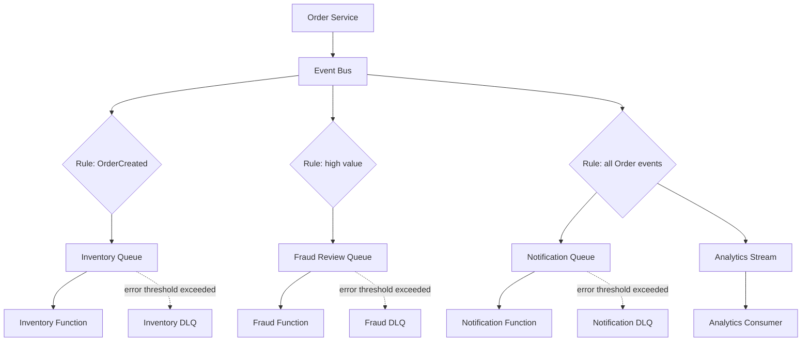

# Event Filtering and Routing to Multiple Consumers

## 1. Why Filter and Route Events?

In serverless applications, a business event often interests multiple stakeholders. When an order is created, the inventory system needs to reserve stock, the fraud service needs to evaluate risk, the notification service may send a confirmation email, and analytics needs to record data. If the producer had to know the address and protocol of every consumer, services would become tightly coupled. Adding or changing a consumer would force changes to the producer as well.

An event bus, topic, or event routing layer decouples producers from consumers. The producer emits an event describing what happened. The broker receives the event, evaluates rules, and forwards matching copies to one or more targets. Each consumer processes its own work at its own pace and under its own error policy.

**Event filtering** determines which events match a consumer or subscription. **Event routing** chooses the target destination for those events. Both are usually configured together: a rule specifies matching conditions as well as the queue, function, topic, or stream consumer that should receive the data.

Within the scope of CLOUD_SERVERLESS, Java functions can be triggered by messages or events. Designs must clarify event contracts, filter conditions, fan-out to multiple consumers, processing state, retries, idempotency, access permissions, scalability, and cost.

## 2. Distinguishing Queues, Topics/Event Buses, and Streams

Different messaging mechanisms can coexist in one architecture, yet they do not share identical semantics.

| Mechanism | Primary Purpose | When Multiple Consumers Are Interested |
| --- | --- | --- |
| Queue | Store pending work and distribute to workers | Workers compete for messages; each message is typically handled successfully by one worker per queue semantics |
| Topic / Pub-sub | Broadcast one message to multiple subscriptions | Each subscription gets its own delivery copy; multiple consumers can receive the same event |
| Event bus | Route events by type, source, or content | Multiple rules can match the same event and route to multiple targets |
| Event stream | Store ordered events in partitions for offset-based reading | Independent consumer groups can read the same stream; within a group, partitions are distributed across consumers |

The most common confusion is between **multiple workers sharing one queue** and **multiple subscriptions receiving the same event**:

- If three workers read from an image-processing queue, the goal is usually load sharing. One message is received by one worker at a time per queue dispatch rules.
- If inventory, billing, and analytics all need to know about `OrderCreated`, you need three independent subscriptions or three target queues. That is fan-out; every consumer receives the same event.

Do not use a single queue where workers discard irrelevant messages themselves when the broker can route upstream. That causes workers to steal each other's messages, increases redeliveries, and risks acknowledging a message before the intended consumer processes it.

## 3. Event Contracts as the Foundation for Filtering

### 3.1. Event Structure

Filter rules are only reliable when producers and consumers agree on field semantics. An event should have an envelope containing a unique identifier, event type, source, timestamp, and business payload. You can adopt a standard like CloudEvents or a versioned internal schema.

Simple envelope example for an order-created event:

```json
{
  "id": "evt-8f31",
  "type": "com.example.orders.created",
  "source": "/order-service",
  "subject": "orders/ord-42",
  "time": "2026-11-17T10:15:30Z",
  "schemaVersion": 1,
  "correlationId": "req-7f2a",
  "data": {
    "orderId": "ord-42",
    "customerId": "cus-81",
    "region": "south",
    "total": 1850000,
    "currency": "VND",
    "paymentMethod": "CARD",
    "priority": "NORMAL"
  }
}
```

This is an illustrative envelope, not a mandatory format across all brokers. If using CloudEvents, adhere strictly to the standard attribute names and semantics of the CloudEvents version in use; do not arbitrarily rename standard fields.

Clearly separate fields into:

- **Routing metadata:** `type`, `source`, `subject`, `region`, tenant, or business category. These help the broker pick the right consumers.
- **Operational metadata:** `id`, `time`, `correlationId`, schema version. These support deduplication, tracing, replay, and schema compatibility.
- **Business payload (`data`):** the data consumers need to perform their work.

Do not stuff secrets, access tokens, or unnecessary personal data into events just for routing convenience. Brokers and subscriptions can distribute payloads across multiple systems; each consumer should only be authorized to read the data it actually needs.

### 3.2. Choosing Stable Fields for Routing

Filter on event types and stable business attributes such as `type`, `region`, `priority`, or `paymentMethod`. Avoid relying on UI display strings, labels, or frequently changing fields.

For instance, `com.example.orders.created` describes an event that occurred. An inventory consumer may care about all events of this type. A fraud-check consumer may only care about high-value orders or risky payment methods. An analytics consumer may receive every order-related event.

Event names should describe past occurrences (`OrderCreated`, `PaymentCaptured`) rather than imperative commands (`CreateOrder`, `CapturePayment`). An event announces what happened; a command asks a party to take action. Distinguishing the two prevents consumers from misinterpreting an event as a mandatory command.

### 3.3. Versioning and Schema Compatibility

Rules can depend on payload fields. If a producer renames a field, changes a number to a string, or relocates a field, existing rules may stop matching. Manage schemas alongside rules and consumers:

- Prefer backward-compatible changes such as adding optional fields with clear defaults.
- Never change the meaning of an existing field without bumping the version or announcing a compatible transition.
- Define behavior when a field used for filtering is missing or has the wrong data type.
- Test new producers against old consumers and vice versa before deploying.
- Monitor which event versions are actively emitted and consumed so old versions can be retired cleanly.

If a rule depends on `data.total`, standardize currency units and numeric types. Never compare totals across different currencies as if they shared a unit. Either route by currency separately or normalize values before emitting events if business rules require it.

## 4. Common Event Filtering Patterns

### 4.1. Type- and Source-Based Filtering

This is the simplest and usually most stable filter pattern. Rules check event type or source:

- `com.example.orders.created` to the inventory consumer.
- `com.example.payments.captured` to the invoicing consumer.
- Events from `/identity-service` to the identity-audit consumer.

This filtering establishes clear boundaries across business domains. If a consumer only needs one event type, keep payload conditions out of the rule.

### 4.2. Attribute- and Header-Based Filtering

Brokers can inspect metadata or message attributes such as tenant, region, priority, event category, or content type. For example, a regional subscription might receive only events with `region = south`.

Attributes used for filtering must be attached reliably by producers. If external clients can supply `tenantId` or `region` unverified, they could route events to unintended consumers.

### 4.3. Content-Based Filtering

Content-based filtering inspects fields inside the payload, for example:

- `data.total >= 10000000` to route high-value orders to an additional review consumer.
- `data.paymentMethod = "CARD"` to trigger a card verification workflow.
- `data.priority = "EXPRESS"` to route work into a priority queue.
- `data.region IN ["north", "central"]` to forward to a regional processing group.

Actual expression syntax depends on the broker. Some support equality/inequality, numeric comparisons, prefixes, field existence, arrays, or AND/OR combinators; supported operators and nested-field behavior vary across providers.

Pseudoconfiguration rule example:

```yaml
rules:
  inventory-consumer:
    when:
      type: com.example.orders.created
    target: inventory-queue

  high-value-review:
    when:
      all:
        - type: com.example.orders.created
        - data.total: greater-than-or-equal 10000000
    target: fraud-review-queue

  south-region-analytics:
    when:
      all:
        - type-prefix: com.example.orders.
        - data.region: south
    target: south-analytics-queue
```

This is illustrative pseudoconfiguration. Translate it into the exact filter policy or event pattern syntax supported by your target platform; do not copy it verbatim as a deployment config.

### 4.4. Combining Conditions and Handling Missing Fields

A rule can combine multiple conditions. For example, route only high-value orders in the south region to the review queue:

\[
\text{type} = \text{OrderCreated}
\land \text{region} = \text{south}
\land \text{total} \geq 10{,}000{,}000
\]

Define explicitly what happens when `region` or `total` is absent from the payload. Depending on the broker, a missing field may fail to match, evaluate as null, or require an explicit existence operator. Never assume a missing field equals an empty string, zero, or a default value.

If a field is required by schema, producers and consumers must enforce it in the contract. If a field is optional, rules must define explicit behavior when it is absent. For complex conditions, you can move routing logic into a dedicated routing function, weighing the added latency, cost, and failure point.

### 4.5. Filtering at the Broker vs. in the Consumer

| Filter Location | How It Works | Pros and Cons |
| --- | --- | --- |
| Broker / event bus | Rules evaluated before delivering to targets | Eliminates unnecessary invocations and traffic; bounded by broker expressiveness and risks silent drops if rules are wrong |
| Subscription / topic | Each subscription receives only policy-matching messages | Isolates needs per subscriber group; semantics depend on pub-sub service |
| Consumer function | Function receives events and decides whether to process or ignore | Flexible for complex logic; still pays for invocations, reads, and risks mis-acknowledging messages |
| Dedicated routing function | A function reads events, evaluates conditions, and dispatches to target queues | Expresses custom logic; adds an extra hop, cost, latency, and operational ownership |

Prefer broker-level filtering for simple, stable conditions that can be expressed directly. Consumer-side filtering suits decisions requiring external data or complex logic. If a consumer receives an event and decides to skip it, it must still acknowledge it properly to prevent endless redelivery.

Broker filtering does not replace validation and authorization inside the function. Functions must still verify schemas, trusted sources, and resource permissions before making business changes.

## 5. Routing One Event to Multiple Consumers

### 5.1. Fan-Out with Multiple Rules or Subscriptions

Fan-out broadcasts a single event to multiple independent processing branches. For example, `OrderCreated` is sent to:

- `inventory-queue`: reserve items and check stock.
- `fraud-review-queue`: assess risk for qualifying orders.
- `notification-queue`: send customer confirmation.
- `analytics-stream`: record events for reporting.

Each branch has its own consumer, processing rate, retries, and dead-letter destination. A slow or failing consumer should not block other consumers when broker and target configs are isolated.



In this diagram, a single event can match multiple rules. If two matching rules point to the same target, the broker may deliver the event multiple times depending on service semantics. Verify target-overlap and deduplication behavior on your platform rather than assuming the broker eliminates duplicates automatically.

### 5.2. Independent Consumers and Fault Isolation

Do not make all consumers share a single queue when each consumer needs its own copy of the same event. A single queue typically distributes work across workers; whichever worker receives a message may acknowledge it before other consumers ever see it. Fan-out requires a dedicated subscription or queue per receiving group.

Separating queues lets each consumer:

- Tune concurrency and batch size for its own capacity.
- Pick appropriate timeouts, visibility timeouts, or leases.
- Retry transient errors without impacting other branches.
- Route failures to its own DLQ for domain-specific investigation.
- Replay messages after remediation without re-running branches that already succeeded.

Separate queues also incur storage and request costs. Only create branches for clear business needs; avoid fanning out to many consumers only for each consumer to discard most events.

### 5.3. Distinguishing Broadcast, Competing Consumers, and Partitioned Streams

| Model | Distribution Mechanism | Best Fit |
| --- | --- | --- |
| Broadcast / pub-sub | Each subscription receives a copy | Multiple independent systems reacting to one event |
| Competing consumers | Multiple workers share one queue and divide messages | Scaling throughput for one type of work |
| Consumer groups on a stream | Each group keeps its own read position; within a group, partitions are split among workers | Continuous data streams needing replay or per-partition ordering |

A new consumer group on a stream can usually replay historical data within offset/retention policies. A traditional queue often deletes messages after acknowledgement. Pick the mechanism based on replay, retention, ordering, and consumer independence needs.

### 5.4. One Event for Many Branches When Not Every Branch Needs the Full Payload

If an event carries substantial data, each consumer may only need a subset. You can use a minimal shared schema, filter by attributes, or emit domain-specific events. Some brokers support input transformation to shape payloads per target; others only filter and forward the original message.

Avoid creating a giant catch-all event with hundreds of optional fields for every consumer. Overly broad contracts make producer-consumer coordination harder, increase data exposure risk, and complicate rule testing. Keep each event focused on one business occurrence and include only required processing data or access-controlled storage references.

## 6. Java Consumers: Processing Routed Events

### 6.1. Boundary Between Broker and Function

The broker receives events, evaluates rules, and delivers to queues/subscriptions. The Java function's adapter converts runtime messages into application types. The handler validates the event, verifies required invariants, invokes the domain service, and returns results per the platform's acknowledgement protocol.

The example below shows an inventory consumer. This is cloud-agnostic Java code; `EventEnvelope`, `OrderCreated`, `InventoryService`, and `IdempotencyStore` are application types. A real adapter translates from the provider's event object into these types.

```java
public record EventEnvelope<T>(
        String id,
        String type,
        String source,
        int schemaVersion,
        T data) {}

public record OrderCreated(
        String orderId,
        String customerId,
        String region) {}

public interface InventoryService {
    void reserveForOrder(String orderId);
}

public interface IdempotencyStore {
    boolean alreadyProcessed(String consumer, String eventId);
    void markProcessed(String consumer, String eventId);
}

public final class InventoryEventHandler {
    private static final String CONSUMER = "inventory";

    private final InventoryService inventoryService;
    private final IdempotencyStore idempotencyStore;

    public InventoryEventHandler(
            InventoryService inventoryService,
            IdempotencyStore idempotencyStore) {
        this.inventoryService = inventoryService;
        this.idempotencyStore = idempotencyStore;
    }

    public void handle(EventEnvelope<OrderCreated> event) {
        if (!"com.example.orders.created".equals(event.type())) {
            throw new IllegalArgumentException("Unexpected event type");
        }
        if (event.id() == null || event.id().isBlank()) {
            throw new IllegalArgumentException("Missing event id");
        }
        if (event.schemaVersion() != 1) {
            throw new IllegalArgumentException("Unsupported schema version");
        }

        if (idempotencyStore.alreadyProcessed(CONSUMER, event.id())) {
            return;
        }

        inventoryService.reserveForOrder(event.data().orderId());
        idempotencyStore.markProcessed(CONSUMER, event.id());
    }
}
```

This example illustrates the deduplication concept, not a concurrency-safe production idempotency implementation. In production, checking and recording processed markers must be atomic—such as using a unique `(consumer, eventId)` key in the database or an appropriate transaction. You must also handle the case where inventory reservation succeeds but the function crashes before recording the event. Ideally, the business action uses its own idempotency key or executes within the same transaction boundary whenever possible.

### 6.2. Do Not Substitute Broker Filters for Input Validation

Broker rules cut down irrelevant events, yet consumers still must verify:

- Is the event ID present and properly formatted?
- Are the event type and schema version supported?
- Does the payload include all required fields with valid values?
- Does the source belong to an authorized producer?
- Is the consumer authorized to act on the referenced resource?

When an event is invalid, classify the failure. Unsupported schema events can go to the DLQ for investigation; transient database errors should be retried. Never infinitely retry a malformed payload.

### 6.3. Acknowledgement and Confirmation Timing

With queues, messages should only be acknowledged after required effects complete or are durably recorded by design. Acknowledging before writing data risks losing work on failure. Failing after completing side effects but before acknowledgement allows redelivery; hence idempotency is mandatory in most systems.

With streams, consumers typically save offsets/checkpoints after processing a record or batch. Committing offsets too early can skip unprocessed data; committing too late can reprocess records. Batching, partition, and retry commit mechanics depend on the platform.

## 7. Per-Consumer Retries, DLQs, and Replay

### 7.1. Retry Policies

Transient errors such as network timeouts, throttling, or brief dependency outages can be retried. Configure max attempts, exponential backoff, jitter, and processing deadlines. Distinguish transient errors from permanent ones like invalid schemas or missing required fields.

With fan-out, retries typically belong to each subscription or target. If the notification consumer fails, messages in the notification queue retry under that queue's policy; the inventory consumer can still succeed independently. Verify whether your platform retries independently per target or uses a shared mechanism.

### 7.2. Dead-Letter Queues

When a message exceeds retry limits or expires, it can move to a dead-letter queue (DLQ). Separate DLQs by consumer or workload type to clarify ownership and prevent one failing message group from hiding another.

DLQ operations must answer:

- Who gets alerted when messages enter the DLQ?
- How do operators inspect event ID, type, source, last error, and delivery count without exposing sensitive data?
- Was the root cause bad data, a consumer bug, permissions, or a downstream dependency?
- After fixing, should all messages or only a selected subset be replayed?
- How do you guarantee replay will not duplicate business side effects?

Never automatically redrive endlessly from a DLQ back into the main queue. That creates error loops and amplifies load. Replay must be controlled, rate-limited, and audited.

### 7.3. Replay and Retention

Streams usually support retention and re-reading by offset or retention time. Replay is valuable when a new consumer needs to build state from scratch or when data must be reprocessed after a bug fix. However, replay can trigger external side effects again such as sending emails or charging cards. Consumers must distinguish state rebuilds from re-executing irreversible actions.

Queues may not retain messages after acknowledgement unless archiving or separate storage is configured. If long-term replay is needed, archive events or use an event stream matching your retention requirements.

## 8. Ordering, Partitions, and Consistency

Do not assume multiple events are processed in strict global emission order. Queues may not guarantee strict ordering; brokers may deliver concurrently; consumers have varying execution times. Some services support FIFO or ordering within a message group/partition, with different guarantee scopes and throughput limits.

If per-order ordering matters, use `orderId` as the message group ID or partition key. Events sharing a key are processed in order within the platform's guarantee scope. Events with different keys can still run in parallel.

For instance, `OrderCreated`, `OrderPaid`, and `OrderShipped` for the same `orderId` must follow valid state transitions. Consumers should check sequence/version numbers or current state to catch out-of-order arrivals. If `OrderShipped` arrives before `OrderPaid`, defer, park the event, or alert per business rules.

With fan-out, each consumer may process the same event at a different time. Do not require consumers to finish simultaneously unless business logic truly demands distributed coordination. If a process must wait on multiple branches, use a workflow/orchestrator or an explicit aggregation mechanism with clear timeouts and states.

## 9. Security and Access Control When Routing

Routing to multiple consumers expands the number of data receivers. Each subscription, queue, stream, and function needs least-privilege permissions:

- Producers may only publish allowed event types to the required bus/topic.
- The event bus may only deliver to declared targets.
- Consumers may only read from queues or streams they own.
- Functions may only call required services and access data needed for their task.
- Rule administration permissions and event-publish permissions should be separated from consumer runtime permissions.

Never treat filter rules as a security boundary. Rules can be modified or misconfigured; functions must authenticate sources and check resource authorization. If payloads carry data meant only for certain consumers, emit separate events or pass access-controlled references instead of broadcasting full sensitive payloads to every target.

Routing logs must avoid tokens, personal data, or full sensitive payloads. Use event IDs and correlation IDs to look up details in authorized stores. Rule configurations should be code-reviewed like source code, as changing a single condition can send data to unintended or missing consumers.

## 10. Scalability and Fan-Out Cost

Fan-out increases independence while multiplying message deliveries and invocations. Sending one event to four queues yields four storage/delivery hops and more function invocations. An overly broad rule can send events to more consumers than intended.

To control load:

- Set per-function concurrency caps aligned with database and dependency capacity.
- Tune batch sizes, polling, or consumer rates to avoid traffic spikes.
- Monitor backlog and oldest message age on every queue.
- Choose partition keys thoughtfully to keep required order without creating hot partitions.
- Forward only needed payloads and consider storing large files in object storage and passing references.
- Estimate costs across brokers, queues, stream retention, functions, logs/traces, data transfer, and replays.

Filtering early at the broker cuts invocation and processing costs, though complex filters, excessive rules, or intermediary routing functions also incur cost. Measure emitted events, matches per rule, deliveries, retries, and invocations per consumer.

## 11. Observing and Testing Routing Rules

### 11.1. Metrics to Monitor

Monitor each rule and target individually:

- Events ingested into the bus/topic/stream.
- Events matching each rule and deliveries sent to targets.
- Unmatched events or events dropped by filters.
- Delivery success/failure rates, retries, and throttling.
- Queue depth, oldest message age, consumer lag, and processing throughput.
- DLQ message count and residence time.
- End-to-end latency from event publish to each consumer's completion.

If the broker does not expose unmatched-event metrics, emit metrics from producers or route unmatched events to a controlled archive/audit destination. Distinguish intentionally filtered events from events silently dropped due to a broken rule.

### 11.2. Filter Test Matrix

For a rule routing high-value orders to a review queue, test at minimum:

| Input Data | Expected Result |
| --- | --- |
| `type=OrderCreated`, `total=12000000` | Matches high-value rule |
| `type=OrderCreated`, `total=500000` | Does not match high-value rule; may still match inventory rule |
| `type=OrderCancelled`, `total=12000000` | Does not match rule restricted to OrderCreated |
| Missing `total` | Follows defined missing-field policy; does not assume 0 |
| `total` is a string instead of a number | Rejected by schema or does not match per tested semantics |
| Misspelled `region` value | Does not match region rule; alerts if value is invalid |
| One event matches two rules | Delivered to both targets as designed |

Beyond unit testing filter expressions, run integration tests against the actual broker or equivalent environment to verify filter syntax, nested fields, data types, multi-rule matching, and target failure behavior.

### 11.3. Testing Consumers and Replay

Test consumers with valid messages, duplicate event IDs, unsupported event types, old/new schema versions, transient errors, and permanent errors. Verify acknowledgement happens only after work is durably recorded. For replays, confirm stale events do not trigger unwanted side effects and still rebuild state accurately when rebuilding is the goal.

## 12. Filtering and Routing Design Process

When adding a new consumer, follow this sequence:

1. **Identify business needs:** which event types and data fields does the consumer need?
2. **Lock down the event contract:** define event type, source, schema, event ID, correlation ID, and version.
3. **Choose the distribution mechanism:** queue for competing workers, pub-sub/event bus for fan-out, or stream for retention/replay.
4. **Write minimal rules:** start with event type/source; add payload conditions only when truly needed.
5. **Define missing-field semantics:** required vs. optional fields, data types, units, and valid values.
6. **Provision dedicated targets:** queue/subscription/consumer group with tailored retries, DLQ, retention, and concurrency.
7. **Design idempotent consumers:** deduplicate by consumer and event ID; define acknowledgement/checkpoint timing.
8. **Enforce least privilege:** scope producer, broker, target, and function permissions strictly to their responsibilities.
9. **Test overlaps and non-matches:** verify events matching multiple rules, zero rules, and ensure no misrouting.
10. **Set up observability and replay:** per-rule/target metrics, backlog/DLQ alerts, and controlled replay procedures.

## 13. Common Design Mistakes

| Mistake | Consequence | Fix |
| --- | --- | --- |
| Multiple business consumers sharing one queue | One consumer steals messages meant for another | Use separate subscriptions or queues per group needing a copy |
| Rules relying on unstable fields | Events misroute after producer schema changes | Filter on event types and stable business attributes; version schemas |
| Undefined missing-field behavior | Rules drop events silently or behave unexpectedly | Specify required/optional fields and test null/missing cases |
| Assuming an event matches only one rule | Duplicate target deliveries or repeated side effects | Design intentional overlaps and per-consumer idempotency |
| Using filters as an authorization boundary | Unauthorized data/action exposure when rules drift | Validate source, identity, and permissions in the consumer/function |
| Infinite retries on malformed schemas | Wastes cost and clogs queues | Classify errors, cap retries, and route to DLQ |
| Acknowledging messages before saving results | Work lost when functions fail | Acknowledge only after durable completion or recording |
| Replaying events without checking side effects | Duplicate emails, charges, or inventory reservations | Enforce idempotency, rebuild modes, and controlled replay |
| Not tracking unmatched events | Cannot tell intentional filtering from broken rules | Monitor unmatched events, rule matches, and schema validation |

## 14. Conclusion

Event filtering and multi-consumer routing let serverless applications decouple producers from downstream processors. Event buses or pub-sub fan out an event to multiple subscriptions; queues distribute work across workers; streams provide consumer groups, retention, and replay. Picking the right distribution semantics is the first step to preventing consumers from stealing messages or causing unintended duplicate processing.

A reliable design requires stable event contracts, clear rules, independent targets, idempotent consumers, per-branch retries and DLQs, least-privilege permissions, and metrics covering both matched and unmatched events. When those pieces are in place, you can add new consumers without modifying producers while keeping scalability, observability, and costs under control.
