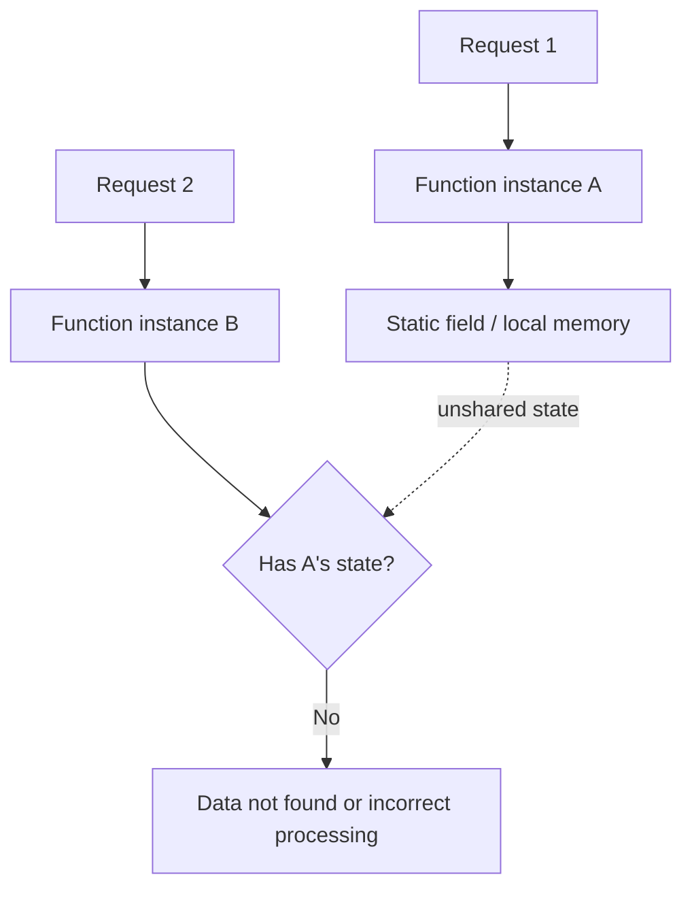
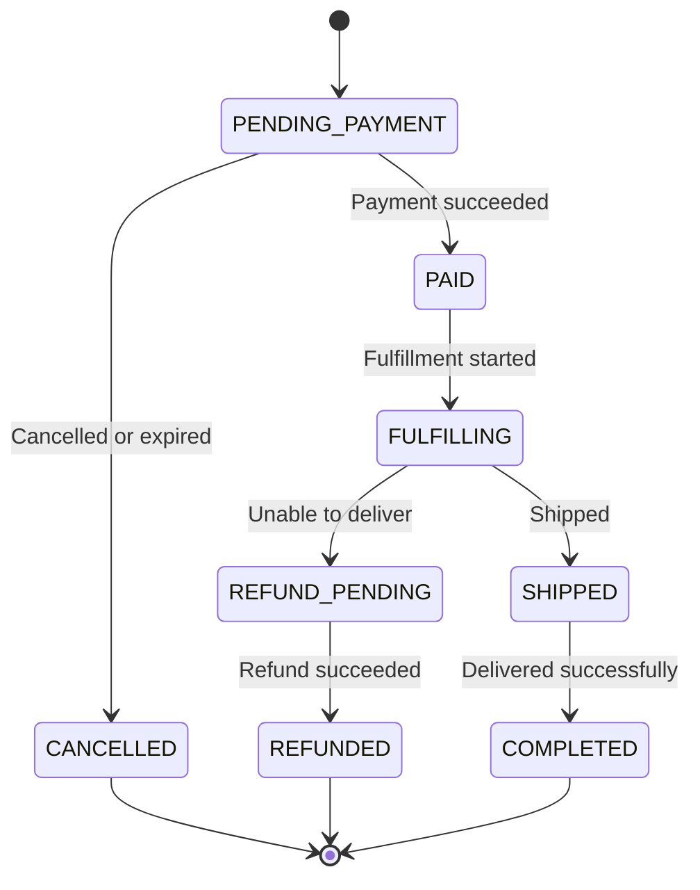
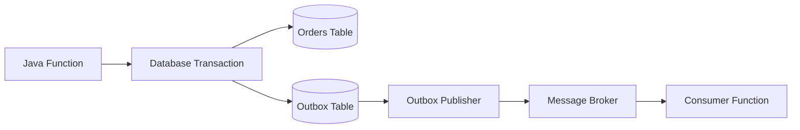
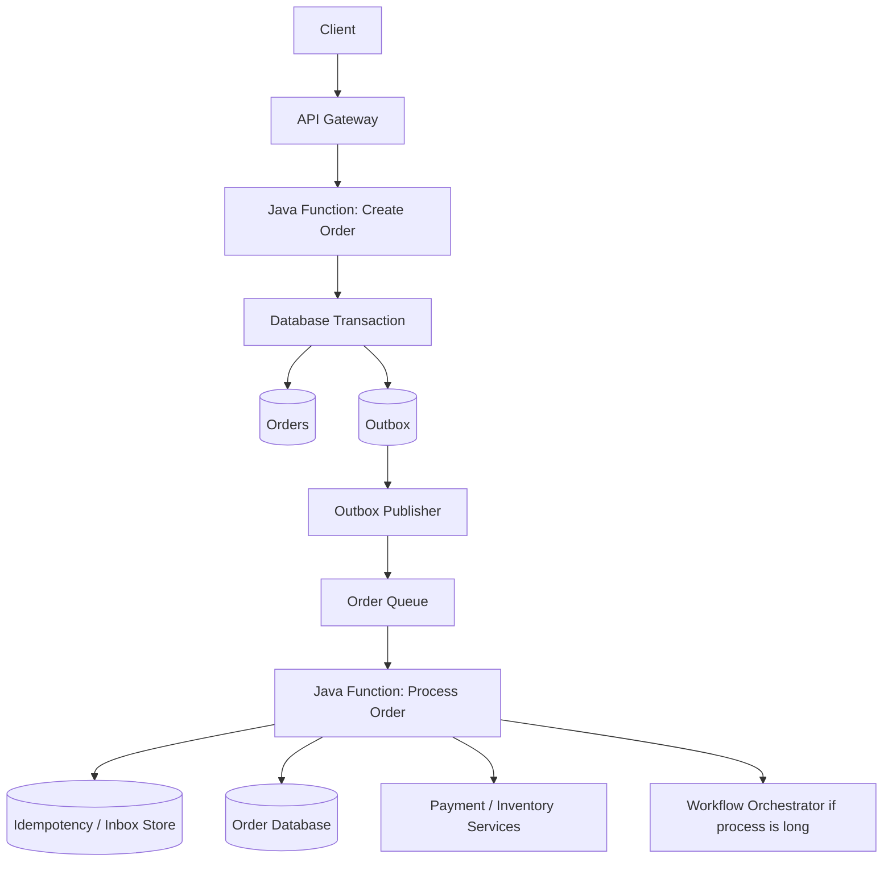

# Stateless Function Design and External State Storage

Serverless functions are typically created to handle a single invocation and return a result. The platform may reuse an execution environment for subsequent invocations, spin up new environments when load increases, or reclaim environments when they are no longer needed. Therefore, an application cannot assume that a function instance will persist continuously, always serve the same user, or retain memory across invocations.

Designing a **stateless function** means that processing outcomes do not depend on state that exists only in the memory of a single instance. If the business logic needs to remember a shopping cart, processing progress, order status, or generated results, the function must read and write that state to an external storage system with appropriate durability and consistency guarantees.

Stateless does not mean the application has no state. It means that business state is managed in a place accessible independently of the function's lifecycle. This organization allows invocations to run on different instances, be retried, be processed in parallel, and recover after an execution environment is reclaimed.

## 1. Why should functions be stateless?

### 1.1. Instance lifecycle is not business lifecycle

A FaaS platform may keep an execution environment warm to reduce cold starts, but reuse is merely a platform optimization. The application has no guarantee that the next invocation will run in the same process, on the same machine, or in the same memory space.

For example, a user sends a first request to create a shopping cart. The invocation may run on instance A and store the cart in a static variable. The second request is routed to instance B; instance B does not have that data. If instance A is reclaimed before the next request, the data is also lost.



The problem is not just data loss when an instance is reclaimed. When the platform scales horizontally, multiple instances have their own separate memory. On retries, an invocation may run on a different instance. When deploying a new version, all old environments may be replaced. In-process state cannot serve as the primary data source for business logic that must persist across invocations.

### 1.2. Types of state to distinguish

| State type | Examples | Appropriate storage location |
| --- | --- | --- |
| Durable business state | Orders, payments, profiles, inventory | Relational database or NoSQL database suited to query and transaction needs |
| Large data or files | Original images, reports, export files, documents | Object storage; database stores only metadata and references |
| Short-lived state | Sessions, temporary verification codes, cached results | Cache or key-value store with TTL, depending on durability requirements |
| Workflow progress | Current step, per-step outputs, retry timestamps | Workflow orchestrator or durable state store |
| Event processing trace | Processed event IDs, idempotency keys, message receipt status | Inbox/deduplication table or data store supporting atomic operations |
| Configuration data and secrets | Endpoints, secrets, credentials | Configuration service and secret manager; do not store in static variables as the source of governance |

Not all data requires a database. Choose the storage location based on read/write patterns, size, transaction requirements, retention duration, latency, durability, recoverability, and cost.

### 1.3. Stateless functions can still use local memory

Local variables within a single invocation, temporary objects, buffers, and intermediate computation data are normal. An instance can also maintain an in-memory cache to avoid repeatedly creating clients or loading configuration, provided that the cache is strictly a disposable optimization with a safe refresh mechanism.

What to avoid is relying on a cache or static variable as the single source of truth for business state. For example, storing a list of user permissions in a static map without a TTL or invalidation mechanism can allow revoked permissions to still be accepted. If using a local cache, clearly define what data is cached, its expiration, how cache misses are handled, and the acceptable level of staleness.

## 2. Design principles for stateless functions

### 2.1. Inputs must carry sufficient context for processing

A function should receive a request or event containing the identifiers and data needed to perform the work. For large data, pass a reference to the object rather than embedding the entire content in the payload.

For example, an image processing event might contain:

```json
{
  "eventId": "evt-8a71",
  "bucket": "incoming-images",
  "objectKey": "tenant-42/uploads/photo-123.jpg",
  "objectVersion": "v17",
  "tenantId": "tenant-42",
  "requestedVariant": "thumbnail"
}
```

`eventId` identifies the event emission; `objectKey` and `objectVersion` point to the data to process. The function does not need to remember previous requests to know what it is working on.

Do not trust every field sent by the client. Identity and access permissions must come from a trusted authentication mechanism; the function must verify that the caller has permission to read the object or tenant specified in the event. For internal events, control which principals are permitted to emit events and validate the event source according to the platform's capabilities.

### 2.2. Read state before making decisions

When business logic depends on current state, the function must read that state from the authoritative data store. For example, before confirming a payment, check that the order is in the `PENDING_PAYMENT` state and that the amount and currency match.

Do not rely on a stale copy of state held inside the instance. If caching is needed to reduce latency, there must be a clear data freshness policy and a strategy for handling cache desynchronization.

### 2.3. Write state using atomic operations

Multiple invocations can read the same value concurrently and then update it. Without appropriate conditions or transactions, data can be overwritten or updates can be lost.

For example, two functions both read an inventory count of 1 and each creates an order. If both write the remaining quantity as 0 without an atomic condition, the system can oversell inventory. Use transactions, conditional updates, optimistic locking, or the equivalent mechanism provided by your database.

### 2.4. Safe to re-run without causing duplicate side effects

The platform or event source may deliver the same event multiple times. A function might also complete a side effect but fail before returning a result. On retry, the operation must be safe for the same event or business key.

This is why statelessness usually goes hand in hand with idempotency. The function does not rely on memory to remember that it has processed an event; it records processing progress in a durable store using atomic operations.

### 2.5. Do not hold transactions open across multiple invocations

A database transaction typically exists only for the duration of the connection and the open transaction scope. You cannot keep an open SQL transaction while waiting for user input or waiting for an event arriving the next day. Break the process into steps with durable state, where each step opens a short transaction, commits, and finishes the invocation.

For long-running workflows, use workflow orchestration or a state machine to persist progress and coordinate steps. If one step produces a side effect and a subsequent step fails, a compensation action following the Saga pattern may be required.

## 3. Choosing an external storage system

### 3.1. Relational database

A relational database is suitable when data has clear relationships and requires multi-record transactions, constraints, joins, or flexible queries. Examples include orders, payments, inventory, and customer profiles.

Advantages:

- ACID transactions help protect business invariants.
- Unique constraints help prevent duplicates and guarantee uniqueness.
- Conditional updates and optimistic locking help handle concurrent updates.
- SQL supports flexible querying and reporting.

Considerations in serverless:

- Many instances can open many concurrent connections, exhausting connection limits.
- Per-instance connection pools can multiply with concurrency.
- Connections need finite timeouts and must be properly closed or reused.
- A database proxy, connection broker, or data API may be needed if supported by the provider.
- Long-running queries and extended transactions increase cost, lock contention, and invocation latency.

### 3.2. NoSQL database or key-value store

NoSQL fits well when the access pattern is primarily key-based reads/writes, horizontal scaling is required, and a clear partition key can be designed. Examples: session state, job status, event metadata, or profiles accessed by `tenantId` and `entityId`.

Before choosing, determine:

- Does the partition key distribute evenly or create hot partitions?
- What queries must be supported? Are secondary indexes required?
- Is the consistency model eventual or strong/transactional, and at what scope?
- Do conditional writes and atomic counters satisfy the invariants?
- How accurately is TTL enforced, and how long can expired data continue to exist?

NoSQL is not automatically simpler than a relational database. If queries require complex joins or transactions across multiple aggregates, the design can become harder.

### 3.3. Object storage

Object storage is suited for large data, immutable files, or artifacts such as images, videos, reports, exports, and documents. The function receives an object key/version, reads the content when needed, and writes output objects.

Typically, a database stores metadata such as owner, processing status, size, checksum, and object path. Avoid storing entire large files inside a database record when object storage is a better fit.

Pay attention to per-tenant access permissions, encryption, versioning, lifecycle policies, object sizes, and event loops. If a function writes results into the same bucket/prefix that triggers it, it can inadvertently create an event loop. Use separate prefixes or event filtering conditions.

### 3.4. Cache and ephemeral data stores

Caches such as Redis or managed key-value caches are suited for regenerable data, short-lived sessions, rate limit counters, or cached query results. A cache should generally not be the sole source of truth for critical business data unless the service is specifically designed and operated as a durable data store according to concrete requirements.

Cache design should answer:

- What is the TTL and who decides the expiration?
- On a cache miss, where is data read from?
- When the source data changes, how is the cache invalidated?
- If the cache is temporarily unavailable, can the business logic fall back?
- Is there a risk of a cache stampede when multiple functions refresh the same key concurrently?
- Is it necessary to distinguish a non-existent value from a cache miss?

Do not use a cache to store state that requires strict accuracy without appropriate synchronization and recovery mechanisms.

### 3.5. Workflow state store

For processes spanning multiple invocations, a workflow orchestrator can store step states, output data, retries, timeouts, and conditional branches. For example, an order processing workflow includes steps to check inventory, collect payment, create a shipment, and send notifications. Each step can run as a separate function.

A workflow state store helps track progress and resume after failures. However, pay attention to state payload size limits, workflow duration limits, state transition costs, how large data is stored, and how duplicate side effects are handled. Workflow state does not necessarily replace the business database; it manages orchestration progress, while the database remains the source of truth for the order.

### 3.6. Comparing options

| Need | Typically suitable choice | Factors to evaluate |
| --- | --- | --- |
| Transactions and business constraints | Relational database | Connections, locks, transaction duration, and query plans |
| Large-scale key-based reads/writes | NoSQL/key-value | Partitions, indexes, consistency, and conditional writes |
| Large files and artifacts | Object storage | Versioning, permissions, lifecycle, and event notifications |
| Short-lived cache or sessions | Cache/key-value with TTL | Eviction, invalidation, availability, and source of truth |
| Multi-step, long-running processes | Workflow orchestrator | Retries, compensation, state size, and transition cost |
| Event deduplication | Inbox/idempotency store | Unique keys, transactions, and trace retention duration |

A system typically combines multiple storage types. For instance, a relational database stores orders, object storage holds PDF invoices, a cache keeps short-lived lookup results, and a workflow orchestrator tracks processing steps.

## 4. Modeling business state

### 4.1. Use state machines instead of scattered flags

Business state should be defined using explicit states and valid transitions. Order example:



Each transition should have clear conditions and actors. Do not allow a `PaymentSucceeded` event to move a `CANCELLED` order to `PAID` if the business rules forbid it. A conditional update can ensure the previous state matches before transitioning to the new state.

### 4.2. Distinguish business state from processing state

A record may have a business state such as `PAID`, while also having a technical processing state such as `notificationStatus=PENDING`. Do not merge these two concepts into a single shared `status` field if they have different lifecycles.

For example, payment has completed, but sending the confirmation email is retrying. The order status remains `PAID`; notification status can be `PENDING`, `SENT`, or `FAILED`. This ensures email delivery errors do not corrupt payment state.

### 4.3. Store timestamps, versions, and correlation IDs

Commonly useful fields:

- `createdAt`, `updatedAt`: creation and update timestamps, using a consistent time format such as UTC.
- `version`: version number incremented on updates, supporting optimistic locking.
- `correlationId`: links steps across a workflow.
- `lastEventId`: identifier of the most recent event if appropriate for the model.
- `expiresAt`: expiration timestamp for data with a bounded lifecycle.

Do not use client timestamps as the sole source of truth for event ordering. Client clocks can drift; required ordering should be enforced via version numbers, sequences, or the event source's ordering guarantees.

## 5. Concurrent updates and consistency

### 5.1. Read-then-write race conditions

Suppose a wallet balance is 100. Two invocations both read 100. Invocation A subtracts 80 and writes 20; invocation B subtracts 50 and writes 50. If both write without checking the previous value, the final result could be 20 or 50, even though both transactions were accepted.

This is a lost update. Checking and updating must be performed within a single transaction or an atomic conditional operation.

### 5.2. Optimistic locking

Optimistic locking is suitable when conflicts are infrequent. A record has a `version` field; the function reads the current version and then updates it under the condition that the version has not changed.

SQL example:

```sql
UPDATE orders
SET status = 'PAID',
    version = version + 1,
    updated_at = CURRENT_TIMESTAMP
WHERE order_id = :order_id
  AND status = 'PENDING_PAYMENT'
  AND version = :expected_version;
```

If the number of updated rows equals 1, the state transition succeeded. If it equals 0, the status or version has changed; the function must re-read and determine whether this is a duplicate event, a conflict, or an invalid transition.

### 5.3. Pessimistic locking and distributed locks

Pessimistic locking can be useful when contention is high and the database supports appropriate locks. However, holding locks for a long time inside an invocation increases contention and can cause deadlocks. Transactions should be short, have timeouts, and lock only the necessary records.

Distributed locks in Redis or key-value stores must be designed carefully. A lease can expire while the old function is still running; a new function can acquire the lock and then both write data concurrently. When using leases, consider fencing tokens or monotonically increasing versions so the target system rejects operations from a holder with a stale token. Do not treat the mere existence of a `lock=true` key as sufficient guarantee of mutual exclusion.

### 5.4. Choosing appropriate consistency

Some systems need to immediately read data that was just written; others can tolerate eventual consistency. For example:

- Wallet balances, inventory, and payment states typically require stricter consistency controls.
- View counters, analytics metrics, and search indexes can tolerate synchronization lag.
- Object metadata can be updated after the file is successfully written, provided the workflow has intermediate states and recovery.

Define business invariants before choosing database consistency. Do not choose eventual consistency for a financial operation simply because it offers higher throughput.

## 6. Transactions, events, and multi-step workflows

### 6.1. A transaction only protects its own scope

A database transaction can guarantee that a group of database operations commit or roll back together. It does not automatically cover sending an email, calling a payment gateway, or writing to object storage. If a function commits an order and then fails to publish an event, the database and message broker can become out of sync.

### 6.2. Transactional outbox

The transactional outbox pattern writes business changes and the event to publish within the same database transaction:

1. The function opens a transaction.
2. Updates the order.
3. Writes the event to the outbox table within the same transaction.
4. Commits the transaction.
5. A publisher/worker reads the outbox and sends the event to the broker.
6. Marks the event as published; the publisher may deliver duplicates, so consumers still need idempotency.



An outbox prevents the case where a database update succeeds but the event is lost before publishing. It does not eliminate duplicate delivery; the publisher may resend after the broker receives the message but before the outbox marks it as sent. Consumers still need idempotency keyed by event ID.

### 6.3. Saga and compensation

Multi-service workflows generally cannot fit inside a single distributed transaction. A Saga splits the workflow into local steps, each committing independently. If a later step fails, the system executes compensating actions for earlier steps where business-level undo is possible.

Order creation example:

1. Reserve inventory.
2. Collect payment.
3. Create shipment.
4. Send notification.

If payment collection fails after inventory has been reserved, the compensating action can release the inventory. If creating the shipment fails after payment is collected, the workflow can retry or issue a refund depending on policy. Compensation is not a perfect technical rollback; it is a new business operation that can itself fail and must be monitored.

### 6.4. Workflow orchestration

A workflow orchestrator is suitable when a process has many steps, waits for callbacks, has timeouts, conditional branches, or requires per-step retries. Functions should perform a bounded unit of work; the workflow tracks progress and invokes the next step.

Do not put large payloads or secrets into the workflow state payload if unnecessary. Store data in a database/object storage and pass reference identifiers between steps. Keep state machines versioned or maintain a compatibility plan when workflows are in flight during a workflow definition update.

## 7. Idempotency and processing traces

### 7.1. Idempotency keys

An idempotency key is a stable identifier for a business operation. Clients can send `Idempotency-Key` when creating a payment or order. For events, an `eventId` assigned by the source can be used. The same key must represent the same request and corresponding payload.

The system should store:

- idempotency key;
- the principal or tenant owning the key;
- a hash of the payload or request validation metadata;
- status (`IN_PROGRESS`, `COMPLETED`, or `FAILED` depending on the model);
- the result to return if the operation has already completed;
- creation timestamp and expiration timestamp.

If the same key is sent with a different payload, reject it or handle it according to an explicit contract; do not return a cached result for a request with different content.

### 7.2. Atomic trace recording

Simple SQL example:

```sql
CREATE TABLE idempotency_records (
    tenant_id       VARCHAR(100) NOT NULL,
    idempotency_key VARCHAR(200) NOT NULL,
    request_hash    VARCHAR(128) NOT NULL,
    status          VARCHAR(30) NOT NULL,
    response_body   TEXT,
    created_at      TIMESTAMP NOT NULL,
    expires_at      TIMESTAMP NOT NULL,
    PRIMARY KEY (tenant_id, idempotency_key)
);
```

The unique key prevents two invocations from creating two records for the same operation. However, inserting a single record is not enough on its own to guarantee that all side effects execute exactly once. Claiming the key, performing business updates, and writing to the outbox must be placed inside an appropriate transaction; calls to external services must forward that service's own idempotency key if supported.

### 7.3. Handling the IN_PROGRESS state

If invocation A claims the key and terminates mid-flight, invocation B may observe `IN_PROGRESS`. Define a lease or timeout so abandoned claims can be recovered. Reclaiming ownership must ensure the old invocation cannot continue writing after ownership has transferred to the new invocation; a lease token/version with fencing checks at commit time can be used.

Do not immediately delete the record when processing fails. Retaining information may be necessary for retries, auditing, or returning an appropriate response. The TTL must be longer than the retry window and the duration within which clients may resend the request per contract.

### 7.4. Java example: stateless handler using a repository

The example below uses hypothetical interfaces to illustrate the pattern. The repository is responsible for performing atomic operations in the database; the handler does not keep the cart or order state in mutable fields.

```java
public final class CreateOrderHandler {
    private final OrderRepository orders;
    private final IdempotencyRepository idempotency;

    public CreateOrderHandler(
            OrderRepository orders,
            IdempotencyRepository idempotency) {
        this.orders = orders;
        this.idempotency = idempotency;
    }

    public CreateOrderResult handle(CreateOrderCommand command) {
        String key = command.idempotencyKey();
        String requestHash = command.stablePayloadHash();

        return idempotency.executeOnce(
                command.tenantId(),
                key,
                requestHash,
                () -> orders.create(command));
    }
}
```

`executeOnce()` is an abstraction, not a standard API. In a real implementation, you must define the transaction boundary, unique constraint, in-progress state, timeout handling, and completed result handling. If `orders.create()` calls a payment service or sends an email, those side effects must have their own idempotency or be coordinated via an outbox/workflow.

## 8. Java FaaS and connection resource management

### 8.1. Create reusable clients, but do not keep business state in fields

A Java function may be reused by the runtime within the same process. Creating shared HTTP clients or database clients can reduce overhead, provided the library is thread-safe and the lifecycle is appropriate. However, shared fields must not store per-user or per-invocation data.

```java
public final class ProductHandler {
    // Immutable/thread-safe client can be shared if supported by the library.
    private final ProductRepository repository;

    public ProductHandler(ProductRepository repository) {
        this.repository = repository;
    }

    public ProductResponse handle(ProductRequest request) {
        // Request state stays strictly in local variables.
        Product product = repository.findById(request.productId());
        return ProductResponse.from(product);
    }
}
```

Do not use mutable fields such as `currentUser`, `currentOrder`, or `lastRequest` in a singleton handler. Multiple invocations may share an instance or run concurrently depending on the runtime; mutable fields can leak data across requests and create race conditions.

### 8.2. Connection pools and scale-out

Suppose each instance has a pool of up to 10 connections and the platform creates 100 instances. The database could receive up to roughly 1,000 connections from this workload alone, not counting other services. A "small" pool per instance can still generate massive total load during scale-out.

Define maximum concurrency, pool size, idle time, connection timeouts, and database limits. Use a proxy or provider-supported connection mechanism when appropriate. Do not open a new connection per query if the library supports safe client reuse; likewise, do not keep a transaction open for the entire lifetime of an instance.

### 8.3. Local files and `/tmp`

A temporary directory can be useful for downloading files, extracting archives, or intermediate processing within a single invocation. However, its contents may disappear when the environment is reclaimed, may persist across reused invocations, and are generally not shared across instances.

Do not use `/tmp` to store profiles, sessions, or business state. Enforce size limits, delete temporary files after processing, avoid writing secrets or sensitive data without protection, and store durable results in object storage/databases.

## 9. Security and state data lifecycle

### 9.1. Least privilege

A function should only have read/write permissions to the exact tables, buckets, key prefixes, or queues it needs. Separate roles among image processing functions, payment functions, and report generation functions if their permissions differ. Do not use one broad administrative role across all workloads.

### 9.2. Encryption and sensitive data

Encrypt data in transit and at rest according to service capabilities. Manage keys with KMS or an equivalent service; control who can decrypt. Do not write access tokens, refresh tokens, passwords, or secrets into state payloads, events, logs, or workflow history without a clear reason and proper protection.

### 9.3. TTL, retention, and data deletion

Sessions, idempotency records, and temporary state need appropriate retention periods. A TTL that is too short can cause late retries to trigger duplicate operations; a TTL that is too long increases cost and retains unnecessary data. Business data may need to be retained for regulatory or audit requirements and must not have a blanket TTL applied to every table.

When deleting data, account for copies, backups, replicas, event archives, and object versions. If deletion by tenant or user is required, design identifiers and data relationships so deletion can be executed thoroughly.

### 9.4. Do not trust state data just because it is in the database

A state store may contain data previously sent by a client or written by another service. When reading it back, still validate the schema, tenant, valid state, and operation permissions. Do not use state data to elevate a caller's privileges unless that data is protected by a trusted workflow.

## 10. Diagnostics and operating state stores

Monitor both the function and the storage layer. A function may execute properly while the database is slow, the connection pool is exhausted, or the cache is unavailable.

Metrics to monitor:

- read/write latency and high percentiles;
- open connection count, connection acquire wait, and pool exhaustion;
- transaction rollbacks, deadlocks, and optimistic lock conflicts;
- conditional write failures and retry rates;
- cache hits/misses, evictions, timeouts, and cache stampedes;
- queue backlog, outbox age, and unpublished event count;
- duplicate idempotency keys, abandoned claims, and expired `IN_PROGRESS` states;
- storage capacity, object count, request rate, and data transfer cost.

Logs should include `requestId`, `eventId`, `correlationId`, permitted `tenantId`, entity identifiers, and the operation. Do not log sensitive payloads or credentials. Use tracing to connect invocations with databases, queues, object storage, and external services.

When a state store is unavailable, decide based on business requirements:

- For payments or inventory, typically reject or defer the operation if authoritative state cannot be verified.
- For regenerable caches, fall back to the database if the dependency can handle the load.
- For asynchronous events, let messages retry according to policy and keep the backlog bounded.
- For HTTP APIs, return an appropriate transient error and instruct the client to retry with backoff; do not return success before the request is durably persisted.

Do not fall back by temporarily storing state in a static field or local file and treating it as committed. When the instance is reclaimed, the data may be lost and the system will have no way to know whether the request was accepted.

## 11. State design workflow for a workload

1. **Identify business state.** List data that must persist across invocations, its owners, lifecycles, and invariants to protect.
2. **Identify access patterns.** Who reads/writes, by which keys, at what frequency, and are queries by tenant or time required?
3. **Choose storage.** Databases for transactional data, object storage for files, caches for short-lived regenerable data, workflow stores for orchestration progress.
4. **Define consistency.** Which operations require transactions/strong consistency, and which accept eventual consistency?
5. **Design concurrency.** Use unique constraints, conditional writes, optimistic locking, or transactions; only use distributed locks when clear leases/fencing are in place.
6. **Design retries and idempotency.** Define keys, trace retention duration, in-progress states, and how side effects are handled.
7. **Design recovery.** Define outbox, workflows, compensation, DLQs, replay, and backup/restore.
8. **Protect data.** Least privilege, encryption, secret management, TTL, retention, and auditing.
9. **Estimate load and cost.** Estimate concurrency, connections, read/write units, storage, network, and logs.
10. **Test failures.** Test mid-flight instance termination, duplicate events, two invocations updating the same record, database timeouts, cache loss, and expired keys.

## 12. Comprehensive example: event-driven order processing

A client sends an order creation request via an HTTP API. A Java function authenticates the caller, validates the request, and writes the order along with an `OrderCreated` event in a single transaction via an outbox. The function returns the order ID after committing. A publisher sends the event to a queue. A consumer function reads the event, claims the idempotency key, processes each step, and updates the order state. A workflow can coordinate payment, inventory reservation, and shipping steps.



The functions do not need to keep order state in memory. Each invocation receives an event with an identifier, reads the latest state, executes conditional operations, and writes results to the data store. If the event is redelivered, the inbox/idempotency store identifies that the operation has already completed. If the function terminates after calling the payment service, the idempotency key must be passed to that service or the workflow must include reconciliation/compensation steps.

This design has many components and requires end-to-end observability. For a simple workload, a single database transaction and one function may suffice. Only add an outbox, queue, or workflow when reliability, load decoupling, or multi-step processes require them.

## 13. Pre-deployment checklist

- [ ] No business state exists solely in static variables, mutable fields, or local files.
- [ ] Each invocation receives sufficient context and identifiers to process independently.
- [ ] The source of truth for each state type is clearly identified.
- [ ] Databases/object storage/caches/workflows are chosen based on access patterns and durability requirements.
- [ ] Concurrent updates use appropriate transactions, conditional writes, or optimistic locking.
- [ ] Retries and duplicate events do not produce duplicate side effects.
- [ ] Idempotency records are stored atomically with sufficiently long retention.
- [ ] Transactions are short; transactions are never held open across multiple invocations or while waiting for callbacks.
- [ ] Multi-step processes have outbox/workflows/Sagas as needed.
- [ ] Connection pools and concurrency do not exceed database capacity.
- [ ] Caches are strictly an optimization for data that can be lost or refreshed.
- [ ] `/tmp` is used only for temporary data, with size limits and cleanup.
- [ ] State store access follows least privilege; data is encrypted and lifecycle-managed.
- [ ] Metrics and alerts exist for latency, connections, conflicts, backlogs, retries, and DLQs.
- [ ] Mid-flight failures, duplicate events, concurrent updates, and state store outages have been tested.

## Conclusion

Stateless functions do not keep business state tied to a specific instance. Each invocation receives sufficient context, reads authoritative state from external systems, applies changes using concurrency-safe operations, and terminates without retaining memory for future calls.

Relational databases, NoSQL, object storage, caches, and workflow state stores solve different needs. Choices must be based on access patterns, transactions, consistency, durability, data size, retention duration, and cost. When retries or concurrent invocations occur, idempotency, conditional writes, versioning, and appropriate coordination mechanisms are required.

With Java FaaS, thread-safe clients can be reused to reduce cold starts and initialization overhead, but mutable fields or local storage must not serve as the business source of truth. Placing state in durable storage and designing recovery paths from the outset allows functions to scale, retry, and replace instances while keeping data consistent.
